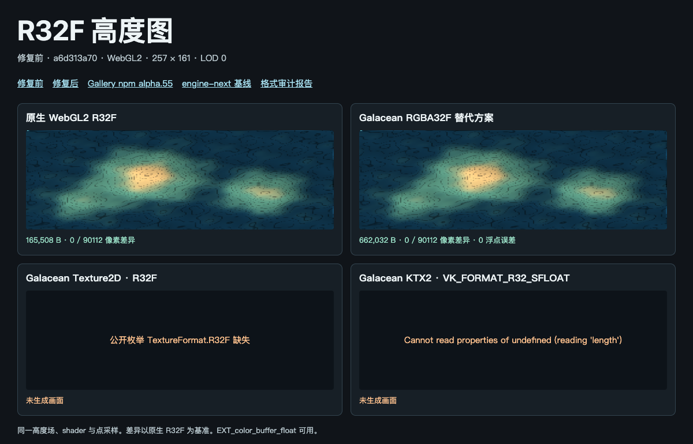
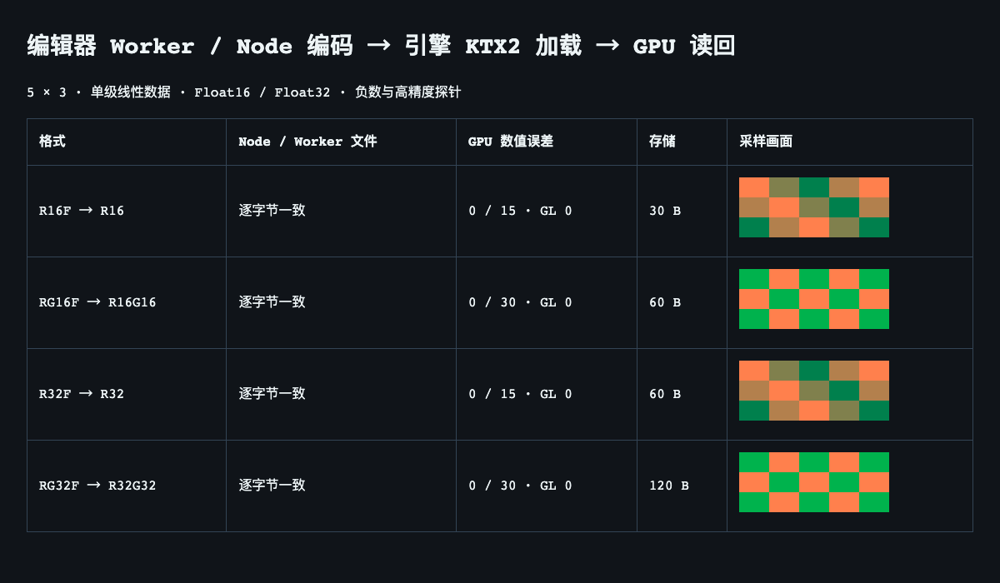

# Texture format audit and editor round trip

The baseline is engine a6d313a70946ff1423418ae47ccf7a04448551f6.
This change adds R16, R16G16, R32 and R32G32, representing R16F, RG16F, R32F and RG32F.
It adds native linear 2D KTX2 loading for VkFormat 76, 83, 100 and 103, with one explicit level or a complete mip chain.
Half-float uploads use Uint16Array bit patterns. Float32 uploads use Float32Array.
Readback uses RGBA Float32Array. Float color rendering/readback requires EXT_color_buffer_float.
Float32 linear filtering falls back to Point when OES_texture_float_linear is unavailable.

## Editor producer and GPU consumer

[Editor producer commit](https://github.com/galacean/editor/commit/607fd1a703) on fix/rg-float-ktx2 is based on dev/2.0 at 4c35df4e8eb1bfc842cb3d887d545b76eef54318.
Its NodeKtx2Encoder and the actual editor ktx2-worker.ts both encode rawFloatFormat inputs.
The generated files are byte-identical and pass Khronos KTX Software 4.4.2 validation.
ResourceManager loads those files, the GPU samples them, and getPixelBuffer verifies every populated channel.
The fixture dimensions are 5 × 3 to exercise row alignment. Probe values include negatives, a subnormal half,
and a Float32 increment that half precision cannot preserve.

| Format | Engine format | Logical bytes | Worker/Node bytes | GPU mismatches | GL error |
|---|---|---:|---|---:|---:|
| R16F | R16 | 30 | identical | 0/15 | 0 |
| RG16F | R16G16 | 60 | identical | 0/30 | 0 |
| R32F | R32 | 60 | identical | 0/15 | 0 |
| RG32F | R32G32 | 120 | identical | 0/30 | 0 |

[Machine-readable results](roundtrip.json). Tested on macOS 26.3.2, Chrome 157.0.8103.79, ANGLE Metal, Apple M5 Pro.
The screenshot is a diagnostic GPU sampling test. Editor asset-inspector authoring and deployment are outside this verification.
Native encoding currently accepts a single explicit mip level and rejects requested supercompression, sRGB conversion, flipping or mip generation.
Native KTX2 arrays, cubes, 3D textures, partial mip chains and Zstd/Zlib remain unsupported.

## All absent exact WebGL2 mappings at baseline

54 core sized formats and 67 extension formats were audited. The 73 absent mappings below consist of
36 core and 37 extension formats. This change fills four, leaving 69 absent mappings.
Each sRGB variant counts separately. Format coverage is an inventory, and priority depends on use cases.
Legacy unsized RGB/RGBA have sized equivalents and are excluded. Legacy LUMINANCE replication semantics remain a compatibility consideration.

| Family | Absent formats at baseline | Count | Recommendation | This change |
|---|---|---:|---|---|
| R/RG floats | R16F, RG16F, R32F, RG32F | 4 | Add for scalar/vector data and 50–75% storage reduction against equal-precision RGBA | Added |
| RGB floats | RGB16F, RGB32F | 2 | Defer until an input requires them; verify backend storage and attachment benefits | Deferred |
| R integers | R8I, R8UI, R16I, R16UI, R32I, R32UI | 6 | Prioritize R32UI when ID/index consumers are ready; others on demand | Deferred |
| RG integers | RG8I, RG8UI, RG16I, RG16UI, RG32I, RG32UI | 6 | Consider RG32UI for paired integer data; others on demand | Deferred |
| RGB integers | RGB8I, RGB8UI, RGB16I, RGB16UI, RGB32I, RGB32UI | 6 | On demand | Deferred |
| RGBA integers | RGBA8I, RGBA8UI, RGBA16I, RGBA16UI, RGBA32I | 5 | On demand; RGBA32UI already exists | Deferred |
| 8-bit SNORM | R8_SNORM, RG8_SNORM, RGB8_SNORM, RGBA8_SNORM | 4 | R/RG first when signed normalized consumers justify them | Deferred |
| Packed | RGB10_A2, RGB10_A2UI, RGB9_E5 | 3 | Evaluate against HDR or integer-buffer requirements | Deferred |
| norm16 extension | R16, RG16, RGB16, RGBA16 UNORM; R16_SNORM, RG16_SNORM, RGB16_SNORM, RGBA16_SNORM | 8 | R/RG first for bounded high-precision data; extension-gated | Deferred |
| S3TC | BC1 RGBA UNORM/sRGB; BC2 UNORM/sRGB | 4 | Asset compatibility on demand | Deferred |
| RGTC | BC4 UNORM/SNORM; BC5 UNORM/SNORM | 4 | Coordinate scalar/normal-map encoding and device fallback | Deferred |
| BPTC | BC6H signed float | 1 | Signed HDR input on demand; unsigned BC6H already exists | Deferred |
| EAC | R11 UNORM/SNORM; RG11 UNORM/SNORM | 4 | Coordinate scalar/vector asset encoding and device fallback | Deferred |
| ASTC | 5×4, 6×5, 8×5, 8×6, 10×5, 10×6, 10×8, 12×10, each UNORM/sRGB | 16 | Add when encoder quality/size requirements justify these block sizes | Deferred |

The GL norm16 R16 entry means normalized integer storage. Engine TextureFormat.R16 means half float.
KTX2 is a container dimension of this inventory. The previous 132 native VkFormat fixtures all failed before native loading existed.
Adding native loading for these four selected formats addresses four entries, while Basis ETC1S/UASTC remains a separate working path.
This change also fixes ETC1 whole-mip uploads, missing depth unpack alignment, array readback overload dispatch,
and cleanup when RenderTarget platform creation rejects an unsupported format.

## Regression commands

Engine verification uses module build, declaration build, lint, and the texture/KTX2 browser tests.
Editor verification uses lint, tsc, and plugins/main's ktx2-float.test.ts (5 tests) and ktx2-float.browser.test.ts (4 tests).
The browser regression used the existing browser config with the local Chrome executable because the bundled Playwright browser download was unavailable.
Engine texture/KTX2/render-target regression: 51 tests passed across 7 files.
Four editor-produced KTX2 files are committed under tests/src/loader/fixtures/float-ktx2 and exercised by NativeFloatKTX2.test.ts.

## Specifications

- [WebGL2](https://registry.khronos.org/webgl/specs/latest/2.0/)
- [WebGL extension registry](https://registry.khronos.org/webgl/extensions/)
- [KTX2](https://registry.khronos.org/KTX/specs/2.0/ktxspec.v2.html)
- [EXT_color_buffer_float](https://registry.khronos.org/webgl/extensions/EXT_color_buffer_float/)
