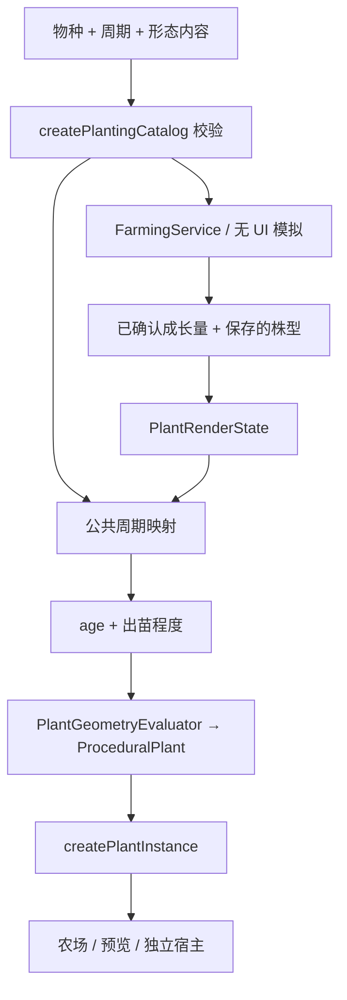

# 程序化种植公共契约

本模块负责耕地管理、程序化植物生成、作物种植、生长与收获，不包含养殖系统。实体容器是库存的唯一来源，接入方式见 [实体仓储](storage/README.md)。

权威源码在 `world/gallery/shared/farming`；`.materialized/engine/world-gallery` 是运行和构建副本。当前生产目录固定为 14 种作物，预览和农场案例共用 `content/DefaultPlantingCatalog.ts`，全部使用程序化配方。

## 公共入口

- `index.ts`：无引擎依赖，提供内容校验、领域模拟、服务和 `PlantRenderState`。
- `api/index.ts`：外部操作入口，导出 `FarmingService`、操作定义/参数、查询和结果类型；不导入引擎或案例 UI。
- [`native/index.ts`](native/README.md)：Scene 组件、只读资源、`FarmingAPI.execute` 和系统拥有的 Agent package；UI 与 API 复用操作协调器。
- `presentation/index.ts`：Galacean 宿主接口 `createPlantInstance`、`PlantPresenter`。
- `content/DefaultPlantingCatalog.ts`：Vite 内容发现与现役目录。Node/无 UI 调用者自行读取内容，然后调用 `createPlantGrowthRegistry` 和 `createPlantingCatalog`，不导入这个 Vite 入口。
- [单一配方格式](procedural/README.md)、[独立宿主示例](examples/standalone-host/main.ts)、[第一轮验收记录](ROUND-1-ACCEPTANCE.md)。



## 契约与时间

`CropDefinition` 是物种定义：身份与内容修订 `version`、`cycle`、六项环境响应 `growthFactors`、必需的程序化绑定 `appearance`、收获配置 `harvest`。`version` 是物种内容修订，不是多格式分派字段。

`CropGrowthCycleDefinition` 使用 `id/revision` 标识当前周期内容；`growthTarget` 是成长总量，`baseGrowthUnitsPerSecond` 是基础速率。阶段由 `stages[{id,name,minimumProgress}]` 声明，必须从 0 到 1 严格递增，ID 不重复。中间阶段区间为左闭右开，最后一个阶段只在 1 成立。当前单周期只按已确认成长量达到阈值转换；健康影响收获，六项环境系数的最小值影响成长速率。

`appearance` 引用 `plantId/plantRevision/recipeRevision`，按相同顺序为每个阶段声明 `ageByStage`，年龄非递减、首尾为 0/1。相邻参考点间连续线性映射。`emergence {start,end}` 单独定义播种到可见出苗的平滑曲线；出苗完成前配方 age 必须保持 0。出苗不新增地下种子几何。

修改成熟时长只改变 `growthTarget/baseGrowthUnitsPerSecond` 的时间换算，不改变同一周期进度的形态。发布内容改动时维护相应修订号；当前存档引用不匹配会明确失败，绝不静默换配方。

`PlantGrowthDefinition` 保存配方、图集、材质和形态调试注释，不携带玩法时钟。其 `preview.durationSeconds` 仅用于预览播放速度；`preview.landmarks/phases` 是原始配方 age 的美术注释，不能参与领域阶段或成熟判定。

`PlantRenderState` 保存 `instanceId`、物种/周期/形态/配方的 ID 与修订、`progress` 和完整 `shape`。不包含地块、相机、世界坐标或显示缩放。`cropRenderState(catalog, cropState)` 转换领域状态，`createPlantRenderState` 供外部宿主创建状态。两者都校验引用并返回冻结副本。

## 校验入口

```ts
import { createPlantGrowthRegistry, createPlantingCatalog } from "./shared/farming";

const registry = createPlantGrowthRegistry(packs); // {path, metadata, recipe, atlasUrl}[]
if (registry.issues.length) throw new Error(JSON.stringify(registry.issues));
const catalog = createPlantingCatalog(speciesDefinitions, registry.list());
// FarmingService 的 definitions.catalog 必须是该入口创建的目录。
```

校验内容包括 ID、修订、阶段覆盖、倒序/重复阶段、出苗区间、器官连接、网格索引、曲线、形态参数等。物种、绑定、渲染状态和配方格式使用运行时校验，拒绝 `model`、`modelUrl`、阶段模型绑定及旧版本字段。无 UI 模拟也使用这个目录，但不会加载纹理或建立 GPU 资源。

## 实例与宿主

部件着色 Shader 在开发／构建服务预编译，显示帧不解析 Shader 源码。Gallery 已启用 `tools/plant-shader-precompile.cjs` 的 `plantShaderPrecompile()`；独立 Vite 宿主也需注册该插件，使用当前 Engine 的 ShaderLibrary 生成预编译指令。没有运行时源码编译回退。

`PlantPresenter` 将材质、几何、GPU 分配、着色、生长、Shader 程序准备和发布纳入同一帧队列。同株独立程序先全部排队提交，再按帧预算轮询不同程序，避免已缓存程序也逐个等待两帧；提交／检查全部结算后才报告失败，迟到任务不会越过局部资源释放。程序准备只覆盖首个活动 SubShader，复用已有 Pass 标签、公开场景/相机配置和材质接收契约，按设备能力保守预热候选阴影、深度与 SSR；实际绘制阶段仍由原管线决定。Forward depth resolve 时可能多预热一个深度变体，SSR 消费者未启动时也可能提前准备接收材质；不复制管线的目标选择、日光仲裁或消费者状态，不受支持的 SSR 不参与创建。ShaderData 宏通过公开 getMacros() 读取；分帧提交和轮询仍需现有 Engine 内部编译桥接，公开 compileVariant 会同步编译全部 Pass，不能替代。程序提交与完成轮询使用当前 Engine 的延迟编译接口；支持 `KHR_parallel_shader_compile` 时不在首次绘制等待链接，缺少扩展时仍遵循 Engine 的同步回退。1 ms 为软预算，不能中断单个 Engine 调用。部分植株保持隐藏，取消会释放局部资源，程序缓存由 Engine 持有。当前 World Engine 根据真实 active uniform 的空位置识别 block 成员，仅有 block 成员时查询与绑定 uniform block，避免普通植物程序进行无用驱动查询。

```ts
import { createPlantInstance, createPlantRenderState } from "./shared/farming/presentation";

const confirmed = createPlantRenderState(catalog, "tomato", "plant-42", 0.5, {
  leafSpread: 1.1,
  stemBend: 1,
  fruitScale: 0.95
});
const instance = await createPlantInstance(catalog, engine, hostAnchor, confirmed, abort.signal);
instance.update({ ...confirmed, progress: 0.75 });
const { state, stageId, stageName, age, emergence } = instance.query();
instance.dispose(); // 幂等；AbortSignal 也可取消或释放。
```

同一实例的身份不能改变；跨阶段更新复用实体、网格、材质和动态缓冲。`plant` 是诊断/调试访问，不要绕过 `update` 修改生长状态。低层 `setGrowth(age)` 留在程序化实现和配方调试中。

批量宿主使用 `new PlantPresenter(engine, catalog, getParent, onLoadState)`，通过 `sync(states, snap, now)` 提交已确认状态，通过 `update(now, visibility, hidden)` 推动显示插值。可见性函数返回非负优先级，负数表示不可见。`retry(instanceId)` 重试失败加载；`remove` 和 `dispose` 会取消加载并释放迟到实例。插值只追随已确认目标，不外推成长；恢复显示只同步目标，不推进领域时间。

实例拥有实体、网格、材质和动态缓冲；图集缓存归引擎管理。取消单个实例不清空引擎资源缓存，也不影响其他宿主。宿主拥有引擎、挂点和世界变换。

可运行独立示例：`/shared/farming/examples/standalone-host/`。页面加载后，可由外部代码提交完整状态：

```js
const confirmed = window.plantHost.query().state;
window.plantHost.update({ ...confirmed, progress: 0.8 });
// 没有任何渲染时钟自行增加 progress。
```

## 土壤表现与资源

播种由共享 `SowingPresenter` 表现：确认播种后种子落到耕地中央，停留约 3 秒再隐入土中；刷新与恢复不重播，播种不再通过土堆改变土壤形态。素材、动作时间、宿主接入与验证见 [播种表现](assets/sowing/README.md)。

土壤贴图归 `assets/soil/` 所有，来源与授权说明随资源保存在该目录。`presentation/soil/SoilVisualConfig.ts` 保存默认贴图引用、干燥与饱和时的颜色/粗糙度、湿度过渡时间、法线强度及外围地面的颜色与纹理平铺配置；`SoilVisualProvider` 拥有耕地网格、每块地独立的材质和共享贴图加载生命周期，四张现役贴图独立加载并绑定。

从 `shared/farming/presentation` 导入 `SoilVisualProvider`，由宿主传入 Engine 和地块尺寸，调用 `apply(renderer, normalizeSoilMoisture(soilProfile, moistureUnits))` / `applyPerimeter` 绑定表现，每帧调用 `update(engine.time.actualDeltaTime)`，结束时调用 `dispose`。颜色与粗糙度按完整湿度范围连续插值，浇水/蒸发时以 0.45 秒时间常数平滑追随目标，约 1.35 秒完成 95% 的变化；使用真实帧间隔避免低帧率时受引擎模拟时间上限影响，新地块直接初始化到当前湿度。HUD 的干燥/缺水/湿润标签仍用于状态提示，不再控制材质切换。农场案例保留地块尺寸、位置与排列，不再拥有土壤贴图或材质配置。领域规则与存档仍不依赖引擎或贴图。

土壤、编辑网格和接触粒子只释放各自拥有的网格及 Buffer，通过共享 `destroyOwnedMesh` 收集顶点和索引绑定并执行销毁。Provider 和粒子在销毁前同步解除 Renderer 的网格引用，兼容帧尾延迟销毁；不依赖全局 GC，也不销毁 ResourceManager 缓存的借用土壤贴图。

浇水可连续点击，达到 `maximumMoistureUnits` 后多余水量不再累加，每次有效操作仍发布浇水事件。已湿润及成熟作物下的土地可继续浇水；农场案例还启用 `allowIrrigateEmptyPlot`，允许空地预先浇水。浇水不会直接增加作物生长进度。

## 默认收获动画

农场案例在确认收获后的快照移除作物时，调用公共表现层的 `PlantPresenter.harvest(instanceId)`，再同步新状态。所有物种默认播放 2 秒噪声消融、橙金色边缘和表面粒子；`PlantPresenterOptions.harvestSeconds` 可调整时长。外部宿主同样在确认收获成功后调用 `harvest`，普通 `remove` 和 `dispose` 仍直接清理。

收获入库和土地释放由领域事务立即完成，动画不延迟存档，也不阻止重新播种。退场实例从原挂点分离并保留世界变换、成熟颜色和透明叶片裁切；噪声使用世界空间，避免图集内固定 UV 的果实整块消失。颜色、深度与阴影同步消融；粒子结束后释放旧植株、克隆材质、发射网格/缓冲与效果纹理。关闭宿主时也会清理正在播放的动画。效果纹理本地程序化生成，不增加 GLB 或网络资源依赖。

## 默认场景与农场案例

种植系统通过 `initialLayout: { groundId }` 初始化中央 **3×3、共 9 块可播种耕地**，同时生成空推车和空篮子各 1 个。显式 `plots/grid` 可配置其他布局。容器与耕地保持距离，不占用耕地和宿主声明的预留农田；已有存档恢复后不补建被删除的默认地块。容量、扩容、数量调整与取货规则见 [实体仓储](storage/README.md)。

农场案例入口为 `/demos/farming/first-person-farm/`，负责第一人称相机、展示比例、交互和 HUD。`WASD` 移动、按住左键环顾，`E` 执行当前推荐操作，`B` 拾取或放下持久收获篮子。底部操作栏按以下固定槽位展示：

| 快捷键    | 操作                   |
| --------- | ---------------------- |
| 1 / 2 / 3 | 播种 / 浇水 / 收获     |
| 4 / 6 | 锄地 / 还原土地 |
| 7 | 放下篮子 |

还原土地在事务中删除耕地和已有作物，露出原地形，不产生收获物或退场动画，之后可以重新开垦。底部 HUD 保留不可用操作的位置与原因，阻止相机拖拽穿透；`Tab/Shift+Tab` 切换按钮，`Enter/Space` 激活。作物顶部标签跟随当前相机投影。

## Debug 模式

默认关闭 debug，仅保留底部种植 HUD、作物顶部标签和瞄准光标。总览、仓库及管理弹窗、作物诊断、选种托盘、地形调试、保存状态及提示面板仅在开启 debug 时创建和更新。关闭后释放这些面板及其监听器，清除弹窗锁定并恢复场景交互；植物、实体仓储和模拟继续运行。

- 农场案例：底部 `Debug` 按钮或 `F2` 随时切换；`?debug=1` 启动时开启。开关同步到当前 URL，刷新沿用 URL 中的设置，不进入农场存档。
- 普通模式：默认装备首个种子（已有选择优先）；底部换种按钮或 `Q` 直接循环切换种子，不弹出面板。
- Debug 模式：换种打开选种托盘，确认只装备种子，随后操作才播种；`M` 打开总览，右上仓库入口打开数量管理和取货面板。关闭 debug 不影响已装备种子。

系统提供不依赖 Engine 的 `FarmingDebugMode`，宿主订阅开关并管理自己的调试界面。原生 `FarmingSystem` 每个实例持有独立控制器，默认关闭：

```ts
// Native 宿主；状态属于本 Scene 的系统，不属于 FarmSnapshot。
system.debugMode = true;
const unsubscribe = system.debug.subscribe((enabled) => {
  // 开启时创建并更新宿主调试面板；关闭时释放面板与交互锁。
});
system.debugMode = false;
unsubscribe();

// 无 Engine 的宿主可自行持有同一控制器。
import { FarmingDebugMode } from "./shared/farming/api";
const debug = new FarmingDebugMode();
debug.setEnabled(true);
debug.dispose();
```

## 存档与结算

领域、应用和仓储分别负责纯规则、串行命令/通知、IndexedDB 原子事务。每个完整 3 秒步按扩散 → 生长 → 蒸发结算，失败命令仍提交已经发生的时间变化，重放命令不再推进时间。跨页通知配合事务避免重复浇水或重复结算。

当前快照只接受 `schemaVersion: 10`，模拟规则版本为 6。不迁移旧版本农场存档，需要新建或重置农场。`storage.containers` 持有真实库存，`inventory` 是容器数量的聚合视图。耕地保存地形身份、网格坐标、标签、形态种子、准备状态和最后确认的地形可用状态。网格配置随存档保存，创建后的地块不允许移动或缩放；高度和法线从宿主当前地形读取，地形缺失时查询位置为 `null`。只有 `tilled` / `leveled` 土地进入种植管理，`raw` 地面属于宿主。恢复沿用保存的株型与内容引用，缺字段或内容不匹配明确失败。

数据库为 `galacean-farming`，数据库结构版本 1；结构版本与快照格式互不代替。农场案例使用 `first-person-farm-storage-v1/<slot>` 身份和 `farm-storage-3x3-v1` 布局。旧 `first-person-farm-land-*`、`first-person-farm-4x4/*` 存档原样保留，不读取或自动迁移；新身份首次创建 9 块耕地和两个空容器，后续以保存状态为准。

## 统一外部操作 API

共享目录 `domain/FarmActions.ts` 定义 `plant`（播种）、`irrigate`（浇水）、`harvest`（收获）、`hoe`（开垦或重新松土）、`delete-plot`（还原土地）的稳定 ID、名称、说明和基于领域规则的可用性。`FarmActionInput` 从已有命令类型派生，不重复维护请求参数。`damage-crop` 和 `advance-time` 仍是底层系统命令，不属于玩家操作目录。

```ts
import { FarmingService, type FarmActionInput } from "./shared/farming/api";

const farm = new FarmingService(options); // 必须注入 groundProvider；另提供目录、初始耕地、网格、仓储和时钟
await farm.initialize();
const definitions = farm.getActionDefinitions(); // id / name / description
const available = farm.getAvailableActions(plotId); // action / enabled / reason
const request: FarmActionInput = { type: "irrigate", plotId };
const result = await farm.executeAction(request);
// 播种：{ type: "plant", plotId, seedId }
// 收获：{ type: "harvest", plotId, cropInstanceId }
// 锄地：{ type: "hoe", target: { groundId, cellX, cellZ } }
const unsubscribe = farm.subscribe(({ snapshot, changes, source }) => {
  // 根据已提交状态更新场景、仓库或其他业务界面。
});
unsubscribe();
```

`executeAction(input, options?)` 由服务补齐 `farmId`，默认生成 `commandId`，在调用时捕获当前修订号；随后进入既有队列和原子事务。结果沿用 `CommandResult` 的 `ok/commandId/revision/replayed/changes/error`。无效请求返回 `INVALID_COMMAND`；有效请求在初始化前返回 `NOT_INITIALIZED`。可用性只是当前快照的预览，执行必须在事务中结算时间后重新校验，不以旧查询结果提前拒绝。

需要可重试操作时，保存业务参数和同一份选项：

```ts
const attempt = {
  input: { type: "plant", plotId, seedId } as const,
  options: { commandId: crypto.randomUUID(), expectedRevision: farm.getSnapshot().revision }
};
const result = await farm.executeAction(attempt.input, attempt.options);
if (result.error?.code === "STORAGE_FAILURE") {
  // 用户重试时复用整个 attempt；不得只复用 ID 却改 revision 或参数。
  await farm.executeAction(attempt.input, attempt.options);
}
```

同 ID 同载荷重放不重复修改或推进时间；同 ID 不同载荷返回 `INVALID_COMMAND`。并发调用捕获相同修订号时可能返回 `VERSION_CONFLICT`，服务会同步事务读取的最新状态，调用方重新呈现后再发起新的操作。底层 `execute(command)` 与操作 API 使用相同的事务规则。

新增除虫等操作时，先扩展命令与 `FarmActionCommand`，添加纯规则和签名/分派支持，再登记操作目录。映射类型要求每个玩家操作都有定义和参数检查。案例的 `config/action-bar.ts` 只补图标、槽位和参数收集，`FarmActionBar` 复用节点并按定义渲染；通用层不依赖相机、快捷键、图标或界面位置。

## 耕地查询、CRUD 与宿主地形

```ts
const target = { groundId: "terrain-main", cellX: 5, cellZ: 3 };
const inspection = farm.inspectCultivation(target); // 不写入；完整范围、最大坡度、地表类型、原因和地形版本
const created = await farm.createPlot({ ...target, label: "后院" });
const id = plotIdForTarget(target);
const plot = farm.getPlot(id); // 不存在为 null；当前位置、土壤、作物、生长状态、农场/地形版本
const ordered = farm.getPlots([id, "missing", id]); // 保持顺序，缺项为 null
const occupied = farm.queryPlots({ groundId: "terrain-main", occupied: true, cropId: "tomato" });
await farm.updatePlot(id, { label: "菜园", preparation: "leveled" });
await farm.deletePlot(id); // 有作物返回 PLOT_OCCUPIED
await farm.deletePlot(id, { cascadeCrop: true }); // 同一事务移除作物，不收获、不产出
```

`createPlot`、`updatePlot`、`deletePlot` 同样接受 `commandId/expectedRevision/expectedGroundRevision`。`updatePlot` 只允许标签、准备状态；湿度、作物、生长量和高度必须通过对应业务操作或宿主地形管理。底层领域命令锄地可创建或重新松动耕地（玩家与 Native hoe 先按开垦、清除作物、还原三种意图映射）；已有作物会在同一事务中被锄除，地块恢复为空的 `leveled` 状态，不产生收获物，并播放与收获相同的消融效果：锄头首次触地时开始，进度跟随锄地动画；动画结束前只改变显示，提交成功后确认删除，不重新播放消融。取消动画或提交失败恢复原作物显示。 模型仍在加载或尚未出苗时保留消融请求；模型可见后接入已走过的锄地时间，不能从头补播。延迟提交的锄地请求需传入 `expectedCropInstanceId`（作物实例 ID；`null` 表示开始时为空地），事务内校验当前占用一致，否则返回 `CROP_INSTANCE_CHANGED`；动画期间的自动存档不影响该校验。即时调用可省略此字段并沿用原 `expectedRevision`，重试必须保持原命令 ID 和完整输入。`updatePlot` 准备状态修改仍要求空地，避免普通属性更新隐式删除作物。锄地不修改湿度、pH 或生长速度。地块查询可按地形、水平范围、准备状态、可用状态、占用、作物类型过滤。

宿主实现 `FarmingGroundProvider.capture/subscribe`；`capture` 返回同一不可变版本的 `sample/inspectBounds/raycast`。`inspectBounds` 必须覆盖完整范围和原生地形采样单元，提供明确地表类型、最大坡度、水下与阻挡事实；不根据材质名或颜色猜测。farming 统一执行非岩石、已识别地表、未阻挡、非水下及严格小于最大坡度的规则。变更通知带地形版本和可选影响范围，服务先结算通知时刻之前的旧状态，再保存新状态。

不合格但仍加载的地形暂停生长、禁止播种和整地，允许浇水与成熟收获；未加载地形暂停所有农业操作并隐藏显示，查询和显式删除仍可用。恢复后不补发暂停期间增长，蒸发继续；按统一三秒步长结算，跨越恢复边界的不完整生长步不回补。初始化先核对当前地形；保存状态或当前状态不可用的地块不补算离线增长，不推断离线地形历史。存储失败不发布成功，重试沿用原命令身份。

案例的 `scene/FarmGround.ts` 提供与渲染一致的连续高度场、缓坡、陡坡、明确岩石区和障碍范围。农场土壤显示铺满 1.25 米网格，采用方形边缘和一致的边界高度，相邻地块连续衔接；可种植检查、仓储避让范围统一使用同一个 1.25 米 `cellSize`，不再保留独立的 `soilSize` 或旧尺寸兼容路径。独立动画预览保留软边土壤。土壤顶点跟随当前采样高度；作物挂点、标签、选择框与工具接触同步更新，作物保持直立。仅受影响地块重新上传土壤网格。选中框只展示已有耕地及其上下左右紧邻的待开垦网格，远处地形仍可锄地。新开垦时，耕地材质从锄头首次触地到最后触地逐渐显现，与底下的宿主泥土地面平滑混合。过渡复用工具播放时钟，通过世界坐标噪声驱动的反向消融与局部覆盖率渐变：耕地纹理沿不规则斑块逐渐显现，前沿带暖色亮边。已显现区域保持正常实色，仅消融前沿和外轮廓做柔和混合，不再叠加整块透明遮罩。新地块和邻地接合区域使用相同噪声与进度，避免消融时出现接缝。仅更新材质参数，不改动或上传地形网格，不产生翻土形变或粒子。新地块与已有邻地的交界边缘按同一进度接合，外围软边保持不变；临时透明度与邻接预览不写入存档。完整动作结束后重新检查并提交，取消或提交失败恢复原地面与邻地外缘。已有耕地再次锄地保持可见。播放期间允许原地环顾。锄地、浇水、播种等操作的移动打断统一使用进度弧的实际进度：低于 75% 时，从动作起点累计超过 3 厘米的位移会取消操作并清除动作与进度提示；达到 75% 后锁定为不可移动打断，走出原工具距离也继续完成。3 厘米容差用于忽略微小接地抖动。已取消的操作不会因返回原位继续完成；保护状态保留至本次尝试结束，进度弧消失或写入等待不会重新开放移动打断。`Esc` 取消、地形变化或关闭页面不创建耕地。

`?debug=1` 提供目标地形抬升、降低、恢复入口。该调试地形本身不存入 farming；宿主应自行持久化真实地形。本期提供共享 TypeScript API 和浏览器 IndexedDB，未注册 World AI 工具、未实现云同步。

## 内容与验证

现役物种定义在 `content/CropDefinitions.ts`，图集/配方/署名在 `catalog/plants`。成熟时长与产量沿用 `CropContent.ts`。阶段敏感度仍是展示数据：原有归一化样本重采样到各物种的实际阶段，表格列数随周期阶段变化，不进入成长公式。旧 `tomato-bumroker` 仅保留在 `tests/fixtures/reference-plants`，没有生产别名。离线源模型可用于提取，不可作为运行时阶段模型。

```sh
pnpm --dir world farming:validate
pnpm --dir world typecheck:farming
pnpm --dir world test:farming
pnpm --dir world build:farming:all
FARMING_E2E_URL=http://127.0.0.1:3047 pnpm --dir world test:farming:e2e
```

`build:farming` 和 `build:farming:demo` 使用种植专用 Vite 配置，检查真实构建依赖图及输出资源，生成 `planting-resources.json`。14 个现役配方必须全部包含，旧运行时、测试素材和植物 GLB 禁止进入产物。

正常包装命令会同步 Gallery 并移除旧路径。避免并发执行多个包装命令，它们共用物化目录；在同一次同步后，可以在物化目录直接执行独立检查。截图输出到 `output/playwright/planting-round1`，下一次全量同步前应归档。

本轮不增加再生/持续产出、施肥、主动暂停 API、AI 工具注册、性能测试或设备/规模指标。几何来自游戏美术素材，中间形态与时间曲线是美术推定，不是农学验证。

## 种植动画预览

Gallery 的“程序化种植系统”下提供“种植动画预览”，入口为 `demos/farming/animation-preview`。浇水、锄地和耙地使用 farming 的标准 Prefab 与控制器资源；可切换视角、暂停、拖动进度、调节速度和循环播放。锄地/耙地保持 Blender 已确认的原始动作与尺寸，预览工具动作与土地准备状态；农场案例复用这些资源，实现开垦和持久化地块注册。`FarmingPropAnimationPlayer` 负责实例与动作播放，ResourceManager 管理共享模型及控制器。关闭页面会释放播放器实例、粒子和宿主 Engine。

`pnpm --dir world build:farming:animations` 构建该页面，`build:farming:all` 也包含它。动画页不加载作物目录，因此不要求打包 14 个配方；仍执行道具模型白名单与植物 GLB 禁入检查。资源来源和重新导出命令见 `assets/tilling/README.md`。

土地准备只有 `raw → leveled`：锄地成功后直接成为已整平、可种植的耕地。未开垦地面不保存为地块，持久化耕地只允许 `leveled`；不迁移旧 `tilled` 存档。农场不再提供耙子和耙地操作。旧存档加载时移除耙子实例，若正拿着耙子则清空携带槽，其他道具、作物和库存保留。耙子素材只供独立动画预览。

耕地通过宿主 `FarmingGroundView.surfaceTriangles` 获取原始地表三角形，沿种植区域裁切后覆盖，面数随宿主网格和边界变化，不再固定为 8 × 8 或 128 面。实际渲染宿主必须提供此几何能力，纯玩法宿主可省略；不会以重新采样的网格冒充原表面。表面只贴合宿主地形并保留防重叠偏移，不生成土块、沟纹或耙齿起伏。工具动画保留。地面不会随触地过程变形或发射翻土粒子；耕地材质从锄头首次触地到最后触地逐渐显现，邻地交界使用同一显现曲线接合。提交成功后保持可见，取消或提交失败恢复原地面与邻地外缘。已有耕地再次锄地保持可见。外轮廓使用独立 65 × 65 R8 覆盖纹理保留静态柔和边缘，相邻已提交耕地共享连续轮廓，不依赖密集顶点。覆盖纹理约 4.1 KiB/地块（不含驱动开销），随地块释放并支持设备恢复。

`SoilWorkPresenter` 仅在创建或地形更新时更新网格，邻接变化只更新覆盖纹理。工具接触轨迹仍供清除作物使用，工具播放期间不上传土壤几何。动画预览的状态选择只有未开垦与已整平。

湿度仍独立控制材质颜色和粗糙度，不改变形状。

## 水分场与体积含水率

`config/FarmingSimulationConfig.ts` 是模拟默认值和单位的唯一来源。`FarmingServiceOptions.simulationConfig` 可覆盖参数，服务初始化校验显式扩散稳定性；存档中的 `rulesSignature` 不匹配时拒绝打开，修改规则需要使用新的存档身份。默认 3 秒一步、不自动拆小步。土壤水分单位统一为体积含水率百分点，查询与作物生长判定直接使用该值；0–1 归一化只用于干燥到饱和的材质插值。壤土默认干燥下限 7.5%、萎蔫点 15%、田间持水量 31%、饱和上限 46%，初始含水率 25%，每次浇水增加 12 个百分点。湿土蒸发上限为每模拟分钟 1.2 个百分点；22% 以下按剩余可蒸发水量指数衰减，始终不低于 7.5%，不通过补水维持下限。田间持水量仍是描述参数，本轮没有新增自动排水。速率以模拟时间计，在线和最多一小时的离线补算使用相同求解器。未满步长保存在模拟时钟中。

壤土的 15%/31%/46% 取自 [FAO AquaCrop 表 2.13a](https://www.fao.org/fileadmin/user_upload/faowater/docs/AquaCropChapter2.pdf#page=71) 的参考参数；7.5% 下限参考 [FAO-56 公式 73](https://www.fao.org/4/X0490E/x0490e0c.htm) 的表层蒸发近似（半个萎蔫点）。22% 减速阈值参考 0.1 米蒸发层、约 9 mm 易蒸发水量，减速公式与模拟速率为玩法简化，不是经过实测校准的农学模型。土壤参数、模拟规则与作物内容版本已更新；当前存档身份与兼容边界见上文“存档与结算”，旧记录保留且不自动迁移。

`domain/fields/SpatialField.ts` 接收容量节点、连接、导通系数和可选局部反应。传输使用同一旧状态和双缓冲，扩散守恒；不同场可自行提供图和反应。水分适配器采用同地形四邻接，两端扩散系数的调和平均除以网格距离平方。整块范围内的岩石、建筑、水下和未加载地形阻断，坡度不阻断。所有耕地统一使用已整平土壤的扩散系数与余水接收权重。仅保存各方向最后确认的地形通水事实及恢复时间，运行时图重建；恢复后不回补未知期间的交换。

浇水立即进入事务：补满目标后，余水沿连通图按距离逐圈、按剩余容量乘接收权重分配，全部饱和后计入流失。`soil-irrigated.water` 返回 `input/absorbed/distributed/lost`；所有受影响地块都有 `soil-moisture-changed`。命令去重、revision 和存储回滚覆盖整组变化。`getFieldValues("soilMoisture", ids)` 按输入顺序返回数值与可用状态，缺失为 null，包含农场与地形版本。含水率保留小数，不存蒸发整数余量。状态查询返回一位小数及干燥/缺水/湿润/过湿/饱和状态，播种面板与作物诊断使用同一含水率单位，准星下不显示含水率提示。所有作物统一采用正向线性水分倍率：蒸发最低值及以下为20%，饱和值及以上为100%，区间内线性增加；不再因为缺水或过湿暂停成长。水分倍率乘以其余环境因素中的最低系数；显式生长倍率0和不适宜的其他环境仍可暂停成长。健康降至0的作物在伤害事务中自动移除并保留空的已整平耕地，不产出收获物，可立即重新播种。

`SoilVisualProvider.setField(snapshot, renderers)` 接入连通图：先平滑显示节点，再计算共享边/角点的 3×3 采样，土壤 PBR 在四个子区域双线性采样颜色与粗糙度。对角孤立地块、空洞和断开连接不混色；变化只重写相关材质，不重建几何。普通动画预览未绑定场时仍按单块湿度显示。用户浇水的整组视觉变化延迟至水滴落地，直接 API 调用立即开始过渡。

状态查询按不可变 `FarmSnapshot` 对象缓存，批量计算只遍历一次地块；时钟更新即使未增加存档 revision，也会生成新的状态结果。农场场景、HUD 和作物标签共享这份结果，单块与单株状态查询按需计算并缓存目标项，不触发全农场诊断；批量查询复用已计算项并补齐剩余地块。

`FarmingGroundInspectionCache` 由各 `FarmingService` 独立持有，只缓存当前宿主地形视图的开垦检查事实，不缓存存档中的可用状态。相同视图和网格配置复用检查，连续版本的局部通知只失效受影响地块；宿主通知范围必须覆盖实际变化的采样、法线和坡度等事实，包含关联原生单元及三角形，不能直接使用编辑笔刷范围，无法保证时省略范围以检查整个地形；版本跳跃、乱序、未知视图或网格配置变化均清空检查缓存。初始化重新取得真实地形证据，删除地块后清理缓存，服务销毁释放全部缓存。查询和模拟复用检查，但执行耕作命令仍在事务中检查目标范围；恢复时刻、离线补算和水分连接的持久化规则保持原有语义。

产品收获篮子是 `items.instances` 中的持久道具，支持混装，总容量为实际产物20单位；只在携带非空篮子并主动操作固定设施时整篮卸货。收获、放下、换拿和刷新均保留内容，没有自动存仓或超时清空。篮内每个实际单位以一个合并网格显示。`HarvestBasketPreview` 只供动画预览，不参与产品库存。

## 空间宿主接入契约

`api.inspectFarmingStarter(view, farmId, groundId, centerX, centerZ, storageDefinitions?)` 是无副作用的起始设施预检查：返回九块已耕地的网格、精确空容器位置、操作通道及候选入口，或具体失败目标。宿主选择位置、预留区域并负责实际接路；返回入口本身不代表道路可达。运行时传 `initialStorage` 复核精确容器占地，失效时拒绝新区域初始化，不重新寻找位置。存档加载继续以原 `FarmSnapshot` 为唯一状态。

耕地和容器共用网格的坡度上限，默认严格小于 15°。竖直容器优先消费宿主提供的完整占地高度极值，并以不大于 0.25m 的底部采样补充覆盖检查；底部高差超过 0.15m 视为明显悬空并拒绝。没有完整极值的宿主仍采用有限采样，不能将其描述为任意高频地形的解析证明。容器和耕地均不修改地形高度。预检查仓储失败时，`NO_STORAGE_SPACE` 后附具体容器类型、各类位置/朝向拒绝次数；`CONTAINER_UNSUPPORTED` 带最小底部高差及支撑阈值（`actual/expected` 单位米），不把满足坡度上限等同于容器可落位。

`FarmingSystem.diagnostics.publish` 接收宿主的候选/发布证据，`FarmingAPI.getDiagnostics({farmId?})` 和 `editor.component.query({type:"FarmingSystem"})` 返回代理的 `getDiagnostics()` 提供同一只读查询，尚未创建区域也可调用。候选按规划版本、发布按发布版本隔离，过期结果不覆盖当前记录。道路连通事实只由空间宿主提供；区域运行时和已有表现的加载结果由 Farming 汇总。查询不触发初始化重试，正常隐藏/剔除不会被误报为加载失败。表现构造失败保留已提交模拟、库存和存档。

作物 Presenter 将等待入镜的创建任务上报为 `deferred`，重新入镜后恢复 `loading`，完成后为 `ready` 或 `seeded`。`FarmingWorldPresentation.getDiagnostics().ready` 表示当前可见表现已就绪，画外等待不阻塞 Planner；可见任务的加载、土壤贴图加载和任何真实错误仍会阻塞，画外错误不会被改写成等待。

SeedWorld 已接入默认空间配方、规划地图、实际道路图检查、共享农业表现、HUD/Agent 与工程内 FarmSnapshot 保存。`inspectFarmingOperation` 供候选与最终地形复核共用，检查完整通道与容器占用。静态水域及实际主体查询按接受版本捕获，扩展开垦的植被占地由宿主协调。Planner 默认跨 POI 检查完整设施，局部接路修复可调整入口、路线及空闲设施位置；显式管理区选择仍限制在原区域，已有农场存档不自动搬迁；`access.evidence` 传递实际公共节点、道路段与道路身份，Farming 只保存和公开该证据。浏览器已验证番茄玩法、扩展开垦与刷新恢复、农场条件失败时世界仍 ready。已补齐原生地形/水域完整占地检查、真实新增容器及同 Scene 连续发布、失败告警和恢复验收；默认空间配方、运行时及保存按接入方案通过功能核对，详见 [Seed Planner 实施记录](../../demos/terrain/seed-world-planner/V2_IMPLEMENTATION.md)。

## 移动端资源与收获篮补充（2026-10-16）

作物图集运行时使用 [共享 KTX2](assets/plant-textures/README.md)。纹理请求本身进入 `PlantWorkQueue` 的可见帧准入流程；画外未准入对象不请求图集，已准入异步请求及缓存由 ResourceManager 共享管理。产品构建禁止导入离线图集 PNG，外部宿主仍可通过自己的 `PlantGrowthDefinition.atlasUrl` 提供受支持图集。

手持篮与仓储复用 `HarvestProduceMesh` 的低面数 CPU 基础几何和配方变换。CPU 模板不持有 Engine 或 GPU 资源；手持篮每批产物拥有一个 Mesh、一个材质和一个 Renderer，顶点色承载部件颜色，两组 UV 承载部件局部显现坐标与延迟。土豆逐颗延迟、混装槽位、数量上限和两秒显现保持原有契约。成熟显现不再逐帧重写相同 uniform。

自有资源销毁先同步解除 Renderer 的 Mesh/Material 引用，再使用共享 `destroyOwnedMesh(Set)` 释放顶点和索引 Buffer；材质随所有者释放，ResourceManager 图集不由实例销毁。该顺序覆盖帧内、帧外、失败清理和重复释放。收获篮收起后不保留 GPU 产物缓存；仓储的物种网格由仓储库共享，随仓储 Presenter 一起释放。

以上创建、压缩、几何与资源所有权均属于 Farming。Planner 适配层仅负责已发布农场位置、地形/相机、可见性输入与宿主生命周期；本轮没有在 Planner 增加补丁、预加载或资源回收旁路。耕地细分与 LOD 不属于本轮前三项 P1 修复范围。

本轮验证：Farming 61 个测试文件 / 511 项、Planner Farming 12 个文件 / 80 项通过；Farming/Terrain 类型检查、农场生产构建、图集确定性重生成检查通过。开发与生产 WebGL 回归均验证：画外请求为 0，14 种作物复用 13 个纹理对象；当前 ASTC 4×4 路径合计 14,680,592 字节；8 批小麦内容为 1,440 三角形、8 次绘制，加篮体共 9 次。6 轮帧内手动/自动收起、8 种创建取消/宿主销毁时机、作物和仓储共享网格回收均无残留 Buffer；深度预通道与显现中间阶段通过浏览器检查。既有 mobile-performance 入口的 8 轮土壤释放、画外生长和 60 份仓储小麦 10,800 三角形回归通过。小型水稻图集在生产构建中以内联 `data:image/ktx2` 形式加载，已覆盖正确解码器选择。以上为桌面 WebGL 验证，未完成移动真机性能或用户美术验收。


### 沉浸式道具交互（方案09）

开局只提供番茄、南瓜、土豆、小麦四袋种子，每种一袋，以及锄头、水壶和收获篮子；其余作物仍保留在可用目录中，不默认生成种子袋。每个道具有稳定身份、合法世界位置及唯一携带槽；取种保留原袋，种子和水无限使用，种子携带选择不写入存档。玩家点击使用 CPU 包围盒与遮挡判断，手机单指累计位移不超过10 CSS像素才触发，拖动与多指交给视角控制。

玩家与 Native API 的替玩家操作共用道具和串行协调器。锄头按原始地开垦、有作物清除作物、空地还原三种意图执行，点击时固定版本和占用，失败不降级。管理区外开垦沿用同一网格、存档和近水分片调度。AI 不受玩家距离限制，优先使用当前道具，否则在目标附近生成或复用；每类软上限20，重试沿用持久命令身份。

`queryItems/getCarry/getItemTotals/generateItems/pickupItem/placeItem/useCarriedItem/unloadBasket` 为正式接口；移除旧 `showBasket/hideBasket/getBasket`。`getInventory` 只读固定设施，`getItemTotals` 区分已存仓和篮中待卸货数量。当前快照只接受 schema9，不迁移旧档。


Planner 近身操作使用 `FarmingWorldPresentation.getPlayerWorkTarget`：锄头、水壶只操作身前约 1.6 米附近的一格，最远 2.35 米；操作中锁定目标；进度低于 75% 时移动取消，达到 75% 后移动不打断，转动视角不打断。篮子与种子继续按点击射线操作远处目标。`FarmItemWorkMotion` 把持久道具平滑衔接到真实地块上的工作动画，土壤接触和出水沿用同一动画来源；静止拿取位置由 `FarmItemCarryPoses` 分横竖屏保存。独立展示案例可不接入近身选地能力。

## 生长调试与营养条件（2026-10-21）

Planner 的“种植 → 生长调试”提供作物生长倍数，取值 0–100，步长 0.1，默认 1。0 暂停对应生长；不会加速昼夜、蒸发、近水补水或农具动作。作物仍受水分、温度、光照、pH、病虫压力及健康状态约束。修改前按旧倍率结算经过的时间；保存失败不切换倍率。参数仅当前会话有效，重新加载恢复默认，已结算的成长进度仍会保存。

营养条件视为最佳。已移除施肥操作、Native API、肥力状态、肥力消耗、响应曲线、表现与调试入口；肥力不参与成长计算。新快照 schema9 不迁移旧版农场存档。

道具停止使用时从当前显示姿态在 0.25 秒内平滑收回持握位置，位置与旋转共同过渡。收回独立于操作进度，取消立即停止进度与出水，不提交农事结果；收回跟随当前视角，新一轮动作等收回完成后开始。

连片耕地外轮廓的暴露凸角按格子边长 16% 向内圆切，保留直边、凹口、通道与对角分离，并复用固定世界坐标噪声形成轻微不规则边缘。仅改变覆盖遮罩，方格占用、作物归属和操作范围不变；邻接变化时更新遮罩，动画不逐帧重算轮廓。
