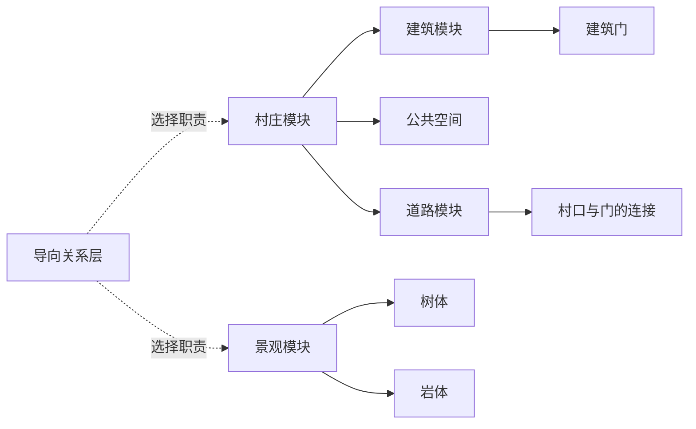

# 模块尺寸与导向配置

世界实验配置位于 `settlement-profile.json` 的 `world`：`size = 1024` 米，`heightmapResolution = 1025`，`alphamapResolution = 1025`。栅格首末采样点对应 0 与 1024 米，白盒入口延迟生成；修改世界范围不缩放建筑、道路或村庄内部的米制配置。

## 已在当前规划器生效

`settlement-profile.json` 只组织本次世界实验；每个模块拥有自己的 `units/*.json`。`SettlementProfile.ts` 读取这些文件并解析为当前规划器输入，不再维护另一套手写尺寸默认值。`semantic-units.json` 是唯一单位目录，`moduleProfile` 指向配置文件；旧实验未迁移的单位继续由其 `referencePaths` 定位。

| 配置 | 拥有的数据 | 当前默认值 |
| --- | --- | --- |
| `units/building.json` | 长宽、楼层分布、层高、门 | 长宽各 8–12 m；初始占地89–144㎡；层高3.5–4 m；随机1–3层 |
| `units/village.json` | 组合、范围、采样预算、建筑净距、可选广场 | 净距等效步行2–4 s → 4–8 m；发布通过占地和接路检查的建筑，广场再适配 |
| `units/road.json` | 入户/公共/村际道路宽度与连续轮廓 | 1.8/3.2/3.6 m 基准宽度；随机轮廓读取同一配置 |
| `units/landscape.tree.json` | 树冠、树干碰撞、高度、朝向 | 树冠直径 3.2–5.2 m，高 4.5–7 m |
| `units/landscape.rock.json` | 小岩体占地、高度、长宽比、朝向 | 宽 1–2.4 m，高 0.7–1.8 m |
| `units/landscape.json` | 沿路景观采样、避让、预算 | 当前仍是稀疏装饰采样，尚非面包屑覆盖求解 |

建筑尺寸由 `buildingPolicy` 的全局／村庄区间及 `buildingSize` 的单栋覆盖决定，倍率按来源链合成。初始面积只是采样参考，不拒绝后续更大的尺寸。楼层独立采样后相加，默认层高满足 `3.5n ≤ H ≤ 4n`；显式倍率作用于最终体量。白盒仍显示一个建筑 OBB；`floorCount`、`floorHeightsM`、门宽高已进入快照，不表示实现了楼内空间或楼梯。

共享的只有米/秒/弧度、角色身高与设计步速这些事实。建筑尺寸来自自身米制配置；村庄净距由自己的时间策略乘设计步速得到。按 Shift 跑步不触发布局重新生成。建筑 6–10 m 在 2 m/s 下沿墙走完需 3–5 s，这是核对值，不是所有模块通用的缩放公式。

建筑净距测量两占地边界的间隔，不是两中心距离。4–8 m 是密度参数对应的最小避让距离；8 m 不是保证所有相邻建筑都不超过的上限。净距除以步速只是直线等价值，真实门到门/广场的体验时间必须沿已连通道路累计。

村庄通过“建筑密度”控制平面间距，保留0–1的 `density` 字段及Recipe兼容。移除目标容积率裁减及占地覆盖率0.3的候选数量截断；通过实际排布检查的建筑全部发布，增加楼层不会减少栋数。实际建筑占地率 `Σ建筑占地/村庄面积` 与容积率 `Σ各层面积/村庄面积` 分开记录，仅作为诊断。有限采样仍受配置预算保护，找到的数量不代表数学上的最大容量。村庄范围、朝向变化和道路曲折等控件由统一组件schema提供。

## 组合粒度

建筑内部的每层高度是建筑模块的实现细节，不要求 AI 逐层组装。AI 请求“生成村庄”时，村庄模块组合建筑/广场/公共道路，建筑模块自己维护门与楼层。地貌组合复用岩石形状单位；旗帜/面包屑是实例职责，不成为另一套重复的建筑或树类型。

## 导向数据已经定义，放置尚未接入

`wayfinding-profile.json` 拥有路径间隔、沿路覆盖和可见性证据要求；`WayfindingModel.ts` 定义实例与关系，`planningInventory` 导出配置但不伪造已验证关系。详细距离含义见 `WAYFINDING_DESIGN.md`。

| 组合/几何 | 旗帜或面包屑职责 | 尺寸数据源 | 接入状态 |
| --- | --- | --- | --- |
| 村庄 | 大型目的地；选择突出屋顶/地标作为视觉目标 | 村庄组合实际范围，建筑自己管理尺寸 | 几何已生效，导向未求解 |
| 地貌组合 | 大型目的地或局部框景 | `units/mountain.json`：宽 40–120、深 60–180、高 12–45 m | 新预算仅数据，旧实验未迁移 |
| 竖向地标 | 中型旗帜 | `units/lookout.json`：6–10 m 占地边长、3–5 层 | 仅数据，不绑定风车/塔素材 |
| 平台复合体 | 中型目的地，组合岩体与可见目标 | `units/plateau.json`：12–24 × 10–20 m，平台高 4–10 m | 仅数据，组合子体另有高度 |
| 树体/小岩体 | 沿路面包屑，特定构图下可成为中型旗帜 | 各自单位尺寸文件 | 几何已生效，职责未验证 |
| 低矮植被体 | 近处面包屑 | `units/landscape.shrub.json`：1–3 m 占地边长，高 0.4–1.5 m | 仅数据，无素材/放置实现 |

这些新 POI 尺寸与 60–120 / 30–60 / 8–16 m 的间隔都是可调整初值，不是理论规定。现有两村庄中心间距仍由实验场地配置控制；它不是已满足“大型 POI 入口路径间距”的证明。

每个导向实例分别存主体占地、基底高度、实体高度、朝向、入口、可见特征和观察目标。同一目的地可能有多个入口，旗帜的可见特征不等于可碰撞主体，也不等于到达点。先检查道路可达，再检查指定观察位置的可见性；景观避让冲突时记录缺口，不为满足密度侵占道路。

参考：The Level Design Book 的 [Wayfinding](https://book.leveldesignbook.com/process/blockout/wayfinding)；Parker Hamilton 的 [Exploration in Ghost of Tsushima](https://gdcvault.com/play/1027399/Exploration-in-Ghost-of-Tsushima)。它们提供导向思路，没有给出本项目上述数值。
