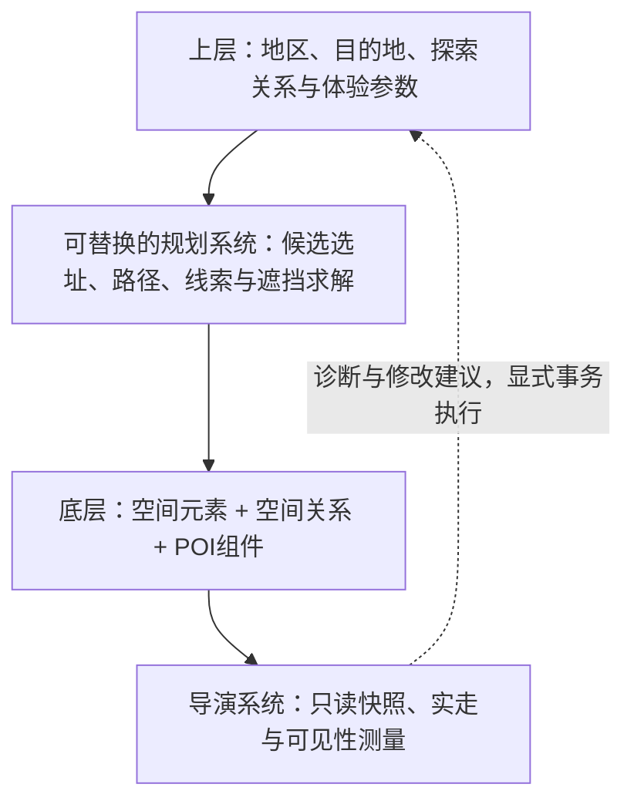

# 心理地图与导演系统设计草案

> 2026-10-27 用户最新取舍：默认规划优先道路两侧错落感，不再为精确心理地图指标支付持续 CPU 成本。沿路策略生成不执行围合射线；保留显式测量、真实道路与占地检查。固定槽位每个侧距只尝试一次，失败留白，不额外沿路搬动凑数。以下心理体验目标保留为研究背景，不要求默认规划逐项求解。当前契约见空间框架 README。

> 2026-09-22 当前参数契约：按用户纠正，心理地图是常驻规划系统，不提供 `enabled` 或“心理地图强度”；旧工程世界、道路及非活动种子中的这两个字段在导入时清除，不转换为其他参数。公开控制为沿程覆盖比例、S 形、通道与岩群尺寸、关键点间距和占屏目标，世界基础和单条道路覆盖走同一组件。S 形默认 1，适用于所有种子；`routeCoverage` 默认 0.3，独立控制安排引导的道路长度比例。自动道路关系使用内部 VisualGuidance 完整强度 1；独立手工关系的底层强度契约不受此次删除影响。只有真实道路连接的 POI 对自动生成道路引导关系，导演测量仍是测试手段。

> 当前执行入口是 `layout/SpatialWorld` 与 `layout/EnvironmentStages`：体量/连接稳定后生成沿路引导，保留不受影响关系；测量目标不直接乘到岩群高度或道路成本。旧 `WorldWayfindingUpdate` 已删除。具体接口以 [README](README.md) 为准。

> 2026-09-21 最新纠正：50% 是关键引导位置的实体占屏目标，不是全程最低遮挡。道路应有开阔、收紧与展开；增加独立“沿程引导覆盖比例”，按实际道路长度分配局部引导区域。生成前按几何确定关键点，导演不能事后挑高占比帧。实测比例按距离计算，不按样本数。两者均走世界基础+道路局部覆盖组件；当前先支持转弯关键点，路口角色规划尚未实现。

> 2026-09-21 最新诊断约定（覆盖下方旧RGB分组）：整幅画面采用类别ID（天空/地表/水域/植被/岩体/建筑/未知），起终点用轮廓、目标被挡部分用纹理叠加；不把天空叫通用留白，不把未分类实体叫天空，不设固定审美合格比例。渲染直接消费实际引擎几何与Terrain顶点路径，同机位ID/深度RenderTarget经PostProcessPass逐帧显示，PBO/fence异步回读只影响数字更新。用户仍只有一个诊断开关，无手动标记。内部统计保存类别、九宫格、深度层次、天空连通开口和目标相对遮挡，支持同口径沿途采样。尚未据此自动优化布局或评判心理地图成立。

> 2026-09-21 上午用户纠正：白盒水域改为同源蓝色网格，停用生产水运行时；Terrain保持真实Heightmap/Alphamap。导演默认自动标记起点POI（蓝）、终点POI（绿）及当前实测遮挡终点的其他元素（红），地势只标记遮挡投影区域。无目标投影为未知，不把沿途所有元素强行叫障碍。坐标端点不虚构POI；可以手动覆盖测量对象。当前后台路线仍是可通行地表寻路+实际行走复验，道路有代价偏好；不等于心理地图观赏动线规划。

> 2026-09-21 03:55实施更新：以下早期状态已被T/A/B1阶段覆盖。白盒已接入真实TerrainClipmap Heightmap/Alphamap及Ocean/River；导演已并入原白盒，支持自由地表端点与对象集合RGB测量，目标独立，颜色不代表设计责任。沿途新版批量报告和有限视觉改善尚未完成，旧v1角色审计仅用于历史兼容。证据及下一步以OVERNIGHT_ACCEPTANCE_2026-09-21.md最新状态为准。

> 2026-09-21 最新地形约束：视觉遮挡包含连续地势起伏以及地上实体，与是否 POI 无关。规划白盒当前虽使用自己的 PlanningHeightmap，但 POI 分支绕过 Alphamap，以自定义地面/道路 Mesh 和 Shader 呈现，尚未接入真实 TerrainProject/Clipmap。先统一规划意图到 Terrain Heightmap/Alphamap 的适配，保证渲染、碰撞/落地、导航与导演高度来源一致，再做视觉目标迭代。水面可独立渲染，但须复用现有水系统并与河床、水位及岸线数据一致；不将 Alphamap 当水面。具体顺序见 OVERNIGHT_ACCEPTANCE_2026-09-21.md 的 T 阶段。

> 2026-09-21 用户纠正后的最高优先级边界：调试颜色只编码被测对象或对象集合，不能绑定Push/Pull/Cue等设计责任。此前DirectorRole自动将沿路体量归Push、终点归Pull、小POI归Cue，以及据此设置默认占屏合格范围的实现不构成Push/Pull验证；已有像素计数与通行测试仅证明测量/行走能力。界面收拢至白盒的改动尚在工作区，不能视为这一理论纠正已落地。

状态：2026-09-20；seed=1有限空间实验见 ../wayfinding-study/README.md。导演基础版已实现连续播放、真实GPU占屏/遮挡测量、有限参数试调，见 ../director-study/README.md；以下全局用途驱动选址、通用目标遮挡求解仍为设计目标。用户要求以认知与探索目的组织POI，保留可配置随机性、组件编辑与局部修改。

## 1. 核心决策

现有间距采样解决覆盖与疏密，不足以决定目的地、视觉主次或认知关系。保留其候选与间距约束，将“满足间距后随机填内容”改成“认知意图与内容条件共同决定位置，在合格候选中按Seed选择”。大中小是组织尺度，不是认知角色。

比较两个方向：

- 分布完成后补地标/遮挡：便于接入，但无法根治目的地位置和路网本身无意义的问题，容易不断加装饰补洞。
- 意图先行、几何有界求解：先指定地区、方向参照、目的地和探索关系，再解POI/路网/视线。采用这一方向；用现有布局先做评估，不立刻重写全部生成。

风车在无人区并非天然无意义：它可能是远景方向参照、可抵达目的地或叙事遗迹。应检查其预定作用是否成立，不能把“靠近村庄”写成所有风车的永久规则。

路径、边缘、地区、节点、地标是空间的认知角色，可附于线、面、体或POI组合；一条河可兼任地区边缘与方向参照，不必强制包装成一个POI。系统生成的是帮助形成心理地图的条件，不能直接生成或保证玩家脑中的心理地图。

## 2. 同一组件框架中的职责

不新增另一套世界对象；上层规划器将意图编译为现有Session命令与底层数据，未来可以由LLM替换。关系是有方向的：从村庄能看到山口，不代表山口能看到村庄入口。物理可达图与感知关系图独立，连接不等于可见，可见不等于可达。

建议新增三个组件契约（名称为暂定接口，不是已经注册的组件）：

| 组件 | 所属实体 | 最小数据与用途 |
| --- | --- | --- |
| WayfindingRole | 任意空间元素/组合/区域 | roles[]（路径/边缘/地区/节点/地标），navigationUse[]（目的地/定位/途中线索），importance，regionRef；按需要添加，多角色允许共存 |
| ExperienceLink | 空间关系实体 | from/to、实际路径引用或候选、服务方向、关联地区、观察条件、分段可见性目标、可修改范围；表达一段探索关系 |
| GuidancePolicy | 世界/地区/单条关系 | 目标主次、无提示时长、线索间隔、遮挡/揭示曲线及允许操作预算；统一稀疏覆盖，不复制成多套独立控件 |

角色用于选择候选与解释目的，不保证生效；效果必须由DirectorReport的实测结果证明。报告不写回作者参数，也不是额外世界维度。

生成的引导树、岩体、地貌组合仍是普通空间实体，记录createdBy/servesRelationIds；需要作为小型兴趣点时，在同一实体上附POI组件，沿用间距/预算，不复制第二个对象。若不符合POI间距，保留普通空间元素身份或报告该POI请求放不下，不能绕过规则凑数。

Hierarchy照常选中这些对象；Inspector既能改其尺寸/位置，也能追溯“为哪段旅程、遮挡或强调谁”。内部拼接OBB仍由组合管理。实体可服务多个关系，反向索引负责提示影响。

## 3. 生成与局部编辑

全局生成建议：

1. 读取陆域、地势、不可移动实体及用户约束；建立地区和候选目的地/方向参照的粗关系。
2. 大中小依次选址，但候选评分同时考虑角色需要、依附内容、地势适宜、接路代价、可观察区域、地区辨识度；不得仅以最近距离排序。
3. 接入点只声明连接能力，实际路网继续综合求解；上层探索关系可指定“需要存在的可达关系”和主次，不强制所有世界变成同一条路线或全局循环。
4. 沿真实候选路段和决策点安排线索、构图与遮挡。先利用已有地貌，再在允许区域新增可编辑元素。
5. 导演测量→有界修复→验证发布。配置评估次数/时间预算，失败给出原因；不无限重试，不偷偷改变种子或硬约束。

间距仍是规则；“哪里需要更多信息”另由路口、地区交界与线索空窗决定。同距离下，可有主干、支路、远景锚点和安静地带。空间评分只是本项目工程提案，不是文献提供的通用公式。

局部编辑：锁定对象与作者覆盖优先；只允许修改选中关系走廊/区域及其依赖对象。初版用明确空间范围和可编辑ID集合限制修复，不能先宣称已有自动最小影响域。其他受影响旅程可以变为待复验，不擅自搬动远处POI。视觉软目标和物理硬约束冲突时报告冲突；显式硬视觉约束未满足时拒绝发布，保留旧快照。

## 4. 从目的到具体参数

用户日常面板继续以POI、地貌、道路、景观等语义参数为入口。下表中的遮挡、显露、占屏和线索指标由内部策略维护，不新增日常滑杆；测试接口允许指定目标值和观察条件。内部策略使用有版本的配置，不能散落在生成器和UI中。角色/用途先作为规划数据，不因本草案自动增加控件。

| 参数 | 作用域/单位 | 明确含义 |
| --- | --- | --- |
| 导航用途/重要性 | 元素/POI；枚举、0–1 | 目的地/定位/途中线索，决定规划优先级；不是“玩家注意力百分比” |
| 目标遮挡率 | 关系的指定路段；0–1 | 指定观察条件下目标投影被其他空间元素挡住的比例目标；1代表该段完全遮挡该目标，不代表全世界不可见 |
| 揭示位置 | 有向旅程；0–1 | 沿实际行走距离归一化，在哪里开始达到约定的可见性标准；反向旅程独立设置 |
| 目标占屏范围 | 关系/阶段；百分比区间 | 目标真正可见的像素占视口比例，不是距离或包围盒面积 |
| 最大线索空窗 | 关系；秒 | 目标或指定替代引导线索都不可用的最长连续时长；用实际速度换算，不靠POI直线间距猜测 |
| 线索间隔 | 地区/关系；沿路米数区间 | 需要连续线索时的采样约束，不等于所有小POI之间的欧氏距离 |
| 同时强调的候选数 | 决策点/地区；整数范围 | 限制同时达到突出标准的竞争目的地，允许探索分支，而非全程唯一答案 |

遮挡率与揭示位置共同编译为分段目标曲线；高级参数可覆盖每段的目标/容差/是否硬约束。0/1不得只是“岩石数量少/多”的别名。所需几何放不下就报告“请求值/实测值/阻碍条件”，不把“最努力的结果”冒充100%。

例如A村庄到B山口（仅用于验证的一组假设，不作为全部世界模板）：开头看到B的标志；中段目标遮挡率0.8；离程70%处重新显露；中间最长8秒没有B或替代线索。支路口的高树可接替引导，挡住直视B的台地本身也可兼作小POI。8秒及其他阈值须经人工测试校准。

## 5. 可借鉴的关卡手段及边界

- Pull：地标、开口、轮廓差异、前景构图、可理解的目的地吸引注意；不能直接把几何面积等同于吸引力。
- Push：危险、压力或不利空间促使离开。当前项目没有敌人/威胁系统，只先实现空间阻挡、降低非目标通路的可供行走性等可观测部分；单纯增加遮挡不等于完整Push。
- Leading lines：路径、坡脊、树列等朝向形成引导。
- Breadcrumbs：可连续辨认的途中线索，关键是服务下一步行动，不是均匀撒装饰。
- Framing：前景和开口减少竞争，让目标突出；并非只能把目标自身遮住。
- Pinching / 展开：先收窄后开阔，形成决策与揭示时机；保留通行净空。
- 隐藏与再显露：局部遮挡地标，再从新的角度看见，提供进展和方向确认。

光照、颜色、运动和声音可以成为后续线索能力；第一版几何/OBB测量不能替代这些感知因素的评估。不得把没有实现的音频/威胁效果伪装成可用强度滑杆。

## 6. 导演系统按钮与测量

预览顶部增加“导演系统”入口，右侧出现：起点POI、终点POI、途经点/路线选择、相机档案、运行/暂停/重播、报告。点击时间轴上的失败区间跳到对应位置，并可选中导致遮挡的实体。导演不改变工程选中对象的作者参数。

2026-09-21 用户纠正：起终点可选任意可站立地表位置或当前角色位置，POI 仅为快捷选点。选择 POI 时使用可站立的接近点，而非可能位于房屋/岩壁内的中心。导演不受道路网限制：可行走地表、坡度、角色尺寸及净空、碰撞、水域和已支持的移动能力共同决定可达空间；道路是可利用的优先路线。没有道路也应能穿过草地或绕过障碍。规划路线须复用真实行走器验证，不飞行或穿模；区分端点无效、不可达和有限搜索预算内未找到。此项是新的实施要求，现有仅道路导航不代表已支持任意点地表寻路。

复用PlanningWalk固定步长碰撞与真实地面，沿路线给方向输入，记录实际位置/时间/阻挡。摄像机使用当前玩家的第三人称相机与避碰逻辑，不用俯视编辑相机代替。锁定FOV、宽高比、相机高度/后距、角色尺寸、速度、光照和世界revision；固定条件保证可比较，另做不同相机/方向的稳健性测试。

两种运行模式必须分开：

- 路线审计：自动走A→B，默认沿行走方向看，可配置有限左右观察；相机不能总是对准B。证明路能走，以及指定视线条件下何时看见什么。
- 自由找路测试：隐藏导航和调试标签，由人决定转向。可选只用局部可见信息的代理作预筛，但代理不能读取终点坐标/完整最短路后宣称自然引导成功。

逐样本测量，不能只看全程平均值：

- P = 视口总像素；A = 同相机下仅渲染目标自身的投影轮廓像素（保留自身遮挡）；V = 正常场景深度遮挡后真正可见的目标像素。
- 占屏率S = V/P；遮挡率O = 1−V/A。A=0时标记“视野外/无有效投影”，遮挡率不可计算，不能记作100%遮挡。
- 复合目标用指定子实体ID并集；不要把整个POI圆或地貌OBB外接矩形当作目标轮廓。可指定标志性子部位，避免村庄露一块屋顶就算目的地可识别。
- 区分相机裁切、朝向造成的不可见与真实遮挡；输出目标方位角、投影角尺寸、遮挡者ID及贡献。
- 同时记录首次有效看见、连续可见时长、最长线索空窗、岔路前线索是否出现、竞争目标数量、回望可见性、实际通行失败。
- 可见性通过标准至少包含占屏下限+持续时间；不把单个像素或一帧闪现算作可靠线索。颜色/光照对比另看真实彩色画面；深度ID掩码不测注意力和记忆。

实现提议：空间索引/视锥和射线用于候选粗筛；正式测量使用与白盒同源几何的离屏ID+深度通道及目标独立掩码。按米数或固定时间间隔采样，GPU读回排队，不在每次滑杆事件中同步逐帧读回。遮挡使用发布场景，忽略仅编辑器图层隐藏的作弊效果；网格、标签、高亮等编辑辅助不计入测试，真人无导航测试也应关闭它们。

输出DirectorReport包括世界revision/Seed、路径及入口、相机档案、采样密度、参数目标、逐样本测量、失败区间、遮挡实体、截图索引、到达状态和耗时。改布局后旧报告标过期，不能沿用旧截图宣布通过。

## 7. 验证方法与最小实施次序

1. 固定seed=1的完整配方、组件文档与版本，保存未调整基线。从真实生成结果选取具有大/中/小POI的局部区域，记录实际实体ID和可达入口；先核查，不预设seed=1一定包含某种组合。Seed相同而参数不同不是同一实验。
2. 先做局部空间效果与最小测量闭环：选择有现成遮挡、开阔、岔路的若干观察路段（实际不存在的情形如实记录）；小POI可以是途中线索，不强制依次走大→中→小。只在明确的允许编辑范围中使用统一策略，保留前后布局供用户判断。不得把坐标、实体编号或seed判断写入产品算法。
3. 测量模块同时用独立几何夹具验证无遮挡、半遮挡、完全遮挡、视野外及复合目标。0/0.5/1是测试目标，不是所有路线的固定脚本。误差、采样条件和未满足目标独立报告；不通过转动相机或隐藏图层达标。射线估计与正式像素测量分别标记，不能混称同一精度。
4. 验证事务与局部性：几何来自发布快照，产生的元素可选/可改/可删或锁定；删除后不静默重生，锁定与约束冲突如实报告。校验修改白名单外ID与几何稳定、实际通行、同Seed重放、存档往返和撤销。一次局部实验通过不证明全局心理地图已实现。
5. 用户认可局部空间效果后，扩展导演自动实走、时间轴和报告，再考虑全局POI意图选址；用其他Seed、正反路线、不同到达方向检查是否依赖首个样本。完整导演系统不是首轮空间改进的前置大工程。
6. 真人对比：同基础世界做间距随机版与意图组织版，避免先后学习偏差。关闭小地图/标牌UI/调试线；测岔路选择、回头次数、到达时间、返回起点、指出地标方向，以及简画地区相邻关系。不同指标分开报告，不压成一个“心理地图分数”。

初稿源码核查（当前实验增量见wayfinding-study/README）：PlanningSession已有组件/关系事务；PlanningWalk已有固定步长行走、OBB碰撞和测量；WorldPlanning3DView已有第三人称相机和实际FOV；WorldPlanningContract已有observes/frames关系枚举。这些可复用，但当前没有上述导演路线控制、目标掩码/视觉曲线、角色驱动的POI选址与心理地图测试。关系名字存在不代表视觉约束已经实现。

## 8. 模块边界与后续维护契约

以下是落地边界；首轮已建立对应模块，但GuidancePlanner目前只进行有预算的演示候选与一次显露开口处理，不是通用优化器。沿用现有组件框架，不另建平行世界模型；按知识职责分模块，不按岩石/树木/村庄种类复制遮挡算法。

| 模块 | 输入 → 输出 | 唯一职责 |
| --- | --- | --- |
| GuidancePolicy | POI用途、真实路线、环境条件、版本化配置、Seed → 观察关系目标与允许编辑范围 | 决定哪些路段保持开阔、哪些利用遮挡或线索；允许不做修改。每条关系使用稳定随机子流，不因遍历顺序变化扰乱其他路线 |
| VisibilityQuery | 只读场景几何、目标实体集合、观察样本 → 可见/遮挡测量与遮挡者ID | 统一测量，不读取POI类别来决定是否遮挡，不修改世界；未知几何明确报不支持，不能忽略后宣称通过 |
| GuidancePlanner | 观察关系、测量结果、允许的编辑能力与约束 → 有预算的候选命令和诊断 | 优先保留已达标布局，再比较有限候选的改动代价；输出现有Session可处理的命令，不直接篡改已发布数组 |

物理约束与发布仍由现有PlanningSession/Runtime负责；导演负责组织观察样本、实走和展示报告，复用VisibilityQuery，不维护另一套遮挡公式。内部策略配置不等于需要为每个字段增加Inspector组件。保持配置版本及有效值摘要随实验报告保存，以便复现。

几何接入复用当前白盒与真实地表数据：POI范围圈不遮挡，内部拼装OBB参与测量但编辑粒度仍是所属地貌组合。地貌、建筑、独立岩石或其他POI只要提供遮挡几何，都走同一查询；以后有透明/稀疏素材时由几何能力适配表达，不能将实体类别名称写入通用测量器。白盒实测只证明白盒几何，不能当成未来树叶素材的准确遮挡。

增加新内容的维护路径：

- 仅增加素材或POI组合：提供现有几何/归属/编辑能力，复用测量和策略，不新增专用遮挡分支。
- 增加新的引导手段：在GuidancePlanner的候选编辑能力处扩展，仍经过相同预算、锁定、物理约束和事务；先有实际需求再抽象扩展接口，不预建空插件层。
- 调整艺术偏好：修改版本化GuidancePolicy配置，保留同配方前后报告，不散改权重和常量。
- 改变测量方法：在VisibilityQuery中实现并标记测量方法、误差及版本，同步夹具；不能为某个POI修正报告值。

禁止将所有路线套用同一显露曲线，也禁止把全局随机数当作唯一布局依据。现有元素若已满足目标（包括另一POI的几何恰好遮挡），直接复用。多个观察关系共享一个遮挡者时，修改应重测受影响关系；范围外关系只标记待复验，不扩大编辑范围。

初期只有beforeNetwork/afterLandscape扩展阶段，不在afterLandscape中修改已完成导航依赖的几何来规避重算。首轮局部候选经Session重新求解并复验路网；若后续需要专门执行阶段，先声明依赖和失效范围再接入。无有界可行候选时返回未满足及原因，保留旧快照，不递归修补。

首轮实验产物应包含：完整基线配方/文档、Seed、配置和算法版本、实际POI/路径ID、观察条件、允许编辑ID或区域、前后几何差异、遮挡者与测量曲线、实际通行结果、失败原因、前后画面以及用户美感验收状态。测试样本引用实际ID是允许的；产品生成逻辑不得引用该样本ID或专属坐标。

## 参考与适用程度

以下来源支持设计方向；参数名称、公式、阈值、模块边界与实施次序是本项目的设计建议，未由这些资料证明为通用标准。

- [David Shaver, Invisible Intuition，作者讲义](https://davidshaver.net/DShaver_Invisible_Intuition_DirectorsCut.pdf)：检索到作者讲义中的引导方法清单、取景与隐藏/再显露说明；全文打开失败，不声称完整审阅全部案例。对应[GDC讲义](https://media.gdcvault.com/gdc2018/presentations/DShaver_Invisible_Intuition_GDC2018.pdf)。
- [Dan Taylor, Ten Principles of Good Level Design](https://www.gamedeveloper.com/design/ten-principles-of-good-level-design-part-1-)：一致视觉语言、可探索路径以及保留必要线索的隐藏；提醒节奏套路重复也会失去效果。
- [Norman Vinson, Design Guidelines for Landmarks to Support Navigation in Virtual Environments](https://arxiv.org/abs/cs/0304001)：地标与路线知识、方向定位的关系；论文也说明部分建议属于需要进一步实证的经验准则。
- [Aiwen Zhang, Using Push and Pull Principles to Improve Non-Linear Level Navigation](https://scholar.smu.edu/guildhall_leveldesign_etds/5/)：2024论文摘要确认在Skyrim开放场景研究该问题；未取到全文，不引用效果量或推断它验证了本项目参数。
- [Brendon Chung, Wayfinding and Storytelling Techniques，GDC 2015](https://media.gdcvault.com/gdc2015/presentations/chung_brendon_wayfindingandstorytelling.pdf)：结构与路径可读性的开发者案例；已读可提取的讲义文字，不声称观看完整演讲。

## 2026-09-21 原文复核：空间引导与测量标签分离

一手来源（本轮已读正文）：

- Clem Melendez, Push & Pull, Introduction: https://www.clement-melendez.com/portfolio/articles/push-pull/introduction
- Facilitate mental mapping: https://www.clement-melendez.com/portfolio/articles/push-pull/mental-mapping
- Influence via composition: https://www.clement-melendez.com/portfolio/articles/push-pull/composition
- Lure with affordance: https://www.clement-melendez.com/portfolio/articles/push-pull/affordance
- Conclusion: https://www.clement-melendez.com/portfolio/articles/push-pull/conclusion

原文结论：引导来自空间可读性、构图、路径的可行动性、目标与叙事等手段的组合。构图不只让玩家看到一个物体，还要建立视线与移动的连续性。心理地图关心地区、参照与连接如何被理解和记住。作者提出吸引/排斥地图作为思考方式，同时明确不是通用公式，不应将所有手段套到每个关卡。

对本项目的推论（尚未实现）：

- 引导意图归属于有方向的观察/旅程情境，而不是物体的永久种类。某树群同时能遮挡侧面、框出开口和强化路线；必须看组合及观察位置。
- 测量选择器只引用实体ID集合，调试颜色任意分配。改颜色不应改变世界、意图、判断结果；不限定三个功能槽，也不建立红色=Push的规则。
- RGB/ID缓冲保留为测量工具，得到投影、占屏、遮挡、画面位置与沿途变化等几何证据。这些只是某项引导假设的观察量，不能换算为通用Push率或Pull率。
- 导演按预定路线走通，只证明该路线能通行及沿途观察条件；不知道路线的人会不会选择它，需要独立的无路线提示选择验证。首先比较同一路段引导结构有/无的对照，固定入口和观察条件，检查目标显露、入口关系、转弯后的方向衔接，而不是调树高凑颜色百分比。
- 先暂停基于旧角色自动分类的新增实现。此前调树高后8异常变0，只能称为达到了一个人为设置的像素范围，不能称为引导改善。

## 2026-09-21 实施纠正：基础生态之上的旅程补充

用户澄清：环境低密度不妨碍两 POI 之间有独立视觉遮挡需求。新增独立 `visualGuidance` 意图，而非提高全局景观密度。现有实体与地势参与估计；补充普通岩群/树木，保留可编辑来源关系。强度不是 GPU 百分比。

一次真实导演试验发现：选中物理道路与实际 POI 旅程不等价，给建筑入口道路加岩群仅改变旅程后段，中段占屏完全不变。因此引入 `fromPoi/toPoi` 引用，经同源 TerrainNavigator 获取实际可行走路径；道路引用仅作为单条道路应用方式，不替代心理地图关系。生成阶段固定布局；导演运行时只测量，不实时增补。配置策略尚未证明具备 Push/Pull 的感知效果。

## 2026-09-21 宽实体与负空间

最新用户决定：实体之间的开放空间组织流动方向，树木作为辅助；不能用细柱或树冠占屏代替Push/Pull。沿途生成策略采用宽岩体搭接，配置控制尺寸、形状和开口宽窄，已有实体与地势参与约束。可通行、实际占地、沿路画面应分开验算；紫色占屏只是一项描述性观测，不等于引导成立。

本次GuidanceRock形状策略与VisualGuidance摆放策略分开维护，保留同一空间数据/事务/白盒适配，详细证据见V2_IMPLEMENTATION最新章节。当前尚未联合优化负空间的连通方向和全图目的地，不能以本次岩群补充替代完整心理地图系统。

## 道路心理地图模块（2026-09-21 晚）

- `planning-data/wayfinding.json` → `WayfindingPolicy`：可配置目标、S 倾向、通道宽度、岩群长厚高和间隔。世界组件为基础，具体全局道路通过相同组件稀疏覆盖；不按种子写生成分支。旧文档缺少组件时统一升级，默认关闭以保留旧布局。
- `GlobalRoadNetwork`：在已有坡度、地面和净空约束内加入稳定的双弯路径代价。S 是偏好，不强迫短路、入口或被障碍限制的道路套同一曲线。局部道路覆盖与全局参数走同一解析。
- `RoadGuidanceCues`：从道路几何选取分隔开的转弯峰值，按 `routeCoverage` 分配长度预算，`cueSpanM` 限制单段范围；保留段间开阔空间。可行关键点不足时记录规划覆盖缺口，不为凑比例全程填墙。该参数分配的是生成区段，不直接保证GPU像素结果。
- `PlanningRuntime` → `VisualGuidance` → `GuidanceRock`：以真实已发布道路中心线创建普通岩群，保留来源道路及局部编辑能力；同一生成来源的岩群可相互搭接。基础生态、村庄占地、其他实体、水域和道路净空仍受保护。只在所分配的引导区段补充体量；此阶段不会为比例改动相机或在导演运行时添石头。
- `RoadJourneys`：逐条列出不同 POI 间的实际道路；平行道路分别测试，不能用最短路跳过。自由导演仍保留无道路地表寻路，只有本次批量验收限制为道路范围。
- `RoadJourneyAudit`：复用真实碰撞行走轨迹及 GPU ID/深度采样；包括正反向，最小采样间距 2m、基础间距 16m、每程最多 600 帧和 120 秒。超预算、不通行、未达标分开记录。画面长宽比来自实际预览；尺寸或布局变化取消旧任务。
- UI：心理地图 Tab 仅含参数；批量检验和可导出的报告放在诊断 Tab。报告包含精确文档、Seed、几何快照标识、有效策略、视角和每个采样值。布局改变后旧报告不能继续作为当前验收结果。

`RoadJourneySampling` 把预定关键点投影到正反向实际行走轨迹；保留全程距离样本、转弯/坡度事件与关键点前后样本，GPU变化触发细化。关键点以外低于目标合法；没有分配关键点时报告 unassigned，不冒充通过。距离覆盖根据相邻GPU样本线性插值估计阈值交点，有限2m分辨率不是连续空间证明。

当前生成仍是道路确定后的有界岩群补充，未实现基于 GPU 结果的自动求解、全局认知角色选址或关键点视觉目标保证。配置覆盖、规划区域覆盖、实测达标路段覆盖分别报告；不能互相替代，也不能以占屏率或通行成功代替心理地图美感验收。此前的全程最低50%实验是误解需求的历史试验，已废止该判定。

## 2026-09-22：道路引导与自动生态的占地优先级

道路引导实体不能等自动景观填满道路两侧之后，再把全部生成景观视为不可移动障碍。本次将优先级明确为：世界边界、村庄/POI主体、已有岩体/建筑/水域、道路净空和显式编辑对象继续硬保护；未经编辑且未锁定的 `ambient` 实例只在实际接受的道路引导足迹内让位。花区是植被密度场，不是独占实体，实际植被继续由已有占地栅格排除岩体覆盖范围。独立手工视觉关系保留原保护行为。

`GuidanceEcology` 独立维护可让位集合、原始顺序和被排除实例；报告保存来源，`withoutVisualGuidance` 在下一次求解前精确恢复。未重叠实例不移动，不改技术美术的密度配置；引导覆盖改为零时恢复基线生态。局部显式编辑通过 PlanningRuntime 的保护 ID 进入，不让生成算法读取编辑器文档。相关模块归属和数量随实际结果同步。

自动道路引导先尝试完整候选，再按 `visual-guidance.json` 中有限拟合档位，在分配的引导区段内搜索可用位置；保留宽岩体下限和全部硬约束。高度随尺寸同比适配，显式局部尺寸不静默缩小；报告区分控件基准尺寸、候选尺寸、实际尺寸、拒绝原因和让位数量。有限搜索失败仍允许缺口，不能报告 GPU 占屏目标已经完成。
