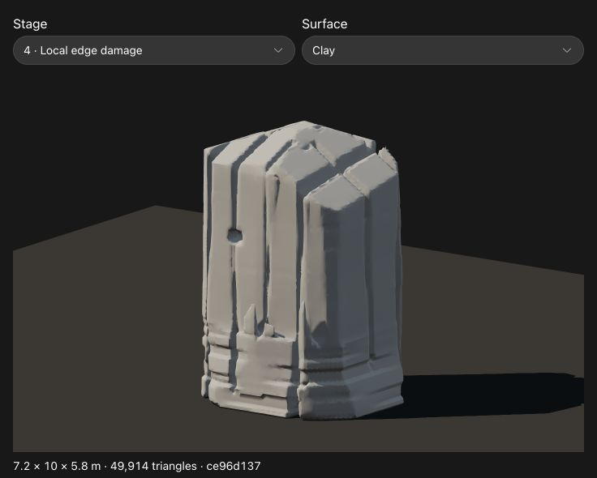
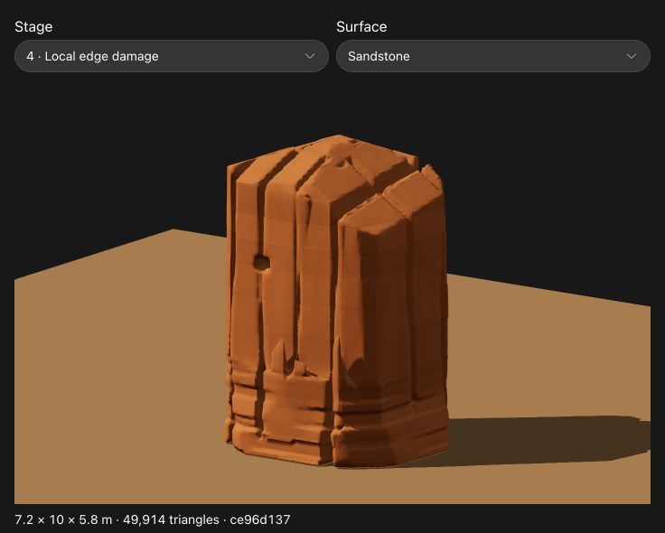

# Procedural sandstone processing experiment

The target is the user's sandstone cliff photograph: broad near-vertical faces,
long joints between connected buttresses, uneven crowns, thin bed breaks, stronger
breakup near the foot, and sparse angular edge damage. This is a single-rock
processing study, not a reconstruction of the photographed landscape. No pixels,
traced outlines, downloaded models, textures or manually edited vertices enter
generation. The result is still a stylized approximation; the broad facade and
cap arrangement remains simpler than the photograph.

Open `index.html` via a local HTTP server, or the inline study. **Stage** compares
the same source and fracture fields throughout the pipeline. **Clay** shows actual
geometry. **Sandstone** adds procedural sediment color, vertical weathering, grain
and a distance-filtered fine bump. **Face close-up** inspects that fine shading.
The parameter slider combines all edits. Height, width and depth are in metres.
**Replicable recipe** exposes editable JSON; applying it regenerates the mesh.
The last status value is an FNV-1a mesh fingerprint, not a cryptographic identifier.

## Pipeline

1. Generate a clean atomic base with the unmodified upstream `buildRock` pinned to
   `b2887feee34df433303d1c3197a679e4c219367d`. Reduce the original wall relief to
   zero, retaining the constrained footprint, body profile and crown. The default
   source is a broad 7.2 × 10 × 5.8 m butte. The previous playground remains a
   separate example of all upstream parameters.
2. Sample distance to the actual source triangles using a BVH. Vertical mesh-ray
   intersections supply the inside sign. This is not a box replacement or a
   projection onto one camera view. Default grid spacing is approximately 0.121 m;
   features below that scale can soften or disappear. Resolution is part of the
   saved recipe.
3. Intersect the field with a few large near-vertical face planes and inclined
   crown planes. Unequally spaced piecewise planar facade setbacks form broad
   connected buttresses, rather than chains of individual small rocks.
4. Subtract two families of nearly vertical tapered fracture volumes, with
   unequal spacing, widths, depths and low-frequency drift. Joints open at the
   crown; some descend to the foot and others terminate higher. Their depths are
   bounded by the current surface shell. Preserve a central column intersected
   with the shaped body, including at extreme slider settings.
5. Apply one shared formation-space bed field: unequal thickness, slight tilt
   and warp, selective face recession, and more densely broken lower beds.
   Mid-height faces remain comparatively quiet. This changes geometry before
   meshing; the color shader uses these same bed boundaries.
6. Subtract sparse bevelled angular wedges around joint/bed intersections and
   exposed crown edges. Chip centers are located against the current broad body,
   including the joint's drift. There is no blanket random pockmark pass.
7. Extract a welded mesh with marching tetrahedra, using consistent shared edge
   crossings and outward winding. A small signed-distance bias avoids Float32
   endpoint collapses. Retain the largest connected surface and report the number
   of discarded tiny components. Recompute all normals and contact extents.
8. Reduce with pinned meshoptimizer, protecting geometric creases and the six
   extrema, with normals as attributes. A topology failure protects the affected
   source neighborhood for one retry; a second failure retains the source. The
   study reports that fallback rather than displaying an invalid reduced mesh.
   The previous generator's >90-degree turn repair is deliberately not applied
   to these intentional concave fractures.
9. Add procedural shading after the shape is fixed. Clay and sandstone use the
   identical triangle buffers. Fine shading does not change geometry or collision.

`recipe.mjs` defines `sandstone-structural-v1`, bounds and defaults.
`processor.mjs` contains the field and mesher; the exact same function runs in a
browser Worker and Node. Four independent seeded streams author faces, joints,
beds and chips. Switching stages does not reroll them. `atomic-controls/kernel-bundle.mjs`
is build-time packaging shared by both demos; all vendored upstream source files
remain byte-identical to their pinned Git blobs.

## Reproduce without a browser

From the repository root:

```sh
# Rebuild the standalone/inline viewers; no package install is needed.
node world/demos/rock-ridge-study/sandstone-study/build.mjs

# Generate the default recipe and print its mesh fingerprint and audit.
node world/demos/rock-ridge-study/sandstone-study/reproduce.mjs

# Paste the demo's JSON into recipe.json, then regenerate and export geometry.
node world/demos/rock-ridge-study/sandstone-study/reproduce.mjs recipe.json /tmp/sandstone.obj

# Independent geometry and recipe checks.
node world/demos/rock-ridge-study/sandstone-study/verify.mjs

python3 -m http.server 8773 --bind 127.0.0.1 --directory world/demos/rock-ridge-study
# Open http://127.0.0.1:8773/sandstone-study/
```

The OBJ contains metre-space positions, normals and triangles. Its adjacent
`.recipe.json` saves the complete recipe. The browser-only procedural material is
not baked into the OBJ. Geometry has no dependency on view angle, illumination,
interaction timing or image assets. Byte repeatability is checked on the current
Node/V8 build, with a matching browser fingerprint; cross-engine floating-point
identity is not promised.

## Validation and limits

`validation.json` records exact position/normal/index replay, all 26 slider endpoint
cases, three combined extreme cases, and every stage. An independent halfedge
audit requires opposite winding, two faces per edge, one cyclic fan at each
vertex, one connected surface, positive volume and nonzero triangle area. An
independent set of 126 front/side ray profiles compares source and reduced
surfaces, including their grooves. The checks do not prove geological realism or
general self-intersection freedom. Tiny sliver faces may remain at field
intersections; no production retopology, UV/normal bake or runtime collider is
included.

For default seed 1, reduction retains 49,914 of 196,848 triangles. The largest
difference across 126 independent front/side ray probes is 0.0085 m, with 0.0144%
relative volume change. These are measurements of that recipe, not universal error
bounds. The browser and Node both produce fingerprint `ce96d137`.
[UI evidence](ui-validation.json) covers 320 px and 736 px layouts, every stage,
height and seed changes, source/reduced display, close-up shading and JSON replay.
Native drag automation did not establish gesture-level orbit acceptance.




The ridge fitter still measures its existing baked prototypes. This experiment
supplies a candidate shape-processing pipeline; feeding its new meshes through
the ridge fitter and recomputing assembly contacts is a separate integration.
The single rock has no talus placement, landscape erosion simulation or texture
capture. Those would be additional procedural systems, not surface noise sliders.
