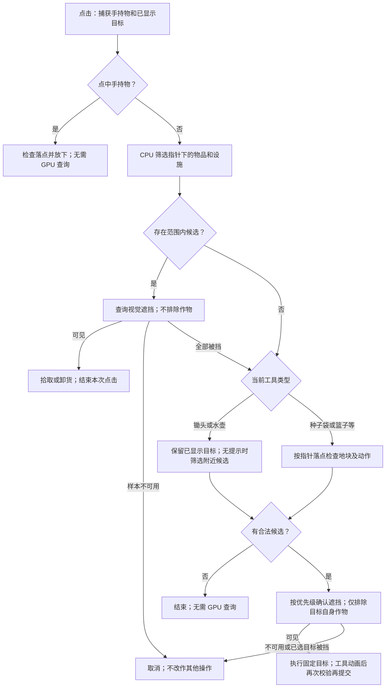

# Seed World 空间规划

统一空间参数框架生成 1024 × 1024 米世界。规划器确定身份、位置、体量与关系；素材消费发布结果，不重新随机布局或重建道路。当前岩石/建筑的通用素材 resolver 与每 POI 物种绑定仍未完成；功能验证和美术验收分别记录。

## 入口与开发

规划页顶部「风格选择」提供原始 Seed World 和语雀《世界引擎模版》的 15 个方向。选定风格与 Seed 后「应用」经 Session 整体载入作者配方，再由「生成 3D」交付当前规划；不会在进入 3D 时偷偷换一份布局。同一风格与 Seed 可重复生成；「随机 Seed」生成新变体。

2026-11-05 用户明确授权按原图为各模板配置光照，取代此前所有风格保留光照的限制。15 个主题配方分别设置 lighting／postProcess，日景、夕照、星夜与水下补光各自独立；更换 Seed 保留之后的手动照明编辑。原始 Seed World 入口仍保留工程照明。草地、裸地道路、树叶、树干、花瓣与岩石分别设置固有色；天空散射、天顶／地平线渐变、月光和雾另按原图配置，不从材质主题色推导。显式 surfacePalette 同时解除原版道路色场对地面颜色的覆盖；空组件和 reset 保留原生色场。原生夜间月光散射与白天天空渐变是不同通道，均通过可序列化的 lighting 参数进入日照 owner。

普通模板保留乔木、灌木、草地与花卉的密度及参数来源；参考图的森林设置高树，荒原保留草木，沙漠保留原生稀疏灌木。冰地、明确裸露的虚空和水下场景不默认生成陆生树林；水下的珊瑚／海草由对应资产槽表达。这些栖息地默认值只在生态发布时求解，不覆盖保存的植被密度，显式全局／级别／局部编辑继续优先。此前版本写入旧工程的错误清零值仍需用已有参数 reset 清除，不猜测删除其它工程的显式零值。

`WorldTemplateArtDirection` 逐一对应本机 huamei-output 的 15 张 SeedWorld 原图，分别描述构图主体、相对位置／尺度、主景取景、材质、照明、核心地貌与原生水体。模板固定 `terrain.baseSeed` 及主体锚点，核心地貌资源使用同一锚点；周边陆域、起伏宽高和方向随 Seed 小幅变化。Seed 新建及归档都保留核心地貌／水体作者资源。普通 Seed World 沿用原规则，参数区间不是后续编辑硬上限。

每个落地主体的实际占地在体量、道路、生态和农场生成前预留；不再清空多个资产之间的整块矩形。浮空资产不清除下方植物。首屏相机按实际漫游眼高和主景包络拟合，与渲染共用接地后的场景描述；植被沿用既有主体可见性约束。樱雪池塘及水下场景接入现有 Lake，水位由原生溢流高度算法求得；霓虹雨巷的细雨及湿润地表接入既有 WorldEnvironmentRuntime。

用户明确要求使用对应资产，缺失资产仅放无标注白盒。本轮检索原有资源及本地资产库后，仍未确认参考图中的完整主题模型；通用街机、蘑菇、水晶不冒充同款资产。当前缺失主体各用一个纯白长方体表达占地和体量，不拼装仿制模型、不新增交互条、音频或替代粒子。真实模型、洞穴内壁、极光、发光材质、花雨、鱼群／鲸鱼运动及 WOW 交互尚未由对应资产实现，当前不能视为原图最终美术还原。

| URL / 文档 | 用途 |
| --- | --- |
| `/demos/terrain/seed-world-planner/index.html?seed=1` | 原 Seed 全屏 3D、漫游与 HUD |
| 同地址加 `debug=1` | 前置空间规划器；白盒测试用同源 OBB，“生成 3D”进入原场景，显示建筑组件调试栏 |
| 普通入口加 `buildingApiDebug=1` | 正式 V2 建筑 list/query/apply 调试；真实修改并保存当前 Seed，仅用于测试工程，不调用 LLM |
| [空间框架](spatial/README.md)、[协作规则](AGENTS.md) | 数据契约、参数作用域、规则与素材接入 |
| [配置目录](planning-data/README.md)、[框架审计](spatial/FRAMEWORK_AUDIT.md) | 配置入口、范围与未完成项 |
| [场景视觉意图](../scene-visual-intent/README.md)、[心理地图](spatial/WAYFINDING_DESIGN.md) | 自然语言首次生成与导演测量；不代表完整美感/找路验收 |

源码只修改 `world/gallery`；物化、构建见 [World 开发指南](../../../../README.md)。已有 Engine 构建时，从仓库根串行执行：

```sh
pnpm --dir world gallery:sync
pnpm --dir world/.materialized/engine/world-gallery typecheck:terrain
pnpm --dir world dev --host 127.0.0.1 --port 4321 --strictPort
```

复用已有服务。`RuntimeOptions.ts` 的公共预编译默认开启：候选资源发布前准备真实 Shader 组合；显式关闭仅用于首用编译对照，任何模式都不跳过 Shader 注册。普通入口不再使用 `version=2`；真实 3D debug 可对照 OBB。WORLD CONTROLS 的 WASD/ORBIT 使用同一控制器，角色身高与漫游离地高度为 1.8 米，Q/E 不修改离地高度。

WASD 模式下，W/A/S/D 平移，←/→ 转向，↑/↓ 抬头/低头，鼠标拖动继续可用。方向键复用相机平滑和俯仰限制；编辑输入框、滑块、下拉框或文本时保留控件自身的方向键行为。

岩石默认表面、Perlin 上升遮罩和独立 OBB 表面/高度模式/坡率/尺寸控件统一位于真实 3D debug 面板的 **05 Rocks / 岩石 → Rock formation**。使用 `debug=1` 入口并点击“生成 3D”进入；点选岩石会展开对应 OBB 控件。Individual OBB 的 Rock surface 可独立选择 Slabs / Cellular curvature；Inherit surface 恢复来源或全局默认。Height mode 可选 Random ascent 或 Perlin noise · ascent mask，独立坡率默认由 `2×高/min(宽,深)` 派生、变化量默认 20%，可关闭 Automatic slope from OBB size 后编辑手动基础坡率。点击 Apply OBB settings 提交模式、坡率与尺寸；规划岩石未保存高度模式时继承生成配置；景观伴生石块也复用同一生成配置。普通 3D 不再挂载独立悬浮岩石面板。参数仍需 Apply 后生效，保留 Reset 与原作者事务。

Rock formation → **Generation profile / 生成配置** 默认平台比例为 1，全部采用保留原始高度的圆钝顶部，去掉默认的 Perlin 尖峰，保留岩石棱面与绘制材质；通用默认表面采用顶点定义岩层，减轻原高小石块的竖向深沟。平台默认高度倍率 1、手动基础坡率 12 m/m；高度与坡率相对早期 0.25 倍／3 m/m 同时放大四倍，在恢复原始高度时保留顶部宽度。调低平台比例仍可按世界 Seed 与稳定对象 ID 混入使用自动坡率的山峰。比例、倍率及变化量可编辑；显式单体覆盖优先，重置继承当前配置，局部编辑只失效受影响岩石及依赖资源。详细字段和保存契约见 [岩石配置](rock-formation/README.md)。景观散布岩石在作者投影时应用同一配置，首次生成、局部编辑、景观显露和水体生态重建均从原始高度重算，显式 solid.height 优先。树脚伴生石按稳定实例 ID 选择平台／山峰，每个素材家族共享两份网格；比例编辑只切换这些实例的网格绑定，单 OBB 编辑不重建树脚伴生石。已有工程显式保存的生成参数继续优先；重置生成配置可恢复当前默认值。

## 固定草地起伏法线资源

`data/seed-world/public/textures/grass-surface-normal.rgb8` 是 256² 线性 XYZ 离线贴图，无 mip、重复采样。只依赖 `grass-color-detail.r8` 和 `src/SeedWorldSurfaceNormalBake.ts` 的固定参数，不包含真实地形、道路遮罩或光照。修改这些输入后，从仓库根同步 Gallery，再执行：

```sh
node world/.materialized/engine/world-gallery/demos/terrain/scripts/generate-surface-normal-tile.mjs
cp world/.materialized/engine/world-gallery/demos/terrain/data/seed-world/public/textures/grass-surface-normal.rgb8 world/gallery/demos/terrain/data/seed-world/public/textures/grass-surface-normal.rgb8
```

同脚本加 `--check` 会重算并逐字节校验，不写文件。运行时缓存已加载的 CPU 数据，每个世界仍独立拥有 GPU 纹理；世界遮罩、真实地形法线和光照继续动态合成。

## 地表渲染权重与草根颜色

世界数据保留草地、湿地/海底、裸地和道路的原始 RGBA 分类，以及独立河床覆盖；导航、水域、动物与植被分布继续读取这些数据。`SeedWorldRenderWeights.ts` 在发布时投影出一张 1024² RGBA8 渲染权重图：R 草地、G 岩坡/裸地、B 道路式地表、A 为可选自然土壤覆盖（没有土壤时为 0）。道路、湿地、海底和河床合并到 B，使用同样的颜色和天气响应，河床不再有不积雪特例。每个通道都显式存权重，不在 shader 中通过减法补最后一层。

地形、原生草与草卡片共用 `TerrainLayerEvaluation.glsl`。当前三层均为色块，不创建地表颜色/法线/材质数组，也不加载河沙图片；纯色单图宏保留一次权重采样。以后添加地表纹理时，通过独立的逻辑层号和紧密图片数组索引恢复采样；纯色层不占白色占位图，多 Region、多张 RGBA 权重图继续走通用路径。纯色草根的顶点求值独立于带导数的片元纹理求值。

权重投影按不可变 surface revision 缓存，初次创建和水域编辑共用结果；不新增逐帧 CPU 栅格处理。这里不改变 relief 遮罩、固定起伏法线、24 小时光照与季节/天气系统。

Seed 地形从 LOD 2 起使用远景材质；仅有两圈时从 LOD 1 起。远景保留地表配色、积雪和简化湿润光泽，省略独立水膜光照、SSR 接收与细节法线，并与近景渐变过渡。

Shader 编译使用仓库已有的 `shader-compiler-precompile` CLI，需使用 World 修改版 ShaderLibrary，并同步更新引用共享代码的 `.shaderc` 资源。

运行 `pnpm --dir world exec vitest run --config scripts/acceptance/seed-world-fixes.config.mjs SeedWorldTerrainRuntimeIntegration TerrainFarShader` 检查接入及远景编译后的采样器裁减。

## 作者、存档与发布

农场地块使用当前已发布建筑构件的占位包络，包含最终铺设单元、prefab 与装饰框架，随编辑、删除及世界变换更新，保留旋转后的水平轮廓；包络内的门窗洞口和内部空隙仍算建筑用地。`captureOccupancyQuery()` 返回可冻结的占位查询，建筑运行时不再保留结构查询用的三角形、顶点或局部／世界坐标副本。

农场只负责工具、候选和动作规则；世界创建并持有 `SeedWorldVisualQuery`，将查询接口注入农场宿主。该服务统一管理提示预算、样本有效期、同帧在途查询复用与 GPU 资源，不保留建筑几何。农场释放时停止交互，世界释放时销毁查询服务。

点击顺序固定如下，空手也可拾取物品，不要求先拿工具：



空手点击既有地块仍保留选择行为。锄头／水壶继续使用身前附近目标；种子袋／篮子继续使用指针落点。物品候选先检查距离及地面前后关系，工作候选先检查动作、可达范围、屏幕范围及可耕种性；没有候选不提交视觉查询。同步与异步宿主驱动同一点击流程，异步等待结束后不重新解释点击。农场快照、地面、相机或输入状态变化会取消等待中的动作。

候选探测不修改已显示的工作目标。点击已有提示时固定该地块，深度确认和动画后的提交校验都使用同一目标；目标被挡或状态失效时取消，不自动改为另一地块。首次提示尚未确认时按优先级确认有限的附近候选，找到第一个可见目标就停止后续独立渲染。过期、失败、取消或缺失样本不能被解释成“被挡”后转入其他动作。换工具和显式选择地块不沿用旧工作目标或旧作物排除对象。

查询在主相机完成当前帧后使用原材质的变形、alpha 与深度规则，包含普通 Renderer 和主相机的自管植被批次。单点与批量查询均采样原生分辨率的像素中心。同视点、同排除对象的连续候选共用一次裁剪区域渲染，区域面积最多 `min(256×256, 视口面积/4)`，过大则分组直至单像素；每组最多 16 点，只读回 `16×1 RGBA8`。不创建全屏 picking 缓冲。不同过滤条件不混用；空作物锚点无需单独排除。同帧相同射线与过滤条件的在途请求共用渲染和读回。

查询不切换 Renderer.enabled、不改变可见帧标记，也不叠加岩石／物理／CPU 三角形遮挡扫描。草地与花卉地被、手持物、UI、粒子效果不挡农场交互；目标农作物只对自身地块排除，物品拾取仍受该作物遮挡。其他作物、树木、灌木、岩石、地形和建筑参与遮挡。主画面深度包含手持物、地被和目标自身作物，与此过滤契约不同，本轮不直接复用主画面深度。

提示合计最多每 100 ms 提交一次、最多一个在途查询，优先采样未确认或最久未刷新的候选，防止前面的遮挡目标长期占满预算。同一目标可延续结果最多 500 ms，观察位置偏移不超过 75 cm，距离、朝向与屏幕范围仍需满足规则。点击及动画提交要求新采样；动作样本从提交时算起最多 150 ms，不因读回慢而续期。世界、建筑发布、设备、相机矩阵、视口、画布尺寸及剔除掩码参与严格查询的失效判断。查询资源由世界服务的 picker 持有、避开显式资源 GC，并在销毁时释放。

真实 WebGL 回归可运行 `node --test world/scripts/acceptance/BuildingInteractionDepth.test.mjs`（已有 Vite 服务时设置 `WORLD_TEST_URL`）；覆盖局部合批与单点一致性、不同过滤策略、提前停止、区域上限、取消与资源稳定性。

建筑组件由 `BuildingManager` 维护稳定身份、归属和原子事务：房屋、围墙、围栏与楼梯是主体；门窗灯和 Gothic 天窗可附着于主体；独立灯饰使用地面锚点。附着部件随宿主适配和删除，独立地面装饰保留；管理器只索引作者事实，不持有网格、渲染器、查询或 LOD 资源。场景与地形候选在提交前准备同一份组件索引，后续参与者失败时一起回滚。LLM 看到的是建筑身份、表面、附着位置、材料、排列、连接和结构化拒绝原因，而不是渲染实现细节。当前生产几何会生成房屋、围墙和围栏；独立地面灯饰使用已接入的灯笼装配与场景光照；楼梯目前仅预留类型，没有生产几何。

正式页通过 `PlannedMasonrySystem` 的 `listComponents`、`inspectComponent` 查询主体、表面和装饰，使用 `editBuilding`、`editDecoration` 修改对应组件。`decorationCatalog` 提供款式说明，`preflight` 与 `applyComponents` 共用最终配置校验。组合编辑保存一次；详见 [组件编辑说明](masonry/planned-masonry-components.md)。

宿主高度、屋顶形态或地形变化后，已有附着装饰重新适配，无法保留的从配置清理并由建筑系统保存。独立灯饰具有地面锚点，保存和渲染均已接入，不随房屋删除。旧 `PlannedMasonryAgent.ts` 仅用于隔离验收适配，不是正式页入口。

建筑装饰遵循宿主优先：修改房屋上、中、下部分或地形后，已有部件按新宿主重新适配；无法继续安装的部件从作者数据和画面一起清理，再升高或重载不会复活。新建或明确修改部件仍须通过安装校验，失败不写入。`decorations(query)` 的 `removedAttachments` 返回最近一次已接受更新的清理原因；容量不足等资源错误仍会拒绝操作，不随机删除部件。初始加载的清理只在场景正式发布后保存，候选回滚不写存档。

`PlanningDocument` 保存 Seed、作者参数及引用，`IslandPlan` 是派生快照。UI/工具经 `PlanningSession` 的注册命令编辑；不直接写生成数组或保存派生缓存。工程通过 `exportPlanningAuthoring` 和统一 Runtime Project 存储；按 Seed 恢复，URL 不携带工程 JSON。玩家相机状态独立，撤销历史仅在当前会话有效。首次生成按 Seed 与配置确定性抽样，局部编辑固定无关对象；未映射的旧版笔刷/Authoring 操作明确拒绝。

主运行页和空间规划器统一通过 `openSeedWorldProject` 打开工程。该入口注册预置组件及资产格式、准备可编辑层级，并为新素材目录生成完整的直接依赖；返回后才允许规划或系统写入。打开过程不主动保存工程，初始化失败会释放会话。已保存工程使用现有依赖，不重新下载完整资产来推算。

仅修改岩石且计划中没有建筑时，局部发布保留现有 World，只替换受影响的岩石表现。有建筑时，岩石几何或生成参数变化走完整候选场景事务：建筑接地读取生成岩石三角面的独立快照，必须与岩石一起发布；该路径可能重建 World 资源，历史局部编辑耗时不代表此路径。

Terrain、Water、桥/实体、导航、音频与玩家状态先准备隐藏候选，再在一个无 await 的提交点接受作者数据与场景版本。准备、失败、取消或过期期间读旧版；候选只释放自身资源。提交前记录桥 parent、导航、音频、玩家、dataset 与相机的恢复值；每个可抛错步骤先登记逆操作，Water Host 最后接受。失败按逆序恢复，导航/音频状态在后续帧重新采样；成功后 finalize 清除旧 owner 引用。根节点激活等 Engine 生命周期回调属于接受后的通知，通知错误单独报告。退休清理独立跟踪，清理错误不撤销已接受场景；销毁先取消并隐藏，再等待晚到资源。`readPublished` 是 Agent/玩法读取入口；开发 `window.seedWorldPlanning` 仅转发现有参数与查询 API，dispose 后撤销，不开放派生几何写入口。

## 共同地形与水体

`PlanningHeightmap` 是背景和精细顶点共同编码/解码后的 R16 规范床面。背景保留原双线性契约，精细块与实际提交三角面使用同一插值；原点 [0,0]、行序 +Z，X/Z 间距独立。Water 拥有不可变快照，裁切保留晶格/细化块；内容身份随实际床面变化，Worker adopt 与主线程共用同一结果。河床不能读取桥面通行高度，水域重建先清除旧派生引道。

River 保留所有已发布高程/宽度锚点，以 `resolved-path + Polyline` 接入生产编译；作者 depth 是挖床意图，实际水深始终为 `max(0, waterY-bedY)`。精度决定补点，显式预算不足报错，不简化锚点或钳制实际深度。湖岸、岛洞和白盒读取最终床面；完整作者接入见 [M1 契约](../../../shared/water/native/M1_AUTHORING.md)。

查询只消费成功发布的原生水体，准备中不替换活跃 WaterWorld。桥面高于水面时导航按桥面接触，桥下水仍可查询；Ocean 视觉波浪不进入导航，远岸代理值须检查 quality，见 [Ocean 查询](../../water/ocean/README.md)。

`planning-data/water-rendering.json` 当前选择 Farmlands River Look，Lake/Ocean 使用共享预设；灯光与相机由宿主拥有。水色为独立 Look 修订，基础 Look 不同不复用旧覆盖；当前 Planning 水色不随作者工程持久化，重载恢复预设。材质编辑不改变水位、几何或查询。

## 照片圈选与场景交互

场景对象点选、名称标签和选中彩虹高亮已移除；WORLD CONTROLS 不再提供“点击选中场景”开关。单击仍可驱赶动物，农具交互保留各自的输入所有权。

照片圈选与 AI 图中定位保留。`SeedWorldPicker` 提供冻结照片的 ID／深度捕获和局部交互深度查询；`RuntimePickPreparation` 和网格替换 Shader 是该捕获路径的共享资源。启动不再执行全画布点选预热，照片路径在世界就绪后按现有流程准备。

发送文本／语音不再携带场景点选目标，`user_selection_at_submission` 为 null；照片附件仍携带自己的圈选和视图信息。临时查询、命名选择集、公共编辑器事务及农具选择不受影响。

## 截屏标记与可查询截图

拍照准备分为固定展示资源和动态拾取程序两部分。相机、闪光、相纸、大头钉、工具条与调色板在拍照入口可用前加载，用 64×64 离屏目标编译真实变体并实际绘制以完成纹理/字形上传；临时目标立即释放。公共 `ShaderPass.observeVariants(engine, callback)` 在程序首次准备时通知 `RuntimePickPreparation`，同一实际宏组合的拾取程序去重后进入异步队列。刚体/蒙皮/实例化及运行时宏变化沿用正常渲染状态，不周期遍历 Entity，也不新增各系统专属规则。内置 Mesh 复用现有拾取替换程序；已有拾取分支沿用原 Shader；未知几何只准备保留原变形/覆盖规则的遮挡程序，不因此新增可拾取能力。

`ShaderPass.compileVariantAsync` 复用引擎程序缓存，支持取消等待；支持 KHR_parallel_shader_compile 时轮询完成，源码生成和 GL 提交仍有 CPU 成本，无该扩展的设备可能同步完成。拍照前只等待已排队工作，再请求下一正常帧；若这一帧刚产生新程序，帧末只查询队列状态并等下一完整帧，照片和身份图始终一起生成，不混用前后帧。队列无工作时不启动定时任务，场景销毁时退订并取消队列。首次准备会延长拍照按钮可用前的阶段。

世界启动预热在发布资源就绪后、允许导航输入前执行：等待农场贴图、当前已接纳动物的模型和相机附近自然植被 Cell，再收集已激活实体的实际材质及 LOD Renderer。IBL 准备仍使用正常渲染；收集与编译期间暂停世界相机，避免首次绘制抢先同步编译。未激活的资源样板不参与这轮预热，拍照与坐骑等延迟入口保留自己的准备流程。蒙皮 Renderer 不枚举自动 GPU 批处理变体；反射贡献 Pass 只为已选择参与的透明材质准备。该范围覆盖初始场景的转向，不承诺任意后续移动、资源新增或材质编辑均无首次编译。

真实 3D 场景在右下角提供相机轮廓截屏按钮，普通与 debug 页面共用。按钮使用 Engine UI 和 InputManager：机身为乳白磨砂玻璃，镜头为更清透的液态玻璃，复用虚拟摇杆的场景采样材质，不额外截取背景。点击后定格当前世界照片，由真实相机模型的闪光灯与快门动作反馈截屏完成（减少动态效果设置下跳过动画）；照片按原比例铺满可用区域，左上圆角悬浮工具条提供丢弃、撤销、重做、调色板、确认五个图标。编辑照片期间禁止世界导航。进入照片编辑页时，原图就加入待发送附件，无需先确认；垃圾桶立即移除当前照片对应附件，再播放相纸沿弧线旋转、缩小、渐隐的丢弃动画，包含重新打开的已钉照片，不提供删除撤销，其他照片不受影响。轻点照片、工具条和展开的调色板之外，保存标记并收回缩略图；从照片内画到外面、拖动背景或点击相纸白边均不会收起。

照片编辑、笔迹、五个工具图标、照片收纳与大头钉全部由独立的 Engine 展示 Scene 渲染：每张照片实例化原始相纸模型，保留曲度与厚度；笔迹是贴合相纸 UV 的三角网格；大头钉保留真实几何，先沿针轴拔起再向上离场。Engine Script 更新展开、回位和拔钉的 Transform。照片输入统一通过 InputManager 和独立 UICanvas 的透明命中区域处理，命中区域跟随照片位置、尺寸与倾角，编辑/动画阶段由全屏命中层接管；BeginDrag/Drag/EndDrag 驱动手势，画笔每帧采样，不读取原始 DOM pointer 事件或引擎私有事件队列。拍照入口同样由 Engine UI 渲染与命中；DOM 仅保留未挂载的拍照命令状态句柄、浏览器默认快捷键阻止和窗口生命周期处理，不再存在照片卡片、SVG 笔迹、CSS 展开动画或大头钉截图。进入编辑页、完成一笔、撤销或重做时更新待发送的笔迹版本，不导出图片。确认只收起照片并保留附件。仅在发送给 LLM 时，独立 Engine Camera 将原图和提交时冻结的笔迹渲染到 RT，通过引擎 getPixelBufferAsync 异步读回并编码 JPEG；显示与输出使用同一笔迹坐标。展示 Scene 不加入世界截图或身份拾取。

确认后照片缩回 Siri 球上方，略微左右倾斜，并用针尖朝纸面的大头钉固定。容量由 `src/SeedWorldPhotoConfig.ts` 的 `maxPhotos` 统一配置，默认 2，可设为 3、4；满额在拍照前提示，不替换旧照片。按下照片时大头钉拔起；轻点重新放大编辑，保留该照片全部撤销/重做记录；小幅拖动松手归位。拖远时其他照片提前居中，拖回来恢复原位，远距离松手直接移除，不提供移除撤销或缩略图删除按钮。编辑已有照片保留此前笔迹和 redo 分支；确认或 Esc 收起时保存已完成的标记，不提供“放弃本次编辑”操作。

标记只有自由笔迹，线宽 3 CSS px：不要求闭合，不自动补齐，不填充，不计算圈内或笔迹经过的对象。调色板提供 48 个不透明色块，不提供画笔透明度控件；每笔保留实际图片坐标与独立的六位 sRGB 颜色，显示、撤销/重做、再次编辑及 LLM 附件导出使用同一笔迹数据。撤销/重做以一笔为单位，新画一笔丢弃重做分支。Esc 取消正在绘制的笔画，或关闭展开的调色板，均不存在时确认并收起照片；移出画布、指针取消、失焦、多指、窗口变化取消当前笔画，已完成标记保持图片坐标。画布获得焦点时支持 Cmd/Ctrl+Z 与 Shift+Cmd/Ctrl+Z；Trace 等文字输入框获得焦点时，照片快捷键不生效。第一版最多 64 笔，不提供图片缩放/平移或跨截图合并。

拖动缩略图时，相纸、图片、笔迹和水印随拖离距离逐渐变淡（最低不透明度 0.35），拖回来恢复；通过渐隐和其他照片提前居中表达移除意图，不显示“松开移除”文字。远距离松手沿拖动方向播放丢弃动画，小幅拖动仍归位。参数由 `SeedWorldPhotoConfig.ts` 提供，默认丢弃动画 460ms；减少动态效果设置下直接完成。每张相纸使用独立材质，渐隐不会影响其他照片或已提交附件。

截屏保存同一时刻的 GPU 彩色纹理和 GPU 编号纹理，后续查询按需读取冻结纹理，不重新渲染，深度与身份共用一张 RGBA8 纹理，不保存全场景结构。照片和身份图统一为最长边 768 像素。拍摄异步等待下一正常帧，仅在拍照帧启用公开 PostProcessPass，在最后后处理输出上复用引擎 FinalSRGB/FinalAntiAliasing Shader，按原分辨率完成颜色转换与可选 FXAA 后缩小并固定为独立 sRGB 显示纹理；不再重新绘制照片场景。onEndRender 在同一帧、无 await/逻辑推进的区间生成身份图，正常渲染与身份渲染各一次，无额外全场景深度预渲染。Overlay HUD 不进入照片；身份图的一次渲染使用原生深度测试，未登记对象保留原始变形、透明裁剪及深度规则并写入零编号以遮挡后方身份（不写深度的透明效果不覆盖编号）。普通点选为返回世界位置，仍可另做深度编码渲染；小于该分辨率的细小内容可能无法区分。普通点选及岩石面板的既有入口继续工作，不清除照片。文字/语音提交时固定所有照片附件，在本轮结束前保持各自快照存活；后续编辑/移除 UI 照片不改变正在执行的任务。请求支持 AbortSignal，取消或销毁时释放待捕获资源；没有当帧后处理输出时明确报错，不回退到重绘世界或上一帧。

每张照片作为独立的 `user_visual_reference` 消息发送，携带 inputId、photoNumber/photoCount 和 `.ai/snapshots/` 下的 imagePath。图片元数据记录实际拍摄时的 capturedAt、viewer.position/forward 和场景版本。自由笔迹只提供视觉提示，不自动变成选区或修改授权。

Agent 的 `snapshot()` 与用户拍照共用 `SeedWorldViewSnapshots`：同一正常渲染帧保存彩色图、完整相机矩阵与冻结身份/深度纹理，覆盖已注册的普通 Mesh 和批量实例。图片直接返回给模型，重看用 `read({file_path})`，不重新拍摄或编码。`pick({file_path,points})` 批量查询点，命中返回拍摄时表面的 `estimatedPosition`；相机或物体后续移动不改变该坐标，它不保证适合放置物体。`pick({file_path,region,offset,limit})` 查询区域。坐标基于返回图片，左上为原点。标注版本共享原始身份图，查询忽略笔迹；转动相机不改变旧图结果。查询不移动相机或改变选择。

拾取返回拍摄帧的 runtime entity/component/instance 身份及 `currentScene`，实际编辑前通过 runtime 声明核对当前归属。未命中不证明空间为空；没有注册的表面、自定义材质和透明表面遵循拾取契约。区域返回 matchedCount/complete/nextOffset 及未注册像素数。

快照存于会话内存，不进入工程 DB。JPEG 仅首次读取或发送某一不可变版本时编码；GPU 身份图按需读回，点查合并为小块，区域读回选区外接矩形。共享预算覆盖颜色、身份、编码图片和临时数据；优先释放未占用的旧快照，执行任务、附件和导出持有的资源不会被驱逐。内存不足时明确失败，不丢弃仍在使用的帧。

生命周期按 ConversationHistory 的新用户轮次计算：最后使用后保留两轮，第三轮可清理；持有引用时推迟销毁。read/pick/发送会刷新使用时间，自动携带历史目录不会续命。路径不存在返回 SNAPSHOT_NOT_FOUND；被清理的快照返回 SNAPSHOT_EXPIRED，历史引用可标记 available=false。不能把旧坐标套用到新图。截图位姿是拍摄时的事实；thumbnail 的提交时/当前位姿用于判断用户是否移动过。


预算由共享 ImageResourceBudget 管理，默认 64 MiB，可通过 SeedWorldViewSnapshots 的 memoryLimit 调整；统一统计 identity（GPU 编号纹理）、display（照片共享显示/出片纹理）、image（JPEG/PNG Blob）和 temporary（捕获、异步标记导出、传输转换），提供当前/峰值和各快照的 pinned、leases、lastUsedTurn。预算不足明确报 IMAGE_MEMORY_LIMIT，不提前挤掉仍应保留的图片。统计为应用侧逻辑分配/保守临时预留，不包含驱动对齐、引擎共享模型及正常渲染已有纹理。截图的身份与对数深度共用每像素 4 字节；按实际实例槽位数分配 14～24 位身份，其余位保存深度。捕获时使用可采样的 Depth24Stencil8，经一次全屏 GPU 合并后释放原始身份与深度附件；合并阶段临时预留每像素 12 字节。Final Pass 临时纹理为 RGBA8、无深度/无 mipmap；原尺寸转换与 FXAA 临时纹理、缩小输出和 CPU 编码临时数据均计入峰值。以 768×576 为例，身份图与显示纹理各 1.69 MiB，加实际 JPEG Blob 大小；捕获临时峰值另取决于屏幕原分辨率和 FXAA。

图片只在模型发送、轨迹便携导出边界转成 Base64；显示直接借用原始 GPU 纹理，不走 Blob 解码或重新上传；发送后缓存 JPEG Blob，同一版本重复发送复用缓存。Agent Trace 单独以内容哈希保存调试附件到 IndexedDB，用户发送截图直接挂在对应 USER 消息下；调试归档不占用场景 GPU，不随场景两轮回收而丢失，既有磁盘归档保留策略不变。世界作者状态变化后旧图仍可查询，但 currentScene=false；相机移动不影响旧纹理。实际编辑需核对对象当前状态，不能拿旧坐标重新拾取当前场景，快照也不授予额外编辑范围。

截图命中现在返回运行时 `entityId/componentId/componentType`；批量绘制可附带 `instanceIndex/instanceKey`。LLM 通过 `runtime.entity.inspect/children` 和 `runtime.component.query/read` 查看真实节点、组件及公开字段。这些 ID 直接使用 Engine instanceId，节点结构和字段均按需读取当前状态；authoring 只返回原生投影已有的编辑态映射，不把父节点推断为业务所有者。公共 Mesh 自动拾取、Worker RPC、覆盖范围和系统负责人接入边界见 [Runtime 查询说明](../../../shared/runtime-inspection/README.md)。

截图独占资源按实际所有权释放：笔迹网格同时销毁自有顶点/索引 Buffer；导出先解除临时 Scene 的引用，再销毁独占网格、材质、RT 和颜色纹理。帧内延迟销毁的预算保留到本帧销毁队列处理完成，不使用全局 GC 代替局部回收。Engine Background 释放内部背景资源，展示/导出各自释放独占的默认 AmbientLight；共享模型及贴图仍归资源缓存管理。附件保存时独立约束本地笔迹数据预算，发送时先校验整批轻量元数据再获取租约。公共图片存储校验完整图片消息封装的 64 KiB 上限，校验失败不遗留资源租约，不把完整笔迹塞入引用字段。

`shared/runtime-inspection/tests/index.html` 包含真实 GPU 回归：12 次捕获、笔迹重绘、导出、Undo/Redo、两轮保留与第三轮回收，检查 GL 纹理删除、纹理/Buffer 字节与资源数，并监测原生 PBO、FBO、Renderbuffer、Fence 的创建/销毁；另覆盖在途提交取消、读回 Abort，以及真实 Session 停止后迟到导出不启动任务、移除排队输入后 GPU 资源释放。资源比较以预热后的基线为准，不要求销毁共享模型、字形和引擎缓存。

## LLM 流式传输

AI Chat 通过线上 `window.lingguang.ai.streamChat` 和本地 Wrapper 的 `FlashApp.remoteStreamSkill` 调用 ASAP。
图片观察继续序列化为 `image_url` 消息；原生 Tool 字段通过版本化 `responseFormat` 请求信封传输，完整终态结果由匹配本次随机标识的结果信封恢复。
本地流事件按请求标识隔离；取消或传输超时后移除监听，迟到消息不能进入新任务。
应用独立结束取消等待，即使现有壳不响应 `AbortSignal`；这不保证供应商立即停止计算或计费。
每轮模型请求预算为 120 秒，前端传输预算为 130 秒；线上能力声明需要允许 `AI_STREAM_CHAT`，ASAP 必须支持对应流式信封。
真实本地 Wrapper 联调与线上原生壳验收分别记录，不用替身测试代替真实链路验收。

## AI Chat 任务交互（2026-10-26）

状态玻璃条右侧内嵌原生 UI Button：运行时为红色玻璃暂停图标，停止完成后为绿色玻璃继续图标，收尾时暂不可操作；语音球右侧有待处理输入时仅显示数量，不提供输入模式切换。执行期间继续说话或在 Agent Trace 普通发送文字，默认补充到当前任务的 next-step。暂不提供排队按钮、菜单或快捷键入口；底层 submit 的显式 next-turn 参数和 FIFO 队列能力保留。

按下 Siri 球立即显示“我在听”；提交任务后先保留需求原文。每次完整模型响应返回后，优先展示其中面向用户的过程说明；工具调用和执行回执提供真实进展，成功时保留该轮模型说明，失败时展示实际失败状态。下一轮模型请求开始不覆盖上一条有效文字。停止立即取消当前请求/Worker，等待事务回执收敛；已生效修改保留，已有排队消息停留。停止后重新发送普通消息会直接启动新 turn；取消尚在收尾时先等待旧 driver 退出。旧 turn 未消费的补充取消，新消息优先，显式 next-turn 队列仍保留 FIFO；若新消息本身显式指定 next-turn，则追加队尾。继续携带已消费的补充、压缩后的上下文及执行回执重新请求模型，不自动重跑旧脚本。执行结果不确定时禁止继续，须先核对宿主状态。该版本只在当前页面内保存恢复点，不提供刷新后的恢复。

Agent Trace 按实际 task_started/结束事件管理，不按每次输入管理；并行语音取消/失败不会覆盖正在执行的任务记录。选择和相机由各输入快照拥有，任务终结或 HUD 销毁释放 viewer。 工具栏「查轨迹」在新标签打开同一 Gallery 下的 DSH 独立轨迹页；复制或下载 Trace JSON 后在该页导入查看。工具栏支持窄屏换行。


整条玻璃条（正文、空白和边缘）均可直接拖走，停止／继续按钮仍支持点击与拖走；按下只捕获手势，松开后才执行。位移不足 8 HUD 单位为点击；已经进入拖动后，释放位移不足 112 单位则回弹，不触发点击；拖远释放时，运行态停止并隐藏当前 turn，已停止态只隐藏。以按住的点为锚平移整条玻璃条，拖动期间锁定条的尺寸，语音球不移动；释放后有回弹或飞离淡出动画。额外指针不接管当前手势；失焦、页面隐藏、布局尺寸变化和任务切换会取消旧手势；旧任务收尾事件不能重新显示已丢走的条，下一条新任务重新显示。隐藏仅影响当前展示，不删除历史或撤销已生效修改。

拖走动效补充：按住后玻璃条约放大 2%，图标轻微下沉但按钮命中范围保持稳定；围绕实际抓取点平滑倾斜，拖动角度最多 ±6°，距离增加时透明度降低。越过丢弃阈值会短暂增强边缘高光。松手时读取最近 100ms 的速度，速度只决定飞离方向、距离和 200～300ms 的动画时长，不改变丢弃判定；短拖以约 320ms 阻尼回弹。飞离期间保留释放时的红／绿图标，与玻璃条一起淡出，任务操作仍在松手时执行。

文字阅读：普通脚本成功结束不再追加“本步执行已完成”等无内容的占位，继续保留最近的具体操作说明；错误及明确的提交回执仍更新提示，原始事件完整保留在 Trace。执行过程默认只显示一行，点击文字展开当前 turn 的需求、模型说明与工具事件；再次点击收起，展开后可用滚轮或上下拖动阅读。最终回复有额外详情时自动展开，长内容在原生 UI 裁剪视口内连续呈现，全部原文保留，不再限制为六行。任务结束后，长详情无交互 9 秒自动收起，短详情再停留 9 秒淡出。短详情点击展开（若有），没有额外详情时保持短条并重置 9 秒。点击切换、滚轮阅读重置当前阶段计时；鼠标悬停玻璃条期间暂停，移开后重新计满 9 秒；触摸按住拖动期间暂停，释放后重新计满 9 秒，触屏不会留下悬停状态。单行且无额外内容的回复直接进入短详情。淡出后不提供恢复入口，用户可继续发消息询问。执行中或停止后仍可继续的任务不自动消失。玻璃条高度变化采用约 360ms 的缓出过渡，底边固定，正文和页脚延后淡入；展开/收起途中可从当前高度重新过渡，抓取时冻结尺寸，视口变化立即适配。收起时整条玻璃可以向任意方向拖走；详情内容未溢出时，正文也可任意方向拖走；真正溢出时，正文纵向锁定阅读、横向锁定拖走，短距离斜向运动等待方向明确。详情空白与页脚仍可任意方向拖走；纵向阅读到达边界不会转成丢弃。参考 ScrollView 的连续位移、最近速度采样、惯性减速与边界阻尼回弹，取消整行跳动；再次按下可停住惯性，此次轻触不会收起。裁剪随玻璃旋转/缩放，全文不参与可见区外命中。轻点仍切换展开/收起。整条玻璃以最高 HUD 优先级参与命中，从按下到松手/取消独占本次触控，并暂停世界视角及虚拟摇杆；第二根手指不能抢走所有权，结束、失焦、隐藏、换 turn 和尺寸变化时释放输入。

这一版不修改 ASAP：现有原生 Tool Calling 通道在完整响应返回后才能取得可展示正文，故按模型响应更新，不提供 token 级流式展示，也不模拟打字或额外请求模型。过程说明来自已接受响应的正文，不使用调试请求、失败重试、推理字段、脚本或工具参数。通用提示词要求说明随工具调用一起返回，不能用说明提前结束尚未完成的任务；应用侧工具名称与文案映射留在 Seed World 展示层。


2026-10-28 普通场景编译补充：候选资源在现有发布前准备阶段完成 Shader 编译，拾取队列消费同一程序准备事件。不再无条件给所有材质拼入未来的环境光混合宏（真实场景已有该宏时仍保留），避免编译不存在合法资源契约的组合；不改各业务系统、不恢复周期扫描。该阶段只覆盖当时已创建的候选 Renderer；晚于发布准备才创建的材质或之后新出现的宏组合仍可能首次编译，不能以等待入场结束代替预热。当前真实场景候选 142 个变体通过，约 2.48 秒发生在发布前。首拍全流程最大帧间隔从此前记录的 411.7 ms、本轮关闭预热对照的 598.5 ms，变为最终实测 183.7 ms；出片阶段 129.9 ms，仍有晚到材质在第二次拍摄首次编译约 169 ms。本机共享 GPU/驱动缓存未隔离，不声称消除所有卡顿。完整成本、调用证据与未覆盖边界见仓库 output/playwright/photo-normal-profile/report.md。
