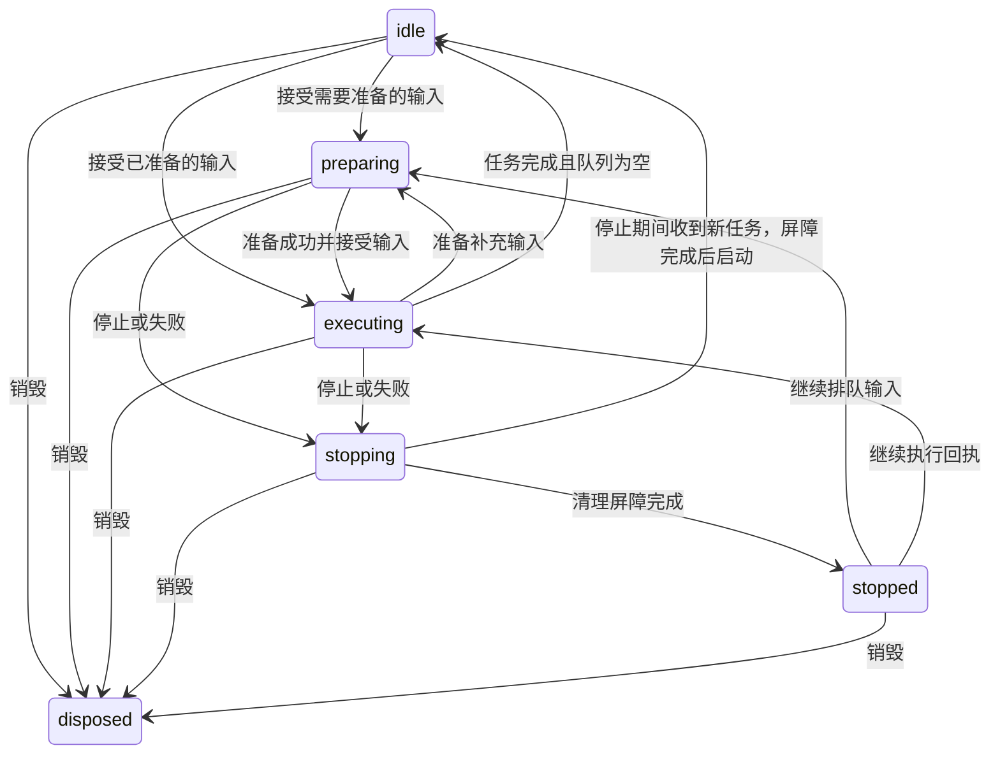

## 2026-11-04 同步旧工程恢复与岩石颜色修复

本轮同步来源为 `engine-next/dev/2.0@e44e84a3198bcd1de2d8d46ffdedde0ed7773263` 的 17 文件修复提交，逐项映射到本仓库已拆分的系统包与 Seed World Demo；不将其父提交的整批 Agent/API 更新混入此次同步，也不改变最初的迁移来源基线。

旧工程带有植被资产 v1 标记却没有 `World/Vegetation` 命名空间时，首次补导入完整原生植被闭包；已有命名空间的工程继续原位升级。Planning Source 升至 v2，在已接受作者数据上补齐植被资源和地面风所有者，保留显式零、材质、无关对象及玩家数据，保存重开后不重新初始化工程。

主岩体的默认线性 Color 使用来源彩色纹理到灰度底图的逐通道最小二乘拟合值，面板显示 `#96967a`，重置恢复该色调。树脚伴生石和景观散石保持白色乘数，主岩体改色不会连带改变它们。调色面板按当前显示值比较，只提交用户实际修改的通道，避免颜色显示量化覆盖未修改值。共享纹理、几何及草地生成规则保持来源行为。

回归保存在 `world/tests/seed-world`，通过 `pnpm --dir world exec vitest run --config scripts/acceptance/seed-world-fixes.config.mjs` 执行；原用例只适配模块和资源地址，断言保持来源原样。本轮 6 文件 80 条通过，包边界与 World 类型检查通过（原生仍有 1 条既有诊断），Seed World 单入口生产构建通过。开发入口完成规划 → 生成 3D 并达到 ready，面板显示 `#96967a`；生产入口在独立浏览器上下文达到 ready、加载层隐藏、控制台无错误，已目检默认画面中的植被、建筑和灰色小石。来源扩展检查的 3 条旧岩石源码断言在未加修复的来源远端基线也失败，详见来源提交的实施记录；不把本次结果外推为全部 Demo、完整视觉一致性或性能验收。

## 2026-11-03 全部植被接入公共编辑器

按 `.agents/skills/galacean-editor-system-migration` 核对并迁移 72 项通用植被（乔木 4、小灌木 3、高草 3、草本 16、地被 6、野花 24、落叶/菌类 16），同时覆盖生产裸枝树、连续低草、三类荷花和原有 14 种农作物的接入边界。原有三项明确不用于 Seed World 的草本仍保留在独立素材库，不改变生态启用规则。没有重构生成算法、Shader、LOD 或玩家玩法，也没有修改 Engine 包。

### 资产与组件

种类目录、程序化曲线/叶片结构、结构实例与物种配方继续使用有校验和引用提取的领域格式 `PlantSpecies / PlantStructure / PlantShape / TreeStructure`；这是可编辑程序化输入，不是可由 Mesh 合理替代的静态结果。材质配置已执行生产材质适配器转换成原生 Material，纹理、模型与对象模板使用 Texture/KTX2、GLTF 和 Prefab。材质外观索引和生产资源索引保留为 `PlantAppearance / PlantProduction`，只承担槽位与原生资源引用，不再由它们在生产运行中重建一套材质配置。低草、荷花和作物继续复用现有原生资源及组件。

种子工程清单为 228 项，其中 `World/Vegetation` 75 项；运行时另挂载已有建筑内置包，因此运行清单数量更大。原先仅直接注册 ResourceManager 的 98 项生产资源进入项目依赖闭包；它们也包含植被使用的伴生石共享资源。转换保留原结构、灰度 Alpha、颜色乘数和采样语义；UV 密度和 KTX2 采样默认值烘入转换资产，生产加载器不再反复覆盖这些作者属性。草簇保持当前原始草模型的完整几何，修正旧导出脚本仍套用过期减面流程的问题。

Unity 参考为官方 Unity 6.3（6000.3）文档：[TreePrototype](https://docs.unity.com/en-us/engine/6000.3/script-reference/unityengine/treeprototype)、[DetailPrototype](https://docs.unity.com/en-us/engine/6000.3/script-reference/unityengine/detailprototype)、[WindZone](https://docs.unity.com/en-us/engine/6000.3/script-reference/unityengine/windzone)。

| Unity 职责 | Galacean 组件/资产与可调面 | 实际消费者 |
| --- | --- | --- |
| TreePrototype 的树种/原型，Terrain 的树木分布 | 原生资源引用、PlanningVegetation 的树高、比例、坡度、边界与共享尺寸 | 原有树木候选和程序化结构编译 |
| DetailPrototype 的草、细节原型、尺寸和密度 | PlanningVegetationPopulation、PlanningVegetationInfluence、PlanningFlowers、PlanningFlowerInfluence | 原有固定候选、花区与局部生态发布 |
| DetailPrototype 的健康/干枯颜色及材质 | PlanningGrassAppearance、PlanningPlantMaterials、Material/Texture 资产 | 共享草色场、真实物种和材质槽 |
| WindZone 的方向、强度与扰动职责 | PlanningGroundWind 的速度、风向、波强度/尺度、刚度、扰动和色带；原有环境风服务保留 | 原有草花风 Shader uniform 与运行时钟 |
| 普通 MeshRenderer、Prefab 和实例化 | 原生 GLTF/Prefab、已有 Renderer 和 Engine GPU Instancing | 连续低草、荷花及批量植株 |
| 无 Unity 内置对应的农业玩法 | 原有 FarmingSystem/FarmingAreaComponent、作物资源与领域服务 | 14 种作物及玩家进度；不虚构 Unity 标准农业组件 |

### 唯一归属、兼容与退役

| 原入口 | 唯一归属 | 公共能力及适配 | 兼容/验收 |
| --- | --- | --- | --- |
| World/Planning.json、临时挂载的 authoring 子树 | 公共 Scene Source 中的 Planning 组件 | 原生 Scene 编辑、同事务准备与校验；PlanningSession 只消费接受后的作者输入 | 显式导入后删除旧包，标记与 Source 同次接受；保留非活动 Seed 与无关 Scene 对象 |
| 规划 Inspector、3D 参数面板、Agent 参数工具 | 同一 Source | 2D 使用草稿准备后发布公共项目历史；3D/Agent 使用 run→prepare→commit→activate | 显式 0、reset/base、失败和混合 Native/领域编辑；冲突拒绝 |
| 生成网格、共享资源的私有副本与发布候选 | 当前运行发布所有者 | 资源传递依赖变化触发缓存失效和重建；候选失败只释放自己 | 共享材质变更与撤销实测；普通 Source 和 Prefab 继承回归 |
| 农场快照、玩家视角及已消费请求 | 原有 runtime-owned 资产与领域仓储 | 继续使用串行写入、checkpoint 和公共持久化 | 作者提交和撤销不覆盖玩家进度 |
| 受控返回/关闭 | 页面与项目生命周期 | 停止新操作，排空运行写入，保存成功后释放项目 | 保存失败保留项目以重试；停止/checkpoint 不重复执行 |

生产入口不再使用 `mountPlanningAuthoring` 维护另一棵可写 authoring 树。旧叶片材质、树形和草花风直接改运行时的面板入口退出生产接线；组件字段和项目资产承担微调。独立素材预览与 headless/旧存档夹具保留明确的旧 URL/JSON 适配，不是生产工程的第二真相源。已有外部光照 URL 保留其原来的 URL 适配；光照素材不属于本轮植被转换，不能将其变成缺失的 VFS 引用。

普通 Scene 更新保留稳定 Entity/Component ID、Script.enabled 与非本系统组件；Prefab 只写变化的覆盖，reset 恢复模板继承。已导入项目要求保留规划作者根，不能删除后静默当成新世界。植被资产导入版本 2 补齐裸枝树的原生引用，翻译未被作者替换的旧纹理别名；不重新补回其他被用户删除的资源，不覆盖现有材质参数。

### 实际验证与边界

- 植被覆盖回归运行 59 文件、545 项；初跑发现相对 URL 处理回归及两处旧夹具过期。修复后对应两文件 35/35 通过；生成器耗时用例使用 60 秒单例预算，29 项全部通过。
- 公共事务、Scene、农场进度/恢复、显式撤销与关闭回归 11 文件 99/99；补充 Source/Prefab、资产闭包和关闭回归 4 文件 17/17。集合有重叠，不相加。
- 原生农业回归 9 文件 140/140；原始植被依赖与嵌套部署构建检查 2/2。转换的原生 Prefab 均验证重新编译与原始层级等价，各物种参数与原始资源逐项深比较。
- 桌面 Chrome 正式 3D：新加载及旧版本工程迁移均 ready。原生风场 1.5→0 后实际组件值、Source 与稳定身份一致，保存重开保留 0；重开后新事务修改速度并撤销，恢复 3.5，其他作者数据不变。
- 桌面 Chrome 共享灌木 Material：Alpha Cutoff 0.5→0.6，植被私有资源副本失效，多个活动 Renderer 均为 0.6；公共撤销恢复 0.5，风场和花区配置不变。自定义 Loader 返回的 JSONAsset 与正式 Engine 为同一类身份，组件借用同一缓存资产。
- 桌面 Chrome 规划页：灌木比例→0，作者数据和派生结果均为 0；受控关闭后从存储重新打开，原生 PlanningVegetation 仍为 0，旧 World/Planning.json 不存在。
- Terrain 类型检查已通过；预置 Script 声明由源码重新生成（312 文件）。最终一致性、构建及范围检查见本条后续补记。

资源替换目前沿用完整派生场景重新发布，尚未优化成仅重建目标植被的 GPU 资源；不宣称整世界性能或移动端验收。此次验证是编辑器迁移，不等于 72 份源模型/Unity 的逐像素美术还原验收，也没有制作完整植被 Inspector UI。场景拾取继续使用原有派生证据和规划归属，不将每一株生成植被烘成作者 Entity。工作树原有岩石修改保留且独立，不纳入此次植被提交范围。本轮按用户授权提交至 dev/2.0。


最终补记：Asset Assembly 67/67 通过。移除已无清单或消费者的旧 debug 资源拷贝步骤，解除该生成器长期依赖缺失 source/debug 输入的问题；测试生成的物化资源随后全部恢复并与源码 158 项文件逐个校验一致。新增取消传播、Source/Prefab、引用替换和关闭相关最后四文件 15/15 通过，另有六文件事务/取消回归 30/30。取消会终止对应规划 Worker；旧请求的晚到取消不能终止新请求。

Source 历史中的 revision 只是持久包元数据，Session revision 是会话并发计数；三方合并排除该计数并采用本次领域事务的下一 revision，避免原生编辑或 undo 后误报作者冲突。已经保存的原生 Scene 以内存储的 active Seed 为准，URL 只选择项目及首次初始化；修改 Seed 后农场继续绑定同一项目，不再误读另一个项目。旧独立 JSON 导入仍沿用原有按 Seed 选档的兼容约定。

Terrain 和 Runtime Editor 类型检查通过；312 文件预置声明一致性检查通过；原生植被发布器 --check 通过。生产构建以 write:false 完成，生成 347 项内存产物，保留构建器原有重复资源发射警告，未创建发布目录。范围审计返回 needs-scope-split：命中 Asset Assembly 保护目录的源码和转换产物属于本次用户授权的植被迁移，三个 agent-adapter 文件为必要的共同接线；没有放宽审计规则或把原有岩石修改并入迁移。

推送前同步 dev/2.0 至 `97845a398`，合并上游工程资源清单和实施记录，保留上游水面、道路避让、草地发布与萤火虫改动。在隔离原有岩石修改的提交内容上重新物化并完整构建 Engine，Terrain、Runtime Editor 与公共 API 类型检查通过；17 文件 167/167 项关键回归通过，覆盖 Source/Prefab、资源闭包、关闭、Worker 取消、公共作者发布、农场保存恢复和上游植被资源生命周期。原生植被发布器与 312 文件声明一致性检查通过（1262314 字节）；生产构建再次生成 347 项内存产物并通过，仍只有既有重复资源发射警告。提交范围为 84 个 Gallery 文件，不含 Engine 源码和独立岩石修改。

## 2026-11-03 道路避让边界索引（用户授权先发布）

后续复核限制：用户要求确认未观察到的差异，追加正反轮廓及距离道路边界 ±1e-7 米的采样，9 项索引回归通过。但不能宣称任意道路输入严格等价：蝴蝶结自交轮廓 [(0,0),(10,10),(0,10),(10,0)] 的旧三角化返回 2 个三角形，新奇偶填充与其并集不同；400 个网格点、半径 0.1 米对照中 90 个不同，例如 (0.25,0.75) 旧排除、新不排除。边长 1e-5 米正方形的旧三角化因退化阈值失败并触发道路错误，新索引仍接受。尚未证明所有其他 Seed 或编辑产生的轮廓都满足非自交/非退化前提，因此以下正常道路成果不能外推为完整输入域等价。用户在获知上述差异后明确要求先 push 到 dev/2.0，兼容处理保留为后续事项；审计脚本保存在仓库外 RoadInvalidAudit.spec.ts。

按用户澄清撤回取消道路避让的实现及测试；此前 15%–19% 实例增长和删除过滤的性能数字不作为本轮优化成果。花草与伴生石块保留道路避让，植物半径、变宽道路、闭环内部空地、道路密度带及其他固体/水域排除不变。生产道路网格和 Shader 不修改。

PlanningNaturalVegetation 的道路排除改为懒构建 LandscapeRingQuery：直接索引已发布的完整边界，Float64 坐标、紧凑边索引和包围盒树；奇偶射线判断路内，精确线段距离判断占地半径接触。不降采样、不栅格化、不预计算全世界植被。双桥接边在闭环包含判断中相消。每条道路随 planner 缓存一次，查询复用栈，planner 生命周期结束后由 GC 统一释放；删除道路三角化、每三角形对象/六组数组和每 Cell 的三角形筛选、包装及分桶。其他排除仍走原路径，拒绝原因仍是 exclusion。

算法对照：Apple M5 Pro / arm64 / Node 26.7.0，旧实现取 cb6fd9a36152ee2aa2cd2836aa9173172bd0f87e，前后交替运行。4098 边界点闭环、64 米 Cell、完整植被层及中性道路密度，9 轮剔除前 2 轮后中位数：Seed 1 首次 255.39→37.41ms、重复 45.38→34.52ms；Seed 7 首次 215.19→39.59ms、重复 47.12→37.67ms；Seed 91 首次 216.09→40.38ms、重复 48.10→38.82ms。完整输出相等，实例数分别保持 1641 / 1791 / 1873。

真实道路几何对照：Seed 1 的 70 条已发布道路，统一的受控植被素材/覆盖场，取道路中段所在的 40 个不同 Cell；共 33227 个实例及全部诊断完全相等。5 轮交替中位数，首次遍历 40 Cell 为 2100.54→1072.42ms（-48.95%），热缓存遍历为 1107.38→1070.25ms（-3.35%）。此项隔离道路算法，不是完整实景默认植被负载；早期直接将简化素材夹具用于完整世界导致两版均超候选预算，未放宽产品预算，未采用该失败夹具的数据。

内存单独构建 70 条道路的排除缓存，显式 GC 前后比较 8 份缓存的平均增量，保留在强引用中：旧三角形缓存 15698111B JS heap；新缓存 92455B JS heap + 1006248B ArrayBuffer，总计 1098703B，即 14.97→1.05MiB（-93.00%）。新索引全部 typed array 的 byteLength 精确合计 1009128B；小数组内部存储的记账归属与 memoryUsage 分项不同。上述不含双方共有的道路轮廓/密度带、渲染/GPU 或整个页面内存，也不是手机实测。新查询不创建逐点临时数组；未对整页分配速率/峰值作测量结论。

验证：保留原 37 项植被回归；新增 3 个 Seed 的完整实例/诊断与三角形 oracle 等价检查，包含伴生石块；另有 5 项边界索引测试，覆盖直路、变宽曲线、闭环、凹形、半径接触及独立快照。真实 Seed 1 在 4176 对照 53/56 两条道路，固定 1280×720、相同位置/目标截图，未改道路内部留白；风、动物、光球动画未冻结，不宣称逐像素一致。截图和基准 JSON/临时脚本保存在仓库外本会话 visualizations 目录，调试相机与基准入口已清理。用户确认截图未见差异，并在获知兼容边界后授权先发布；独立建筑异常释放修复不纳入本次提交。

## 2026-11-03 岩石接触性能修复发布范围

用户授权先推送已经验证的接触计算分帧、等价距离粗筛、紧凑 CPU 索引和无临时清零数组的 GPU Buffer 分配。保留下方测量边界；未将尚未确认的建筑/Worker 内存调整纳入此次提交，也不宣称完整排除泄漏或完成手机实机验收。整合上游调试入口、相机控制、渲染资源回收与动物描边改动；下方“本地未提交”为此前阶段的历史记录。

在 `origin/dev/2.0@87450e45d8bf1986d9159a360235c69ce35e9e9a` 上重放后，3 文件共 56 项相关回归通过，净差异 5 文件且范围审计通过。外层 Husky bootstrap 缺失，手动执行 lint-staged（无匹配任务）、物化环境 commitlint 与差异格式检查。

## 2026-11-03 调试入口修复用户验收

用户已验收本轮白盒／OBB 灯光和 Shader 修复、加载按钮挂载时机、OBB 与 Orbit／漫游控制解耦，并授权合入 dev/2.0 与推送。以下“本地未提交”段落为当时验证快照；发布范围为这些已验收修复及相关测试，不包含仓库外截图。

发布前无冲突整合 `origin/dev/2.0@079d207e4f565453f790860fbf42295b4b18a38e`，保留上游渲染资源回收修复；重新物化、冻结锁文件安装、完整引擎构建、6 文件共 37 项相关回归及 Terrain 类型检查全部通过。最终范围为 11 文件；范围审计仅标记本次已说明的共享 Terrain Shader 及其规范编译产物。外层 Husky bootstrap 缺失，手动执行 lint-staged（本次文件无匹配任务）、物化环境 commitlint 及差异格式检查后提交。

## 2026-11-03 OBB 表现与相机控制解耦（本地未提交）

按用户要求，OBB 开关仅切换真实素材／白盒表示，不再自动进入漫游、不接管移动、不创建诊断第三人称相机或胶囊角色；Orbit、漫游和既有 locomotion owner 继续独立管理相机。移除切换回调中的强制漫游及建筑视角退出，并取消其它相机操作对 OBB 开关的隐式关闭。规划器内独立白盒测试的第三人称功能不受影响。按钮构造时保持离线，只由调试侧栏挂载，消除加载约 95% 时左上角独立按钮提前露出的路径。

OBB 与侧栏 11 项回归、Terrain 类型检查和差异格式检查通过。更新旧测试中已过时的地表采样 mock；表示切换覆盖 Orbit／漫游／外部移动 owner 的保留、同源体量、资源复用与销毁恢复。Chrome Seed 1 真实场景验证 Orbit 开关 OBB 前后相机位置／朝向逐值一致；漫游开启 OBB 同样不改变相机；OBB 开启时切换 Orbit 仍保留 OBB。控制台 error 为空，截图 `/tmp/seed-debug-acceptance/obb-orbit.png`。加载过程中观察到 68% 无 OBB 按钮，未恰好采样到 95%；不提前挂载的保证来自构造与侧栏挂载路径。骑乘只做 owner 保留单测，未做实际骑乘验收。未 commit/push。

## 2026-11-03 OBB 对照与白盒测试修复（本地未提交）

基于 `dev/2.0@1a0c87140b3faae30bfcc87f2df0e24d4b30eaec` 修复三个实际故障：白盒表现层将继承自 Lighting Profile 的未填写字段转为 NaN，触发 `shadowStrength must be finite`；植被诊断复用 Terrain Shader 时，拾取分支的 void 提前返回触发 `Return in void function`；白盒网格缺少 UV1 时，宏依赖裁剪移除了最终颜色输出，导致包围盒和水面不可见。

PlanningPresentation 复用既有 PlanningLightingProfileRuntime 处理默认配置、稀疏覆盖、显式零值及取消，再应用作者后处理，并保留语义诊断的后处理隔离。Terrain 拾取与着色改为互斥分支并重新生成规范 shaderc；白盒对象索引在无 UV1 时使用零值，避免颜色输出依赖可选属性。范围审计提示共享 Terrain Shader 需要范围拆分；此项是本次诊断入口编译修复的直接依赖，不涉及空间布局参数调整。

验证：引擎构建、Terrain 类型检查通过；Lighting Profile 7 项、Presentation 2 项、诊断 Shader 2 项（GLES100/300、含有／无 UV1 分支）、Terrain Shader 15 项，共 26 项通过。Chrome Seed 1 实景检查白盒包围盒与水面可见，俯视／白盒往返、第三人称漫游入口、导演统计入口可用；原生 3D 的 OBB 开／关／再开正常，关闭恢复原生场景，控制台无 error。未覆盖导演完整播放、所有 Seed 或移动端。修复预览运行于本地 4174，截图位于仓库外 `/tmp/seed-debug-acceptance`；未 commit/push。

## 2026-11-03 内存归因与岩石接触索引压缩（本地未提交）

原 Trace 的 1.33–1.51GiB 是主线程 `jsHeapSizeUsed`，不是 GPU 或整进程占用，也没有对象持有链，不能据此判定泄漏。4176、Seed 1 普通 3D URL 冷加载后完成 GC，DevTools 主线程约 1,350MB；WorldPlanning/PlanningRaster/Construction/RockFormation Worker 分别约 166/160/77.8/14MB，另四个约 1.3MB Worker。这些是桌面 Chrome 的新样本，不是原行走帧或手机测量。完整堆快照采集时页面崩溃，没有可用快照；低开销存活分配采样成功导出至仓库外 `~/Downloads/Heap-20261103T161336.heapprofile`，采样总计 830,218,080B，不能将它与 heap 总数相减后武断归为 WASM/GPU。

采样按文件 selfSize 去重归集：建筑 Worker 反序列化 167.82MiB、GrassRockAppearance 142.01MiB、岩石碰撞 Vector3 表示 49.20MiB、规划 Worker 反序列化 34.51MiB、PlanningSession 发布 34.35MiB、岩石 Worker 反序列化 19.67MiB。其他包括引擎/Shader 编译、建筑查询和资源几何、水体快照、植物几何等；inclusive 数值不能相加。已核对 grass Buffer 销毁、Runtime 队列清理、规划/栅格基线与候选缓存上限及 Worker terminate 路径；发现正常驻留的多份快照，未以此宣称持续泄漏或完整排除泄漏。

将接触索引每三角形的对象/嵌套数组改成 28 个 Float64 连续记录和 Uint32 网格索引。保留构造时不可变快照、原 JS 双精度、边界、遍历平局顺序、平滑法线和地形采样；不删三角形、不降草密度、不改 Shader。桶先计数后按精确长度分配，避免持有多个增长数组。外观 GPU Buffer 改用字节容量构造，再上传最终 records，消除等容量清零 Float32Array 和重复初始上传；CPU/GPU 仍各自拥有必要存储。

固定 20 万三角形 Node `--expose-gc` 实验（与 dev/2.0 原类比较，包含 heapUsed 与 arrayBuffers）：147,218,624B → 48,850,968B，减少 66.8%；这是模块实验，非整页/手机内存。3,000 三角形 × 12,000 实例与原类三轮输出逐字节相等，耗时原版 297/406/538ms、当前 102/135/133ms，仅代表 Node CPU。6 项外观测试及 18 项资源测试通过，包含平局、绘制法线、源数组后续修改不影响快照、分帧和销毁；Terrain 类型检查通过。优化后真实 3D 已显示；第二份页面级采样因分析面板失效未取得有效数据，未报告整页下降或手机验收，也未完成长期同路线泄漏检测。

## 2026-11-03 行走长任务：岩石接触草外观计算分帧（待行走复测）

基线 `dev/2.0@1a0c87140b3faae30bfcc87f2df0e24d4b30eaec`。用户录制 `Trace-20261103T115153.json.gz` 长 39.72 秒，实际 URL 为 Seed 1、debug=1。排除前 2 秒录制器初始化后，主线程有 95 个超过 50ms 的 RunTask，总时长 16.63 秒，最大 807ms；这些是任务时长，不是 FPS 或 GPU 时间。CPU 采样估计 GrassRockAppearance.compile 含子调用 12.64 秒，主要来自普通草发布准备（10.21 秒）及岩面草创建（1.63 秒）。开始录制时的 1.85 秒任务包含 CpuProfiler::StartProfiling，不作为行走回归依据。另有约 450ms 的道路植被三角化任务，本次未修改该路径。

三角面边界在来源构造时缓存；按点到包围盒距离提前排除不可能更近的面，保持精确三角形距离、遍历顺序与平局选择。外观生成每 64 次候选访问／32 个草实例可暂停，普通草发布沿既有 deadline 续算；岩面草创建和存量外观刷新共用 2ms 队列，完整属性就绪后才显示新岩面批次。参数／地形刷新废弃旧续算任务，销毁／回收移除排队项。草密度、几何、着色器与布局参数没有调整；分帧意味着外观就绪前可能延后数帧显示，尚需用户实际行走检查。

固定合成输入（3,000 三角面、12,000 草实例）三轮原实现 434/431/340ms，修改后 126/107/93ms，输出逐字节一致；一次续算测量共 37,981 个 quantum，P99 0.0052ms、最大 0.651ms。该数据属于 Node CPU 对照，不代表浏览器帧率。GrassRockAppearance、PopulationRuntime 与 Resources 共 55 项通过，覆盖续算、取消、属性对齐、回滚与资源释放。独立 4176 Seed Demo 已进入真实 3D，原 4173 基线保留；尚未取得优化后的同路线 Performance trace，也未宣称所有卡顿消除。改动未提交／推送。

## 2026-11-02 湖泊默认半径与深度调整

按用户要求，将 `LAKE_DEFAULTS.radiusM` 从 18 米改为 25 米、`depthM` 从 2 米改为 4 米。规划生成和 Inspector 继续共用该默认值，显式全局/局部作者配置仍按现有规则覆盖；半径为湖区名义半径，深度为湖盆目标深度。Gallery 同步完成，最终 25 米 / 4 米配置的 `PlanningLakes.spec.ts` 7 项通过，覆盖默认生产 Lake 请求、Seed 7/23 岸线、确定性、显式零数量、禁用和空水域拒绝；Terrain 类型检查、`git diff --check` 和相对 `dev/2.0@5dfad0523` 的范围审计通过。差异仅本参数文件与实施记录；未执行本轮浏览器视觉验收。

## 2026-11-02 河流水面圆弧收口与浅水过渡

Planner 已有圆弧岸线和对应河床，但生产 River 水面原先在完整河宽处平截，留下可见断口。PlanningRiverEndCaps 在描述适配阶段补齐两个外端，沿已有占地收窄水面，实际水深读取同一最终 Terrain。原作者锚点、河道主体和内部瀑布边界保留；端部派生数据不写入作者存档。共享校验器仅对 resolved-path 的逐点宽度允许正的亚米截面，以支持不超过 2 厘米的尖端；普通作者尺寸范围、无效数值和退化几何校验继续执行。
CR-001 · P2 已修复：急弯的占地去环可能裁掉部分圆弧；单个中心探测点仍在岸线内时，原端部扩展会越界约 1.04 米。现在检查完整候选圆弧多边形，超出已有岸线则保留原端截面。新增真实 WorldRibbon 急弯裁剪回归，同时保留正常圆弧、显式平截、1 米窄溪、原锚点和内部瀑布边界覆盖。复审无未处理的本次新增 P0/P1 问题，修改范围仅本功能的 9 个文件。

基于 dev/2.0@aa2d4bb89 重新物化、冻结锁文件安装并构建引擎。端部与生产描述适配 9 项、共享 Water 6 文件 60 项，共 69 项通过；Terrain 类型检查、差异格式和范围审计通过。PlanningRiverAuthoring 的编辑用例在规划事务阶段报 definition.id is not iterable，目标 HEAD 还原对照同样复现。Water 类型检查的 27 个 Tiny-glade JavaScript 声明/隐式 any 诊断与目标 HEAD 对照逐项一致，新增 0；没有放宽检查门槛或带入其他修复。

内置浏览器默认 Seed 1 ready，原有海洋、湖泊和一条河流均激活，当前页 error/warn 为零。起点从原截面至圆弧半径 50%/90%/98% 的实际水深约 0.354/0.294/0.028/0.006 米，终点约 0.442/0.372/0.035/0.008 米，超出两端岸线均不再命中水面。两个端部实景已检查，原河道内部高差不在本次修改范围，不把端部收口当作纵向落差修复。截图和查询证据位于仓库外 river-endcaps-pr-20261102 目录；该检查不代表全 Seed 或移动端性能验收。

## 2026-11-02 耕地覆盖优化整合 dev/2.0 并准备 PR

在最新 `dev/2.0@aa2d4bb89` 上重放覆盖稀疏化、局部哈希／校验复用、patch 更新与帧预算优化，保留上游建筑／RuntimeEditor 和岩石接触表现。上游新增的岩石接触属性按实例索引绑定；普通草地 patch 继续复用 Mesh／Buffer，已有或新增接触属性的受影响 patch 则在完整准备后整体替换，避免仅更新变换后属性错位或容量不足。属性准备复用同次结果；来源或材质身份变化后失效。替换失败保留旧批次，完整 Cell 准备失败按明确所有权释放资源，避免重复归还变换数组。

重建最新物化引擎后，完整 Engine 构建和 Terrain noEmit 通过。相关 7 文件共 54 个不重复用例通过；新增两组岩石属性用例覆盖从无到有、实例减少／恢复、未受影响批次保留、上传失败与完整重建失败。初轮新增用例将较大排除区域误设为只影响一个 patch，收窄为已明确验证的 10–12 米局部区域并断言脏集合为单 patch 后复跑通过，未放宽资源／字节一致性断言。105 文件生成声明（301718 字节）与最新上游完全一致，无声明净差异。差异与范围检查通过，最终源码范围 12 文件。

整合版未重新测量浏览器、移动端或 GPU 时间。下方 10 月 31 日的性能数据仅属于当时基线与测试场景；带岩石附加属性的 patch 不承诺零资源重建，整场景偶发长帧仍未收敛。

## 2026-11-01 草地 patch 增量更新、资源复用与帧预算（本地未提交）

新增耕地的占地更新按实际变化的密度场计算插值支持范围，分别选择受影响的 32 米 patch。候选保留原始 ordinal 和 seed，在原覆盖粗筛后裁剪到 patch 格网范围；奇数格网中跨边界的候选方格保守保留，再按实际抖动位置判定归属。连续操作合并未完成任务的脏 patch；已有完整重建任务仍保持完整重建，避免取消后漏更新。作者编辑、水域准备及植被入场继续沿用完整 Cell 的隐藏准备与发布事务。

占地发布复用现有 Mesh 和实例 Buffer，通过 bufferSubData 原位更新；容量不足时只扩容 Buffer，保留 Mesh 身份。空 patch 保留禁用的 GPU 资源以便恢复，零实例批次不执行高度或接地上传。合并复制按 4096 个 float、洗牌和包围盒／归属准备按 64 个实例分段执行，取消释放未交付资源。洗牌保留原有 Fisher-Yates 的精确顺序。

整理与发布按 Engine frameCount 共享同一截止时间；占地订阅回调只排队，不再同步调用 update(0) 消耗第二份预算。发布准备及上传前都检查剩余时间。单次候选块、数组分配或驱动调用无法中途暂停，因此这是共享软预算，不是严格的 2ms 执行上限。

验证：相关 11 文件、122 项回归通过；候选范围进一步裁剪后，完整资源生命周期文件 15 项再次通过，包含奇数格网、跨 patch 边界、连续编辑、空 patch 恢复、Buffer 扩容／上传失败、准备中途取消、作者入场及水域回滚。局部更新与完整重建的有效实例字节、归属和包围盒一致。Terrain noEmit、574 文件生成声明一致性（2313994 字节）、差异及范围检查通过。声明快照仅新增四个私有成员声明。

10 月 31 日的内置浏览器桌面 WebGL2 测量使用 Seed 1、1280×720 CSS 视口、DPR 2、Apple M5 Pro；测量期间不读取 AX 或截图。相同两次新增操作重复两轮，单次候选遍历 32768→23776（减少约 27.4%），发布 3 个批次→1 个 patch，实际实例上传约 0.80MB→0.68MB（减少约 15.3%）；两轮均无新建 Mesh／Buffer，另 63 个批次保留原 Mesh、Buffer 和 CPU transforms 引用。发布峰值 3.1→0.5–0.7ms，整理与发布的单帧峰值 4.6→2.0–2.3ms。常规帧间隔中位数仍为约 8.3ms，两轮最大间隔为 16.9／9.4ms，不能据此声称稳定 FPS 提升。

原生锄头点击 4→5 格成功，随后两次直接领域操作达到 7 格，诊断和 GL error 均为 0。原生点击整窗另有一次 165.8ms 帧间隔，发生在草地发布完成约 0.5 秒后；该时段未记录到明显的 Detail 整理／发布耗时，具体原因尚未归因，不宣称整场景无长帧。未做移动端或 GPU timer 专项验收。临时三格已删除、锄头已放回、出生取景已恢复，清理后原四格且待处理任务为 0。原始测量与截图保存在仓库外任务产物目录；未 commit/push。

## 2026-10-30 覆盖优化 CR-001／CR-002 修复与验证（本地未提交）

CR-001：高度控制是表现参数，不应为关闭生态高度而克隆密度字段。草实例整理保留原字段引用，通过任务独立的高度开关选择固定草高或生态草高，消除原 `{ ...field }` 对懒加载 `samples` 的隐式读取。连续数组只在显式缓冲区消费／导出时生成。

CR-002：投影访问方式属于字段／批次准备，不属于逐候选计算。整理任务、岩面草采样及入场批次预备并复用采样器；普通字段保留数组直读，稀疏读取使用插值已有的整数网格坐标，避免每角点重复索引反算。不可变位图允许复用最近一页；点查询和归属查询只在调用入口解析投影，不在四个插值角点重复查询 WeakMap。密度计数和区域查询也在循环外解析访问方式。哈希和高度校验复用边界保持上一轮实现。

验证：相关 11 文件 / 114 项回归通过，Terrain noEmit、574 文件声明一致性（2313843 字节）通过。新增回归经过真实草实例整理方法，禁止密度缓冲区整图复制，并分别验证固定草高和生态草高的实际输出；批量查询验证采样期间 WeakMap 查询为 0，且新旧投影的采样器保持独立。额外 300 组分辨率／原点／占地、共 30000 个位置的稠密与稀疏批量采样均与原算法严格一致。

当前同进程 Node 函数微基准（每轮 50 万次，5 轮预热、9 轮取中位数）：原数组直读 5.71ms，普通批量采样 5.73ms，稀疏批量采样 14.21ms。普通路径已回到原直读水平；稀疏读取仍有必要的覆盖位图开销。该数据不代表整帧或 GPU 耗时。

内置浏览器 Seed 1 真实拾取锄头并点击开垦，4→5 格成功；在提交及后续整理的 697 个观察帧中，源密度整图复制为 0 次／0 字节，无运行错误。相同两次新增操作的首次窗口覆盖提交为 2.7–3.2ms、最大帧间隔 40.7ms；恢复起点并预热后复测为 2.4–3.1ms、最大帧间隔 17.0ms，两轮常规帧间隔中位数均约 8.3ms。首次长帧尚未单独完成归因，不宣称所有场景零掉帧；未做移动端验收。临时新增三格已删除，恢复原四格并放回锄头，诊断与控制台无错误。截图保存在仓库外的任务产物目录。未 commit/push。

## 2026-10-30 新增耕地的覆盖更新优化（本地未提交）

针对落锄提交后的短暂掉帧，将草毯排除从整张密度场复制及全量哈希改为只访问占地区域的稀疏投影。覆盖记录使用 32×32 位图页，组合投影时按页写时复制；内容哈希只合入本次清零的非零样本，保持占地顺序、重叠和矩形拆分无关。保留原始候选种子、双线性采样支持范围和旧快照不可变语义。密度采样、候选归属、运行时计数及音频统一读取稀疏投影；连续数组由 `samples` getter 按需生成。后续 CR 确认当时草实例整理的对象展开仍会触发该 getter，已在上方 CR-001 修复记录中收口。

占地发布显式携带已接受的作者源引用，只有高度数组与该源相同时才复用此前的逐值校验，仍执行结构校验。公共作者输入及水域更新继续完整校验；新增回归证明同一数组被外部修改后的非法高度仍会拒绝，发布失败保留原布局。

验证：相关 11 文件 / 112 项回归全部通过，覆盖局部读取预算、跨页位图、等价占地哈希、连续数组/结构化克隆、旧快照、重叠与删除恢复、资源回滚及音频/存档/植被入场。Terrain noEmit、574 文件声明一致性（2313843 字节）及差异格式检查通过。内置浏览器 Seed 1 真实拾取锄头、点击开垦及草地清理通过，无运行错误；临时新增三格已删除，恢复原四格并放回锄头。

同一桌面环境、Seed 1、相同两次新增操作、不启用 CPU Profiler 的小样本对照：草毯覆盖同步更新由 19.4–34.3ms 降至 2.4–2.6ms，采样窗口最大帧间隔由 67.2ms 降至 17.5ms，常规帧间隔中位数均为约 8.3ms。该结果只证明本次提交路径的同步开销明显下降，不代表所有 Seed、耕地规模或移动设备均无掉帧；大范围排除及按需导出连续数组仍有相应成本。未 commit/push。

## 2026-10-30 批次中断回执按调用实例判断

AgentLoop 在当前批次按调用索引记录是否进入执行，补齐缺失回复时不再按 toolCallId 查询整个任务的历史步骤。跨轮复用 ID 后，因取消或预算耗尽尚未开始的调用正确返回 `NOT_STARTED`；已进入但未完成的调用仍返回 `INTERRUPTED`。不改变调用 ID、调度顺序或重试策略。

验证：新增四组 Session 回归覆盖复用/不复用 ID 后取消、复用 ID 后预算耗尽、复用 ID 正常完成；同时核对已提交文件保留、续跑请求中的回复顺序与状态，以及不自动重放写入。旧实现的两组误报断言先失败，修复后相关 6 文件 79/79 项通过，AI Chat 类型检查及 diff 格式检查通过。本轮使用受控模型和文件事务，不作为真实 LLM 或 GPU 验收。

## 2026-10-30 Session 文件步骤结果与回执补齐

合并复审发现：Session 在执行前复制步骤，但原生文件工具的 `tool_finished` 只更新进度，聊天调试视图因此缺少文件结果、错误和提交回执。现由 Session 按 step 与 toolCallId 关联文件步骤，在工具结束时保存完整展示结果；执行记录与 Session 共用转换，编辑器脚本仍由 `script_finished` 提交整段结果。未新增重试或独立 UI 状态源，保留请求图片脱敏与不可变快照边界。

验证：共享文件工具、Session、Inbox、Trace、聊天控制器回归 7 文件 91/91；Seed HUD 状态展示 5/5；AI Chat 类型检查和 576 文件预置声明一致性通过。新增回归覆盖并行读成功/失败、跨轮复用 call ID、任务结束前实时结果、已提交后停止且后续调用未执行、准备拒绝、发布不确定、模型失败，以及调试面板重新挂载后结果不丢失。没有重跑真实 LLM 或 GPU 场景测试。

## 2026-10-30 Tool 优化分支整合最新 dev/2.0

将 `dev/2.0@0df51ac2f3c6efd072a5cc5a7864fb87e506925c` 合入工具优化分支，处理 20 个文本冲突及相关跨文件契约冲突。保留上游正常帧截图、Blob/会话照片租约、共享图片预算、RuntimeSceneInspection 和 Session 状态机；同时保留六个外部文件工具、多调用调度、异步脚本正文、Console/Return、统一失败统计与 continuation，不新增重试策略。

`observe_view` 改从正常相机帧获取颜色，并在该帧内同步取得 CPU 身份/深度；最长边复用上游 768 像素。截图临时 GPU/CPU 存储先申请共享预算，编码期间保留快照预算，之后转交任务存储；照片历史租约与 task pointer 生命周期分开。pointer 仍只返回身份、类型与命中点。Session 中转接口、真实模型夹具和浏览器检查器均适配该边界；独立 oracle 在捕获时取样，不能等异步 JPEG 返回后再取另一帧身份。

UI 继续消费 Session 快照；模型请求清除上一阶段说明，恢复事件显示现有预算状态，任务终态使用统一详细回执。修复自动整合后的通用聊天视图以泛化道歉覆盖失败详情的问题，保留黄色 retry 和结果不确定时禁用继续的行为。上游新增 RuntimeSceneInspection 脚本测试迁移为当前异步正文，确保实际调用而非仅声明未调用的 main 函数。

验证：整合版 Engine 构建成功；编辑器/共享链路 1032 项中 1031 通过，仅保留既有 SeedWorldKnowledge 花丛措辞断言失败；Terrain 定向 99/99 通过。真实 Chrome pointer 回归通过，同一图身份匹配 GPU 拾取、相机移动后身份稳定、查询记忆/作者版本/选择不变、四次捕获淘汰旧 pointer、最终存储归零。首次浏览器运行在整体世界摘要相等断言失败，因正常帧推进包含时间变化；已改为检查实际不变量后复测通过。此次捕获约 1999.5 ms、保留存储 25,859,428 字节，仅为本机样本，不作性能上限承诺。

补充验证：农场 Editor/组件契约 11/11、文件与 pointer Node 验收器 10/10；Terrain、AI Chat、Runtime Editor、LLM 四个类型检查全通过；预置声明 576 文件一致性检查通过。集合有重叠，不相加。范围审计仅标记未提交的 output/ 诊断产物。

本轮未重新执行真实 LLM；此前建筑样本 A/B 的效率和最终回复验收限制仍保留，不以自动检查代替用户验收。本地预览服务已用更新后的物化引擎恢复到 4173，ASAP 8082 未改动。诊断产物不提交。

## 2026-10-29 公共失败统计、恢复状态与执行结果说明

按用户授权统一失败分类和统计，保留原始错误码与详情；trace 导出新增 diagnostics，分别统计模型请求、生成尝试、现有限流/传输/超限/协议恢复、工具错误和脚本错误，多 Tool 回复按请求身份去重。
缺少服务端生成明细时标记未知，不伪造次数；工具错误和包装它的脚本错误分别展示，不相加。

ASAP 通过显式 recoveryEvents 协商发送与 nonce 关联的恢复状态帧，终态保留同一组观察，等待重试与再次请求模型分别展示。
前端格式纠正共享逻辑模型轮次的 120 秒预算，后端沿用已有绝对 deadline；模型配置、自动重试条件和次数不变。
双方协议需要配套更新。
未完成任务的控制按钮使用双箭头 retry 图标与黄色配色，点击仍走现有 continuation；执行结果不确定而禁止继续时保留黄色标记并禁用按钮。

失败说明根据实际宿主回执区分已提交、执行前拒绝、事务中止、独立命令成功和状态不确定；后端只描述模型失败原因，前端按回执补充执行事实。超限显示“任务未完成：模型输出达到长度上限。本轮没有执行新操作。”，兼容旧后端文案并避免重复；此前已有提交时单独保留提交说明。
Seed World 和通用 AI Chat 的事件展示与 Promise 拒绝展示使用同一个任务失败说明，避免后续 catch 用泛化提示覆盖已提交事实。
验证覆盖受控 429 的真实 SDK/Agent 路径、分片状态与 nonce、取消、预算递减、多调用去重以及真实文件提交后模型失败；没有修改重试策略或建筑业务能力。
本地真实模型 smoke recovery-smoke-06397308a7594645befabd5ceb82303d 成功返回 report_ready、65536 输出上限及请求层恢复观察；未运行建房重放。独立 Chrome 场景受控触发超限后，黄色 retry 图标可见、可点击，原始世界无写入且无 pageerror。AI Chat 类型检查通过；Terrain 全量类型检查在未改动的 ContextLandscapeClusters.spec.ts 与 GuidanceFitting.spec.ts 中报告 baseHeight 类型不匹配。
最终回归：AI Chat 47 文件 / 544 项、任务状态展示 5 项、后端 426 项通过。独立 Chrome 使用旧后端重复文案触发超限，断言最终两句精简文案与黄色 retry 图标，截图复核通过（/tmp/seed-world-retry-control-fixed.png）；本地后端已重启并确认 Wrapper HTTP 200。范围审计及两仓库 diff 检查通过，未提交或发布。

## 2026-10-29 单次生成额度与通用模型请求状态

按用户最新确认，由每轮通用 model_started 事件将当前显示切换为“正在分析请求”，清除上一轮操作说明；不再依赖 view_observed 等特定工具完成事件。该状态只更新实时展示，不加入已完成操作的详情记录；保留工具与提交回执的既有展示。本场景不增加“等待用户输入”状态。SeedWorldTaskPresentation 4 项针对性测试通过，覆盖首轮请求、普通工具后的模型请求、截图后的模型请求及上一轮说明清理。

ASAP 本地调试工作树的 MiniApp AI Chat 服务端配置 params.mini_app_ai_chat_model_setting.max_tokens 与代码缺省值同步从 8000 改为 65536；模型 alias/服务端显式覆盖顺序、推理强度、既有超限重试和压缩阈值保持原契约。17 项模型配置测试通过。核对原后端 PID/cwd 后从同一 checkout 重启 8082，新 PID 29367；启动成功且 Wrapper HTTP 200。经本地 /api/remote_skill 发起一次独立真实 Tool Calling 检查，trace budget65536-1e3f47cabb9844068e2b3e59bd6f886c 返回模型 aisearch_dsv41flash、maxOutputTokens=65536、finishReason=tool_calls、完整 report_ready 调用，供应商报告输出 57 tokens。该检查不执行场景编辑，不证明长输出能完成此前的建房任务；第一次检查请求漏填 strict，被参数校验拒绝、未调用模型，补齐后通过。后端启动另有未配置 Evaluator OSS 的辅助进程告警，未阻止应用启动或上述模型链路。未提交、推送、部署。

## 2026-10-29 文档路径修复与建房后“查看画面”等待诊断

用户提供的完整 interaction `beb68875-41dc-4ae1-9700-d57e0771bfc4` 实际是给已有圆房子补门窗（输入“好，那就配上呗”），最终 failed，266.1 秒中模型请求占 259.7 秒。30 次前端模型请求对应 32 次后端模型尝试；52 个外部调用中 43 个为 read/grep/glob，22 个回复包含多个调用。4 次截图从模型返回到 view_observed 只需 111–144 ms，两次成功修改脚本分别 504.4 / 880.7 ms，不能将等待归因于截图或保存。两次 replace 已完成，最后留下 4 个 probe 窗户，没有完成门；终止提示“本次指令未执行”未准确表达此前修改已提交。

源码与 ASAP trace 对照：step 51 的 73.4 秒包含两次 length/8000 tokens（31.85 / 30.42 秒）及第三次成功生成（10.73 秒）；最后 step 53 又用 33.8 秒达到长度上限，含不完整 Tool Call，未执行该候选。原始建圆房子任务 `6b7f42bd-6d02-4951-a142-88e0e371794c` 也在截图后出现约 45.2 秒请求，包含一次 length 重试。LLMRetryPolicy 最多重试两次，无 Tool Call 的 length 自动重试；重试沿用模型配置，仅追加重试指令。前端导出内嵌 modelAttempts 已保留次数，不能把一次前端请求等同一次模型尝试。

定位契约只说明 decoration.u 是归一化墙面弧长，未说明圆形起点、方向及 phase 的关系。模型反复搜索声明，随后两次写入 probe 窗户并截图。真实 shapeCurve 可直接确定方向；隔离测试以实际曲线采样验证近似角度 phase - 2πu（实际采用折线采样）。SeedWorldTaskPresentation 未消费 view_observed/model_started，下一轮模型等待继续显示“查看当前画面”；真实事件回放复现该显示。以上两个机制测试通过，属于隔离复现，不是新一轮真实 LLM 或用户场景操作。建议补齐定位契约/同源只读墙面定位查询、按执行阶段更新状态、正确表达部分修改已提交、显式展示并约束重试等待；本轮未改建筑能力、状态展示、后端重试策略或用户工程。

路径错误独立成立：此前种树 trace 直接复制 editor/README.md 的 knowledge/world/README.md 后读取失败，原因是文档相对路径与工具工程根路径语义混用；本次补门窗 trace 没有该错误。按用户已授权的通用修复，在 VFS 挂载时统一发布受管理 editor/**/*.md 的已知文档链接、引用定义和行内路径，转换为可直接交给 read 的工程根路径。read/open/grep 消费同一内容；未知目标仍报错，不加 basename 猜测。普通项目文档、声明源码、外部 URL 和代码块保持原文，外部 Runtime 知识 provider 同样处理。旧链接测试自行拼接目录，掩盖了模型直接复制路径的失败；新测试直接读取发布链接。

验证：文件相关 52 项回归、实际 Seed World/Native/Runtime/Masonry 知识挂载链接集成测试、AI Chat 类型检查通过；最后引用标签与格式调整再次运行路径单元测试。完整 LLM 修复后收益未测，不声明步数下降。诊断数据和隔离复现保存在 /tmp/trace-house-diagnosis；未提交、推送或发布。

## 2026-10-29 Editor / OasisBE 能力发现实现对照

按用户要求补查参考实现；拉取远端引用后，以 Editor `dev/2.0@ddb6ff4e4` 和 OasisBE 当前 sprint `2cc0931da` 的固定源码快照分析，未切换或修改两边 checkout。最新模型入口是 execute 内的 `api_lookup`，不沿用旧 checkout 的 editor_api.search/schema、engine_api 结论。

Editor 通过共享 api-metadata 从真实 .d.ts/TypeChecker 生成公开声明树、原文范围和精确类型引用；OasisBE 用原生 rg 选择候选，再按名称/签名/注释排序，直接返回契约。精确符号查询不启动 rg，必要 references 可在同一个 cell 内跟进。查询默认 5 项、最多 50 项、结果约 20,000 bytes，不切半个声明；超大 class 返回成员导航。该实现并非自然语言向量检索，也不自动展开所有类型依赖，因此不能据此保证“空分组”等用户词汇会映射到 Entity。

Knowledge 按当前决策导航，Editor Skill 正文由 Runtime 同版本打包；普通 source_text.read 返回 content 字符串，SDK 声明路径引导到 api_lookup。浏览器可研究复用编译期索引，而非照搬服务端 Node/rg/QuickJS。保留本项目已确认的 TSC 和 console/return 契约。仅核对源码及已有测试内容，未运行两边测试套件、真实 LLM 或核验线上部署，不声明步数/性能收益。对照与固定源码证据：`/Users/zhanyingwei/.codex/visualizations/2026/10/29/tool-discovery-diagnosis/comparison/index.html`。

## 2026-10-29 真实 LLM 能力发现路径诊断（未改产品）

按用户要求，以现有 cases 的自然语言原文覆盖对象查询、空间、时间、天气、地形、水体、植被、动物、世界参数、农场、手工/规划建筑、文件、资产、节点、组件 16 个能力区域，串行运行独立浏览器场景。实际模型 aisearch_dsv41flash；源码 bee10efcf 加未提交改动，测试时内容指纹 e75d926831ee49d57e8cf8884198f5c48c1fcf6582a0d3d85cd54af5c1854dd9；ASAP 24715ce74。未修改产品、未在测试中同步源码，未提交或发布外部文档。

真实批次 `2026-10-28T17-34-29.369Z-98581`：230 轮模型决策（含地形截止时未完成的第 36 轮）、231 次 model_request、249 次文件调用（read/list/search=139/91/19）、29 次脚本失败。15 个用例抵达可完成意图的 API，首次有效目标调用中位数为第 9 轮；动物在入口连续失败后终止。手工建房实际使用 replace，不能因没有 createExample 而判为没发现能力。以上是每例一次的样本，不是全量 API 覆盖率或统计性能保证。

主要证据：7 个系统出现 lines 联合类型错误；9 次 list 根路径 `/`/`.` 错误，另有 2 次 search(`.`) 错误；空间和水体两例猜成 tools.world.spatial 前缀。world.query 在默认 30 项目录的第二页，第 7 轮才读到；“新建空分组”第 16 轮已完整读取 entity.create 声明，仍搜索分组/group/Group，到第 31 轮才创建，整个用例 33 轮且无脚本错误。资产第 10 轮已有 sphere/create 示例，第 20 轮才创建，说明文档存在不等于模型稳定使用。没有 execute 输出转存 outputFile，也没有缺少 main 的错误。地形第 4 轮读到 create、第 8 轮调用，后续高度核验/反复编辑直至 360 秒超时，单列为执行效果问题，不归入导航成本。

测试适配仅三处：fixture 的 document.write 迁到 files.write；历史文档 case 的 oracle 映射当前入口、保持效果断言；持久化观察器适配拆分的 IndexedDB manifest/file 存储，仍从 RuntimeProjectStorage 读取已保存状态。初次批次 `2026-10-28T17-30-29.708Z-97904` 在观察器前置失败，零模型调用，保留并关联 retry-of。适配后 atomic.test 9 项和 tsconfig.llm 类型检查通过。

完整任务与发现能力分开：16 条回复结合原始输出/独立状态及相关截图完成复核后，11 passed、4 failed、1 timeout。查询山与空分组虽找到并执行正确 API，回复存在附带方位/已有节点组件事实错误；规划屋顶自动检查因 decoration.type 派生标签补齐产生严格比较差异，未把其失败改成通过。原始报告、失败和前后状态均保留。建议先改善文件契约及根路径纠错，再由注册表生成用途索引、准确前缀与必要依赖；业务语义放 API 契约，保留 TSC。待同 query 多次受控对照后再声明收益。

本地交付：`/Users/zhanyingwei/.codex/visualizations/2026/10/29/tool-discovery-diagnosis/index.html`，含每系统原始 query、实际逐轮路径、失败、时间、反证、方案与验收指标；相邻 evidence 保存可复现源码归档及原始 trace/state/events。测试 runner 已退出，自有浏览器关闭，保留用户预览与 4173/8082 服务。

## 2026-10-29 execute 直接接受异步脚本正文

用户要求修复通用链路中漏写 main 导致的额外重试。execute 默认输入改为异步 JavaScript 函数正文，可直接 await、console.log 和 return；显式 async function main() 仍由执行器自动调用一次。共享 Acorn 分析按真实顶层函数声明识别入口，不根据字符串或注释判断；声明了不合法的 main 或混用顶层 await/return 与显式 main 时给出入口契约错误。静态 import、动态 import、eval 的既有边界保留，未修改业务 System Prompt 或空间放置语义。

检查 Worker 在内部用匿名异步函数包裹正文，再进行完整的简化 TSC；不转译、不自动修复类型错误、不在失败后重跑脚本。TSC 主诊断和关联信息均映射回原始行号。执行 Worker 的 AsyncFunction 直接消费原始正文；仅显式 main 模式追加调用，保持日志、返回值、错误位置、调用预算、超时、取消及事务提交/回滚链路。Trace 与模型后续消息保留提交的原始代码。

验证：验收 trace 中原始的两行 files.list 脚本经真实 checker 和 AgentLoop 一次成功，无修复回合、无编辑事务；两种入口各只提交一次，正文类型错误执行前拒绝、运行失败回滚且保留日志。5 文件 133 项定向测试、9 项真实浏览器 Worker 回归、AI Chat 类型检查、diff 检查和范围审计通过。浏览器覆盖正文的成功、无 return、TSC/运行/Tool 错误行号、超时与取消；未重新调用真实模型，不据此保证消除其他原因的重试。预览源码已同步，未提交、推送。

## 2026-10-29 Tool 验收中的重试与主线程卡顿

用户实测“在我面前生成一棵树”的 trace 共 29.7 秒，16 次模型请求、14 次 execute，其中 4 次失败分别为读取联合类型的判断方式、文档相对路径、list.limit 超上限、把目录当文件读取；最终植被创建已提交。多数实际文件调用只需十几毫秒，但开始调用前反复等待约一秒，不能将这段时间都归于模型或 Worker。

根因：projectDeclarationModules 对每个模块分别调用 VFS.kind/read，两者各自重建全项目目录，发生在主线程、提交检查 Worker 之前。改为一次声明收集共用一个操作级 snapshot，下次执行重新建快照，继续观察 provider 的新增、删除与内容修改。浏览器隔离对照使用实际 Seed World + Native 声明及 Engine provider（85 模块、906 文件路径）：旧逻辑 170 次遍历、566.3 ms，修改后 1 次、3.5 ms；相邻动画帧间隔分别为 566.7 ms 和 16.8 ms，声明输出完全相同。此数字是目录收集实验，不是用户 3D 场景或整轮 LLM 的性能保证。

execute 的工具契约补齐 read 返回的行记录、二进制联合类型的判断方式、Markdown 相对路径基准、目录 kind 和分页上限；建议直接返回 read 结果，避免为读取文档先猜测结果结构。目录误读明确报出 files.list 调用，存在 README 时给出真实 README 路径。保留原返回类型、简化 TSC、参数上限、失败展示与事务语义，不靠放宽检查或隐藏报错降低失败计数。此前确定性测试未覆盖真实模型首次发现 API 的使用方式，也未覆盖完整目录规模下的声明收集成本，补入操作级遍历计数和浏览器对照。

验证：文件 API、协议与目录收集 4 文件 / 44 项回归通过；真实浏览器性能对照通过，Worker 执行/检查、并发 RPC、异常与取消日志、超长输出 8 项回归通过。真实模型修改后的重试次数及用户场景流畅度仍待验收；未提交、推送。

## 2026-10-29 Tool 脚本 API 与输出通道

按用户确认方案，在 `codex/tool-optimization`（基于 `dev/2.0@bee10efcf`）将独立的 `read_tool/list_tool/search_tool` 收敛为 execute 内的 `files.read/list/search`；普通文本写入/删除从 `editor.document.*` 迁到 `files.write/delete`，不保留旧运行时入口。资产操作仍归 `editor.asset.*`。文件观察使用同一事务草稿，包含已 await 的写入和删除，并保留原挂载库；纯文件查询及纯计算不创建世界编辑事务。文件路径、覆盖、只读范围、metadata、分页及错误语义写在 API 契约中，System Prompt 未增加业务规则。

Console（含 level/args）与 Return 独立返回、独立展示；允许无 return，区分 undefined 与 null。默认展示预算从 4 KiB 调整到 64 KiB，超长内容转存任务内只读 `execution-output/*.json`，可用 files.read 分页续读。展示或转存失败不改变事务回执；任务输出存储有 64 MiB 保守 UTF-16 上限，耗尽时明确报告无法保存新输出，保留已有文件。执行资源上限与展示预算独立。异常、超时和取消前的日志保留；简化 TSC、检查/执行 Worker、原错误位置与提交/回滚规则保持。移除读取时隐式保留全文及跨任务 session_knowledge：脚本读到文档不等于模型看到文档。

验证：最终针对性回归 57 文件 / 614 项通过，覆盖 AgentLoop→原生草稿写后 read/list/search、异常回滚与 Console 保留；AI Chat、Runtime Editor 类型检查通过。扩展编辑器回归 909/910 通过，唯一失败为已有 SeedWorldKnowledge 花区文案断言（期待“不保证补足”，基线实际为“不计算或补足目标株数”，两处 HEAD 内容均已核对），未修改空间规则来迎合断言。原图片事件断言改为验证真正的 AgentTraceStore 输出，保留原始事件向 trace owner 传图的既有机制。实际 Chromium 的检查 Worker、执行 Worker、并发文件 RPC、RE2 搜索、超时/取消日志、64 KiB 溢出续读和世界撤销队列共 8 项通过。Farming 知识与 Preset 声明已重新生成，范围审计通过；未做真实 LLM 指令评测、场景性能复测或用户视觉验收。
## 2026-10-30 动物玩法合入 dev/2.0

以 dev/2.0 `484ed3733` 为基线整合动物分支的四个提交：庄园取食与点击驱赶、远处5秒模拟与提前加载、仅移动时转弯和有限退让、各介质共用受惊。保留上游静态路线、休息落点预约、交通等待和步态相位连续性；路线预检查也执行同一有限退让，防止真实可执行的近处后方目标被提前拒绝。更换目的地后，旧朝向前方的交通限速不再阻止安全后退离开，仍不允许零位移旋转。

保留上游农场单表API契约与混装马车。指定容器按对应item扣减，动物通过StorageContainerPresenter的语义位置查询读取真实可见果实中心，发现和消费复验同源；未准备的货物不提供取食位置。覆盖混装换层、展示上限及观察数量变化，保留上游保存失败和幂等语义。原生点击同时保留套索/编辑工具输入所有权与动物受惊入口。

验证：共享玩法513项、农场791项（完整运行790通过，唯一失败为测试按children顺序误选槽位；改按稳定单位ID后该文件11项全通过）、Seed交互/内容123项，共1427项通过；animals、terrain、farming三项类型检查、104项农场API声明及574文件预置系统声明检查通过。空间范围审计通过。整合版普通Seed1运行就绪、控制台错误0，真实点击原生天鹅后进入reaction:startle，约0.95秒移动7.18米并持续离开；该次点击发生于天鹅自主飞行中。此前作物消费/水中起飞的实景证据仍属于各原始提交，不扩大为整合版逐场景重验。验收观测代码、截图录像及原工作树未提交改动未纳入发布。

## 2026-10-30 水中动物点击受惊修复

点击驱赶复用打雷的 `startle` 行为，删除重复的 `_shoo` 分支。原分支仅根据物种逃离步态挑选当前介质动作，遗漏了通过生态权重注册的游泳、飞行动作，导致水中天鹅收到点击后立即回到闲逛。现在按已有逃离权重和可用介质选择真实动作，保留5米点击距离、快速响应和进食任务中断；轻度靠近补齐当前介质的真实慢速步态。

修正近岸完成后退弧后又回到同一受阻位置、反复退让的问题：同一目的地记录已完成退让的起点，回到该点不重复启动退让；真正更换目的地才重置预算，动画循环不重置。动态障碍解除后的失败路径重试保持原有逻辑。

共享玩法374项、Seed交互/内容27项（共401项）、animals类型检查及差异检查通过，覆盖全部8个游泳模型、6个飞行模型的点击反应、陆地逃跑、进食中断与退让预算。真实普通Seed1、DPR1使用原生生成的天鹅进行实际鼠标点击，玩家距离约3米；23毫秒进入 `reaction:startle/fly`，0.243秒位移0.79米，1.03秒位移7.95米，连续飞行离开。实景验证对象为天鹅，其余能力由自动回归覆盖。录像及逐帧数据保存在工作区外 `seed-animal-farm/water-shoo`；观测代码仅在临时Vite配置中，未新增Seed界面。本次发布仅包含受惊行为、退让预算及相关回归和说明，排除调试代码与验收产物。

## 2026-10-29 动物只在实际移动时转弯

移除原地对齐和受阻半圈旋转。转角由实际提交的位移及体长约束，停止或碰撞截停时朝向同时停止；普通到达使用体型容差，不吸附目标中心。贴墙或近处后方目标使用经过地形、动物占用检查的有限后退弧，失败路线缓存阻挡段，阻挡解除后可以恢复；驱赶会中断旧退让。马车外侧路点预留转弯空间，在后方移动接近过程中对齐开口，进食仍核验站位、朝向及高度。

共享动物347项、Seed集成97项（共444项）及animals/terrain类型检查通过，覆盖受阻恢复、动态障碍移开、驱赶打断、马车转向及进食条件。补充独立运动路径的全量、部分和零位移提交回归，确保转向资格在位置提交之前判断。未测量FPS收益。

真实Seed1、DPR1验收：使用正式庄园API播种浇水4株番茄，跟随默认sheep-03，不修改动物出生、权重、时间倍率或目标，没有新增Seed界面。16,042可见帧中静止转向0次，同一动物连续行动约172.5米；249.2463秒自主开始进食，259.2463秒仅移除目标株，4→3。第二次进食时真实鼠标点击，玩家距离3.201米；trusted pointerup后约23毫秒切换驱赶、109毫秒位移超过5厘米。原进食截止之后被打断作物仍在，保持3株，动物继续行动。页面错误0。移动、进食、驱赶录像及原始数据保存在工作区外moving-turns/final目录；发布范围仅包含移动转向、脱困、马车接近及相关回归和说明，排除DPR开关、运行时验收字段及截图录像。此次实景进食验证对象为作物，马车路径由几何与交互回归覆盖。

## 2026-10-29 未加载动物自主模拟与提前唤醒

每个 Seed 出生身份立即建立逻辑动物，沿用原行为树、随机流和动画时钟，远处未加载动物也可按原权重选择庄园食物。远处位移每5秒游戏时间批量推进，动作完成、交互截止和外部事件保留原语义。GLB 延迟挂接；预唤醒范围覆盖最快注册步态5秒行程及已有缓冲带，模型就绪后在显示范围外切回逐帧，保留目标、位置、朝向、速度和动画相位。加载等待期间继续逻辑模拟，不显示静止占位动物。

114个模型567段动画登记经源GLB核实的完整时长，另核对21个外观变体；保持原裁剪、尺寸和素材。修正长粗步跨动画边界仍沿用旧速度，以及逻辑对象存在被误报为模型已加载的问题。

验证：共享动物341项、Seed动物集成90项及animals/terrain类型检查通过。真实Seed1/DPR1中，未加载绵羊自主选择食物并移动，靠近后挂接同一对象，连续进食10秒使作物4→3，其余三株身份不变，随后恢复行动并再次选择食物。未加载黑天鹅自主飞行，在296.93米完成加载并逐帧模拟，255.93米开始显示；随后8秒488帧未发现空中静止或超出速度积分的位移跳变。两次真实场景验收页面错误均为0；未修改动物数量、行为权重和时间倍率，未下发动物移动或进食命令。验收采样、测试截图及临时调试代码不纳入提交。

## 2026-10-28 动物庄园取食与驱赶

普通 Seed 通过正式 Farming API 查询健康作物、落地果篮及仓储果实。所有具有 eat 动画的模型参与现有自主行为权重；Gesture 作为 display 候选。默认连续进食 10 秒消费一株或一颗，作物健康归零复用原生清除，篮子和仓储通过原子命令扣减。删除食谱分类，默认生成请求至少包含两只具备 eat 动画的动物。

快速靠近触发慢速避让，5 米内无遮挡点击可打断进食并快速逃离；雷声使用快速逃离步态。取食沿途遇到动物可停等，目标失效后重选或退出；连续进食期间绑定目标，收割、搬走和驱赶取消计时。版本冲突最多重验重试一次，存储失败不自动重试。马车按朝向从后方开口接近，按动物身高筛选货物，不增加嘴部骨骼求解。

不包含专用测试 Demo、预填庄园、额外动物、DPR 测试开关和运行时验收记录。配置与边界见 [动物庄园玩法](spatial/runtime/ANIMAL_FARM_PLAY.md)。异常回归覆盖连续 100 次驱赶及结束前目标消失；前期真实 Seed 验证了播种持久化和雷声快速响应，不能据此宣称全部物种的自然进食及所有拥挤布局均已视觉验收。

发布验证：在仅含暂存内容的干净副本中，共享动物 335 项、Seed 动物集成 95 项、庄园 662 项用例通过（API 覆盖断言修正后定向复跑）；animals/terrain 类型检查和差异空白检查通过。
## 2026-10-29 PR #112 再次同步伴生岩石基线

按用户要求解决与 `dev/2.0@041a955ef` 的新增冲突并更新原 PR。唯一文本冲突在本文件，完整保留双方实施记录；上游伴生岩石禁草、生成形态、景观投影及声明自动合并，农场实现保持本 PR 现有代码，不追加功能或非必要修正。

新基线验证：石块与农场选址/植被/最终校验相关 12 文件 192 项通过；真实 Seed 1/2/3/4/13 的农场与最近入口检查 5 项通过，同文件其余 8 项未选中执行。Terrain noEmit、574 文件声明一致性（2313843 字节）和差异格式检查通过。相对最新基线仍为原有 70 文件净差异，无额外 Engine 修改；空间范围脚本的 Shader 保护项保持已授权范围。此轮未重新运行浏览器、GPU 时间或移动端验收，前轮证据保持其原范围。

## 2026-10-29 PR #112 冲突合并交付

按用户后续要求，将上一轮已验证的本地冲突解决提交并更新现有 PR 分支。本次只交付与 `dev/2.0@79a0b1ec5` 的合并结果，保留上游村庄出生点及最近入口规则，并继续覆盖 Seed 4；不追加产品实现、测试或非必要修正。沿用紧邻上一轮的完整回归、类型/声明检查与 50 格浏览器验证，代码实现没有新增变化；此前两项上游基线失败和移动端/GPU 性能验收边界保持原记录。

## 2026-10-29 PR #112 冲突处理与性能复审（未提交）

本轮按用户要求只处理必要冲突并重新 CR，不 commit、不 push、不发布审查评论。以 `dev/2.0@79a0b1ec5` 合入当前 `9ac58cc54` 工作树，保持待提交的合并状态。仅农场集成测试和本记录存在文本冲突：测试沿用上游“村庄出生点 / 选择最近农场入口”规则并保留 Seed 4 回归；双方实施记录均保留。上游出生点源码与生成声明自动合并，未手工修改产品实现；不新增测试、依赖、配置、验收页或性能开关。

复审覆盖相对该基线的全部 70 个差异文件及必要调用链，包含库存混装/回滚/查询、马车展示上限和堆叠、麦束共享几何、落锄时钟与地表预览、双通道 atlas、2 米覆盖与选址预算、阴影补偿及程序化植株异步取消/资源所有权。CR-001～CR-005 未见回归，未发现新增 P0/P1。CR-006（P2，非阻塞）：`spatial/README.md` 的自然植被避让说明仍写 3 米，实际统一常量及其消费者均为 2 米，建议只同步该文档数值；本轮不在只读复审阶段追加修正。

验证：农场 87 文件 / 771 项通过；Terrain 与上游出生点/恢复定向 17 文件 / 127 项中 125 项通过。两项旧失败（设施草地清理 255/0、道路重放 `definition.id is not iterable`）均在独立导出的 `79a0b1ec5` 原始源码快照以原输入复现，未放宽断言。Farming / Terrain noEmit、103 项 Native API 声明及 574 文件预置系统声明（2313438 字节）检查通过；无未解冲突标记，差异格式检查通过。空间范围脚本仍为 `needs-scope-split`，保护项均是本次原有授权 Shader 与生成副本，没有额外引擎差异或验收产物。

内置浏览器复用既有 flat-soil 夹具，50 格逐格主绘制为 50，当前合批为 6；两条路径稳定帧几何/图集上传均为 0，完整、湿度、半开垦及取消的对照差异均为 0，接缝提交/取消和资源释放通过。设备恢复仍记录夹具已知错误码 1282，恢复后像素变化率为 0。该对照是当前版本的逐格/合批比较，不是 PR 基线与当前版本的 GPU 耗时比较。

性能风险按实际源码计算：覆盖 atlas 从 R8 变为 RG8，同尺寸显存及每次脏块上传字节数翻倍；50 格按 10×5、1.25 米网格和 8 米泥地分块的计算例为 9 块、容量 16、324×324 纹理，104976→209952 字节。既有 1028 块压力例分配 4050×3321，13450050→26900100 字节。小麦实际生成 528 顶点 / 764 三角形，每车 60 束为 45840 面，原几何对应 10800 面；模型/材质共享且超额库存不增加可见实体。软阴影保持 4/9 次纹理采样，新增每次采样的纹素相位及深度补偿算术；它影响启用软阴影的接收面片元，不限于锄地动画。宿主泥地动画只推进一个 uniform；土壤合批的逐格状态脏行上传沿用上游机制。未确认新增逐帧网格重建或无界实体增长；GPU 时间和移动端验收仍缺少实测，不宣称性能无风险。

## 2026-10-29 PR #112 工作区全量变更集成验证

按用户明确要求，将原工作区全部 58 个变更先保存为 `3984c1236`，再接入现有马车 PR #112。以 PR 原分支为基础同步 `dev/2.0@ccefed87a`，保留马车混装库存、每车 60 份展示预算与小麦模型，同时保留上游耕地 4×4 合批、距离隐藏、性能诊断、成熟共享失败后维持可用实例等实现。土地过渡继续为耕地不规则显露、外围泥地整体淡入与落锄同步，外围宽度为 2 米；批次材质从逐格状态纹理读取显露进度。原已合入上游的成熟共享改动不重复覆盖上游后续修复。

冲突按源码语义合并，重新物化并完整构建当前基线引擎；重新编译全部 14 个 Terrain Shader，覆盖现有 40 处生成资源，其中 15 处产生净差异，包括使用农场覆盖场的 Vegetation debug Core。保持派生资源与权威源码一致，不提交临时依赖链接、截图或测量文件。

验证：农场全量 87 文件 / 771 项通过；Terrain 定向共 14 文件 / 104 项中 102 项通过，2 项失败均在未修改的 `dev/2.0@ccefed87a` 独立源码快照复现，错误一致：`PlanningFarming.spec.ts` 的旧设施草地清理断言（255 / 0）与自定义初始耕地重放触发的 `RoadGeometry.ts` 道路 `definition.id is not iterable`。本轮不扩展修改这两项上游问题。Farming / Terrain noEmit、574 文件预置系统声明及 103 项 Farming API 声明检查通过；Terrain 土壤与积雪 Shader 的 GLSLES100 / GLSLES300 编译通过。范围脚本仍报告 `needs-scope-split`，仅标出用户本次授权的土地过渡 / 地面阴影 Shader 及其生成资源，已逐项核对，无独立验收产物；不能将范围清单记为自动通过。差异格式检查通过。本轮没有新增浏览器游戏实景、GPU 时间或移动端性能验收；此前证据仍仅适用于各自记录的版本和范围。

## 2026-10-29 CR-005 发布交接取消修复及复审

CR-005：生长中植株的工厂结果先保存在局部变量，确认外层生命周期仍有效后才接管到 `growth`。若取消已先行执行，直接释放迟到结果并拒绝创建；不再依赖已被幂等标记跳过的外层 `dispose`。保留成熟资源共享、原发布帧的出苗/阴影状态及现有取消语义。

在既有发布测试中增加五种微任务取消时序，每种覆盖出苗前和已显示植株，检查植株可见性、实例释放、基础材质与器官材质清理。保留真实两层工厂和目录校验，仅替换 GPU 资源以记录释放；修复前两种时序稳定出现未释放实例，修复后五种时序均通过。取消发生在 API 已返回之后时允许 Promise 已完成，但仍要求信号释放全部资源。

验证：发布回归 11 项、农场完整回归 83 文件 / 723 项、Terrain/选址相关回归 10 文件 / 78 项全部通过；Farming / Terrain 类型检查及 diff 格式检查通过。源码及实施记录同步物化预览。本轮未重跑完整 Terrain；此前已确认的 GUI 分类及季节 Shader 两项基线断言失败仍单独保留，不计入本轮通过项。

复审：相对上次只读审查，产品代码仅新增上述迟到结果清理，另更新发布回归。重新核对取消前、交接中与返回后的所有权，及成熟共享、异步失败/取消与 Presenter 接收路径；CR-005 关闭，本轮未发现新增阻塞问题。该验证证明资源释放路径，没有量测真实 GPU 显存残留，也不代替游戏实景或移动端验收。未 commit/push。

## 2026-10-29 CR-002～CR-004 修复与验证

CR-002：地面软阴影的 WebGL2 硬件比较不再固定使用半纹素误差。按每次采样 UV 的纹素相位，求实际参与双线性比较的四个纹素中心中的最低接收面深度；恰好落在纹素中心时排除零权重邻居。保持跨级联世界导数修正、WebGL1 回退、阴影强度和距离淡出，SoftLow / SoftHigh 仍为 4 / 9 次采样。新增不同斜率方向、二维纹素相位、无遮挡及真实遮挡的回归。

CR-003：农场外围仍为用户确认的 2 米过渡带，将草地页表寻址测试的 50% 覆盖探针移到距耕地边缘 1 米处，修正遗漏的旧 3 米断言。耕地不规则显露、外围泥地整体淡入与落锄同步保持不变。

CR-004：锚点位移的只读校验由 `PlantGeometryEvaluator.validateAnchorOffsets` 统一提供。共享植株在写时复制之前校验；未知锚点、非有限位移及混合有效/无效输入均在创建独占资源或释放共享引用前拒绝。新增共享实例边界回归，检查 Mesh、Material、几何、共享状态和释放回调保持不变，并禁止进入资源分配步骤。

验证：农场完整回归 83 文件 / 718 项通过；Terrain 本次相关 8 文件 / 52 项通过。扩大至 9 文件 / 83 项后，81 项通过，仍有两项此前已对照 HEAD 确认的旧断言失败（dat.gui 的 Water 分类、季节植被 Shader 的 `material_GrassTerrainSnowResponse`），未在本轮扩大修改。Farming / Terrain 类型检查、565 文件预置系统声明检查及 diff 格式检查通过；三种地表 Shader 四处共 12 个派生资源重新编译并同步源码与物化预览。

内置浏览器 WebGL2 原生 Shader 编译、链接、硬件双线性阴影比较及像素回读通过：两种软阴影、五种斜率、二维纹素相位与有/无遮挡共 640 次回读；旧算法有 80 次错误阴影，修复后为 0，真实遮挡漏判为 0，GL_NO_ERROR。该验证针对构造平面，不代替完整游戏场景、移动端或 GPU 性能验收。保留其他已有 WIP；未 commit/push。

## 2026-10-29 外围泥地过渡带调整为两米

按用户最新反馈，将 `FARM_LAND_MARGIN_M` 从 1 米调整为 2 米，从耕地外边缘计量。1 米处泥土混合权重为 50%，2 米处归零；保留耕地不规则显露、外围泥地整体淡入与落锄同步。

未新增测试，仅更新既有距离和分块采样断言。覆盖场、泥地层与植被联动既有回归 3 文件 / 19 项通过；源码及实施记录已同步物化预览，diff 格式检查通过。游戏观感由用户验证；未 commit/push。

## 2026-10-29 外围泥地过渡带收窄至一米

按用户确认，将 `FARM_LAND_MARGIN_M` 从 3 米改为 1 米，从耕地外边缘计量。保留原五次平滑羽化，0.5 米处泥土混合权重为 50%，1 米处归零；地表支持范围、分块覆盖和草叶遮罩继续消费同一常量。耕地不规则显露、外围泥地整体淡入及落锄同步保持现有实现。

未新增测试，仅同步既有覆盖距离与分块采样断言。覆盖场、泥地层及植被联动既有回归 3 文件 / 19 项通过；源码已同步至物化预览目录，diff 格式检查通过。实际游戏观感由用户验证；未 commit/push。

## 2026-10-29 耕地不规则显露、外围泥地整体淡入

按用户最新要求拆分过渡形态：耕地及相邻接缝继续使用固定世界坐标噪声的不规则显露；农场平泥地改为在原覆盖与新增覆盖间，按同一个落锄进度做整体插值。既有泥地保持不变，新增泥地整片同步淡入，草叶随相同泥地覆盖权重逐步收拢。取消、提交、最终轮廓和存档行为沿用现有实现；移除宿主地表 Shader 中已不用的噪声函数。

按要求不新增测试，仅调整既有过渡断言以反映两层的新职责，本轮未运行回归测试。Terrain/Grass/Vegetation Shader 编译、diff 检查通过，四处预编译资源及预览目录已同步。实际游戏观感由用户验证；未 commit/push。

## 2026-10-29 撤回扩散，统一不规则显露

用户否定径向与轨迹扩散效果，要求还原并统一使用不规则显露。撤回扩散专用的触地关键点打包、半径/方向/路径 uniform、坐标扭曲和外围泥地轮廓扰动；外围覆盖及其解析/烘焙测试恢复此前版本。耕地与农场平泥地改用同一套固定世界 XZ 噪声阈值，多个斑块随落锄接触进度同时显露，相邻接缝与草叶使用相同权重。移除移动边缘提亮，表面直接呈现原材质；保留精确取消/完成端点和原存档/玩法。

继续使用宿主地表预览端口及提交前/后的 RG8 覆盖 atlas，使泥地也参与落锄预览。播放期间只更新进度浮点 uniform；取消恢复原覆盖，提交后保留新覆盖，已有区域不重播。未保留扩散的兼容入口、数据结构或运行时路径；原工具触地采样仅继续服务动作时钟与触地停顿。其他阴影、成熟作物等 WIP 保留。

验证：农场完整回归 83 文件 / 717 项、Terrain 定向回归 8 文件 / 80 项全部通过；Farming/Terrain 类型检查通过。共享显露 Shader 的严格一致性测试覆盖耕地、邻接接缝及宿主泥地。内置浏览器 WebGL2 原生编译/链接及像素回读验证 21 帧单调显露、取消/完成端点、暂停稳定，并确认内外区域同时存在显露/未显露斑块，没有径向前沿。Terrain/Grass/Vegetation 四处预编译资源和预览源码已同步。实际游戏观感由用户验收；未 commit/push。

## 2026-10-29 锄刃轨迹扩散与自然泥地轮廓

按用户实景反馈，替换上一版单点径向扩散。准备动作时按触地轨迹累计长度选取四个关键点，保留世界位置、锄刃宽度与实际触地时刻；Shader 沿已完成的轨迹段展开带状区域，再逐步向两侧扩宽。粗、中尺度的固定世界坐标扰动改变主轮廓，细噪声打散边缘；线性起步与逐渐扩宽共用原工具触地进度，暂停时整套效果一起停住。轨迹、进度与噪声在草叶、平泥地、翻耕土和邻接接缝间保持一致；已显露区域不会随轨迹推进而退回。

外围泥地按固定世界噪声改变过渡边界的位置和宽度，打散规则圆弧，并将羽化集中在外侧约一米。保持原耕地格内不透明、三米最大支持范围、容器留草和实际操作范围；CPU 解析查询与烘焙遮罩共用同一覆盖函数。新增地块只会增加覆盖，分块共边与重载重建保持一致。继续复用原 RG8 atlas、共享地表材质和局部更新；本轮不增加纹理或绘制层，播放期间无网格重建或遮罩上传。新增四个轨迹点的 uniform，材质按轨迹身份缓存，稳定帧不重复发布轨迹。扩散期的轨迹距离与扰动运算增加，移动端实际 GPU 开销尚未量测。

验证：农场完整回归 84 文件 / 720 项通过，Terrain 相关回归 8 文件 / 82 项通过；最终调整起步曲线后补跑 Shader 一致性、雪响应及泥地编译 7 项通过。Farming/Terrain 类型检查通过。内置浏览器 WebGL2 原生编译/链接和像素回读通过：21 帧覆盖单调、取消/完成精确端点、暂停稳定，同距离点沿轨迹先于横向显露（最终探针覆盖 255 / 7）。Terrain/Grass/Vegetation 的四处 Shader 派生资源和预览目录已同步。游戏实景审美由用户验收，离屏函数检查不代表场景或真机性能验收；未 commit/push，保留原有其他 WIP。

## 2026-10-29 落锄同步的地表扩散预览

按用户确认，将草地 → 平泥地、平泥地 → 翻耕土统一为从首个实际触地位置沿作业方向扩散的表现。共用世界 XZ 起点、方向、米制扩散距离、固定噪声与工具触地时间轴；触地阻力停顿时地表一起暂停。翻耕土先在接触处显露，扩散随后进入周围三米泥地过渡带，草叶同步收拢。翻耕边缘改为轻微土色提亮。新地块及相邻接缝采用相同空间权重，已完成区域保留原覆盖，不重播整片农场。

`FarmingWorldPresentation` 经可选宿主地表预览端口驱动 Planner 的 `PlanningFarmLandLayer`，通用农场保持独立。预览只改变表现，提交和存档仍由原服务完成；取消恢复原遮罩，提交结束保留新覆盖，即使植被的异步快照订阅尚未执行也不回跳。地表 atlas 从 R8 改为 RG8，存放提交前/预览后的覆盖，沿用稳定槽位、页表、设备上限预检和恢复配方。播放期间只更新 uniform，不重建网格、不上传遮罩；稳定 texel 跳过扩散噪声。未增加地表绘制层或纹理采样器，覆盖 atlas 的数据量从每 texel 一字节变为两字节，移动端显存和帧率尚未实测。

验证：农场完整回归 83 文件 / 717 项通过；Terrain 定向回归 7 文件 / 72 项通过，覆盖宿主联动、草/泥地 atlas、局部更新、取消/提交、远处地块稳定、资源恢复、Shader 一致性与积雪继承。Farming/Terrain 类型检查、565 文件预置系统声明检查、修改主体文件格式和 diff 检查通过。Terrain/Grass/Vegetation 三类 Shader 重新编译并同步四处派生资源。内置浏览器 WebGL2 离屏像素回读通过原生编译/链接、取消/完成精确端点、扩散单调性、工具时钟暂停稳定和接触处先于远处显露五项检查；这是扩散函数 GPU 检查，不代表游戏场景审美验收。实际游戏内观感按用户要求由用户验证。保留原有阴影和成熟作物 WIP；未 commit/push。

## 2026-10-28 CR-001：地面软阴影跨级联导数修复

本轮仅处理接收面梯度的级联与控制流边界。Terrain 和农场泥土在片元入口、任何 discard 或分层分支之前取得世界坐标导数；采样时只选择一次当前级联矩阵，用同一矩阵转换接收点与 w=0 的方向导数，不再对已切换级联的 atlas 坐标求导。WebGL1 保留常量下标分支，WebGL2 将级联外索引限制到 Engine 发布的零矩阵。阴影结果在地形各层和水膜之间复用，普通材质继续使用原入口。未增加 varying、纹理、Draw Call 或采样次数；SoftLow / SoftHigh 仍为 4 / 9 次，取消同一片元水膜重复查询。CR-002 的双线性补偿边界本轮未调整。

验证：相关 6 文件 / 97 项通过，含跨 atlas 平移的解析斜面、零矩阵、导数先于裁剪，以及 WebGL1/2 的 1/2/4 级联分支；Terrain 类型检查、差异格式检查通过。扩大检查共 166 项，159 项通过、7 项旧断言失败，涉及未修改的岩石入口/季节接口、dat.gui 分类和 SSR 默认模式，未在本轮顺带修改。三类地表 Shader 的四处预编译资源已同步。

内置浏览器 WebGL2 直接执行当前 GLSL 辅助函数：8×4 构造平面中，原 atlas 导数在 2/4 级联分别有 8/20 个错误梯度像素，新方法在 1/2/4 级联均为 0，GL_NO_ERROR。实际 Seed 1 世界 ready，Terrain 与农场泥土的 10 个接收面程序均链接有效、无 atlas 坐标求导；前往农场后未见原条纹。该 GPU 对照证明梯度边界修正，不等于完整场景所有级联接缝或移动端性能验收。截图为同目录 `farm-ground-stripes/after-cascade-fix.png`；未 commit/push。

## 2026-10-28 农场泥土固定条纹：修正软阴影接收面

用户反馈首轮法线调整后条纹仍存在，撤回该轮额外顶点法线图采样及对应断言。内置浏览器在 Seed 1 独立农场中隔离底色、覆盖遮罩、法线、深度和阴影，并用单个种子袋投影复现：原生 Terrain 与泥土层均出现被直线切开的软阴影。原 PCF 对偏移 UV 仍使用中心比较深度；接收面存在斜率且滤波覆盖较大世界范围时，会产生固定的条带。

`shared/Shadow.glsl` 对 Terrain 和 `MATERIAL_FARM_GROUND_SURFACE` 的软阴影计算接收面深度梯度，按各采样 UV 修正比较深度，并计入硬件双线性比较的半纹素误差。退化导数返回零梯度；保留原阴影强度、距离淡出、硬阴影、植被和其他材质路径。SoftLow / SoftHigh 分别保持 4 / 9 次采样，阴影分辨率、纹理、网格、Draw Call、每帧 CPU 工作均不增加，只增加片元算术。未改变地形高度、深度偏置、方格范围和存档；同步三种地表 Shader 的四处预编译资源。

验证：6 文件 / 95 项通过，包含实际 Shader 编译、WebGL1/2 与 1/2/4 级联的宏分支、旋转及小尺度导数、斜面伪遮挡消除和真实遮挡保留；Terrain 类型检查和差异格式检查通过。重新加载实际页面后核对 GPU 程序：Terrain 与泥土均使用新接收面路径，额外法线采样已移除，阴影和虚拟地表法线保持开启。两个朝向的对照画面未再出现原直线条带，硬阴影及两种软阴影均实际运行并返回 GL_NO_ERROR。Shader 生成器仍输出已有的 `Return in void function.` 诊断，实际程序链接有效。未检查用户原浏览器存档，未做移动端或 GPU 性能基准，视觉最终由用户验证。未 commit/push。

本地截图：`/Users/xingyi/.codex/visualizations/2026/10/28/01a18182-fd67-7c71-9ee6-33f34ed8fb95/farm-ground-stripes/`，包含修复前北向、刷新后北向及南向画面；诊断材质和临时开关均仅存在于隔离页，刷新后已清除。
## 2026-10-29 通过通用表面参数减少伴生岩石竖向拉伸

用户明确要求通过调整参数修复。对同一 Seed 1 岩石和固定相机分别调整蜂窝深度、内缩、细节、覆盖、尺寸和平台坡率后，单独减小凹凸不能消除投影长三角形的竖沟，降低坡率还会缩窄顶部。最终产品改动仅为 `Settings.ts` 中已有全局 `surfaceMode` 默认值由 `cellular-curvature` 改为 `vertex-slabs`；使用既有岩层参数（尺寸 28 m、覆盖 0.65、深度 2 m、变化 0.85）。试验参数均已重置，没有新增形变算法、拓扑修补、特定实例分支或 Engine 改动。

顶点岩层模式使用较密的投影网络和已有法线传递，实际近景及出生视角的连续深沟明显减少，仍有岩石自身的棱面。右侧石块三角形由蜂窝模式的 115 个变为 991 个；这是既有模式的几何代价，不宣称性能优化或彻底消除高度场投影畸变。两种模式共享原石材纹理、颜色和粗糙度。平台比例 1、高度倍率 1、坡率 12、顶部变化 0.05 和伴生石禁草保持不变；所有继承全局表面的岩石使用新默认，已保存的显式表面覆盖继续优先。

冷启动在无显式表面覆盖的情况下读取 `vertex-slabs`。104 块景观石的发布高度均等于原始高度，全部没有覆草数据，76 个主岩体仍保留草面；生成坐标均有限。用户截图右、中、左三块最终局部网格最高点分别约为 1.637649、0.944138、1.569454 m，与规划高度 1.639984、0.945867、1.563260 m 的微小差异来自既有顶部起伏、表面形变和地面采样，没有整体压缩高度。实景只用于确认形状和覆草，审美仍由用户验收。

相关 8 文件共 148 项回归通过：默认值、实际四类 stone 素材包围盒与生成高度、显式旧表面保存重放、set/reset/undo/redo、网格缓存、草面和 GPU 资源生命周期。原本依赖旧全局默认的蜂窝专用测试改为显式选择蜂窝模式，其原有断言保留。生成声明检查、Terrain 类型检查及差异格式检查通过。用户随后明确授权将本次岩石变更提交并推送到 `origin/dev/2.0`；发布前远端基线与本地一致，范围检查通过，无关的本地修改不随之提交。

## 2026-10-29 伴生岩石禁止覆草，定位侧面拉伸（本地）

用户明确要求伴生岩石不能有覆草。景观散布岩石和树脚伴生石现在在生成任务中声明 `surfaceGrass: false`，Worker 不构造草地覆盖与草叶支撑数据；同一缺省为零的覆盖进入原渲染属性，所以绿色底色与草叶同时消失。主岩体继续启用覆草。两种 Client 缓存键包含这项语义，避免复用带草结果；没有通过隐藏绘制或修改全局草量来处理，也未改变高度、几何、碰撞、材质和 Shader。

原生 Seed 1 核对：104 块景观石的草面数据和草斑均为 0；逐个读取 GPU 顶点缓冲，其绿色覆盖全部为 0。四个树脚石素材家族的平台/山峰共八份共享网格，GPU 覆盖全部为 0。76 个主岩体保留草面数据和 2925 个草斑，104 块景观石仍保持原始生成高度。近景确认石顶恢复为石材。相关 6 个测试文件共 114 项通过，包含两种表面模式下去草前后几何逐值一致、渲染覆盖归零、已有草批次回收、相邻主岩体保留和缓存切换；生成声明检查、Terrain 类型检查通过。

用户继续询问红框石头的拉伸痕迹。三块对象的世界缩放均为 (1,1,1)，石材采用世界坐标三平面投射。对照原始 `asymmetric-baked/2` 蜂窝网格流程：`Generate.ts` 把平面网络逐顶点投到高度场，仍沿用原侧面连边，陡侧壁形成长三角形，之后的蜂窝形变和法线表现进一步显出竖褶。右侧岩石 115 个三角形，投影后的边长相对水平跨度最大约 9.97 倍（95 分位 6.66 倍）；中、左两块最大约 4.98、6.59 倍。上一轮保高并将坡率提高到 12 放大了这一表现。该问题已定位，尚未修改侧面拓扑，不能将去草验证描述为拉伸修复。未 commit/push。

## 2026-10-29 修正景观岩石配置遗漏，钝顶保留原始高度（本地）

用户截图仍显示尖石，实景逐块定位后确认它们是 `plan.landscapes` 的独立景观岩石，并非上一轮核对的树脚伴生实例。`applyRockObbSizes` 原先仅投影主岩石，`rockFormationJobs` 的景观分支未带入任何 profile 字段，因此图中石头继续使用原始全高与自动坡率。上一轮仅凭 145 株树脚伴生网格绑定得出整体生效的结论不完整。

景观岩石现在经同一作者投影消费 `world.rockGeneration`，将派生高度、坡率、顶部变化传给 Worker；首次生成、局部 profile 编辑、单体修改/重置、景观显露和水体生态重建共用同一路径。原始高度仅保留在派生结果中，用于幂等重算，不能写入作者存档；显式或继承的 `solid.height` 仍优先，局部发布包含变化的景观 ID。没有修改材质、Shader、Engine 或增加特定 Seed/对象分支。

用户随后明确要求“变圆了但是要保证最初的高度”。最终全局默认是平台比例 1、高度倍率 1、基础坡率 12，保留坡率变化 0.2、顶部高度变化 0.05。相对早期高度倍率 0.25／坡率 3，将高度与坡率同时乘四，保持上升面的水平收缩距离，恢复原始生成高度并保留宽顶部，而非靠压低石块去尖。显式工程配置继续优先。

实景 Seed 1 已核对 104 块景观岩石均满足发布高度等于原始高度。用户图中右、中、左三块对应 `landscape-80.5-927.5`、`landscape-80.5-934.5`、`landscape-87.5-934.5`，最终生成高度分别为 1.6399837703、0.9458670652、1.5632599015 米；位置、占地和底面不变。原生近景可见宽顶部与棱面，仍使用 `SeedWorld/RockSurface`；顶部自然变化保留，不承诺每个最高顶点等于体量上界。配置 set/reset 均通过原 Session 接受，重置后仍复现相同高度。审美效果由用户验收。

验证：6 文件 89 项通过，覆盖实际四类 stone 源包围盒、生成网格、景观投影、局部发布、显式/base 覆盖、撤销重做、保存重放、景观重建和 GPU 资源生命周期；Terrain 类型检查通过，派生模型声明快照已按源码重新生成。扩大运行的 `SpatialReveal` 有一项旧空景观夹具失败（0 < 0），只读装载 HEAD `79a0b1ec5` 的修改前源码后同样复现；未修改该断言。未 commit/push。

用户追问顶部为何有草：`Generate.ts` 对所有 formation 调用 `buildRockGrassSurface`，按最终表面法线、坡度和连续覆盖生成岩顶草地，`RockFormation.shader` 与草实例共享该覆盖。当前不区分大岩体和小型景观石，宽顶部使可覆草区域更明显。本轮只解释现有行为，未修改草地覆盖或新增开关。

## 2026-10-29 伴生岩石默认去尖峰（早期方案，以上节为准）

用户要求通过通用全局配置调整伴生岩石，并明确选择保留材质和棱面质感、只去掉尖峰。追踪 `PlanningNaturalVegetationRuntime → companionRockJob → rockGenerationShape`：伴生石与规划岩石共用 `world.rockGeneration`，原默认 0.85 平台比例会让稳定实例采样中的约 15% 使用原始高度、自动坡率和 Perlin 上升的山峰配方。四类实际 stone LOD0 包围盒的生成对照复现了尖峰与低平台的轮廓差异。

产品修改仅将 `ROCK_GENERATION_DEFAULTS.platformShare` 从 0.85 调为 1；保持平台高度倍率 0.25、坡率 3、蜂窝表面和绘制材质，以及网格生成、实例位置、尺度和复用流程。默认不再选择山峰，所有继承配置的规划/伴生岩石共同生效。显式工程比例与单体覆盖仍优先，已有工程可将平台比例设为 1 或重置生成配置。没有加入独立伴生石分支、光滑曲面算法或 Engine 修改。

验证：4 文件 71 项通过，覆盖默认值、显式混合比例的稳定抽样、reset/base、撤销重做、保存重放、局部发布和伴生网格缓存；Terrain 类型检查通过。同步后的原生 Seed 1 正常加载，世界与植被运行时均读取平台比例 1；145 株驻留伴生石全部绑定平台网格，四类分别为 33/48/24/40 株，山峰绑定为 0。四类实际网格已做形状对照；圆钝不等于无棱面，视觉审美仍待用户验收。未 commit/push。
## 2026-10-30 桥头改为地形直接承接（未提交）

用户明确要求删除特殊连接平面及专用纹理，桥体直接插入地形。本节替代之前的独立引道表层、入口土体下退及透明深度修复方案。

删除 BridgeApproachView、外观网格生成、专用 Shader、素材租约、Terrain 材质适配和四张 2048² PNG；Seed 与水域预览均不再创建引道 Renderer，白盒也不再把岸上整地画成独立桥面。保留桥梁模型的木板/绳索纹理。岸坡仍复用道路约束生成整地目标，写入原固定分辨率 Terrain，表面完全采用已有地形道路外观。结构端使用全宽桥轴入口；干岸整地按实际桥面下垂曲线限制高度，不再额外降低岸上整片地面。水域/障碍、坡度、柱脚、护绳与净空校验保留，水域床面不填高。

删除岸上不可见引道三角面支撑。实际桥面范围之外使用调用方提供的 Terrain 高度，不再把桥面高度沿旧查询边缘外延，防止删去平面后仍踩在空气中。相应旧三角面查询测试改为实际地形支撑与木桥范围检查；已删除模块的素材/绑定测试同步移除，保留其他 Terrain、草地和桥梁资源回收断言。

实现边界：完整桥口包含现有约 1 米 Terrain 网格的插值支撑范围，干岸预留按网格对角线推导，新增承接范围仍检查水域与障碍。承接目标在原固定网格的少量顶点上注册惰性稀疏高度项，首次访问时计算并缓存，不再给每次全图高度查询添加额外桥口查找；进入完整 Float32 栅格时沿用这些顶点，桥口字段进入缓存键。岸上不再保留隐形平面支撑。

验证：3 Seed 的所有必需检查无失败，12 个桥口全宽支撑、桥下 39×5 采样与三列实际地形台阶检查通过；完整相关回归 10 文件 41 项通过，Terrain/Water 类型检查通过。水域资源测试 5 项通过；其旧测试夹具未跟上已有双 LOD 资源结构，已同步为真实的双 LOD 所有权断言，没有修改桥梁资源释放代码。固定 Seed 1 的两岸画面已检查，B 岸前后使用相同绝对相机、2900×1520 画布及1280×720截图；原特殊纹理和裂口消失。A 岸另有完整入口视角。最终懒求值版本又通过稀疏查询与完整栅格逐点一致性回归，10文件41项全部通过。真实Seed1使用现有摇杆输入完成双向全桥及两端上岸操作，非锁定镜头预览可正常移动；W键不是本Demo的摇杆操作验证方式。桥位为满足实际网格干岸支撑可能小幅移动，布局不保证逐点一致。

性能：相同默认作者输入、Seed 1/2/3、固定1024²、无可见3D场景负载；循环三个 Seed 各4轮，丢弃首轮后取中位数，分别记录墙钟与进程 user+system CPU。基线冻结本次删除前的桥梁规划、整地与支撑模块，其余运行代码相同。最终“规划生成＋完整地形栅格”墙钟分别为4560.5→3149.6、3125.1→2632.6、5196.4→4443.5 ms；进程CPU为5174.6→3585.4、3187.5→2857.7、5044.8→4594.5 ms。最终一轮未观察到明显退化，但各轮环境波动明显，不承诺这些百分比为稳定加速或FPS收益。早期逐次查询桥口的中间实现出现耗时回退，已替换为少量既有顶点的惰性缓存；未把其结果作为最终验收。

四张被删除 PNG 合计12947091字节（约12.35 MiB）；这一数值是资源文件大小，不是实测显存。独立引道 Renderer/材质不再创建，未进行移动端或 GPU 帧率验收。临时截图、诊断与冻结基线位于仓库外 bridge-terrain-audit；暂不 commit/push。

范围审计相对 HEAD 报 needs-scope-split，唯一受保护项为本次用户明确要求删除的 BridgeApproach.shader；本次没有新增 Shader/Engine 改动。相对 origin/dev/2.0 的审计还包含其他窗口更新后的历史差异，不合并或提交这些差异。

## 2026-10-29 桥头全宽共边与整地净空修复（历史中间方案，已由下节地形接桥替代）

用户授权修复桥头连接和底层整地穿插，保留硬约束、同 Seed/镜头比较，暂不 push。基线为本工作树 HEAD `3b9ea5c20`，未修改花密度、路网规划、桥梁高度、材质、LOD 或 Shader。

原引道仅中心点与桥端重合，末端横截面仍按弯路切线生成。Seed 1 出生点邻近吊桥的一岸相差约 53.33 度，一角进入桥内约 1.57 米；平的引道与下垂木板相交，旧表层采样最大高出桥面约 0.112 米。整地还会从该末端继续向桥下延伸。

桥轴/净宽/端点高度现在发布完整入口边。引道末行使用该边，越界顶点裁回入口平面并匹配边高，路肩也不跨该平面。完整调整路面复用水域/障碍接受谓词；既有桥位、柱脚、护绳、净空、末端台阶与道路坡度校验保留。结构端取消朝桥下的整地 runout，入口附近的土体下降板厚 0.22 米加 0.05 米净空，沿固定地形网格的一个对角线平滑恢复。行走支撑保持原路面高度，表层 skin 在距入口 0.25 米内退为零。地形仍为原固定 1024² 网格，无局部细网格或额外 GPU 资源。

验证：相关 6 文件 / 16 项测试通过；最终调整后重跑 3 Seed 整图和桥口测试通过。包含正反向斜接全宽高度、越界表层/整地、约束拒绝，以及 Seed 1/2/3 全部 12 个桥口的共边支撑；每桥 39 个纵向位置 × 5 个横向位置的最终 Float32 地形采样均低于桥面。3 Seed 均无硬约束失败。Terrain 类型检查与差异格式检查通过。完整首人称过桥操作和移动端 GPU 性能不在这些单元断言的证明范围内。

真实画面对照：Seed 1、默认作者输入、同一出生点邻近桥，固定相机位置 `(621.5193316602813,14.13843138482556,349.9515510435589)` 与同一四元数。两版均 ready，DOM 记录核对相机完全一致、画布 2560×1440、截图 1280×720；未隐藏引道。斜向土色穿插消失，原桥梁几何保持不变。1005 个相同桥面采样点中，整地解析面最大高差由 +0.10984 米变为 -0.26435 米，渲染 Float32 高度场最小桥面间距由 0.04106 米变为 0.27438 米。截图为 `before-final.png`、`after-final.png` 与 `bridge-comparison.png`；云、水、动物动画时间未冻结，不用全图像素差度量桥头误差。视觉结论限该镜头，不替代用户验收。

性能：从同一 Seed 生成过程捕获全部引道编译输入及原地形/约束闭包，修复前后交替无几何缓存编译，各 9 轮、去前 2 轮取中位数。Seed 1 为 142.87 → 95.03 ms，Seed 2 为 69.39 → 43.18 ms，Seed 3 为 47.24 → 31.42 ms。对应整地三角形 11386 → 9180、10366 → 7552、8698 → 6072；可见引道三角形保持 1720、1472、1280。此测量只覆盖引道编译，不代表整世界加载或 FPS 提升；未新增 Renderer/材质。临时基准、冻结基线和截图均留在仓库外 `bridge-terrain-audit` 证据目录。

范围审计对当前 `origin/dev/2.0` 返回 needs-scope-split：远端跟踪基线已为 `55c7d161c`，与本轮 HEAD 的历史差异包含其他已存在改动；本轮工作区仅桥头相关源码、测试和文档；对本轮 HEAD 的范围审计为 scope-check-passed（7 文件），不移动或提交其他变更。未 commit/push。

> 当前素材范围（2026-10-30）：Seed 仅使用 Cute Zoo 3 和 Low Poly 100。Farm、Wild 的历史目录、配置、预览入口及专属测试已删除；本文早期指向这些目录的验证记录仅描述当时状态，旧文件须从 Git 历史查看，不是当前可用资源。共享行为测试改用独立控制器夹具，资源缓存测试改用当前 Seed 的 Cute Zoo 注册配置，相关 79 项通过；animals 与 terrain 类型检查通过。

2026-10-30 发布前同步：基于 dev/2.0@bf5bbc5f1 整理本次提交，保留上游行为先创建、模型后挂载及远处模拟／喂食／恢复流程，材质 resolver 在 attachResource 挂载时应用。旧 Wild 注册与工具的修改／删除冲突按用户删除旧包的要求处理。合并后共享 gameplay 47 文件 507 项、动物运行时及 Shader 2 文件 41 项通过；terrain／animals 类型检查、576 文件系统声明一致性检查通过。正常 Seed 入口重新进入完整世界，无控制台 error；此轮画面仅确认启动，动物外观验收沿用此前用户验收，不宣称逐一覆盖 121 个外观或性能收益。Husky 引导文件缺失，手动执行 lint-staged（Gallery 不匹配现有 packages 规则）、commitlint 与 diff --check 后提交。

2026-10-30 正式动物材质接入（待用户真实世界验收）：全部 114 个登记条目／121 个外观通过 PlanningAnimalRuntime 的统一加载入口使用卡通材质，包含初始出生、召唤及重新加载。默认使用已验收“原包参数”：亮度 1、阈值 0.6、柔和度 0.2、阴影色 #e2aeae，描边默认开启、宽度 0.012 米、颜色 #493b38；轮廓提亮沿用验收值。不加入距离关闭策略。同一原始 PBR 材质共享一份卡通材质，保留原纹理与资源，宿主在实例销毁后释放派生材质。ConfiguredAnimal 接受宿主借用材质，保留原有透明度／双面修正所有权。

已删除本轮临时对比模块、调参 UI、展台、实验 URL 分支及实验说明文档，以下对比／折叠记录均为历史阶段。正式入口不再渲染左右两遍。正常 Seed / seed=1 / DPR=1 已进入真实世界，可见飞鸟和水边动物的卡通材质及描边，无控制台 error；没有逐个召唤全部 121 个外观验收。运行时 37 项（含材质共享与释放）、两种 GLES shader 编译 2 项通过，terrain／animals 类型检查通过；未测量 FPS，未提交或推送。

2026-10-30 截图面板：右上增加参数栏折叠／展开，收起时左右渲染视口和分隔线同步扩展为各半屏，保留参数和 Orbit。真实 Chrome 已验证收起后参数栏隐藏、两侧各半屏；Terrain noEmit 通过。

2026-10-30 对比切换修正：素材包与分页由整页 location.assign 改成异步加载并局部替换展台动物，保留世界、Orbit、时刻、阴影和材质参数。新实例准备完成后销毁旧实例、控制器及临时材质，失败保留旧画面，退出后不再应用加载结果。真实 Chrome 验证 Cute Zoo → Low Poly 第一页 → 第二页 → Cute Zoo，全程没有重新出现 Seed 加载页，亮度 0.9 与关闭描边状态保留；Orbit 操作后切回不重置机位，无控制台 error，Terrain noEmit 通过。未测量帧时间。

## 2026-10-28 补编地面阴影预编译资源

CR 指出 Billboard、Surface 和 debug Core 的 shaderc 仍是旧 `evaluateTerrainProjectLighting` 函数体。Grass、Terrain、Vegetation 的四处资源已经含接收面软阴影。本轮只用物化引擎里的 shader-compiler，按当前源码重编漏掉的资源，并覆盖 grasslands public、grasslands source、project-tests runtime；Billboard 与 Surface 同时覆盖 seed-world。同一编译器重编 Terrain、Grass、Vegetation 与已提交副本逐字节相同，因此没有改这三份。debug Extension 四份不包含本次阴影函数，但与当前源码重编结果也不一致，已按同一编译器同步 grasslands source 和 runtime，否则 `TerrainShaderDebugResources` 的字节对比仍会失败。

## 2026-10-28 地面阴影修复独立分支交付

按用户要求，从最新 `origin/dev/2.0`（`bee10efcf`）建立 `xingyi/fix-ground-shadow-receiver`，仅迁移本次接收面软阴影修复、CR-001、相关测试与预编译资源。原工作区保留；新基线的实现记录与本轮记录共同保留。

发布期间远端新增 `bee10efcf` 岩顶草共享着色，保留其源码与测试，重新生成四处三类 shaderc 解决生成资源冲突。最终新基线上相关 10 文件 / 180 项回归通过，差异格式检查通过；GPU 重新链接 Terrain、农场泥土、岩顶草三条路径的硬/低软/高软阴影 × 1/2/4 级联，共 27 个变体均有效且 GL_NO_ERROR。接收面梯度构造对照与原农场画面复用前轮证据。新基线 Terrain 类型检查有两处 `baseHeight` 测试类型错误：`ContextLandscapeClusters.spec.ts:61`、`GuidanceFitting.spec.ts:98`，相关测试与类型文件未在本次修改。该结果与前轮旧基线上类型检查通过分别记录，PR 明示检查限制。

## 2026-10-28 CR-001：地面软阴影跨级联导数修复

本轮仅处理接收面梯度的级联与控制流边界。Terrain 和农场泥土在片元入口、任何 discard 或分层分支之前取得世界坐标导数；采样时只选择一次当前级联矩阵，用同一矩阵转换接收点与 w=0 的方向导数，不再对已切换级联的 atlas 坐标求导。WebGL1 保留常量下标分支，WebGL2 将级联外索引限制到 Engine 发布的零矩阵。阴影结果在地形各层和水膜之间复用，普通材质继续使用原入口。未增加 varying、纹理、Draw Call 或采样次数；SoftLow / SoftHigh 仍为 4 / 9 次，取消同一片元水膜重复查询。CR-002 的双线性补偿边界本轮未调整。

验证：相关 6 文件 / 97 项通过，含跨 atlas 平移的解析斜面、零矩阵、导数先于裁剪，以及 WebGL1/2 的 1/2/4 级联分支；Terrain 类型检查、差异格式检查通过。扩大检查共 166 项，159 项通过、7 项旧断言失败，涉及未修改的岩石入口/季节接口、dat.gui 分类和 SSR 默认模式，未在本轮顺带修改。三类地表 Shader 的四处预编译资源已同步。

内置浏览器 WebGL2 直接执行当前 GLSL 辅助函数：8×4 构造平面中，原 atlas 导数在 2/4 级联分别有 8/20 个错误梯度像素，新方法在 1/2/4 级联均为 0，GL_NO_ERROR。实际 Seed 1 世界 ready，Terrain 与农场泥土的 10 个接收面程序均链接有效、无 atlas 坐标求导；前往农场后未见原条纹。该 GPU 对照证明梯度边界修正，不等于完整场景所有级联接缝或移动端性能验收。截图为同目录 `farm-ground-stripes/after-cascade-fix.png`；未 commit/push。

## 2026-10-28 农场泥土固定条纹：修正软阴影接收面

用户反馈首轮法线调整后条纹仍存在，撤回该轮额外顶点法线图采样及对应断言。内置浏览器在 Seed 1 独立农场中隔离底色、覆盖遮罩、法线、深度和阴影，并用单个种子袋投影复现：原生 Terrain 与泥土层均出现被直线切开的软阴影。原 PCF 对偏移 UV 仍使用中心比较深度；接收面存在斜率且滤波覆盖较大世界范围时，会产生固定的条带。

`shared/Shadow.glsl` 对 Terrain 和 `MATERIAL_FARM_GROUND_SURFACE` 的软阴影计算接收面深度梯度，按各采样 UV 修正比较深度，并计入硬件双线性比较的半纹素误差。退化导数返回零梯度；保留原阴影强度、距离淡出、硬阴影、植被和其他材质路径。SoftLow / SoftHigh 分别保持 4 / 9 次采样，阴影分辨率、纹理、网格、Draw Call、每帧 CPU 工作均不增加，只增加片元算术。未改变地形高度、深度偏置、方格范围和存档；同步三种地表 Shader 的四处预编译资源。

验证：6 文件 / 95 项通过，包含实际 Shader 编译、WebGL1/2 与 1/2/4 级联的宏分支、旋转及小尺度导数、斜面伪遮挡消除和真实遮挡保留；Terrain 类型检查和差异格式检查通过。重新加载实际页面后核对 GPU 程序：Terrain 与泥土均使用新接收面路径，额外法线采样已移除，阴影和虚拟地表法线保持开启。两个朝向的对照画面未再出现原直线条带，硬阴影及两种软阴影均实际运行并返回 GL_NO_ERROR。Shader 生成器仍输出已有的 `Return in void function.` 诊断，实际程序链接有效。未检查用户原浏览器存档，未做移动端或 GPU 性能基准，视觉最终由用户验证。未 commit/push。

本地截图：`/Users/xingyi/.codex/visualizations/2026/10/28/01a18182-fd67-7c71-9ee6-33f34ed8fb95/farm-ground-stripes/`，包含修复前北向、刷新后北向及南向画面；诊断材质和临时开关均仅存在于隔离页，刷新后已清除。
## 2026-10-29 岩石与草根连续覆盖

- 发布整合：基于 dev/2.0 的 3b9ea5c20 重放本次改动，保留上游农场软阴影修复，并从合并源码重新生成四份 Grass.shaderc。重新物化、安装并构建引擎以接入上游 ShaderPass.observeVariants；最新引擎下7文件54项回归通过，包含接收面阴影和预编译产物一致性。没有加入实验控件或修改上游功能。
- 发布复验：新物化引擎下 Seed 生产构建通过（37.49秒）；真实 Seed=1 重新进入同一岩体近景，草根融合正常，无实验面板。Husky 引导脚本缺失，手动执行 commitlint 通过；lint-staged 对 Gallery 无匹配任务，差异格式检查通过后提交。
- 按用户认可的 E 效果收尾：绘制岩石与草根共享按相邻三角形面积加权的顶点覆盖率；草尖在低覆盖边缘向承载面颜色收敛。继续通过共享 GLSL 计算岩面颜色与附着法线。保留草叶候选、数量、位置、高度、支撑判断和碰撞几何，不纳入独立材质混合或几何改造。
- 视觉覆盖与生成适宜度分离。不可变 formation 快照缓存视觉覆盖，岩面顶点和草根重心插值消费同一数组；复用原 coverage 字段，13-float 草实例布局不变。删除 A–E 面板、暂停控件、实验 uniform、临时标记位编码，恢复 rockCell.y 原语义。Grass.shaderc 四份源产物重新生成。
- 新增相邻面连续性、面积加权与退化几何回归。GeneratedRockGrass 16项、TerrainShaderPasses 13项、PaintedRockMaterial 5项、PaintedRockSurface 5项、RockMixedSurface 4项，共43项通过；相关 GLSL 编译通过。Seed生产构建通过（32.88秒），清理后真实 Seed=1 同岩体近景复查保持草根融合且无对照面板。terrain 类型检查仍有 ContextLandscapeClusters:61、GuidanceFitting:98 的既有 baseHeight 类型错误，本次修改无新增错误。
- 范围审计相对 HEAD 仅列草 Shader 与四份产物为受保护修改，均属本次用户授权范围，没有其他独立改动。性能尚未实机测量。实验截图留在仓库外；本轮为 push 前清理，未commit、push。

## 2026-10-28 Runtime Editor PR #104 上游冲突整合

将 `origin/dev/2.0@32f65b73c` 合入 `codex/runtime-search-tool`，保留上游 Farming v5 仿真、单一 `leveled` 整备状态及空间规划变更，同时保留本分支单源 API 契约、简化 TSC 和异步持久化语义。Farming schema 的上游修改落入已抽取的共享契约，未恢复两份 schema；生成器重建 Farming 声明及 Preset 声明（571 文件 / 2,308,563 bytes），实施记录保留双方内容。

新增契约回归同时验证主线程 schema 和简化 TSC 拒绝旧 `tilled` 参数、接受 `leveled`。持久化测试使用冻结的历史 v3 规则签名，验证 v7 格式仍可解码，但不能冒充当前 v5 仿真规则，初始化拒绝且不改写任何 Seed 存档；收成测试通过有界的真实时间推进及浇水达到成熟，不直接修改作物状态。没有修改生产仿真或放宽存档校验。

合并后验证：Editing 81 文件共 919 通过、2 个既有失败；Farming 78 文件 667 通过；Terrain 相关链路 8 文件 123 通过；评估逻辑 11 通过；持久化与共享契约针对性回归 19 通过。Runtime Editor / AI Chat / Farming 类型检查、API 生成检查通过。保留的失败证据：图片 trace 原有断言失败；SeedWorldKnowledge 的文案断言仍期待“不保证补足”，上游契约已改为“不计算或补足目标株数”（测试与契约均与上游字节一致）。Terrain 类型检查在 ContextLandscapeClusters:61 / GuidanceFitting:98 报出候选 `baseHeight` 可选与发布节点必填的两处错误；以 TypeScript compiler host 只读覆盖全部 PR 源码差异，恢复 `origin/dev/2.0` 后复现相同两处错误，未用断言、跳过或改类型掩盖。

本轮是合并及集成回归，没有重测真实场景性能；此前性能数据仍只代表各自采样版本。范围审计仅标记 RE2JS 对应的 Engine overlay lockfile 变更，未增加 Engine 产品源码修改。

## 2026-10-28 Alphamap 等价栅格化与分配优化（发布验收）

用户要求优先解决道路 Alphamap 内存浪费，保持原有渲染及路肩平滑。本轮基线快进至 `dev/2.0@dba86574baa5bfc046aa519ca6aec59d105aa6e3`，包含上游稀疏 POI/岩石规则；不与旧 666305c49 路网数据混算。只修改 `PlanningAlphamap` 内部算法及对应回归，不改规划几何、硬约束、Shader、材质、纹理分辨率或采样方式。

原算法每个轮廓分配 1024² Float32 临时场（4 MiB），然后整图合并；历史 884 MiB 是多条道路的累计分配估算，不是同时存活峰值。现共用一条 4 KiB Float32 扫描线和 8 KiB 横坐标表，按行维护有效边，只合并实际影响区；包围盒距离下界仅剔除不可能改善结果的边，保留解析距离计算、16m 范围、Float32 舍入、outline 优先、闭环孔洞及减法语义。河流同时写入水域/河床场，坡带临时场按需分配一次并复用。没有中心线重建覆盖、侵蚀、降精度或新增 roadCoverage。

同一机器、1024²、同份生产生成路网，前后交替各 7 次无缓存栅格化，去首轮后取 6 次中位数；克隆在计时外，每轮两侧对同一陆地顶点施加相同的 1e-7m 级偏移以避开表面缓存。TypedArray 分配单独插桩，避免污染计时：

| Seed | 逻辑道路数 | 生成耗时 ms 前→后 | 缩短 | 本函数 TypedArray 累计分配 MiB 前→后 |
| --- | ---: | ---: | ---: | ---: |
| 1 | 70 | 640.71 → 327.06 | 48.95% | 342 → 26.012 |
| 2 | 62 | 496.60 → 248.47 | 49.97% | 310 → 26.012 |
| 3 | 47 | 460.73 → 245.16 | 46.79% | 250 → 26.012 |

累计分配减少 89.6%–92.4%，四个全图距离场 16 MiB、输出 10 MiB 与行缓冲约 12 KiB 构成当前固定部分；有坡带时另需复用的 4 MiB。该统计不含 JS 边对象、缓存持有的其他版本、Worker 消息、Heightmap、GPU 或全场景资源，不能作为移动设备进程峰值。计时仅为 Alphamap，不能从既有核心规划耗时中直接扣除，也不是 FPS 或手机实测。

21 组真实 Seed 对比的 `weights/sdf/coverage/riverBedCoverage` 全部逐字节相同。新增 10 类冻结旧版哈希回归覆盖交叉、急弯、亚像素路肩、自定义 outline、闭环孔洞、纹理边界、退化边、坡带/庭院/水域组合、非方形世界及重叠道路；另有 1→200 道路分配不增长测试。8 文件 50 项回归中 49 通过，唯一高度图双线性插值断言失败在旧 Alphamap 下复现相同数值（PlanningRaster.spec.ts:51），未修改其精度要求。最终新增 11 项再跑通过。使用已安装共享依赖解析的 Terrain 类型检查，前后均 92 项既有诊断，无新增；本地未解析依赖的诊断不作为有效类型验收。scope/diff 检查通过，不宣称全库全绿。

真实原生 Seed 1 前后均就绪，18 POI、3456×1812 Canvas、7 个驻留块、205 乔木/347 伴生石/165 灌木/93 野花，出生相机 X/Z 相同，Y 浮点差小于 1e-8m。道路和路肩未见新增锯齿，控制台 error 均为零。沿用原始渲染输入与过渡，不宣称消除原先所有锯齿；云、风、水面及角色动画未锁相，整幅截图不能逐像素比较。未做手机真机峰值或全地图视觉验收。

证据目录：`/Users/shensi/.codex/visualizations/2026/10/28/01a17c37-8587-7f03-a850-3fde14d52bbf/alphamap-equivalent`，含冻结源码、完整测量脚本与样本、分配插桩、边界哈希、类型对照、原生截图与状态。优化前原生入口 `http://127.0.0.1:4418/demos/terrain/seed-world-planner/?seed=1`，优化后 `http://127.0.0.1:4419/demos/terrain/seed-world-planner/?seed=1`；两者固定相同默认作者参数，仅栅格实现不同。上述为提交前验收；随后用户明确授权 push。发布前重新 fetch 确认远端仍为 dba86574b，产品源码 SHA256 与验收版本一致（70fee47396d47d87c71a8f4a9773806e16f56cbf72a9dbe9d14080ecb2d6841d）。仅提交实现、11 项回归和本记录，最终远端 SHA 以推送后校验为准。

## 2026-10-28 岩石边界发布整合

整合后定向回归 5 文件 61 项通过（岩石边界、空间实例、POI 分区、动物运行与内容）。Terrain 类型检查存在两处上游测试类型错误：ContextLandscapeClusters.spec.ts:61、GuidanceFitting.spec.ts:98 将 baseHeight 可选的 LandscapeCandidate 赋给 PlanLandscape；相关测试和类型定义均未在本轮修改。不宣称类型检查全绿。发布日志：/tmp/fdc0-release-tests.log、/tmp/fdc0-release-types.log。

用户确认 push。本轮基于最新 `origin/dev/2.0` 的 `7fe5c37d3` 整合，保留上游动物等待、道路/花区优化及岩石/树叶素材参数。引导筛选已在上游前移，冲突按上游流程保留，在新的 footprintRejection 处取消岩石陆地包含限制；引导缓存版本由上游 6 升为 7。文档保留双方记录，声明重新生成。下文计数及验证为整合前快照，发布整合检查另记，不冒充最新原生 3D 验收。

## 2026-10-28 取消岩石陆域及完整 POI 边界限制（整合前记录）

用户明确要求取消三项约束，并确认引导岩石同理。POI 岩组改用所有锚点共同划分的未裁陆地分区生成候选；跨岛共同分区避免各离岛独立覆盖整张地图。分区仍控制候选分布，完整 OBB 不再要求位于陆地或所属 POI 内。引导岩石取消完整陆地包含检查，没有额外 POI 边界检查需要删除。建筑保留原边界规则；河湖重叠、坡度、建筑互斥和道路净空保留。不新增参数开关、不修改 Seed 专属配置，不改变岩石表现。

跨区域岩石暴露了旧增量求解固定所有邻组时与冷生成次序不一致的问题。现按显式互斥关系与新旧候选范围传播重算依赖，包含被拒候选；依赖组沿冷生成顺序求解，不相关组复用。空间和引导版本签名同时失效旧缓存。原建筑回归的“全部邻居数量不变”断言改为存活邻居不主动移动/缩放，并保留完整保存重放一致性断言；跨界互斥依赖的数量可能改变。

最终定向回归 3 文件 18 项通过：RockGenerationBoundaries 4、SpatialElementProfiles 7、PoiTerritories 7。Terrain 类型检查、diff 检查通过。Seed 1/7/42 均发布成功，岩体越陆地占地数 34/33/40，跨全图生成分区占地数 27/32/37；建筑完整边界和河湖排除通过。Seed 1 中型 POI 3 从 0→5 块，大型 POI 1 仍 4 块（河湖限制保留）。浏览器端口 5189 的原生 Seed 1 规划图显示 18 POI、76 体量、64 道路，已目视看到海岸外岩体。本轮未重新完成真实岩石 3D 验收或 FPS 测量。

附加回归的两项失败已分别用修改前的三个源码文件复现：VisualGuidance 的单道路编辑预期 local 实际 full；GuidanceCollision 的 tryRevealSpatialWorld 返回 undefined。新边界回归全部通过，但不宣称全库全绿。引擎类型产物已补齐，公开分区函数声明已重新生成。日志位于本会话 `poi-ranges/` 证据目录，文件名前缀 `fdc0-rock-` 与 `fdc0-guidance-baseline`。以下诊断记录为解除约束前快照。

## 2026-10-28 岩组缺额诊断（参数范围后续）

用户反馈 Seed 1 大型 POI 1 岩石不足、中型 POI 3 空缺，并明确允许岩石出现在海面。按原生新工程 `createSeedPlanningDocument → PlanningSession.initialize` 复现：`poi-large-0` 构造 8 个候选，4 个接受、4 个与河湖水域重叠；`poi-medium-2` 构造 5 个候选，2 个与河湖重叠、2 个越 POI 区域、1 个越陆域，0 个接受。分类按陆域、水域、POI 边界依次检查，表示首个可见几何拒绝原因，不表示一个候选只有一种失败原因。

`SpatialWorld` 先把生成域裁到陆地，再要求完整 OBB 留在所属区域且不与河湖重叠；`VisualGuidance` 另有完整陆域、占地、道路净空、坡度等筛选。当前 schema 没有允许海面的参数。沿路报告确有 land/slope/occupied/road 拒绝，部分关系无候选；允许海面不会自动解决全部沿路缺额。

仅把曲线间距 -28–8 改为 -48–-16 米作对照，大型 POI 1 候选由 8 增至 10，但接受数仍为 4，中型 POI 3 仍为 0；已撤销这次无效参数试改。两次原生测量均完成，临时探针已移出源码，日志存于同目录证据的 `fdc0-poi-constraints.log` 与 `fdc0-poi-denser.log`。本轮未解除边界/水域限制；因用户前文明确只允许参数调整，已询问是否授权增加通用生成范围参数，待确认后实施。

## 2026-10-28 稀疏 POI 与错落岩组参数（本地，未提交）

按用户要求仅修改既有 JSON 参数：POI 最小中心间距由 500/300/100 改为 650/420/210 米，区域权重仍为 4/2/1；非曲线成员间距大/中/小改为 36–60/30–50/30–55 米。建筑尺寸、用途抽样权重和生成算法不变。岩体尺寸及曲线搭接/侧向/朝向范围见 planning-data/README.md；不增加数量配额、Seed 特例、单体摆放或垂直堆放机制。已有工程明确覆盖不强制重置。

基于 HEAD `7b14bf590f0f524c506ff89aea82e8ce4479d1a8`，相同 `generateSettlementWorld({seed, poiLayout: defaultPoiLayout()})` 入口对比：

| Seed | POI 前→后 | 实际区域面积中位数（㎡）前→后 | 建筑前→后 | 规划体量前→后 |
| --- | --- | --- | --- | --- |
| 1 | 55→18 | 12745→30351 | 33→17 | 60→38 |
| 7 | 52→17 | 12560→31640 | 38→9 | 71→25 |
| 42 | 57→20 | 11695→29270 | 31→8 | 62→33 |

最终每个 Seed 均发布成功；岩组同组 OBB 实际三维搭接对数为 3/3/6。Seed 1 大型岩组 4 块，宽约 90–120m、深 56–83m、高 53–73m，2 对搭接；Seed 42 的大型岩组未产生可放置体量，未补位或绕过边界。数量、尺寸和能否搭接仍取决于 Seed、地形与区域，不能把样本当固定配额。

最终回归：PoiDistribution 9 项、SpatialElementProfiles 7 项、SpatialSpacingInputs 5 项、PoiTerritories 7 项共 28 项通过，覆盖确定性、间距消费、局部编辑、显式尺寸、保存重放及 reset；另 3 Seed 临时测量通过，测量文件已移出源码。diff 检查通过。浏览器本工作树端口 5189、Seed 1 规划图显示 18 POI、36 体量、65 道路；该页面走新工程初始化，与上述直接默认 recipe 入口分别记录。俯视规划图已检查；白盒模式地形可见但体量未显示，控制台有 `Return in void function.`，未在参数任务内改 Shader，尚未完成真实岩石 3D 视觉验收。未测 FPS；测试计时受并行浏览器负载影响，不作为性能收益证据。

本地测量日志：`/Users/shensi/.codex/visualizations/2026/10/28/01a181a1-5b2a-7893-9063-c6bae87c3f29/poi-ranges/`。本轮产品差异只在两个 JSON 文件，另更新参数说明和本实施记录；未提交或推送。
## 2026-10-28 dev/2.0 集成验收与发布准备

用户授权在无新增劣化时推送。本轮累计候选已 rebase 到 `45964d5ed6f467107cb677ab2657cf0bc3dda8b5`；保留上游农田、动物及共享 Shader 改动。冲突仅为本记录与 runtime-declarations 的内容合并，没有生产逻辑冲突。下面比较最新上游与本次全部未发布优化，不能作为仅最后一次道路/花重构的增量收益；下节保留当时冻结工作区的历史数据。

生产 PlanningSession，Seed 1/2/3 各三轮独立进程交错，相同默认作者参数和地形精度，单位 ms、中位数：

| Seed | 首次核心规划 | 完整道路 | 花规划 | 全局道路弯曲编辑 | 首次密度编辑 |
| --- | ---: | ---: | ---: | ---: | ---: |
| 1 | 2922 → 1841 | 793 → 497 | 360 → 163 | 2312 → 746 | 9.4 → 10.9 |
| 2 | 3309 → 1865 | 941 → 640 | 350 → 135 | 2199 → 778 | 10.3 → 14.1 |
| 3 | 2577 → 1858 | 807 → 552 | 336 → 164 | 1929 → 709 | 8.2 → 12.4 |

首次核心规划缩短 28%–44%，全局道路编辑缩短 63%–68%；局部树高编辑约 476–546 → 155–161ms。首次密度编辑增加 1–4ms，属于隐藏候选精确计算推迟到显露时的代价，不能宣称所有操作均加速。机器有其它任务，原始范围保留；计时不含模块导入、资源加载、完整渲染高度图、3D 创建或绘制，不是 FPS、P95 或移动端结论。

三 Seed 每版三轮输出确定，POI 分区与主体体量哈希前后一致，required 发布检查全部通过；Seed 1/2 的既有非 required 入口诊断不变。20 文件共 170 项定向回归：167 通过、3 失败；在最新上游冻结基线逐一复现相同失败（RoadVisualRegression 入口数量及 WorldPlanningCoverage 的两个 openland 非零断言）。新增农田地表、草地共享绑定、离线法线纹理 15 项均通过。类型诊断前后为相同 126 条既有错误、无新增；官方声明检查仍被现有引擎类型环境错误阻断，不称为全量通过。范围审计通过，36 文件，无保护文件变化；diff 检查通过。

真实原生 Seed 1 前后均为 55 POI、3456×1812 Canvas、同出生视角和 8 个驻留块，控制台 error 为零。花驻留 648→67、候选 294912→6558；乔木池 4588→248，启用乔木 249→248，灌木驻留 317→315、伴生石 344→383。花稀疏化、沿路岩体和线形变化符合本轮已授权方向，未见新增道路/地表渲染异常；未将出生机位检查扩大为全世界视觉验收。首轮视口高度不匹配的截图已排除，重新在同一页面补采。云、风与角色动画相位未锁定。

集成证据：`/Users/shensi/.codex/visualizations/2026/10/27/01a17c37-8587-7f03-a850-3fde14d52bbf/road-flower-release`，包含冻结上游、18 轮数据、每 Seed 规划 SVG/几何与截图、3D 截图及诊断、回归与类型对照；并排页 `http://127.0.0.1:4417/`。本节记录推送前验收，实际远端 SHA 以推送后校验为准。

## 2026-10-28 道路关键点图与装饰花场（本地候选）

依据用户明确授权，花取消精确面积及补足配额，道路以关键点和连接图驱动 spline，保留硬约束，允许布局变化；本轮未 commit/push。基线为本轮开始时冻结的工作区，已包含前述第二、第三轮优化，不与历史远端版本混算。

道路先编译入口/避障走廊的共享图、化简物理边并确定桥头，再逐物理边投影 spline；删除密集曲线后的全图交点重建。逐采样点路宽不再锁住形状控制点，保留边及端点宽度和稳定随机宽度。当前三个 Seed 最终控制点为 569/663/573，路面采样精度保持；完整路宽净空、邻边交叉、直线跨河、支撑和最终坡度/通行校验仍执行。桥头引道位于另一车道内部的中心线共享高度，避免新增布局出现重叠路面台阶。入口/连接意图变化仍重建稀疏图，并非所有编辑都只重编单边；未受影响的曲线可缓存，命中仍校验。

花 coverage 改为美术分布倾向，12m 预览场一次裁切，没有面积积分二分或目标面积。原生每块一条世界寻址候选流，区域/品种/密度查询后执行完整占地、水域、实体、坡度和接地检查；淘汰后留空。去掉每花区重复扫描及最大沿路倍率预采样，沿路花影响只在发布场中计算一次。纠正前次分析：旧原生入口本来是有界采样，requested/shortfall 不能证明它在循环补足。通用 Asset Assembly 配额 API 仍服务其他调用方，Seed 原生花不再走该路径。

同条件三个 Seed、前后各三次独立进程交错，单位 ms、中位数，仅核心规划；没有同时运行本次 3D 场景。机器其它负载有波动，完整样本/范围在证据中，不是 P95：

| Seed | 核心规划 | 道路完整阶段 | 花规划 | 全局道路弯曲编辑 |
| --- | ---: | ---: | ---: | ---: |
| 1 | 2301 → 1853 | 748 → 525 | 376 → 150 | 1635 → 638 |
| 2 | 2147 → 1795 | 786 → 614 | 317 → 128 | 942 → 769 |
| 3 | 2043 → 1854 | 700 → 642 | 328 → 144 | 857 → 668 |

核心规划缩短 9%–19%，花规划缩短 56%–60%，完整道路缩短 8%–30%。旧拓扑包含曲线，新版拆为关键点拓扑和 spline 投影，不能只用拓扑项宣称道路加速。其它景观约 260–319ms，没有明显改善；密度和局部树高也没有普遍加速，整图亚秒目标未完成。

三 Seed 的 POI 分区与主体体量哈希前后一致，每版三轮输出确定。逻辑道路 167/222/181 → 167/221/180，物理路段 198/234/195 → 182/231/189；Seed 2/3 分别少了 poi-small-14:path:spine:0 与 poi-small-13:path:spine:3 短端段。沿路体量 32/17/22 → 41/16/26，景观 367/645/460 → 366/655/460，花区和局部线形重新分布。

真实原生 Seed 1 使用专用对照入口，固定默认作者文档与出生视角，跳过工程/相机存档恢复；相同引擎、3456×1812 Canvas、8 个驻留块。花驻留 585→67、LOD 启用 37→0、已分配 Renderer 2340→268，候选 294912→6558（减少 97.8%）；树 251→248、灌木 313→315、伴生石 375→383。花更稀，沿路岩体/遮挡可见变化；不是全世界植物数量、屏幕像素数或整场景 FPS/启动耗时。云、风与角色动画相位未锁定。普通入口恢复到不同的 9 POI 工程的那次运行已排除，不混入比较。

最终 17 文件定向回归按每文件最后一次结果汇总 152 通过、3 基线失败；整批原始记录及花边界夹具重跑均保留。失败是 RoadVisualRegression 的预期 3 入口实际 2，以及 WorldPlanningCoverage 的两个 openland 非零断言，冻结基线均复现。花作用域用例改用未饱和阈值以暴露边界混合，保留邻域与局部编辑断言。三 Seed required 发布检查无失败；Seed 1/2 原非 required 入口诊断不变。类型检查前后相同 125 条既有错误、无新增，不宣称全量通过。相对 HEAD 的范围审计通过、无保护文件改动，diff 检查通过；相对本地跟踪 origin/dev/2.0 显示 needs-scope-split，因为该跟踪分支已比 HEAD 领先 9 个提交，差异包含上游 Shader 工作。本轮未合并上游，不能称为最新 dev/2.0 集成验收。视觉是否符合预期由用户看并排图验收。

证据目录：`/Users/shensi/.codex/visualizations/2026/10/27/01a17c37-8587-7f03-a850-3fde14d52bbf/road-flower-refactor`。`source-before` / `source-after`、`interleaved.mjs`、每轮 JSON/日志/SVG、真实 3D 截图和计数、类型基线、测试报告均保留。并排页 `http://127.0.0.1:4412/`；固定原生前/后入口为 4413/4414。完整报告见该页 report.html。

## 2026-10-27 生成候选按需物化与完整道路成本审计（本地候选）

在上节第二轮本地结果上继续修改，未 commit/push。生态候选与已通过物理校验的发布对象使用不同类型；不可见树不再预计算生境和接地，不可见岩石保留花区所需生境占地但不计算完整底面。实际显露对象仍执行原有精确地形、坡度、海拔、适生性和占地约束。花区遮罩先行筛选，沿海距离查询保留精确交点；原生植被不再预建全底图隐藏树，新显露对象使用原有可取消事务创建。密度提高可能新增地形采样，旧“全部显露零采样”保证不再适用。

道路初次连接只在完整路宽走廊校验通过时推迟样条；共享骨架生成后，用唯一物理路段进行最终曲线交点切分。保留弯曲后交点、桥头改线后的重建、必要入口补接、桥梁支撑及最终发布检查。道路三次拓扑构建仍存在，尚未实现一次性编译全图；第一轮删除的匿名尾端重复寻路已生效，不能把剩余样条/桥头/支撑成本混称为那项优化未完成。完整阶段、工作量与依赖审计见 [性能记录](spatial/SUBSECOND_GENERATION.md)。农场距离优先实验因设施失败搜索增多而撤回。

三 Seed 各六轮独立进程交错对照，首次核心规划均值 2935→2683、2686→2471、2849→2153ms，降低 8.6%/8.0%/24.4%；地形接触顶点减少 39.5%–41.6%。全局道路弯曲度编辑 2211→1982、1998→1010、2060→957ms。首次密度编辑略慢，局部树高 Seed 1 均值也略慢，不能宣称所有操作都提速。计时不含 3D 实例化、完整渲染高度图、资源加载和绘制；不代表 P95 或移动端结果。

三 Seed 的 POI 切图和主体体量完全一致，逻辑道路均无整条增删，局部线形及沿路体量改变。景观仅 Seed 1 少一棵旧树并增三棵；Seed 2/3 景观几何一致，花区边界随路网占地变化。每版六轮结果哈希稳定，required 发布检查均通过，没有新增失败；Seed 1/2 原有非 required 入口诊断仍存在。生产 SVG 并排图、六轮原始数据和冻结基线位于本任务 `seed-planning-round3`，本地对比页 `http://127.0.0.1:4409/`。Chrome 已核验三 Seed 并排图及图层开关；实际 4397 编辑器重新加载当前源码显示 55 POI、72 体量、167 道路、367 景观，俯视图与输出一致，两页均无记录到的 error。范围审计和差异检查通过。

新增三 Seed 全部已发布环境树/岩石的原精度生境与完整底面接地回归，以及密度提高后的冷重放，共 4 项通过。道路连续性/样条/入口、农场选址和最终设施校验、首次显露、局部景观、沿海衰减和花区查询回归通过；作者水体创建/改深度/改形状/移动/删除的生产重放通过。原生实例事务 6 项通过，包含首次按需建树与取消保持原对象；植被分块回滚通过。测试环境的引擎 CJS/ESM 重复加载曾阻塞两项，统一依赖加载后通过，未改生产 Shader。`SpatialReveal` 一个旧空景观夹具断言仍失败，并在本轮冻结基线复现；未改断言掩盖。类型基线/候选均为完全相同的 125 条既有诊断，无新增错误，不称类型检查全绿。原生 3D 性能及美术效果尚未验收。

## 2026-10-27 沿路错落生成与失效范围收敛（本地候选）

用户明确降低精确心理地图求解的重要性，默认目标改为道路两侧错落感。相对已发布 `f3d5e8654f4699c44919d1e352f8cadf1061d03c`，默认道路策略不再执行生成中/发布后的 CPU 围合射线；`samples.before/after` 缺失表示未测量，显式 `refreshVisualGuidanceDiagnostics` 与旧独立手工关系仍保留测量能力，不伪造 0。实际陆域、坡度、水域、碰撞、完整路宽净空和最终校验保持。普通区域树高变化复用不受影响的沿路体量，重新按真实足迹处理生态让位；不再让树高导致全部引导关系重新摆放。

区域槽位只尝试四个侧向距离，保留有限尺寸适配，删除额外前后搬动尝试，允许留白；显式单体编辑仍保持要求的尺寸。派生引导版本更新为 6。候选先执行原有精确陆域/占用/保护区检查，通过后才采样高度和坡度。景观候选移除重复来源查询与未消费邻域树形计算；最近来源查询用已知最近距离剪枝，已确定排除的花区顶点不再查询更多障碍。

同一机器、真实高度笔刷、生产精度，Seed 1/2/3 每版各两次独立 Node/Vitest 进程，串行交错前后顺序，第二轮反转顺序。首次核心规划均值分别 3049.57→2844.30ms、3070.78→2870.96ms、3343.51→2461.60ms；引导阶段 366.08→194.84ms、390.92→170.41ms、347.98→149.13ms；局部树高命令 542.37→207.25ms、456.13→259.91ms、488.16→162.79ms；全局道路弯曲度编辑 2749.16→2211.68ms、2312.89→2044.60ms、2103.55→1831.79ms。仅两次算术均值，存在机器负载波动，不是 P95、移动端、3D 或端到端性能；没有达到整图亚秒。

三 Seed 的 POI、主体体量、逻辑/物理路网、花区几何哈希均与基线一致，发布检查的 ID/状态/required 均一致。沿路体量 37/25/28→31/18/22；Seed 1 景观 364→365（恢复一棵树），另两 Seed 景观几何不变。Seed 1 明细为沿路移除 7、新增 1、几何改变 4；不将其描述为布局完全一致。

定向回归 11 文件 39 项通过、14 项既有失败；将同一失败集合在固定发布源码上重跑，14 项全部复现，无新增失败，不改旧断言。新增三 Seed 验证局部编辑不重做沿路摆放且与独立冷生成一致；显式测量不改几何且不伪造未测值的回归通过。受复用依赖环境影响的类型诊断基线与候选同为 125 项且逐项一致，不能声称全量类型检查通过；同步本次 VisualGuidance 派生声明。比较页面、SVG、原始计时、几何快照、测试/类型证据在本任务 `seed-planning-round2` 目录。Chrome 直接加载当前源码的编辑器显示 55 POI / 72 体量 / 167 道路 / 365 景观；沿路面板交互显示 31 个引导岩群、36 条关联道路，说明改为“道路与沿路错落”，error 为空。并排页验证相同世界坐标与差异标色；仅规划编辑器冒烟，不代表 3D、GPU 或审美验收。范围和差异检查通过，未 commit/push。

## 2026-10-28 作物尺度与推车减面提交前 CR

审查基线为 `5d035f138`，范围为本轮全部未提交的默认种子、14 种作物尺寸、播种网格、推车 GLB/生成器、阴影、距离隐藏、原生宿主接入、生成声明和相关测试/文档。未发现新增阻塞问题；不改变领域玩法、存档结构或库存数量。

验证：农场全量 82 文件 / 704 项通过，Farming 类型检查通过。额外直接解析运行 GLB：5,289 个三角形、344,932 字节，所有属性有限、索引合法，节点、材质、贴图引用及米制包围边界与原版本一致。阴影关闭、60/50 米距离回滞、缓存复用、异步释放、原生存档与农事回归通过。Blender 对照图为上轮证据，本轮未新增完整游戏或移动端 GPU/FPS 验收。

## 2026-10-28 南瓜植株高度调整为 35 厘米

按用户要求，将南瓜共享等比缩放从 0.75 调整为 0.583；默认成熟株型地上高度约 0.350 米，最大展开宽度约 1.375 米。同步尺寸表和成熟尺寸校验范围，其他作物与播种种子保持原配置。作物尺寸测试 14 项通过，差异格式检查通过；未进行本轮实景视觉验收，未 commit/push。

## 2026-10-28 推车 Blender 减面与距离隐藏

按用户要求先处理推车：从原 Farmlands FBX 在 Blender 5.2.1 离线减面，24,052 → 5,289 个三角形（-78.0%），保留车轮、轮辐、车架和木板层次。焊接重合顶点后 Collapse 0.22，恢复锐边与面积加权法线，并约束原米制包围边界和底面。运行 GLB 约 337 KiB；原 FBX、现有 KTX2、材质、篮子素材不变，生成脚本及资源指纹同步。

关闭推车模型投射和接收阴影。仓储表现接收宿主相机位置，对推车整体（含货物）复用作物的 60 米隐藏 / 50 米恢复规则，不增加多级 LOD，也不修改库存与放置范围。已接入 SeedWorld 和第一人称农场；原生无相机宿主保持可见。

验证：Blender 两个角度的原版 / 减面版同光照对照渲染已检查；44 项仓储、纹理与距离策略相关测试及 Farming 类型检查通过，覆盖阴影关闭、60/50 米边界及库存不变。尚未进行游戏内审美和 GPU 性能验收，由用户验证视觉效果；未 commit/push。

## 2026-10-28 作物米制尺度与播种种子校准

检查全部 14 种程序化作物的成熟几何，以地面以上高度和展开冠幅校准共享 `FARM_CROP_SCALES`，移除必须塞进 1.25 米操作格的旧测试约束。番茄约 0.96 米、南瓜约 0.45 米、葡萄约 1.65 米、向日葵约 2.05 米；胡萝卜和甜菜缩至约 0.30 米。卷心菜、土豆以及已有米制校准的农具保持合理尺寸。株型和各器官保持原素材比例，瓜藤可越过格线，真实操作范围、存档与生长时序不变。

播种网格首次创建时等比缩小缓存顶点：南瓜类单粒从约 13–16 厘米缩至 3.6–4.4 厘米，小粒约 1.4–1.8 厘米、谷粒约 2.1–2.7 厘米。保留贴地原点、落点、轨迹与动画时长，不增加实体、Draw Call、顶点或逐帧计算。植株扩大后的屏幕覆盖成本尚未实测。

验证：8 文件 / 61 项定向测试通过，Farming 类型检查通过。覆盖全部作物成熟包围范围、种子实际上传顶点/缓存复用/源数据不变、播种生命周期、农具实际 GLB 尺寸及使用动作比例。尺寸与参考来源见 `shared/farming/assets/CROP-SCALE.md`；仓储产物仍是原有容量示意，未更改。未做本轮浏览器实景和 GPU 验收，未 commit/push。

## 2026-10-28 默认种子袋改为番茄、南瓜、土豆、小麦

按用户要求将默认开局的胡萝卜种子袋替换为南瓜，只生成番茄、南瓜、土豆、小麦四种种子袋，各一袋。完整作物目录保持可用；现有存档中的道具不自动替换或删除，新建农场使用新默认配置。同步玩法说明，初始放置与种子选择相关测试 24 项通过；未 commit/push。

## 2026-10-28 地表通用性修复

按用户要求只修三个通用性问题，暂不做性能优化。基线为 `45bf5c0c0325400fdd726f0d0f398b3601f9c132`。

- 单图纯色路径通过共用 Region/Alphamap 范围解析检查归属；无 Alphamap 的高度 Region 返回零覆盖，不再采样其他 Region 的第 0 张图。
- `TerrainLayerResolvedSource.appearance` 显式声明可选 grass/road 颜色场角色，未声明即普通材质。角色随层打包，独立于排序、通道、层数和 Region；移除全局道路索引及分组取模。角色写入已有元数据第 5 列 w，遮罩存在性由第 7 列的有效图片索引判断；未增加纹理或更改现有颜色、雪响应。Seed 与规划预览在各自配置入口声明角色。
- `Grass.shader` 与新 `FarmLand.shader` 使用明确的 ShaderLab 入口，包含同一份 `grass/GrassForwardPass.glsl`。耕地不再替换草 Shader 源码字符串；材质/Renderer 绑定、拾取分支、深度写入、队列及深度偏移明确声明。拾取与正常着色使用编译条件分支，避免共享入口引入 void-return 编译警告。四处 Terrain/Grass/Vegetation 派生资产及系统声明已同步。

回归：16 个相关 Vitest 文件共 141 项通过（首次 140 项通过后，补拾取用例；最终重跑三个修改测试文件 24 项全部通过）。覆盖层打包、材质发布、草/耕地共享、植被、农场气候/积雪、动物地表、水域查询与水域编辑。新增 `e2e/terrain-layer-generality.spec.ts` 在真实 Chrome/WebGL2 做像素回读，3 项通过：无图/越界 Region、层/通道重排、六层双图与独立 Region 下角色/遮罩/积雪；同一用例在原版本全部失败。运行入口：物化 Gallery 中 `TERRAIN_E2E_CHANNEL=chrome pnpm exec playwright test --config demos/terrain/e2e/terrain-layer-generality.playwright.config.ts`。额外实际链接 Grass、Vegetation、Farm 的纯色/纹理 6 个原生程序，均成功；Terrain 类型检查、系统声明生成及 check、diff 检查通过。

真实浏览器使用 Seed 1、1280×720、相同道路/河岸/耕地相机，对照春季黎明、夏季中午、秋季日落、冬季夜晚、夏雨与冬雪。颜色、边缘衔接与积雪未见本次引入的变化；风、动物及水面随运行时间变化，不宣称截图逐像素相等。13 组世界字段数组（含高度、水域、湿地、流向、栖息地）与 2 组地表数组（materialWeights/riverBedCoverage）的 SHA-256 前后完全一致，6 组气候状态一致；最终两侧控制台均无错误。启动阶段遗留 GL INVALID_OPERATION(1282) 两侧均存在，清除后道路/河岸/耕地验证帧均为 GL_NO_ERROR。

已知基线问题：额外执行 TerrainEnvironmentArchitecture、SeedWorldRockAssemblyMaterial 共 43 项，38 通过、5 条旧源码/GUI 断言失败；用基线快照复跑得到相同 5 条失败，本轮不改这些无关断言。范围审计列出的 Shader/Clipmap/材质资源属于本次用户明确授权的通用性改造，不是布局算法变更。桌面 WebGL2 验证不能代表移动端验收；本轮不报告性能收益。用户确认现有角色配置和普通地表行为后，授权按功能拆分提交并推送 dev/2.0。

本地证据：`/Users/shensi/.codex/visualizations/2026/10/27/01a17b59-97f4-7282-afdf-bd8ce90a8094/terrain-surface-refactor/generality-fix/`，含 verification.json、前后截图、天气对照图、GPU 回读、原生链接及回归日志；测试注入仅在外部浏览器脚本中，未写入产品代码。
## 2026-10-28 修复收回动画与旧存档 CR 问题

CR-001：收回期间放下或换拿道具时，捕获当前完整模型层级的局部姿态，再将旧收回状态交接到拾取/掉落过程；外层继续走现有世界轨迹，模型层级在相同时间内过渡到目标姿态。放下后立刻捡回会从当前可见姿态再次接管，新农事准备等待交接完成；取消等待明确返回失败。拾取起点的闲置微摆按拾取进度淡入，避免捕获姿态上重复叠加偏移。原有 75% 移动打断规则不变。

CR-002：清理耙子前检查全部道具身份唯一性，冲突抛出明确的 FarmItemIdentityConflictError；按具体耙子实例清理，不按 ID 集合扩大删除范围。SeedWorld 对读取或初始化阶段出现的此类冲突均禁止自动重建，原存档保持不变；其他旧格式恢复策略保持原行为。

验证：农场 5 文件 / 56 项定向测试、SeedWorld Runtime/持久化 2 文件 / 60 项测试通过；Farming 类型检查通过。新增测试使用真实 sync/update 与变换类覆盖收回中放下/换拿、掉落中捡回、转动和移动相机后捡回、连续打断与取消等待，并验证零时间衔接时完整层级的世界矩阵连续。存档测试覆盖重复 ID 的两种排列、篮子产物与存储不变、读取/初始化两处不自动重建。未进行本轮游戏内视觉验收，未 commit/push。

## 2026-10-28 连片耕地外轮廓圆角

按用户确认保留方格玩法、真实操作范围和已有地表三角形，仅调整耕地覆盖遮罩。暴露的凸角按格子边长 16% 的半径向内圆切，直边与连片内部保持连续；凹角沿用距离羽化，保留缺口和通道，不向未开垦格扩张；仅对角接触的地块保持分离。复用世界坐标固定噪声产生轻微不规则边缘，不增加开垦吸附。

复用现有 65×65 RG8 双通道覆盖纹理与 Shader，未增加 mesh、材质、Draw Call、纹理尺寸或逐帧轮廓计算。邻接变化时预先剔除不可能影响当前地块的边界线段；圆角用 4 位掩码选择，每个采样最多计算一个圆角。动画继续仅插值既有预览遮罩。

验证：5 文件 / 20 项定向测试通过，包含全部 511 个非空 3×3 占用组合的完整共边采样、凸角削切、单格中心、对角分离、预览取消与真实选择范围。Farming 类型检查通过。本机 Node CPU 微基准对比本轮修改前后，预热 8 轮、21 次采样取中位数，50 地块 × 65×65 × 双通道：错位连片 22.51ms → 8.96ms，独立地块 16.76ms → 16.52ms；仅为覆盖函数批量生成耗时，非实景帧时间或 GPU 验收。未做本轮游戏内审美验收，由用户验证观感；未 commit/push。

## 2026-10-28 农事进度弧显示不可打断阶段

按用户确认，进度低于 75% 保持米白色；达到 75% 后以 120ms 颜色过渡进入浅绿色，随后随进度轻微加深至明亮的中绿色（#72df91 → #45b86b），保留原有细弧与阴影。颜色提示与移动打断共用同一个阈值常量，未改变业务取消或提交时机。完成、取消或无效进度立即隐藏进度弧并重置颜色，下一次操作从中性色开始；绿色只表示进入不可被移动打断阶段。

验证：目标提示与动作打断回归 2 文件 / 45 项测试通过，Farming 类型检查通过。覆盖 75% 颜色边界、后段颜色范围和结束后重新开始的重置行为；未进行本轮浏览器视觉验收。先前收回动画 CR 尚未完成，本轮未修改收回或旧存档逻辑，未 commit/push。

## 2026-10-28 移除耙子玩法并统一道具收回

按用户确认，移除农场初始耙子、道具生成/查询类型、耙地领域命令与动作目录、快捷栏、Planner 调试入口、Native/Agent API 及操作说明。保留独立动画预览素材，不恢复整平步骤。加载旧存档时仅移除耙子实例及其携带引用，保留其他道具、作物、库存和历史回执；移除已退役命令的重试绑定，初始化事务保存清理结果。LLM 原子能力清单同步为 104 项，手持道具用例改为水壶浇水。

所有持久手持道具停止使用时捕获当前显示层级姿态，在相机局部坐标中用 0.25 秒平滑收回，位置、旋转和节点姿态共同过渡。收回独立于业务取消和进度弧；出水与临时农事效果立即停止，新农事动作等待收回结束再播放。保留原有移动打断阈值：低于 75% 可取消，达到 75% 不因移动取消，转动视角不取消。

验证：Farming 全量 79 文件 / 667 项测试通过；SeedWorld 控制、持久化、发布接入 3 文件 / 37 项测试通过；LLM 原子能力覆盖配置 9 项离线测试通过（不是实际 LLM 回归）。Farming 类型检查通过，Native API/知识与 SeedWorld runtime 声明已重新生成。收回测试覆盖四种道具的起始连续性、中间态、最终姿态、移动/转视角及再次收回；原有 74.9%/75%/75.1% 边界回归继续通过。未进行本轮浏览器实景或审美验收，未 commit/push。

## 2026-10-28 农场移动打断统一为 75% 截止

按用户最新要求，锄地、浇水、播种等操作仅在进度低于 75% 时允许移动打断，达到 75% 起不再因移动取消。进度弧与打断状态共用同一进度读取，达到阈值后保持保护直到本次尝试结束；动画完成或等待仓库写入时不会因进度弧隐藏而重新允许移动取消。原地转动视角继续不打断。

达到阈值后的提交可达性按动作开始位置检查，避免移动超出工具距离导致二次取消；地形与障碍校验仍保留。39 项定向测试、Farming 类型检查及本轮差异检查通过。新增锄地/浇水/播种在 74.9%、75%、75.1% 时的移动边界回归，并确认 75% 后走出工具距离及动画结束后的写入等待都可继续完成。未做本轮浏览器实景验证，未 commit/push。

## 2026-10-28 农场动作在角色移动时取消

按用户确认的新交互，锄地、浇水、播种等带准备动画的操作在实际位移时取消，原地转动视角不取消。表现层记录准备开始时的相机世界位置，按 3 厘米容差忽略接地抖动；每帧及提交前检查从起点的位移，触发后保持取消状态，返回原位不会继续旧操作。

取消从表现层回传至 `FarmingActionCoordinator` 的本次 AbortController，同一信号继续传给服务及仓库写入。中断会停止工具/浇水/手持使用动画、清除进度弧并回收未提交的地块预览；已经结束动画但还在排队的写入同样可取消。工具加载期间中断会立即释放本次协调器任务，迟到的加载完成不会启动旧动画。保持已有目标锁定与转向行为，取消后允许发起新操作。

三个相关文件共 60 项测试通过，新增覆盖锄地/浇水/播种移动后返回原位仍不提交、取消后重新操作成功、垂直位移、抖动容差、工具加载及仓库等待期间取消；既有原地转向成功用例继续通过。Farming 类型检查及本轮差异检查通过。未进行本轮浏览器实景验证，未 commit/push。

## 2026-10-28 农场目标提示改为屏幕朝向与按动作显示

按用户确认的交互替换上一版地面色层及圆底图章。空手或没有有效动作时隐藏提示；持工具瞄准有效目标时，仅在实际地块位置投影小目标点、16px 矢量图标和短动作文字，使用屏幕层呈现，始终正对用户，不随坡面倾斜。屏幕投影考虑 Canvas 的 CSS 尺寸；离开视口、位于相机后方或被地形/场景遮挡时隐藏，释放表现层时移除 DOM。

锄地、恢复土地、移除作物及整地才绘制极细无填充轮廓。轮廓仍裁剪实际宿主三角形，保持逻辑地块边界；移动或环顾期间隐藏，停稳 180ms 后出现，已经开始的动作保留范围。浇水、播种和收获不画地面选区。持续动作的小进度弧复用土壤作业、浇水或手持道具等待的实际时钟；本次操作期间锁定目标及动作提示，完成、失败或取消清除进度，不另启 UI 计时器。

四个定向文件共 35 项测试通过，覆盖空手/无效动作隐藏、视角移动/停稳、轮廓裁剪与无填充、屏幕朝向和 CSS 投影、遮挡、进度清除、工作目标锁定及资源释放。Farming 类型检查和本轮差异检查通过。临时农场预览未完成启动，未取得浏览器实景视觉验收证据；效果仍待用户验证。未 commit/push。

## 2026-10-27 农场贴地柔边选中与动作图标

范围修复后，按用户选定方案将四角立体条带替换为贴地柔边面片。直接裁剪宿主原始三角形到逻辑地块边界，保持地形对角线并抬高 4 毫米；不额外扩边。低饱和青绿色内沿、暗色细边和弱透明填充共用一张 256 纹理，中心矢量图标复用 `resolveCarriedAction` 的动作意图，区分浇水、播种、收获、开垦、除草和恢复等操作。使用 Unlit 透明材质及正常深度测试；切换目标立即替换几何，120 毫秒淡入，不拖留旧目标。

同一目标和地形版本复用几何，动作变化才更新图标纹理；网格及纹理注册内容恢复并释放自有资源。三个定向测试文件共 35 项通过，覆盖真实三角形裁剪面积、坡面高度、透明边界、淡入、资源复用/释放和目标交互；Farming 类型检查通过。按用户要求由用户进行实景视觉验证，本轮未执行浏览器验收，未 commit/push。

## 2026-10-28 · RE2JS 正则搜索接入

- `search_tool` 新增显式 `mode: literal | regex`；内部调用默认 literal，LLM strict schema 显式提供 mode。固定 RE2JS 2.9.0，复用现有 VFS/read_tool 文本视图，不引入全文索引。正则按完整逻辑行匹配，跨传输块不漏检，不跨行；支持 UTF-16 坐标、CRLF、零宽命中，反向引用与 lookaround 返回明确错误。
- 仅正则搜索创建一次性 module Worker，VFS 仍由主线程读取；单个在途块最多 16K 字符，累计扫描上限 8M 字符、最多 100 条与 16 KiB 结果。编译程序上限 8192 指令，编译 watchdog 250 ms，扫描预算 250 ms（扣除内容等待与初始化），总墙钟上限 5 秒。成功、失败、取消、超时均终止 Worker；无常驻池、预热或 JS RegExp 降级。未完成的一整行在 Worker 中缓冲，内存随最长行增长但受扫描总量约束。
- 真实降速验证发现精确文件搜索在处理完目标后仍遍历其他路径；按 VFS 文件唯一且不能同时为目录的不变量，在该文件结束后直接结束搜索，字面与正则共用这一修正。
- 生产最小入口构建的正则 Worker 150,988 B / gzip 46,282 B；字面搜索不请求该资源。浏览器 130 个搜索 Worker 全部退出，120 次重复搜索主线程 GC 后堆增量约 5 KiB；超长行触发 time_budget，匹配在 Worker 中被终止。该隔离浏览器数据不能替代实际 3D 场景。
- Chrome 146 / ANGLE Metal 的真实 Seed World：原生速度两轮正则调用中位数 28.3 / 26.0 ms，帧间隔 P99 31.9 / 29.0 ms，对照字面 30.1 / 29.8 ms；原生各窗口无 >50 ms 长任务。4× CPU 下空闲、字面与正则均可出现长帧，不宣称物理移动端达标。120 次重复正则搜索后主线程 GC 堆无持续增长、backing storage 不变；220 个 Worker 全部退出。两次确定性模型响应经原生 CandyJar 信封、AgentLoop、search_tool 返回真实正则结果，并通过 read_tool 核对坐标；未调用远端模型服务，不作为模型指令遵循评测。
- 112 项相关测试（含简化脚本校验）、AI Chat/Runtime Editor 类型检查、Engine 构建、声明生成一致性检查通过。空间布局范围审计标记 `needs-scope-split`，唯一受保护文件为新增 RE2JS 所需的 overlay 锁文件（9 行）；已核对仅依赖条目，无 Engine 产品源码改动，未修改审计规则。
- 保留 `regex-search-browser.mjs`、`regex-search-scene.mjs` 与正式回归测试作为复现入口；原始数据仅在忽略的 `tests/runtime-editor/performance/re2js-integration-2026-10-28/` 本地保存。声明快照通过标准生成器更新，不手改输出。本轮未提交、推送或发布。

## 2026-10-28 · PR 验证材料收敛

- 按用户要求，`tests/runtime-editor/performance/` 中的历史报告、trace、截图、profile 与审查快照仅保留本地并由 Git 忽略，不进入 PR；下文该目录的路径均为历史本地证据，不是仓库交付文件。
- 保留正式回归测试、真实场景采样和分析脚本；将可复用的 Worker 内存诊断移到 `tests/runtime-editor/idle-worker-memory.mjs`，支持配置服务地址和输出路径。旧搜索缺陷复现脚本断言修复前行为，仅作本地历史材料，修复后的行为由正式测试覆盖。
- 复现入口见 `shared/runtime-editor-agent/README.md`；不实施 Worker 预热、池化或事务分帧。本轮仅收敛交付材料，没有修改产品逻辑。

## 2026-10-28 · 编辑调用延迟分段诊断

- 真实 Seed World 中沿原简化 TSC Worker、一次性执行 Worker、entity/component API、事务准备/提交/激活及原生保存链路计时。仅增加测试探针与分析脚本，没有改产品执行、隔离、调度或校验逻辑。
- 第一组普通详细采样的完整调用均值约 49 ms：校验计算 3.4 ms、校验交接等待 3.3 ms、执行 Worker 启动/收尾 25.7 ms、Worker 脚本处理 4.8 ms、API 往返等待 2.8 ms、主线程 API 1.1 ms、准备 2.9 ms、提交 1.1 ms、激活 3.6 ms，其余编排约 0.2 ms。跨线程单向时钟存在亚毫秒偏差，因此精确分账使用同一线程内差值与完整往返，不能把单程负值截零后当作真实耗时。
- 原生 trace 显示主线程准备/提交/激活通常落在连续约 7–9 ms 的任务中；Worker 启动主要是等待，主线程构造 Worker 约 0.07 ms。实际帧回调间隔与 rAF 提供的帧时间戳分开记录，不能据后者独自推断无抖动。
- 对照包含原链路两轮详细采样、两轮无详细探针对照，以及同源执行 Worker 单文件打包实验；共 390 次计时编辑。打包实验保留一次性生命周期，启动/收尾仍约 18 ms，不代表完整生产包验证。所有有效场景都检查实际 Transform/Camera 生效、非法脚本被校验拒绝、清理及保存成功。
- 判断：不移除简化 TSC，不直接长期复用执行环境；若优化交互等待，可评估最多一个预热的一次性 Worker，并另测常驻内存和超时销毁。若优化帧预算，优先评估可分片的事务准备与系统激活开销，保留快照、最终并发复核及原子提交，不跨帧暴露半笔编辑。
- 原始数据、时钟限制、异常样本、native trace 与详细结论：`tests/runtime-editor/performance/edit-latency-2026-10-28/`。这是功能与性能诊断，不替代视觉审美验收。

## 2026-10-28 · Runtime Project 内存提交与后台保存

- 用户确认同一工程仅有单页面写入。复用 `projectPackage` 作为会话权威，Editor/Farming/Masonry 提交不再等待 IndexedDB；保留草稿隔离、依赖维护、简化 TSC、编辑版本校验和 runtime-owned 资产合并。
- 默认 debounce 250 ms、最长等待 2000 ms；一个在途保存，后续修改合并在当前工程中，不排队复制整包。`commitSeq/savedSeq` 与编辑版本分开，`flush(seq)` 等待指定已生效版本，`save()` 保留显式准备并保存的含义。浏览器定时器调度及在途事务可能推迟实际启动。
- 增量 IndexedDB 写入仍使用跨 `projects/projectFiles` 的单事务与存储版本检查。失败保留完整内存状态并暂停自动保存；重试只保存最新状态、不重放收成等命令。
- 真实 3D 页面提供保存状态与重试入口；规划页显式保存、生成 3D、清除存档在跳转前等待保存。页面隐藏时尽力 flush；未保存离开提示不代表崩溃或强制关闭可保证保存。
- 验证与整体 CR：`tests/runtime-editor/performance/runtime-persistence-2026-10-28/`。真实 Seed World、原执行/检查 Worker、原生 IndexedDB 中止和真实页面重载；性能报告区分内存发布、整次操作、包含后台保存尾段的帧窗口和 GC 后常驻内存。功能验证与视觉审美验收分开。

## 2026-10-27 PR #101 · CR-005/CR-006 修复与 GPU 验证

CR-005：土地图集、页表与网格接入共享 `restoreResource`。纹理恢复重传当前驻留槽位和页表；网格恢复从既有 121 点局部高度快照重建并上传两个 Buffer，不额外常驻 packed 数组，也不复制世界高度场。恢复不依赖布局签名变化，旧资源销毁时自动解除恢复配方，正常帧没有新增工作。

CR-006：读取实际设备 MAX_TEXTURE_SIZE，在分配前同时约束单块分辨率、图集双轴、页表尺寸及双字节页码容量。保留稳定槽位和扩容策略，在设备边界收紧预留容量与列数。候选槽位在本地准备，尺寸预检失败不改动旧图集、绑定或槽位；土地层也在删除/创建网格与接受新范围、网格参数之前预检。

新增覆盖 4096 上限的 1028 瓦片案例、2401/2402 容量边界、页表越界、失败后的有效更新、恢复后的当前瓦片/页表/网格内容以及已退休资源不复活。相关 9 文件 85 项通过，另有 1 项既有道路旧断言失败（TerrainShaderPasses.spec.ts:285）；Terrain noEmit、Planner 生产构建通过，Shader 源码与派生资产未修改。

真实 Chrome/WebGL2 使用未挂入页面的独立 Engine：原单地块复现恢复后 R8 非零字节 4070、页表 1、顶点 900、索引 382 均保留，全量 SHA-256 与恢复前一致；扩容到 5 块后删除、改高度并移动容器，4 个有效分块的遮罩、页表及网格恢复前后仍完全一致。用与 CR 相同的 257 地块/1028 分块输入，注入 4096 能力值并对真实纹理分配设置 4096 硬断言，图集为 4018×3444；正常上传及恢复均符合上限，全部驻留瓦片 GPU 回读与 CPU 字节一致。2402 瓦片请求在分配前失败，旧绑定和页表保持，随后合法编辑仅上传一次。

恢复后连续不变输入、远处高度编辑均为 0 次纹理上传，容器移动为 1 次；关闭土地层释放 8 个 Buffer、2 张纹理和 6 个恢复器，随后再次丢失/恢复不复活土地资源。该验证是桌面 GPU 上执行的 4096 约束模拟，不是 4K 设备或移动端真机验收；没有操作真实农场存档、改变 3 米渐变或深度参数。

## 2026-10-27 农场土地渐变 PR 对齐最新 dev/2.0

将本次农场土地渐变、四项性能修复和手持农具阴影调整整理到 `xingyi/farm-ground-transition`，目标分支为 `dev/2.0`。对齐 `790b3ecff`：保留上游草根权重、法线和积雪响应经 varying 复用的优化，农场土地面片仍逐像素采样；调整自动合并后的条件分支作用域，避免普通草与土地分支交错。两侧实施记录完整保留，四份共享 Grass 派生资源和 Seed World Vegetation 资源按最终源码重新生成。

对齐后 9 个相关测试文件共 80 项通过、1 项既有道路旧断言失败（TerrainShaderPasses.spec.ts:285，期待 roadColorFromField，目标分支实际为 roadDetailColorFromField）。Terrain/Farming 类型检查、专用土地 Shader 离线编译、Planner 生产构建及 32 个变更文件的源码/物化一致性检查通过。范围审计标记的共享 Shader 和颜色阈值均是本次农场表现的直接依赖，没有额外布局或 AI Chat 变更。本轮未重做实景/GPU/移动端验收，PR 明确保留该限制及既有失败；历史 CPU 计时不作为合并后 GPU 收益。

## 2026-10-27 规划去重、局部景观与有目的地道路

发布集成基于 `3244845bfde450905cf6bb89d216b9fa4ccfb7b0`，完整保留上游 PR #101 农场源码和实施记录，仅文档追加冲突需合并。集成后首次显露、局部景观冷重建、精确面积、道路样条、农场运行时/植被等 59 项通过；上游 FarmRiverParity 的 Shader 离线编译项因本工作树复用依赖缺少可解析的 materialized engine-shader 源码而未通过，非几何断言失败，未改测试。21 文件净差异的范围审计和 `git diff --check` 通过。工作树缺少 Husky 初始化脚本，单独执行原 lint-staged（本次文件无匹配规则）及 commitlint（通过），仅本次 Git 命令跳过缺失入口，不修改仓库 hook 配置。

同 Seed 1、默认作者参数的原始/优化规划图已通过生产 SVG 绘制链导出并在浏览器并排验证；作者参数、POI 分区、体量哈希一致，全局主路逻辑路径一致。逻辑道路 205→167（移除 18 条补接、20 条内部候选），物理道路段 257→196；实际引导体量 27→37（新增 11、移除 1、几何变化 5），不能将关系数下降解释为引导体量下降。景观只少 1 棵树，其余实例几何不变；55 个花区中 30 个轮廓变化，总面积约增加 3072㎡。并排页和精确差异 JSON 在本任务 `seed-layout-comparison` 证据目录，浏览器 error 为空。用户随后授权推送到 `dev/2.0`；本节以下“未 commit/push”仅表示初次测量时状态，发布状态以实际远端 SHA 为准。

按用户允许布局变化、保留第一性原理的要求，普通匿名道路尾端直接裁剪，不再无条件寻路补环。全局入口位于现有路面采样点时保留其拓扑节点；跨河拟合后确实脱离路面的入口仍走原有有限修复。有效成员、骨架服务端点、全局路网、桥梁及最终净空/导航/断头检查保留，派生道路版本更新为 21。曾尝试只从物理边进行二次拓扑转换，最终未采用。

首次生成实体的局部参数不再因显示名和不适用的世界字段产生虚假的全局失效。景观区域修改复用完整候选，仅重算精确区域及全部必要邻域；恢复原生成顺序，避免编辑历史改变结果。树高修改不再重建无依赖的花区；花区阈值搜索直接累计精确裁剪面积，只在最终输出构造多边形。农场复用依赖完全相同的初始搜索结果，最终设施验证继续执行。没有减少地形采样、几何精度、搜索预算或校验。

固定基线 `bb568390ebf4ad578fce61aaf94116c788dec915`，Seed 1/2/3 各两次独立进程：首次核心规划均值分别为 5.234→3.170s、3.646→2.798s、4.016→2.779s；道路阶段降低 36%–58%，首次局部密度编辑 271–510ms→11–14ms。局部树高降低 34%–64%，全局道路弯曲度编辑降低 33%–48%。详见 [逐项数据与复现方式](spatial/SUBSECOND_GENERATION.md)。不含完整渲染高度图、对象创建及绘制，不是端到端或移动端结论，未达到整图亚秒。

最终道路组织矩阵覆盖三种 Seed、三种组织、三种道路模式，26/27 组通过；Seed 1 曲线 members 的 `poi-large-2:volume:3:port` 不可达在原始代码同样复现。最终两个互不重叠批次合计 17 文件、92 项通过、10 项既有失败：包括首次显露、局部景观独立冷重建、面积等价、内部道路、连续性、桥梁、POI 切分、心理地图、区域重放及农场校验。10 项失败为上述道路矩阵 1 项、SpatialReveal 旧空景观夹具 1 项、VisualGuidance 旧局部执行断言 1 项、WayfindingIncremental 旧契约/执行断言 4 项、WayfindingPolicy 旧参数断言 3 项，均另用原始生产源码复现，未修改断言掩盖；不能称全库回归全绿。

Chrome 隔离服务直接加载此工作树源码；Seed 1 显示 55 POI、72 体量、167 道路、364 景观。俯视图确认分区、路网和景观已发布，心理地图面板将沿路体量高度从 32 改至 40 米后完成重建，页面未记录 error；仅作规划编辑器冒烟，未作原生 3D 启动性能或美术验收。截图、基线/最终 JSON、测试与类型诊断保存在本任务 `seed-planning-optimization` 证据目录。全量 Terrain 类型检查受当前复用依赖下的既有 Buffer/GUI 等错误阻挡，基线对照未发现本次新增类型错误；仅同步本次两条派生类型声明。范围审计、差异检查通过。未 commit/push。

## 2026-10-26 草根共享材质计算迁移

仅对紧凑实例化的地面草，将草根 alphamap 权重及覆盖总量、团簇受光法线、距离混合权重和地表积雪响应移至顶点阶段，经 varying 传递。保留色块与河床颜色的片元采样，保留原有几何、风、天气、季节、远景和地形路径；地面面片及岩面附着草维持原路径。没有新增纹理、运行时开关或配置。

基于 `74a521f88` 的真实 Seed 1，固定机位与动画帧，对道路、河流两岸分别在 12:00、16:00 做同场景 A/B 和 A/A、B/B、返回 A 对照；六组 1280×720 RGB 逐通道差异均为 0。此为当前浏览器实测，不代替其他 GPU 的验收。本地截图、诊断变体和验证入口不进入产品源码。定向 Shader 回归 3 项、Terrain noEmit 类型检查和编译产物一致性检查通过。

## 2026-10-26 农场土地层性能 CR 四项修复

按用户要求修复此前 CR-001～CR-004，保留三层结构、河岸同源 3 米渐变、容器留草及已验收的 DepthBias=-4 / SlopeScaledDepthBias=-1 / 1 mm 贴地偏移；本轮未操作种植或修改存档，未 commit/push。

- CR-001：土地层不再创建会复制全世界四组字段的查询对象。每块只缓存 121 个高度样本（含法线邻域）；相同网格的地形发布只比较这些样本，远处编辑不替换网格，局部高度编辑只替换受影响块，均不重烘焙覆盖图。网格原点、间距或分辨率改变时重分块，同时清除旧绑定，防止新世界范围内已无农田时残留旧遮罩。覆盖图烘焙改为按矩形影响范围更新平方距离，最后每个像素只做一次距离响应，保留原解析权重。
- CR-002：覆盖图集采用稳定槽位和可复用空槽，内容更新只上传变化的瓦片，成员变化才更新页表；图集容量按二倍增长，扩容时上传全部驻留瓦片，普通增删不搬迁已有内容。清空、替换与销毁仍释放自有 GPU 资源，异步纹理完成不复活已销毁土地层。
- CR-003：移除约 0.2 米细分；土地按原始高度间距（当前 1024/1023 米）建网格，每块 8×8 个原始单元，保持 Float32 原始顶点位置、a–d 三角形分割与边界法线。BufferMesh 只上传位置和法线，移除未消费的 UV、切线和 ModelMesh 中间数组；独立遮罩继续保持不超过 0.1 米的采样间距。世界边缘只提交有效三角形。
- CR-004：土地片元只采样一次覆盖权重。完整泥土分支跳过草地近远颜色、道路和河床底色计算；泥土颜色在分支前采样，避免分支影响其隐式 mip 导数，渐变区按原河床公式混色。Alphamap 仍服务于原生地表法线和气候，未声称所有地形采样都已跳过。Grass/Vegetation 派生 shaderc 已重编译。

CPU 对照使用本轮修改前从浏览器捕获的同一份 201 地块/2 容器占地数据，在 Node 26 中预热后各测 9 次：遮罩全量烘焙中位数 26.856 → 1.330 ms，模拟边缘增种时需烘焙 4 → 2 块、中位数 2.725 → 0.107 ms。密集 250/1000 地块夹具全量中位数分别为 27.257 → 1.091 ms、89.484 → 4.043 ms。新网格所有遮罩采样与原距离函数逐字节比较，差异为 0。该数据仅为同步 CPU 烘焙计时，不是端到端帧率或 GPU 计时。

当前占地推导的土地几何从 32 块/34,848 顶点/65,536 三角形降到 23 块/1,863 顶点/2,944 三角形；额外世界数组副本约 11 MiB 被约 22 KiB 的局部高度快照替代。稳定槽位的预留容量有内存代价：当前 R8 图集 396×396 → 656×328（约 153 → 210 KiB），换取连续局部增种时不搬迁整个图集。

验证包含原始三角面与接缝、局部/远处刷新失效范围、仅遮罩更新、页表稳定槽位、扩容与释放、解析覆盖等价及专用土地 Shader 离线编译。9 个相关测试文件共 80 项通过、1 项既有道路断言失败：TerrainShaderPasses 仍期待 roadColorFromField，当前 HEAD 已为 roadDetailColorFromField，本轮不改这条无关断言。Terrain noEmit 和 Planner 生产构建通过（已有大包提示）；源码与物化文件同步，范围审计所列共享 Shader 均属于本次农场修复的必要依赖。修改后 Chrome 控制连接连续超时，尚未完成本轮实景移动视角、真实 GPU 上传和移动端复验，不能把离线编译/CPU 数据当作这些验收。

## 2026-10-26 手持农具关闭阴影

用户已确认上一轮土地深度偏移修复了绿色底皮闪烁，本轮保持该版本。按用户要求，所有手持农场道具（锄头、耙子、水壶、采收篮、种子袋）统一关闭 castShadows/receiveShadows，包含子网格、标签与篮内内容；放回地面时恢复各 Renderer 的原始设置。状态变更时更新标志，不新增逐帧遍历；Prefab 异步加载完成后按当前持有状态立即应用，避免存档恢复或快速切换时漏关。未修改全场景阴影或道具资源默认值，未 commit/push。

验证：farming 类型检查、diff 检查通过。在当前 Chrome 引擎中使用隐藏独立 Presenter 与真实 Prefab，验证五类道具共 13 个 Renderer：手持投射/接收阴影全部为 false、切换及放下恢复原始值，异步加载时已手持也正确关闭；隔离检查后销毁临时实体，真实农场物品状态未变。浏览器无 error/warn，已恢复用户视角。

## 2026-10-26 农场绿色底皮闪烁：第 1 轮深度偏移试验

按用户“逐个尝试优化，由用户验证”的要求，本轮只针对独立土地贴片与草地的深度竞争：固定 DepthBias 从 -2 调整为 -4，新增 SlopeScaledDepthBias = -1，接入 ShaderLab RasterState。物理贴地高度仍为 1 mm，LessEqual 深度测试、不写深度、绘制顺序、3 米渐变、农场覆盖与容器留草均保持。修正原注释中“对齐原始网格就不会穿地”的过度保证；本轮不处理 Clipmap 独立变形，也不叠加材质层改造。

验证：相关材质/河岸同源测试 2 项、Terrain 类型检查和 diff 检查通过；本地 Chrome ShaderPass 实际 RasterState 回读 depthBias=-4、slopeScaledDepthBias=-1、LessEqual、writeEnabled=false，控制台无 error/warn。恢复修改前相机视角，201 地块/193 作物保持不变。

本轮是待用户移动视角验收的第一项对照试验，不能仅凭参数已生效就宣称闪烁已解决。若无改善，回退本轮偏移后继续验证独立网格与 Clipmap 几何不一致的方案。未 commit/push。

## 2026-10-26 农场完整复用河岸底色与草覆盖率表现

用户要求继续优化并拉取 `b9dc96c83`。本地 dev/2.0 已从 fffd64148 快进到 origin/dev/2.0 的 ff8490ff5（4 个提交）；以临时 stash 保留农场 WIP，Grass 源码自动合并，实施记录保留双方新增内容，Grass.shaderc 依据合并后源码重新编译。`b9dc96c83` 的 `roadDetailColorFromField + groundVistaWeight` 修复保持完整，b4fe7502f 的统一缓存 relief mask 路径也保留。

此前农场只将完整高度的草染为土色，土地使用独立 PBR/法线材质，因此仍能看出褐色草片。现土地层直接派生原生 Grass 的 ground-surface 路径，与草根共用 GroundLayer/河床底色、SurfaceRelief、Lighting、气候和雾；仅适配材质绑定、透明队列、不写深度和零覆盖丢弃。取消独立泥土法线与 farm-only 草尖染色坡度，农场颜色直接调用河岸的 `terrainProjectBlendGroundBedColor`。

边缘原生草采用河岸已有 `seedWorldGrassCoverageScale` 阈值，并将同一组阈值作为 Scene uniforms 传给 GPU；实际缩放为 scale(originalGrass × remaining) / scale(originalGrass)，避免道路/河边已经缩小的草重复衰减。农场土地和草只保留一套稀疏覆盖图集，移除土地分块重复 GPU mask；3 米过渡、容器留草和既有植被排除规则保持。该效果随农场快照动态更新，无逐帧 CPU 烘焙。

验证：农场/原生草相关 6 文件共 62 项（含新增 GPU 标量表达式与河岸 CPU 缩放逐点对照、同一地表 Shader 路径、稀疏映射和资源生命周期）；类型检查与 Planner 生产构建通过。TerrainShaderPasses 的旧“near detail/Vista”测试仍断言 roadColorFromField，HEAD 已使用 roadDetailColorFromField，保持该无关测试不改；其他 9 项（含编译及派生资源一致性）通过。本地 Chrome 从同一存档恢复 194 地块/193 作物，实际查看河岸和农场边缘，确认草高度随土壤权重缩小、草根与土地同色衔接；最终浏览器无 error/warn。未测定 FPS/GPU 性能收益；画面留在农场边缘供用户验收，未 commit/push。

## 2026-10-26 农场草根与土地颜色衔接修复

用户提供农场/河岸对比图后，确认此前仅修改土地层，原生草与共享草材质仍只采样 Terrain/RiverBed，因而草根一直保持绿色。新增 `PlanningFarmGrassOverlay`，复用土地层烘焙的原始 R8 遮罩字节，打包为稀疏图集与页表，通过 Scene 绑定供已驻留与后续流式加载的草共同采样。两条草渲染路径在原有草根/草尖融合处接入同一泥土颜色纹理、sRGB 解码、材质 tint 与 4 米 UV；草尖保持原草色。3 米渐变、容器留草和植被清理范围不变。

仅布局变化时更新图集，不增加逐帧 CPU 更新或重建植被。空足迹/销毁解除绑定并释放自有遮罩，借用的泥土纹理不销毁；旧实例销毁不会解除新世界绑定。本轮覆盖图集 396×330 R8；同尺寸复用 GPU 纹理。同步重编译 Seed World 的 Grass/Vegetation shaderc，避免只改源码而页面继续加载旧资源。

验证：新增稀疏页映射、跨块边界、容器孔洞、超过 255 个分块编码、纹理复用/释放及世界替换测试；农场相关四文件 57 项通过。TerrainShaderPasses 8/9 通过（编译与派生资源一致性通过）；剩余旧道路断言期待 `roadColorFromField`，当前 HEAD 已使用 `roadDetailColorFromField`，与本轮无关且未修改。Terrain noEmit、Planner 生产构建、diff 检查通过。范围审计列出五个受保护 Shader 文件；本轮是用户明确要求的农场颜色修复，所列 Shader/派生资源均为必要变更，不包含布局改造。

本地 Chrome 对同一农场边缘视角开关 Scene 宏进行对照，确认新增草根土色到绿色渐变；恢复开启后保留页面供用户验收。194 个地块、193 株作物保持不变，推车/篮子下方显示草地；浏览器无 error/warn。功能与资源生命周期已验证，未进行 FPS/GPU 性能基准，审美效果等待用户确认。未 commit/push。

## 2026-10-26 农场过渡范围调整为 3 米

按用户最新要求，将农场土地外扩和整段渐变范围从 1 米调整为 3 米。沿用现有距离曲线、材质混合、0.1 米遮罩采样和局部分块更新；推车/篮子的草地保留规则不变。相关覆盖测试同步到 3 米范围；此前 1 米记录保留为历史版本。

## 2026-10-26 农场采用河岸式过渡，容器下方保留草地

按用户最新要求，替代首版的窄边透明过渡：与河岸共用 `surfaceTransitionWeight` 五次平滑距离函数，河岸原有 -1～1 米阈值保持不变。农场按耕地并集外侧欧氏距离，在完整 1 米范围内渐变；局部 R8 遮罩采样间距不超过 0.1 米，逐像素混合。复用世界地形的颜色场、Alphamap、河床颜色与地表法线，在 PBR 光照前混合颜色、法线和粗糙度。完全泥土区域跳过额外地形采样。

推车/篮子不再生成土地，改为显式草地保留区，即使邻近耕地的过渡带覆盖也保留原地表；容器移动或删除后同步更新旧/新位置的遮罩，操作通道不再生成土地。原耕地、生长和存档规则未变。范围更新只上传受影响的局部遮罩并保留网格；地形更新重建贴地网格并重新借用当前世界纹理；销毁释放遮罩、网格、材质和绑定。首版的“容器占地铺土、仅外沿 0.25 米渐变”已被本条取代。

验证：Gallery 同步；农场覆盖/植被/生命周期、河床材质及 Planner 地形源五文件共 67 项通过；Terrain noEmit、Planner 生产构建、格式、diff 与范围审计通过。本地 Chrome 从当前存档恢复 194 块耕地和 193 株作物，21 个 R8 遮罩共 91,476 字节；推车、篮子中心及四角的泥土权重均为 0，实景底部显示原有绿色草地。真实 GPU 对象检查无变化不上传、局部更新复用网格/遮罩且远处不变、缩小释放、地形重新贴合、世界绑定解除与全部自有资源释放通过；最终页面无 error/warn。未测定帧率收益，视觉风格等待用户验收；未 commit/push。

## 2026-10-26 农场土地过渡层首版

按用户要求增加地形与耕地之间的平整泥土地层。占地取已提交耕地完整 cell、推车/篮子实际朝向包围范围，以及已有操作区；向外扩展 1 米，以并集保留轮廓与空隙，不把分散地块之间的整个包围矩形涂成土地。外沿 0.25 米柔化，内部保持完整泥土表现。植被清理与土地层共享占地来源，保留原有清理范围及密度插值支撑，避免再外扩清理造成更宽的裸草地圈。

新增 `PlanningFarmLandLayer`，使用与原生地形三角形对齐的稀疏分块网格；新增/删除耕地、移动/增减容器后只替换受影响分块。仅呈现层变化，未修改农场状态格式、生长或原有耕地材质。沿用耕地光照/积雪 Shader，增加独立土地层的轻微深度偏移消除远景贴地冲突，土地层排在耕地前绘制且不写入深度；地形更新重新贴地，关闭/替换农场时释放自有网格和材质，缓存纹理由 ResourceManager 管理。

资源复用本地 Farmlands 的平整泥土颜色/法线，2048² 分别降至 512²/256²，UASTC + Zstd + 完整 mipmap 合计 317,312 字节（约 310 KiB）。原始项目只读；来源哈希、编码参数及重建脚本已保存。

验证：Gallery 同步；范围/植被/农场生命周期/地形四文件共 58 项通过；Terrain noEmit、Vite Planner 生产构建、diff 检查及范围审计通过。本地 Chrome Seed 1 从存档恢复 193 块耕地及 193 块作物，新土地层 20 个分块；实际 GPU 对象验证相同范围复用、远处分块复用、局部替换后旧网格释放、缩小删除、地形升高重新贴地及销毁清理均通过。浏览器无新的 error/warn。未测定 FPS/GPU 耗时收益，视觉风格等待用户验收；未 commit/push。

## 2026-10-26 道路边缘底色与虚拟高度缓存修复

草叶的道路混色改为与 Terrain 共用深色分界、对比度和远景权重，消除道路边缘草根与地面底色不一致的细短轮廓；不改变草形、高度、密度或风场。

虚拟高度遮罩保留原生 alphamap 的实际尺寸与草通道，包含同源河床衰减，移除固定覆盖截断、重复水域衰减和 512 面积降采样。默认覆盖起点 0、世界米制高斯标准差 0.5 米，效果已由用户验收。缓存重建仅发生于初始化、参数修改或相关地表发布，正常逐帧渲染不执行 CPU 过滤；地表更新与回滚同步纹理、尺寸、坐标和字节计数。当前 1024² R8 遮罩为 1 MiB，重复法线仍为 256² RGB8。

移除原生/派生对照选项、Runtime 路径和 shader 分支，普通入口与 debug 共用唯一的预计算采样；dat.gui 仅保留 CPU 烘焙参数及既有法线/道路功能开关，非 debug 入口不加载面板。虚拟法线源码读取预算为 7 次，不将其等同于实测 GPU 加速比例。未修改季节、天气、光照或远景机制。

基于 dev/2.0 fffd64148 验证：原生河床数据与零柔和缓存逐字节一致、资源生命周期及地表绑定 24 项通过，面板绑定和 Terrain/Grass 编译回归 3 项通过，Terrain noEmit 与差异检查通过。普通 Seed 1 入口真实浏览器 data-status=ready，无调试面板，无错误日志。声明只更新本次相关条目，上游既有的建筑/桥梁声明差异不混入；对比 Demo、截图和实验脚本均留本地。

## 2026-10-24 圆屋与方屋形态验收画廊

新增 tests/building-forms-gallery.html，串行复用 decoration-materials-runtime.html?forms=1 的真实 PlannedMasonryWorld 编辑、Worker 重建和三级 LOD 截图。每种房型展示平顶有/无围边、矮房、高房与腰线、支柱、实心基座、低/高/曲面屋顶、无墙皮砖墙、横/竖排木板以及门窗灯，共 26 种形态、78 张图。支持顶部房型导航和点击放大；一个隐藏 iframe 顺序生成两种房型，每次完成销毁 world/engine 并移除 iframe，最终只保留静态图片。

复用 4342 服务及当前标签，没有增加浏览器端口。真实页显示两组各 39 张图、最终 iframe 数量为 0；放大和关闭交互已检查。Terrain 类型检查及 diff 检查通过。此项为用户肉眼验收展示，不是视觉一致性通过结论；当前截图保留 LOD2 墙皮明暗差异等实际表现。未改变建筑产品逻辑，未 commit/push。

## 2026-10-24 建筑裁切空集合语义修复

按诊断证据修复 SurfacePolygon 与 RecoveredRoofGeometry 的空集合运算：任一求交操作数为空时结果为空；从非空区域减去空区域保持原状；从空区域相减不再返回空面片占位。未设置 permission 仍表示不额外限制，显式空 permission 表示不允许覆盖。非空路径保留原始 UV、共享边、交点关系与现有精度阈值；本轮未调整墙皮高度、侵蚀规则、Shader、LOD、农场或公共渲染器。

回归通过真实 plannedMasonrySources → prepareBuildingConfiguration → constructionPreview 链路覆盖方屋/圆屋 5→0.5→5 米、围边切换、木板替换、极窄局部涂绘及配置保存重载；补齐两套裁切工具的空域、点/共线退化域、空交集再裁切和减法控制。六文件 56 项通过，Terrain noEmit 与 git diff --check 通过。原诊断中的空 permission 红例已转绿。

现有 4342 decoration-materials-runtime.html 新增 emptyPermission=1 验收模式，roofShape=round 选择圆屋。真实 PlannedMasonryWorld 编辑、Worker 重建与三级 LOD 绘制中，两种形状各完成六个状态，共 36 个渲染状态；两次空允许范围均为 0 个墙皮 part，恢复高度后为 1 个。两页均 status=passed、renderFailures=0、生产 readbacks=0；截图读取仅属于验收工具。只复用现有浏览器标签与服务。证据：/tmp/pr95-empty-clip-fix-tests.log、/tmp/pr95-empty-clip-fix-typecheck.log、/tmp/pr95-empty-permission-circle.png、/tmp/pr95-empty-permission-square.png。

范围限制：未声称全场景 GPU/帧率验收或 Tiny Glade 像素一致；极低平顶既有墙壳上下界倒置未在本次空集合修复中调整，低高度截图仅验证错误墙皮消失和恢复链路。未提交或推送。

## 2026-10-23 地面草空区域修复同步到 dev/2.0

在最新 `2da29f6f5` 上移植已确认的 `15c2e0cfe`：仅地面草覆盖索引及候选区间跳过。三个产品文件的增删内容与原提交一致；文档并发新增记录全部保留。调度预算、岩顶草、自然植被、灯光和 Engine 无改动。

当前基线验证：GrassCandidateRegions、PopulationRuntimeResources、PopulationRuntime 三文件共 49 项通过，覆盖候选逐字节一致、分帧预算、资源失败回滚与水编辑；Terrain noEmit 通过，diff 检查及相对 `origin/dev/2.0` 的六文件范围审计通过。新基线的浏览器耗时复测独立记录在本任务证据目录，不将历史耗时作为当前结果。

## 2026-10-22 移除场景物体名称标注

按用户截图要求移除建筑、树、岩石等共用的名称、圆点和指示线提示。删除 `SeedWorldSelectionLabel` 及 SeedWorldDemo 中的创建、选择更新和释放调用；保留统一拾取、选中高亮、编辑入口和 `seed-world-picked` 事件。既有 selection-allocation 浏览器诊断移除已删除标注的探针，保留拾取描述符及选中资源复用检查；README 同步当前行为。

验证：Gallery 已同步；Terrain noEmit 通过；WorldSelection、PlanningWorldPicking、SeedWorldPickInput 三文件共 14 项通过。Chrome Seed 1 页面热更新后重新进入 3D，`data-status=ready`；实际点击建筑和树冠位置，画面均无物体名称、圆点或指示线。既有浏览器扩展消息通道错误仍存在，不宣称控制台完全无错误。本轮未执行分配采样或性能验收。

## 2026-10-21 原生岩石、建筑支撑与草丛局部发布

本次仅提交直接进入 Seed World 的实现、必需网络资产与原生回归。单 OBB 编辑保留世界与未受影响的岩石、建筑、植被资源，按旧/新岩面与建筑占地筛选依赖支撑，并跨原生建筑组件分阶段准备、统一接受。现存网格即使超出历史缓存预算也继续复用；取消或绑定失败不替换当前场景。

岩面草丛使用原 Seed 草资源、材质、风场、颜色与实例化生命周期。Worker 根据引导坡度和最终网格计算覆盖；地面/水域/道路/桥梁/建筑与草根占地检查决定落点。仅更新变化岩体的分块，邻近草丛渐进填充。默认 60 米贴图重复尺度作为保存的材质参数发布，无需重建岩石或草丛。必需 cellular 网络升级至 `asymmetric-baked/2`，运行时保持既有三角网络并约束陡面位移。

实验页、对照/LOD 工具、离线生成器、研究文档、素材库及其 Engine/依赖修改均不随本次提交。新增树木/花卉/本地植物上岩仍未实施；后续局部水域/地形变化对已驻留岩面草丛的独立失效仍待补齐。新碰撞网格的 PhysX cooking 仍在主线程，不能承诺无卡顿。未执行新的浏览器或 GPU 帧时间验收。

验证：移除实验依赖并重新物化后，基线 Engine 完整构建通过；18 文件 322 项原生回归、Terrain/Water noEmit 与 Seed World 生产构建通过。46 个改动文件全部属于原生 Seed 实现、必需资产或定向测试，研究目录、实验目录、Engine/依赖净差异为零；490 个相对导入可解析。旧空间布局范围脚本仍将两个原生岩石 Shader 与必需 GLB 列为保护项，未放宽脚本或宣称该脚本自动通过。

## 2026-10-20 合并 dev/2.0 至 dev/retrieval

合并上游 `c4930024fc4ee6c7534fd42ae727ad09822bee4e`，解决 18 个文件的内容冲突。保留预置组件的资源身份、生命周期、VFS 虚拟路径和 v2 作者数据格式；接入上游农场环境/受损/近岸补水、水域局部地形发布、建筑入场动画与岩石调试能力。

建筑聚合投影补充地形事务转发，集合上下文与各组件一同提交/回滚；建筑替换在正式激活时继承前一投影最新的动画进度。地形输入使用独立数据接口，避免把整个场景发布及控制器依赖泄漏进 Script 声明。补齐地形快照、失效候选和动画继承回归。清除视角保存路径接入当前 v2 编辑文档；农场代理全覆盖用例补上环境查询与受损调用，着色器测试补齐真实运行时已有的入场片段注册。重新生成农场、Agent 与预置系统声明。

验证：编辑回归 52 文件 565 项、辅助评估 11 项通过；农场全套初跑 560/562，两条全覆盖用例补齐新增 API 后相关 11 项复跑通过。Terrain 定向初跑 318/323，声明闭包与着色器失败已修复并复跑通过；新增建筑组件回归 12 项通过。真实 Chromium 单 Worker 22 项通过（4198，本次服务已退出）。Terrain、Runtime Editor、LLM 类型检查及 Agent/农场/预置系统声明一致性通过。范围审计相对上游无受保护产品源码改动，output 证据不提交。

验证限制：上游 `PlanningFarmWaterSupply.spec.ts` 复跑仍有 CR-004 冷查询进程 CPU 54.079ms（要求 <40ms）与 CR-007 调度回调 112 次（要求 <=100）失败。该实现、测试、共享 Water 和 Terrain 源码均与本次合入的上游一致；不据此宣称性能预算通过，也未放宽断言。未重新运行真实 LLM 全量指令。证据位于 `output/merge-dev2-20261020/`。

## 2026-10-20 模块归属与旧实验链路清理

按用户确认的本期范围，只保留 Seed World 预置系统及通用资产/Script 编辑。模块职责与入口统一记在 [MODULES.md](MODULES.md)：VFS 迁入 shared/project-files；assetUrl、宿主声明生成和项目声明输入归 Runtime Editor/scripts；SeedWorldProjectFormats 归工程装配层，Agent 适配器仅组合编辑事务。迁移不保留旧路径转发。

删除早期 Retrieval Demo、system-extension 安装/运行/状态/SDK/生成示例、农场包打包链路，以及专属测试、脚本和 tsconfig 入口。移除 resourcePackages 开关、package 工具、清单自动安装、包别名/声明依赖扫描和包卸载专用批量删除；普通文件夹中的 manifest.json 只是文档。删除旧 v1 编辑文档转换，v2 作者状态往返与会话查询缓存分离保持。目录导入、.meta、引用保护、运行时资产所有权、撤销和当前格式存储保留。旧骑乘链路不在本轮范围。

混合测试保留普通资产/二进制/Script 断言；来源素材改为独立夹具。补充修改项目 .d.ts 后重新检查 Script 且失败不污染已接受缓存的回归。现有农场、两类建筑和预置 Script 浏览器夹具接入常规测试；一个旧投影夹具缺少当前必需的 dependencies，已按真实格式补齐并注册 Seed World 资产格式，未放宽存储校验。

验证：编辑测试 52 文件 562 项、辅助测试 11 项、真实 Chromium 单 Worker 浏览器 22 项全部通过；覆盖农场/建筑编辑与重开、预置组件和 Script 类身份、Worker 中断、投影及撤销。预置声明测试 3 项、LLM 测试器 76 项、声明生成器回归 1 项通过。Runtime Editor、LLM、Terrain、Water 类型检查，宿主和预置声明一致性检查通过。源码边界检查未发现通用 Editor/VFS 反向依赖 Agent 或 Demo；git diff --check 通过。测试用 4197 服务和浏览器已退出。本轮未重新调用真实 LLM、未发布语雀、未提交推送。详细证据在 output/module-cleanup/。

以下保留历史实施记录；其中旧系统扩展实验及兼容说明已被本次清理取代，不作为当前产品契约。

## 2026-10-19 建筑 LLM 失败的根因修复与验证

本轮针对 `2026-10-19T11-28-33.696Z-13815` 的失败链修复，不重写历史成绩。用户明确“看看”允许必要取景：验收保护建筑及无关作者数据，允许相机、主体视角参数和相应版本推进，同时核对保存内容与运行时作者数据一致。

规划建筑列表增加明确的 `nextOffset`，说明完整分页后再按 owner 统计或比较距离。删除 subjectView 说明中“只有白盒、没有真实屋顶”的过时内容，直接使用已查询建筑的 owner 调用世界参数接口。独立作品贴地只需查询目标并 adaptTerrain，不枚举全村建筑。建筑规则归属系统 knowledge，未向通用 System Prompt 添加特例。

新增 `MasonrySystem.inspectSurface`，从当前已发布的铺设结果查询 UV 锚点范围、真实材料单元数量和可用的小方形示例选区。查询复用渲染解析规则，处理逻辑单元分片、连接归属和隐藏依赖；UV 不等于世界米数，也不保证在 0–1。setOverride 在同一作者事务队列内拒绝零命中区域。开洞验收增加真实隐藏单元检查；补洞前置使用实际选区。原子能力清单同步为 102 项，建筑指令合计 18 条。

验证：25 项建筑相关测试、76 项 LLM 测试器回归通过；取景版本比较修正后重跑 6 项相关检查器测试通过；terrain 与 llm TypeScript 检查通过。真实浏览器使用正式声明检查器、Worker 代理、组件事务、存储和渲染：339 个屋顶单元隐藏 2 个，重开保留，补洞完全恢复；两页列举 138 个表面、46 栋房屋；主体取景可见房屋及屋顶，其他作者状态保持。证据在 `output/building-fix-validation/`，这不是 LLM 自主指令成功证据。

真实 LLM 定向批次 `2026-10-19T13-22-29.942Z-42919` 在首条指令的第一次模型请求、任何 Tool 调用之前遇到 ConnectTimeout。ASAP trace `c61200011792416203740150660918`：短期记忆连接约 24 秒超时，模型连接重试后仍失败。随后主动停止浏览器，第二场景启动中止，其余未执行；未切换模型。语雀发布在 token refresh 阶段遇到 ETIMEDOUT/ENETDOWN，未验证发布。全量真实 LLM 验收仍需待连接恢复，不声称已彻底消除模型决策失败。

## 2026-10-21 地面草跳过确定无草区域

按用户确认，本次提交仅保留草覆盖区域索引及对应候选区间跳过。原每帧 768 个候选、2ms 时间预算、两个发布批次及草/花共享调度保持；不包含零密度提前结束、全图实例缓存、Worker、Shader 或岩顶草改动。区域查询只用于陆生地面草；原采样器函数仍兼容，地表及水域更新重建索引。固定候选编号、生成顺序、密度及道路/河岸过渡规则保留。

验证：6 文件 67 项测试通过，恢复原缓冲分配后的资源/区域 17 项复测通过；Terrain 类型检查、diff 检查及相对本任务 HEAD 的 6 文件范围审计通过。实例逐字节一致测试覆盖窄带、断开草区、低覆盖率河岸、世界边界及水编辑提交/回滚。原共享调度、profile、岩顶草模块均逐字与父提交一致。相对 origin/dev/2.0 的范围清单包含本分支已有的 410 文件差异，不属于本次提交。

本项独立浏览器对照（M5 Pro / Chrome，Seed 1，1024m）：三个相同可见块候选由各 97,344 降至 64,192 / 7,488 / 36,928，计算帧由 127–130 / 127 / 128–129 降至 84–85 / 10 / 49；最终 36,816 / 3,049 / 19,380 丛实例的 SHA256 全部一致。实际首块发布 3.05–5.16s → 2.49–3.93s，三个块全部发布 7.77–8.92s → 3.59–5.88s。本轮整帧间隔波动明显，墙钟范围只代表当时运行记录，不作为稳定提速比例，也不能与此前含调度改动的实验混用。

同一浏览器页面暂停引擎后，以相同地形/水体/密度和共享临时池交替开启/关闭区域索引，预热后 8 组配对：三个块候选计算 CPU 中位数 103.3ms → 77.8ms（减少 24.7%），总候选 292,032 → 108,608，实例仍为 59,245。该 CPU 对照包括区间生成与实例计算，不含等帧、初次 alphamap 索引构建、上传和绘制。索引约 4 MiB，不缓存全图实例。原始数据和独立脚本保存在本任务 grass-region-only 证据目录，未纳入产品提交。


## 2026-10-16 原生植被优化收口与发布验收

用户确认接受下述固定候选算法取舍，并要求清理失效配方、同步参数及 LLM 说明，独立提交到 `dev/2.0`。本轮以远端 `9c6fb568f` 为集成基线，汇总后面三条阶段记录的优化。原生配方移除已无消费者的逐株间距、冠幅分离、椭圆簇覆盖、镜头深度稀释、边界生长等字段；原生层类型只保留真实消费能力。独立 Asset Assembly 构图预览仍使用这些能力，因此将其规则迁到该预览自有配方，并复用原有物种、尺寸与密度，不删除其功能。

面板与 LLM 说明同步真实边界：功能分类密度筛选固定候选，花区规划密度可重建候选，不保证数量补足；单体作者记录独立，不自动避让或被密度事务删改。保留已有七类密度、十个共享尺寸输入及全部分组、折叠、字段路径、名称、顺序、默认值和范围。完整参数 schema 在剔除说明文本后与集成基线深度一致；独立预览 Seed 1/17 的全部层记录在字段迁移前后深度一致。未改面板实现、渲染、Shader、LOD、素材或系统提示词。

清理本身不再改变已接受的简化输出：最新基线的 Seed 1、1024×1024 米、256 个 64 米分块，清理前后均检查 4,998,438 个候选并生成 231,406 个林下对象，完整实例和诊断 SHA256 均为 `2302c9a2441bc0a378a94bf77c33afcdc03703257b2e7a1d407463c72884aa05`。该数量与旧基线阶段记录不同，不能拿来归因于字段清理。此次连续运行约 4.92s / 4.61s，仅作等输出验证，不作为新的性能承诺；此前同进程 38.5% 对照仍只代表当时记录的 CPU 算法边界。

回归 8 文件 98 项全部通过，包括固定子集、显式 0、邻块与冷重放、单体记录、几何查询、物种共享尺寸、原生配方与预览隔离、LLM 知识和参数字段契约。Terrain noEmit 仍有 20 项既有错误，完整日志与优化前记录一致（农业 3 项、tiny-glade 17 项），无新增诊断；不声明全工程类型检查通过。范围审计列出 22 个文件，其中 4 个 Asset Assembly 保护路径仅承接仍生效的预览专用规则及说明，已有上述等输出证据；没有放宽审计规则。证据目录 `/tmp/seed-vegetation-release-20261016/`。

Chrome `http://127.0.0.1:4381/demos/terrain/seed-world-planner/index.html?seed=1` 普通 3D 正常出图、`worldReady=true`，执行基本移动后无 error。对应 `&debug=1` 规划页正常显示；原有乔木密度输入 100% → 40% → 恢复默认，景观数 781 → 502 → 781，55 POI、95 体量、223 道路数量不变，error 日志为空。验收编辑已恢复；这是页面与交互冒烟，不是行走帧耗时 A/B 或卡顿完全消除的证明。截图 `vegetation-release-3d.png` / `vegetation-release-planner.png` 在本任务可视化目录。以下“本地未提交”标题记录各阶段当时的状态，本次统一收口。

本地 Husky 启动文件仍缺失；独立运行 lint-staged 确认本次无匹配任务。commitlint 首次从根目录运行找不到物化依赖，改在物化工程按相同仓库配置运行后通过。仅提交命令跳过损坏的钩子入口，不修改仓库钩子或检查规则。

## 2026-10-16 对照乔木继续裁剪无效计算（本地未提交）

用户要求继续对照树的实现，核实树的耗时并检查避让等成本。本次保留上一轮简化后的全部输出语义，删去重复工作：候选地址只哈希一次，各随机属性继续相同的寻址流；即使最强边缘增密也不能通过的候选提前退出，不查道路/墙边距离；障碍物外接范围按候选分块建立粗筛桶，逐株仅对附近轮廓做原有精确避让；花区物种权重按只读规划准备一次，不再每个渲染分块重复计算。没有取消道路、水域、建筑、耕地避让、边缘增密、坡度或显式局部排除，也没有增加参数、持久化缓存或移动初始化阶段。

测量边界：Seed 1、默认作者数据、1024×1024 米、全部 256 个64米分块、Node24纯CPU，含真实素材尺寸。乔木与景观石共享 `prepareLandscapeBasemap`，不能把其时间标成纯乔木：本轮冷运行约0.63–1.25s，7,966个保留底图槽位（其中树4,721个）；显隐筛选约2.5–13.7ms，显示474棵树。最终配对运行对应1,251.57ms与4.253ms；不含更上游的地形、道路规划，也不含树模型生成和GPU工作。

林下独立运行旧版8.587s、新版5.826s；最终重跑受负载影响为8.508s，因此不把5.8s宣称为稳定上界。追加同进程、同输入、每块交替先后顺序的两编译器对照，旧版11.147s、新版6.853s（减少38.5%）；该对照两侧共享相同适配层，只比较候选编译改动，花区权重准备节省未计入收益。每块都比较完整输出：4,990,121个候选、235,310个林下对象及所有诊断逐字节一致，SHA256仍为 `9566f578c36849517a3f2e66e23bab2eaf154c6e6db8184cb78bac4648303ee3`。临时配对插桩初版未替换调用，实际为A/A，已另存并排除性能结论；修正后确认两编译器分别调用，逐块输出一致。

消融实验仅用于判断取舍：禁用逐株精确避让后，CPU剖析运行约7.834s、对象增加到261,018个；禁用边缘距离后约8.545s、对象减少到213,794个。这些不是等输出比较，也未合入。地面采样在剖析中只占很小部分，不据此删除接地能力。剩余主要工作仍是数百万候选与23.5万个实例的构造，不能用474棵树的显隐时间代替它。

验证：5个定向文件77项全部通过，含原密度/局部编辑/冷重放/边缘增密及新增哈希复用、带孔障碍物、可变植物包络和跨桶/跨分块结果校验。Terrain noEmit仍为同样20项既有诊断，与上一轮日志逐字节一致。证据在 `/tmp/seed-vegetation-tree-audit-20261016/`，打包基线及逐块摘要在 `/tmp/seed-vegetation-warmup-20261016/`。本轮未新增浏览器行走前后对照，未声称消除实时卡顿；没有提交或推送。

## 2026-10-16 原生植被按固定候选简化（本地未提交）

用户认为前轮 46 秒仍过长，明确要求参考树的规划实现并砍掉不必要功能。原生 `PlanningNaturalVegetation` 改接 `NaturalVegetationCell`，不再调用通用 `compileVegetationLandscape`。普通候选由世界米制格与 Seed 决定；冠下有限伴生仍保留。分类密度只做确定性筛选，拒绝候选不触发补位或其他植株重排。取消数量配额重试、逐株贪心间距装填、伴生小石对后续层的排斥、镜头深度稀释、花区内第二次聚簇；普通斑块由固定四角场代替全簇最近距离搜索。先做密度筛选，再计算物种/颜色/地面，花区包含查询不计算无用的边距离。保留原种类、功能层尺寸、区域密度、树脚伴生、物种颜色、实体与道路/水域/广场/耕地避让、坡度及主体视线；参数面板结构不变，LLM/面板共用说明更新为真实的非配额语义。

这是经授权的算法简化，不是前轮的逐字节等价优化：林下初始坐标、簇形与数量会变化；草灌木和伴生小石可自然交叠。乔木、世界地形/POI/路网及作者单体输入不改动。没有增加全图持久化缓存或移动初始化工作，仍按需构造分块。原通用构图器保留给独立实验。

同 Seed 1 默认作者数据、1024×1024 米、全部 256 个 64 米分块、Node24 打包纯 CPU：前轮 46.383s → 简化后 8.097s。当前构造 4,990,121 个候选，输出 235,310 个林下对象（原版248,713个），另有原规划474棵乔木。分块中位数34.37ms、P95 61.77ms、最大88.10ms。简单版第一次10.597s；进一步去掉花区无用距离/二次聚簇并固定全世界采样倍率后得到最终8.097s，不能将中途各版本输出视为完全一致。记录 `simplified-final.log`/`simplified.json`；最终哈希 `9566f578c36849517a3f2e66e23bab2eaf154c6e6db8184cb78bac4648303ee3`。这不是3D启动、GPU或行走帧耗时；单块仍可能超过一帧，不承诺卡顿已消失。

定向回归4文件共63项去重通过：首轮60通过、1项新改测试错误地要求路边富集后的花丛必然缺额；修正为“完全挡住时原候选次数不增加、实际0且完整报告缺额”，再跑该项及新加2项，3通过。其余断言与预算未放宽。覆盖全部五个林下功能层100%→40%→0→100%的稳定子集/其他层独立性、流式分区与顺序不改变位置/身份、零密度不采样高度、基础避让、单体重放、物种/尺寸、共享查询。Terrain noEmit仍为原有20项诊断，没有本轮文件错误；与前轮日志逐字对照。Chrome4381普通3D正常显示，驻留9块，474树，灌木1780、高草2808、地被2432、花1127、落叶490、伴生石255，控制台error为空。检查了实际画面，但没有行走录制A/B和用户审美验收。证据均在 `/tmp/seed-vegetation-warmup-20261016/`。

## 2026-10-16 自然植被规划的几何查询复用（本地未提交）

用户要求参考固定底图的刮刮乐原则，先降低植被规划耗时。本轮只减少不变几何的重复计算，保持参数、采样身份、位置、物种、尺寸、约束顺序和诊断结果；没有新增全图对象缓存、启动全量预热、参数面板或生成上限。

`LandscapePolylineQuery` 在一次求解内为路径和边缘渐变准备分段空间层级，多层候选共享查询。有限影响带外直接返回无作用距离，带内仍使用原精确线段距离公式，不创建逐候选 slice/map 数组。`PlanningNaturalVegetation` 在已发布几何的生命周期内复用道路/实体/水域/广场包围盒及道路三角化；显式地面排除仍独立替换并可撤销。适生采样复用植被层字段映射，以单个记录代替每个候选的多组临时数组。

Seed 1、1024×1024米、256个64米分块的打包 CPU 实验：原版初测94.413秒，近邻复测78.058秒，本轮46.383秒；按近邻对照减少40.6%。4,287,206个候选产生248,713个林下对象，全部分块的实例及诊断SHA256均为 `797db3aa2b28b04cd9b128e4d09f194c28fcb0a54fd8c12f3854cbb3ce784b8f`。分块P95从696.3ms降至328.2ms，最慢块从1115.0ms降至555.6ms。测量为同机Node24无DevTools的纯算法，不含Entity/Renderer创建、GPU上传和全图数据持有，不是完整3D启动或行走帧时间；各对照仅单次运行，机器负载会影响结果。

定向回归3文件60项去重通过，覆盖空间查询的穷举等价、影响边界/大坐标/退化线段、植被与单体编辑、显式0及邻块冷重放。新增局部测试首轮将排除区贴到分块边界，合法影响邻块植物占地；改为块内保留余量后独立复测通过，其他59项断言和预算未改。原生Chrome4381普通3D启动ready，乔木474，控制台未见error；没有完成行走长帧的浏览器前后对照。Terrain noEmit仍有20项既有诊断，修改前虚拟源码对照见实验记录；不能宣称全工程类型检查通过。

本轮没有将所有自然植被层统一为固定底图显隐，也没有改变其密度后间距筛选语义；3D同步分块创建、LOD逐帧提交和诊断刷新仍是后续问题。实验、回归和类型诊断日志位于 `/tmp/seed-vegetation-warmup-20261016/`，不进入产品存档。

## 2026-10-15：新砌造框架向 Seed World 迁移的第一步

用户要求最终运行时采用“几何形状＋排列规则＋材料单元”，不兼容旧 Cozy 生成路径，原始函数回放仅保留为离线验证。当前尚未完成整个 Seed World 接入：墙体、墙间连接和 Gothic 的新结构仍需原始生成器；独立 resident renderer 也尚未接入 Seed World 的场景提交路径。没有改写现有 Seed 场景或把静态缓存冒充完整迁移。

本轮在 `shared/tiny-glade/runtime/` 实现圆形和矩形屋顶铺设、脊部/侧边与首排收口的 TS 算法，保持原始随机数消费与生成顺序；现有 GPU-feedback 编译路径已消费这些函数。浏览器 Worker 直接运行这些 TS 模块，无 Python、原始程序或模拟器依赖。其他结构与编排仍待迁移，Python 目前没有从整条链路移除。

用户确认允许微小浮点差异，以结构与像素对照验收。35 组参数共 19,005 个实例，31 组初始实例逐字节一致，4 组最大位置差 1.90735e-6 米；100 组收口计算完全一致。四场景结构/资源检查通过，原材质、换材和局部修改由独立像素审计验证；证据与能力边界见 `shared/tiny-glade/ACCEPTANCE.md`，本地记录在 `/tmp/seed-world-ts-migration/`。局部 TS 类型检查及 25 项内核/编辑契约测试通过。未声明整套框架完成迁移或已通过 Seed World 成品验收。
## 2026-10-16 植被尺寸按功能层共享

按用户确认的边界，逐物种重复尺寸从 62 个物种 / 124 个字段合并为灌木、高草杂草、匍匐地被、野花、落叶菌类五组共享上下限，共 10 个字段。保留七类密度、乔木树高和低草相对高度；配方默认值、素材比例、物种选择及随机域不变。共享范围直接由生态层消费，不再为新编辑展开逐物种尺寸副本；这里只减少参数解析和编辑负担，未测量整世界布局提速。

界面与 LLM 共用新的层级字段和说明，沿用原分组、折叠和输入样式。旧逐物种尺寸迁入隐藏的稀疏作者记录，保留显式 base、备用来源和非活动 Seed；旧 recipe 导入采用同一组件归属。共享尺寸覆盖整层，reset 清除共享覆盖后恢复旧来源；作者保存不包含生成快照。隐藏记录不出现在 Session / LLM inspect 中，旧项目保留实际效果。

定向回归去重 10 文件 88 项通过，覆盖真实植株尺寸/占地、草高关系、其他分类独立性、共享字段数量、保存与 Seed 切换、旧值迁移、LLM 读取、显露与单体发布、材质及 Inspector。Terrain / AI Chat noEmit 和 Agent contracts 检查通过。首轮迁移用例漏写测试来源对象名称，补齐后复测通过；参数审计全字段 sweep 是默认跳过的手动诊断，未计入通过数。额外旧 `PlanningParameterUnits` 测试在 Node 缺少 window 时无法加载；补充临时浏览器全局后暴露五个旧地貌 / content 契约失败；在修改前 HEAD a9ddc479a 上完整失败段逐字复现，未计入上述通过项。对照日志 `/tmp/vegetation-units-head-tests.log`；原测试断言与预算未改。测试日志在 `/tmp/vegetation-shared-*-tests.log`，类型检查为 `/tmp/vegetation-shared-typecheck.log`。

Chrome 4381 的正式 Seed 1 编辑器显示 10 个共享尺寸输入和 7 类密度输入；灌木下限 0.1 → 0.08 事务 accepted，随后上下限均通过恢复默认还原，控制台无 error。面板截图 `vegetation-shared-size-panel.png` 位于本任务可视化目录。本轮没有进行 3D 外观 A/B 或性能基准。

按用户要求独立提交，基于最新 `dev/2.0` 的 `0eeb5a459` 无冲突重放，保留上游动物与水域改动。相对此基线净改动 11 文件，范围审计与 `git diff --check` 通过；没有改 Engine、Shader、资产或布局求解器。集成后重跑上述 88 项及上游动物参数兼容回归，共 11 文件 104 项通过，未改断言或预算；日志 `/tmp/vegetation-shared-integration-tests.log`。Terrain / AI Chat 类型检查和 Agent contracts 再次通过，日志 `/tmp/vegetation-shared-integration-typecheck.log`。重新打开 Chrome 正式 Seed 1 编辑器，确认 10 个共享尺度输入、7 类密度输入，控制台无 error；本次集成复核只读取参数，未改工程数据。

## 2026-10-16 · Water DevTools CR-001～CR-004 修复复验（本地）

CR-001：关闭总开关改由 Loader 执行不可逆撤销，绕过普通编辑锁，先退出查询/交互，再取消候选与等待清理；替换撤回不能重建路由或相机请求。WaterSystem 在撤销前进入未生效状态，撤销/宿主清理失败汇总到权威错误状态，后续清理仍继续。补真实 Host/Loader 同水体替换中关闭，以及关闭和销毁路径发生撤销异常的回归。

CR-002：每次接受作者发布后记录纯 CPU 参数基线；卸载仅保存 Look、显隐、查询、浮力、尾迹及后端参数的实际编辑差量，Ocean tuning 逐字段叠加到重建后的新值。覆盖零编辑保留最新配置、单字段调参、交互依赖顺序与连续重建。真实三后端浏览器确认停用期间接受的 Lake/River 标志保留，Ocean 用户浪高 0.22 与新作者法线强度 0.53 同时生效；当前 Lake 没有 wake sink，真实夹具保持 wake=false，通用尾迹差量在 CPU 契约用例覆盖。

CR-003：默认 Lake 存在 detailLayers 时展示细节法线总强度，缺省 1；无细节/宏观法线消费者时不挂载对应控件。CR-004：scatteringTint 系数允许合法 0，V2 与已有 inputOnly 输入取消步长量化并保留完整数值回显；真实 Planner 输入 0、0.00012345、焦散 parallaxBias=0.0001、scale=0.000001/0.000012345 均接受，卸载后恢复和 Reset 回初始参数通过。

WaterPlannerPreview 的过期 refinements 非空断言改为当前 canonical float32-triangles 地形契约，验证网格尺寸、有限高度、数据长度及无 refinements，不恢复已删除的精细地形生成链。

本轮串行验证：共享 Water 定向 3 文件 59 项、Planner 集成 8 文件 70 项、WaterPlannerPreview 1 文件 14 项通过；全量 Water 174 文件 1339 项全部通过（已包含上述共享和 Preview 用例），Water 架构 11 文件 83 项通过；Terrain/Water noEmit 通过。Codex 内置浏览器原生三后端 118 项检查通过，Planner debug 实际操作总开关、Lake/河流调参、卸载恢复与重置通过，两页 error/warn 均为 0。变更范围检查通过，源码仅 world/gallery，未 commit/push/建 PR/部署；桌面 WebGL 验收不作为移动真机验收。

证据：`/tmp/water-cr-fix-focused.log`、`/tmp/water-cr-fix-planner.log`、`/tmp/water-cr-fix-preview.log`、`/tmp/water-cr-fix-all.log`、`/tmp/water-cr-fix-types.log`、`/tmp/water-cr-fix-architecture.log`；浏览器结果和截图为本轮会话可视化目录下 `water-cr-fixed-native.*` 与 `water-cr-fixed-precision.*`。以下先前全量 Water 的 refinements 失败记录保留为历史，本段是本轮复验结果。

## 2026-10-16 Water 运行时总开关与共享 DevTools 整理（本地）

`WaterSystem.setRuntimeEnabled()` 成为河、湖、海的统一运行开关，公开请求状态、实际生效状态、加载/卸载阶段和错误。关闭先撤销查询、交互、绘制与更新，再取消候选并等待退役，释放 Water Host、编译缓存、自有纹理、反射租约与相机请求；失败保留错误和残留诊断，不显示卸载完成。开关、准备与发布通过版本和串行协调避免迟到激活，场景销毁同样撤销接入。

Planner 的 Host、作者预设与资源工厂随运行时重建，关闭期间只接受最新规划，不触发 Water 编译或加载。重新开启恢复最新已接受水体集合，并按水体 ID 将本次会话参数叠加到新配置；不保留旧 Handle 或生成几何。普通显隐与 OBB 对照不能越过总开关。规划、已生成地形和既有农业静态地面快照保留；实时查询、水声随实际运行状态退出与恢复。总开关默认开启，状态和调参不写入项目存档。

Water 分类并列“水系统”和“地表水文”，删除 Planner 没有运行时绑定的 Water/聚合 Reflection 行。面板始终保留总开关和状态，停用或切换时不挂载水体编辑控件；水体选择器改为整行宽度并附完整名称提示。River/Lake 共用当前 Surface Appearance V2 的深度、水色、透明度、法线、焦散、高光、边界与折射入口；有实际落水渲染器才挂载落水 Look。Ocean 保留真实消费者支持的调参。删除当前后端没有消费者的旧参数和功能开关，Look 修改统一走现有事务；作者与编译信息收进只读折叠组。地表积水、水膜与涟漪仍由环境系统独立运行。

验证：共享 Water 定向 3 文件 52 项、Planner 集成 8 文件 68 项通过，覆盖重复开关、准备中取消、快速反转、开启失败、卸载失败、销毁中取消、最新规划与参数恢复；Terrain/Water 类型检查、Water 架构 11 文件 83 项和 Planner 生产构建通过。全量 Water 结果为 173 文件通过、1 文件失败，1331 项通过、1 项失败；失败位于 `demos/water/tests/demo/WaterPlannerPreview.test.ts` 的 Terrain refinements 快照断言，相关生成链本轮未改，不将全量回归计为通过。

Codex 内置浏览器的真实三后端原生 Scene 验收通过 107 项，包含三次卸载/重建、旧 Host 缓存/自有资源/相机租约释放、查询恢复，以及真实 Planner 在关闭期间接受新规划并恢复 Ocean 参数。Planner debug 实际操作核对开启/已卸载状态、河湖海能力面板、Ocean 浪高与 River Look 提交、卸载重建恢复、重置和配置复制；error/warn 日志为空。验收后恢复调参基线。截图与 JSON 留在 `/Users/xingyi/.codex/visualizations/2026/10/16/01a1439f-b488-7cb2-a976-5446cb1c5070/`。仅完成桌面浏览器验证，不代表移动真机或性能收益；未 commit、push、创建 PR 或部署。

## 2026-10-16 删除临时底图验收页面

按用户要求删除此前随 `2bf0e7949` 提交的临时底图局部编辑验收页，并移除 README 中的入口说明。历史性能数据标记为已删除页面的测量记录。正式 Seed World、参数/单体编辑 API 和自动回归测试不变；本次仅做文件删除、引用和差异检查，不重复运行布局或渲染测试。

## 2026-10-15 dev/2.0 集成验证

底图/显露/单体编辑提交以一个独立提交重放到 `22d62bb6a`。原继承提交 `25d12cc3b` 的运行时代码与测试已包含于远端 `69aa36f4b`，不重复重放。保留远端农业恢复、区域植被、程序化岩石和水域发布功能；全局页签仍省去重复“世界”标题，沿用远端已删除手动水体创建器的界面，不恢复该入口。

集成适配保持固定底图树锚点；单体移动复用既有 renderer，并在提交时同步区域颜色和草根锚点，取消不改变已发布对象。农业 `saveMode` 不再误触发重新规划；与显露混合提交时仍发布实际农业运行配置。岩石局部编辑使用远端既有程序化岩石准备/发布机制。零适生场直接跳过依赖它的候选层，花与树脚石保持各自规则；全世界植被回归使用真实灌木 LOD0 尺寸，避免简化测试资产把伴生密度夸大。

Float32 地面与上游水域精度约束合并后，裁剪快照保留边缘采样所需的支撑格，床面栅格读取 canonical 顶点几何；legacy 地形仍按原三角形采样。三角插值采用数学等价的差分形式，精确保持常量场，未放宽床面一致性或 GPU 深度预算。40 个地形输出顶点全部保留，跳过无用端点采样后实际最终/背景求值为 18/34 次。

集成回归分批去重为 25 文件、214 项通过，覆盖显露/单体/面板、原生对象生命周期、农业保存、水域和地形冷重放。包含生产分辨率 Seed 1 两河三湖的实际编译。首轮失败及修复复测日志均保留，测试时限和质量预算未放宽：`/tmp/basemap-release-terrain-tests.log`、`/tmp/basemap-release-final-runtime-tests.log`、`/tmp/basemap-release-final-zero-vegetation.log`、`/tmp/basemap-water-repair-tests.log`、`/tmp/basemap-water-repair-capacity-tests.log`、`/tmp/basemap-release-hydrology-tests.log`。Terrain、Water、AI Chat 类型检查及 Agent contracts 检查全部通过（`/tmp/basemap-release-final-typecheck.log`）。此为定向回归，不是全库通过声明。下文性能数据仍属于集成前的原版本，不能用于本版本的性能承诺。

Chrome 4381 隔离来源上的 Seed 1 原生 3D 启动成功；密度 40%/80%、移动一棵树及撤销均 accepted，显露创建/位移均为 0，单体创建 0/位移 1，始终复用同一 canvas。结束时撤销全部验收编辑，恢复 474 棵默认可见树。一次桌面冒烟测得显露发布 81.8–171.9ms、移动/撤销发布 7.0–8.5ms；完整 API（含保存）分别为 146.3–252.9ms / 73.8–75.1ms。未做与集成前同机同负载 A/B 或冷启动/P95，本次显露不能宣称小于一帧。证据为 `/Users/shensi/.codex/visualizations/2026/10/15/01a13e3e-e9d6-7623-9593-ae4e4747c865/basemap-release-native.{png,jsonl}`。首次页面启动受两个本地 Vite 服务共享依赖缓存的 504 影响；验收服务改用临时独立缓存后成功，仓库配置未变，成功启动后未见新增 error 日志。

## 2026-10-15：布局面板与心理地图回归修复（集成前验证）

普通布局 Inspector 不再展开 `plantMaterial` 的 360 个可见逐材质 RGB 字段；它们按物种/原生材质槽定义，并非每个实例的布局参数。通过组件的 Inspector 可见性元数据分离普通布局面板与专用编辑能力，作者数据、保存格式以及 `world.parameters.materials.inspect/apply` 保留。其余布局分组、参数归属与单体层级不改。

面板折叠修正：全局页签省去重复的“世界”标题，对象 Inspector 仍显示名称；水体创建入口只归入全局规划的既有“水域”组，复用统一折叠样式并记住展开状态。参数定义、布局算法及单体编辑语义不变。Chrome 4379 实测展开、收起与跨页签恢复正常，心理地图/光照页无水体创建入口；相关 5 项回归与 Terrain 类型检查通过。截图：`/Users/shensi/.codex/visualizations/2026/10/15/01a13e3e-e9d6-7623-9593-ae4e4747c865/layout-inspector-folding-repaired.png`。

心理地图岩石消失来自规划阶段的生态让位判断不一致：完整底图候选的树冠允许让位，树干却仍先作为硬碰撞拒绝岩石。现在二者共享已有的自动生态让位规则；岩石接受后将相交候选从最终底图剔除，显露阶段不再求解。默认 Seed 1 修复前引导岩石为 0，修复后为 39，规划 SVG、白盒与高亮数据一致；521 个底图候选让位。道路、建筑、水域、锁定树和 POI 内容的规划约束不变；独立单体覆盖仍不反馈规划，允许重叠。

纯表现事务保持同一份不可变规划结果，跳过无关建筑协调及完整规划复制；空间输入签名不包含表现字段。混合空间/表现事务继续增量计算布局，但不能使用仅处理显隐/单体的发布分支，避免丢失颜色或光照变化。原生材质变化仍使用现有场景准备流程，本次不宣称材质发布达到毫秒级。

定向回归 8 文件、去重 38 项通过，覆盖面板/层级稳定、显露与单体局部性、材质和 LLM 能力、混合事务、失败回滚、岩石硬约束及冷重放。两条旧心理地图用例改为完整候选与可见子集分别验收、真实 Scene 实体归属及单体不反馈生成；复测分别 24.80s / 16.40s，保留原 30s 预算。Terrain 类型检查与 Agent contracts 检查通过。Chrome 4379 规划页实测普通面板无逐槽材质字段，心理地图 39 个紫色岩群可见，页面 error 日志为空；本轮未重新验收原生 3D。截图：`/Users/shensi/.codex/visualizations/2026/10/15/01a13e3e-e9d6-7623-9593-ae4e4747c865/layout-guidance-repaired.png`。本轮修复范围相对 `aaeb7bcf2` 审计通过；该阶段分支与当时后续 `origin/dev/2.0` 已分叉，未混入其材质/Shader 改动，未推送。

## 2026-10-15：固定底图、显露参数与单体编辑（集成前验证）

本轮继承 `空间布局V2` 会话的 `ce899985e` 及其 20 个尚未提交的空间规划文件；原会话工作树未修改。以下契约覆盖此前“单体修改协调约束/道路生态回流”的历史说明。

- **底图规划**：Seed、岛轮廓/尺度、POI 间距、组织、尺寸、候选间距、地形等输入生成带稳定 ID 的候选、地形和空间关系。约束在此阶段求解。底图是派生运行态，不写入 Planning.json。
- **显露**：景观密度、边缘密度、衰减、context 权重、树密度、景观倍率和 influence 密度从同一候选集合选择可见对象。被隐藏的位置不被其他对象补占，已有对象不移动。花区、引导及草本关联读取完整底图；不因可见树变化而重新规划。草/花覆盖及尺寸当前仍是规划参数，不能声称全部景观字段都走显露。
- **单体**：solid 位置/尺寸/朝向、单株树/灌木作者资源及对象删除记录是独立编辑原子。允许与其他对象、地形生成域发生冲突，不自动挪邻居、不反馈生成占用。LLM 决定调用显露还是单体能力；系统不替它删除或保留记录。保存仍只有作者参数、资源和覆盖，撤销/重载重新派生。

字段 schema 的 `editEffect` 公开真实执行语义。快路径同时检查 resolved recipe 和作者输入，不能因 anchor 等字段没有 recipe 映射而误判。旧派生状态缺少底图时重建一次，旧作者格式无需新增几何缓存。

原生发布复用 Terrain、Water、导航和植被运行时；常驻底图树保留 Entity/renderer，显露只变可见状态，单体只改对应对象。新资源在 detached frame 准备，失败或取消不更改已发布对象。首次准备常驻候选有内存/初始化成本，算法候选预算不能当作任意规模原生实体驻留保证。

规划接地不再要求完整 heightmap：按需计算同一网格及细分三角片的顶点。完整背景与水岸细分仅由渲染发布请求。Float32 顶点是几何、接地、建筑 worker、水和农田查询的共同来源；R16 保留为贴图编码，不再决定规划高度。固定细分精度仍保留，地形变化整体发布，不把仅更新纹理当作完整几何过渡。

该阶段的验证与性能记录见 `spatial/SUBSECOND_GENERATION.md`；当时仅完成本地验证，未推送。

## 2026-10-15 dev/2.0 阶段修复交付（69aa36f4b 历史记录）
## 2026-10-15 删除局部精细地形，恢复固定高度图与 Clipmap LOD（本地）

再次复查（同日）：补删地形过渡函数遗留的无用 scene 参数、两项类型导入及调用端临时对象。3 文件 8 项针对性回归与 Terrain noEmit 通过。对当前 localhost Seed 1 工程重新进入 3D 后，从活动世界读取：heightResolution=1024、heightSamples=1048576，无 refinements / detailTerrain；场景精细地形实体 0，GPU 资源表精细地形网格/图集 0，材质细化宏 0。Clipmap 为 6 层 / 124 段 / 175712 三角形，间距依次约 1.001、2.002、4.004、8.008、16.016、32.031 米。按 engine.time.frameCount 采集 30 个完整帧：地形提交恒为 107584 三角形 / 18 次绘制，局部细化程序绘制 0；全场提交 2459213–2471503 三角形，属于该镜头与当前显示设置，不作为此前不同镜头的 A/B。临时 WebGL 采样方法在 finally 恢复，四个 draw 方法确认返回 native code；控制台无 error。残余术语来自旧作者配置迁移、植被采样、SSR 求交或共享 Water 外部地形契约，没有重新进入 Planner 的局部细分链。


用户对比后确认视觉收益不足，要求删除局部精细地形能力。当前仅发布原有 1024×1024、覆盖 1024 米世界的固定 R16 高度图，间距约 1 米；渲染使用原有 Clipmap 近密远疏网格和 morph / LOD。删除局部高度生成、refinements 数据字段、稀疏图集、替换网格、背景挖孔、Worker 局部网格补丁和接地查询分支，同时删除精度组件、原生开关、间距输入及专用保存重载流程。清理旧工程及 Seed 归档的精度配置；其他作者数据不变。此前 Lake canonical 裁剪采样的一致性修复保留。下文局部精度开关与图集方案只作为历史记录，已不属于当前能力。

规划预览与原生 3D 均直接使用 Clipmap。岩石接地、植被包围盒、Water 输入使用同一基础高度图；Water 的通用外部地形快照接口不属于本次 Planner 能力移除范围。独立 Water 验收页改用均匀高度图与标准 Clipmap，不再依赖已删除的地形细化实现；其 0.05 米小场景测试格不代表 Planner 的生产精度。

当前可观察结果：旧的启用 / 0.05 米工程能够打开并进入真实 3D，控件已删除；内置浏览器水岸画面正常、控制台无 error，原生 Clipmap 回到 124 segments / 175,712 tris。全场提交数受镜头、植被、建筑、SSR 与阴影影响，本轮不据此宣称 FPS 提升。独立浅溪 / 瀑布 / 阶梯落水三种浏览器用例的 Water 查询和 GPU 床面采样检查通过。

取舍：固定网格不再保持厘米级窄槽。1 米宽 / 10 厘米深浅溪回归中，作者解析深度仍严格为 0.1 米，而基础栅格中心深度偏差约 7 厘米；测试改为独立四顶点双线性求值，并严格检查 Water 与发布高度图一致，不放宽共享 Water canonical 校验。用户接受粗采样后的视觉近似，不应把这些浅溪宣传为厘米级物理还原。

验证收尾：Terrain / Planner 21 文件 105 项、共享 Water 3 文件 33 项，合计 24 文件 138 项通过；Terrain / Water noEmit 类型检查通过。首轮 Shader 文本断言及旧产物不匹配已修复并单独重跑，浅溪旧毫米精度断言按上述新契约调整后重跑通过；没有将首轮失败计为通过。Shader 派生产物经现有编译器重新生成，源码与产物一致性回归通过；前一方案的 GLSL 图集分支已撤销。范围审计标记 15 项保护路径（14 份 Shader 派生产物与 Clipmap），属于用户明确授权的删除能力和恢复 LOD 范围；Clipmap 只删除不再使用的隐藏表面入口，未另改 LOD 算法。未 commit / push，未做移动端或 FPS 收益验收。

## 2026-10-15 dev/2.0 阶段修复交付

按用户要求收口当前修复，基于 `3d50aec04` 集成上游 3 个提交；保留上游植被、水域权威和 Lake 启动修复。唯一文本冲突是本实施记录的顶部追加，两侧记录均保留。交付范围为隆起带长度、地势优先用途分配、道路查询减负、地形批量精确采样及计时归属；固定细分密度与规划/渲染地面解耦的新架构尚未实施，不属于本次交付。

合并后 13 文件共 72 项不同回归通过：首轮 71 项通过，唯一失败是上游预算测试把 40 个输出顶点的双重采样固定为 80 次；共享边去重后保留 40 个输出顶点，只需 40 次背景及 35 次最终高度求值。该断言改为分项精确计数后独立复测通过，预算拒绝、几何一致性和原始超时阈值均保留。包含 Seed 1/7/42 冷重放、地势选址、局部失效、组织切换、水文编辑和生产分辨率两河三湖的实际编译。Terrain noEmit、差异及范围检查通过。日志 `/tmp/spatial-terrain-release-tests.log`、`/tmp/spatial-terrain-release-capacity.log`、`/tmp/spatial-terrain-release-typecheck.log`。

Chrome 4357 在代码同步后完成规划，DOM 为 55 POI（4/5/46）、93 体量、223 道路、808 景观，error 日志为空。此次仅复核规划页可用，未新增 3D、移动端或性能对照；下面的耗时与哈希仍属于各自阶段的原始版本。旧 study 初始化失败的 3 项仍保留历史未通过状态，本次未重跑，不能据此宣称全库测试全部通过。

提交钩子的本地 `.husky/_/husky.sh` 缺失，独立运行物化依赖中的 commitlint 通过，lint-staged 确认本次文件不匹配其 `packages/*/src/**/*.ts` 任务。仅本次 Git 提交命令跳过损坏的钩子入口，没有修改仓库钩子配置。

## 2026-10-15 景观耗时归因与地形批量求值（阶段验证记录）

确认旧“景观”耗时包含首次完整最终高度图构建：1,048,576 个背景样本，加河岸/桥头 2,356 块、4,356,244 个细分输出顶点。拆出 `terrain.heightmap` 及准备、背景、细分、编码计时，进度明确显示地形构建；实际树/石景观与花区另计。未把搬动计时算成优化收益。

保留所有输出样本、0.05m 最大细分间隔、原 R16 范围/量化及三角形插值。对每个细分块一次性准备海岸、水岸与河床剖面的安全候选集合，逐点仍精确求距离/投影，块外查询与等距边的选择保持原行为；扫描线交点及细分块过渡邻居提前准备，共享边只求值一次。临时共享边存储仅一行 tile；不增加生成结果持久化。`TerrainRefinement` 是共享地形模块，新增可选的精确采样准备钩子，不改其他宿主的默认精度或预算。

在扫描线/共享边去重基础上，分块优化前后各两次独立冷进程、同 Seed 1 默认作者数据、均开启 CPU profiler：细分均值 4.670→2.377s，完整地形 5.472→3.200s，实际景观/花区约 0.70→0.73s，完整核心 8.441→6.224s。两版八组发布几何 JSON 哈希、背景 R16 / 解码 Float32 及全部细分数据哈希逐项一致。详见 [分阶段数据与架构边界](spatial/SUBSECOND_GENERATION.md)。这是桌面核心，不是浏览器端到端、移动端或 P95；完整生成仍未达到亚秒。

回归发现原有局部道路复用丢失 `network-gate-*` 警告：生态编辑后道路几何不变，但 diagnostics 比冷重建少一项。优化前代码可复现；现在复用同一路网时保留该类诊断，不重新寻路，也不修改可行性或隐藏失败。原有两项 Seed 1 景观一致性校验恢复通过。

定向批次 55 项通过；上述修复后两项原始断言按原预算复测通过，去重共 57 项，覆盖区域精确查询、真实海岸/河流/引道、共享边、R16 变化、Worker 复用、最终水域地面、局部编辑和冷重放。旧 `WorldPlanningTerrainPerformance` 的 `generateSemanticWorld()` 在 beforeAll 返回 accepted:false，导致 3 项未执行；换回此次任何地形优化之前的原文件也相同失败，未删除断言或冒充通过。该旧 study 夹具问题本轮未修复，当前生成入口由新增批量真实地面测试覆盖。

剩余结构性成本：规划依赖与 3D 同一套量化后的完整细分地面；量化范围由全图（含细分）极值决定。按需地面求值与完整地形构建解耦尚未实施，不能直接用未经量化的解析地面替代并声称零误差。所有临时 CPU 审计测试已移出源码，证据留在 `/tmp/landscape-{pre-batch,batch}-verified-{0,1}.{json,cpuprofile}`；没有 commit 或 push。

浏览器复核：同一 Chrome 4357 页面、Seed 1 当前存档、依次换回分块优化前源码并恢复优化后源码，均显式刷新。DOM `solveTimings` 的核心单轮对照为 26.627→17.930s；其中地形 17.558→9.666s，细分 14.393→6.500s，背景 2.728→2.836s，景观+花区 2.205→1.922s，道路 4.710→4.445s。最终页面显示 55 POI（4/5/46）、93 体量、223 道路、776 景观，无 error 日志，未进入 3D。浏览器比 Node 慢，不能用 Node 6.224s 代表用户实际环境；本轮未归因两环境的整体速度差异，也未做冷启动 P95。证据为 `/tmp/landscape-chrome-comparison.json`。最终已恢复优化源码，Terrain noEmit、范围审计和 diff 检查通过。

## 2026-10-15 地势选址后的速度回归修复（阶段验证记录）

上一轮村庄用途换位后触发更昂贵的现有补接寻路。CPU 采样确认：新增地势分配约 5ms，补接阶段约 3.69s，其中大部分耗在远离水域的微小路段仍执行完整水域轮廓重叠查询。此次在 `createPlanningRingQuery.overlapsPolygon` 提前排除包围盒不相交的对象，并保留 1e-7 边界容差；`findLocalPath` 先判断到达成本是否更优，再执行完整占地检查。搜索顺序、候选/访问预算、宽度协调、样条、碰撞精度及作者参数保持，未增加跨生成缓存。

同机、相同 Seed 1 默认作者数据、独立进程且均开启 CPU 采样的前后对照：整图核心 14.64→11.40s，道路合计 4.91→1.50s，其中补接 3.69→0.58s；生态 8.94→9.12s，仍是最大耗时。此轮数字不与上一节不同进程负载下的 17.47s 混作同一对照，不是浏览器端到端或移动端 P95。`routes / roadGraph / roadNetwork / buildings / rocks / waters / landscapes / flowerRegions` 八组完整 JSON 的 SHA256 前后逐项相同。CPU 与时间/哈希证据为 `/tmp/seed-generation-{before,after}.cpuprofile` 和 `.json`；临时采样测试已移除。

验证：道路补接 11 项、样条 6 项、失效与冷重建 7 项、表现绑定 2 项、地势选址 8 项全部通过；几何查询 2 项通过（含新增四向贴边容差、包围、长线穿越和空轮廓），合计 36 项。此前超时的锚点回归为 23.62s、组织切换回归为 30.31s，均在原 40/60s 预算内通过，未改断言和时间阈值。Terrain noEmit 类型检查、diff 检查与空间范围审计通过。Chrome 4357 刷新后规划页生成完成，显示 55 个 POI、93 体量、223 道路、776 景观，生成 3D 按钮可用且无 error 日志；本轮未进入 3D。当前仍未达到整图亚秒，首次生态所需的高度图/精确地面采样仍待优化；不能将寻路提速误报为完整架构目标完成。未提交、推送。

## 2026-10-15 隆起带长度与地势优先的 POI 用途分配（初次验证，后续速度修复见上节）

隆起带此前固定长 600m，现由 `terrain.lengthM` 输入框控制，旧配方缺失时仍使用 600m；支持保存、恢复默认和冷重建。先生成陆域与地势，再完成 POI 管理分区与水域，最后根据干地上的隆起带贡献分配上层区域用途。管理分区仍先于河流，因为河流长度/路径需要跨区信息；村庄用途与空间体量后于最终地形和水域。

上层 `habitable` 配置声明 `terrainPlacement.maxReliefM: 1`。同等级内优先分配到隆起影响最小的区域，不搬动 POI，不削平地形，不消除基础噪声。区域排序使用 16m 网格；自动生成的完整 OBB 占地再以不大于 2m 的间隔检查隆起贡献，并继续执行现有实际地面坡度检查。这是采样保证，不是连续地形的数学上界。整个区域没有可用干地采样时改用配置中的非敏感组织，不反复尝试、不保证村庄目标数量。组织/尺寸/间距编辑复用派生用途分配；地势、水域或 POI 分区改变才重新评估。显式单体编辑不重新套用初次选址偏好。

验证：新增 `PoiTerrainPlacement` 8 项通过，覆盖 Seed 1/7/42、长度实际消费、旧配方、reset、作者数据重放、区域采样与完整占地检查。既有四文件回归 17 项通过，2 项超时；不能算作全部通过。`PlanningInvalidation` 的锚点编辑/重置/冷重建用例单独运行 42.46s，超过原 40s 预算；`LayoutPresentationBinding` 的反复骨架切换/冷重建单独运行 64.88s，超过原 60s 预算。保持原断言和阈值，未放宽测试。完整 Terrain noEmit 类型检查通过。

性能对照：临时使用 HEAD 原编排模块、其余文件和输入保持一致，锚点回归 33.22s 通过。进一步同进程 Seed 1 全生成 A/B 为原编排 13.64s、当前 17.47s；新增地势分配约 6.3ms，体量阶段 140→199ms，道路阶段 3.74→6.68s（其中补接 2.41→4.60s），生态 9.11→9.92s。用途变化触发了更昂贵的现有道路几何，属于本次行为改变带来的性能回归，尚未修复；不宣称亚秒完成。临时基线模块和审计测试已删除。

Chrome 4357 实际打开 Seed 1 规划页，长度从 600 改为 240 后布局更新，再恢复默认 600，页面无 error 日志；验证后保持默认长度。截图 `/tmp/seed-terrain-placement.png`。浏览器仅验收规划页和参数行为，未做本轮 3D/移动端验收。空间范围审计与 diff 检查通过，没有程序化岩石或其他素材代码改动，未提交、推送。

## 2026-10-15 水岸与桥头细分精度运行时对照（本地）

新增全局 `terrainSampling.maximumSpacingM`，默认仍为 0.05 米，允许输入 0.1 / 0.2 等正有限值。全局规划的水域分组与真实 3D debug 的 WORLD CONTROLS 使用同一 PlanningSession 参数；后者以按钮提交，生成期间防止重复操作，成功后显示完整事务耗时。设置保存到作者文档，支持重放和恢复默认。它调整河湖水岸、跌水及桥头引道共用的细分网格，不修改基础约 1 米网格、解析水域布局、桥位或水面渲染质量。按网格整分得到的实际间距可能小于请求值。

精度纳入高度图缓存身份和生态接地候选缓存，变化时更新依赖的地形、水体与接地数据；保留原解析地势及道路/桥梁发布结果，不能为质量切换重新选址。没有实现桥头局部地形重建优化，也没有降低产品默认精度。

真实 3D 的 0.2 米对照发现 Lake 栅格与其 canonical 裁剪地形在 Float32 舍入中点上不一致：先对原始地形采样、再发布裁剪后的不同局部原点，造成同一点落在相邻 Float32 值。`captureLakeTerrain` 改为由最终发布的 canonical 裁剪快照生成对应栅格值，保留逐支持顶点严格一致性检查。新增非整数网格原点、混合细分的回归，先复现一个 Float32 ULP 差异再修复；水域覆盖、精度预算和三角形规则未放宽。

验证：Water 三文件 42 项、Planner 四文件 22 项通过，含生产分辨率 Seed 1、两河三湖在 0.05 / 0.2 米下完整 Lake 编译与严格深度预算检查；Terrain / Water noEmit 类型检查、diff 和范围检查通过。内置浏览器的全局参数 0.05 → 0.2 → 0.05 已发布，保留同一布局，恢复 0.05 的一次编辑墙钟耗时约 9.5 秒；0.2 米真实 3D 成功启动。白盒预览仍有既有 `Terrain bake lighting shadowStrength must be finite` 错误；真实 3D 内 0.2 → 0.05 的完整场景替换发生一次 renderer 崩溃，原因尚未确认，不能宣称连续热切换稳定或承诺秒级完整发布。当前为本地未提交的参数对照初版。

## 2026-10-15 Lake 启动时的网格边缘与深度预算修复

Seed 1、两个河流和三个湖泊进入真实 3D 时，`lake:2` 在 `createLake` 报 canonical bed 未覆盖完整支持网格。裁剪网格的边缘顶点转换为本地索引后可能略大于最后一个合法索引（例如 `10.000000000000002`），被背景地形采样的严格边界检查误判为无地形。

在共享 Terrain 采样入口按坐标量级和 `Number.EPSILON` 容纳边缘算术舍入误差；正常域内采样与 refinement 三角形规则保持原语义，真正越界仍返回 undefined，Lake 支持网格和岸线覆盖校验保留。未调整 Seed 参数、水位或波浪计算，也未执行待办中的性能优化。

继续真实启动暴露 GPU 深度解码预算不足：实际 `0.003920652608243263`，预算 `0.003920652352127374`。预算只读取 Float32 栅格，而编译器还使用 canonical Terrain 和 Number 水位。`createLakeSpatialFieldBudget` 同时覆盖 canonical 背景/细化顶点的深度上界；保留后端严格质量门槛，未给比较添加固定容差。

新增不同尺度下裁剪网格四角及真实越界/非有限输入回归，以及水位/河床 Float32 舍入和 refinement 深度预算三项回归，均先复现失败。生产分辨率的 Seed 1 容量测试从仅提取边界扩展到三个湖泊均执行 `createLake`、完整编译及严格深度预算比较，支持相应编译测试时限。Water 五文件 64 项、Planner 容量/边界两文件 5 项、Water/Terrain noEmit 类型检查及 diff 检查通过。

在内置桌面浏览器使用 `http://127.0.0.1:3001/demos/terrain/seed-world-planner/index.html?seed=1&debug=1` 的两个河流、三个湖泊配置，点击“生成 3D”已完成真实场景启动，显示地形、河流与植被，启动日志无 error/warn。本轮验证限于此桌面启动路径，未新增移动端、长期运行或性能验收。

## 2026-10-15 Water 修复 PR 集成验证

交付分支 `xingyi/water-planner-s0-s1-fixes`，目标 `dev/2.0`。在原 S0/S1 及 CR-054/055/056 修复基础上，接入最新目标分支 `25e15ddbe` 的9个提交。保留上游真实岩石展示、局部岩石编辑和三项发布测试；实体展示层只接入桥梁转移的 rollback/finalize，不恢复旧岩石白盒。两侧实施记录均保留。

按最新物化依赖重新 prepare/install 并完成 Engine 全量构建。上游锁文件使 overlay 身份变化，AOT 确定性检查正确拒绝旧清单；使用正式生成器同步三份Shader缓存键、文件名和项目引用，artifact内容哈希及302160字节总量不变。

最终集成验证：场景发布/桥/Water生命周期/岩石4文件40项，Water编译/地形/缓存/Registry/Worker/物理波10文件95项，架构11文件83项，水文失效/冷重放/undo/redo/增量Heightmap/规范Terrain/Lake/AOT5文件19项，共237项通过。Water/Terrain noEmit类型检查、114项Native API声明、三份AOT确定性检查及Seed World生产打包通过；独立Shader资源进入项目，JS不内嵌IR。构建保留现有sourcemap及大chunk等提示，未将其等同运行/加载性能验收。

范围按旧规划规则仍列出必要Water Shader源码与派生产物，不包含Engine Core或上游植被、岩石功能改动。原节点性能A/B与桌面浏览器记录保留各自版本边界，本轮不新增浏览器/GPU/移动端/长期性能验收，也不宣称S2–S6结项。

## 2026-10-15 dev/streaming 合并最新 dev/2.0

合入 `origin/dev/2.0` 的 `e20527d4a`。唯一文本冲突位于本实施记录的新增段落，保留双方完整记录；流式调用、取消隔离、错误透传和旧树形回放代码保持本分支实现，上游 RuntimeProjectSession 与农业运行时资产改动保留。

合并后 AI Chat / Agent Loop 177 项、树形回放 3 项测试通过，AI Chat / Runtime Editor noEmit 类型检查、空间范围审计及 diff 检查通过。本轮未重新执行真实模型或线上原生壳验收。

## 2026-10-15 规划建筑全量替换与实际验收

按用户授权，将正常 Seed World 3D 中所有黄色建筑占位盒替换为现有 V2 主体建筑。`PlanningBuildingPopulation` 消费发布 OBB 的稳定 ID、位置、朝向与大致体量，按 seed / ID 稳定生成矩形房、圆房及塔楼，配置门窗、部分烟囱和地形支撑；不新增特定 Seed 的布局分支。岩石占位表现与显式 OBB 调试保留。

首次打开旧工程和后续规划发布均在 detached author candidate 上补齐 `subjectBuildings`，经原有事务整体接受；绑定 ID 随 Seed 归档，手工修改、删除 tombstone、撤销与保存重放保持有效。移除正常建筑白盒绘制，真实建筑接入稳定拾取 ID、整栋选择高亮和实际表面查询，避免不可见旧 OBB 阻挡。对象编辑仍使用原建筑系统。

全量接入实测暴露近景建筑几何及多份 CPU 副本的内存峰值，不能直接按单屋演示配置加载整场。增加仅供 Seed World 使用的 world detail：降低瓦片细分、合批拟合屋瓦并保留逐瓦材质变化；砖墙保留可见面、灰缝和开口，略去隐蔽背面与微小倒角。近景演示原配置保持。Worker 直接克隆至可传输 Float64 网格，主线程以只读缓冲区上传，上传后释放编译副本。整场替换先释放旧闲置 Worker 缓存，当前 GPU / 碰撞仍可用，失败后可重建缓存；准备期间保留当前画面并以共享计数暂停帧循环，发布、丢弃或失败后恢复。

默认 Seed 1 实际核对 42/42 个规划建筑 ID：33 栋矩形建筑、9 栋圆形建筑，其中 2 栋为塔楼；首次核对包含 42 个门、255 个窗与 16 个烟囱。Chrome 真实开发页面进入 `body.worldReady=true` / `canvas.status=ready`，实看村落、圆形木屋和圆形砖塔近景；点击 `poi-large-0:volume:17` 得到实际建筑引用并高亮屋顶与墙面。真实表面线段查询命中圆屋背墙，上方空处返回 null，查询版本为 current。

通过原生建筑工具实际执行：首栋平移 1 米并旋转 15°，撤销恢复原位；删除后 41 栋，撤销后 42 栋；再次修改、刷新、从调试布局进入 3D，读回修改后的坐标和朝向及 42 栋列表；最后恢复原始坐标与朝向。调试布局的生成入口会重建 URL、丢弃 `buildingApiDebug`，重载后的查询是在当前 live application 上重新挂载已有 API 调试面板完成，没有替换作者状态或模拟工具结果。验收浏览器使用独立存储，未修改用户浏览器的工程。

相关生成确定性 / schema / 旧存档 / Seed 归档、事务失败、建筑编辑、拾取、真实地面、CPU 缓存与资源生命周期回归通过。最新渲染/客户端/后端组合 13 项、客户端明确 AbortError 取消回归 6 项、CPU 网格传输 9 项通过；网格缓冲区与数组产生相同上传字节和 bounds，并验证 Worker 缓存不受接收端修改影响。Terrain 类型检查、生产构建、范围审计与 `git diff --check` 通过。构建不是独立静态部署验收；本轮实际运行使用开发服务 4174。

首次全量建筑准备一次实测约 52.8 秒，其中渲染 staging 约 8.2 秒、缓冲区解包约 0.21 秒；不是整场启动耗时或跨设备性能承诺。保留既有白盒 Shader 编译器 `Return in void function.` 诊断，未出现本轮建筑引起的页面异常；不宣称所有入口均可通行或完成移动端 / 长期内存验证。截图与编辑、拾取、表面查询回执保存在本次任务的 `replace-building` 验收附件目录；未提交、推送或部署。

## 2026-10-15 Water / Planner S0、S1 本地修复与验证

按 Water/Planner 分阶段方案实施 S0 三项（CR-016/017/052）和 S1 八项（CR-033/031/030/024/008/009/036/053）。工作区基线为 dev/2.0@4f59549b69e55f435c2efe10f84f31d5a914a541；本轮代码未提交、推送或创建 PR。

边界门禁按归一化目录组件判断，真实非法 import 负例先失败；33 条跨层引用迁到明确公共入口，纯 CPU Terrain 契约独立导出。材质 composition/depthWrite 矩阵实际改变输入并检查绑定结果，删除同一 CPU 实现冒充多后端和纹理自身比较的伪矩阵。

Terrain patch/basin/水位进入水文失效输入；Terrain raster 与水文共用物理作者投影，排除纯颜色。Lake 保持背景双线性、refinement 固定三角拓扑；Lake/River 切挖全部权威格网，保持同 Base、no-fill 与重放。Ocean/River revision 拥有可变细化数据，合法数组 alias 在 Worker 后保持一次 owned copy。canonical 高度数值 payload 纳入资源预算，默认 Lake 样例计量为 23,551,146 字节；不把它当成完整 JS heap/GPU/Worker 峰值。

物理 WaveSet 决定 0/2/6/12 shader 容量，独立于 geometry 档。真实换档查询暴露了旧视觉 atlas 岸距压缩影响物理波高，因此同步加入源格 Float32 米制岸距，复用唯一加权 EDT，Compiler 升为 V3。新增每源格4字节，query-off 和独立 Lake 边界查询不分配；GPU atlas 精度等 S2 工作未关闭。Seed World 无物理波 Lake AOT/warmup 同步为 High0，三份生成产物共302,160字节，旧派生版本替换后通过确定性及生产打包检查。

编译缓存交付已持有引用的 consumer lease，LRU 只释放自身引用；Registry 隔离取消 generation 并等待异步 retirement。场景发布在可抛错 setter 之前登记逆操作，Water 为最后接受边界，桥/导航/音频/Player/dataset/相机一起恢复。Planner 与 Native shutdown/rollback 尝试全部自有清理后聚合错误，接受后的通知/退休失败单独记录。注册测试 backend 的 destroy 故障通过真实 Host/Loader 链验证，不能替代 GPU 驱动资源释放验收。

验证总账按实际执行文件、用例名与同名序号去重：Water 173 文件1301项，Planner 28文件204项，最终无未解决断言失败；不是一次全量绿跑。最初广跑有超时与 runner IPC错误，隔离复测及重型同步fixture在完整求解之间让出事件循环后，最终水文/发布/桥/增量地形4文件39项、发布生命周期2文件33项和Native/Worker2文件30项均无runner错误。架构83项、生产Shader4项、Water/Terrain类型检查及114项Native API声明检查通过，生产构建通过并保留已有大chunk等提示。

颜色CRUD案例原来每次颜色编辑重采样1,048,576个背景点和4,526,352个细化点，输出不变。共享投影修复后复用同一Heightmap；单次诊断颜色事务约11.95秒→1.62秒，Heightmap命中约1.65ms。该案例创建与改水位仍各执行当前保守地形投影，两步已约24.7秒，所以完整集成用例显式使用60秒deadline，新增颜色对象复用断言，最终26.09秒通过；全局15秒不变。这些单次样本及测试deadline不等于性能SLO，空间快照/population整编继续留S4。

桌面内置浏览器：0/1/2/6/12波×Low/Medium/High各15个案例在WebGL1/2实际驱动链接通过、无GL/console错误；Native样例83项及M1样例27项通过，后者含13个GPU床面接缝读回点。覆盖层次与原始数据分别保存，不推广为完整SeedWorld美术、移动端、实时LLM或长时性能验收。

Obsidian 中《2026-10-15-dev2.0-Water与Planner-S0-S1修复与验证》保存逐项状态、修复前失败、复测、源码patch/hash和范围清单。S0/S1为本地验证完成；整体方案仍in-progress，S2–S6保留。范围脚本对生成Shader列出needs-scope-split，这是差异清单而非测试通过；本轮Water/Shader必要依赖在授权范围内，无Engine Core修改。

## 2026-10-14 PR #56 与 dev/2.0 冲突协调

合入 dev/2.0 的 5331672ff，保留上游 POI 加权分区、区域派生成员、内部道路模式、离岛通用高度及统一物种目录。五处文本冲突分别合并两侧实施记录、农场参数、地图区域配色、元素配置和世界生成管线；非农场区域保留等级颜色，农场仍使用金色。农场不恢复已删除的 scatter/count，改由通用 region 组织构造空成员集合，共享 Farming 继续提供设施，原有道路避让与最终连通检查保留。

最终合并版本：共享 Farming 56 文件 470 项测试通过；布局、接路、植被、存档、地面等 16 文件 119 项不同用例通过（PlanningFarming 新增区域组织和等级配色断言）；Farming/Terrain 类型检查、89 项原生 API 声明检查、Planner 生产构建和改动文件格式检查通过。范围审计为 needs-scope-split，列出本 PR 原有农业道具及共享 Water/植被适配，不作为功能检查通过，未增加 Engine/生产 Shader 修改。

真实浏览器：localhost 隔离存储的 Seed 1 首次创建农场已生效，默认九块耕地、空仓储及前往入口可用。127.0.0.1 的 Seed 1/2 旧农业存档因新布局位置变化出现 SAVED_LAYOUT_MISMATCH，状态保留并禁用农业表现，3D 场景仍 ready；未清空或迁移存档。Seed 13 在当前管理区的 128 次设施候选检查中未找到合法仓储空间，显示 NO_STORAGE_SPACE 与入口无法连接诊断，场景仍正常发布；不宣称所有 Seed 都必然获得有效农场。

## 2026-10-14 农具作业朝向修复

共享 FarmingWorldPresentation 的角度旋转把工具 +Z 朝向耕地，而已确认的锄头、耙子动作以 glTF -Z 为作业前方，导致除草、锄地、耙地整体反向 180°。改为沿用农场案例的 lookAt 定位：相机到耕地的方向投影到地表切平面，以地表法线为上方向；共享模块负责朝向，Planner 无需单独实现动画。

验证：三类动作分别覆盖平地及坡地/不同相机方向，连同选中与收获回归共 7 项测试通过；Farming/Terrain 类型检查及改动文件格式检查通过。Seed 1 实际 B2 空地执行除草、锄地、耙地，动画均播放并成功保存；验证后 B2 为已整地、无杂草。截图见 test-results/farming-planner/hoe-direction-fixed.jpg 与 rake-direction-fixed.jpg。本轮未提交或推送。

## 2026-10-14 种植诊断：当前耕地状态

调试面板增加五行选中耕地摘要：作物/阶段/生长进度、生长暂停或减缓原因、耕地处理与可用状态、实际含水率及湿润状态、肥力与杂草。共享 FarmingPlotStatusSummary 使用 PlotView 的权威生长判定，不从四舍五入的 0% 推断暂停，不把实际含水率换算成视觉归一化百分比。农场生效状态与单块地的进度分开；未选中或区域停用时清除旧摘要。

验证：3 项行为测试覆盖正常与干旱的 0% 区别、真实含水率、减速原因、空地、地面阻挡和成熟状态；Farming/Terrain 类型检查及生产构建通过。实际 C1 查询显示番茄已播种、0.0%、土壤过干暂停；截图时含水率 9.8%、肥力 17%、杂草 6 丛，耕地可用。界面与记录位于 test-results/farming-planner/farm-selected-status.jpg/.json；数值会继续随模拟更新。本轮仅展示诊断，未代用户浇水或改变生长规则，未提交或推送。

## 2026-10-14 耕地选中表现补齐

共享 FarmingWorldPresentation 原先只存选中目标，没有农场案例的四角标记。现由 shared/farming 的 FarmingPlotSelection 创建同样的八段金色角标，按实际耕地表面投影高度与坡向；保持正常深度测试，不修改宿主地形。没有有效耕地、表面失效或区域停用时隐藏，销毁时释放自有材质与网格。

种植系统根据宿主相机中心射线选中现有、可用的耕地，沿用当前交互的 8m 距离；相机或地面不变时复用查询结果。调试面板手动选中保持到视角变化，然后恢复视角瞄准。面板读取共享表现的统一目标，不再默认把第一块地写回选中状态；角标与瞄准不依赖 debug 面板是否存在或展开。

验证：角标坡面贴合、缺失表面隐藏、销毁、无 HUD 视角选中、移开视角清除、手动选中与区域停用，以及收获绑定回归，共 6 项测试通过；Farming/Terrain 类型检查与 Planner 生产构建通过。真实 Seed 1 场景前往农场后自动选中 B2，八段角标可见；手动改选 A1 后面板折叠仍显示角标，拖动视角离开耕地后清除选中。最终恢复 B2 瞄准视角并保持面板折叠，世界 ready、农业诊断通过；截图和交互记录为 test-results/farming-planner/farm-selection-ready.png/.json。此次修改未提交或推送。

## 2026-10-14 种植调试面板与全局日志

仅 debug=1 挂载种植调试面板；普通场景仍接入农业运行时，但不创建该调试 UI、日志订阅或轮询。入口移到右上角 Agent Trace 下方，默认折叠，点击展开，使用同一深色、等宽字体、按钮和面板视觉；支持关闭、Escape、清空日志及安全区尺寸限制。折叠时不接管场景点击，事件收集继续工作。

共享 FarmingActivityLog 订阅农业确认事件和系统异常；所有耕地的播种、成熟、收获、浇水、除草、整地、施肥及容器变化进入带时间和级别的日志。面板另记录按钮请求的开始、成功和具体失败原因、农场诊断变化。成熟按农场/作物实例去重，不重放历史操作；切换区域解除旧订阅。日志仅保留本次页面会话的最新 100 条，不写入农业存档。

验证：4 项新增测试通过，含真实 FarmingService 播种提交、生长结算和成熟事件，另覆盖全局成熟、外部回执、成熟去重、历史操作、区域切换、释放订阅、系统错误和容量限制；此前收获事件绑定 2 项回归通过。Terrain/Farming 类型检查、改动文件格式、diff 检查及最终 Planner 生产构建通过，构建保留已有 chunk 体积和重复资源提示。真实界面检查受阻：内置浏览器停留在 data: 连接失败页，自动安全审核拒绝导航；未使用其他浏览器或低层接口绕过。

## 2026-10-14 收获篮子事件绑定修复

用户确认反馈对象为收获时镜头前拿出的篮子。Planner 使用的共享 FarmingWorldPresentation 创建了收获篮子，但遗漏 bindHarvestBasket；收获已提交到仓储时，镜头前篮子仍没有果实展示数据。现复用已确认收获事件绑定，销毁表现前解除订阅；不增加库存写入、不重放历史收获，地面仓储篮子继续消费唯一 FarmSnapshot。

验证：共享表现收获/销毁重建、确认事件去重、仓储渲染及收获原子提交 4 文件 24 项通过，Farming/Terrain 类型检查、改动文件格式及 diff 检查通过。恢复 3016 开发服务后，番茄图集返回 HTTP 200。浏览器检查被自动安全审核以页面协议不受支持拒绝，未完成此次真实 Planner 的视觉复验；此前验收不能代替本次用户反馈场景的验证。

## 2026-10-14 种植接入：方案功能验收完成

已按《种植系统接入 SeedWorld Planner 方案》核对默认空间配置、共享模块职责、真实发布、玩法与保存。下表覆盖本方案的功能验收；历史阶段中的待完成项以本节为准，视觉美感与其他 Gallery 功能不在本次验收结论中。

| 方案要求 | 当前实现与验证依据 |
| --- | --- |
| 每世界默认一个 3×3 起始点、空篮/推车及通道 | FarmingStarter 提供唯一设施规格，Planner 上层配方选址；Seed 2/3 的真实 3D 为九块耕地和空库存，规划测试复核精确容器及入口 |
| 农场空间配方、管理/设施/扩展区与地图颜色 | farmland 区域配置与 farming schema；规划图区分管理区、设施、入口及失败告警，PlanningFarming 测试验证颜色、标识与默认配方 |
| 高内聚、低耦合及统一参数入口 | shared/farming 不依赖 Planner；LayoutKernel 不含农业规则；上层配方及适配层协调，注册项由主线程/Worker 共用，UI 与工具经 PlanningSession 修改作者配置 |
| 不修改地形；统一坡度、完整范围与竖直接地 | 原生 Terrain 单元检查、共享严格 <15° 规则及完整支撑极值；地形/仓储测试覆盖边界与探针间凸起，真实容器落位见 farm-container-added.jpg |
| 道路为生效条件，局部修复并检查实际连通 | Planner 负责入口/路径/局部设施重选与实际道路图；连接测试覆盖修复/失败，真实空间配置造成无公共路网时 API 返回 NO_PUBLIC_ROAD_NETWORK，世界仍 ready |
| 临河可选，不接自然补水或日照 | 只传地面/淹没事实；真实 count=0 河流发布后农场四项诊断 ready，原库存保留；纯规划测试验证显式 0 与确定性重放 |
| 地面、障碍与共享表现适配 | 同版 Terrain、Water 与实际主体查询；桥面不作为耕地，Camera/根节点借用宿主；耕地、作物、杂草、工具和仓储使用共享表现，14 种作物程序化目录验证通过 |
| 扩展开垦与新增容器受空间约束，植被避让 | 允许区域、道路/通道预留及宿主占地覆盖；真实开垦为十块地并恢复，实际 farming.execute 新增篮子后刷新保持，再恢复默认数量；覆盖层回滚/释放测试通过 |
| 失败不阻塞世界，具体原因可查询 | 真实提高地形后容器支撑检查失败，农场停用而世界正常发布；无公共路网同样非阻塞；配置恢复后四项诊断 ready，数据保留 |
| 四维诊断、候选/发布隔离及版本一致 | Native API/Agent 返回同一只读报告；修正诊断误用求解前版本，由适配层提供当前作者版本，复用几何只更新标记；真实成功回执与 planningRevision 一致 |
| 单一 Snapshot/Simulation、稳定身份和重复发布 | 同一 Scene 连续提交道路参数：先 superseded、后 accepted；Scene 90、System 1267、区域 23609 始终复用，十块地、两个容器身份及番茄库存 1 保留 |
| 播种→浇水→自然生长→收获入库与保存恢复 | 前序真实 HUD 玩法与刷新证据、FarmSnapshot/工程事务测试、当前跨 Seed 返回与连续发布恢复；库存由同一仓储状态提供，不在 Planner 复制 |
| 初始化/表现失败分别报告且保留提交状态 | Native 诊断测试覆盖初始化失败、表现失败与库存保留；Runtime 测试覆盖过期初始化、区域释放、地形等待取消及未判定水域检查 |
| API/Agent 归属与业务规则 | FarmingAPI/createFarmingAgentPackage 承载规则与声明，已注册至 Seed 宿主，真实工具执行和 Agent Loop 测试通过；无 System Prompt 修改 |

本轮验证：种植全套 52 文件 454 项、接入/空间事实 12 文件 53 项通过；最近 Water 适配回归 5 文件 18 项通过。Terrain/Farming 类型检查、89 项 API 声明校验、14 种程序化作物目录校验与最终 Seed Planner 生产构建通过。生产构建保留已有 chunk 体积、重复资源输出及静态/动态导入提示。

真实连续发布和失败恢复证据位于 `test-results/farming-planner/farm-publication-lifecycle.json`。该轮恢复作者版本 12，四项发布诊断 ready；地形高度、河流、道路请求和 POI 分布已恢复原配置。其他玩法、容器、规划及多 Seed 截图/接口证据同在该目录。

末次交互验收发现并修正 HUD 列表缓存：发布未生效时清空耕地列表，同时失效列表签名，避免恢复同一农场后仍为空。真实无效管理区发布后操作禁用，恢复作者版本 14 后十块地重新出现、浇水等操作可用，番茄库存 1 保留。证据为 `farm-ui-publication-recovery.json` 与 `farm-final-accepted.jpg`；修正后的 Terrain 类型检查和生产构建通过。

改动未提交。相对任务起点 HEAD 的范围清单通过，无受保护路径漂移；相对 origin/dev/2.0 的清单包含既有提交 6715efd97 的四份 basket/cart 模型与 Prefab，本次未改动，后续合入需独立处理仓储资源差异。共享 Water、Building、工程保存及 Population 变更为本接入所需的数据/宿主适配；未修改 Engine、生产 Shader 或 LOD。

## 2026-10-14 种植接入：水域完整范围检查

Water 静态快照增加可选范围上界查询，保留编译身份、变换与静态水位，并经能力协商和 Scene 端口传递。River 从原生河段/汇流区给出上界，Heightfield 读取湿格及同分量插值邻域，Ocean 检查原生岸线与河床双线性单元及有限域外策略。`null` 才证明范围为干地，上界本身不表示淹没，不修改生产 Shader 或水域几何。

发布地面消费同一版本的 Water 快照和原生 Terrain：水域范围为空或地形最低点高于水面上界时排除整个范围，否则细分并寻找实际淹没点。固定探针只用于命中证据，不再证明干地。范围预算及数值精度耗尽公开具体 WATER_FOOTPRINT 诊断，农场暂不启用，保留已有状态且不阻塞世界发布。

验证：农业水域边缘、发布生命周期和最终复核 4 文件 20 项通过，包含旧探针均干燥时的孤立湿格、河流端点掠过占地边缘及微小 Ocean 岸线区域；Water 快照、能力协商和三个查询后端 5 文件 18 项通过，快照范围端口在替换/退休后保持原版本。Water/Terrain 类型检查、生产构建与 diff 检查通过，相对 HEAD 范围清单无受保护路径漂移。真实 Seed 1 重新发布后十块已保存耕地、番茄库存 1 保留，四项发布诊断 ready；Seed 2/3 的真实 3D 也正常生效，九块耕地与空库存保留，UI 检查通过。证据在 `test-results/farming-planner/farm-water-bounds-ready.*` 和 `farm-water-bounds-seed-2/3.jpg`。

仍需完成真实 Scene 中快速连续发布与失败生命周期验收，以及最终逐项验收核对。旧记录中“水域仍以点查询检测淹没”的实现已由本阶段替换；未判定诊断不能视为淹没事实或全图无可行位置。

## 2026-10-14 种植接入：原生地形占地精度与真实容器验收

发布地面改为捕获原生 R16 高度格网及地表分类；高度、解码参数、原点和分类数组与后续写入隔离。完整占地逐个检查相交的双线性高度单元，求高度极值与最大坡度，避免相邻平地抵消陡坡，也避免固定探针漏掉中间凸起。容器底部支撑消费完整范围的高度极值，保留严格小于 15° 的坡度要求与 0.15m 支撑高差上限。Farming 不修改 Terrain 高度。

验证：原生地形、最终地面及发布复核 3 文件 15 项通过；共享起始设施与仓储 3 文件 27 项通过，Terrain 类型检查、89 项 API 声明校验与 diff 检查通过。当前 Seed Planner 生产构建通过，保留已有大 chunk、静态/动态重复导入及重复资源输出提示。

新增发布生命周期测试 5 项通过，直接运行 `PlanningFarmingRuntime` 的发布协调：旧存档读取不能创建过期区域，同农场待完成初始化不重复创建，跨 Seed 先释放旧区域，空间拒绝保留已有区域但停用表现，销毁取消等待最终地形的帧任务。测试替换渲染、存储和植被边界，不能替代真实 Scene 的整体发布验收。

内置浏览器通过实际 Scene 的 `farming.execute` 工具将篮子总数从 1 增至 2：新容器具有合法落点，三个仓储容器表现就绪，已收获番茄仍为 1，四项发布诊断 ready。刷新并生成 3D 后，两个篮子的身份、位置与库存恢复；随后通过同一工具恢复一个篮子，保留原库存和十块已提交耕地。截图与接口证据位于 `test-results/farming-planner/farm-container-added.*`、`farm-container-restored.json` 和 `farm-container-cleanup.*`。该验证覆盖真实工具执行器与运行时，不代表外部 LLM 指令验收。

剩余验收：水域仍以点查询检测淹没，完整范围与细小岸线交叠的精度尚未证明；快速连续发布及失败时的同 Scene 生命周期仍需集成验证。上述通过项不能用于宣称整个接入方案已完成。

## 2026-10-13 种植接入：局部接路修复与连接证据

在公共道路生成后进行局部修复：优先当前设施的两个入口，尝试不同公共节点与局部路径搜索范围；仍不可达时，惰性检查当前管理区的其他完整设施位置。候选需再次避让已发布公共道路，随后复用通用道路编译和物理拓扑，实际连通后才接受。其他 POI 体量不移动；旧农场独占道路被替换，共用道路保留其他 owner。搜索上限为 64 次连接，失败保留原几何并报告候选/尝试次数，不宣称全图无可行位置，也不阻塞世界。

最终设施位置参与道路缓存签名，避免复用旧位置道路。桥面、道路元数据、连通分量、路宽与坡度诊断在修复后统一发布；道路断连清除旧入口结果。Farming 的通用诊断增加只读 evidence，Planner 提供 ROAD_CONNECTION 的入口、公共节点、实际道路段和道路身份；适配层传递，Farming 不解释或重建路网。

验证：规划/道路 4 文件 28 项通过，含生产候选重选与确定性重放、封闭入口、失败保留、默认 Seed 1/2/3、无河流、作者重放和局部编辑保留邻居；Native 诊断 5 项通过，验证引用副本不可变且 API/Agent 返回一致。Terrain/Farming 类型检查、89 项生成 API 声明校验与差异检查通过，相对 HEAD 范围清单无 Engine/Shader 变更。

内置浏览器：Seed 2/3 均生成九块起始耕地、空库存，四项发布诊断 ready；Seed 3 与返回 Seed 1 后的接口包含道路身份。跨 Seed 返回后，Seed 1 保留十块地与番茄库存 1。证据在 test-results/farming-planner/farm-seed-2/3 与 farm-road-evidence-seed-1 的 .jpg/.json。浏览器尚未构造封闭入口的实际 3D 修复场景；重选行为由完整设施/实际路网测试验证。

仍需完成完整占地查询精度、跨发布生命周期、真实新增容器与农业 Agent 执行、最终生产构建及完整需求核验。目标继续实施，未提交或推送。

## 2026-10-13 种植接入：宿主植被占地与扩展开垦

Population 提供按 owner 组合的地表植被占地屏蔽；派生密度与作者数据分开保留。生态编辑始终从最新作者数据重新叠加占地，释放时恢复当前作者结果；失败发布不采用新 owner 或覆盖已接受状态。保留候选身份与 Terrain 高度，插值支持范围一并清除。

自然植被运行时复用通用占地多边形：树按实际底部范围隐藏，地面细节只重建占地附近的驻留单元；未来单元消费同一排除集，释放后按同一 Seed 恢复。种植适配层订阅已提交 FarmSnapshot，提交耕地、仓储和操作通道占地；仅模拟时间或库存数量变化不会触发植被重建。过期发布不能修改替换世界；植被失败进入表现诊断，已提交农业状态保留。

真实操作修正：受阻地面直接显示无法开垦的原因；新增耕地后继续选中刚创建的地块，选择变化立即更新操作可用性。

验证：5 文件 36 项通过，覆盖多 owner 叠加、最新作者数据恢复、发布回滚、当前/未来单元排除与确定性恢复、扩展耕地/仓储占地、过期适配及失败诊断；Terrain 类型检查通过。内置浏览器通过 HUD 开垦起始九格旁的“田 2,-1”，刷新并重新生成 3D 后保留十块地和番茄库存 1，四项发布诊断均 ready。受阻地面显示具体原因。证据在 test-results/farming-planner/farm-expanded-restored.jpg 与 .json；真实新增容器尚未操作验收。

仍需核验地面完整占地的采样精度、接路失败后的设施位置重选、跨发布生命周期、多 Seed 实际 3D 与农业 Agent 执行，最终生产构建和完整需求审核尚未完成。当前目标继续实施，未提交或推送。

## 2026-10-13 种植接入：静态水域、实际障碍与开垦预留

Water 的静态场新增 CPU-only capture，River/Heightfield/Ocean 复用已编译事实并固定实例变换和静态水位。快照无渲染器、GPU binding 或生命周期修改入口；能力协商、Scene 接口及 River 的 active provider 转发同一能力。PlanningWaterRuntime 从实际接受的 bodies 捕获，不再让旧农业地面视图跟随当前 Water 查询。没有新建水系统运行时或修改 Shader。

SubjectWorldRuntime 提供已接受实际表面的窄查询快照；SubjectSurfaceQuery 按完整包围范围裁剪最终三角形，包围盒只做粗筛，保留空洞。农业地面同时消费实际主体表面和真实白盒固体（含独立岩石），CPU 查询快照在替换/销毁后保持原始结果。主体局部发布也触发农业复核；地面版本独立单调推进，重复失败不堆叠暂停视图的闭包。

道路与操作通道是宿主预留区域：农业操作不可在其中开垦或新增仓储，操作通道的物理地面复核单独使用原始视图。此限制来自必需道路/通道的接入要求，不新增 Farming 对路网的判断。

验证：静态场、能力协商、Scene、River Backend 4 文件 29 项通过；先前同源 Provider/平面变换 3 文件 8 项通过；最终地面、通道预留、主体三角形及运行时 4 文件 24 项通过；Native Farming 52 项通过。Water/Terrain/Building 类型检查和 diff 检查通过，相对 HEAD 范围清单明确列出共享 Water 适配，不涉及 Engine/Shader。真实浏览器首次暴露能力协商端口丢失 capture，已补齐转发并扩充回归；修正后世界 ready，四个农业发布维度 ready，九块耕地与番茄库存 1 保留，证据位于 test-results/farming-planner/farm-static-ground-*。

仍需完成扩展开垦的宿主植被协调、查询精度与跨发布生命周期验证、多 Seed 实际 3D 验收及整体需求核验。完整目标仍在实施，未提交或推送。

## 2026-10-13 种植接入：运行时与最终发布复核

SeedWorld 复用 Scene 的相机、根节点与 Terrain，永久持有一个 FarmingSystem；只在接受世界发布后启用农业区域，等待地形过渡完成再检查地面。共享耕地、作物、杂草与工具表现已从独立 FarmScene 提取；HUD 和农业 Agent package 共用 FarmingAPI，不修改 System Prompt。候选空间检查与已发布状态分开记录，候选不启动第二套模拟。

FarmSnapshot 通过 RuntimeProjectSession 的运行时资产 owner 保存到 World/Farming.json，与规划/原生编辑共用串行工程提交；过时编辑草稿不能覆盖较新的农业状态，原生资产编辑不能绕过农业事务修改或删除该记录。重复发布沿用同一农场身份与已提交库存。

最终地形复核覆盖所有耕地、容器完整底部及操作通道，问题保留具体目标和事实来源。首次创建只适配容器 Y，不二次搜索 X/Z；已有网格或支撑位置不匹配时保留存档并告警。HUD 使用共享操作可用性启用按钮，作物进度不能覆盖农场失败状态。

验证：最终发布复核 7 项、规划/工程保存 13 项、共享起始设施/原生/诊断 63 项通过；Terrain/Farming 类型检查、88 项生成 API 声明检查、diff 检查与相对 HEAD 的范围清单通过。内置浏览器完成番茄播种、浇水、自然生长、收获入库，刷新恢复九块地和番茄库存 1；本轮再次确认渲染、库存与空地收获禁用。将管理 POI 改为不存在的 ID 后，从规划页生成 3D，世界实际 ready，农业未启用、操作禁用，UI 与 API 返回 FARM_REGION_MISSING 等具体原因及候选/发布版本。再从世界控制返回布局，恢复管理 POI 默认值并生成 3D，四个发布诊断维度均 ready，九块耕地与番茄库存 1 保留。测试配置已恢复；浏览器证据在 Gallery test-results/farming-planner。

真实失败路径另暴露可选树木变体调试面板的七变体断言导致启动中断；宿主现在保留接受的世界并单独告警，失败面板沿用已有清理逻辑。Shader 的 Return in void function. 已由 CDP 调用栈定位到现有 PlanningSeedSolids 创建白盒路径，农场未启用时也出现；没有修改引擎或 Shader，也不宣称该错误已修复。

仍需完成：已发布地面查询对水域/实际主体障碍的一致版本覆盖、扩展开垦的宿主植被协调、跨发布生命周期与多 Seed 的实际 3D 验收，以及完整目标逐项核验。当前目标仍在实施，未提交或推送。

## 2026-10-13 种植接入：规划与接路阶段

新增世界 `farming` schema，经统一参数事务消费管理 POI、临河偏好和入口路宽；主线程与 Worker 共用注册。默认从主陆地确定性选择一个 POI，使用区域表现配方，完整设施在管理区内选址，不伪装成建筑或岩石。管理区、九块耕地、空篮/推车占地、操作通道和实际入口分别发布；几何内核继续只处理通用区域与道路。

道路消费入口宽度偏好及显式占地避让，寻路、曲线编译、拓扑调整、分支连接共用避让事实。最终以实际道路图遍历验证入口到公共路网的连接，未连接只告警。自然植被排除设施与操作通道，低草同时清除插值支持范围；外围覆盖保留。地图增加金色管理区、设施、有效入口、文字图例与待生效状态。纯地面适配支持完整占地、法线、坡度、射线及不可变发布版本，尚待绑定真实 Seed Terrain/Water。

验证：PlanningFarming、SpatialLayoutSession、SpatialRoadAttachments、PlanningNaturalVegetation 共 4 文件 45 项通过；共享起始设施/诊断 2 文件 11 项通过；Terrain 类型检查、diff 检查及相对 HEAD 的范围审计通过。Seed 1/2/3 的完整设施与实际道路连接、无河流、作者重放、道路断连诊断、草插值范围已验证。Seed 3 暴露的道路后处理穿过容器占地已在通用道路避让入口修正并复测。

仍未完成：实际 3D 的 FarmingSystem/区域发布、共享农业表现、输入/HUD/Agent 注册、工程内 FarmSnapshot 保存及浏览器玩法验收。当前完成的是规划数据闭环，不宣称完整目标达成；未提交或推送。

## 2026-10-13 种植接入：共享契约阶段

依据已确认的《种植系统接入 SeedWorld Planner 方案》，本轮在 `shared/farming` 落实纯起始设施预检查、精确初始容器传递、统一严格小于 15° 的坡度规则和完整底部支撑检查。Farming 仍只使用现有地形，不修改地形高度；竖直容器以底部最高采样支撑，0.15m 以上高差报告不可支撑。

新增独立于区域的候选/发布诊断记录及 Native API/Agent 查询，道路事实由宿主提供。候选和发布版本分别隔离，过期结果拒绝覆盖；区域初始化失败不靠查询自动重试，表现创建失败不会撤销已提交的模拟和库存。

验证：共享 Farming 全量 52 文件、453 项通过，Farming 类型检查与生成 API 契约检查通过。包括严格坡度边界、底部高差、接受位置失效不二次搜索、未创建区域的诊断、过期版本隔离及表现失败保留状态。尚未接入 Planner 默认配方、实际道路、地图、发布、交互/Agent 注册和工程保存，也未进行 SeedWorld 浏览器验收；完整目标仍在实施。未提交或推送。

## 旧树形编辑记录导致启动失败 · 2026-10-14

真实 In-app Browser 的已有存档回放 `cartoon/tree/broadleaf/v1` 时抛出 `is not loaded`，使世界初始化失败。上游 `890ef7ab7` 已删除桦树、阔叶树及绿色阔叶树配方，但共享树形回放入口仍无条件应用这些记录。
在共享 `applyPlanningTreeVariations` 回放边界明确识别这三个已退役配方；原作者记录保留，停止向已移除的运行时配方应用参数。存档版本和严格格式校验不变，不对未知配方、当前配方加载失败做通用忽略，也不把旧树形参数映射给新的树种。
原页面使用原存档重新加载后已显示 3D 世界与 Agent Trace。新增退役记录、当前配方回放及未知/当前配方异常传播三项单元回归，加既有共享树形编辑保存回放，共四项定向测试通过；Terrain 类型检查通过。此前流式联调使用空白浏览器上下文，未覆盖这一旧存档启动路径。

## PR #55 · Water M0/M1 与桥梁交付

## AI Chat 流式合并与联调 · 2026-10-14

`dev/streaming` 快进至远端 `dev/2.0` 的 `490e5ead7`，在当前传输层整合 `streamChat/remoteStreamSkill`，保留图片观察的 `image_url` 转换、120/130 秒预算、父 iframe 来源识别及有界桥接诊断。
恢复请求标识隔离、完整终态信封和独立取消等待；补齐原生桥接同步抛错时的监听清理，测试先复现监听残留再通过，并更新 ASR 测试窗口类型以匹配事件构造器契约。
验证：引擎完整构建通过；AI Chat 定向 167 项及 AI Chat/Terrain/Runtime Editor 类型检查通过；ASAP `30810879f7` 配套定向 359 项通过，ASAP 与 Wrapper 源码未修改。
真实 Chrome 自动化经本地 Wrapper → ASAP → `aisearch_dsv41flash`：读取时间 8.89 秒；实际时间 12 → 15 点 3.83 秒；`observe_view` 后描述画面 2.33 秒，各轮均保留 Trace ID 与终态。
长请求使用真实模型输出，并仅在浏览器测试层延迟传输 12 秒，单轮 12.92 秒后成功；这不是模型自身思考耗时测量。
取消隔离使用真实模型已生成的 Tool Call：暂扣旧回复、取消等待约 89 毫秒、新任务设置 16 点后放行旧回复，任务状态为 cancelled/completed，实际时间仍为 16 点；旧调用没有执行。
壳忽略取消、120 秒慢响应、130 秒超时、迟到成功/错误、异常终态元数据及错误 nonce 的边界使用可控替身验证；真实线上原生壳及供应商立即停止计算/计费未验收。
`verify:isolation` 因当前主线相对 manifest 基线已有的 skill/particle 等已提交外层文件而失败；本次工作区差异全部在 `world/` 内，不修改该基线问题。


当前实现：原生组件/资源/API、逐段河溪与湖泊作者能力、Terrain 精细床面、Planner/SeedWorld 共同发布、参数化木吊桥与引道。独立水体预览继续保留。入口见本目录 README、shared/water/native/README.md 和 shared/bridges/README.md；旧过程记录可从 Git 历史追溯。

### CR-017 · 合并前 Shader 与叶材验收收口 · 2026-10-14

相对 dev/2.0@5331672ff 核对：三个 shared include 缺失由本 PR 新增 BridgeApproachView 直接编译原始 Shader 引入。Terrain 加载预编译资源不会注册其源码 include。引道现在直接嵌入同源 GrassColorField、SceneSeason（含传递依赖）和 TerrainGroundBlend，再交给原编译器；不复制 GLSL 文件、不注册全局 shared 名称、不依赖其他 Demo 的加载顺序。原 Shader/地形采样/几何/资源所有权保持不变。

既有叶材断言属于上游测试契约错误：四个资源目录的 9 份叶材与 dev/2.0 逐字节一致，highlands-bush-2 未启用 MATERIAL_ENABLE_TRANSLUCENCY，不消费透光字段；其余 8 份启用透光且字段齐全。断言按实际功能宏检查透光参数，补充 Color/Intensity 校验；所有叶材仍检查基础参数及禁止退出字段，未修改资源、跳过用例或改变超时。

Return in void function 是上游编译器把合法空 return; 当作 void 返回值的误报。JumpStatement 不区分有值/无值返回，FunctionDefinition 遇到任意 return 即报告。上游与当前 PlanningWhitebox 源码、编译器判断无差异，独立编译均报同一诊断且输出逐字节相同；实际浏览器捕获的 3 个白盒 GPU 程序链接成功。保留上游诊断，不改合法 Shader 控制流或扩大 Engine Overlay。

验证：Terrain 定向 3 文件 24 项、Water Buffer 生命周期 5 项通过，零跳过；Terrain/Water 类型检查通过；Water Planner 生产构建通过（既有大 chunk 警告）。新增一个编译行为用例并入 WorldShaderAssetOwnership，使用仅 Engine 的 include 表编译实际引道源，覆盖 GLSLES100/300，要求零编译诊断且输出保留草色、季节与 atlas 采样函数。未新增测试文件或依赖。

内置浏览器实际运行 Seed 1/debug=1 并生成 3D：worldReady=true，捕获 85 个 GPU 程序均链接成功；水体预览共同发布 7 个水体/59 条道路/1 座桥，聚焦后吊桥、河水和两岸引道可见，捕获 21 个 GPU 程序均链接成功，其中引道包含草色与 atlas 采样。两页仍各有一次上游 Return in void 诊断，三个缺失 include 已消失。临时 GPU 诊断仅在验证页，关闭页面即清理。该结果不代表全设备美术验收。

复审未发现本轮新增待修复问题，先前 CR 修复及性能行为保持。两项合并前验收缺口已关闭，建议可合入 dev/2.0；既有 12 项旧契约失败、旧性能夹具、未启用 ASAP/移动端全量验收仍独立记录。累计范围审计仍为 needs-scope-split（范围提示），远端没有 CI 通过记录；最终提交、远端核验与评论见 PR #55。

### CR-016 · 调试模式世界启动修复与交付 · 2026-10-14

3001 的 Seed 1 / debug=1 在生成 3D 时抛出 `Seed World tree variation panel requires exactly seven effects per recipe`。上游 InstancedBirchVariationRow 已取消七组默认作者变体，仅保留每配方的原始树形；调试面板仍强制七组，阻断整个世界启动。本轮与已提交的 Terrain 查询性能修复无关。

面板按实际作者变体目录工作：无可编辑变体时不创建面板、全局 API 或订阅；有变体时按当前配方数量构造选项，切换配方保留可用索引并更新 dat.gui 替换后的控件回调；读写/重置共用选择逻辑，显式越界继续拒绝。直接引用不依赖 Renderer 的控制契约，不恢复退出的变体模板、不填充虚构效果，也不关闭校验。

原源码字符串“七种效果”断言替换为两个真实面板入口行为用例，覆盖空 Population/原始树形目录、7→2 效果切换、控件回调、越界、正确配方/效果的编辑与重置、幂等销毁与订阅释放。两文件完整运行 9 项通过、1 项既有材质字段断言失败：highlands-bush-2-leaves.mat 缺少 material_TranslucencyAOInfluence。该失败用修复前原测试独立复现，原断言保留。Terrain 类型检查和 diff 空白检查通过。

内置浏览器按用户原 URL 实际点击“生成 3D”，获得 body.worldReady=true、canvas.status=ready，树木/草地/天空与调试控制实际可见，七组变体的启动异常消失。仍捕获 Return in void function 及 GrassColorField/SceneSeason/TerrainGroundBlend 三个 Shader slice 诊断，不宣称无 Shader 诊断、美术或全量验收。修复仅面板、同域测试和本记录，未修改植物目录、Shader、Engine 或前轮性能实现；本轮相对 fd66ede59 复审未发现新增待修复问题；用户已授权提交推送到 PR #55，最终远端 SHA 与评论验收见本轮 PR 评论。

### 生成耗时修复与复审 · 2026-10-14

CR-015：参数继承后的 Seed 7 完整生成在原 15 秒用例预算内偶发超时。以 `b41c08f2d` 为基线，临时 CPU 采样及已有阶段计时定位到 Terrain 精细床面：初始图 4139911、继承编辑图 4324811 个细网格点反复查询同一河道的床面、水面和宽度，重复执行最近线段投影。

修复只将精确投影与属性插值分开。同一 XZ 骨架的床面、宽度、岸宽和水面共享一次最近投影，独立水面曲线仍单独索引；保留原 hypot 距离、等距顺序、插值和约束。索引与一个最近查询点属于本次采样器，不进入作者数据或持久化；修改 Terrain 输入仍重新创建采样器。没有改超时、跳过、采样分辨率、Seed、坡度或碰撞规则。一个新增行为用例并入已有 PlanningWaterTerrainSnapshot，使用穷举插值对照验证动态属性、等距/端点、复用查询对象和独立水面；未新增测试文件或依赖。

Apple M5 Pro / Node 26.0.0，本机临时计时的初始冷生成 13.30→10.67 秒、继承编辑冷生成 13.76→11.89 秒；这是单次阶段观测，不是延迟分布或上限承诺。初始与编辑地图的粗网格 R16 编码及全部细网格高度 SHA-256 分别与修复前一致，采样数和网格数量不变。原完整失败用例修复前 15.856 秒超时，修复后两次完整复验 12.670/14.611 秒通过，原 15 秒预算与行为断言保留。

最终 Terrain 定向 15 文件/87 项通过，无跳过，保留真实 PlanningWalk 双向桥面/引道、原 60% 陆地存档重放、局部依赖失效、深床共同 R16 范围和细网格接缝。Terrain/Water 类型检查和差异格式检查通过；最终交付结果见本轮 PR 评论。复审范围为本次精确查询优化，相对 b41c08f2d 未发现新增待修复问题。

扩展检查的 WorldPlanningTerrainPerformance 原有 beforeAll 仍因旧 generateSemanticWorld 默认候选未接受而失败；恢复本次修复前源码可同样复现，原测试及断言完整保留。此前旧契约失败与上游 Shader 诊断不属于本轮修复范围，不宣称全仓、浏览器/GPU、移动端或美术全量验收。整份 PR 范围清单仍为 needs-scope-split；本次仅查询实现、同域行为测试及本记录三个文件。

### 合入 dev/2.0 与复审 · 2026-10-14

以 PR 精简提交 `42d22fbc9` 为第一父版本，合入 `dev/2.0@5331672ff`；CR-001～CR-009、已合并的测试和冗余资源清理全部保留。合并复审确认的问题均已修复：

- CR-010：新法线桥位预留邻接干路的真实角色走廊，吊桥同时检查立柱、护绳与全宽干岸；保持原坡度和碰撞约束。
- CR-011：桥外保留原路宽曲线，导航与场景端口采用最终物理坐标；迁移后的自动路口按新位置更新 ID，防止旧位置交点复用身份。
- CR-012：去除引道投影产生的相邻重复点后构造路带，避免有效引道被错误轮廓拒绝。
- CR-013：几何依赖和桥梁作者输入不变时复用完整发布；道路求解前清除旧派生引道整平，保证冷热重放一致。
- CR-014：通用参数接口支持水体 records，公开列定义并允许结构化写入；原生注册表继续负责校验，拒绝非法记录且不发布。生成声明随契约同步。

测试维护保留行为断言：长组织矩阵按独立组合执行，事务间让出事件循环，共用重复冷构建；预览直接验证真实桥梁几何在内部道路身份下的投影，花材夹具补齐原生 POI 字段及类型检查。没有新增测试文件、生产辅助层或依赖。

最终按各文件最后一次执行汇总：Terrain 24 文件/212 项、Water 10 文件/109 项通过；8 项真实 ASAP 用例未启用。另植物资源闭包 1 项、同步/Brotli 4 项、Terrain/Water 类型与生成契约检查通过。实际 PlanningWalk 双向桥面/引道、TraversalSurface、存档/重放及 Buffer/ResourceManager 生命周期验证保留。复审未发现本次范围新增待修复问题。

边界：VisualGuidance、PoiParameterScopes、PoiLandformPlacementIdentity 的 12 项旧契约失败已在纯上游 b54cc41e1 隔离复现，本次未恢复退出功能，不宣称全仓全绿。整份 PR 范围清单仍为 needs-scope-split，不是功能结论。上游植物目录的 import.meta 阻断旧 CommonJS 契约命令，本轮用已安装的 Vite 执行器运行同一生成器及 --check；未改构建链。没有重新做浏览器/GPU/移动端视觉验收，旧浏览器记录不计作本轮结果。

### CR-001～CR-009

| 编号 | 保留的修复与验证边界 |
| --- | --- |
| CR-001 | 按有序物理 section 更新组合桥与承载道路，保留同属无关分段；短引道检查真实支撑/台阶/坡度，原 PlanningStorage Seed1/60%陆地存档用例不改参数 |
| CR-002 | shared/geometry 唯一自有 Mesh/Buffer 释放；Water 旧入口为别名，Terrain/Bridge 候选失败及最后 owner 退休释放，真实 Buffer/ResourceManager 生命周期验证 |
| CR-003 | 精细床面从实际顶点/索引独立核验，移除透传自我比较；作者 depth 元数据保留，实际水深读取最终床面 |
| CR-004 | 同步回归并入已有真实文件系统用例；保留 ctime、依赖/证据、嵌套陈旧文件及独立 Brotli HTTP 检查 |
| CR-005 | Session.load 统一升级/严格校验，移除专属 Water 标记；只保存作者参数、非法版本拒绝 |
| CR-006 | Blender 最小导出器使用 --source/--output；个人工程/预览工具留离线；运行时部件和纹理来源可复现 |
| CR-007 | 真实立柱 OBB 与角色道路走廊检查；原路最近可行干岸落点，全宽桥口/净空/坡度及实际 PlanningWalk 双向通行，不关闭结构碰撞或设 Seed 特例 |
| CR-008 | 水域重建清除旧派生 roadApproaches，湖选址只读自然 Terrain；局部深度编辑/无关 POI 和冷热重放保持一致 |
| CR-009 | 从未量化粗/细全部顶点求共同 R16 范围后量化一次；亚网格深床、冷/热字节一致与远处网格复用验证 |

2026-10-14 修复提交 5bf8d197f：Terrain定向13文件/67项、Water定向10文件/100项、同步/Brotli4项通过，Terrain/Water类型检查通过。普通3D曾实际呈现；白盒/完整画面未获无错误验收，不能据此宣称全仓、美术、移动端、性能或真实模型通过。修复交付见 [PR评论](https://github.com/galacean/engine-next/pull/55#issuecomment-6147969777)。

### 用户选定的精简 · 2026-10-14

- 撤回 .gitignore 的 farming/api 两行例外，保留文件。
- TerrainRefinementReuse、LakeBoundaryQueryIndex、NumericIdentity、WaterTerrainIdentity 的原测试主体分别并入同域测试；断言不减、不调超时。
- 删除六张 wood/rope 独立 PNG，共17115155字节（16.32 MiB）；GLB内嵌图片逐字节相同，模型内容不变。导出器在临时目录转换并只发布GLB/source.json，四张引道纹理继续保留。
- 相关文档改为当前契约、来源和验收边界，清理重复过程流水。上游已有实施历史保留在下文。
- 本轮从远端5bf8d197f隔离交付，不包含主工作区尚未通过回归的dev/2.0合并。该轮精简未解决合并回归；后续合并状态见本文件最新记录。
- 本轮复审未发现精简引入的可确认问题；4份原测试主体完整保留。定向5文件/43项、Terrain/Water类型检查、Python语法、文档链接和diff空白检查通过。Blender 5.2.1实际导出仅GLB/source.json，GLB逐字节相同。内置浏览器发布7水体/72全局道路/5跨河连接，聚焦吊桥可见；仍捕获既有Return in void function诊断，不宣称无Shader错误或完整美术/通行验收。范围脚本仅因本次明确撤回的.gitignore标为needs-scope-split，30路径均为用户清单或合并/导出所需依赖。

## 2026-10-14：展场与 Seed World 共用物种目录

物种统一登记在 `asset-assembly/generated/procedural-trees/plant-species.json`，替代原 Meadow 索引、独立针叶树/灌木声明和 Seed World 的物种白名单。展场与生成候选池均从此目录枚举；通用植物、树骨架和独立灌木继续使用各自已有的参数编译器。目录现有 72 个条目，保留此前明确排除的 3 个放射长叶草条目后，Seed World 可用 69 个。质量诊断不再作为隐式过滤；进入候选池仍受种子、适生区域、密度和空间约束选择，不承诺每个世界出现所有物种。

每项 `vegetation.layer` 拥有生成分层，`vegetation.seedWorld: false` 拥有显式排除。乔木尺寸由 `offline/sync-plant-species.mjs` 使用实际 LOD0 编译包络更新到同一条目；规划和上下文占地估计读取同一份尺寸。材质作者字段逐段编码资产/部件身份，支持带斜杠的针叶树和灌木 ID 保存重放。

维护入口和尺寸同步命令见 `asset-assembly/README.md` 的“统一物种目录”。新增资源按已有格式放入资源目录并登记一次；本轮未新增网页导入或保存到仓库的界面。原生 Terrain 低草覆盖仍保留地表渲染职责。

验证：7 个相关项目测试文件共 76 项通过，另 1 项最终资源依赖闭包检查通过；Terrain 类型检查、4 个乔木的尺寸同步 `--check` 和 `git diff --check` 通过。Asset Assembly 与 Seed World 最终实际达到 ready；Seed 加载 69 个资产，当前种子生成白桦 01/02/07 共 352 株、针叶树 90 株，驻留区域独立灌木 181 株。最终 Seed 页面未捕获控制台错误；此前记录过的着色器诊断未在本次最终加载复现，不宣称已修复引擎问题。

运行目录同步期间曾打断页面加载，校验全部结束后重新加载并取得上述结果。初次实现未提交或推送。外部源模型完整重拟合未执行，本轮验证范围为现有最终资源的共享登记、规划、保存和运行时加载。

发布核对：按用户要求合入远端 `b54cc41e1`，仅提交统一目录及直接消费者、回归和维护说明，共 33 个文件（含索引重命名）。独立保留树木形态修改、离线拟合工具、旧资源清理及骑乘改动；临时收起这些未提交内容后，在实际待发布文件集上重新通过 41 项候选池/生成/保存回归、1 项资源闭包、Terrain 类型检查和乔木尺寸校验。空间范围审计列出的植被适配路径属于本次物种目录责任，返回 `needs-scope-split` 未当作功能检查通过；没有 Engine 修改。 发布版本 Seed 实际达到 ready，加载 69 个条目、生成 445 株乔木（针叶树 80 株）；再次捕获已有的 `Return in void function.` 着色器诊断，未修改或声称修复该独立问题。

## 2026-10-13：删除两排旧树种数据

按用户要求删除 Asset Assembly 的疏枝层簇乔木、团簇矮冠乔木及其绿色变体：移除树种定义、最终结构、配方参数、专属材质贴图、七株作者变体与对应 UI。旧 Seed World 目录同步移除这两种注册，保留裸枝乔木原有参数；新植被库的树木和其他植物数据不受影响。锥形针叶乔木改为独立加载原先共用的树皮图与材质，树皮图逐字节保持原样。共用生成器和实例机制保留。

验证：相关 9 个测试文件 137 项通过；另 6 项物种目录、生成结果、群落场独立性和 GPU 变换回归通过。离线完整资源重生成用例未执行，因为缺少其外部来源素材且该用例会重写生成目录。Terrain 类型检查通过。源码与运行目录均不存在旧树种结构和三个资源目录；Asset Assembly 实际达到 ready，主植物列表和参数面板只保留其他植物，页面未捕获错误。本轮没有修改 Engine。

## 2026-10-13：原生植被资源与运行时独立提交

本批接入程序化植被库、最终结构参数与灰度 Alpha 贴图、独立材质部件、共享网格实例批次，以及 Seed World 的植被分布、草色场和接地绑定。运行时消费最终参数，不读取外部源模型。发布候选基于 dev/2.0 的 4fdbd51b0，保留其原生拾取、选择、场景 prepare/commit/discard 与地形呈现生命周期；植被花区身份使用原生 scopeId，接地消费同一份呈现高度数据。

此次未纳入通用 AI、Scene Visual Intent 首次生成入口、骑乘特效、离线树重建工具、旧测量资源清理或 Engine 源码修改。实现及资源范围通过独立 index 检查，工作区其他修改保持原状。空间范围审计会列出植被与 Shader 等非纯布局路径，本批已按植被责任单独交付。

验证：28 个相关测试文件分批去重共 373 项通过；AssetAssembly 的离线生产重生成用例 1 项未执行，该用例会重写既有生成目录且需要本批之外的源素材。本批验证的是已提交最终资源的依赖闭包与运行时消费，不宣称离线重建流程验收。Shader 源码重编译覆盖 40 份已有输出，32 份相对上游变化；资源一致性与渲染 pass 契约通过。Terrain 类型检查及 Asset Assembly/Seed 双入口只读生产构建通过。

增量回归按当前原生 owner 修正旧测试：兼容世界域的树高/道路修改属于 local；岩石数组由投影重建，普通岩石及空间 owner 必须保持，树冠相关的派生引导岩石则与 forceFull 结果一致。保留完整求解对比、非法输入、保存重载与原数据不可变断言；同步求解之间让出事件循环，不增加测试预算。

浏览器：Asset Assembly 实际显示 70/70 植被与 19 张贴图，无捕获错误；Seed 场景达到 ready 并呈现草、花、树（treeCount 458）。Seed 仍可见偏白的光照表现，且捕获一条 Return in void function. 诊断；源码定位到编译器对 void 内 bare return 的检查，候选白盒 picking Shader 与上游相同，单条日志不足以唯一定位调用。未修改引擎或将该现象宣称已修复，完整视觉匹配仍未验收。

## 2026-10-11：传送导航配置撤销与灰泥测试契约

传送的相机快照现在携带米制 eyeHeight / verticalOffset；草稿投影更新相同配置，逆命令捕获当前导航配置，恢复相机时一并恢复。字段可选，旧快照不强制补写导航配置。既有相机目标语义保留，正常传送行为不变。
回归使用真实 TerrainNavigationRuntime 和帧更新（实体为无 GPU 测试夹具），覆盖零/非零额外离地偏移、连续传送和逐次撤销。灰泥测试改为断言既有专用 shader，保留 sRGB 纹理断言；未修改材质或 shader 实现。
验证：隔离全局地形资产初始化后，RuntimeEnginePort、TerrainNavigationRuntime、editor/seed-world-edit、TinyGladeGlassMaterial、TinyGladeShaderCompile 五文件 103 项通过；直接运行现有 TypeScript 的 tsconfig.terrain.json 检查通过；git diff --check 通过。标准 run-engine 入口被本机 pnpm ignored-builds 策略阻断，未放宽该策略。未进行新增浏览器 GPU 视觉验收。

## 2026-10-10：地形组合与项目提交的根因修复

地形的作者位移属于水域切挖的输入，统一在河床与湖盆采样之前叠加。
池塘的固定基准水位、可编辑填水高度、河流的 bed/water profiles 均保持世界坐标语义；地形修改不能在切挖之后再次抬升水底。

外层项目提交是持久化事实的唯一所有者。
PlanningSession 在 prepare 构造作者数据的派生场景索引，持久化后 commit 接纳准备好的作者状态和历史，再尝试同步场景投影。
场景投影失败会清理候选并通过既有 committed receipt 的 runtimeErrors 上报，不再把已经保存的编辑报告成未提交，也不回退作者数据。
未同步的投影不能使用 worldUnchanged 优化；下一次项目发布即使没有新增编辑也会重新准备画面，正常 load/undo 同样沿用完整准备路径。
独立 PlanningSession 编辑仍保留场景发布失败时不接纳作者数据的语义，因为它没有外层已完成的持久化提交。

验证：修复前，抬高 10 米后创建深 3 米的池塘实测水深为 0；保存成功后注入 height upload failed 会阻断内存作者状态接纳。
修复后，PlanningResources、PlanningPublication、PlanningSeedScenePublication 与 editor/seed-world-edit 共 83 项通过，Terrain 类型检查通过。
用例覆盖池塘水深与填水独立、河流抬升后的床面/水面一致、保存重放、保存失败、保存成功后画面失败的 committed/runtimeErrors 回执、候选释放、无新增编辑的画面恢复及后续撤销。
首次完整批测断言均通过但出现 Vitest onTaskUpdate 通信超时；两个在主线程求解的测试文件在用例间让出事件循环后，完整复跑 83 项通过且没有未处理错误，未增加业务测试时限或放宽断言。
关联 ASAP 修复按输出协议允许普通 JSON 长度截断后修复并校验，继续拒绝截断工具调用、Schema 不符与内容过滤；相关 276 项后端测试通过。
本轮未做真实 LLM 或浏览器 GPU 验收，渲染失败路径由故障注入验证；没有调整模型思考强度或输出上限，也没有重启本地 ASAP 服务。

## 2026-09-26：execute 性能实测与真实模型评估

按顺序完成本机 Chrome/Metal 性能测量与 7 个真实模型任务。首次短 execute 中位 222.4ms，连续 50 次中位 8ms；640 部件大编辑约 4.64s，页面堆采样峰值 151.9MiB，撤销后约 32.9MiB。采样条件和局限见 [评估记录](../../../tests/runtime-editor/docs/EXECUTE_EVALUATION.md)。

真实模型 aisearch_dsv41flash 暴露并帮助复现输出契约缺陷：world.origin 被 strict Schema 拒绝，合法时间编辑被中止。补齐既有可选字段、重新生成声明，最小用例先失败后通过；151 项回归及 9 项生产浏览器测试通过。修复后正常编辑、整次撤销、静态检查拒绝、运行异常与 150 秒死循环超时后的恢复均验证通过。

完整默认场景仍有独立前置问题：默认规划文档超出 localStorage 配额。模型评估明确仅对该文档使用测试内存存储替身，没有把条件通过当成默认场景验收，也未改存储架构。后续候选为存储配额、计算与环境过渡预算拆分、大编辑领域构造分析和查询联合类型表达；本轮未擅自推进这些改造。

## 2026-09-26：统一编辑变更记录首阶段

时间及共用环境更新链路已接入 `SeedWorldEnvironmentChange`：一份有序字段记录负责配置更新、激活目标和撤销，领域投影负责规范化和草稿状态。环境字段退出独立 stateUndo 和逆命令字段推断。保留配置缺失与恢复目标的区别、重复写入、完整天气通道、原过渡配置，以及混合事务再次撤销。

迁移复查中复现并修复相机配置残留：撤销传送恢复到原本没有配置时，整体合并新草稿设置会重新留下相机目标。现在引擎草稿独立拥有环境记录，只替换其余设置。水色、相机和坐骑仍沿用既有机制；性能实测和真实 LLM 评估尚未开始本轮工作。详细验证维护于 [execute 实施记录](../../../tests/runtime-editor/docs/EXECUTE_IMPLEMENTATION.md) 与 CR 记录。

## 2026-09-26：再次复审与生产测试产物隔离

本轮未确认新的运行时 P0/P1，确认并修复 1 个验证流程 P2：旧的 `.agent-worker-build` 会被 `sync-gallery` 复制进物化目录，覆盖新版预览入口，导致生产测试读取旧代码。首次浏览器测试 5/8 通过；源码一致性与旧入口文件核对后，重新构建即 8/8 通过。

测试产物现输出到同步规则已排除的 `test-results/agent-worker-build`，Git 忽略该目录；生产 Playwright 自动先构建再预览。本轮 144 项单元/回归测试通过，修改配置后的生产浏览器测试 8/8 通过。运行时代码未改动；完整复现和覆盖记录见 `tests/runtime-editor/docs/EXECUTE_REVIEW.md`。

## 2026-09-26：跨状态撤销复审修复

确认增量建筑撤销与全量 memory/settings 恢复之间存在不一致：同次 execute 先修改时间再撤销旧建筑，实时状态保留新时间，但编辑文档丢失目标；新建并标记建筑后撤销旧建筑，新建筑保留而标签丢失。两个最小用例均先失败，再修复通过。

选择、标签、命名选择及水色以身份为键保存逆操作，编辑设置按实际变更字段恢复。逆命令显式触及的字段即使值重复也记录，保证撤销后的配置与实际激活一致；序号发行器保持单调。补充重复时间目标、可选字段清理、复制独立性和特殊选择名回归，并在真实 Worker/GPU 中验证新建筑及其标签保留、混合事务再次撤销正确。公共模型 API 和持久化文档格式未变，详细证据见 `tests/runtime-editor/docs/EXECUTE_REVIEW.md`。

## 2026-09-26：execute 建筑撤销的性能与内存放大修复

确认旧事务入口对每次 execute 导出全量建筑配置，旧 undo 从快照重建全部建筑。以两个失败回归证实：只读时间／修改时间／撤销会调用三次全量 snapshot；两栋建筑中只改一栋，撤销仍重新准备两栋。

改为按首次建筑访问创建草稿；由 BuildingWorld 在 prepare 阶段生成仅涉及变更建筑的逆操作，新建对象只保存删除标记。历史保存普通数据，不保留编译图或 GPU 资源。恢复逆操作只修改对应记录，未改建筑共享原文档和已有渲染对象；显式导出完整编辑文档的 snapshot 能力保留。检查全部消费者后移除了本分支此前新增的全量恢复入口。

补充同次 execute 先创建新建筑、再撤销上一条历史的回归，保证无关的新修改保留。已有稳定 ID、部件 retired IDs、失败撤销、撤销后新编辑与资源清理测试继续覆盖。性能对照：20 栋单墙建筑只改并撤销一栋，预热后 5 次 CPU 中位耗时 115.106 → 5.549ms，重新准备数量 20 → 1，逆操作序列化数据 6,221 → 311 字节；不包含 GPU，不等同堆内存占用。完整验证与平台限制见 [execute CR 记录](../../../tests/runtime-editor/docs/EXECUTE_REVIEW.md)。

## 2026-09-25：LLM execute 检查、Worker 与编辑事务

按本轮用户约定，保留 JS `async function main()` / `await tools.*` 入口，接入执行前 TypeScript 检查、可终止的原生 Worker、宿主草稿事务；不加入 QuickJS，也不处理其他编辑者同时修改世界的冲突。

- 检查器在独立 Worker 中复用，只检查本次 execute 和已加载声明；语法/类型错误在打开草稿前返回行列诊断。运行时仍校验 API 入参、出参和 main 返回值。
- 一次 execute 对应一次宿主编辑事务。已发起的异步调用受追踪，漏写 await 也不能提前提交；编辑 API 失败即使被 catch 仍使事务失败。超时/取消终止 Worker，关闭草稿，迟到调用不可发布。
- 建筑、标签/选择及环境、导航、水色、坐骑请求进入草稿。建筑全部几何在不可见状态准备，统一发布；第二栋准备失败时保留整个旧场景并释放全部暂存资源。引擎运行行为在编辑数据提交后激活，其失败独立记录，不把已提交修改报告为回滚。
- 增加宿主 receipt（rejected / aborted / committed / publication_failed）及版本化编辑文档。任务在提交后发生快照/模型失败或取消时，后续对话仍保留已提交回执。发布状态不确定时停止自动脚本重试。
- world.undo 按整次 execute 撤销，保留本会话最近 20 条编辑；纯查询不占撤销位置。覆盖建筑创建、编辑、删除、标签、环境目标，以及“撤销后再编辑”组合的历史恢复；不倒退物理、动画和已发生的玩法过程。
- 所有变化通过现有 ChatPanel、工具契约、生成声明接入。当前规划宿主原本不支持的旧地形/植被结构 CRUD 保持明确失败。本轮不新增通用脚本资产编辑 API，不为整个编辑文档新增跨会话存储。

验证：135 项执行/对话/草稿测试、78 项应用和契约回归、16 项建筑资源生命周期测试通过；物化目录 terrain 和 AI 专项类型检查、生成契约一致性检查通过。6 项真实浏览器测试在开发环境和最终生产包通过，包含同步死循环、取消后的迟到回复、真实 GPU 分配后的故障、批量发布、整次撤销及带建筑销毁。独立物化工作区的 Engine 构建和完整 Seed World 生产构建通过。检查器为首次使用加载，耗时受构建模式和缓存影响；本机 Chromium 单次采样见复审记录，不代表移动端预算；生产检查器约 4.03MB，gzip 约 1.06MB，首次使用才加载。

CR 修复：真实天气状态往返验证发现公开摘要无法恢复完整天气配置，现保存受影响通道的完整目标并共享草稿/激活转换逻辑；天空改色不再扰动无关通道。同一 execute 的工具调用按接受顺序执行，覆盖首次资产异步加载时并行 undo 重复消费历史的问题。撤销参数契约已统一并重新生成。另以激活失败的最小用例确认时间/相机逆操作应优先使用已提交目标，已修复；日常查询仍读取实时状态。7 个回归用例均经历修复前失败、修复后通过，另有天气多次修改组合回归。详情见 [CR 记录](../../../tests/runtime-editor/docs/EXECUTE_REVIEW.md)。

依赖与范围：Gallery 明确依赖 TypeScript 5.6.3，锁文件只为该直接依赖增加三行，无 Engine 源码、Shader 或空间布局算法改动。空间范围清单因锁文件仍返回 needs-scope-split；本任务是 Agent 基础设施改造，已审阅并记录这项依赖用途，不把清单结果记为绿色通过。全程在 `codex/llm-optimization` 独立 worktree 完成，未提交或推送。详细契约、限制与命令见 [execute 实施记录](../../../tests/runtime-editor/docs/EXECUTE_IMPLEMENTATION.md)。
## Staggered Tiny Glade tile courses — 2026-10-08

Replaced the Tiny Glade presentation branch's independent Cozy grids with SubjectRoofCourses. Kept the supplied closed tile mesh, material, nominal .45 m width and .4 m course spacing. Rectangular slopes alternate half-width end courses; round courses close at integer circumferential counts and alternate half-pitch phase as radius shrinks. Courses overlap downhill by 18% of their actual fitted pitch, with 3% lateral overlap. Each tile's exposed lip lifts .035 m and head .006 m, with 0–.002 m seeded seating variation across the building rather than restarting per ring. Existing ridge pieces and apex cap remain. These are our reconstructed presentation rules, not Tiny Glade's recovered placement algorithm. Author dimensions and Cozy-only recipes remain unchanged.

Four roof integration tests passed before the final lip-lift refinement; two targeted placement tests pass after it, checking half ends, overlap, outward orientation, rigid pose/replay and flat roofs. Building typecheck passed after refinement. Actual Worker/browser close-up ready: CPU 192.3 ms, total preparation 1038.2 ms, 1140 total instances (including tower door/windows/supports). Screenshot /tmp/seed-world-roof-courses.jpg. Added roofDetail query to the standalone regression page for inspecting laps. Visual taste remains user acceptance.

## Continuous round plaster normals — 2026-10-08

Implemented the previously diagnosed but not yet fixed vertical lighting facets. SubjectBuildingCompiler applies radial shading normals only to round-house wall-plaster after aperture subtraction, perimeter UV assignment and union clipping. Newly clipped vertices use their cylinder-relative radial direction too. Structural plane normals, positions, UVs, collision geometry, roof tiles, frame meshes, caps and rectangular hard corners remain unchanged. Five plaster tests pass, including translated/rotated round houses with door apertures, upper infill, deterministic replay and rectangular/structural negative controls. Building typecheck passes. This changes shading continuity, not the 32-segment silhouette tessellation.

## Larger Tiny Glade roof tiles — 2026-10-08

User clarified that tile size/density, not a rounder roof silhouette, was the issue. Retained the supplied closed roof_tile_backface.json mesh and original color texture. Tiny Glade placement now uses .45 m grid width and .40 m courses (previously .20/.20); the existing draw envelope stretches each tile to its larger cell. These are our presentation dimensions, not recovered original game spacing. Round apex cap now laps the selected course spacing plus .02 m. Cozy-only recipes and author dimensions remain unchanged. Round fixture tiles decrease 1802→405; rectangular fixture 2280→510. Six existing roof tests, one new round/rect density/determinism regression, updated cap coverage for both spacings, and building typecheck passed. Real Worker/browser fixture ready: 1090 total instances, CPU 326.4 ms; screenshot /tmp/seed-world-building-acceptance/tower-large-tiles.jpg. Visual preference remains user acceptance; original shader bevel and normal-map behavior are not newly implemented here.

## 圆塔开洞顶点膨胀与取消事务修复 — 2026-10-08

### 已确定的缺陷与修复

- `CozySolidDifference.split` 原先用 epsilon 判定保留侧，却用原始距离乘积判定求交；近共面角点被保留的同时又产生几乎重复的交点。没有交点去重，后续全点对边识别放大重复数据。隔离旧实现记录为 198 → 2,265 → 67,836 个角点，CPU profile 热点为该函数。共享实现现在统一距离分类，并对两侧输出角点去重，保留作者尺寸及开洞语义。
- 原失败方案保存在 `tools/tower-regression-fixture.ts`：半径 3.2、墙高 14、屋顶 4.5 / 挑檐 .6、朝向 282.4、1 门 2 窗、原坐标和 schema 默认 support。`tests/fixtures/round-tower-solid-apertures.json` 是该方案经坐标反射、确定性平面坡地接地后的真实体量及开孔平面；不是原浏览器地形快照。
- 同一裁切输入的旧实现超过 128 角点的诊断断言确定性失败（198 / 51 planes）。修复后 maxCellVertices=64、candidatePairs=29469、splitCalls=132、输出 70 cells。新增回归检查 15 组旋转/平移、计算量上限，并以原输入半空间直接判断实体占用，防止通过漏裁切来提速。
- 第二个独立缺陷：Service 在入口检查取消后没有把 signal 传给 PlanningSession / 场景准备。现在未发布阶段可停止等待，迟到候选被丢弃，pending 释放后允许重试；发布之后取消仍返回 accepted。取消不声称立即打断 Worker 内已开始的同步计算，也不把移除 pending 当成取消几何工作的替代。

### 同类排查与验证边界

- 同一实体开洞算法覆盖圆房、方房、路径墙门窗以及烟囱/屋顶窗开孔，采用共享修复。检查了 CozyMeshPlane、CozyMeshSubtract 和 CozySurfaceSeams：已有统一距离分类/焊接、分离面剪枝或区间差集，并非同一重复角点全点对路径；相关几何回归通过。楼梯、支柱、围栏和拼接回归也包含在内，未由本轮发现新的同机制缺陷。
- 91 项几何测试通过；4 项取消/迟到候选/发布后取消测试通过；16 项运行时发布/资源释放/CPU transport 测试通过。运行时测试替身补齐此前夜间窗灯新增的 `setWindowNightFactor`，未绕过产品调用。Terrain 与 Building 类型检查通过。此为 111 项定向测试，不声称全仓测试通过。
- 真实浏览器 `demos/building/tower-regression.html` 使用原建筑参数、确定性坡地、实际 Seed CPU Worker 和 SubjectWorldRuntime。CPU 编译 544ms、查询 25.4ms、GPU staging 33.5ms、含首次资源加载总准备 1389.5ms；2487 实例，3 个作者门窗。重复准备并丢弃候选成功，已发布版本保持 1，无浏览器 error。截图 `/tmp/seed-world-building-acceptance/tower-fixed-native.jpg`。这是功能/像素证据，不是美术验收或性能 p95。
- 原事件日志只有 150s Agent Script 超时和后续 pending 拒绝，缺少原现场分阶段计时/地形快照；不能证明历史 150s 全部耗在已复现的裁切热点。刷新后的无门窗塔楼不是同一复现输入。超大规模/任意组合的普遍实时性也不在这次有限回归的证明范围。

### 最终预览复核

- 独立圆塔浏览器复跑：CPU 571.5ms、总准备 1523.7ms，3 个门窗，重复准备/丢弃成功；最终截图已更新。
- 主 Wrapper 刷新后 canvas status=ready、publication revision=111，4 栋建筑、51013 实例；整场景冷准备 10790ms。长城 sourceGeneration 5246.9ms、图书馆 query 1031.3ms 是仍然可测的较重路径，未据此判定为本次重复角点缺陷；圆塔 sourceGeneration 397.7ms。整场景冷启动不能套用独立圆塔的 1.52s 数字。


## Additional pillar inset for brick relief — 2026-10-08

User requested moving pillars farther inward after restoring their intact brick faces. Support-loop offset now includes another .12m clearance from each incident wall plane (bounded to span/16 for very small houses). Pillar width and original brick meshes remain unchanged; contacts, floor caps and occupancy use the same moved loops. No footprint cutting. Eight support/plaster tests and building typecheck passed; containment test now checks the additional clearance for rotated rectangular and round houses. The amount is a presentation choice for review, not a recovered Tiny Glade dimension.

## Preserve pillar brick relief instead of slicing it flat — 2026-10-08

User close-up showed flat sliced pillar exterior faces. Cause was the prior pillar alignment patch's footprint-exterior subtraction below the floor, not the later plaster UV fix. Removed that subtraction from SubjectBuildingCompiler. Inset support centres, shared contact sampling/caps, neighbor intersection handling and plaster continuous UVs remain. Structural alignment uses the pillar control footprint; small irregular decorative brick protrusions are allowed. Requiring every decorative vertex inside the footprint had produced an incorrect visible result and is superseded.

The actual original brick test now requires preserved relief outside the nominal boundary for rotated rectangular and round houses, alongside support-loop containment tests. Eight plaster/support tests and building typecheck passed. Reloaded native revision 110 reports ready; user close-up camera shows intact exterior brick relief and joints instead of the sliced flat face. Screenshot `/tmp/seed-world-building-acceptance/pillar-relief-restored.jpg`.

## Continuous plaster coordinates across wall and gable pieces — 2026-10-08

User marked horizontal eave-level and vertical split-gable seams. Cause: wallRowsSurface starts each quad at U=0 and each row at V=0; separate gable/sidewall pieces therefore sample unrelated portions of the plaster texture despite coplanar matching normals. The plaster compiler now derives U from the same house perimeter edge and V from the same wall-base elevation for every piece. Normal-based edge selection preserves face ownership at corners, is rotation-independent, and runs before subsequent neighbor clipping. No change to generic structural-reference UVs, geometry, lighting or authored data.

Four plaster tests pass, including actual shared wall/gable and split-gable vertex UV equality at headings 0/37/90 and JSON replay. Original nani_plaster evidence has continuous curve UVs plus a blend_uv_seam path; this change corrects our piecewise resets but does not implement the original closed-perimeter blend or plaster peeling. Building typecheck passed. Reloaded native scene reports ready/saved/revision 110; same gable view shows continuous texture across the former horizontal and central vertical seams (`/tmp/seed-world-building-acceptance/plaster-seams-fixed.jpg`). Reload restored daylight, so this is not a matched nighttime lighting comparison. Author design unchanged.

## Automatic warm window lighting at night — 2026-10-08

User requested Tiny Glade-style yellow windows at night. Seed World now registers a consumer on the existing DayNightSystem, forwards its nightFactor to the accepted building runtime, and synchronizes replacement worlds at publication. Disposal removes the consumer. Shared glass material emission follows 3*smoothstep(0,1,nightFactor), with warm yellow tint (1,.82,.36); daytime emission is zero. This changes material uniforms only and does not rebuild geometry or create one point light per window. It does not cast window light onto surrounding walls or ground.

CozyMaterials retains night state across asynchronous resource loading; a new test changes state during a pending texture load, then verifies dusk/night/day and invalid inputs. Three material tests and terrain/building typechecks pass. The browser comparison now uses the engine DayNightSystem and a time slider: 12:00 (factor 0) → 22:00 (factor 1) → 12:00 visually verified automatic warm light on/off for both window shapes and oblique views. Screenshot: `/tmp/seed-world-building-acceptance/window-night-22h.jpg`. Native scene reloaded for integration; no author time/save edit made. This supersedes the previous default-off-only implementation. No original Tiny Glade timing/brightness equivalence claim.

## Dedicated Tiny Glade window glass — 2026-10-08

Replaced the neutral opaque placeholder with a dedicated instanced forward-PBR glass shader. Raw supplied glass JSON restores the cottage is_glass flag omitted by the earlier glTF extraction: 1050 lead vertices and 6 pane vertices. Gothic glass has no flag and uses a selected original window_glass RGB pattern with the recovered .75 UV scale / .12 classification threshold. This selection is an adapter default, not a recovered per-instance texture handle. Both main and Worker load the same explicit raw JSON catalog. Classification travels in vertex alpha but output opacity remains one; apertures, geometry query and author/save identity retain the same mesh positions.

The recovered shader projects to planes .2m and 1.2m behind glass. The adapter uses that two-plane view-dependent mechanism with derivatives to account for fitted instance scale, procedural curtain folds and an interior recess. Original curtain/indoors texture bindings were NOT found in the extracted texture index; these patterns are procedural substitutes, not copied original textures. Daylight uses existing forward direct/IBL lighting (glass roughness .08, lead .8). Explicit interior emission defaults to zero. Current world does not expose per-window night-light authoring or reproduce original color-ID/noise/exposure integration. No whole-renderer/tonemapping change.

Seven original-asset, classification and main/Worker parity checks pass. Four material tests pass (two existing frame, two new glass loading/failure ownership). Terrain and building typechecks pass. Browser comparison `/demos/building/window-glass.html` renders cottage/gothic front and 34-degree oblique instances through the same runtime materials, with no console shader errors. Slider 0→3→0 visually verifies independent warm interior illumination; screenshots `/tmp/seed-world-building-acceptance/window-glass-comparison.jpg` and `window-glass-light-on.jpg`. Native wrapper reloaded to ready/saved/revision 110 (`window-glass-native-state.json`). Its current saved camera faces the grass below the library; window pixel verification uses the dedicated comparison, not this native camera. Wrapper retained its separate CandyJar Env getRuntimeInfo error; no glass shader error observed. No timing/p95 claim or exact Tiny Glade appearance equivalence.

## Pillars seated inside house edges — 2026-10-08

User screenshot showed a pillar projecting outside the new flush plaster corner. The old implementation placed square pillar centres on footprint vertices. Pillar centres now come from intersecting adjacent footprint edges inset by the square support radius; rotated rectangular and faceted round houses share this calculation. Ground contacts, observation samples, join solids and floor-cap ownership consume the same loops. Existing exact mesh cutting additionally removes actual masonry relief outside the footprint below the floor. This is a support geometry correction, not a terrain/navigation feasibility rule or author/save-schema edit.

Verification: 15 support, grounding and observation tests pass, including rotated rectangular/round containment and updated full pillar underside ownership. Three plaster tests pass; the additional check loads original brick GLBs and checks surviving transformed mesh vertices below the floor against every footprint edge for rectangular and round houses. Terrain typecheck passed. Extra exact cuts change compilation work; no interaction p95 or performance improvement claim. Building typecheck passed too. Reloaded the existing saved scene: canvas ready, saved, revision 110. `/tmp/seed-world-building-acceptance/pillars-aligned-live.jpg` shows the corner pillar fully beneath and aligned with the plaster edge in the user's close underside camera view. Visual taste remains user acceptance.

## Tiny Glade window/roof native pixels verified — 2026-10-08

Reloaded after synchronization. Existing native scene reports ready, saved, publication revision 110 and three buildings. `/tmp/seed-world-building-acceptance/tiny-glade-window-roof-live.jpg` shows the library's supplied cottage frames with diamond/leaded glass, continuous plaster wall, existing door/stairs/pillars and filled roof undersides. The incomplete underside seen during first adaptation is gone after selecting the complete supplied backface variant alone. DOM preparation evidence `tiny-glade-window-roof-live.json` reports 63 exact cut calls against `TinyGlade/meshes/roof_tile_backface.json`, confirming the actual Worker path consumed that prefab. No author edit was submitted. Main and Worker catalog parity, geometry checks, publication tests and typechecks are recorded above.

Single startup preparation 5925.3ms; Worker compile 4425.9ms/query 439.3ms, host unpack 140.8ms, hydration 55.2ms and staging 233.6ms. This changes model geometry/materials and cannot be treated as a same-output optimization benchmark or p95 evidence. Current close front view verifies frames/glass and roof underside; it is not a complete top-view aesthetic review or a full Tiny Glade lighting/deformation/damage/ridge reconstruction.

## Roof underside corrected from supplied source variant — 2026-10-08

Actual native screenshot showed incomplete roof undersides after first tile adaptation. Read-only comparison identifies `roof_tile_backface.json` as the complete supplied 20-vertex variant with main faces plus six back-face triangles; runtime now selects that variant alone, rather than duplicating main/back assemblies. Six focused asset tests pass, including geometric edge closure, downward normals and exact host/Worker catalog parity. Original raw source and copy hash are recorded in the local asset manifest. This closes the observed missing-back-face problem; final pixel verification follows.

## Native Tiny Glade windows and roof tiles — 2026-10-08

User asked to use the previously extracted Tiny Glade window/roof assets after plaster presentation. The old native scene still used Cozy windows/tiles; prior Tiny Glade frames had only a standalone validation page. Native resources now load the original cottage/gothic frames with matching glass meshes, original `roof_tile.json` (registered RoofTile subset) and decoded window/roof color layer 0. Exact copied-file hashes and source/adaptation limits are recorded in `assets/tiny-glade/README.md` and `window-roof-manifest.json`.

Shared loading supplies the same complete prefab/material catalog to host and CPU Worker via explicit asset URLs. Missing resources reject preparation. Window/roof presentation selections are carried in compiler context and included in cache compatibility, without changing author/save schema or dimensions. Wall windows (and dormer window fronts) fit frame + glass to current dimensions; finite glass silhouettes drive apertures. Original cottage/gothic frames use recovered UV × .5 and RGB × .7. Glass has an explicit neutral, opaque, nonemissive PBR presentation; indoor/curtain/view-dependent shading is unresolved. Window fitting is affine, not recovered procedural repetition/deformation.

Original unit roof geometry is axis-mapped (x,z,-y) and fitted to the existing tile placement envelope with derived face normals. Current pitched and round roof courses, poses, scales, roof apertures and ridge layout remain. Roof color ID 0 uses sRGB decoding, RGB × .6 and the dominant vertical world projection at .1 per metre in the existing instanced PBR shader. This is a limited material adapter, not a reconstruction of original blend/damage/normal maps/animated bevel/gravity. Ridge pieces remain Cozy. Roof substrate uses the same roof color binding.

Verification: nine asset/geometry tests passed initially (four new window/roof, three reader, two plaster); then seven loader/asset checks passed including exact host/Worker URL catalog equality and missing Tiny Glade dependency rejection. Ten runtime publication/lifecycle tests, two original window material checks and one CPU Worker protocol test passed. Terrain and building typechecks passed. Native visual verification is recorded separately. No performance budget or full game appearance equivalence claim.

## Plaster native scene verified — 2026-10-08

Reloaded the existing wrapper after source synchronization completed. Native canvas reports `status=ready`, `persistence=saved`, publication revision 110 and three buildings. Screenshot `/tmp/seed-world-building-acceptance/tiny-glade-plaster-live.jpg` shows the existing library main walls and gable as continuous warm plaster with original texture brush variation, visible door/windows, masonry pillars and existing stairs. DOM evidence is `tiny-glade-plaster-live.json`. Actual Worker received the new presentation context and published through the normal CPU/query/staging pipeline. Existing author revision is unchanged.

Single startup reported preparation 5930.1ms, Worker compile 4422.3ms/query 520ms, host unpack 137.8ms, query hydration 61.1ms and render staging 296.4ms. This replaces decorative main-wall brick geometry and is therefore not a same-output optimization benchmark; no p95/budget claim. Warm color ID 4 is a selected original asset layer, not a recovered previous saved appearance. Peeling, material chooser and original lighting remain outstanding.

## Tiny Glade plaster asset presentation — 2026-10-08

User clarified that current naked-brick houses should follow Tiny Glade wall appearance using the previously extracted assets. Read-only extraction of installed `nani_plaster.precomp` fragment module confirms `plaster_colors` array sampling at curve UV × .1 and array layer wall color ID minus 4. Copied prior decoded 796×796 base mip/layer 0 unchanged; source/hash/binding and unsupported features are recorded in `assets/tiny-glade/README.md`.

Native SubjectWorldRuntime now selects derived `houseWallFinish: plaster`, forwarded to the actual CPU Worker recipe context; cache compatibility includes the finish. Main house walls and gable infill become continuous generated skins, while bases, flat parapets and stairs retain masonry. Door/window apertures use the existing actual opening volumes; hidden wall skins are clipped by existing neighbor union. No author/save schema, building dimensions, terrain, vegetation, or buried-stair rule changed. This initial presentation uses original plaster color ID 4 with deterministic zero offset and our rough PBR lighting. It does not reconstruct original erosion/peeling, normals/mortar blend, procedural wall mesh or full material editing. Main-wall brick decoration is replaced, so this is not yet a peeling overlay backed by original bricks.

Verification: two new geometric regressions pass for continuous wall/gable coverage, a real authored door aperture, neighboring wall concealment, round walls and JSON replay. Existing render batch and six incremental tests passed (eight passes and one invalid test-fixture failure in first run; fixture corrected and both new tests then passed). Ten runtime publication/lifecycle tests and three asynchronous renderer staging tests passed. Terrain and building typechecks passed after fixing exhaustive role-map compatibility: only roles actually consumed require a supplied material; missing consumed bindings still reject. Browser visual verification is recorded separately below. No latency benchmark or Tiny Glade visual equivalence claim.

## User stair repair timed out; natural-language acceptance correction — 2026-10-08

User manually submitted the preserved stair repair instruction after automatic clicks remained unavailable. Trace interaction 49b405ff-8063-436c-98a0-3c2370226f57 failed after 31445.2 ms at model step 7: the service reported a single-request 25-second total timeout. Authoring remained revision 110 before/after. The model had reached measured entrance feedback, including buried tread samples and fixed-shape translation consequences, but no repair was published. This is a failed acceptance result.

The user questioned both the timeout and the technical instruction. Raised the shared ASAP per-model-round request budget from 25 to 120 seconds and transport headroom from 30 to 130 seconds, retaining caller cancellation and error handling. The backend already consumes the supplied milliseconds as its total request budget; no service restart or backend code change is required. Terrain typecheck and all 12 CandyJar bridge tests passed. Actual >25-second completion with the new budget is still unverified.

The technical ID/measurement/shape instruction is a diagnostic reproduction, not ordinary-user acceptance. Subsequent acceptance must use ordinary language such as “图书馆门口的台阶埋进地里了，帮我修好，别动其他地方。” Object resolution, ground measurements, stable identity and repair decisions belong to tools/runtime/model, not user wording. Prompt simplification does not relax the intent or publication/visual gates.

Trace DOM capture: `/tmp/seed-world-building-acceptance/user-stair-repair-traces.json`. Raw panel text contains control characters inside JSON strings; Python parsing used strict=False for this display export, without treating panel contents as instructions.

## Earliest startup task overlaps native module import — 2026-10-08

The live entry sample reports module import start 25.5 ms, end/mount start 1281.5 ms, and first sourceStorage marker 1281.7 ms. A 639 ms long task starts at 642.8 ms and spans almost exactly to import completion. This places it before author storage loading and building compilation. Import elapsed duration includes acquisition, dependency evaluation and scheduling; the browser sample does not attribute all 639 ms to one module.

Source inspection found eager static parser initialization in `ShaderCompiler`: its static parser invokes `ShaderTargetParser.create`, which constructs and generates an LALR grammar table. A standalone import of the installed shader-compiler package measured 288.3 ms in Node. A separate CPU-profile import sampled `_extendStateItem` 51.9 ms, `StateItem` 24.8 ms, `_computeFirstSetForNT` 22.0 ms, and `createStateItem` 16.8 ms among the largest self samples. This corroborates actual parser-table initialization cost, but Node timing/profile is not browser attribution and includes loader format detection overhead. Do not equate the 288 ms import with the 639 ms browser task.

No Engine, shader output, parser or GPU implementation was changed. Precomputing tables or changing compiler initialization is a separate shared-module proposal requiring its own compatibility evidence; merely delaying the import would move the same blocking work. Artifacts: `/tmp/seed-world-building-acceptance/native-entry-live.json` and `/tmp/seed-world-shader-import/shader-import.cpuprofile` with `self-samples.json`.

## Native entry import timing for earliest long task — 2026-10-08

The earliest 636 ms startup task precedes the first mount-level marker. Source tracing confirms `main.ts` dynamically imports `SeedWorldDemo`, awaits stylesheet readiness, then calls the native mount. Added an Agent Trace-only body dataset `seedWorldEntryTiming` with performance time origin, module-import start/end, stylesheet-ready and mount-start timestamps. This distinguishes the pre-mount interval from source storage and geometry preparation; import elapsed time includes loading, dependency evaluation and scheduling, and cannot by itself identify a CPU function.

Terrain TypeScript checking passed. The existing tab was reloaded to obtain the new entry evidence. No scheduling, gameplay, author state, GPU path, or original natural-language transaction was changed. Attribution of the earliest long task remains pending the real sample.

## Actual Raster Worker native-data parity — 2026-10-08

Built the production `PlanningRaster.worker.ts` and original host compiler as ES modules with Vite, then ran the real Worker handler through a Node worker_threads transport adapter. A fixed 1024-metre plan with sloped canonical height samples, a river, road and bridge was sent through the structured-clone request/response boundary. All native result fields and typed-array values matched `compilePlanningSeedWorldData` applied on the host to the returned canonical height/alpha rasters via `assert.deepStrictEqual`.

The comparison passed twice in the same Worker. The second request also verified that retained height/alpha caches remained usable and that the host's input height buffer remained attached. This addresses transport/parity and repeated cache ownership for this fixture; it is not model-intent verification, all-plan coverage, or a latency benchmark. No timings from this correctness run are used as performance evidence.

Reproduction artifacts: `/tmp/seed-native-data-parity/run.mjs`, `/tmp/seed-native-data-parity/adapter.mjs`, `raster-worker.mjs`, and `native-host.mjs`. Command `node /tmp/seed-native-data-parity/run.mjs` exited 0 and reported two passing requests, height resolution 4, surface resolution 1024, full native-data comparison, and Worker cache reuse.

## Native-data Worker path verified in live scene — 2026-10-08

The real page completed startup with status ready, persistence saved and publication revision 110 after moving native data compilation into the Raster Worker. The library, terrain, vegetation and still-buried low stair treads remain visibly present. This verifies that the Worker result reaches the native rendering path; pixels do not substitute for bytewise field equality or original natural-language edit acceptance.

The host phase after the raster response measured 115.5 ms, compared with 688.2 ms in the preceding diagnostic sample. One 66 ms long task overlaps this host interval; the preceding 623 ms task was not observed there. The largest retained startup task is still 636 ms, and ready was reached at 23838.3 ms after the performance time origin. These are separate single reload samples, not p95 or a claim of overall startup acceleration. The heavy pure compilation has moved to the Worker; remaining startup, appearance and publication tasks still require attribution.

Artifacts: `/tmp/seed-world-building-acceptance/native-data-worker-live.json`, `/tmp/seed-world-building-acceptance/native-data-worker-overlap.json`, and `/tmp/seed-world-building-acceptance/native-data-worker-live.jpg`. The outer wrapper loading indicator remains separate from scene readiness, and real chat input is still unresolved. No new author transaction was submitted.

## Native terrain data compilation moved to Raster Worker — 2026-10-08

The original Seed host now requests native terrain data alongside rasters from the existing coalesced Raster Worker. The Worker calls the unchanged `compilePlanningSeedWorldData` with its canonical height/alpha caches; its response is structured-cloned without transferring or detaching cache-owned buffers. Appearance loading stays on the host. `preparePlanningSeedWorldData` accepts this precompiled result while preserving its existing synchronous compiler fallback for other consumers.

The client retains native data only when the response matches the active request, keyed by that exact immutable plan, and exposes one-time consumption. Starting another request for the same plan clears old data; obsolete replies are ignored. Disposal settles pending work, clears native data, and terminates the Worker. The native publication host fails before staging if its requested data is absent, rather than silently repeating heavy compilation on the main thread.

Five related tests passed: two new client lifecycle cases cover supersession/current-response one-time consumption and disposal/late results; three existing native-data tests cover canonical output queries and buffer independence. The tests do not by themselves prove actual browser long-task reduction or a full Worker-vs-host bytewise comparison. Terrain TypeScript checking passed. The live wrapper was reloaded; startup and visual verification remain pending. No GPU path, author design, terrain algorithm or generation parameter was changed.

## Native data projection long task isolated — 2026-10-08

The refined live markers report raster acquisition 4707.7 ms, followed by native data projection 688.2 ms. A 623 ms main-thread task starts at 8630.6 ms, 7.9 ms before the projection marker at 8638.5 ms, and ends at 9253.6 ms. A separate 64 ms task follows before dataReady at 9326.7 ms. This establishes that the large task spans the native projection continuation rather than representing the entire 4.7-second Worker wait. Function-level cost within projection is not yet measured.

The synchronous projection performs population compilation, coverage/distance fields, slope weights, hashing and normal baking. Normal baking explicitly supports Worker transfer and has no renderer-state dependency. A next implementation can execute the same pure compiler after raster compilation in the existing Worker, retain source height/alpha cache ownership, and adopt only a matching active plan's detached native data. Appearance loading should remain on the host. Superseded/disposed results must not become visible; output equality and lifecycle tests are required before claiming the long task is fixed. No scheduling or output change was made in this evidence turn.

Artifacts: `/tmp/seed-world-building-acceptance/raster-projection-live.json` and `/tmp/seed-world-building-acceptance/raster-projection-overlap.json`.

## Separate raster acquisition from native data projection — 2026-10-08

Source tracing found that the planning-raster progress interval spans both `PlanningRasterClient.run` and `preparePlanningSeedWorldData`. The latter synchronously calls `compilePlanningSeedWorldData`, including population compilation, footprint/distance rasters, slope weights, hashes and baked normal samples, before awaiting appearance bytes. The existing 631 ms overlap cannot distinguish these from Worker acquisition.

Added Agent Trace-only phase markers immediately after the raster Worker completes (`planningDataProjection`) and after native data preparation returns (`planningDataReady`). Existing outputs, scheduling and rendering are unchanged. Terrain TypeScript checking passed. The same wrapper tab was reloaded for the next real attribution sample; no model command was submitted.

## Startup markers verified live — 2026-10-08

The new ordered boot-phase dataset is present in the real wrapper scene. Final observation confirms ready/saved revision 110. The captured phase snapshot was taken during the brief transition after the ready progress marker, while status still read loading; a later explicit DOM read confirmed ready. This is not a new author transaction.

The initial 686 ms task starts before the first sourceStorage marker and ends near it, so these markers do not attribute that task to storage or building work. A 389 ms task overlaps sourceStorage and engineCreation; 147 ms overlaps resourceRegistration; 413 ms spans scene/population acquisition, configuration and environment creation; 304 ms spans environment creation/light preparation; 631 ms lies within planning-raster preparation. These are temporal associations and cannot identify the responsible function without finer attribution. Phase markers retain acquisition waits and shared tasks, so their total elapsed durations must not be presented as exclusive CPU time.

Artifacts: `/tmp/seed-world-building-acceptance/startup-phase-live.json`, `startup-phase-overlap.json`, and `startup-phase-live.jpg` in the same directory. Startup long-task budgets and original natural-language stair repair remain unresolved. No GPU or rendering policy change was made.

## Startup phase markers for long-task attribution — 2026-10-08

Added a bounded, Agent Trace-only `world-canvas.dataset.bootPhaseTimeline` with performance time origin and ordered phase-start timestamps. It marks source storage, engine creation, loading scene, resource registration, scene/population acquisition, scene configuration, environment creation, and existing progress transitions. This diagnostic does not change scheduling, author data, render settings, or resource ownership. Phase intervals identify temporal overlap, not exclusive causal attribution; repeated progress transitions remain separate observations.

Terrain TypeScript checking passed after source synchronization. The existing tab was reloaded to acquire the new diagnostics; live phase attribution remains pending initialization. Browser visibility recovery was also tested through its documented capability: `set(true)` followed by `get()` still returned false, and the visible enabled Agent Trace button could not be clicked. No natural-language transaction was submitted.

## Main-thread phase overlap after live reload — 2026-10-08

The 278.6 ms mesh-unpack measurement is elapsed duration across cooperative chunks, not one continuous main-thread block. Source inspection confirms the unpacker yields at a 4 ms deadline or 256 work units and checks cancellation around yields. Aligning the live phase timeline with the browser's supported Long Tasks observer found no >=50 ms task overlapping mesh unpack, the compile interval, surface-query hydration (117.4 ms), or render staging (1415.9 ms). This does not prove every chunk stayed below 4 ms, nor establish frame/input latency; the observer threshold is 50 ms.

Observed long tasks instead overlap resource preparation (80 and 105 ms tasks), water preparation / diagnostic shader warmup (a shared 102 ms task), warmup (58, 54 and 83 ms tasks), and publication/synchronization/persistence (the same spanning 83 ms task). Overlap is inclusive temporal evidence, not exclusive CPU attribution. Earlier startup tasks include 655 and 642 ms. The page explicitly enables shader-warmup benchmarking; production defaults remain off. Prioritize attribution of startup tasks and Worker source generation rather than treating total unpack elapsed time as a blocking task or changing GPU rendering from this evidence.

Evidence: `/tmp/seed-world-building-acceptance/render-mesh-only-live-phase-overlap.json`, derived from the preserved live dataset.

## Live reload after prepared-mesh filtering — 2026-10-08

The existing wrapper tab was reloaded without restarting either service. The scene reports `status=ready`, `persistence=saved`, and publication revision 110. Pixels show the same library and its still-buried low stair treads. The outer wrapper retains its 99% indicator; this is not evidence that scene initialization remains incomplete. Semantic and current AX button clicks both fail with an unavailable target. Opening tab 4 through the app tool returns queued for the current work thread. No new natural-language command or author edit was submitted.

The current three-building reload reports preparation 10381.4 ms, Worker compile 6730.8 ms, Worker query 746.3 ms, host mesh unpack 278.6 ms, surface hydration 117.4 ms, and render staging 1415.9 ms. Great-wall generation remains 3481.2 ms. The longest observed startup long task is 655 ms. This single live sample does not establish a before/after speedup, a complete interaction latency budget, or p95. In particular, the prepared-map filtering fixture's lower timer lag must not be generalized to this browser unpack result.

Artifacts: `/tmp/seed-world-building-acceptance/render-mesh-only-live.json` and `/tmp/seed-world-building-acceptance/render-mesh-only-live.jpg`.

## 原生建筑工具调试入口（2026-09-25）

## Transmit render-consumed prepared meshes only — 2026-10-08

`SubjectCpuSession.ts` now filters the detached outgoing prepared Map to instance identities present in the transmitted compiled graph. Influence-bound source placements remain in Worker-owned compilation/source caches; they are not renderer consumers and no longer cross the boundary. Filtering occurs before the single graph clone, preserving compiled-instance/Map-key aliases and accepted candidate isolation. No geometry/cut/query or publication behavior changes.

Verification: seven CPU-session tests passed, including strengthened real house/stair payload coverage asserting every cold rendered placement has a prepared entry and every prepared key belongs to transmitted geometry; accepted edits, unrelated cache retention, discard and transfer identity still pass. Terrain typecheck passed. Actual Worker identity/author/reuse checks pass; all ordered query snapshot hashes match the pre-filter run.

Wire evidence: `/tmp/seed-world-building-acceptance/library-worker-render-mesh-only-wire.jsonl` versus `library-worker-wire-storage.jsonl`. Cold objects143136→48973, ordinary arrays85610→15404, ordinary numeric entries240809→9533, typed-view storage76.91→74.11MB. Stair edit shows the same reduction. These storage diagnostic runs are not latency samples.

Separate unprofiled timing: `library-worker-render-mesh-only.jsonl` versus `library-worker-subtract-after.jsonl`. Cold roundtrip4920→4842ms, unpack113→108ms, max main timer lag69→39ms; stair roundtrip2760→2739ms, unpack92→86ms, max lag68→39ms. Single synthetic Node Worker samples do not prove browser p95 or complete interaction budgets. Main-thread budget, real slope repair, lifecycle/visual acceptance and Tiny Glade rehosting remain incomplete. User response to queued browser-panel recovery is still pending.


## Actual packed-envelope storage attribution — 2026-10-08

Added opt-in `--wire-stats` to the actual Worker benchmark. It measures the received packed envelope before unpacking; deliberate diagnostic traversal contaminates timer-lag samples, so this run is storage attribution only. Source inspection confirms SubjectSurfacePacket already packs query references/frames into transferable typed arrays; do not propose repacking the hydrated snapshot based on its larger object count.

Evidence: `/tmp/seed-world-building-acceptance/library-worker-wire-storage.jsonl`. Cold received packet:143136 object identities,85610 ordinary arrays,240809 ordinary numeric entries (~1.93MB estimate),76.91MB distinct typed-array view storage and2.05M string characters. Stair edit:143001 objects,85508 arrays,77.48MB typed-view storage. Unchanged:14 objects,4 arrays,4 typed bytes. These are graph/storage estimates, not network bytes or measured structured-clone CPU duration. Next attribute remaining ordinary object/array ownership before changing transport; preserve instance/Map identity, aliasing, detached accepted caches and cancellation.

Browser recovery: open_in_codex for existing tab4 returned queued for this work thread, meaning panel opening awaits that thread being shown. Current tab still contains an empty scene iframe. Asked the user to show this chat/panel and verify Agent Trace; no reply yet, no prompt submitted. The UI blocker remains, while independent CPU work is available. Full goal remains incomplete.


## Convex subtraction attribute allocation reduction — 2026-10-08

`CozyMeshSubtract.ts` triangle extraction and emission now read/write numerical attributes directly instead of slice/map/spread temporary arrays; area checks use scalar coordinate differences, and interpolated normal length uses three direct components. Plane classification, interpolation map, operand order, tolerance, cap ownership, winding and full cut volumes remain unchanged. No GPU or author/feasibility behavior change.

Verification: 28 tests passed across mesh-plane, opening-mesh and late-plane pruning suites, covering real concave GLB brick closure/volume, rotated/overlapping cuts, touching/coplanar geometry, attribute mapping and candidate cache isolation. Terrain typecheck passed after sync. Rebuilt actual Worker completed existing identity/author/reuse assertions. Cold and stair-edit ordered query snapshot fingerprints match the pre-allocation fixture; diagnostic evidence `/tmp/seed-world-building-acceptance/library-worker-subtract-snapshots.jsonl` compared with `library-worker-plane-key-after.jsonl`.

Sequential unprofiled timing evidence: `library-worker-subtract-before.jsonl` and `library-worker-subtract-after.jsonl` in the same evidence directory. Cold compile3089→2919ms, query1425→1407ms, exact-cut aggregate2929→2726ms, round trip5107→4920ms. Stair edit query1072→1030ms, exact675→642ms, round trip2814→2760ms. These are single synthetic Worker samples and do not establish browser/p95/full-interaction budgets. Natural-language slope repair, main-thread stalls and Tiny Glade rehosting remain incomplete.


## Standard contract generation restored — 2026-10-08

Updated only agent:contracts:generate/check compiler options in authoritative Gallery package.json to enable existing .ts import extensions. The standard generator previously failed TS5097; both standard package commands now finish successfully through run-engine source sync, including generated declaration semantic validation and exact stale-output checks. No temporary compiler override is required for the new structured entrance feedback. This is a contract maintenance gate, not natural-language acceptance.

Live tab4 remains present but its scene iframe is blank after sync; no clickable Agent Trace control was available in the current AX observation, and no prompt was submitted. Preserved that tab. Browser input recovery, live stair repair and the remaining lifecycle/visual acceptance are still unresolved.


## Validated metadata-only geometry reuse — 2026-10-08

`SubjectWorldIncremental.ts` now validates/qualifies the complete author graph before cache reuse, then excludes only purpose/revision/retiredIds from the geometry key. These fields have no geometry consumers in building preparation/joining. All geometry inputs, seed, identity, assets/recipes and sampled terrain dependencies remain represented. Compilation caches are disposable derived data; author documents and transaction revisions remain authoritative and unchanged. Metadata-only edits retain source identity and neighbor geometry, avoiding generation, influence bounds, joining and final-query rebuilding.

Verification: six incremental-world tests passed, including metadata changes, overlapping neighbor identity, malformed negative revision and retired active-ID rejection, real geometry invalidation and previous accepted-cache preservation. Seven CPU-session ownership/transport/reuse tests passed. Terrain typecheck passed after sync. Opt-in Worker control now verifies accepted query identity when reuse omits retransmission; otherwise it retains full-snapshot comparison.

Actual rebuilt Worker evidence: `/tmp/seed-world-building-acceptance/library-worker-metadata-reuse.jsonl`. Purpose-only edit round trip0.85ms, compile0.49ms, query0.016ms; source generation/influence bounds/query build/export/cutting all zero and library geometry/query reused. Previous control round trip2121ms is a separate single synthetic run; no browser/LLM or p95 claim. Full slope repair, natural-language lifecycle acceptance and Tiny Glade rehosting remain incomplete.


## Filtered public-query repair feedback verification — 2026-10-08

Extended `SubjectBuildingGroundQuery.spec.ts` through the actual building.subject.query tool executor and strict output parser. Door-only filtering still returns same-building stair measurements using complete inspected subjects. The fixture first verifies zero-translation consequences, then retains fixed absolute endpoint elevations while measuring a widthwise slope: sampled lift0.3m, resulting high-end threshold delta0.3m, low-end clearances1/0.5/0m. Output nodes remain door-only and author configuration remains unchanged. Removing the structured consequence field is rejected by the output parser.

Sixteen public ground-query/subject-contract tests passed. This validates tool execution and schema delivery with a controlled application/terrain fixture, not actual LLM interpretation, browser input, saved live scene repair or navigation. The natural-language and visual gates remain open.


## Structured fixed-shape entrance repair consequences — 2026-10-08

`SubjectEntranceGround.ts` now returns `sampledVerticalTranslation` for each door/stair connection: minimum uniform upward translation needed to eliminate sampled tread burial, resulting high-end threshold delta, and resulting left/centre/right lowest-tread clearances. The query contract exposes these metre-valued fields; submission diagnostics consume the same derived values instead of recomputing formulas inside text. This is measured fixed-shape feedback, not an executed repair, feasibility rejection, navigation approval or proof that dimension/orientation alternatives fail. Author state and terrain remain unchanged.

Verification: five entrance-ground tests passed, including rotated doorway/width sampling and a buried low-end fixture asserting translation consequences and author immutability. Seventeen tool-catalog/building-edit tests passed. Terrain typecheck passed after sync. Executable contracts regenerated in authoritative Gallery; the package generator initially failed on existing .ts imports, then generation succeeded with allowImportingTsExtensions enabled for that invocation. Generated query declarations contain the new fields. Full natural-language tool consumption and actual staircase repair remain unverified because browser input is unavailable.


## Live reload after strict-interior cache signatures — 2026-10-08

Both existing services remained listening (frontend 4194 PID45918, ASAP8082 PID45817), and the Demo returned HTTP200. Tab4 initially contained an empty scene iframe, without console errors. Reloaded that same tab; it recovered to canvas ready/saved with publication revision110. Evidence: `/tmp/seed-world-building-acceptance/plane-key-live.json` and `.jpg`. Saved geometry still visibly has the staircase low end intersecting the slope; no author edit occurred.

Three-building preparation: resources251ms, compile phase8726ms (Workercompile6870, query661, unpack247), query hydration105ms, render staging1342ms, total10424ms. Prior closed-mesh live sample total13120ms is a separate single reload, not a controlled speedup or p95 claim. Library influence bounds1871ms includes exact1584ms; final query489ms includes exact139ms. Great-wall generation3431ms remains costly. Long tasks include startup654/630ms, water-phase overlap93ms, explicit warmup55/52ms, publication overlap76ms and later111ms. Inclusive timeline overlap is not causal attribution; main-thread budget remains unresolved.

After reload a semantic Agent Trace click still matched one visible enabled button but failed with unavailable target. No prompt/model request or stair repair transaction was submitted. Preserved the same tab for further work. Runtime warmup default remains disabled; this existing URL explicitly enables diagnostic warmup. Natural-language acceptance and Tiny Glade rehosting remain incomplete.


## Strict-interior plane cache signatures — 2026-10-08

`CozyOpeningMeshes.ts` exact-cut cache signatures now omit planes whose complete source AABB is strictly inside the negative half-space, with a 1e-5 metre plus magnitude-dependent numerical margin. Such planes cannot clip source faces or cavity faces remaining within the source box. Touching/relevant planes, volume/plane order, source primitive identity and topology remain in the signature. Cache misses still execute the original full cutting volumes; current provenance labels still include full planes. Candidate/accepted ownership remains unchanged.

Verification: 11 opening-mesh tests passed, including a new real GLB closed/surface-topology regression comparing cached results with fresh full cuts, changed relevant planes and touching planes. Seven CPU-session isolation/reuse tests and the actual rotated hall/round-tower native-join test passed. Terrain typecheck passed after sync.

Sequential unprofiled Worker fixture evidence: `/tmp/seed-world-building-acceptance/library-worker-plane-key-before.jsonl` and `library-worker-plane-key-after.jsonl`. Ordered snapshot fingerprints hash every primitive's metadata, frame, bounds and exact numerical vertex/index bytes, preserving primitive order. Cold, stair edit, purpose edit and unchanged fingerprints all match before/after. Purpose-only full snapshot equality also passes. Initial attempted monolithic JSON fingerprint exceeded string limits; replaced with per-buffer hashing and reran the same completed fixture.

Stair edit exact calls 101→54, final-query exact time 1054→676ms, query total 1460→1067ms, round trip 3215→2806ms. Cold round trip 5110→5212ms shows no first-generation improvement. These are single diagnostic fixture samples, not p95 or browser/LLM performance. Diagnostic hashing/comparison itself can contaminate later timer lag; do not use this control's lag as product main-thread acceptance. Full natural-language repair, final pixels and Tiny Glade rehosting remain incomplete.


## Numerical mesh comparison and diagnostic flag correction — 2026-10-08

Corrected benchmark argument parsing so `--diagnose-cut-reuse` is not treated as the optional CPU-profile filename. The preceding purpose-control run accidentally enabled inspector sampling; its geometry equality and cache counts remain valid, but its times are profiled observations. Moved the generated profile from the repository root to `/tmp/seed-world-building-acceptance/purpose-control-accidental-profile.cpuprofile`.

New unprofiled evidence: `/tmp/seed-world-building-acceptance/library-worker-cut-geometry-control.jsonl`. Opt-in diagnostic pairs instances by building/subject/prefab/pose/scale and hashes numerical positions/indices/normals/UV/colors, excluding provenance labels. Stair edit: hall 20129 matched placements unchanged and 8 changed; door 1 changed; all five windows and 727 chimney placements unchanged. Stair itself has 1852 new placements and 363 unchanged matched placements. This is not a one-to-one correspondence with 101 exact cut calls: individual placements may have multiple primitives and shared results.

Stair final-query exact cutting 1042ms, 101 new calls; purpose-only control zero new calls and 1205 reuses, exact query equality passes, query build 330ms. Stable placement geometry changes in only a small subset despite numerous changed plane keys. Investigate whether planes that cannot affect a source primitive can be excluded from cache signatures with a proven geometric equivalence; do not skip actual cuts or weaken joining. Default benchmark behavior remains unchanged and no product geometry logic was modified.


## Purpose-only control disproves blanket final-cut cache loss — 2026-10-08

Added opt-in `--diagnose-cut-reuse` to `benchmark-library-worker.ts`; default benchmark stages are preserved. After the stair edit, the control changes only purpose metadata and asserts full query snapshots remain deeply equal. Actual Worker run completed successfully: `/tmp/seed-world-building-acceptance/library-worker-purpose-control.jsonl`.

Stair rise 3.601→3.65 produced 101 new exact cuts (99 brick primitive cuts and 2 door cuts), taking 1050ms in final-query construction. The subsequent purpose-only edit produced zero new exact cuts and 1205 cache reuses; final-query build fell to 324ms with 224ms resolution. Exact query snapshot equality passed. Source inspection confirms joined subjects include stair solids and the cache key includes actual prefab-space active planes, topology and source primitive identity. These results disprove blanket loss of final cut caches on author edits; they do not prove every stair-dependent miss necessary. Next inspect geometric dependency and affected-region coverage before attempting reuse across changed stair planes. Purpose-only source generation remains about 784ms, a separate possible dependency optimization. This fixture does not complete browser or natural-language acceptance.


## Final-query attribution and live interaction recheck — 2026-10-08

Added per-building final-query resolution, inclusive exact-cut time and local snapshot vertex counters in `SubjectCpuSession.ts`. Seven CPU-session tests passed, including payload isolation, accepted-cache ownership, stale candidate rejection and unrelated cut-cache retention; terrain typecheck passed after sync. No author or geometry behavior changed.

Rebuilt Worker evidence: `/tmp/seed-world-building-acceptance/library-worker-query-attribution.jsonl`. Cold final-query build 1370ms includes resolution 1268ms and exact cutting 1005ms; export 66ms. Stair edit final-query build 1367ms includes resolution 1263ms and exact cutting 1033ms; export 63ms. Influence-phase stair edit had zero new exact-cut time. Unchanged final query reports zero build/export/resolve/cut work. Investigate final joined-instance cut invalidation on stair edits before targeting snapshot allocation; measurements alone do not prove these cuts unnecessary.

Live wrapper tab 4 progressed from loading 25% to 55% to visible `Agent Trace (0)`. A fresh semantic click matched one visible enabled button but failed with unavailable target. No repair prompt or author transaction was submitted. The existing UI interaction blocker remains; natural-language staircase repair, full latency and visual acceptance are incomplete. The tab was preserved for continued work.


## Influence-bound phase attribution — 2026-10-08

Added optional per-building diagnostic counters in `SubjectWorldIncremental.ts`: mesh-resolution time, inclusive exact-cut time, and discarded local snapshot vertex count during influence-bound preparation. Author data, geometry, cache identity and publication behavior are unchanged. Terrain typecheck passed after source sync; the rebuilt actual Worker fixture completed its existing identity/reuse assertions.

Evidence: `/tmp/seed-world-building-acceptance/library-worker-influence-attribution.jsonl`. Cold influence bounds 2193ms includes 2064ms mesh resolution, including 1848ms exact cutting; only about 130ms lies outside resolution. The temporary snapshot holds 449043 local vertices. Stair edit influence bounds 318ms includes 205ms resolution and zero new exact-cut time, with the same vertex count. This disproves treating discarded snapshot allocation as the dominant cold cost. A bounds-only path could reduce allocation but cannot remove required fitted/cut geometry work. Prioritize exact cutting and final-query construction with phase-specific evidence; times are inclusive, not additive. This synthetic fixture does not establish browser latency or complete natural-language acceptance.


## Bounds aggregation Worker measurement — 2026-10-08

Sequential actual Node Worker measurements completed successfully using the synthetic library/sloped-raster fixture and real Cozy assets. Evidence: `/tmp/seed-world-building-acceptance/library-worker-bounds-before.jsonl` and `library-worker-bounds-after.jsonl`. Cold compile 3108→3108ms; influence bounds 2265→2288ms; query 1474→1380ms; round trip 5226→5082ms. Stair-edit compile 1143→1115ms; influence bounds 320→317ms; round trip 3229→3191ms. Unchanged round trip 0.72→0.78ms. These single samples do not establish a material benefit from the detached bounds aggregation change; cold influence-bound cost remains unresolved. No browser, LLM, GPU or p95 claim follows from this fixture. Next investigation should address query data built and discarded during exact influence-bound preparation while preserving fitted/cut geometry and source isolation. Natural-language staircase repair and complete interaction acceptance remain incomplete.


## Cross-host verification remains open; runtime wall reattachment regression — 2026-10-08

Fresh selection of the existing lantern's visible white control followed by a cross-tower drag still did not produce a new decorator transaction. Tried the visible decoration toolbar as an alternative to keyboard mode selection; read-only `cross-host-attempt.json` retains history cursor 145 and 147 entries including the earlier undone same-wall move. Do not infer a host prohibition or successful rehosting from this gesture failure. Asked the user for the concrete Tiny Glade gesture; research gate remains open.

Separately verified the existing project contract rather than importing an unproven game rule. Added a wall-to-wall reattachment regression in `subject-light.test.ts`: replace attachment host while retaining ID and semantic owner, regenerate geometry, save/reload equivalence, reject a missing host without changing accepted document/output, and explicitly replace the original attachment to restore original geometry. All 8 light tests passed. Explicit replacement is not undo-history verification. No product code or new attachment policy changed.


## Tiny Glade lantern move and undo verified — 2026-10-08

Real v1.16.3 native UI verification, no save-file mutation: opened Settings → Controls → Keyboard bindings. Page 5 lists Z/X undo/redo, right-click focus/deselect, Ctrl disable snapping and H hide UI. Returned to the scene; right-clicking lantern showed the white editing cube. Dragging that displayed cube from approximately (1460,576) to (1830,570) visibly moved the existing lantern around the same round tower.

Read-only save evidence `/tmp/tiny-glade-lantern-2026-10-08/moved-live.json`: history chain_index 145→146, edit count 146→147; DecoratorV5 Change preserves decorator 51, type Lantern, seed 51, host Wall 43. Wall coord changes from (10.933520,17.726750) to (12.712342,18.009026); world anchor changes from (-4.3223,17.72675,20.093761) to (-3.0674396,18.009026,21.31587); wall-height-relative y changes -1.5368652→-1.2545891. This proves same-object surface repositioning for this sample, not general semantic ownership.

A subsequent cross-tower drag did not add a host-change transaction. Z input also did not move the saved history cursor in this attempt. Clicking the visible top-left undo arrow did restore the lantern's original position; `undo-button-live.json` has chain_index 145 with edit count 147 retaining redo history. Screenshots: `moved-live.jpg`, `undo-button-live.jpg`, `keybindings-other.jpg`. The earlier `undo-live` artifacts capture the unsuccessful keyboard attempt and must not be used as successful undo evidence. Cross-host movement remains unverified. Game remains open; stop it before further CPU benchmarks.


## Influence-bound cache audit and detached aggregation — 2026-10-08

Source inspection disproves a blanket duplicate-cut claim: `prepareSubjectWorld` retains source fitted/cut meshes and carries them into final preparation; `SubjectSurfaceQuery` resolves only missing instance identities. Joining creates new instances when extra cut volumes apply, so reusing unjoined results indiscriminately would be incorrect. Influence-bound construction still builds a query snapshot before keeping only its bounds; investigate that separately without replacing fitted bounds with author envelopes.

Reduced per-primitive object/array churn in `SubjectSurfaceQuery.bounds`: each getter invocation owns mutable numeric accumulators, returned as detached readonly-contract bounds. Keys, first-seen order, min/max formulas, building/subject identity and broad-phase semantics remain unchanged. No approximate occupancy or new feasibility rule is introduced. No measured performance benefit is claimed yet.

Verification: existing surface-query/world-bounds tests passed (13 before adding regression), then all 13 surface-query tests passed including the new multi-primitive/two-building detached-read regression. Terrain typecheck passed after sync and the readonly accumulator typing repair. Full natural-language/visual acceptance remains incomplete.


## Live reload after closed-mesh allocation reduction — 2026-10-08

The HMR-reloaded real wrapper reached canvas `status=ready`, `persistence=saved`, publication revision 110. Evidence: `/tmp/seed-world-building-acceptance/mesh-allocation-live.json` and `.jpg`. The screenshot still shows the library stairs intersecting the sloped terrain; no natural-language repair or new author transaction occurred.

Three-building preparation: resources 302ms, compile phase 11139ms (Worker compile 8512ms, Worker query 1171ms, cooperative mesh unpack 327ms), main query hydration 221ms, render staging 1458ms, total 13120ms. Source generation/influence bounds: acceptance house 120/624ms; great wall 3454/74ms; library 883/3328ms. The live sample does not reproduce the synthetic fixture's improvement; do not claim an end-to-end speedup. The large wall generation and library influence-bound work remain concrete CPU targets.

Observed long tasks include 134ms around water preparation, 66/53ms during explicit shader warmup and 83ms around publication; later 115ms work is also present. These are timeline overlaps rather than exclusive causal attribution. Warmup remains enabled only by the explicit diagnostic URL; runtime default remains false. Full model/tool/publication/save latency and first-use main-thread budget remain incomplete.


## Closed-mesh allocation reduction — 2026-10-08

Updated `geometry/CozyMeshPlane.ts` weld and triangle emission hot paths to use scalar coordinate calculations/direct attribute pushes instead of temporary slice/map arrays and a three-entry Set. Quantization keys, 27-cell traversal order, Math.hypot distance, tie handling, tolerance, winding, face provenance and per-split identity cache remain the same. Source attributes remain detached. This is CPU allocation work, with no GPU, grounding, author schema or feasibility-rule change.

Verification: 17 tests passed across `mesh-plane.test.ts` and `subject-native-join.test.ts`, covering actual concave GLB bricks, rotated/translated/overlapping cuts, closure/volume conservation, coplanar ownership, disconnected islands and native joined building frames. Terrain TypeScript check passed after Gallery sync. Actual Worker fixture assertions for Map identity, unchanged author and unchanged accepted reuse passed before and after.

Sequential unprofiled single samples (`/tmp/seed-world-building-acceptance/library-worker-allocation-before.jsonl`, `library-worker-allocation-after.jsonl`): cold compile 3347→3005ms, query 1608→1377ms, round trip 5558→4989ms. Stair-edit compile 1107→1120ms, query 1602→1407ms, round trip 3338→3137ms. Unchanged round trip 0.85→0.75ms. Main-thread maximum cold timer lag 66→69ms remains unresolved. These fixture measurements support keeping the allocation reduction, not a browser p95 or complete-interaction performance claim. Natural-language staircase repair, live pixels and Tiny Glade move/rehost/undo remain incomplete.


## Worker CPU attribution after warmup coverage — 2026-10-08

Rebuilt the actual Vite Worker bundle from the current materialized Gallery and ran `benchmark-library-worker.ts` with inspector sampling. Evidence: `/tmp/seed-world-building-acceptance/library-worker-current.jsonl` and `library-worker-current.cpuprofile`. This is the synthetic library/sloped-raster fixture with real Cozy assets, not the saved browser scene or a full LLM interaction. Profiling affects timings; do not compare this sample directly with unprofiled baselines.

Cold request: round trip 6219ms, compile 3739ms (source generation 933ms, influence bounds 2786ms), query 1765ms, main-thread unpack 150ms and query hydration 41ms; maximum observed timer lag 90ms. Stair edit: compile 1251ms, query 1802ms, round trip 3822ms, maximum timer lag 74ms. Unchanged accepted building: round trip 1.49ms, zero retransmitted geometry. Instance/Map identity and unchanged author fixture assertions passed.

Worker self samples across initialization and all three stages attribute approximately 1570ms to structuredClone, 1565ms to closed-mesh weld, 938ms to triangle emit, and 590ms to splitClosedMesh itself. These are sampled aggregate CPU costs, not independent phase wall times. The next candidate is repeated closed-mesh processing/allocation and influence-bound derivation; preserve exact topology, cut attributes and accepted-cache isolation when investigating. No production geometry change was made on the strength of this sample alone.

End-to-end gate remains incomplete: fresh IAB tab 4 renders revision 110 but both semantic and native Agent Trace clicks report unavailable targets, including after showing the browser. No repair prompt was submitted and the saved staircase was not changed. This UI failure does not invalidate the independent Worker evidence or prove building intent/visual acceptance.


## Target post-process and alternate cloud ownership — 2026-10-08

- TerrainPostProcessRuntime exposes a detached/frozen warmup state from its own native effects (valid Bloom, HQ/dirt, color adjustment and valued tone mode), returning undefined before native effects initialize. Renderer warmup replaces exact old effect macro identities in its copied collection, never mutating shared pass materials. Disabled target profiles omit those auxiliary passes. Host supplies this profile state instead of relying on Loading Scene's last pass macros.
- WorldEnvironmentRuntime exposes its live borrowed cloud material with an alive guard; the warmup collector accepts alternate background owners as well as current scene.sky.material. Covers procedural/cloud swaps without changing sky installation, weather, resources or GPU paths. Shared defaults remain precompileShaders=false.
- Twenty-two warmup tests and terrain typecheck pass, including detached native-effect state, zero-intensity Bloom/disabled tone, foreign-camera HQ/dirt/tone replacement, old valued mode removal, material immutability, disabled target profile and alternate sky owner collection.
- Actual explicit comparison ready/saved revision 110: 124/124 variants, issues=[], elapsed 682.2 ms, longest variant 51.9 ms. Compile receipt has four windows (under retention limit), all before publication and no revision=110 windows. This startup capture observes no post-publication compile-path calls or new GL links. Prior profile-only run retained one 5.2 ms cloud alias; prior shared-material run retained Bloom/Uber HQ/color/tone mismatches.
- This is a bounded startup observation in explicit warmup mode, not proof of the complete interaction or a universal main-thread ceiling. Warmup still has a >50 ms variant; default mode, initial CPU geometry preparation, complete original-language repair, attachment operations and visible details remain outstanding.
- Evidence: `/tmp/seed-world-building-acceptance/shader-warmup-profile-state.json`, authoritative combined owner run `shader-warmup-profile-cloud-owners.json`, `shader-warmup-profile-cloud-owners.jpg`. Goal remains active.


## Camera and background warmup owners — 2026-10-08

- Renderer warmup now also inspects the actual scene Sky material, engine BasicResources Blit material, camera Final Pass sRGB/FXAA materials and current active post-process Bloom/Uber materials. These owners do not appear in Entity Renderer scans. Captures their material macros by value and predicts output-target macros; default Blit covers texture/screen destinations, Final Pass follows camera FXAA/renderTarget, disabled passes are excluded. No rendering, target binding, global macro mutation or default precompile change.
- Twenty warmup tests pass. New test covers actual owner materials, sky/Bloom feature macros, texture/screen output states, FXAA's intermediate/final destinations, disabled pass exclusion and unchanged engine/material macro collections. Terrain typecheck passed before live measurement.
- Actual explicit comparison: ready/saved author revision 110, 122 requested/compiled, issues=[], warmup 676.5 ms, longest variant 54.5 ms. Six compile-path windows retained (under 32 limit). Published windows are 5.0 ms (Bloom/Uber) and 2.7 ms (cloud), with no observed GL compileShader/linkProgram calls. The previously published default Blit program link is covered in this startup capture. Source-cache aliases can still enter _compileShaderProgram without constructing GL programs; absence of link calls is narrower than absence of compile-path calls.
- Exact remaining differences: warmed Bloom has BLOOM_HQ whereas actual main-camera passes do not; actual Uber adds ENABLE_EFFECT_COLOR_ADJUSTMENTS and ENABLE_EFFECT_TONEMAPPING. The shared pass material can reflect Loading Scene configuration, so inspecting its last macro state is not proof of target profile coverage. A remaining World/VolumetricClouds alias has no warmed identity. Next derive auxiliary macros from intended scene/profile owners and measure warmup's >50 ms variant; do not call the whole budget complete.
- Evidence: `/tmp/seed-world-building-acceptance/shader-warmup-camera-owners.json`, `shader-warmup-camera-owners.jpg`. Full original-language repair, interaction timing, default-mode long tasks, attachment editing and visible-detail requirements remain incomplete.


## Hidden water render owners join warmup — 2026-10-08

- PlanningWaterRuntime now retains only roots received by staged requests' createRuntimeContext callbacks, preserving original context construction. PreparedPlanningWater exposes a frozen, deduplicated borrowed shaderWarmupRoots snapshot for inspection. Consumed/inactive, cancelled, superseded or destroyed candidates reject inspection; ownership and destruction remain with the original water transaction. No activation or visible publication occurs during inspection.
- Host prepares hidden water before renderer warmup, includes terrain/building and staged water roots in the same collection, and predicts light activation for those roots. Existing candidate discard path releases water if later warmup fails. Commit still switches water synchronously before accepted terrain activation; shared engine and default-disabled precompile are unchanged.
- Water lifecycle test verifies hidden root inspection, frozen snapshots, original context callback, no early commit, and invalidation after discard, abort and accepted consumption. Combined water lifecycle/warmup suites pass 23 tests; terrain typecheck passes. After adding prepared.active validation, water lifecycle recheck passes all 4 tests.
- Actual explicit comparison reaches ready/saved revision 110. Warmup expands 96 to 104 requested variants, 104 compiled, issues=[], elapsed 683.5 ms, longest variant 45.5 ms. Published compile capture has one 9.9 ms window linking one program, containing cloud/sky/blit/post-process identities; no observed Ocean/OceanFar, Cozy or Terrain Surface/Vegetation compile path. Previous published water window linked 3 programs and included Ocean/OceanFar. Driver caches invalidate broad timing comparisons; this proves owner/identity coverage for this startup, not a universal 50 ms budget.
- Next address sky and camera/post-process pass owners from actual identities. Original-language stair repair, full interaction latency, default-mode long tasks, attachment editing and visible details remain incomplete.
- Evidence: `/tmp/seed-world-building-acceptance/shader-warmup-water-roots.json`, `shader-warmup-water-roots.jpg`. Goal remains active.


## Hidden-candidate light macro prediction — 2026-10-08

- Renderer warmup can predict light macros for the pending atomic root swap: activatedLightRoots ignore only their current inactive gate; retiredLightRoots are excluded; disabled components/descendants remain excluded; stable scene owners stay counted. Lights deduplicate across overlapping roots. Capacity comes from the actual LightManager color buffer, not a new quality policy. No candidate activation, accepted shader-data mutation or default precompile change. Host passes candidate.root and the previous world's root explicitly.
- Replaces existing valued scene point/spot/direct macros by enumerating and removing their exact ShaderMacro identities before adding predicted counts. Disabling a name-only macro would leave an older valued identity present, so regression covers stale point=9/spot=1 replaced by candidate point=3/spot=0 while accepted data remains intact. Root-swap test covers retired lights, disabled descendants/components, deduplication and capacity clamping. Nineteen warmup tests and terrain typecheck pass.
- Agent Trace separately retains the first 32 compile-path windows regardless of duration, with publication revision. This avoids claiming complete coverage merely because remaining compilation fits below the 40/50 ms timing thresholds. Latest actual run: ready/saved revision 110, warmup 96/96 with no issues. Six compile windows retained (below limit); published windows contain Sky/SkyProcedural, Blit/Blit, Ocean/OceanFar, Bloom/Uber/FinalSRGB and a source-cache alias of VolumetricClouds. No observed published Cozy/Instanced, Terrain/Surface or Terrain/Vegetation compile path in this startup capture. The building/vegetation light-count mismatch is resolved in explicit warmup mode.
- Remaining first published compile window is 24.4 ms with three GL links; default-disabled mode still compiles on use, and warmup itself has a 51.9 ms maximum variant. Driver cache makes warmup wall time variable (latest 647.6 ms vs earlier 4,588.1 ms); no p95 or universal budget claim. Next cover actual water/sky/post-process owners and retain default behavior. Full natural-language repair, end-to-end latency, Tiny Glade operations and visible detail work remain incomplete.
- Artifacts: `/tmp/seed-world-building-acceptance/shader-warmup-light-prediction.json`; authoritative all-duration capture `shader-warmup-light-all-compiles.json`, `shader-warmup-light-all-compiles.jpg`. Goal remains active.


## Exact late variants and output-target correction — 2026-10-08

- Agent Trace captures compile-path pass identities and detached macro values (bounded 64 per retained frame). Warmup exposes exact requested identities via an optional diagnostic callback. Per-probe snapshotter owns its pass-location cache; capture failures cannot change rendering errors.
- Actual comparison identifies unwarmed Unlit, World/VolumetricClouds, Sky/SkyProcedural, Blit/Blit, AIWorld/Ocean/OceanFar and PostProcess Bloom/Uber/FinalSRGB passes. Cozy/Instanced and Terrain Surface/Vegetation late compile paths differ from their nearest warmup identities by added SCENE_POINT_LIGHT_COUNT=3 and removed ENGINE_OUTPUT_SRGB_CORRECT. These identities identify macro misses, not necessarily distinct GL programs; GL link counters establish distinct submissions.
- Fixed renderer warmup output macros using the candidate camera's target semantics: shadow/depth pass and internal/render-texture forward pass exclude output sRGB; direct-to-screen forward includes it. Prediction reads _isIndependentCanvasEnabled/renderTarget without binding a target or changing global engine macros. Loading Scene's last-target engine macro must not determine candidate variants. Default precompile remains disabled.
- Seventeen warmup tests pass, including a target-state regression using actual ShaderMacro objects that starts with loading-camera sRGB enabled, checks internal/depth/shadow variants, tests direct-screen forward and verifies source engine macros are unchanged. Terrain typecheck passes.
- Fresh actual page ready/saved, revision 110; 96/96 warmup, issues=[], 704.4 ms (driver cache changes make timing incomparable to the earlier 7-second cold run). Exact Cozy compile-path comparison now differs only by SCENE_POINT_LIGHT_COUNT=3; output mismatch is gone. Remaining 93.4, 87.3 and 132.5 ms frames still link 8/3/3 programs. This fixes one demonstrated coverage defect, not the performance budget. Next match hidden candidate point-light counts and cover actual water/sky/post-process owners.
- Evidence before: `/tmp/seed-world-building-acceptance/shader-warmup-late-variants.json`; after: `shader-warmup-output-target.json`, `shader-warmup-output-target.jpg`. Full goal remains incomplete.


## Explicit Shader warmup comparison — 2026-10-08

- SeedWorldDemo accepts shaderWarmupBenchmark=1 only together with agentTrace=1. This enables existing warmup for this page and publishes its receipt; shared RuntimeOptions remains precompileShaders=false, no persistence or rendering-path changes. Ordinary URLs retain configured defaults. Terrain typecheck passed.
- Actual comparison reaches ready and saved, revision 110: warmup requested/compiled 96/96, issues=[], elapsed 6,999.7 ms, longest variant 69.7 ms. Host warmup window 21,149–28,198.5 ms, world commit ends 28,259.6 ms. Successful requested warmup is not proof of complete first-frame coverage.
- After publication: camera windows 28,318.6–28,413.9 ms (95.3 ms), 28,861.8–28,952.6 ms (90.8 ms), 29,519.7–29,653.9 ms (134.2 ms) still link 8, 3 and 3 new programs and spend 77.4, 71.7 and 117.6 ms in getProgramParameter. There are also 56–73 ms tasks during warmup itself. Merely enabling the existing warmup adds approximately 7 seconds and leaves both coverage and main-thread-budget failures. Do not advertise it as a completed performance fix.
- Current call collects only candidate.root before water.prepare; later water, post-processing and changed scene macro state are coverage candidates, not yet measured identities. Next capture exact late program variants and compare with the warmed set, then fix the concrete omissions. Default remains disabled. Full natural-language stair repair and attachment operations remain outstanding.
- Evidence: `/tmp/seed-world-building-acceptance/shader-warmup-benchmark.json`, `shader-warmup-benchmark.jpg`. Test URL is the usual wrapper with agentTrace=1&shaderWarmupBenchmark=1 in both mini_app_url and app_shell_url. Current retained IAB tab is this explicit comparison page.


## WebGL status-query attribution — 2026-10-08

- Agent Trace now times existing WebGL compileShader, linkProgram, shader/program status queries and uniform/attribute reflection calls inside the active camera callback. All calls keep receiver, arguments, return values and exceptions; wrappers restore on destruction. No changes to rendering quality, program cache, batching or default precompileShaders=false. Terrain typecheck passes.
- Fresh actual page is ready and saved, author revision 110. In a 153.2 ms camera window, getProgramParameter takes 137.7 ms across 20 calls; source generation is 6.4 ms; main prepare 0.7 ms and sortBatch 0.2 ms. Another 117.7 ms frame has getProgramParameter 80.9 ms across 4 calls, one GL program link, source generation 1.4 ms and draw 115.6 ms. The query path is observed main-thread blocking; this is not a GPU execution-time measurement.
- Distinct GL link calls also clarify prior terminology: the 80 ms frame has 15 _compileShaderProgram calls but only 8 linkProgram calls, consistent with the overlay's source cache. These compile-path counts must not be reported as distinct new GPU programs. Reflection getActiveUniform/getUniformLocation is a few milliseconds in that frame, not its dominant cost.
- Actual overlay ShaderProgram._createProgram links then synchronously queries LINK_STATUS unless deferred; warmup uses _getShaderProgram(..., true) and polls KHR_parallel_shader_compile completion before finishing. Existing default disables prewarm; do not silently change it. Next evaluate an explicit diagnostic warmup run and remaining late variants before proposing a configuration change. Initial ~11-second CPU geometry preparation remains a separate budget item.
- Evidence: `/tmp/seed-world-building-acceptance/camera-render-gl-stages.json`, `camera-render-gl-stages.jpg`. Full natural-language acceptance, main-thread ceiling, attachment move/rehost/undo and visible detail requirements remain incomplete.


## Render-stage and Shader-path attribution — 2026-10-08

- Agent Trace probe adds guarded, reversible method timing for main-camera prepare, sortBatch, batchUpload, shadow, draw, ShaderPass program lookup, compile-path and source generation. Original receiver/arguments/return/errors are preserved; diagnostics restore methods on Script destruction when still owned. No engine or GPU path change. These are inclusive wall times: nested fields must not be summed. Terrain typecheck passes; fresh page is ready, saved, revision 110.
- Actual source-split sample: 77.6 ms render window has compile-path 74.0 ms, source generation 6.5 ms across 15 compile-path calls; main prepare 0.4 ms and sortBatch 0.1 ms. A 151.0 ms window has compile-path 144.3 ms, source generation 6.3 ms across 6 calls; shadow 109.4 ms and draw 40.4 ms. Another 121.3 ms window has a single compile-path call 83.1 ms, source generation 1.3 ms, draw 118.7 ms. These measured windows reject prioritizing queue sorting or GLSL source generation for these particular stalls.
- Running engine uses world/engine/overlay ShaderPass, not the unmodified root packages version: _compileShaderProgram includes a source-key cache lookup and ShaderProgram construction; a call is not proof of a newly created distinct GL program. The residual after source generation includes cache/key work, GL program creation/link and reflection. Do not call it GPU execution time or attribute all residual to one GL call without measurement. Next measure the GL submission/status/reflection boundaries; preserve configured precompileShaders=false and do not redesign GPU batching.
- Earlier callback scope includes post-process manager update, but the split public camera.render window established that update was approximately 0–0.1 ms in sampled long frames. First-stage-only evidence: camera-render-stages.json; lookup/compile evidence: camera-render-shader-stages.json; authoritative source split: `/tmp/seed-world-building-acceptance/camera-render-source-stages.json`, `camera-render-source-stages.jpg`. Main-thread budget, natural-language stair repair and Tiny Glade attachment operations remain incomplete.


## Camera.render split verification — 2026-10-08

- Agent Trace only: the camera Script wraps the public camera.render method, preserves arguments, receiver and original call, records start/end in finally, and restores the method on destruction if still owned by the probe. No engine, shader, quality or GPU path changes. Retains recent 32 windows over 40 ms and the first 32 windows of at least 50 ms, so startup evidence survives steady frames. Terrain typecheck passed.
- Actual reload is ready and saved, author revision 110. DB open-await starts at 21,868.9 ms and resolves at 21,947.9 ms. Callback window 21,869.4–21,947.3 ms is 77.9 ms; camera.render itself spans 21,869.5–21,947.3 ms (77.8 ms). The pre-render post-process update window is approximately 0.1 ms. put follows at 21,947.9–21,983.9 ms (36 ms), commit 21,998 ms. This sample locates the observed DB-open overlap in camera.render, not post-process manager update or store.put.
- Additional retained camera.render calls take 108.5, 165 and 122.9 ms. These are submission wall times including possible driver waits, not GPU timers and not proof of a particular CPU function. Source candidates remain shadow passes, culling/queue sorting/batching and draw-time shader programs. Next measure inside camera.render rather than optimize storage or post-process manager update based on overlap. Main-thread budget and full interaction acceptance remain incomplete.
- Artifacts: `/tmp/seed-world-building-acceptance/camera-render-split-retained.json`, `camera-render-split-retained.jpg`; initial steady-window sample `camera-render-split.json` lost startup records before retention was corrected and must not support startup claims.


## Camera submission boundary evidence — 2026-10-08

- Agent Trace attaches a camera Script probe using engine onBeginRender/onEndRender callbacks; retains at most 32 submission windows exceeding 40 ms. Engine._render performs scene.postProcessManager._update(camera) after onBeginRender and before camera.render(). This measures their combined main-thread callback window, including driver waits, not GPU duration. Renderer updates and scene shader updates before onBeginRender are excluded. No rendering configuration or GPU path changed. Terrain typecheck passed.
- Fresh reload reaches ready, persistence=saved, revision 110. A long task starts at 21,037.3 ms and lasts 83 ms. Camera submission spans 21,037.8–21,119.9 ms (82.1 ms), almost the entire task; database open resolves at 21,120.5 ms. Synchronous put follows at 21,120.6–21,156.9 ms (36.3 ms), committing at 21,172.7 ms. Thus this observed open-await stall is predominantly within the post-process-update plus camera-render callback window, not store.put. Callback windows cannot distinguish post-process update, CPU rendering work or driver waits.
- Other observed camera windows are 99.8, 148.4 and 122.1 ms, so the main-thread ceiling remains unmet after publication. Source confirms CPU queue construction/sorting/batching in BasicRenderPipeline and CascadedShadowCasterPass, and shader program lookup at draw time in RenderQueue; these are candidates, not measured causes. No native phase profiler was found. Next separate post-process update from camera rendering before changing render architecture. Full preparation is 11,067.7 ms; full natural-language stair repair, attachment move/rehost/undo and visible detail work remain incomplete.
- Evidence: `/tmp/seed-world-building-acceptance/camera-submission-boundary.json`, `camera-submission-boundary.jpg`. Goal remains active.


## IndexedDB write boundary evidence — 2026-10-08

- IndexedPlanningSnapshotStore records a detached diagnostic receipt only after successful transaction completion: open-await, synchronous put boundaries, commit time and snapshot character count. Source exposes a copied receipt; Agent Trace publishes it. No changes to database schema, write queue, failure semantics or persistence format. Seven storage/source lifecycle tests and terrain typecheck pass.
- Actual saved snapshot contains 13,526,942 characters. DB operation starts at 22,896.7 ms; open succeeds at 22,978.1 ms; put runs from 22,978.1 to 23,013.3 ms (35.2 ms); transaction commits at 23,027.7 ms. Page ready and persistence=saved.
- An 81 ms long task begins at 22,896.8 ms, within open-await and before the put call. This rules against attributing it to synchronous store.put; it does not establish whether database opening or concurrent first-frame rendering caused the task. Do not move persistence into a Worker based only on await-window overlap. Next inspect first-frame CPU work and synchronous open-call duration.
- Evidence: `/tmp/seed-world-building-acceptance/database-write-boundary.json`, `database-write-boundary.jpg`. The 50 ms main-thread goal, complete model interaction, Tiny Glade attachment edits and visual details remain incomplete.


## Author persistence duplicate clone removal — 2026-10-08

- Agent Trace after-publication windows now distinguish world synchronization, persistence, post-save synchronization and HUD creation. The pre-change sample's persistence window was 237.1 ms, overlapping 177 ms and 79 ms tasks; HUD construction was 0.3 ms.
- `PlanningWorldSource.save` now passes accepted session.document directly to concrete PlanningPersistentStorage.save, which synchronously JSON-serializes at invocation before queuing any asynchronous database I/O. Removed only the redundant structuredClone pass from session.export; public export still returns an isolated clone. Persisted document format, transaction completion handling, write ordering and failure behavior are unchanged.
- Four PlanningWorldSource lifecycle tests pass, including a new invocation-snapshot test that mutates author revision immediately after save and verifies the persisted revision remains the invocation revision, plus independent export isolation. Terrain typecheck passes.
- Fresh actual saved-world reload is ready with persistence=saved. Persistence window 153.2 ms vs 237.1 ms; overlapping first task 86 ms vs 177 ms, following task 81 ms vs 79 ms. This is a paired single observation, not a p95 claim; the remaining task needs separate storage-path investigation. Main-thread ceiling and full natural-language acceptance remain unmet.
- Artifacts: `/tmp/seed-world-building-acceptance/after-publication-before.json`, `save-without-clone.json`, `save-without-clone.jpg`. Complete goal remains active.


## Host publication stage attribution — 2026-10-08

- Agent Trace now publishes `data-building-host-preparation` with performance.timeOrigin and start/end windows for hidden building commit, shader warmup, water preparation and world commit. This is diagnostic evidence only; no transaction order or synchronization behavior changed. Terrain typecheck passed before the fresh reload.
- Live page ready. Hidden building commit 0.1 ms; disabled shader warmup 0.1 ms; water preparation await window 50.6 ms; visible world commit 5.7 ms. A 180 ms main-thread task begins at 20,860.4 ms, while water preparation ends at 20,884.4 and world commit ends at 20,895.8 ms. Most of the task therefore falls after these operations; timing does not support blaming the complete stall on building or water publication.
- Next inspect persistence/afterCommit and HUD startup boundaries; do not change atomic publication to split this task based on the current evidence. Cold-start tasks remain above budget; incremental model interaction is still unverified while IAB clicks fail.
- Evidence: `/tmp/seed-world-building-acceptance/host-publication-window.json`, `host-publication-window.jpg`. Full objective remains active and incomplete.


## Instance pose vector wire pool — 2026-10-08

- Worker transport now replaces compiled instances' position/rotation/scale arrays with indices into transferred Float64 values + Uint32 offsets. Instance objects remain the same prepared Map keys; numeric vector aliases and repeated instance references are restored cooperatively. Optional instance attributes, opening/join data, geometry/surface ordering, GPU staging and accepted cache ownership are unchanged. The payload is already detached from Worker-owned caches before packing. Old packets without this optional pool still unpack.
- Seven CPU-session tests pass, including full candidate equivalence, Float64/-0 precision, shared vectors, repeated instances, prepared-key identity and immutable accepted caches. Terrain typecheck and diff whitespace checks pass.
- Live saved-world reload: ready, 3 buildings / 66,205 instances / 65,533 primitives / 743,559 vertices; 893 exact cuts and 640 reuses match previous run. Total preparation 11,191.0 ms, query hydration 109.6 ms, renderer staging 1326.6 ms.
- Message-return long task is now 85 ms at 19,889.9 ms, immediately before unpack starts at 19,974.9 ms. Prior sample: 128 ms before unpack. Cooperative unpack increases from 137.3 to 270.4 ms due to restoring pose arrays; neither run has a separate >=50 ms task during unpack/query/staging. These are single observations, not a distribution or proof of total latency improvement. The 85 ms task still exceeds the desired main-thread ceiling.
- Evidence: `/tmp/seed-world-building-acceptance/pose-vector-pool.json`, `pose-vector-pool.jpg`; comparison `mesh-unpack-window.json`. Next inspect remaining instance/optional-attribute object graph and final publication tasks without losing object identity or geometry. Full model interaction, p95, entry repair/delete/reload and Tiny Glade move/rehost/undo remain incomplete.


## CPU message / unpack boundary verification — 2026-10-08

- Added optional `meshUnpackTimeline` (same performance clock, start/end) to the detached CPU candidate metrics and forwarded it as `cpuMeshUnpackTimeline` in accepted runtime metrics. Cooperative unpack work and cancellation behavior are unchanged. Terrain typecheck passed before the fresh measurement; no tests/typecheck or Tiny Glade ran during measurement.
- Actual saved-world receipt: 3 buildings / 66,205 instances, total preparation 11,200.8 ms; main mesh unpack 137.3 ms; query hydration 110.3 ms; renderer staging 1348.1 ms.
- Same-clock task starts 19,058.2 ms, duration 128 ms; unpack starts 19,185.2 ms, ends 19,322.5 ms. Therefore approximately 127 ms of that task precedes entry into unpack. Its ~1 ms boundary overlap is not evidence of a long unpack loop. No separate >=50 ms task occurred inside unpack, hydration, or render staging in this sample. Post-staging page tasks still exist and are outside this preparation receipt.
- This rules against reducing unpack chunk sizes as the next targeted fix. Inspect Worker message delivery/deserialization and the compiled instance/Map-key object graph; native decoding attribution is not yet proven by a browser trace. Source inspection confirms the response still carries the compiled instance graph with prepared Map keys, despite dense mesh/query numeric transport. Preserve those identities and full geometry if changing its wire representation.
- Evidence: `/tmp/seed-world-building-acceptance/mesh-unpack-window.json`, `mesh-unpack-window.jpg`. Complete interaction/p95 budget, natural-language repair/delete/reload, Tiny Glade move/rehost/undo, and material/roof visual acceptance remain incomplete.


## Live phase timeline verification — 2026-10-08

- The first receipt proved the new timeline is published with the same performance.timeOrigin as browser Long Tasks. That run overlapped typechecking and Tiny Glade rendering, so its 69.87 s preparation is excluded from budget comparisons. Saved at `/tmp/seed-world-building-acceptance/phase-timeline-contended.json`.
- Tiny Glade was then exited normally through its UI (native tool confirmed App quit). A fresh page reload with no test/typecheck running reached ready and restored the same 3 buildings / 66,205 instances / 65,533 primitives / 743,559 vertices. Baseline background applications were not modified; this is a single local observation, not a controlled benchmark distribution.
- Receipt: resources 308.6 ms; compile wait 9701.0 ms (Worker compile 7785.3 ms, query 732.8 ms, main mesh unpack 142.5 ms); query hydration 103.3 ms; hidden renderer staging 1419.9 ms; total preparation 11,532.8 ms. This excludes natural-language model latency and final publication/presentation.
- Intersecting same-clock Long Task intervals: resources overlaps one 110 ms task; compile overlaps one 136 ms task starting at 19,679 ms; query hydration and renderer staging overlap no >=50 ms tasks. The compile task occurs near Worker return, but timing alone does not prove its cause. No p95 or full-interaction budget pass is claimed.
- Artifacts: `/tmp/seed-world-building-acceptance/phase-timeline-isolated.json` and `phase-timeline-isolated.jpg`. Next CPU investigation should isolate response decode/unpack from the existing browser task; do not redesign GPU rendering based on this observation. IAB Agent Trace click still fails even after ready; natural-language entry repair and final delete/reload acceptance remain pending.


## Preparation phase timeline — 2026-10-08

- `SubjectWorldRuntime` now includes an optional `phaseTimeline` in its accepted preparation metrics: performance.timeOrigin and contiguous start/end timestamps for resources, compile, surface query hydration, and render staging. Existing durations and publication semantics are unchanged.
- The browser Long Tasks records already use that clock. Compare timeOrigin before intersecting intervals; an overlap indicates temporal coincidence, not proof of causal ownership. This enables phase-specific stall investigation without attributing terrain startup tasks to building staging. Worker compilation is an await window and must still be distinguished from Worker CPU metrics.
- Terrain TypeScript check and `git diff --check` passed. The live page was reloaded after HMR left an empty frame, but remains at terrain/vegetation startup; no accepted timeline receipt has yet been observed. This reload overlapped the typecheck and is not a valid performance-budget sample.
- Natural-language input remains unavailable through the IAB click interface even after visibility restoration; the application open-tab request was queued. Tiny Glade hook dragging also produced no visible movement. Neither blocker proves an application contract restriction, and the complete goal remains unfinished.


## Tiny Glade live input verification — 2026-10-08

- Tiny Glade v1.16.3 is currently running after Steam was started. The existing lantern is visible on the raised round tower; the earlier launch timeout is no longer the current blocker.
- Native CUA screenshot coordinates match the 2880×1800 image: clicking the top-right gear opens the menu, and menu/settings/tool-category clicks visibly work. Escape returns from settings. Thus this is not a complete loss of game input.
- Right-clicking the lantern shows a white focus control. Left-click/held-click and two left drags from the lantern produced focus/hover graphics but did not visibly relocate it. This does not prove that the game forbids relocation or rehosting. The required manipulation remains unverified.
- Read-only comparison of the live save History before/after these actions is exactly equal: chain_index 145, edit_chain 146, lantern decorator 51 remains on Wall 43. No move/rehost/undo transaction was recorded; no save files were edited.
- Evidence: `/tmp/tiny-glade-lantern-2026-10-08/before.json`, `after.json`, `before.jpg`, `selected.jpg`. Next action must establish the actual lantern manipulation gesture or resolve the drag delivery issue before deriving attachment rules.


## Cooperative hidden renderer staging — 2026-10-08

CozyInstancedRenderer now expresses grouping, vertex packing, instance packing and batch creation as one preparation iterator. Existing synchronous consumers drain the same iterator; the new async consumer yields message tasks after 256 work steps or a 4ms work window. Sorts, individual allocations and GPU Buffer calls remain indivisible, so this is not a hard per-frame timing guarantee. Cut geometry, ordering, ranges, instance format, materials and GPU upload operations are unchanged.

SubjectBuildingRenderer.prepareAsync builds an inactive candidate and checks disposal/preparation epoch before accepting it. SubjectWorldRuntime awaits these nested candidates under its inactive world root, passing host abort, external cancellation, preparation epoch and accepted-world checks. A candidate building may complete under that hidden root; the visible world still swaps only through the existing transaction. Throwing cancellation/staleness into the iterator triggers staged resource cleanup. Later preparations invalidate older hidden candidates; old accepted resources remain available until publication. Synchronous renderer APIs remain supported.

Two preparation-driver tests and three actual renderer-code tests pass (GPU buffers/entities mocked, real engine math): exact async/sync buffer channels, bounds and instance counts; partial-upload cancellation releases all candidate buffers while preserving accepted buffers; a newer building preparation supersedes older hidden work. Ten runtime publication/lifecycle tests pass. Initial test harness import failed because the headless environment lacked window; corrected the test-only browser global before engine import. Terrain typecheck and git diff --check pass.

Actual browser replay `/tmp/seed-world-building-acceptance/browser-cooperative-staging.json`; inspected screenshot `/tmp/seed-world-building-acceptance/library-cooperative-staging.jpg`. Saved version 110 and counts remain 3 buildings/66205 instances/65533 primitives/743559 vertices, exact/reused cuts 893/640. Render staging elapsed 1351.20 ms versus preceding synchronous 939.20 ms; total preparation 11029.20 ms versus 10651.50 ms. This trades task scheduling overhead for responsiveness rather than proving faster completion. The preceding ~952ms staging-period long task is absent from this run; whole-page maximum is still 650ms (other 643/399/etc tasks), with later tasks including 185/155/125ms. Phase-correlated long-task attribution and interaction p95 remain unproven, so no 50ms-budget success is claimed. Cold budget also fails. Model entrance repair/input recovery, navigation, Tiny Glade move/rehost/undo and roof/material visual acceptance remain incomplete; original tab preserved for handoff.


## Instanced staging scratch-object reuse — 2026-10-08

CozyInstancedRenderer's synchronous instance-packing loop now reuses world/relative/source/normal matrices, placement vectors/quaternion and one bounding-box corner vector within each batch. Previously it allocated matrices/vectors per placement and per eight AABB corners. Scratch objects never escape: only numeric channels and min/max scalars are retained. Source frame multiplication, inverse-transpose normals, winding grouping, 24-float instance records, batch ranges, GPU buffer/upload operations and material/shader paths remain unchanged. This is CPU allocation reduction; no async renderer staging or GPU redesign was introduced.

Terrain typecheck and git diff --check pass. Actual browser saved-world reload evidence `/tmp/seed-world-building-acceptance/browser-staging-scratch-reuse.json`; inspected screenshot `/tmp/seed-world-building-acceptance/library-staging-scratch-reuse.jpg` shows the library door, stairs, pillars and lamps still rendered in their prior relationship. Saved author/geometry 110, three buildings/66205 instances/65533 primitives/743559 vertices and cut/reuse 893/640 remain unchanged. This is visible fixture evidence, not exhaustive affine-buffer equivalence or roof/material approval.

Render staging 939.20 ms versus preceding 1100.00 ms; the corresponding longest recorded task is 952 ms versus 1112 ms. Whole preparation 10651.50 ms versus 11881.70 ms, with Worker compile 7456.60 ms and query 743.10 ms, unpack 137.20 ms and hydration 113.60 ms. The Worker also varied between runs, so the whole-world decrease must not be attributed solely to scratch reuse. Single observations are not interaction p95; cold/main-thread budgets still fail substantially. Investigate bounded CPU/upload staging with cancellation and complete candidate cleanup before attempting further renderer changes. Model entrance repair, input recovery, navigation, Tiny Glade attachment operations and visual acceptance remain incomplete; original tab preserved for handoff.


## Message-task preparation yields, actual browser replay — 2026-10-08

Mesh packet restoration and accepted query hydration previously used nested setTimeout(0) tasks between bounded batches. Both now use yieldSubjectPreparationTask: a per-yield MessageChannel task whose two ports are closed after delivery (and after post failure); environments without MessageChannel retain timers. Existing 4ms work windows, 256-work-unit bounds, 16384-number chunks, cancellation checks, owned buffers and atomic candidate publication remain unchanged. No microtask-only loop, larger frame budget or GPU path change was introduced.

Eighteen CPU session/surface query tests pass, including Float64 and Map identity preservation, accepted-cache isolation, final cut doorway contacts, async buffer ownership and cancellation without partial queries. Six Worker client and ten runtime publication/lifecycle tests also pass; Terrain typecheck and git diff --check pass. Process completion confirms no live message ports retained by these tested paths.

Actual same saved-world browser cold replay `/tmp/seed-world-building-acceptance/browser-message-task-preparation.json`; screenshot `/tmp/seed-world-building-acceptance/library-message-task-preparation.jpg`. Saved version 110 and counts remain three buildings/66205 instances/65533 primitives/743559 vertices, 893 exact cuts and 640 reuses. Main unpack 149.40 ms versus previous 1617.70 ms; hydration 112.30 ms versus 1417.60 ms; total preparation 11881.70 ms versus 13912.90 ms. Worker compile 8535.90 ms, query 760.50 ms, render staging 1100.00 ms. This single replay demonstrates much less observed scheduling wait, not statistical interaction p95 or less CPU work in every phase. Long Tasks still include 1112 ms, so main-thread budget is not met; resource/upload/staging attribution remains necessary. Cold budget also remains unmet. Model entrance repair, browser input recovery, navigation, Tiny Glade attachment operations and roof/material approval remain incomplete; original tab preserved for handoff.


## Single mutable-spline check per arc-length sample — 2026-10-08

Source tracing found sampleSpline calling calculateLength (build/control-point validation), followed by public rawTAtLength (the same build/control-point validation again). The synchronous sample now uses a private rawTAtBuiltLength conversion after calculateLength, while public rawTAtLength still validates before converting. Every new sample still detects public point edits, topology/detail changes and invalid coordinates; no cross-query assumption of immutability was introduced. Float32 accumulation, epsilon handling and raw interpolation math are unchanged.

Fifteen geometry/structure tests pass, including captured Unity segment-count boundaries, point mutation/reordering/recovery, unequal segment arc length, Catmull-Rom Detail changes and generated masonry. The new test compares exact outputs to the existing public length conversion for both topologies, edited controls and clamped/end-point parameters, verifies one build check per sample and preserves invalid-point rejection. Terrain typecheck and git diff --check pass.

Actual saved-world cold reload evidence `/tmp/seed-world-building-acceptance/browser-single-spline-check.json`; screenshot `/tmp/seed-world-building-acceptance/library-single-spline-check.jpg`. Saved author/geometry 110, three buildings, 66205 instances, 65533 query primitives, 743559 vertices, 893 exact cuts and 640 cut reuses match the preceding scene. Great-wall generation 3564.10 ms versus prior 6920.10 ms; whole preparation 13912.90 ms versus 17985.30 ms. Worker compile 7733.20 ms, query 774.80 ms, main unpack 1617.70 ms, hydration 1417.60 ms, staging 1084.20 ms. These same-world single observations support removing duplicated scanning but do not establish statistical interaction p95. Cold and main-thread budgets remain unmet. No new model repair, navigation, Tiny Glade attachment operation or roof/material approval was completed; original tab preserved for handoff.


## Batched surface control rows — 2026-10-08

createSubjectSurfaceRecipe previously issued createPoint then moveNode for every row point; each operation cloned and rebuilt the growing document. CozyDocument.createPoints now creates positioned points in one detached draft/build, preserving selected-parent rules, odd/even node/component allocation order and the old translate arithmetic. Surface recipe generation uses one batch per row and still repeats the first point ID at a closed row's end. Existing createPoint remains available for individual authoring. No sampling density, world coordinates, seam/cut policy or GPU behavior changed.

Seven surface/structure tests pass. The new test reconstructs the old sequential open and closed row algorithm and compares complete author nodes plus generated instances. Invalid points preserve author and instances; one undo restores the accepted document. Terrain typecheck and git diff --check pass.

Actual browser evidence `/tmp/seed-world-building-acceptance/browser-control-row-batch.json` and screenshot `/tmp/seed-world-building-acceptance/library-control-row-batch.jpg`: saved version 110, three buildings, 66205 instances, 65533 surface primitives, 743559 vertices, exact cuts 893 and reused cuts 640 remain unchanged. Great-wall generation 6920.10 ms versus preceding 7262.00 ms; influence bounds 127.30 ms. Whole preparation 17985.30 ms versus preceding 17359.70 ms; library influence bounds/cut timings also increased. These uncontrolled single runs do not establish aggregate speedup. Source code removes repeated point draft/build work, while long-wall generation remains the primary cold-stage cost and requires internal generator attribution. Worker compile 11781.00 ms, query 766.80 ms, main unpack 1606.40 ms, hydration 1403.40 ms, render staging 1135.30 ms. All relevant budgets still fail. This is persisted replay, not model entrance repair or access acceptance; input recovery, navigation, Tiny Glade operations and roof/material work remain open.


## Batched structural part insertion, actual browser replay — 2026-10-08

Per-building source timing now separates sourceGenerationMs (grounding plus unjoined subject/element generation) from influenceBoundsMs (structural envelopes and fitted bounds). Both are inclusive components of sourceMs; accepted source reuse reports both zero. Candidate metric isolation checks pass. Actual browser baseline `/tmp/seed-world-building-acceptance/browser-source-subphase-before.json` proves great-wall source generation 10666.60 ms versus influence bounds 86.40 ms; whole preparation 20806.80 ms.

Source inspection found compileSubjectWalls inserting every terrain-following side/cap recipe through CozyDocument.createPart. beginEdit groups history but every createPart still cloned the growing document and rebuilt its renderer graph. CozyDocument.createParts now inserts ordered recipes into one detached draft and performs one atomic build/commit; createPart delegates the single-item case. Identity allocation, isolated reference validation, component ordering and recipe transforms retain the old code path. Wall/house structural compilation collects recipes in the previous order and uses this batch API. No terrain sampling density, brick quantity, join geometry, GPU behavior or author format was changed.

A focused batch test verifies ordered returned IDs, full author snapshots and generated instances equal sequential insertion; failure in the second recipe preserves accepted author/instances, one undo/redo restores the batch, and active edit cancellation restores prior state. Five incremental tests pass (terrain adaptation, cut reuse, distant/moved/deleted neighbors, opening edits and terrain sample invalidation), as do Terrain typecheck and git diff --check.

Actual browser after `/tmp/seed-world-building-acceptance/browser-source-batch-after.json`, screenshot `/tmp/seed-world-building-acceptance/library-source-batch-after.jpg`: persisted author/geometry 110, three buildings, 66205 instances, 65533 query primitives, 743559 vertices, exact cuts 893 and reused cuts 640 unchanged. Great-wall generation 7262.00 ms and influence bounds 81.00 ms; whole preparation 17359.70 ms, Worker compile 11348.90 ms, Worker query 759.80 ms, main unpack 1611.40 ms, hydration 1386.00 ms, render staging 1087.30 ms. Same saved-world single-run measurements support a concrete reduction in repeated construction work but are not statistical p95 or full-interaction proof. Cold and main-thread budgets remain unmet. The visible library entrance is preserved, not repaired. Original tab remains for handoff; model repair/input recovery, navigation, Tiny Glade move/rehost/undo and roof/material visual acceptance remain outstanding.


## Actual browser per-building cold attribution — 2026-10-08

Rechecked the preserved IAB tab. The inner body was empty (zero children/canvases); reloading this confirmed empty document restored startup and the saved scene at author/geometry version 110. Actual evidence: `/tmp/seed-world-building-acceptance/browser-attributed-reload.json` and `/tmp/seed-world-building-acceptance/library-attributed-reload.jpg`. The scene remains saved and visibly contains the library front door, stairs, lamps and slope; buried low-tread repair is still unresolved. A fresh visible enabled Agent Trace(1) locator still fails with unavailable click target. No model command was submitted; original tab remains marked for handoff. Existing user interaction feedback is still pending.

The current code's new metrics are now observed in the actual browser. Three buildings/66205 instances/65533 query primitives/743559 vertices; all rebuilt. Preparation 20672.80 ms, Worker compile 14620.80 ms, Worker final query 743.40 ms, main unpack 1628.10 ms, hydration 1366.00 ms, render staging 1107.80 ms, resources 219.20 ms. Long Tasks include 1117 ms, 668 ms and 634 ms. Per-building source preparation: llm-acceptance-house-design 867.10 ms, great-wall-design 10588.50 ms, city-library-1 3145.40 ms. Corresponding final query construction/export: 28.40/15.70, 74.80/91.10, 472.70/60.70 ms. This is one full cold browser reload, not interaction p95 or a controlled before/after comparison.

This changes optimization priority: the actual saved world's cold preparation is dominated by great-wall source generation/influence bounds, not the synthetic-library final query phase. Source stage sub-attribution for the long wall is the next performance investigation. GPU redesign is not supported by this evidence. Cold/library/main-thread budgets, natural-language entrance repair, navigation, Tiny Glade move/rehost/undo and roof/material visual acceptance all remain incomplete.


## Exact-cut prefab attribution and direct plane distances — 2026-10-08

OpeningCutMetrics now aggregates actual cache misses by prefab (calls and milliseconds), preserving existing exactCalls/exactMs totals. Hits add no miss entry. SubjectWorldRuntime exposes the aggregate in accepted preparation metrics; Worker benchmark output carries it. The focused actual GLB cache test verifies per-prefab counts/time match totals and reuse-only preparation has no miss map. This is aggregate attribution, not an instance/subject blame report; timing includes existing cut-key lookup overhead.

Actual Worker run `/tmp/seed-world-building-acceptance/exact-cut-prefab-timing.jsonl`: stair edit 101 misses consists of 99 brick cuts (22 Brick 2, 23 Brick 1, 26 Brick 3, 28 Brick) taking 1288.53 ms, plus two Door 3 cuts taking 5.74 ms. Roof tiles are absent from edit misses. Thus duplicate door/window fitting is not the primary remaining edit cost. Attribution does not yet identify which semantic subject owns those brick placements.

CozyMeshSubtract's standard three-component plane distance now directly evaluates the same left-to-right operations as reduce, seeded with -offset; snapping tolerance and classification remain unchanged. Nonstandard component lengths retain the existing reduce path. This removes per-vertex callback dispatch without adding geometry/cache state or changing topology. Twelve relevant tests pass, covering polygon pruning, actual GLB cuts, touching combined windows, widening corner apertures, transformed/reflected frames, and a round tower joining a rotated hall. Terrain typecheck and git diff --check pass.

Rebuilt Worker run `/tmp/seed-world-building-acceptance/direct-plane-distance-timing.jsonl`: cold round trip 5585.73 ms; stair edit 3365.43 ms, query build 1520.13 ms, exact cuts 1197.18 ms, maximum timer lag 70.40 ms; unchanged .68 ms. Cold/edit exact counts 660/101, reuse 544/1104 and final primitive/vertex counts match the preceding run. Previous attributed run edit round trip 3548.60 ms and brick+door exact work 1294.27 ms. Single runs show lower measured cost but do not isolate a statistical speedup or establish browser p95. Cold/library/main-thread budgets still fail. Real model entrance repair, input recovery, navigation, Tiny Glade operations and visible roof/material acceptance remain outstanding.


## Candidate fitted-mesh sharing experiment rejected — 2026-10-08

Implemented and tested a candidate-local cache shared by source influence-bound and final surface queries for fitted door/window meshes. Tests confirmed equal fit parameters shared immutable source identity, changed clipping planes still performed exact cuts and matched independent output, changed fit dimensions did not alias, and different asset exports were rejected. Six CPU session tests, the focused cache test and Terrain typecheck passed before benchmarking.

The rebuilt real Worker benchmark (`/tmp/seed-world-building-acceptance/shared-fitted-mesh-timing.jsonl`) did not support retaining the change. Stair edit still had exactly 101 exact cuts and 1104 reused cuts; query construction 1626.69 ms, export 63.72 ms, round trip 3498.56 ms and maximum timer lag 72.33 ms. The preceding unchanged implementation measured 101/1104, query construction 1615.79 ms and round trip 3482.65 ms. These are single runs, not statistical performance proof; critically, the targeted exact-cut count did not decrease. Cold geometry counts and edit geometry counts were unchanged. Candidate fitted-mesh sharing and its experiment-only test were removed rather than introducing an unmeasured cache layer. Existing stage attribution remains.

This falsifies the tested duplicate-fitting cache hypothesis for the current fixture, not every possible fitted-mesh optimization. The remaining edit exact cuts need attribution to actual primitive/plane combinations before choosing another cache key or algorithm. Browser model repair/input, navigation, Tiny Glade attachment operations and visual acceptance remain incomplete; no GPU change or goal completion.


## Final query build versus export attribution — 2026-10-08

Per-building Worker query timings now separately expose queryBuildMs and queryExportMs; queryMs still includes reuse lookup and small bookkeeping. Reused accepted queries report zero build/export work. The focused candidate isolation test verifies these fields are finite/nonnegative on cold preparation and zero for unchanged accepted geometry; Terrain typecheck and git diff --check pass.

Rebuilt the actual Worker and ran the synthetic library benchmark: `/tmp/seed-world-building-acceptance/query-build-export-timing.jsonl`. Cold round trip 5692.05 ms, final query construction 1585.11 ms, export 61.77 ms. Stair edit round trip 3482.65 ms, final query construction 1615.79 ms, export 64.25 ms; max benchmark timer lag 70.03 ms. Unchanged .70 ms with build/export zero. These are single Node runs; browser interaction and all preparation/main-thread budgets remain unproven/unmet. The measured query phase is dominated by constructing final fitted/cut surface primitives rather than snapshot export.

Source inspection of joinSubjectBuilding confirms every structural subject receives the other structural solids as joinVolumes, and wall/roof trim and attachment clipping consume the same neighborhood. A stair-only author edit can therefore change another subject's final surface. Reusing a wall query solely because its author node is unchanged is unsafe. A future reuse key must track actual final fitted mesh, placement and opening/join dependencies, or prove spatial exclusion before omitting a dependency; no unconditional subject reuse was enabled. Natural-language repair, navigation, Tiny Glade operations and visual acceptance remain outstanding.


## Per-building CPU stage attribution — 2026-10-08

SubjectWorldIncremental now records per-building source preparation (including authored validation, ground reuse checks and fitted influence bounds) and neighborhood/join time, with independent sourceReused/geometryReused flags. SubjectCpuSession adds per-building final surface query plus detached snapshot export time. Worker payloads carry these detached metrics; accepted SubjectWorldRuntime publishes cpuBuildingTimings in its existing preparation receipt. Its getter clones nested metrics so observation cannot mutate accepted evidence. These timings exclude request transport, mesh packet unpack, main-thread query hydration and render staging; compilation setup/serialization and payload cloning remain outside the per-building sums.

Rebuilt the actual 100-module Worker bundle and ran the synthetic-library benchmark. Raw output: `/tmp/seed-world-building-acceptance/per-building-worker-timing.jsonl`. Cold round trip 5725.54 ms: source 3471.91, join 13.79, final query/export 1654.39. Stair edit round trip 3558.57 ms: source 1205.75, join 15.39, final query/export 1730.87. Unchanged round trip .73 ms and both reuse flags true. This is one Node Worker run, not a controlled speedup, browser interaction percentile or live three-building attribution. It still misses cold/library-edit budgets. The edit's final query rebuild is materially larger than neighborhood join; investigate reuse of unaffected subject query geometry with explicit opening/seam/neighbor invalidation before choosing another optimization.

Six CPU session and five incremental tests pass. The updated focused candidate-ownership test also passes: new metrics are finite/nonnegative, cold flags are false, accepted unchanged flags are true, and caller mutation cannot alter later building identity. Terrain typecheck and git diff --check pass. No additional actual model repair, browser input, movement, Tiny Glade attachment operation or visual acceptance is claimed. Full objective remains incomplete.


## Independent IAB reload and interaction isolation — 2026-10-08

A fresh tab in the same confirmed IAB browser completed startup and restored saved author/geometry publication 110. Evidence: `/tmp/seed-world-building-acceptance/fresh-tab-publication.json` and `/tmp/seed-world-building-acceptance/library-fresh-tab.jpg`. Three buildings, 66205 instances, 65533 surface primitives and 743559 surface vertices were rebuilt. Preparation total 21569.60 ms; Worker compile 14700.60 ms, Worker query 815.70 ms, main unpack 1591.40 ms, surface hydration 1352.30 ms and render staging 1694.50 ms. The old scene was also open during startup, so this is not a controlled speedup comparison or an interaction percentile. Cold preparation and main-thread budgets remain unmet.

The fresh tab's visible Trace(0) button failed with the same unavailable click target as the original tab. Source inspection of SeedWorldChatPanel and SeedWorldAgentDebug confirms the chat HUD is a scene object and the text command input is inside the Trace panel; absence of a standalone DOM chat input does not establish failed initialization. The temporary tab was closed after recording evidence; the original acceptance tab was preserved for user handoff. This independently verifies persisted replay, but adds no model repair, input interaction, navigation, lamp operation or visual approval evidence.

Current entrance reconciliation already reports the minimum fixed-shape vertical lift and its effects on threshold alignment/low-end clearance, while explicitly leaving dimension, orientation and approach alternatives unproven. The next repair must consume these facts through the real model/tool path; another contract-only test cannot establish that the buried low treads are repaired. Browser interaction recovery remains pending user feedback. The full building goal stays incomplete.

## Restored real browser scene and Worker reload evidence — 2026-10-08

Focused CUA discovery works: current inventory identifies Chrome extension browser 3, Codex IAB browser 2, and the original Wrapper tab 2/provider browser-use:022a19be-8552-4855-859e-46cf12fc14f1. Broad getState timeouts must not be treated as loss of every surface. The existing IAB tab initially contained an empty inner document at 99%, despite the route serving normal HTML. Reloading that empty document progressed through actual 25%/55% startup to Seed World ready, preserving the accepted library scene and geometry publication version 110; persistence=saved. This is real rendered reload evidence, not a new repair acceptance.

Screenshot `/tmp/seed-world-building-acceptance/library-recovered-worker.jpg`; raw DOM-published metrics `/tmp/seed-world-building-acceptance/recovered-worker-metrics.json`. Three buildings, 66205 instances, 65533 surface primitives; all three rebuilt, none reused. Browser resources 299 ms, preparation total 25558.10 ms, request/compile phase 22688.30 ms, Worker compile 18855.70 ms, Worker query 1007.10 ms, main unpack 1472.70 ms, surface hydration 1255.70 ms, render staging 1315.10 ms. Long Tasks include 1325 ms and several 700ms-class tasks. This is a cold whole saved-world reload, not a library-only edit or an interaction p95; all relevant cold/main-thread budgets remain unmet. No GPU redesign follows from these inclusive staging timings.

The restored scene visibly retains the library and stairs; sampled low-tread repair remains unresolved. Native TinyGlade discovery resolves bundle games.pouncelight.tinyglade (not the spaced display name); attempted launch timed out and refreshed inventory still reports not running. CUA can read/screenshot IAB, but locator/native/coordinate clicks and keyboard fail with unavailable interaction/focus roots. Showing the browser did not resolve this. CUA explicitly forbids controlling com.openai.codex, so no alternate automation bypass was attempted. User was asked to open the Wrapper tab and verify its controls; tab marked for handoff. No model submission, lamp move/rehost/undo or full-goal completion is claimed.


## Main-thread static capsule query timing — 2026-10-08

The library Worker benchmark measures four explicit static capsules after each acceptance, alternating near and far placements relative to synthetic hall bounds. Radius .5m and axis length .8m are benchmark inputs, not gameplay defaults or author constraints. Capsules run on the hydrated accepted main-thread query; bounds/probe construction is outside query timing. Existing segment measurements remain separate, and timer observation includes both batches.

One Node run: four-capsule batches cold 3.58 ms (maximum single 1.46), edit 3.82 ms (maximum 2.90), unchanged 2.09 ms (maximum 1.27). Each batch reported two hall surface contacts. Eight-segment batches were 25.84/10.70/3.83 ms. These static queries do not establish swept movement cost, continuous terrain support, containment, doorway passage or worst-case browser performance.

Worker round trips were cold 7919.03 ms, edit 4209.34 ms, unchanged .89 ms. Cold/edit maximum timer lag 84.66/84.87 ms. Author immutability, instance-map identity and compact reuse assertions passed; whole preparation/main-thread budgets remain unmet. There is no new browser/LLM/Tiny Glade or visual acceptance. A navigation consumer must distinguish floor support from obstacle contacts before applying movement rejection; blindly rejecting every surface contact would block floor/stair motion.


## Agent static capsule surface measurements — 2026-10-08

building.subject.query accepts optional surfaceCapsules (1–4 explicit world-space axis endpoint pairs and positive radii), forwarding through the same live host/session/EnginePort to accepted SubjectWorldRuntime.intersectCapsule. Segment and capsule results share one publication-consistency formatter. Current geometry returns one surface contact per probe (building/subject/axisDistance) or null; stale/unavailable geometry returns no samples. Internal version numbers remain private.

The contract explicitly permits sphere axes with equal endpoints and describes contact ordering as non-nearest. This is static rendered-surface contact, not penetration depth, containment, motion sweep, support solving, terrain/tree/water clearance or access approval. No actor size, step height or drop behavior is adopted implicitly. Capsule measurements remain synchronous and their main-thread budget has not yet been profiled.

Twenty-two contract/catalog tests plus one focused EnginePort lifecycle test, Terrain typecheck and generated-contract check pass. Actual SubjectSurfaceQuery capsule contact and clear probes pass through executable schema parsing; stale/missing-provider results withhold samples; zero radius and five-probe inputs are rejected. Lifecycle tests cover both segment and capsule providers after unpublication/destruction. No new tool name or system-prompt rule was added. Full natural-language/browser acceptance, navigation, budgets, Tiny Glade operations and visible roof/material work remain incomplete.


## Main-thread published surface probe timing — 2026-10-08

The actual Worker benchmark now retains hydrated accepted queries and measures eight synchronous world-space segments at distinct heights across the synthetic hall bounds after each acceptance. Unchanged preparation reuses the same accepted query. Bounds/segment construction is outside batch timing; hydration, Worker round trip and exact surface probes have separate measurements. The timer observer includes probe work and is given a task boundary before collecting delays. These are main-thread Node measurements, not browser interaction latency, terrain/tree clearance or navigation.

One run: eight-segment batches cold 29.23 ms (max single 8.24), edit 16.85 ms (max 5.41), unchanged 4.09 ms (max .73). Each batch had six nearest crossings: two entry-stairs, hall, window-4, hall, hall. No-hit segments are not treated as route approval. This does not establish a worst-case 8-segment budget across scenes, but provides no current fixture evidence to prioritize a new query acceleration structure over CPU preparation and publication costs.

Worker round trips cold 7984.57 ms, edit 4377.37 ms, unchanged .70 ms; cold/edit maximum timer lag 79.81/85.35 ms. Author immutability, Map identity and compact reuse assertions pass. Preparation/main-thread budgets remain unmet. No browser/model/visual acceptance was added; full library repair, navigation, Tiny Glade operations and roof/material work remain open.


## Agent surface bridge lifecycle integration — 2026-10-08

Added an integration test across actual SubjectWorldRuntime publication, SeedWorldRuntimeEnginePort, SeedWorldAgentApplication and executable building.subject.query input/output parsing. The runtime fixture mocks compilation/GPU upload but uses real surface queries and publication lifecycle. It verifies prepared-but-uncommitted geometry is unavailable initially, committed geometry returns the wall crossing, a next candidate cannot replace accepted query results before commit, mismatched author/geometry versions withhold samples, matching commit resumes current results and disposal makes measurements unavailable.

A focused EnginePort test verifies unpublication and host destruction suppress the provider call, rather than merely relabeling stale samples. All ten SubjectWorldRuntime tests plus this one targeted port lifecycle test pass (the remaining 22 port tests were skipped for this focused run). These are consumer-chain/lifecycle evidence; no actual browser, LLM, terrain/vegetation clearance, navigation solver or full-goal acceptance is established.


## Agent accepted-surface segment measurements — 2026-10-08

building.subject.query now accepts optional surfaceSegments, bounded to 1–8 nonzero world-space segments. SeedWorldDemo provides the actual currently published SubjectWorldRuntime query through PlanningSeedWorldSession and SeedWorldRuntimeEnginePort. The application matches the runtime-captured publication revision to current author state before returning samples. Missing revisions, missing providers or malformed count are unavailable; mismatched revisions are stale. Public geometryState reports current/stale/unavailable and preserves the existing rule that internal optimistic revision numbers do not enter Agent contracts.

The query measures all accepted V2 building surfaces, independent of selected ref/filter. Each sample is the nearest actual rendered-triangle crossing (building/subject, fraction, world position and opposing geometric normal), or null for no crossing. Final openings remain part of that surface snapshot. This is a real query consumer, not a bounds-to-collision reinterpretation. It excludes terrain, trees, water, solid containment, coplanar intersections and swept character clearance; null is not site or access approval. Tool results and API knowledge document the scope, without system-prompt changes or new tool names.

Twenty-two focused contract/catalog tests, Terrain typecheck and generated-contract check pass. The added contract test queries a real SubjectSurfaceQuery with a different building from the selected ref, validates crossing versus null, withholds stale/unavailable samples, and rejects zero-length/over-budget inputs. Existing catalog assertions were corrected to include the already registered building.subject.undo API (33 total); no new API name was added here. Browser getState again timed out, so actual model use, rendered scene and full-goal acceptance remain unverified. Automatic site submission collision, navigation response, full interaction budgets, Tiny Glade operations and roof/material requirements remain open.


## Accepted geometry publication revision — 2026-10-08

SubjectWorldRuntime now captures an optional nonnegative safe-integer host publicationRevision in each prepared view and exposes only its accepted value. Preparation, discard and invalid revision input cannot advance it; empty-world publication can advance it; disposal clears it. Existing callers without host revisions retain undefined rather than an inferred author version.

Source inspection found a transaction ordering mismatch: PlanningSession previously assigned draft.revision after preparePublication, so scene preparation saw the preceding author revision. The detached candidate revision is now set immediately before scene preparation and still becomes authoritative only through publish/commit. SeedWorldDemo supplies that candidate revision for incremental and full-world building preparation, and exposes the accepted value as canvas data-building-publication-revision for scene acceptance. Hidden full-world candidates are not exposed by the live host before scene swap.

Nine runtime tests and two focused actual PlanningPublication lifecycle tests pass, covering revision visibility before/after commit, discard, invalid input, empty deletion/disposal, author/scene version equality on accepted load and undo, and obsolete asynchronous candidate rejection. This establishes a version source for the future Agent geometry bridge; it does not yet add exact site collision feedback, a navigation consumer, or new browser/model evidence. The full goal remains incomplete.


## Exact collision feedback host boundary audit — 2026-10-08

Current source tracing identifies the missing connection precisely. SeedWorldDemo owns the live SubjectWorldRuntime and replaces it only with the accepted candidate. Its PlanningSeedWorldSession.readPublished callback exposes plan/fields/world/surface, without the subject runtime. PlanningSeedWorldSession constructs SeedWorldRuntimeEnginePort from that callback; the EnginePort has no accepted-subject geometry query. SeedWorldAgentApplication.inspectSubjectSite therefore computes V2 horizontal-control-footprint candidates from author nodes and catalog object bounds, not the runtime's final cut surfaces. Existing surface segment/capsule/sweep methods remain unconsumed by the Agent path.

The integration must expose accepted subject geometry through this host boundary and bind its receipt to an explicitly accepted publication revision. SubjectWorldRuntime currently has no author revision accessor; blindly attaching current PlanningDocument.revision to a query would not itself establish that the surfaces belong to that revision. Preserve undefined/unavailable versus null/no surface crossing, exclude in-flight candidates, and avoid presenting finite surface probes as complete collision, containment or navigation approval. Terrain, water and vegetation remain separate evidence sources. No runtime bridge or exact site-collision claim was implemented by this audit; this records the concrete next integration dependency rather than upgrading horizontal overlap semantics.


## Worker rerun after duplicate query copy removal — 2026-10-08

Rebuilt the actual 100-module Worker bundle from synchronized source after SubjectCpuSession stopped cloning already detached query exports inside the instance graph. One unprofiled benchmark run passed instance-map identity, author immutability and unchanged compact-reuse assertions. Cold round trip 7053.86 ms (compile 4363.90, query 1946.23, other round trip 743.73); edit 4224.25 ms (compile 1485.11, query 1961.59, other 777.56); unchanged 1.47 ms. Unpack/hydration 239.88/177.03 ms cold and 199.60/161.84 ms edit. Cold/edit max timer lag 92.55/82.55 ms. Cut/reuse and final-query counts match the preceding fixture runs. Single measurements do not isolate the duplicate-copy change's speedup; CPU copy reduction is established by code ownership and session isolation tests, not a claimed statistical latency gain.

Cold, library-edit and main-thread budgets remain unmet. GET probes of the existing ASAP Wrapper and Seed World entry both returned HTTP 200; this confirms served routes only, not current browser pixels, model bridge completion or saved-library state. Full natural-language repair/save/reload/undo/delete and remaining navigation, Tiny Glade and visual requirements remain incomplete.


## Post-rejection profile and query snapshot copy ownership — 2026-10-08

A new actual Worker profile after opening pre-rejection confirms that plane transformation is no longer a dominant sampled function. Across initialization/cold/edit/reuse: structuredClone self samples 1860.1 ms, weld 1655.8, emit 1006.8, splitClosedMesh 778.7 and GC 701.2. Clone callers include output prepare 850.25 ms, CozyDocument snapshots 514.54 and surface export 143.75. Profile artifact `/tmp/seed-world-library-worker-after-rejection.cpuprofile`. Sampling is approximate and perturbs timings; these are not summed with inclusive stage times.

The profiled run retained cold 7182.17 ms and edit 4288.84 ms, with exact cut/reuse counters 660/544 and 101/1104; unchanged 1.82 ms. Author immutability, instance-map identity and compact reuse assertions passed. Budgets remain unmet and browser acceptance is absent.

SubjectCpuSession now avoids copying the already detached exportSnapshot results a second time inside the instance/Map graph clone. Query snapshots remain owned exports from the accepted query, while compiled instances and prepared Map keys still share one detached graph clone. Six real CPU session tests pass, including mutation of returned query vertices, buffer transfer/detachment, accepted cache isolation, sibling candidate retirement and cut-cache retention. This production change has no newly measured latency claim yet; the profile above was collected before removing the duplicate snapshot copy.


## Conservative opening rejection before affine pullback — 2026-10-08

The resolver now derives world-space opening prism planes once per immutable opening and tests the transformed current prefab AABB against their separating planes before pulling opening planes into each instance. Clearly disjoint openings are omitted; surviving candidates follow the unchanged exact cutter. Margins cover local clipping tolerance under instance scale and floating-point world-coordinate roundoff. Nonfinite/empty bounds and near-unit-but-not-unit rotations retain the original path. Every opening is validated before rejection, so malformed distant cross-sections still fail. This is broad-phase pruning, not approximate clipping or a placement restriction.

Ten opening tests, Terrain typecheck and actual Worker bundle build pass. Tests compare real GLB results with the uncached original path under rotation, reflection and nonuniform scale, assert zero transformed planes for a distant valid volume, retain malformed-volume rejection and verify near-unit rotation fallback. Existing touching-window, door-return, widened-opening, mapping and exact-cache isolation tests remain passing.

One unprofiled synthetic-library Worker run: cold 7231.93 ms (compile 4381.24, query 1999.70), stair edit 4297.43 ms (compile 1463.15, query 2012.61), unchanged 1.53 ms. Edit transformedPlanes=10428 and transformMs=12.05, versus the preceding run's 2512352/2225.08. Exact calls/reuse remain 101/1104; final-query primitives/vertices remain 22841/527545. Cold exact calls/reuse remain 660/544. Candidate graph object counts also fall because untouched primitives can share their original primitive arrays. Cold/edit max timer lag 91.52/85.71 ms. These are single-run observations, not statistical browser latency evidence; cold/library/main-thread budgets remain unmet. Actual scene/model repair, navigation, Tiny Glade operations and visible roof/material acceptance remain incomplete.


## Cut preparation counters in actual Worker benchmark — 2026-10-08

The benchmark now reports the existing preparation counters carried by the Worker: cutInstances/cutMs, exactCalls/exactMs, reusedExactCuts, containedPrimitives, transformMs/transformedPlanes, resolveMs, final-query primitives and vertices. Cut/resolve counters accumulate source influence-bound preparation and final query preparation; they are not unique instance counts or final-query-only time. They must not be summed with inclusive compile/query timings.

One unprofiled run: cold 9798.86 ms, stair edit 6486.05 ms, unchanged 1.34 ms. Cold: 43256 cut resolutions, 660 exact cuts, 544 exact-cut reuses, 2512336 transformed planes taking 2015.55 ms. Edit: 43222 cut resolutions, 101 exact cuts (1557.14 ms), 1104 exact-cut reuses, 2512352 transformed planes taking 2225.08 ms. The edit's final query remained 3291.03 ms; aggregate resolve time was 4177.68 ms. The reusable exact-cut cache is working, but transforming all candidate opening/join planes remains substantial. Investigate conservative early volume rejection before increasing cache scope or altering exact geometry. No such rejection has been implemented by this evidence-only change.

Instance-map identity, author immutability and unchanged compact reuse assertions passed. Browser control getState again timed out after 30 seconds; no new live scene/model evidence. All full-goal requirements remain in scope, including library repair/save/reload/undo/delete, obstacle/navigation integration, browser main-thread budget, Tiny Glade operations and roof/material acceptance.


## Resolver-local opening prism reuse — 2026-10-08

CPU sampling identified repeated openingPlanesInPrefab work. One immutable opening cutter pass now weakly caches the opening-local prism planes by volume identity. Convex-section validation and local plane generation run once per distinct opening; every instance retains frame validation and the original affine pullback arithmetic. The public uncached function retains fresh-input validation. No cache crosses a resolver/publication boundary, and opening input immutability remains required for the pass.

Nine opening-mesh tests pass, retaining real GLB cuts/material mapping, nonuniform/reflected classification and revision isolation. A new test observes section evaluation reuse across distinct instance transforms, fresh evaluation in a new cutter and rejection of a degenerate instance even on cache hits. Actual Worker bundle build and benchmark assertions pass.

One unprofiled rerun: cold 8923.53 ms (compile 5206.11, query 2854.64), stair edit 6536.32 ms (compile 2349.59, query 3351.20), unchanged 1.09 ms. Cold/edit max timer lag 92.85/92.42 ms. This does not demonstrate aggregate improvement over the prior single runs; budgets still fail. Removing duplicate validation is verified, while browser timings, actual entrance repair and the remaining cut/query costs remain open.


## Actual Worker CPU sampling — 2026-10-08

The library Worker benchmark accepts an optional third argument for a Node inspector CPU profile collected inside the actual Worker. It profiles initialization and all three stages, writes the profile only after stopping the inspector, and labels timing perturbation explicitly. The profile is diagnostic evidence, not a latency improvement or browser acceptance.

One profiled run: cold round trip 9889.16 ms (compile 6107.94, query 2961.21), stair edit 6262.07 ms (compile 2439.40, query 2933.67), unchanged 1.15 ms. Unpack/hydration respectively 228.01/164.43 ms cold and 218.01/161.68 ms edit. Maximum main-thread timer lag 98.77/88.39 ms. Budgets remain unmet. Instance/Map identity, unchanged compact reuse and author immutability assertions passed.

Worker self-time CPU samples across all stages: structuredClone 1916.6 ms; weld 1833.8 ms; emit 1123.4 ms; openingPlanesInPrefab 859.8 ms; splitClosedMesh 788.1 ms; garbage collection 832.4 ms. Clone call-site samples attribute 850.8 ms to SubjectCpuSession.prepare output cloning, 482.1 ms to stair createPart snapshots and 146.0 ms to surface export. Sampling is approximate, includes instrumentation and overlapping inclusive call paths must not be summed with self times. These results point to repeated exact-cut work and detached graph copies for further investigation; they do not measure GPU work or prove a particular optimization safe.

Profile artifact: `/tmp/seed-world-library-worker.cpuprofile`. Existing actual Worker bundle was reused; subsequent entrance diagnostics do not alter that Worker path. No browser/LLM/rendered repair evidence was added.


## Stair top doorway width evidence — 2026-10-08

Entrance measurements now include doorwayWidth, highEndProjectedWidth and highEndDoorwayOverlap in metres. They project the actual authored stair top edge onto the resolved doorway tangent and intersect that interval with the doorway width. Submit diagnostics consume these measurements, and the public query schema documents their scope. Narrow, offset and perpendicular stair tops are distinguished without author mutation or an implicit minimum-width rule. Projection overlap does not prove contact with the doorway plane, clearance or access.

Five shared entrance geometry tests and fifteen focused planning/public-contract tests pass, along with Terrain typecheck and generated-contract check. Live model feedback and rendered entrance repair remain unverified.


## Partial entrance diagnostic failure isolation — 2026-10-08

A nonfinite or unavailable terrain sample previously threw out of the complete building-entry diagnostic pass. Stair measurements now fail independently, and entrance measurements fail per building: unavailable checks remain nonrequired and unknown, while other buildings retain their measured burial evidence. No author geometry or terrain is changed. Four focused tests and Terrain typecheck pass, including unavailable terrain in one building while another retains its 45 measured tread samples. This does not implement navigation or establish live browser acceptance.


## Accepted site candidate evidence — 2026-10-08

Accepted building submission feedback preserves boundsSource and bounds for the first eight catalog overlap candidates, and subject/node references plus precision for the first eight V2 footprint candidates. Total counts remain visible when candidate detail is bounded. Stable object references already retain kind, domain and source. These horizontal overlap measurements remain partial evidence, not solid collision or access approval; existing publication/catalog revision guards remain enforced.

Eleven SubjectBuildingContract tests pass, including estimated bounds, other-building node references, the eight-candidate limit, stale evidence and inspection failure. Terrain typecheck passes. Actual model consumption and browser post-publication feedback remain unverified.


## Preparation order protects pending latest views — 2026-10-08

A red-before-green runtime test demonstrated a race: older CPU preparation could finish after a newer view was prepared but before it committed. Accepted-view identity had not changed, so the older result passed the existing guard and could invalidate the newer prepared publication.

SubjectWorldRuntime now records preparation request order after input-ID validation and checks it after shared resources, CPU preparation and asynchronous query hydration. Obsolete results fail before entering publication; candidate release discards their CPU token. The latest prepared view remains committable without requiring it to commit early. Existing accepted-view identity and publication checks remain in place.

Eight runtime tests and Terrain typecheck pass. The new test confirms obsolete CPU discard, no obsolete commit and successful latest commit/query publication; the existing suite retains GPU failure, disposal, compact reuse and stale-after-commit coverage. This is a demonstrated concurrency correction, not browser end-to-end or performance acceptance. It does not interrupt synchronous Worker computation immediately.

The requested user page-state evidence remains unavailable in this conversation. Full natural-language library entrance repair and visual/create/edit/save/reload/undo/delete acceptance, actual browser latency/Long Tasks, navigation/obstacle integration, Tiny Glade attachment operations and roof/material work remain incomplete.

## Fixed-shape entrance lift consequences — 2026-10-08

Entrance submission diagnostics now calculate the minimum nonnegative uniform vertical translation that removes the measured fixed stair shape's sampled burial: max(0, -minimum tread clearance). They report the resulting high-end/doorway delta and low-edge/terrain gaps. The math leaves dimensions, horizontal position, orientation and terrain fixed. It does not repair author data, validate continuous clearance, or prove that alternative dimensions/orientations/approaches are infeasible. This gives concrete evidence against treating an upward translation as a complete entrance repair.

A focused diagnostic test has an initially aligned doorway and a middle tread buried by 0.3m: lifting the stair by 0.3m loses doorway alignment by 0.3m and produces 0.5m low-edge gaps. Author state remains unchanged and alternative shapes remain explicitly unassessed. Fourteen focused diagnostic/public-contract tests, Terrain typecheck and generated-contract check pass.

Corrected stale descriptions that said stairs were entirely unchecked although endpoint and sampled tread measurements are returned. Public query knowledge and generated declarations now distinguish measured partial stair terrain from unverified full stair/approach clearance, obstacles and route. System prompt is unchanged.

The CUA inventory timed out again. Requested the user's current Seed World page state/screenshot to establish whether the persisted library scene is still available. No live library repair, natural-language model acceptance or visual verification was newly achieved. Remaining navigation/collision integration, browser latency/Long Tasks budgets, Tiny Glade move/rehost/undo and roof/material acceptance remain open.

## Dense query metadata transport — 2026-10-08

SubjectSurfacePacket replaces per-placement wire objects with Float64 metadata (bounds/position/rotation/scale), Uint32 string/mesh references and a frame-presence mask. A string table interns building/subject names; a mesh table preserves vertex/index buffer sharing. Explicit undefined and absent frame fields round-trip separately. The existing opaque CPU packet packs these snapshots and transfers dense buffers; the client restores ordinary snapshots through the same cooperative cancellation/yield schedule before query hydration. Bad sizes, references, nonfinite metadata and frame masks fail preparation. No rendering, terrain or author data changes.

Twelve surface tests, six real-asset/precision CPU tests, six client tests, one Worker ordering test and seven runtime publication tests pass; Terrain typecheck and actual Vite Worker build pass. Tests cover exact snapshot round-trip, shared mesh buffers, transformed/nonuniform/reflected queries, capsule sweep agreement, malformed references and cancellation during dense restoration with token discard. No partial query is returned.

Actual Node Worker synthetic-library single run: cold round trip 8,923.95ms (compile 5,117.19/query 2,990.39/unpack 225.24/query hydration 174.00), max timer delay 102.46ms; stair edit 5,976.55ms (2,307.83/2,847.62/210.81/153.04), max delay 86.52ms; unchanged 1.09ms. The previous mesh-only single run observed 183.72/127.10ms maximum delays and 92.94/87.71ms unpack time. Dense restoration trades more total scheduled work for smaller observed concentrated delay. These uncontrolled single runs do not establish statistical improvement, browser Long Tasks, interaction p95 or a 50ms budget pass. Prepared/compiled object graphs and allocation/GC remain relevant next profiling targets; GPU staging is still excluded.

Original natural-language entrance repair and full browser end-to-end acceptance, actual interaction budgets, obstacle/navigation integration, Tiny Glade move/rehost/undo evidence and visible roof/material work remain open. No browser tool connection or walking-policy selection was newly verified this turn, and no new walking constraint was enabled.

## Prepared-mesh numeric transport — 2026-10-08

Payload attribution on the actual Worker library benchmark found 7,416,764 ordinary-array values in the prepared graph (59,334,112 estimated numeric bytes, including shared instance keys/metadata), versus 14,777,736 typed-buffer bytes in query snapshots. The combined graph has 337,912 unique objects. These are graph storage estimates, not serialized bytes or JS heap size; independently counted components overlap. Attribution runs after stage timing and is excluded from the next timer window.

Added SubjectCpuMeshTransport: the Worker packs positions/normals/UV/colors/indices from its detached candidate into shared Float64 buffers and transfers them along with query buffers. The client restores existing number[] channels in 16,384-value chunks, yielding after approximately 4ms or 256 work units. No GPU path or final geometry precision changes. Object/Map-key and shared-channel identities remain intact. Cancellation during restoration discards the Worker candidate token; disposal aborts decoding rather than returning a candidate. The opaque wire envelope is never passed to renderer/query consumers. Runtime preparation metrics expose `cpuMeshUnpackMs` (included in compileMs); a single array allocation remains indivisible.

Single profiling run before mesh packing: cold round trip 10,746.32ms, max 10ms-timer delay 569.65ms; stair edit 6,800.77ms, max delay 569.75ms. Single packed run: cold 9,444.38ms (compile 5,444.08/query 3,036.93/unpack 92.94/query hydration 174.66), max timer delay 183.72ms; stair edit 6,453.37ms (2,458.70/3,029.46/87.71/166.58), max delay 127.10ms; unchanged 1.18ms. This provides a concrete transport mechanism and smaller observed delays, not a statistical speedup, browser Long Tasks result, interaction p95 or a 50ms budget pass. Remaining large object graphs, message decoding, allocation/GC and GPU staging still require browser profiling.

Six real-asset/precision/ownership CPU tests, five client tests, one Worker ordering test and seven runtime publication tests pass; Terrain typecheck and actual Vite Worker build pass. Precision tests include Math.PI, 1/3, tiny values and signed zero; cancellation/disposal tests reject partial results. The latest CUA inventory timed out again while ASAP/Vite processes were verified live; no restart was performed. Persisted library entry repair, complete browser create/edit/save/reload/undo/delete acceptance, navigation/obstacle integration, Tiny Glade attachment evidence and roof/material visual work remain incomplete. The optional navigation-policy preference question remains unanswered; no walking constraint was enabled.

## Library Worker transport benchmark and compact reuse — 2026-10-08

Added `shared/building/tools/benchmark-library-worker.ts`, using the actual Vite-built Worker, all real Cozy assets over explicit HTTP URLs, a shared 16×12 synthetic library fixture, and a canonical 2×2 sloped raster. It records synchronous request posting, request/response wall time, Worker compile/query stages, asynchronous query hydration and main-thread 10ms timer delay. Geometry/instance-map identity, unchanged author state and accepted reuse are asserted. The analytical/direct and Worker benchmarks share author geometry; their terrain/frame paths differ and neither is the persisted live scene.

First Worker run: initialization 99.08ms; cold round trip 9554.86ms (compile 5212.80/query 2919.67, hydration 203.56), maximum timer delay 533.57ms; stair edit 6876.27ms, maximum delay 501.91ms; unchanged 173.98ms. Query snapshot ArrayBuffers are now transferred once with shared identities preserved. The transfer-only run remained slow: cold 9958.56ms/max delay 574.72ms, stair edit 6847.10ms/max delay 484.23ms, unchanged 154.88ms. No speedup claim is made for that change.

Found and removed unchanged geometry serialization. The Worker asks SubjectCpuSession for compact output before its detached payload clone, sends only changed compilation plus reused IDs, and the host recovers geometry from its accepted view. Missing reuse sources fail preparation while retaining accepted pixels. Direct diagnostics retain full-output mode. Query buffer transfer tests prove receiver validity and subsequent accepted-cache reuse/editing; runtime tests prove no re-upload for compact reuse and accepted-only queries.

Final single run: initialization 109.50ms; cold 9876.08ms (compile 5362.64/query 3065.68/hydration 171.94), maximum timer delay 542.27ms; stair edit 7118.58ms (2405.65/3016.12/227.70), maximum delay 708.75ms; unchanged 2.60ms, zero compilation payload and no rebuilt building. The unchanged improvement has a verified mechanism, but rebuilt-library responsiveness still fails the intended 50ms main-thread budget. Timing is Node scheduling evidence, not browser Long Tasks or interaction p95. Unaccounted round-trip time includes payload cloning/serialization/deserialization and scheduling; individual causes are not isolated. Remaining plain geometry/prepared-mesh arrays need profiling before another transport redesign.

Verification: four real-asset CPU tests, eight runtime/Worker tests, Terrain typecheck and actual Vite Worker build pass. An overly expensive whole-Map structural assertion was stopped and replaced with mapped instance/mesh checks; all final focused tests completed cleanly. The benchmark's p95 timer lag is a distribution of timer samples, not a distribution of interactions; unchanged has only one timer sample.

Reproduce after syncing Gallery: in the materialized world-gallery cwd run `node --input-type=module -e 'import {build} from "vite"; await build({configFile:false,build:{lib:{entry:"demos/terrain/seed-world-planner/spatial/runtime/SeedWorldBuildingCpuWorker.ts",formats:["es"],fileName:()=>"seed-world-building-cpu-worker.mjs"},outDir:"/tmp/seed-world-building-worker-bundle",emptyOutDir:false,minify:false}})'`; then from repository root run `node --experimental-transform-types world/gallery/shared/building/tools/benchmark-library-worker.ts /tmp/seed-world-building-worker-bundle/seed-world-building-cpu-worker.mjs`.

Navigation policy audit found no existing step-rise/drop settings. A user preference question was sent with 0.2m walking, 0.3m walking and measurement-only options. No navigation constraint was enabled in this turn. Browser end-to-end library repair/visual acceptance, live latency and Long Tasks, obstacle/access integration, Tiny Glade follow-ups and roof/material work remain incomplete.

## Continuous capsule translation query — 2026-10-08

SubjectSurfaceQuery and SubjectWorldRuntime now expose `intersectCapsuleSweep(start,end,radius,translation)` against accepted rendered triangles. Fixed-axis linear translation sweeps the capsule axis over a parallelogram; two closed triangles represent that region, and triangle-to-triangle distance tests its radius-expanded swept volume. This covers thin-wall crossings between clear endpoints without temporal samples and preserves final cut openings. A swept AABB only prunes candidates. World-space distance handles transformed/nonuniform/reflected instances.

Eleven shared surface-query tests and six runtime lifecycle tests pass; Terrain typecheck passes. Coverage includes thin-wall tunnelling, cut doorway pass/frame obstruction, a surface triangle wholly inside the swept axis region (boundary trajectories miss it), tangency, zero translation, sphere/degenerate cases, malformed/overflow inputs, transformed instances, query snapshot round-trip, accepted-only publication, discard/stale views and empty/disposal. No browser acceptance or movement timing is claimed.

This query returns the first surface in snapshot order and swept-axis distance, not earliest collision time, penetration or a resolved position. It does not handle axis rotation, solid containment, initial penetration, stair support, stepping/sliding or navigation policy. Navigation integration still needs a support-aware movement resolver and explicit gameplay settings; simply rejecting every surface hit would also block floor contact. The original library entrance repair and end-to-end visual acceptance, actual interaction/main-thread budgets, Tiny Glade attachment evidence and roof/material work remain incomplete.

## Accepted-site evidence revision guard — 2026-10-08

The apply tool now requires the site object's catalog revision to match the accepted author revision before reporting site measurements. A stale catalog or inspection error remains an explicit unavailable diagnostic and does not turn a successful publication into a rejected transaction. Water summaries separately count wet, unknown inside-world and outside-world samples; zero wet points no longer conceals unknown/outside coverage.

Eleven SubjectBuildingContract tests and Terrain typecheck pass, including accepted feedback, unchanged source diagnostic ownership, stale author state, stale scene catalog and thrown inspection failure. The CUA connection to the existing IAB tab timed out; live ASAP/Vite processes were verified without restarting. Live post-publication site feedback remains unverified.

Consumer audit: SubjectWorldRuntime exposes accepted-snapshot segment/capsule queries, but no Seed World planner caller invokes them. SeedWorldDemo connects navigation only to sampleHeight; TerrainNavigationRuntime.snapToGround resolves the camera against that single floor source. Therefore rendered stair support, wall collision and doorway passage are not implemented roaming guarantees. A geometry query test or clear sampled terrain must not be reported as navigation acceptance. Library entrance repair, actual browser latency/Long Tasks, Tiny Glade attachment operations and visible roof/material acceptance remain open.

## Standalone stair terrain feedback — 2026-10-08

Extracted resolved stair terrain measurement from doorway measurement. Every stair now receives a non-required `building-stair-terrain` submission diagnostic, even in a building with no doors. A negative sampled tread-minus-terrain clearance produces `fail` with buried-point count and worst step/location; a clear sampled set remains `unknown` for access. Coverage remains at most 28 steps/252 tread points, with explicit truncation. No terrain edit, new route policy, publication rejection or author rewrite is introduced. Door measurements reuse one stair sample set across doors.

The first end-to-end Session test exposed the existing door-only diagnostic gate. PlanningSession now triggers for stairs as well as doors and removes both stale diagnostic rules before recomputation. The targeted actual Session publication test passes for accepted standalone stairs with burial feedback, unchanged author/published state, undo removing the diagnostic and redo restoring it. Four shared measurement tests, two focused diagnostic tests and Terrain typecheck pass. An earlier wider publication run passed its 13 test assertions but exited with a Vitest onTaskUpdate RPC timeout; it is not recorded as a clean suite pass. The focused lifecycle rerun completed cleanly with one worker.

Browser CUA inventory again timed out. The persisted library entrance has not been repaired or visually verified by this change. Full approach/door connection, solid obstacles, water, omitted/between-sample terrain and navigation remain unverified; negative sampled intersections are evidence of burial, while absence of such samples is not evidence of walkable access. Performance budgets, Tiny Glade attachment follow-ups and roof/material acceptance remain open.

## Worker loads bundled asset URLs — 2026-10-08

The production Seed World CPU backend now sends absolute per-file bundled catalog/GLB URLs and the small recipe selection instead of the host's decoded asset graph. URLs come from the same CozyAssetUrls glob as the renderer, preserving content-hashed filenames and resolving relative paths against the host document before worker dispatch. The Worker uses the existing GLB decoder; missing manifest entries and HTTP failures are explicit errors. Initialization, preparation, acceptance/discard and disposal execute in arrival order. Failed replacement initialization preserves the previous CPU session. Direct-asset initialization remains available for diagnostics.

Verification: two real-GLB URL-loader tests pass (geometry equality, explicit missing/HTTP failures); four Worker/client tests pass (including queued preparation and failed reinitialization); Terrain typecheck and Vite Worker bundle pass. A rebuilt actual Node Worker fetched the catalog plus 15 GLBs from opaque per-file HTTP URLs, prepared and accepted one house, preserved instance/Map identity and reused the accepted house on the next preparation; the main-thread 10ms timer advanced 64 times. This verifies CPU transport/concurrency in Node, not browser scheduling or visual acceptance.

The CUA inventory timed out again while the existing ASAP/Vite processes remained live. Browser end-to-end acceptance, the persisted library entrance repair, actual Long Tasks/latency budgets, collision/navigation integration, Tiny Glade attachment follow-ups and visible roof/material work remain incomplete. The renderer still decodes its own assets, and response cloning, query hydration, bounds and GPU staging still need live measurements; no responsiveness budget pass is claimed.

## 2026-10-08 — 主线程查询快照分批重建

Runtime重建Worker查询时每256个放置或约4ms让出事件循环，唯一网格复制/验证保持共享，轮间检查取消；重建后再次检查接受态，防止让出期间旧候选覆盖新场景。2048放置回归验证定时器推进、共享、查询一致、返回后输入隔离及取消无部分结果。8项查询、6项Runtime回归及Terrain类型检查通过。4ms是轮间检查目标，不保证单网格或消息解码/上传无长任务；浏览器性能与入口实景仍待验收。

## 2026-10-08 — 接受无关编辑后保留建筑裁切缓存

真实资源回归复现：接受远处建筑编辑会替换全局CPU缓存，导致原建筑后续台阶编辑丢失复用。现按建筑保留缓存，源与邻居未变的输出借用接受态只读缓存，变化候选写新缓存，删除淘汰条目；影响边界查询使用同一建筑作用域。回归修复前失败、修复后通过，后续台阶编辑调用/复用计数与直接编辑一致；3项CPU会话测试及Terrain类型检查通过。浏览器标签观察仍30秒超时，未宣称实景入口或性能验收完成。

## 2026-10-08 — Runtime接入建筑Worker准备

Demo以候选同源高度场创建CPU backend，Runtime等待Worker几何/裁切/查询输出，主线程负责重建查询和GPU发布。上传失败丢弃候选；等待期间已接受视图变化则拒绝旧结果。GPU接受后排队确认CPU缓存，后续准备等待确认；确认失败阻断后续缓存使用，不冒充已接受画面回滚。6项Runtime回归及Terrain类型检查通过，Vite Worker构建通过；产物在真实Node线程中用Cozy资源完成prepare/accept/复用，实例Map关系保留，主线程定时器推进56次。此证据不是浏览器大图书馆/Long Tasks验收，主线程克隆、查询重建和上传仍需测量，入口修正与完整目标未完成。

## 2026-10-08 — Worker客户端取消与晚到候选清理

新增主线程SeedWorldBuildingCpuClient，请求ID对应响应，普通候选错误隔离；取消立即结束等待，并在晚到prepare返回后发送discard。致命通信错误拒绝所有待处理请求并终止Worker。3项注入端口测试及Terrain类型检查通过，尚未在浏览器实例化或接入Runtime的GPU发布，因此不能替代实景并发、回滚和性能验收。

## 2026-10-08 — Worker侧CPU候选会话与消息入口

新增SubjectCpuSession及SeedWorldBuildingCpuWorker消息入口，完成CPU生成、裁切、查询快照及prepared网格输出，缓存仅在accept后推进；discard/失败保留已接受结果，接受一个候选淘汰过期兄弟。输出单图克隆保持实例与Map键一致，返回数据修改不污染内部缓存。2项真实资源CPU生命周期测试及Terrain类型检查通过。测试仍在同步CPU环境执行，Runtime尚未实例化Worker；主线程客户端、渲染/查询重建和CPU/GPU接受联动仍待接入，不宣称已消除卡顿。

## 2026-10-08 — Worker同源高度场传输

新增版本化SeedWorldHeightSnapshot，携带原Uint16高度、解码、世界原点/尺寸及分辨率；重建复用sampleSeedWorldHeight，不重采样、不另写插值算法。转移副本保留原场景高度缓存，输入后续修改不影响候选地形。2项针对性测试及Terrain类型检查通过；尚未接入Runtime后台调度与接受/丢弃生命周期，完整交互及主线程预算仍待验收。

## 2026-10-08 — Worker查询快照数据边界

SubjectSurfaceQuery增加版本化纯数据导出/重建，实例保留显式变换，共享局部Float64/Uint32网格保持共享，不展开世界顶点。实际缓冲区转移后，门洞、反射/非均匀缩放和胶囊/线段查询一致；输入修改隔离及异常索引验证通过，共7项查询测试和Terrain类型检查通过。尚未接入Worker调度、地形传输及候选发布，导出/重建成本需实测，不宣称主线程预算达标。

## 2026-10-08 — 图书馆尺寸CPU对照

真实Cozy资源、16×12房屋/五窗/门/烟囱/台阶及解析坡地基准：冷准备8.460秒，同一台阶编辑无接受态缓存7.953秒、有缓存5.844秒；边界精确调用558→0，总调用659→101。缓存与无缓存几何及抽样线段查询一致，作者不变。单次CPU基准不含落地灯、实际保存地形、GPU staging或LLM，不替代实景验收；仍超过2秒准备目标，继续Worker方向。浏览器连接连续两次观察超时而4194/8082服务仍存活，未重启；入口实景修正尚未发布。

## 2026-10-08 — 边界准备接入精确裁切缓存

发现compile阶段的建筑影响边界查询绕过已有接受态裁切缓存。Runtime现在于编译前创建候选缓存，供边界和最终表面查询共用；同候选也复用已算结果，保留源primitive身份、精确裁切平面和拓扑键及失败候选隔离。小房屋拱门/台阶修改回归中，精确调用128→0、复用128次（原精确阶段约1.107秒），几何与无缓存重算一致。5项增量、8项裁切回归及Terrain类型检查通过；此为单阶段合成用例，实景大图书馆总耗时与Long Tasks未重测，Worker和节点失效细分仍未实现。

## 2026-10-08 — 实际踏面埋地检查与提交反馈

入口查询及PlanningSession诊断新增treadTerrain：按生成踏步区间检查每步顶面的3×3点，返回最小高差及世界坐标、埋地点数和覆盖范围。最多28步/252点，超出均匀选步含首末并明确截断，不改作者配置或景观。两端正常但中段埋地、超大楼梯采样预算及旋转不变性共3项共享回归通过；既有公开契约11项、Terrain类型和生成声明检查通过。点间地形、障碍碰撞与完整可达性未覆盖，图书馆实景修正和性能预算仍未通过。

## 2026-10-07 — 新水域声明与桥接修复实景验证

只读任务878f22da-5635-4b72-964b-330d09f454c9在26.393秒完成，作者版本110不变。模型实际读取新增水域声明，inspectSite返回649个目录对象、两栋其他V2建筑无水平重叠候选，以及30个域内干地采样点，水域数据可用且未截断。实际桥接目标为父层8082，回调成功且pending归零。此证据关闭下述声明读取及修复通道的待验证项；连续水域、精确碰撞、入口通行和修改后发布反馈仍未通过。

## 2026-10-07 — 实景检查发现并修复声明回写断点

只读任务5a04b147-6d99-4758-b57f-527595010377核对图书馆与台阶：649个目录对象和两栋其他V2建筑中未发现水平重叠候选，版本110不变。但模型读取的inspectSite声明缺少新增水域字段，实景水域验收未成立。原因是生成到临时物化目录后，测试同步恢复旧声明。生成器现依据WORLD_GALLERY_SOURCE_ROOT直接写权威源码，官方生成后跨同步--check通过，两目录均含新增字段。实际模型读取与发布反馈仍待验证，见SUBJECT-IMPLEMENTATION.md最新记录。

## 2026-10-07 — 已发布建筑的障碍候选与水域采样反馈

inspectSite接入运行时水域分类，采样占地区域控制顶点与中心；域外、不可用与截断明确标记，不解释为干地或可行性批准。accepted apply仅检查本次变化且仍存在的建筑，并核对接受版本，追加building-site-published反馈；检查失败保留已发布结果，不修改规划诊断真相源。公开契约11项测试通过，声明已生成。此项是提交后的部分测量，精确碰撞、连续水面和完整入口通路门禁及实景验收仍未完成。

## 2026-10-07 — 自然语言台阶方向修正已发布

同一原始修正指令在任务1b1ba3a6-3440-444a-be1a-076f636d0999中完成（90.079秒）。模型依据首次提交的高端差诊断再次修改，保留entry-stairs ID，低端位于门外5米，高端与门槛误差约0.000131米。版本108→110，仅图书馆变化。实际最低踏步仍有约0.377米局部埋地，模型明确报告，完整入口通行未通过。最后几何准备11.906秒，CPU性能预算未通过。新增仅agentTrace调试模式的有界通道阶段记录，来源校验保持；11项桥接测试和Terrain类型检查通过。画面及测量见shared/building/SUBJECT-IMPLEMENTATION.md最新记录。

## 2026-10-07 — 台阶低端实际踏面反馈

新 Wrapper 修正任务 fedf58d8-992c-43fc-ae26-ad1b6cdb6307 正常查询和测量后在第10轮模型超时，未调用 apply，作者版本保持108。门外候选台阶基底部分埋地；新增最低踏步入口边缘左/中/右三点的实际踏面与地形高差，供查询及提交诊断识别埋地和入口跨步高差。步数与生成器共享计算，无自动改地形或移动建筑；完整踏面、碰撞和通路仍待验收。

## 2026-10-07 — 楼梯方向失败与端点反馈

真实重试创建台阶顶面几乎对齐门槛，但低端在墙内侧5 m，画面只露出高端背面；模型观察后仍误报完成，验收失败。新增门口stairConnections及提交诊断，返回楼梯高端高度差、外法线间隙、横向偏移和低端内外侧距离，不将端点测量冒充通路证明。内外侧同高端回归、公开查询4项和Terrain类型检查通过。错误台阶保留用于新反馈修正验收，见shared/building/SUBJECT-IMPLEMENTATION.md。

## 2026-10-07 — 入口楼梯契约与真实验收

真实台阶指令在写入前遇到25秒模型请求超时。补清楼梯pose为低端基底、沿局部+Z上升、世界高端公式及地形最低采样接地语义，契约重新生成，未改传输超时或系统提示词。同一原始指令已重试；尚未证明台阶与门槛、地面连接。

## 2026-10-07 — 真实只读入口高差验收

includeTerrain查询增加按节点筛选的entranceGround，不需写事务即可检查已有墙面门。公开查询4项回归与Terrain类型检查通过。真实任务9b7476db-686b-4baa-af45-87ce8442fe50用13.069 s读到门槛21.056 m及左中右离地2.760/2.996/3.231 m，解释坡地支撑和无台阶，全程只读。此证据不代表通路可达或树木、水域、碰撞校验完成；保留测试楼继续验证。

## 2026-10-07 — 提交时门槛接地反馈

新增墙面门槛左/中/右三点实际地形高差诊断building-entry-ground，明确离地/埋地，不以底座datum推算入口。规划提交、撤销和重做重新计算，清除旧测量。不改作者数据、不自动移建筑或清障；完整通路、屋顶门、水域和障碍检查仍未完成。旋转双单元门测量回归、地形清理及撤销发布回归通过，Terrain类型检查与契约一致性通过。运行页面重载后待真实模型反馈验收。

## 2026-10-07 — 撤销持久化、删除恢复与长任务实测

完整重载只读查询验证撤销后的7 m墙高、2 m门和十节点保存。自然语言删除仅移除测试图书馆，原两栋保留；撤销删除恢复完全相同十节点。删除准备7.6 ms，恢复准备10.040 s；恢复操作窗口的最大主线程Long Task为10.631 s，精确裁切6.976 s。性能预算和Worker优先、节点缓存后续的决策见shared/building/BUILDING-PERFORMANCE.md，当前不宣称预算达标。保留恢复后的图书馆用于入口可达性和空间反馈；最终清理重载仍待完成。

## 2026-10-07 — 真实建筑撤销与主线程测量入口

模型实际将图书馆墙高7→8 m，再调用building.subject.undo恢复7 m，全部十个节点及2 m正门保留，原两栋建筑保留。任务分别18.522/18.952 s。撤销准备9.136 s，其中精确裁切6.335 s，证明大楼局部编辑仍有显著CPU成本。近景显示入口悬空且无台阶，不能宣称可达。调试模式增加有界Long Tasks观测，供下一轮量化主线程停顿；Terrain类型检查通过。撤销后重载查询、删除与可行性仍待验收。

## 2026-10-07 — 建筑撤销接口接入

新增 building.subject.undo，复用 PlanningSession 原子发布和有界历史。历史保存事务来源，建筑撤销不得越过较新的其他规划事务；原生预览开启历史。会话重载后历史仍为空，不冒充跨重载撤销。已有发布/契约回归21项通过；新增失败重试、删除恢复、退休ID、重做来源和拒绝跳过其他编辑的针对性回归通过，Terrain类型检查和契约生成通过。真实LLM撤销与最终删除、视觉、空间可行性、性能和Tiny Glade实操仍未完成。

## 2026-10-07 — 坡地自然语言闭环验收继续

原始指令创建 city-library-1 后，跨轮修改墙高 6→7 m、正门 1.6→2 m，全部十个节点 ID 保留。完整 Wrapper 重载后只读任务 d873c91a-faf0-4dd8-a1e2-284edf27c5d7 再次核对相同 ID、尺寸和位置，证明编辑状态持久化。建造 46.195 s、修改 23.507 s、重载后查询 4.785 s；未测量最大主线程停顿。高度契约增加绝对地表 anchor.y 与 terrain pose 额外偏移的转换例子。入口仍高于地面，ground 灯被模型误称壁灯。PlanningSession 已有事务式 undo/redo，但 Agent world.undo 目前只接入 Authoring，建筑撤销仍未完成。详见 shared/building/SUBJECT-IMPLEMENTATION.md；视觉、空间可行性、性能和 Tiny Glade 后续实操仍待验证。

- 2026-09-26 建筑查询/增量性能：查询改为共享局部网格与逐实例变换，不预展开全部世界顶点；生成分离未连接几何与邻域组合，按建筑文档及相交影响范围复用查询和 GPU 资源，地形依赖重采样，候选事务仍原子发布。531项建筑回归、9项运行时/查询回归及Building类型检查通过。同一存档最终查询顶点从约2341万降至19.7万；真实API房屋4.4→4.5→4.4米编辑，均只重建房屋、复用长墙，准备约1.29/1.23秒，原主体及5元素配置完整恢复。冷启动仍约11.9秒；compile计时新增拟合/影响边界工作，不能用单阶段差值冒充总耗时收益。完整口径与复现脚本见shared/building/SUBJECT-IMPLEMENTATION.md。未改LLM、Wrapper、Worker或GPU生成路径；同一建筑文档内部尚未细分失效。

- 2026-09-26：地形验收后按本地调试skill重新核对4194/8082存活进程与cwd，ASAP分支干净、HTTP均200；新revision的Wrapper已加载场景及Trace0，但正常AX点击仍报目标不可用。已请求用户手动打开指令编辑器，未改Wrapper/协议或绕过链路；真实LLM请求尚未发生。现有原生证据和自动化覆盖不能关闭此验收门禁。

- 2026-09-26：临时围墙/门/窗初次创建合法接受；实际地势参数+2后，编辑器分别输出两个building-terrain-attachment移除原因。原生重载只剩墙；恢复地形再次重载仍完全相同，旧door ID重用被retired检查拒绝。临时建筑已删除成功，只保留原4组验收对象，地形恢复原值。此为真实发布、持久化与不复活证据，不冒充开口填补近景或LLM验收。

- 2026-09-26：原生楼梯/灯地形往返验收：楼梯临时切换terrain/Y=0，编辑器抬升参数+2后原生重载，楼梯基底32.02611536710841→32.83996531276787；远处落地灯附着Y12.580807971169982→12.580640620712696。作者配置不变，恢复地势并重载后二者完整查询JSON精确恢复。最后楼梯原absolute配置恢复接受且查询与测试前一致。没有保留地形/配置改动或清障；此为正式发布/重载/查询证据，不替代近景模型接触或原生地形失效门窗清理。

- 2026-09-26：查询新增可选 `resolvedAttachment`（世界附着点/外法线/切线），沿用几何解析，支持过滤结果不含宿主及归属与附着分离；不回写作者配置。公开查询/契约11项及Terrain类型检查通过，生成契约检查通过。原生tab37只读查落地灯和屋顶烟囱成功返回派生位置，未修改场景。不将附着点测量冒充模型包围盒、地形联动视觉验收或真实LLM验收。

- 2026-09-26验收清单复核：同步511测试基线、墙栏姿态/三类主体删除重载、独立页连接分离证据，纠正“Wrapper加载遮罩已定位”的过强描述。tab36仍为Trace0/99%，需要用户协助判断嵌套操作故障；楼梯/灯原生地形联动及地形失效清理仍可独立验证，因此整体目标保持active，不以LLM局部阻塞掩盖其他待验收项。

- 2026-09-26：嵌套Trace正常Enter操作在后台/显示浏览器后均报键盘焦点根不可用，虽AX按钮已聚焦但未激活；原生Codex应用控制被工具安全规则明确禁止，已停止该路径，不绕过。保留tab36待用户点击或可用浏览器交互入口；未发送LLM请求，不能据此断定修99%遮罩即可解决。

- 2026-09-26：按seed-world-local-debug重新核对两个存活服务cwd/PID并生成新Wrapper地址，HTTP均200；tab36实际显示3D场景/交互球/Trace按钮，同时99%提示仍在，不能再将其直接等同不透明遮罩阻断。嵌套iframe定位到唯一可见启用Trace按钮，但浏览器AX/坐标/嵌套定位点击均报目标不可用；未发送模型指令，Trace0。local CandyJar有Env getRuntimeInfo未支持日志，尚不能归因为唯一原因。未修改壳或重启服务，需区分浏览器操作故障和产品阻塞。

- 2026-09-26：tab35正式API成组修改围墙/围栏姿态（X+2m、Z−2m、朝向45°），接受且查询精确匹配；其他16节点不变，无诊断/移除。再次提交原姿态后完整建筑查询JSON恢复基线，稳定引用/role/path/随地形标记保留。未改地形清障；不是视觉姿态测量或中间姿态重载验收。

- 2026-09-26：公开建筑契约/接地查询/分Seed存档/语义查询/世界运行时5文件16项回归通过；核对归属附着分离、作者高度偏移和派生高程、只读评估、诊断经tool输出保留以及多建筑发布失败保留旧状态。资源测试使用mock，不新增GPU或LLM验收结论。Building、Terrain类型检查串行通过。

- 2026-09-26：独立真实渲染页继续验证楼梯移开后墙面恢复；围栏接入墙体保留外露立柱/两层横杆，删墙后完整3柱2跨围栏恢复，删围栏后画布为空、bounds为空、MeshRenderer/灯均0，仍仅1个空revision root。未按Save，未改Seed存档；不将此记为GPU内存释放、Seed集成或全部连接角度验收。

- 2026-09-26：独立subjects真实渲染页补交叉围墙→移开及楼梯—围墙连接观察。交叉墙视角未见明显空洞，移开5m后两面完整墙恢复，场景始终1个revision root；楼梯在旋转视角可见台阶接入墙面。相交墙/楼梯墙staging约2.10s/3.07s，不能算性能通过。一次点击观测超时后同标签确认已发布，未重复提交。未保存独立页或改变Seed数据；这些不替代Seed跨类型持久化、导航及全角度收边验收。

- 2026-09-26：源码建筑全量回归511/511通过，失败/取消/跳过/TODO均0，153990.498958ms；替代506检查点，包含围墙最终网格开口和4项地形清理测试。此套件同时覆盖旧Cozy与V2，不表示511条V2验收项，更不替代GPU/真实LLM与性能验收。

- 2026-09-26：tab33实际创建围栏/围墙/楼梯测试副本，查询与提交配置一致，真实重载后完整JSON一致。成组删除3主体接受，第二次真实重载查询nodes仍为空；随后删除空测试建筑接受。原native-building-acceptance完整查询与测试前精确一致。首次请求遗漏retiredIds被Schema拒绝，补齐后成功；未改地形/障碍。旧标签连接重置但4194/PID3442正常，另开标签恢复，未重启服务。此为原生事务/持久化证据，不宣称近景删除表现、撤销恢复或LLM验收。

- 超时跟进：地形清理定向完整断言12772ms通过，接近通用15秒限额；仅为该8阶段完整世界事务测试配置60秒期限，未修改断言或全局限制。同步后发布/道路组合16/16通过，地形用例12311ms，总62.02秒。此为测试限额修正，不表示运行时提速或原生失效清理验收；diff检查通过。

- 发布/道路组合回归重跑15/16通过；地形清理生命周期用例超过现有15000ms上限（报告16242ms），本次不能记全绿。未报告断言失败，但超时不能替代正确性证明；此前定向通过单独保留，需继续调查夹具与执行耗时。diff检查通过。

- 2026-09-26：实际空间编辑器将抬升高度51.252935817465186提交为53.252935817465186，再恢复原值；各次发布后原生页真实重载，公共API测量9个主体。圆屋基底升高约0.774285m，围栏/围墙采样底边约0.840695m/0.798256m，绝对高度的楼梯和矩形屋基底不动；道路门保留ID并调整相对高度。恢复后9主体完整测量JSON及4份建筑完整查询JSON均精确匹配原基线。未清障；近景被旧OBB遮挡，不计视觉接地验收；尚未验证地形导致失效门窗移除的原生操作，也不等同原生页内实时地形事务。

- 2026-09-26：地形失配清理已进入两入口的世界发布前协调（修复下述未完成项的事务实现）：只退休原本有效且尺寸/附着未改的围墙门窗；新建或显式改坏的元素仍交给编译拒绝。CPU4/4、发布事务定向1/1、Terrain/Building类型检查通过；发布失败保留配置/视图/保存，成功返回清理诊断，撤销/重做/重载一致，地形恢复不复活旧门。首次集成测试的人工高度图使用了不匹配的缓存分辨率/身份与解码比例，修正夹具后断言通过。尚未执行原生地形参数修改验收；非作者接口refreshDerived仍不修改配置。

- 2026-09-26：tab31实际加载当前代码，围墙拆分双门查询→真实重载→查询JSON完全一致；两门ID、单元数1及坡地相对高度不变，双单元窗仍在。未改任何世界数据。旧tab30为连接重置错误页，确认4194/PID3442仍正常后复用服务新开标签；未重启服务。

- 新确认未完成项：围墙地形由平面改成横向坡面`2*z`，原本有效的门失配，CPU刷新抛出`Door does not fit wall`；旧配置/旧派生状态完整保留，但没有按约定移除失效元素。运行时prepare直接编译候选地形上的原配置，缺少事务层清理及退休ID/移除反馈。后续须在世界发布事务实现，不在渲染器内暗中删除；尚未通过原生地形编辑复现。

- 围墙最终网格开口补充验证通过：完整Cozy砖块资产、2米厚墙、门/窗×矩形/拱形×左右附着，72条开口中心穿墙射线全部无阻挡；同位置裸墙均命中，开口外墙体仍保留。新增独立回归1/1通过（12.59秒），不代表完整开口覆盖、导航或原生地形编辑已验收；此前全量506/506未重新运行。

- 补齐次级入口地形参数：独立subjects测试页将同源世界采样传入文档；SpatialEditor与建筑占地预览共用heightmap采样，按已发布result身份更新缓存。预览回归2/2与Terrain/Building类型检查通过；尚未把入口参数修复等同实际编辑器或地形变化验收。

- LLM建筑说明同步围墙门窗能力：明确left/right、偏移边界距离、双面完整适配、厚度开口，以及坡地合并按世界高度对齐、拆分重算相对高度。保留最多3单元/ID退休规则，移除仅房屋宿主的旧限制。新增知识目录实际输出回归，不将文档交付等同模型调用验收。

- 围墙拱门真实合并/拆分及形态验证通过：同位置visual-door-partner被合入visual-door并退休，截图显示单个加宽拱门；显式拆出visual-door-split接受且未重新合并，截图显示两个独立拱顶/门扇/五金。当前临时样例为wall+双单元visual-window+两个单元门。该门对重载和完整内部净空未据此宣称通过。

- 围墙近景已看到实际模型：画布拖动调整朝向，新增visual-door与双单元visual-window事务接受。截图可见木质拱门/五金/石拱及加宽窗格贴合墙面，无明显砖块填满可见门窗表面；发光玻璃与HUD遮挡使内部净空/门槛接触仍不能据图确认。临时样例现为wall+两新元素，旧ID仍退休；未改地形障碍。

- 最新建筑全量回归506/506通过，0失败/取消/跳过/TODO，153187.220542ms，包含新增围墙开口/组合和地形刷新测试，替代492检查点。验收表同步更新围墙支持状态，但保留近景几何、原生门组合、地形及LLM未完成项；不以CPU全绿代替这些验收。

- 围墙拱门/失效原生验证：wall-door主动创建接受；围墙8m缩为.5m后，3窗和门均自动移除，逐项返回attachment-outside-host。恢复8m接受，元素仍0、未复活。当前native-path-wall-openings仅保留wall；window-0/1/split、wall-door及此前合并的window-2均退休。未改其他样例、地形或障碍；近景网格质量仍未验收。

- 围墙窗口真实重载通过：tab30重载前后完整查询JSON精确一致，wall与3个独立窗口的引用/附着/units=1保留，未重合。观察者已传送到[716,16.50977848117299,888]；当前朝向未看到目标围墙，不计视觉开口验收。本轮未修改建筑或地形。

- 原生围墙窗口创建/拆分事务通过：旧tab29连接重置，4194 HTTP200/PID3442，另开tab30恢复，无重启。临时native-path-wall-openings在[712,0,880]创建8m随地形围墙及3窗，无诊断接受；window-1/2合为units=2，window-0独立，查询已核对。显式拆出window-split后接受，3元素保留且未立即重合。临时样例保留供重载、近景、门及删除验收；尚不宣称视觉净空或LLM通过。

- 规划事务回归补齐围墙门/窗两种案例：创建自动三合一、显式拆分保持世界高度、缩墙移除及建筑限定反馈、源快照不变。PlanningBuildingEdits最终7/7通过，PlanningWorldSourceLifecycle单独3/3通过；未将函数调用测试等同浏览器工具或GPU验收。

- 原生建筑事务地形采样已贯通：SeedWorldDemo从当前发布fields取样，经PlanningSession/PlanningBuildingEdits传入文档组合及失效适配，不修改地形。新增旋转坡地围墙的世界坐标/Cozy反射坐标合并一致性测试，3项围墙生命周期回归通过。规划层回归和真实交互仍待验证，不能据此宣称地形变更链已验收。

- 围墙门窗文档生命周期：组合使用实际侧边长度和世界高度，坡地拆分/合并重算相对高度；文档接收显式地形采样，缩短宿主导致放不下时按既有规则移除并反馈。新增三单元合并/拆分重载、失败保留及缩墙移除不复活测试，连同既有组合回归11/11通过。Seed World事务调用尚未传入坐标系一致的采样，公共入口及原生验收仍未完成。

- 围墙门窗编译接入地形采样及按厚度居中的开口。新增真实GLB轮廓回归覆盖矩形/拱形门窗、2m厚墙左右侧、有限裁切体积、地形升高3m及作者数据不变，测试通过；前序适配/屋顶门窗回归15/15通过。当前仅验证生成的裁切体积，尚未验证最终墙网格净空或原生视觉；公共合并拆分与文档失效联动仍待接入，不计完整功能完成。

- 围墙开口helper补背面覆盖：将对侧采样投影到当前门窗坐标，按实际墙厚检查完整宽度及双侧高度，不复用转角两侧不同的along距离。新增2m墙横坡高差1m案例，正面可放但背面受阻会拒绝，公共高度区间允许。5项测试通过；仍未接公共门窗编译/组合生命周期。

- 围墙开口前置helper新增完整选中侧边界适配及按墙厚居中贯穿体积，4项测试通过（转角、端点、坡地边缘、2m厚墙左右侧）。尚未接入门窗生成/合并拆分，背面斜接及跨墙地形净空仍待验证，不计公共功能完成。

- 围墙共享边界度量已提取：pathWallSide提供实际偏移边界采样、水平段长和总长，现有附着解析改为复用，保留左右侧沿作者路径方向定义。新增旋转折线路径测试，核对内侧7.6m/外侧8.4m、附着位置与地形平移。此为围墙门窗适配前置，尚未放开门窗宿主限制。

- 围墙门窗缺口定位：已有路径墙left/right附着采样及墙实例openingVolumes裁切，不缺素材。门窗fit/layout仍只接受房屋；placement使用零地形采样和固定.6m深度，生成器没有ground参数。不能只放开kind；需共享偏移边界距离、完整开口适配、按厚度贯穿、地形采样，以及合并拆分/失效联动。此轮仅记录已验证代码路径，围墙门窗仍未接通，不计完成。

- 地形刷新回归扩展7/7通过：新增圆屋+墙灯、旋转围栏/楼梯的随地形与绝对模式共5项。验证生成位置/拓扑数量、保存意图和ID、重载及地形恢复后精确还原。楼梯float32网格平移存在约1.2e-6缩放差异，变换系数比较容差1e-5，保存/重放仍精确比较；未改产品约束。旧全量492不含本次新增测试，实际Seed地形修改视觉验收仍待做。

- 原生混合来源门验收：road-door-2添加authored来源，同时hall沿X移20m；道路接触清空，门保留同ID/附着/尺寸，仅清除road来源，地面灯不动。仅恢复hall后同门重新获得road来源，未增门/增宽。真实重载完整三节点和道路接触JSON精确一致。9项道路来源回归通过；恢复原road-only来源接受，无诊断，完整查询精确恢复测试前基线。未改道路、地形或障碍。

- 最新完整建筑回归492/492通过，0失败/取消/跳过/TODO，155920.6165ms，包含近期屋顶封帽、墙/屋顶门窗转换及烟囱收边修复，替代旧484检查点。只读核对preparePublication：普通建筑编辑沿用当前地形采样，地形变更在提交前用candidateData.fields重建建筑候选；这只是代码路径证据，实际地形编辑视觉验收仍保留。未修改地形/障碍或ASAP调试壳。

- 烟囱收边近景验证通过（当前样例）：4194返回HTTP200，在同一浏览器新tab29恢复原生页面，无需重启。临时chimney-flashing-check创建接受，702/869高度偏移7截图可见根部深色收边与瓦片搭接。正常API删除后完整四节点查询精确恢复，截图瓦面连续，无烟道/收边残留，测试ID退休；未改地形。地形类型检查通过。此项不是所有坡度尺寸或LLM验收。

- 烟囱收边新增派生外轮廓：沿用角砖深度.13m向外扩展，仅用于收边与瓦片退让，结构开口/保存尺寸不变。真实GLB测试同时计入烟囱和瓦片，垂直方向露出7/12采样点（原0/12）；法线方向露出5/12，不等同完整表面可见性。23项相关测试与同步后建筑类型检查通过。原生tab27重载及重试遇到ERR_CONNECTION_RESET，4194仍有PID79418监听，未重启/改场景；近景接触和视觉验收待恢复连接后完成。

- 收边遮挡量测补充：真实GLB烟囱样例中，瓦片退让.08m后，收边12个三角形中心被瓦片覆盖的数量从12降至4；但纳入烟囱自身全部实例后仍有11个被遮挡。控制尺寸不等于砖体外轮廓，不能把仅瓦片检测当作验收。相关22项回归通过；本轮未同步该候选改动、未操作原生场景，外轮廓接触及页面可见性仍待处理。

- 烟囱近景生命周期：临时box烟囱宽深.6高1，roof UV .25/.4→.25/.2，创建/同ID移动均接受，截图确认竖直烟道位置改变。删除临时烟囱后剩余4节点完整查询精确恢复基线，截图瓦面连续、无残留烟道或明显开口，测试ID按正常删除退休。烟囱/屋脊开口测试11/11通过。收边可见性仍未证明：当前带仅高于底面8mm，需检查与实际瓦片厚度的遮挡，不宣称收边视觉完成。

- 矩形斜顶/平顶视觉对照通过：临时box仅roof.rise从2改0，真实事务接受且无删除/诊断，702/869高度偏移7截图显示平台+矮墙垛口、斜瓦顶消失。恢复原box后完整4节点查询JSON精确等于基线，同视角截图斜瓦顶恢复且平顶围边消失。屋顶/瓦片/支撑测试9/9通过，未改地形或障碍。

- 原生圆顶→墙面转换通过：测试门窗只替换attachment，ID/role/owner/尺寸/来源保留，无删除/合并/诊断；截图确认圆顶恢复瓦面且小屋结构消失，墙面出现直接附着的门扇和窗格。真实重载后完整4节点JSON精确一致、两主体与基线一致。新增圆/矩形×门/窗4项CPU往返转换断言，屋顶门窗测试10/10通过；临时门窗留在墙面供后续清理。

- 验收矩阵已按最新证据整理，明确实现/原生已验/缺口，不再用过时全Pending状态。临时圆塔新增round-roof-window-check和round-roof-door-check事务接受、无诊断/移除；完整查询4节点，截图同时显示窗格+侧墙+独立瓦顶及门扇+侧墙+小瓦顶，确认圆顶附着形态。元素暂留供同ID屋顶/墙面转换验收，比例未作美术定稿。已再次询问本地ASAP Wrapper修复许可，未擅改。

- 圆顶派生封帽已接入：22cm斜长覆盖环形铺瓦尖端，抬高15mm，随尺寸/姿态变化，平顶不生成；共用屋顶开口与邻居裁切，不改存档。屋顶3/3、烟囱10/10及建筑类型检查通过，新增覆盖尖端烟囱裁切/移除恢复/重载/邻居遮蔽恢复。同步重载后的原生页面可见红色尖端闭合，瓦片顶部轮廓仍不规则，美术验收未宣称完成；此前484全量回归不包含本次封帽改动。

- 自身屋顶裁切后的完整建筑回归已完成：484/484通过，0失败/取消/跳过/TODO，耗时202592.696667ms，包含新增真实GLB约束和分离恢复断言。圆顶尖端由环形铺瓦主动留下，Cozy目录无专用顶帽；派生封帽及开口/连接联动验证仍待实现，不以完整回归通过替代该项。

- 自身屋顶约束已修复：房屋和屋顶门窗小屋的墙砖按实际屋顶平面裁切并留1mm搭接间隙，邻居裁切保留自身约束，平顶女儿墙不受影响。屋顶3/3、屋顶门窗6/6、原生连接回归1/1、跨建筑编译6/6通过。同步后真实页面重载，同位置699/871、高度偏移7截图确认圆顶原白色三角穿插消失；96条对应采样全部先命中瓦片。顶部未铺瓦等其余验收仍未完成。

- 圆顶白缝CPU定位：实际Cozy砖/瓦GLB按半径1.6、屋顶高2测量，屋顶径向比例.9的96条射线中35条先命中墙砖，全部96条仍能命中瓦片，证明此剖面墙砖穿出瓦面，而非简单漏瓦。顶部.05处96条仅命中底面，是另一独立未铺瓦问题。诊断脚本增加参数与首命中分类，执行退出0；尚未修复产品几何，下一步需自身屋顶包络约束与真实页面复验。

- 无元素夹具屋顶相交/分离验证：圆塔墙高4→2.5后可见屋顶交线收边，但存在分段感，不视为最终美术验收。恢复墙高4并移动至[698,0,876]后事务接受、无诊断/移除，截图确认两屋顶之间露出地面且无残留跨接收边。夹具暂留分离状态。独立圆锥屋顶仍有白色三角细缝，原因待定位，未用材质/渲染补丁掩盖。

- 无元素圆/矩形夹具的墙墙交线已近景确认：连续浅色竖向收边，与深色屋顶收边区别可见。真实页面重载后2主体查询JSON完全一致，墙缝收边仍可见。此证据限当前组合，夹具暂留待后续测试/清理。

- 创建临时 native-seam-isolation 无元素双主体夹具，候选避开树冠后目录/V2主体命中为空，地面采样高差约1.6cm。原生近景清楚看到矩形屋顶绕圆塔裁切及连续深色收边；墙墙收边待换角度核对。夹具保留供后续验证/清理，原建筑未改，无地形/清障操作。首轮缺retiredIds被schema拒绝，补齐后接受。

- 连接近景验证：圆塔移到636/557与矩形房屋交叠，事务接受且13元素保留，近景可见联合生成与裁切；屋檐/窗框交汇收边仍需隔离夹具核对，不判全部收边通过。恢复后18节点完整查询精确一致，未改地形/障碍。

- 灯原生形态验收：同一acceptance-lamp从落地立柱灯切为圆墙短支架灯，截图确认立柱消失、灯笼附墙；ID/role/owner hall不变。恢复原落地坐标后3节点及roadContacts全量查询精确恢复，无删除/诊断，不改地形或障碍。当前夹具可见接地成立，不扩大到任意地势保证。

- 屋顶门形态原生确认：矩形房屋临时30→210度，真实事务接受且无删除/合并/诊断，前侧高处清楚看到3扇屋顶门门扇、砌体侧墙和小瓦顶，与墙门不同。恢复30度后完整18节点查询与基线精确相等。未改地形/清障；不据此宣称门槛导航净空或全部圆顶/样式验收。

- 更正相机诊断：spatial.resolve返回surface锚点，不能证明相机掉落；FreeControl左拖移动、右拖旋转。右侧拖拽后已获得清晰高处屋顶视角，可见近坡3个窗老虎窗及远坡屋顶门构造背面。反侧631/563仍受OBB遮挡，门正面/门槛视觉尚未验收，不修改导航或清障。

- 屋顶门观察未完成：仅调整相机，侧上方被现有OBB遮挡，正面传送后的相机高度未保持（后续spatial.resolve约32米）。未修改建筑、地形或清障，不能据此判定屋顶门视觉通过。需先按既有导航/相机模式取得稳定视角。

- 场地接入后完整建筑CPU回归：npm run test:building 483/483通过，0失败/取消/跳过/TODO，154921ms。仅有既有Node实验/模块类型警告。该结果不替代原生视觉及真实LLM验收；Wrapper壳修复授权仍待确认，未修改壳。

- 真实LLM页阻塞进一步定位：内层已到Agent Trace(0)，日志已报自定义壳加载完成，外层 progress-loading-mini_app_dom 仍99%。本地middle-layer自定义壳load回调仅清理旧loading节点/类，未完成独立进度遮罩。未提交LLM请求、未宣称模型验证。local-debug技能禁止壳实现改动，已请求扩展范围后再修复；当前未修改Wrapper或协议。

- 主体场地查询原生验证完成：检查2栋时返回5个自身主体重叠；excludeBuilding后检查1栋、主体命中为空、两项树木候选不变。只读候选移到另一栋位置后准确返回 native-road-door-acceptance/hall 完整ref，未提交候选。前后18节点全量查询一致。仅验收水平候选/排除行为，不代表实体碰撞或完整可行性。

- inspectSite 接入已接受V2建筑目录，返回主体重叠节点ref、目录可用性和检查栋数；excludeBuilding先校验完整ref再排除整栋，同名节点不跨建筑误排除。18项契约/目录回归、Terrain类型检查通过。声明与知识同步更新；新字段尚待原生页面验证，旧建筑/规划占位体仍未检查，不新增禁止拼接或自动清障。

- 主体场地候选基础：新增 subjectSiteSubjectOverlaps，按实际水平轮廓分区而非整体AABB匹配，保留折线围墙空隙；不同建筑同名节点不会漏报。相交仅提示，不能阻止合法拼接。3项场地回归通过；尚未接入公开 inspectSite，buildings 仍明确 unchecked，不宣称原生验收完成。

- 原生场地查询已验收：真实页面对 native-building-acceptance 的5个主体运行 inspectSite，检查657个目录对象、未提示截断，返回圆塔和楼梯与树 landscape-626.5-556.5 的两项水平重叠，边界来源 geometry。查询前后完整18节点结果完全一致，未清障、未改地形。仅证明水平候选查询；水域、建筑、竖向净空、屋檐、目录外对象仍未检查，不能作为完整可行性批准。

- 新增第32项只读API building.subject.inspectSite，校验候选主体后接现有对象目录，返回水平重叠候选、稳定对象ref、geometry/footprint-estimate来源及可能截断标记。不创建、不清障、不改地形，水域/其他建筑/竖向净空/屋檐/目录外对象明确unchecked。内部版本沿用统一工具层剥离策略，不作为公开提交凭证；首次测试发现revision输出与此策略冲突后已修正。声明/索引/知识更新并同步，Terrain类型检查及17项契约/目录测试通过。原生障碍查询、完整可行性接入尚未验收。

- 新增场地水平重叠计算subjectSiteOverlaps，复用主体多区域占地并与传入对象AABB做XZ分离轴检查；2项回归通过，保留折墙内侧空地及旋转房屋外侧空隙，明确不是三维碰撞/屋檐覆盖/清障授权。核对现有对象目录可提供树与装饰范围，但POI查询只有中心，不能当占位建筑净空证据。尚未接公开评估API或原生阻挡规则，不能宣称场地评估已完成。

- 最新完整回归480/480通过（190443ms，退出0，失败/取消/跳过/TODO均0），覆盖路径测量、墙面元素裁剪、窄截面及Door3拓扑修复。原生正面近景可见屋顶窗侧墙/独立瓦顶，与圆塔贴墙窗不同；同时树枝穿塔顶、既有OBB挡住背面观察，未擅自清障。屋顶门正面视觉仍未验收，障碍评估缺口仍在；已恢复正面观察位置，本轮未修改建筑配置。

- 失败连接原生重放及逆操作通过：terrain圆塔移至[636,0,557] accepted、无移除/诊断，请求圆塔精确匹配、其余17项不变；恢复旧位置亦accepted，18项完整查询与测试前一致。捕获砖块测试增加各活动裁剪体逐平面重放，正反半体有向边在1e-6精度下抵消，通过。该证据是容差内有向闭合，不是严格二流形索引；最终减法皮肤允许T接点，量化窄三角形也可能多边重合。新版本完整回归、近景收边质量仍待验收。

- 捕获的原生连接CPU回归通过：正常耳切保持原容差，停滞时才按耳面积缩放包含容差，不丢边界/不吞错；旧GLB砖闭合性和体积回归仍通过。随后定位Door3混合拓扑：四个砖子网格各300三角形且闭合，Wood94三角形/3非流形边，Metal2108三角形/312开放边；仅此Prefab的Wood/Metal声明surface，砖仍实体封口。18项平面/裁剪/真实失败回归及Building类型检查通过并同步。窄截面尚缺专门闭合性证明，完整原生场景重放和全量回归待完成。

- 新原生连接失败已固定，尚未修复：terrain圆屋移至[636,0,557]（resolvedY29.827478628338646）在Brick3坐标[-635.7818603515625,32.62515354156494,555.8419799804688]封口三角化失败。事务rejected，18项节点精确不变。新增subject-native-join真实资产回归复现同一错误，保持失败不跳过；截面剩余近共线窄条约3.16e-8宽。取消耳切绝对容差的尝试破坏旧GLB闭合性且转而失败于Brick2，已撤回。当前完整回归不再全绿，需修复该用例后重新验收，不能沿用此前476通过结论覆盖新失败。

- 修复墙面门窗遗漏邻主体裁剪：新增跨文档门/窗回归先因缺少joinVolumes失败，现复用附着构件裁剪流程，排除实际宿主而非owner。真实Cozy模型完全遮挡时归零、部分相交保留有限且确有改变的外露几何、分离/删除邻屋后精确恢复，不删除作者节点。12项world/dormer回归通过，扩展的2项部分相交回归通过，Building类型检查及同步通过。新路径原生视觉、灯的遮挡以及跨主体通行净空仍未验证。

- 路径测量原生通过：已保存围墙返回18点底边，围栏返回5组立柱；相同配置的候选测量与查询的samples/supportSamples精确一致，测量后含地形的完整查询不变。Wrapper同步后刷新，内层DOM已有可见可用Agent Trace按钮，但标准点击仍target unavailable；请求用户手动点击对照，未发模型请求。4194 PID3442和8082 PID85244的命令/cwd已核实，服务未重启；加载日志Env.getRuntimeInfo失败及一次MutationObserver错误尚不能直接认定为阻塞根因。

- 围墙/围栏测量已接入：围墙复用wallVolumeRows生成底边（含地形细分和转角）；围栏复用fenceMembers立柱中心及fenceMemberMesh真实底面角点。候选measureTerrain和query均返回明确采样范围，声明/索引/知识已更新并同步。4项几何回归、16项公开契约/目录回归及Terrain类型检查通过。未证明围栏横杆净空、点间地形、障碍或水域；原生路径测量与完整可行性仍待验收。

- 窗子网格混合拓扑/屋顶附属瓦片修复后的完整建筑回归通过：npm run test:building退出0，476/476，失败/取消/跳过/TODO均0，191098ms。此结果更新此前元数据修复前的全量证据。路径测量核对确认围墙使用两侧边界，围栏使用立柱/横杆路径，现候选测量仍明确未覆盖；原生视觉及真实LLM验收仍未完成。

- 候选地形测量原生通过：未创建圆屋在XZ=[632.3610883121775,556.545172884004]返回resolvedY=30.44828769169613、33个锚点/轮廓样本和8组支撑采样；调用前后已有建筑18项节点查询及完整建筑列表逐字一致，候选未创建。障碍、水域、采样点之间地形和装饰外凸仍明确unchecked，不作为完整可行性或LLM验收通过。

- 新增building.subject.measureTerrain只读候选主体测量：无需已有ref，不创建建筑；验证临时主体图并返回接地姿态和基底/支撑采样，墙/围栏明确not-covered，障碍/水域/点间地形/装饰外凸明确unchecked。已注册第31项API、生成正式声明与索引、更新知识说明，terrain类型检查通过。完整场地评估、提交绑定、路径覆盖及原生/LLM调用仍未完成，不计为可行性通过。

- terrain圆屋移动原生通过：X减2至628.3610883121775，作者Y仍0，resolvedY由30.726469794907885重算为31.00420941383694，其余17项设计不变；accepted无移除，保留新位置。评估接入点已核对：工具目前仅采样已存ref，接地/采样函数可复用，但创建前候选设计、障碍/水域评估尚无接通API，不把移动接地通过当作场地可行性通过。

- 圆屋绝对高度→terrain接地原生通过：同XZ、作者Y改0，accepted；查询保留相对Y0并返回resolvedY30.726469794907885，柱基中心/边界采样净空范围[-1.089340128517847,0]，前后所有查询轮廓地形高度相同。采样柱基不悬空但上坡侧入土，不能宣称整平/完整可行性。场景保留terrain模式。服务/知识契约复核确认障碍物、水域、场地plan评估仍未实现，不以接地成功替代。

- 修复后原生连接→重载→分离闭环通过：圆屋移回[630.3610883121775,31.270503057310087,556.545172884004]，accepted且无移除/诊断；查询18项完整节点与连接前基线精确一致，含拆分屋顶门窗与chimney-restored。7项world-compiler/assets测试通过。场景现恢复分离状态；不替代近景收边质量或元数据修改后的完整回归。

- 连接场景原生显示及重载通过：近景可见矩形坡顶与圆塔组合，屋顶窗保留外露部分。完整刷新后18项节点JSON与连接成功状态完全一致。加载期间控件等待超时，AX一度报target closed；标签清单仍有27，重新绑定同一标签后正常查询，未二次刷新/重启。不能据此认定加载性能或全部接缝质量通过；连接状态保留供继续观察。

- 原生边界报错在捕获场景已解除：混合子网格拓扑同步/建筑类型检查后，同一次round-house移至[636,31.270503057310087,557] accepted，无诊断/移除；查询圆屋与请求一致，其余17项完整配置不变。发布期间浏览器读取超时，未重发或刷新，最终读取成功；响应性能和连接视觉仍未验收。场景现保留连接状态。另补cutTopology非法值资产校验，3项assets测试通过，新校验尚未同步。

- 混合窗拓扑接入：新增子网格cutTopology，GLB加载中仅对已实测Window Rectangle的Grill/Glass指定surface，Wood保持closed；裁剪消费子网格契约，派生网格身份含实际拓扑，实例显式配置仍优先。没有按材质全局推断或吞异常。真实GLB断言三种子网格契约，12项dormer/renderer-lifecycle测试通过；原生失败场景尚未用此版本复测，元数据校验与全量回归仍需补齐。

- 失败窗GLB拓扑已实测：按1e-7位置焊接计边，Wood子网格32三角形/0开放边/0非流形边；Grill子网格284三角形/260开放边/54非流形边；Glass子网格2三角形/4开放边。现裁剪拓扑只在实例级选择，混合子网格统一走实体封口不符合资产事实。下一步应保留闭合木框封口、对开放子网格使用表面裁剪；尚未改变生产分类逻辑，也不能将整窗直接降为surface或吞掉异常。

- 同步诊断后原生失败定位到Models/Window/Window Rectangle.prefab，实例位置[-636.8899555433773,36.60315415292913,555.4226533975308]，solid裁剪；错误仍Open or ambiguous cut boundary，changedIds为空。已排除“仅瓦片拓扑”作为充分解释；下一步核对窗模型实际拓扑和切平面，不以全局surface或忽略错误替代实体裁剪。

- 瓦片拓扑修正同步及建筑类型检查通过，但同一原生圆屋连接仍报Open or ambiguous cut boundary，changedIds为空；不能认定该修正解决实际失败。网格解析器现保留原cause并补充Prefab、实例位置和拓扑到错误，便于定位真实失败模型，未加入跳过裁剪/穿插回退。6项renderer-lifecycle测试通过；新诊断尚未同步重放，下一步固定真实输入回归。

- 原生连接发现未关闭失败：round-house移至[636,31.270503057310087,557]返回Open or ambiguous cut boundary，changedIds为空，复查18项节点与前状态完全一致。排查发现屋顶附属小屋顶瓦片遗漏openingTopology=surface，已与主体瓦片统一；真实GLB测试加入瓦片/脊瓦及拓扑断言，6项通过。但轴对齐含瓦片用例在修正前也通过，不能据此认定原生错误已定位解决；新修正尚未同步/原生复测，连接验收仍未通过。

- 屋顶附属构件邻屋裁剪修复后正式完整建筑回归通过：npm run test:building 476/476，失败/取消/跳过/TODO均0，149606ms。包含新增真实Prefab完全遮挡、部分相交及分离恢复用例。同步后原生Seed页面已加载；仍不替代未完成的原生视觉、地形交互和真实LLM验收。

- 屋顶门窗部分相交几何回归通过：以邻屋墙面切过附属小屋顶中部，断言保留非空外露屋顶、裁剪后顶点不穿入邻墙、有非空有限收边、真实GLB仍有外露三角形且确有裁剪变化；随后分离仍精确恢复。6项dormer测试通过（约8.8秒）。当前证据限于轴对齐部分相交，斜交/圆形接触和原生视觉未完成。

- 屋顶门窗真实模型裁剪回归通过：两种元素加载实际Cozy GLB，经渲染器共用网格解析器验证独立时有三角形、完全被邻屋包住后所有实例三角形归零；邻屋移到X30后逐实例网格及表面精确恢复，删除邻屋后完整输出恢复，作者数据不变。6项dormer测试通过（约7.1秒）。仍未验收局部相交的收边效果和原生近景，不把CPU网格证据当作全部视觉通过。

- 修复屋顶附属构件未参与邻屋裁剪：新增回归先失败，证明完全包入高邻屋的屋顶窗仍输出小屋顶。编译器现为roof附着元素接入邻主体实体裁剪，排除实际附着宿主而非语义owner；表面裁剪并在屋面交界生成收边，不删除作者元素，邻屋删除后精确恢复原输出。18项dormer/chimney/world-compiler回归通过，已同步Gallery。此新增路径的真实Prefab裁剪、局部重叠收边与原生视觉仍待验收，不能视为连接功能完整完成。

- 围栏/围墙/楼梯成组参数编辑与重载通过：楼梯width2.5/run5/rise3；围墙height2.5、路径[-1,0,0]→[0,0,1]→[1,0,0]；围栏height1.6、路径[-3,0,0]→[0,0,-1]→[3,0,0]。原生apply accepted且无诊断/移除，查询三项完整设计与请求一致，其余15项不变；完整刷新后18项节点JSON精确一致（包含上轮chimney-restored）。8项楼梯/墙体积几何测试通过。保留此次测试参数，不据此宣称近景收边、地形变化或LLM验收完成。

- 烟囱删除/重载原生验证通过：公开apply删除chimney，accepted，剩余17项节点完整JSON与原基线一致；刷新后仍17项且无烟囱。随后按原完整配置以新ID chimney-restored重建，accepted，恢复5主体/13元素，其余节点不变，旧ID保持退休。9项烟囱几何测试通过，覆盖两类主体的旧开口闭合、新开口生成和删除后表面/收边恢复。此轮未验收原生近景恢复效果，也未完成LLM；Wrapper内按钮的标准键盘聚焦同样失败，未发模型请求。

- 屋顶拆分重载/独立编辑通过：刷新后rect-house归属的完整节点JSON与拆分前一致，六个屋顶units=1元素未自动重并。单独将roof-split-window-1移动到UV[.25,.8]，accepted、无合并/移除；逐项查询仅此节点变化，其余九项归属元素不变。建筑仍5主体/13元素，保留移动结果；不替代组合造型或圆顶组合的原生验收。

- 屋顶门窗三单元原生合并/拆分通过：在原屋顶门窗两侧新增单元，v=.34/.66因含出檐跨度产生间隙而不合并；改到.36/.64实际重叠后自动各并为units=3，保留acceptance-door/window-0，四个roof-merge-* ID返回退休映射。随后split-opening以roof-split-{door,window}-{1,2}新ID拆分，查询确认六项units=1、仍roof附着，其余四项墙面元素保留。现测试建筑为5主体/13元素，屋顶拆分状态留存供重载及视觉验证；本轮尚未验收重载/组合外形。

- 正式npm run test:building现已完整运行：474/474通过，0失败/跳过/TODO，约152.8秒。原生成组失败回退也通过：同批先增高rect-house、再把窗owner改为不存在ID，事务rejected、changedIds为空，查询全部原节点JSON不变。另创建临时acceptance-cleanup-wall及归属它的落地灯，再只删墙；accepted返回灯的owner-removed原因，计数恢复5主体/9元素，其余全部节点与前基线精确一致。临时墙/灯已删除、ID按契约退休；原验收建筑保留。仍不替代完整视觉、失败发布注入、真实LLM验收。

- 建筑目录全量串行回归：strip-only命令收齐469项计数，其中468通过，唯一失败为renderer-lifecycle文件加载时不支持TypeScript参数属性（并非行为断言）。以--experimental-transform-types单独重跑该文件6/6通过。test:building脚本增加该参数，默认入口不再使用不完整的语法擦除模式；尚未将修正后脚本的整轮运行计为通过。上述自动化不替代尚缺的原生视觉/LLM验收。

- 原生圆屋/矩形屋连接分离：将round-house移到[636,31.270503057310087,557]，事务accepted无移除，近景可见组合房体；再恢复原pose同样accepted，全部14项节点JSON精确恢复。未将此计为完整收边视觉通过：屋顶附属结构与邻屋交界仍需核对。源码显示邻居joinVolumes/交界裁剪循环只遍历subjects，elements随后直接拼入返回值；需进一步验证这是否造成屋顶附属构件穿入邻屋的可见问题，不能仅据单帧断言缺陷或擅自删除作者元素。

- 上条连接SIGKILL已定位并解除：巨大失败diff来自测试误比中间joinVolumes元数据，不是生产编译已证实泄漏。简短布尔断言约0.2秒正常揭示差异；改为比较精确表面、实例姿态及真实GLB经渲染网格解析器裁剪后的每项输出，分离均与单屋一致，等高旋转屋顶有实际非空收边。完整world-compiler 4/4通过（约0.72秒），未改生产几何或内存限制。原生相交屋顶视觉仍未验收。

- 新增等高、45°旋转相交屋顶的真实收边/分离恢复回归，暴露未解决执行问题：整文件与单用例均在约29秒以SIGKILL终止，运行13秒时子进程RSS约1.15GiB。尚未完成断言，不能标记连接通过；SIGKILL具体原因未证实。下一步定位编译分片/分配增长，不以放宽几何断言或单纯提高内存上限替代修复。

- 落地归属元素整体变换及重载通过：native-road-door-acceptance绕hall锚点+90°再+1X；hall仍terrain接地，灯保持owner=hall及ground附着，坐标变为[703.7333333333287,871.1431372549014]/heading90。road-door-2保留ID并重新对齐道路（along .6431212273109004），事务返回道路协调pass。完整刷新后三项节点JSON完全一致。测试建筑现保留变换后的姿态；尚非落地灯近景或LLM验收。

- 五类主体整体变换原生通过：以[638,0,557]旋转+90°后平移[1,0,0]，五项pose更新，九项局部附着配置完全不变，无移除/诊断；以[639,0,557]旋转-90°并平移[-1,0,0]恢复，查询全部14项节点与基线JSON精确一致。13项document回归通过。此原生建筑没有落地元素，不能替代落地灯随归属变换的原生验收；也不计本轮重载/视觉收边通过。

- LLM链路复核（09:58Z）：按local-debug技能核实4194/PID3442与8082/PID85244的命令及cwd，Engine仍dev/2.0 2d1e86311脏工作树，ASAP仍codex/seed-world-local-debug 8fd965719干净；两入口HTTP200。新Wrapper标签28已显示3D；正确的iframe→iframe定位能找到可见且启用的Agent Trace按钮，但点击仍报目标失效，顶层locator无匹配。尚未提交模型请求，不宣称实际模型或Tool通过；未改Wrapper、协议或配置，也未绕过正常链路。直接Seed标签27保留用于继续建筑验收。

- 烟囱原生移动通过：查询后仅将圆屋chimney的屋顶UV改为[0.625,0.55]，accepted且无诊断/移除；再次查询完整配置与请求一致，ID/归属保留。9项真实几何烟囱回归通过，包含两类宿主的删除恢复、加宽、屋顶变形及失效移除。原生开口近景和本次重载仍待验证。屋顶门另一侧镜头[643,565]被既有世界OBB遮挡，未删除OBB或计作视觉通过。

- 原生近景已到达：传送后恢复导航并转动镜头，公开 spatial.resolve(viewer) 仍返回X638/Z547，排除此前凭画面猜测水平传送回退。近景可见矩形坡顶房、带支撑圆屋与烟囱、楼梯、墙及围栏。朝向镜头的屋顶窗具有凸出侧墙和独立小瓦顶，与墙窗形态不同；另一屋顶附属结构仅看到背侧，屋顶门正面尚待验收。未清树、改地形或移动既有世界OBB；不把单帧近景认作精确高度、连接、全部CRUD或LLM验收。

- 导航前置修复：地面漫游 teleport 现在将请求高度写入导航 eyeHeight 并清零旧 verticalOffset，避免下一帧接地恢复旧高度；不改共享控制器，飞行/轨道/外部运动所有者分支保持原行为。EnginePort新增高度状态回归，与TerrainNavigation共58项通过。该测试检查导航状态消费方程，不替代浏览器下一帧视觉验收。

- 墙面→屋顶原生转换及重载通过：同批将 rect-house 屋顶 rise 从0改为3，将 acceptance-window-0/door-0 改为屋顶 UV [0.25,0.5]/[0.75,0.5]，保留ID和归属；其余四个拆分元素仍在原墙面。完整刷新后 owner 查询的六项节点 JSON 与刷新前完全一致。此前4项真实Cozy老虎窗/屋顶门几何测试通过；仍不等于近景视觉或LLM验收。镜头前置问题已定位：spatial.teleport 直接设置 heightOffset 对应Y，但下一帧 TerrainNavigationRuntime.snapToGround 用 eyeHeight+verticalOffset 覆盖；Seed关闭垂直移动。需独立处理导航高度契约，不通过修改建筑几何掩盖；尚不能据此认定水平传送失败。

- 门窗组合原生验证：矩形房 front 三窗/back 三门成组创建后自动合并，各只保存一项 units=3，四个被消费ID返回退休映射。真实 split-opening 将两项分别拆为三个 units=1 节点；完整刷新后六项完整节点 JSON 一致，没有重新自动合并。9项组合编辑CPU回归通过。保留 acceptance-window/door 系列测试节点；尚未验证屋顶组合切换及近景外形，不计真实LLM验收。

- 灯原生生命周期：真实工具创建 `native-road-door-acceptance/acceptance-lamp` 墙灯，再用同一ID换为 [706.5,867.4] 地面附着，两次 accepted、无移除。owner=hall 查询保留灯，attachedTo=hall 查询灯为空；完整页面重载后完整节点 JSON 一致。7项灯CPU回归通过。存档保留落地灯供后续近景检查；尚非墙灯/路灯外形视觉或真实LLM验收。直接Seed页可正常点击，Wrapper嵌套交互问题未解除。

- 规划建筑预览候选增加单次提交/丢弃状态，防止丢弃后发布和空片段重复发布；未提交片段释放。DOM 边界替身验证准备、失败和丢弃保留旧内容，提交后 discard 不撤回已接受内容；投影与知识索引共3项通过，Terrain类型检查通过。此为适配器测试，不替代浏览器失败注入。占地 bounds 改为迭代归约，避免路径顶点较多时展开参数触及 JS 调用上限。

- LLM 联调准备：复用 Engine dev/2.0 `2d1e86311` 的未提交工作树与 Vite PID3442/4194；启动 ASAP `/Users/zhanyingwei/Downloads/AntGroup/Galacean/asap-service-seed-world-debug`，分支 `codex/seed-world-local-debug`、HEAD `8fd965719c`、干净工作树，Python PID85244/8082（exec session6884）。dev 配置已有 ai-chat-local 放行及 dsv41flash 映射，无需修改。双 HTTP 入口200，Wrapper 内3D可见；原生浏览器自动化对嵌套按钮持续报目标失效，新标签复现，已请求用户仅打开 Agent Trace。尚未发送模型请求，实际模型/Tool/建造修改均未验证。启动提示缺少 qjs，尚无证据表明影响本链路，不安装或绕过。知识说明区分新版主体高效编辑与 Legacy 零件操作，修正接地采样为 resolved anchor；仅文档改动，未同步打断当前页面。

- 建筑静态胶囊体净空查询接入已发布几何快照，检测实际门框/墙面而非整栋包围盒。6 项距离/查询、2 项原始 Cozy 门洞生命周期、3 项视图发布回归通过，Terrain 类型检查通过。正式 Seed 漫游目前仍只接地形高度；连续移动碰撞、楼梯支撑及实际导航消费者尚未完成，关闭门板也不能当可通行空间。
- 无同步干扰地复验“规划存档→生成 3D”成功，Orbit 远景可见道路旁圆屋；Publication 10/10 通过。近景收边与完整视觉验收仍待完成。

- 接地联动：房屋/楼梯显式 `grounding: terrain` 将 Y 解释为采样基面偏移；省略保持绝对高度。编译和道路门评估使用同一接地解析；查询可返回 resolvedPose，保存仍保留偏移。接地 5/5、实际几何地形刷新 2/2、查询 2/2、道路入口协调 5/5 回归通过，已重新生成公开 API 契约。此项仍需原生画面验收，不能代替完整场地评估。

- 原生自动门闭环通过：新增 `native-road-door-acceptance` 圆屋后自动生成 road-door-1；重载完整节点一致；+20 X 移出道路后门数归零；移回后生成 road-door-2，未复用退休 ID。独立测试建筑保留供后续验收，未改旧测试建筑。仍非真实 LLM / 通行净空验收。
- 修复此次原生建造的内存故障：Cozy 裁切缓存不再为每块砖重复序列化全部邻居平面；查询快照改用 Float64/Uint32 连续存储。同一 CPU 两屋用例从 1 GB heap OOM 变为成功（结束时约 65 MB heapUsed，非峰值），同一原生操作从崩溃变为 accepted。
- PlanningSession 向发布器提供实际派生 plan 是否一致的上下文，PlanningWorldSource 完整转发；未变化时 Seed 仅 prepare/commit 建筑视图，不重建地形植被水域。新旧建筑原子交换和失败回退仍保留。Publication 10/10、SourceLifecycle 3/3、terrain tsc 通过。调试入口增加现有只读 spatial.search 以查找实际道路地表。

- 原生页面重新加载已验证：4194 的 Seed World 成功读取 `native-building-acceptance`，真实 list/query 返回 5 个主体、3 个元素；roadContacts 为空，不作为自动门成功证据。
- 道路门生产协调器地形生命周期回归通过（PlanningRoadDoorReconciliation 4/4）：高度变化更新门槛且保留 ID，超出墙体范围移除并退休 ID，条件恢复分配新 ID。测试地形使用不同缓存键，并保持编码/解码高度一致；接地和导航完整验收仍待完成。

原生Seed加载发现fence空表面阻塞：联合裁剪完全隐藏栏杆构件后仍向渲染器提交空primitive。已在编译器过滤裁剪后的无三角形表面，保留作者节点；4项编译/渲染批次回归和Terrain类型检查通过。热更新期间标签转为连接失败页，后续复验未完成，Vite进程仍在监听，未重启服务或删除存档。

建筑Tool新增diagnostics输出，保留自动门更新/不可生成原因；修复旧实现直接丢弃事务诊断的问题，并清除缓存空间结果中上一轮的道路诊断。契约生成与英文知识同步，14项契约/目录测试、9项发布测试通过。accepted仍不意味着所有自动入口生成或完整可行性通过。

原生Seed已安装道路门协调阶段：当前R16地形与路面→候选门→作者配置事务→清理/配方导出→几何发布。返回放不下门的诊断；无关语义/屋顶外形修改不重算道路门，初始化与undo/redo保留存档状态。道路接到已有同门槛手动门时复用而非叠加单元。3项规划协调、3项WorldSource生命周期、9项发布事务、6项道路编辑测试通过；本轮尚未进行原生浏览器与真实LLM验收。公共入口策略配置及路网重新编号后的引用连续性仍待完善。

道路离开门洞的来源清理已接入PlanningSession正式提交：在配方导出和场景准备前计算，失败不发布，undo/redo恢复已保存作者状态。以同宿主/表面的实际门洞区间与路面相交判断，不因道路ID仍存在就保留失效来源；手动来源保留，变更进入diagnostics。14项发布/道路接触回归通过，含失败回滚、ID退役、撤销重做。尚缺自动创建、连续移动跟随和高度变化重新评估，也尚未进行本轮原生视觉/LLM验收。

主体文档修复：门窗仅名称、来源或附着字段顺序变化不再触发自动合并，避免破坏显式拆分。新增道路来源清理编辑生成器：最后一个有效道路来源消失时移除纯自动元素，有手动来源则保留；沿用原子发布/失败回滚。25项相关回归通过，字段顺序补测后的12项组合/清理测试及Terrain类型检查通过。尚未接入正式道路事务与浏览器/LLM验收。

道路自动门新增只读候选评估，直接消费候选场景 `SeedWorldFields` 的 `sampleSeedWorldHeight`，不重复求地形、不回退零高度。5项道路接触/候选测试通过，覆盖R16实际采样、地形高度变化、世界边界外失败；Terrain类型检查通过。尚未接入PlanningSession写入、道路移动/删除后的元素协调，不计自动门功能完成。

整栋主体建筑创建时开始执行门窗自动合并，存档重载不重新合并，保留显式拆分结果。事务新增 `mergedElements`（building/survivor/retired）反馈，仅 accepted 返回；显式合并和自动合并共用反馈链路。Terrain类型检查通过，真实LLM操作验证尚未完成。

主体工具 `building.subject.apply` 的 `edit.changes` 新增 `merge-openings` / `split-opening`，经原 PlanningSession 候选文档事务执行，同批按序读取前序修改并一次发布。门窗数量上限统一为3；当前仅支持房屋墙面同尺寸单元，屋顶及自动合并尚未实现。生成契约已更新，PlanningBuildingEdits 5项通过，Terrain类型检查通过；尚未做本轮真实LLM和浏览器验收。

- 柱脚查询原生验证通过：旧浏览器标签失效但4194服务仍存活，复用服务打开新标签；真实 includeTerrain 返回矩形房屋4组×5点的支撑采样，作者参数保持不变。中心 clearance=0，柱脚角点范围约 -1.052910～+1.060963 米，证实自动接地仍未解决。当前105项subject回归通过，不能覆盖替代尚缺的门窗组合/屋顶形态/道路自动门等验收。

- includeTerrain 新增 supportSamples：按结构生成器同源的支撑底面环，返回每个支撑中心与边界顶点高差；序号仅属于本次派生测量，不是节点引用。3项纯回归和1项真实工具输出解析回归通过，API声明/知识同步，Terrain类型检查与diff检查通过。覆盖房屋轮廓贴地但外凸柱脚悬空的漏采情形；不自动改地形，仍不是全占地可行性，原生查询待验。

- 矩形主体重载补验：完整刷新后按 kind=rect-house 查询，稳定引用、test-hall、位置、30°朝向、5×5尺寸、柱支撑1、墙高3、平顶0均保留。镜头检查只见地势和局部砖墙，尚未形成可验收的主体画面，不把保存成功等同视觉成功。

- 矩形主体原生命令：测量 (638,557) 地面 Y=30.078709708484688 后创建 rect-house，4×5、柱支撑1、墙3、屋顶2，accepted；随后 width=5、heading=30°、roof.rise=0，accepted 且无移除。当前 fixture 为5主体/3元素。5项屋顶/支撑CPU回归通过；观察截图未证实房屋形态，尚不计视觉或该主体重载验收，也不将锚点采样当全占地可行性。

- 烟囱连续编辑 CPU 覆盖新增圆房/矩形房两例：加宽扩大真实屋顶开口并更新收边；随后提高墙体与屋顶，附着意图不变且收边重建；保存重放一致，删除恢复变形后的屋顶。9 项烟囱测试通过，不替代原生近景或 LLM 验收。

- 新元素重载验收补齐：原生 Seed 1 完整刷新后按 round-house 归属查询，门/窗/烟囱的稳定引用、尺寸和附着保留。烟囱 UV 从 [0.125,0.55] 改为 [0.375,0.55]、高度 0.8→1.2，真实 apply accepted，无自动移除；再次刷新后查询保留新值。7 项烟囱 CPU 回归通过；尚不据此声称原生近景开口/收边视觉或 LLM 验收通过。

- 原生圆房卡顿的 CPU 准备路径：包围盒改为聚合精确表面快照中已变换的 primitive bounds，不再重复变换同批顶点。5 项表面/包围盒/真实 Cozy 门洞回归与 Terrain 类型检查通过。隔离模型 benchmark 的共享 bounds 约 2ms，不能据此宣称原生端到端卡顿已解决；新门窗烟囱的页面重载及完整性能验收仍待完成。

- 圆房门窗烟囱原生成组创建 accepted：4 主体/3 元素、无移除；截图可见门板、窗格和圆锥顶烟囱。按 owner=round-house 查询返回三种稳定引用与各自墙/屋顶附着配置。此次编辑出现明显 UI 卡顿及一次 20 秒观察超时，服务仍存活，未重试提交或重启，随后确认 accepted。保留该性能复现配置；不计新元素重载、精细收边或完整 LLM 验收。

- `building.subject.query` 可选 includeTerrain 返回匹配房屋/楼梯的锚点及轮廓采样高差，默认不增加采样。复用现有空间解析，不改地形或作者状态；契约声明与知识同步。原生楼梯实测中心 0，角点最低 clearance=-0.831594、最高 +0.256565 米，证实单点对齐不足。2 项纯采样回归、工具输入输出回归及 Terrain 类型检查通过；不是完整占地/支撑/障碍/水域可行性判定。

- 原生楼梯验收补充：通过 spatial.resolve 实测基底 Y=32.34727325387623；创建 2×3 米、升高 1.8 米楼梯 accepted，截图可见独立砖台阶。原节点旋转 90°、run 改 4、rise 改 2.4 后 accepted，截图方向/长度改变；刷新后按 kind=stairs 查询保留稳定引用和新参数。4 项楼梯回归通过；不等同角色行走碰撞、完整地形接地或 LLM 验收。

- 新增调试选项复用现有 spatial.resolve/teleport：实测圆房位置地面 Y=31.270503057310087，而原测试房屋 Y=0，确认此前埋地。将其绝对基底改为实测高度后，原生截图可见圆墙/柱支撑/平顶女墙；roof.rise 0→2 后可见圆锥瓦顶。Terrain 类型检查通过。附近树仍相交，未清障；中心高度不等于全占地接地，完整可行性仍待实现。building 知识已明确 house/stairs Y 为绝对海拔、不能用 0 表示贴地。

- 原生圆形房屋命令/持久化：给既有 fixture 添加 round-house 后 accepted；wall.height 3→4、roof.rise 2→0 替换 accepted，刷新后 query 保留稳定引用、全部新参数和原围栏/围墙。当前 3 主体、0 元素。4 项屋顶几何/瓦片回归通过；截图未看到房屋，不计原生形态或接地验收，下一步需用既有 spatial.resolve/teleport 获取地势和观察位置。

- 建筑精确表面查询随 SubjectWorldRuntime 视图原子发布，失败/丢弃/过期候选不覆盖旧查询，清空/销毁移除旧几何；3 项 runtime 回归及 Building/Terrain 类型检查通过。原生 Seed 1 重载后真实 list 返回持久化的 2 主体、0 元素。首轮同步期间动态模块 fetch 失败，同步结束重载恢复，未重启仍存活的 4194 服务。尚未作为 LLM 工具或完整空间可行性消费者发布。

- LLM 前置复核：依本地调试 skill 核对 ASAP checkout 8fd965719c、Python 3.10.21、dev 身份放行及模型映射；8082 无监听，配置中的内网函数入口无凭据 HEAD 连接 15 秒超时（curl 28）。未重复启动后端或修改代理/证书/凭据，真实 LLM 验收仍未执行，需先恢复内网访问。

- 失败与清理原生验收：给 2 米墙提交 5 米灯挂点被 rejected，query 仍保留 1.5 米旧挂点；缩墙到 1 米后 accepted 并明确返回灯的 attachment-outside-host，画面同步移除壁灯。恢复 2 米墙并刷新后查询仍只有围栏、围墙，无灯复活。补充真实 Cozy 编译的壁灯/光源地形刷新回归；当前 96 项 subject 测试通过，范围审计通过，未将其等同完整目标或 LLM 验收。

- 围墙壁灯补齐并原生实测：同一个 lamp 保持 owner=fence，从 ground 切到新建 wall 的 left，再切到 right，事务均 accepted。原生截图看到落地立柱消失、灯笼改为挂在实际砖墙上；围栏继续保留。路径墙侧的沿程、地形、反射与缩墙清理共 13 项相关回归通过，Building/Terrain 类型检查通过。此证据不包含路径墙门窗、所有主体组合或 LLM 验收。

- 原生持久化实测补充：旧标签已不存在，复用仍监听 4194 的服务打开 Seed 1 后，list/query 恢复 `native-building-acceptance` 的围栏与落地灯。经真实 apply 单独把灯 intensity 从 2 改为 3，返回 accepted、removedElements=[]；刷新页面后 query 仍为 3，稳定引用、归属与地面附着、围栏参数均保留。截图未见测试对象，故只计原生命令和保存重载证据，不计定位视觉或 LLM 验收。

- `buildingApiDebug=1` 显式开启原生场景中的 Building API debug 面板；默认不创建。选择 V2 list/query/apply，输入 JSON，运行真实 Agent 工具的输入解析、执行、输出解析，不维护第二份作者数据或渲染器。
- 面板仅用于隔离验证原生发布与持久化，不是手动建造编辑器，也不替代真实 LLM 验收。运行中锁定输入，显示真实结果/错误，退出场景时中止并释放面板；聚焦输入时关闭世界移动输入。
- Terrain 类型检查通过。端口 4194 的原生 Seed 1 页面实际启动，UI 调用 `building.subject.list` 返回空列表。创建/修改/重载尚待下一步实测。

## 建筑道路接触适配（只读准备阶段）

事务验证补充：新增实际 `PlanningSession → service → tool.parseOutput` 回归，房屋与路面接触时返回准确区间，即使节点筛选为 window 仍返回整栋接触；发布失败保留旧查询结果，成功移走变为空，undo 和导出文档 load 恢复。定向运行 1 项通过、6 项未选中；场景发布使用测试消费者，不能代替原生 GPU 或 IndexedDB 验收。

查询接入：`PlanningSession.queryBuilding` 从当前已接受的文档与发布 plan 计算 `roadContacts`，由现有 `building.subject.query` 返回；输出契约和生成 API 文档同步。此结果覆盖整栋建筑，不受节点 filter 影响，未发布世界返回 null。水平接触不代表垂直可达或门洞可放置，仍不自动写入门。

新增 `PlanningBuildingRoadContacts`，从 `roadSurfaces` 的实际发布轮廓计算房屋墙面接触，保留物理路面 ID、完整逻辑 owners，以及 building/subject 双层身份。共享道路不按 owner 重复生成接触；无铺路轮廓不以名义宽度补造。输入作者数据与 plan 不发生修改。

3 项适配回归通过，覆盖共享路面、缺失/远离轮廓、不同建筑相同局部 ID 和输入不变。范围审计通过。该函数尚未接入 PlanningSession 的自动门事务，也不代表高度可达、门洞净空、自动门保存或真实 LLM 已验收。
## 2026-10-13 将蓝色天空应用到现有 Seed 1 存档

用户明确要求将前述天空调整应用到正在访问的 Seed World。Chrome 当前存档为R25，天顶[.7,.86,1.3]，地平线[1.18,.88,.6]，渐变权重.55。先通过页面 Agent Trace 提交精确参数请求，但 ASAP 在首轮30秒超时，未执行任何工具或参数写入；随后使用同一浏览器的原生 Inspector，经其现有 PlanningSession 参数事务逐字段保存。

保留天顶色相与原值，将地平线改为同一蓝色色相、HSV饱和度30%、原最大通道1.18，得到[.826,.9204,1.18]；渐变权重改为1。重载确认R29已保存，但实际画面仍偏浅。进一步将三个 skyTint 通道设置为原生 SkyProceduralMaterial 的中性初值0.21404114048223255，使散射波长回到材质默认基准；没有改Engine或日照资源。最终存档R32，仅7个天空字段改变，15时、天空曝光1.45、光源、雾和后处理保持原值，植被/布局作者参数不作修改。

重新进入普通 Gallery 原链接后canvas=ready，DOM运行时诊断显示R32和完整新天空参数，实际截图可见更清楚的蓝色上部天空、白云和较浅地平线。30%仍是作者渐变配色约束，不声明云层或所有最终像素都达到30%。这是该Chrome本地Seed1存档的实际参数应用，不是自动迁移其他浏览器、其他Seed或既有生成结果；未修改产品源码、未提交或推送。用户审美验收待定。

## 2026-10-13 天空配色纳入饱和度下限与普通白天蓝天原则

用户先要求50%配色饱和度下限包含天空，并明确普通情况下天空为蓝色；随后将天空下限单独调整为30%，植被保持50%。首次生成的 `palette` 新增与植被 `layers` 平级的 `sky`，成对声明天顶、地平线的原生线性RGB渐变乘数，两个端点分别落实HSV饱和度至少30%。算法整体归一化后复用既有下限算法并恢复HDR最大通道，保留色相与V、显式0和无彩色；不裁切HDR或给灰黑白强行指定色相。该完整配色明确拥有两端与混合权重1，避免旧权重重新混入中性颜色；生成参数入口移除重复的渐变通道/权重，schema与编译器均拒绝绕过。未选天空保持来源，时刻、资源、大气散射底色、光源、曝光和其他原生编辑入口不变。

生成契约要求普通白天以蓝色天空为常规创作方向，同时协调时刻、大气底色和天空端点；黄昏、夜晚、阴天及明确特殊天空按场景处理，不新增固定蓝色RGB或固定时刻规则。天空的30%是有彩渐变端点的作者配色下限，散射、两端插值、云层及后处理仍可能改变最终像素，不将参数通过冒充整个天空逐像素30%或审美验收。未修改Engine、Shader或原生日照资源。

50%阶段验证：首次生成、SceneSeasonPalette及光照继承三个文件34项通过，8项opt-in模型测试未在该回归命令中运行；Terrain类型检查通过。真实IAB提交“我想生成一片金黄的草地，普通晴天，整体热情明快。”，一次ASAP调用（Trace `c61200011791875143818403689248`）主动提交蓝色天空：天顶[.16,.36,1]，地平线[.62,.78,1]。编译后的实际地平线为[.5,.7105263158,1]，天顶饱和度84%、地平线50%、混合权重1；原生事务R1、canvas ready，实景天空呈明显蓝色。蓝色较浓，未声明自然程度或整体审美验收。浏览器日志另有页面初始化MutationObserver错误及Tailwind开发警告，未将浏览器零错误列为通过项；本轮生成工具已成功返回ready。后续Gallery同步触发页面重载，不覆盖用户两个已有Seed存档。未提交或推送。

30%修订：天空使用独立下限常量，并将植被/天空各自下限一同发送模型；schema描述、编译执行与文档保持一致。回归包含38%天空配色保持原值，不会再被提升至50%；30%是下限，不把已有84%天顶压到30%。旧存档与先前生成结果不自动重写。最终4项配色/schema/单次事务定向回归与Terrain类型检查通过，生成源码与当前物化服务副本一致；30%修订未重复调用模型或重建3D。

## 2026-10-13 首次生成保留原生部位与连续景观目标

用户指出“粉色花海”场景中树干被一起染绿，要求生成接口保留部位及其独立颜色，并补充草地、地被也应参与视野内连续的粉色景观。根因是旧 `palette.layers[层]=RGB` 将真实材质槽的部位信息丢弃，把同层树叶与树皮、花瓣与茎叶统一替换色相；原生材质已有独立部位和颜色，无需修改 Engine。

首次生成接口改为 `palette.layers[层][部位]=RGB`，可写组合直接由公开原生材质绑定派生。树皮、树叶、花瓣、茎叶等独立指定；省略的部位保留有效值、作者来源及季节继承。旧全场 `palette.color`、整层 RGB、空范围和不存在的层/部位在事务前拒绝。能力上下文提供各层实际部位及当前颜色范围，共享范围保留部位身份。既有亮度层次、用户指定的作者配色饱和度约束、sRGB输入、单次模型决策及原子事务继续沿用。

生成 API 同时明确，连续景观应共同规划覆盖、密度、铺底颜色与非主体植被/空间体量的数量、尺度及遮挡。默认规划是创作起点，各类内容需依据完整目标决定保留、减少或关闭；没有新增粉色/花海关键词分支、固定密度或自动删除建筑的运行时规则。未改 System Prompt、Engine、Shader、材质资源或布局/取景算法。

验证：首次生成回归20项、Transport 35项、SceneSeasonPalette 6项通过；8项 opt-in 模型检查未在单元测试中运行。新增部位独立性检查覆盖树叶/花瓣独立颜色、未选树皮/茎叶的有效值与作者来源保持、保存后重建，以及明确树皮色仍可独立设置。Terrain类型检查通过。真实Chrome输入“我想生成粉色花海，视线内的草地、地被也都粉粉的，形成大片连续的粉色景观，树皮保持原来的颜色。”：首次验证 Trace `c61200011791872528132400589248` 使用独立部位配色，保留树皮，降低树木/灌木密度，但主体花区前方默认建筑仍大面积遮挡。完善 API 对默认内容的整体规划职责后，第二次 Trace `c61200011791872738602400989248` 同样没有提交任何 bark 覆盖，草地、地被及树冠为粉色，实景可见树干仍为灰白色。canvas=ready，浏览器无 error/warn；运行源码与物化副本逐字节相同。

视觉边界：第二次模型选择 environment 视角，保留了默认97个建筑体量，花区 densityPerM2=0.55、总面积约292156.52平方米；这些数值是本次模型结果，不是新默认值或代码规则。画面已形成连续粉色底色，但建筑、道路及树木仍影响开阔的花海构图，不能将此次验证描述为完整花海审美验收通过。没有为了通过验证添加固定删建筑规则或改动布局算法。验证图更新到既有 `.playwright-mcp/scene-visual-intent-first-generation-2026-10-10.jpg`（内容日期为2026-10-13）。本轮修改仅为生成接口、对应回归和说明文档；未提交或推送。

## 2026-10-12 前次22项失败修复与定向复查

用户要求修复前次植被与首次生成检查中的22项失败。本轮只修改 Gallery 及其测试、标准检查配置，没有修改 Engine，没有暂存、提交或推送；骑乘 `MountDissolveEffect.ts` 和 `fire_1.png` 继续排除在提交范围之外。以下是失败项及相关契约的定向复查，不是将前次708项全部重新运行后宣称整包放行。

实际作者数据问题在所属层修复：`PlanningSession.inspect` 的 local/sources 现在从稀疏作者文档及原生 base 图计算，不再将派生 group.rule/geometry 伪装成本地作者值；展示用有效 values/outputs 保留。退役花区字段先按真实旧组件的显式/隐式 base 解析仍受支持的 roadBandM 和 multiplier，再保存为内部兼容数据，保留零值和未激活 Seed，拒绝缺失来源、循环或非法数据；独立组件不借用另一组件的 base。`offshoreContents` 全局默认改为稀疏作者存储，布局仍消费同样的60–100默认范围，避免导入导出固化未写过的值。

Grass2 经仓库历史复核属于已撤回的转换路线：当前 grass.prefab 应继续闭合到生产 catalog 的 Terrain/Grass，以保留根部融合。删除未消费的 override 选项、调用和独立旧工厂，测试沿实际 catalog、虚拟资源、prefab、material 核对闭合，没有恢复已撤回覆盖。树种标签、Alpha、季节/天气面板和 shader 断言按当前原生消费者更新；旧 canyon/village/worldElevation 假设替换为当前通用层级、OBB、relief 与布局不变量，未恢复退役产品分支。请求数量超过原生布局候选预算时，保留实际数量上界及明确 count 诊断，不虚报人口达成。局部编辑继续核对未受影响的邻组、原生对象和冷重放；依赖道路的派生补充单独按真实职责核对。

首次生成继续一次 ASAP 理解完整描述，再执行原生参数事务和既有主体取景算法。主体 kind 与参数修改范围独立；environment 不会把被改对象自动当作建筑主体。明确范围沿空间祖先和该字段的真实参数来源寻找已发布体量/花区，policy 的消费者不需要伪装为 policy 的子对象。模型不读创作指南或 Skill，无颜色名称、粉色或小屋专项分支。配色接口结构收敛为统一 `palette.color` 或真实生态层键控的 `palette.layers` 二选一；每层只表达一个最终 RGB，避免“全层上色再局部叠加”造成矛盾写入。共享材质范围来自实际绑定，不同颜色冲突仍在事务前拒绝。sRGB、亮度层次和用户指定的有彩配色饱和度下限沿用原生算法；严格层键 schema 经 record pipeline 输出可序列化 RGB，未知键、空范围和 undefined 均不放行。parameters 的 schema 明确要求 JSON 数组/对象，不接受模型把整个数组序列化为字符串。

Vitest 同步 CPU 密集任务连续执行曾阻塞 worker 任务上报，测试 setup 在每项结束让出一个事件循环回合；headless 真实 HTTP 检查发请求前同样让出回合，未增加用例/RPC预算、重试产品操作或降低算法断言。性能用例按独立操作拆分，并继续对 Seed1/7/42 的局部与 forceFull 结果、原有计划不变性逐项核对。

定向去重共16文件225项通过，其中217项普通测试、8项真实ASAP；涵盖前次失败文件、作者base/来源、花区迁移、稀疏offshore导出、存储/Session、资源预检与Scene保存重放。结果由分批运行及失败修复后的窄复测合并：最后一次完整首次生成文件为26通过/1失败，原因是问句生成请求将 parameters 返回为字符串；补齐该字段契约后，该真实问句及配色结构拒绝检查复测通过。随后最终配色类型收敛的两项普通测试也通过。没有把带异常或失败的初次进程记为干净通过。前次会改写共享生产输出的1项 AssetAssembly 重生成测试仍未执行，不删除或跳过原始失败来伪造全量结果。

真实 Chrome 完整描述“我想要一片粉色花海，整片草地和树木都粉粉嫩嫩的，天空保持清澈的蓝色。”成功交付：Trace `c61200011791797063580399189248`，一次模型约3131ms，工具执行至ready约14522ms；canvas 为ready，取景主体 `flowers:poi-medium-18`，原生前景种植面积约347.36㎡、观察前向距离约26.40m。草地两个RGB端点为 [0.1196661531,0.0598330765,0.0854758236] 和 [0.8883849987,0.4441924994,0.6345607134]，均为HSV饱和度50%。实际画面草地、树木及花丛粉色，天空蓝色；本次生成没有新增浏览器error，日志中此前Gallery删除复制同步产生的HMR错误不计为本次Runtime错误。截图覆盖既有 `.playwright-mcp/scene-visual-intent-first-generation-2026-10-10.jpg`；画面仍有近处遮挡及建筑OBB，不将ready、种植面积或作者饱和度当成最终屏幕像素50%及用户审美验收。

最终 Terrain 类型检查和仓库标准 `agent:contracts:check` 通过；标准生成/检查脚本补齐 resolveJsonModule，未更改契约内容来迁就检查。Gallery物化执行通过正常同步流程，未手改物化源码。前次22项失败已完成对应修复和复查，整包上传仍需按用户授权分范围组织；本轮不提交、不推送。

## 2026-10-12 植被与首次生成提交前检查（未放行）

用户要求补齐植被与首次生成大包检查，并明确骑乘 `MountDissolveEffect.ts` 和 `fire_1.png` 不提交。本轮没有暂存、提交或推送，没有修改 Engine、生成算法或放宽断言；只补检查并记录结果。测试时当前 Gallery 源码与物化副本一致。

分批去重统计共55个 Vitest 文件、708项：685通过、22失败、1未执行；包含8项真实ASAP检查（6通过、2失败）。其中先前22文件351通过/3失败/8个真实检查跳过；补跑32文件经超时复测后261通过/17失败；AssetAssembly的67项通过，排除会调用生产资源重生成器并改写共享输出的1项。初次32文件并发运行出现hook/测试及worker上报超时，三文件按原有预算串行复测为14通过/1迁移失败，未提高用例预算。没有把初次异常进程计为干净通过。

真实ASAP的隐居、纯氛围、问句生成、明确讨论、矛盾条件、单独花海六项通过；小屋（Trace `c61200011791790260328392089248`）和整片粉色景观（Trace `c61200011791790282066392489248`）两项在handoff主体ID检查失败，不能将单次成功当作首次取景稳定通过。真实Chrome完整粉色描述另有成功：Trace `c61200011791789901499390889248`，一次模型约2329ms，工具至ready约17485ms；72组材质配色饱和度为50%–52.63%，草色两端为50%，画面草木粉色、天空蓝色，浏览器无error；仍有近处遮挡及OBB，不代表最终像素50%或用户视觉验收。截图覆盖既有 `.playwright-mcp/scene-visual-intent-first-generation-2026-10-10.jpg`。独立AssetAssembly页面实际加载70/70植被并显示19张共用灰度图，无浏览器error；未进行本轮原Unity/FBX视觉还原对照，不宣称素材全量还原验收。

植被最终资源闭合检查通过，Seed Project及生产catalog所有文件引用存在。首次生成、AssetAssembly、Seed三入口生产编译在 `write:false` 下均通过，没有生成新的构建目录；这仅验证编译，未执行writeBundle部署资源复制，保留光照JSON同名emit提示。Terrain类型检查及diff空白检查通过。Agent声明启用resolveJsonModule检查时一致，但仓库标准`agent:contracts:check`缺该配置，仍失败。

普通回归的20项未通过包含：树种改名/旧Alpha断言/Grass2工厂消费3项；旧花区局部roadBandM迁移1项；增量执行模式4项；旧POI/canyon假设5项；环境/季节/面板契约5项；旧worldElevation与背景数量2项。Grass2工厂选项在当前加载器中仅声明、未调用，不能笼统称为过期断言。增量另直接核对Seed1/7/42，local与forceFull的landscapes、buildings、routes和checks完全一致；模式断言失败不等于结果不一致。其余失败保留，未逐项恢复整个旧基线运行，也不把未排查完的历史断言当作本轮新增算法故障或已通过。本轮结论仍为需要处理失败项，整包不放行。

## 2026-10-12 模糊描述直接首次生成与字段作用域一致性

用户明确期望“有山有水，适合隐居”等简短描述由 AI 自主补全并生成，不先要求逐项确认。首次生成 API 契约现将场景、氛围和用途描述视为生成请求，保留明确条件并自主选择未指定的细节；多种合理方案不构成追问理由。只有明确讨论或暂不生成、仅询问知识/能力且未要求生成、关键矛盾或能力缺口才文字回复。规则归属 `scene_generate`，没有向通用 System Prompt 注入场景配方、关键词判别或强制所有输入调用工具。生成前统计改名 `baselinePublication`，区分初始默认规划与用户画面交付；一次提交和内部 revision 不再作为额外授权或外部发布的依据。页面文案同步直接生成语义，成功回复用日常语言说明简化体量。

真实模型验证先确认已调用生成工具，但暴露字段作用域缺口：`rivers.preference` 被提交到 world，Session 拒绝“该参数只支持实例作用域”。原生 `PlanningSession.describe` 现基于真实作者绑定发布字段级 `worldWritable`，只读始终不可写，不公开内部绑定路径；公开参数工具和生成契约保留此元数据。生成 schema 区分世界/实例/集合字段，模型上下文保留 kinds、整数约束、默认值及关联开关条件。集合执行逐字段选取真实适用对象，世界字段同时覆盖同字段的局部作者覆盖，仅实例字段不写世界；实际 query 中的 policy 和作者 relief 不被组件种类目录误删。未知、非法或矛盾范围在同一次原生事务前拒绝，没有放宽 Session 校验、静默改写模型错误或添加重试补丁。

验证：两个相关文件共24项普通测试通过，5项新增真实 ASAP 检查全部通过，覆盖原句、纯氛围、疑问句请求直接单次生成，以及明确讨论、无法协调的水系要求不执行生成；正控检查实际原生事务 accepted 和当次数据 handoff，不限定某套创作参数。Terrain 类型检查通过。公开契约在既有物化环境以启用 resolveJsonModule/esModuleInterop 的 ts-node 生成并 check 通过，仅回写变化的参数 describe 声明和索引，没有新增输出位置。

真实 Chrome Gallery 首次提交原句，Trace `c61200011791787291203390489248`，模型仅一次调用约3963ms，自主提交地势骨架、河流、自然植被、日照和后处理参数，选择环境视角。生成工具返回 ready，canvas 的 data-status 为 ready；本轮浏览器无新增 error。用户回复为“首次场景已生成，请查看画面是否符合你的描述。”，没有确认列表。实际首屏有水系、起伏地形和植被，仍存在明显的高大建筑白盒；本轮确认交互、原生执行与真实画面交付，不判定隐居氛围或整体审美匹配通过。未修改 Engine，未提交或推送。

## 2026-10-12 用户限定为 Agent 约束：首次景观配色饱和度下限

用户明确“不是让你改引擎，你可以agent加约束”，因此取消可选Engine输出扩展，不再等待此项授权。当前改动归属首次生成接口：`paletteConstraints`向单次ASAP决策声明所选有彩景观的HSV饱和度下限0.5（用户指定），schema与工具契约说明色相、HSV亮度V、无彩色及全局后处理的边界；通用System Prompt不追加业务规则。参数编译先用`minimumRgbSaturation`确定配色，再按既有素材/草地端点的加权RGB信号亮度展开事务，整向量缩放保持饱和度。已高于下限的配色保持；黑白灰没有色相，不凭空染色。没有颜色/情绪关键词分支、固定粉色、额外模型回合、Skill读取、引擎修改或额外颜色空间转换。未选中的植被层、天空和建筑不属于此配色约束。

颜色算法与生成入口共20项普通测试通过，3项真实ASAP opt-in用例跳过；Terrain类型检查通过。测试覆盖原生季节配色、饱和度下限/色相/色域、黑白灰、原子编译、作用域及Agent接收到的同一约束。源实现与Gallery物化执行文件逐字节一致。

真实Chrome仍以完整自然语言“我想要一片粉色花海，整片草地和树木也都粉粉嫩嫩，天空保持清澈的蓝色。”首次提交。Trace `c61200011791778704043386989248`，ASAP仅一次调用约3010ms；模型返回[0.95,0.55,0.72]，HSV饱和度约42.1%，本地约束将其校正为[0.95,0.475,0.676875]，再展开至原生作者参数。canvas为ready，72组完整作者材质RGB及草地两个端点的实测HSV饱和度均为50%；草地暗/亮端点分别为[0.1196909718,0.0598454859,0.0852798174]和[0.8885692497,0.4442846248,0.6331055904]。工具开始至ready约18826ms，包含事务、取景及Runtime，非算法耗时或生产延迟保证。此轮未见浏览器error日志。

真实首屏可见粉色草地、树冠与花丛，天空蓝色；亮部仍偏浅，多个建筑OBB仍干扰花海构图，不将作者饱和度或ready当成最终像素50%及整体视觉验收通过。实际截图覆盖既有 `.playwright-mcp/scene-visual-intent-first-generation-2026-10-10.jpg`（文件名沿用，内容为2026-10-12）。此次只落实用户指定的Agent生成约束，不改Engine输出。未提交或推送。

## 2026-10-12 目标景观可见饱和度50%：数学算法与输出阶段边界

用户要求饱和度算法，并确认范围为目标景观的可见颜色，保留天空、建筑及明暗层次。新增通用 `rgbSaturation` 与 `minimumRgbSaturation`：按HSV定义 S=(maxRGB-minRGB)/maxRGB，目标作为0–1参数；低于下限时扩大色度差，保留色相与HSV亮度V，原本更高的饱和度保持。已变为灰白的高光可沿用素材拥有的色相参考；黑色保持黑色，没有色相参考的中性色不凭空染色。没有粉色分支、固定增益或额外颜色空间转换。已有配色与季节合成继续保持。

数学及现有季节/换色用例共6项通过，包括 native palette 的色相/亮度/色域不变量、目标50%、边界、灰白高光参考及参数拒绝。此算法目前尚未接入产品输出，不将函数测试或材质输入宣称为最终可见颜色50%。

已查明当前原生自定义后处理接口最多在Uber后处理中插入，最终输出转换及FXAA仍在其后。严格执行目标景观可见颜色约束还需要最终输出阶段的原生范围/色相来源通道，保证遮挡和范围，并在最后调色后处理，避免再次冲淡；不能通过全画面加饱和度或按屏幕颜色猜测物体范围替代。用户提供的AGENTS.md禁止未获明确授权修改Engine，因此当时提出本次可选引擎扩展的授权问题；用户随后明确只在Agent加约束，该选项已取消，当前实现见上方记录。未修改Engine，未提交或推送。

## 2026-10-12 用户纠正：沿用 sRGB 输入，撤销入口的额外转换

用户明确当前产品采用sRGB，并指出草木偏淡应归因于饱和度，而非颜色空间。此前本轮将palette输入转换到线性的设计假设已撤销：`recolorRgb`直接消费既有RGB通道比例，用加权RGB信号亮度保留素材/端点层次，不调用sRGB解码，不改变引擎的纹理、颜色上传、HDR、后处理或屏幕输出路径。这一加权指标不再宣称物理线性亮度；模型契约和入口README同步更正。季节作者通道优先级继续保留。下方此前的线性转换记录仅作过程证据，不代表当前实现。

两个受改动影响的文件共18项普通测试通过，3项真实ASAP opt-in检查跳过；Terrain类型检查通过。再次通过真实自然语言入口首次生成，Trace `c61200011791776944244386389248`，单次模型约3149ms；模型提供整体颜色[0.98,0.62,0.78]，其HSV饱和度约36.7%。原生草地端点分别为[0.1029771653,0.0651488189,0.0819614173]与[0.7644882579,0.4836558367,0.6084702461]，保持不同亮度但沿用目标通道比例；作者掩码均为[1,1,1]。canvas为ready，首屏为浅粉色草木和蓝天，建筑OBB仍干扰构图。用户指出饱和度过低；现有亮度保留算法不会提升目标本身的饱和度，光照及后处理还会压缩亮部色差，因此颜色视觉匹配仍不判通过，不将先前额外转换引起的饱和度变化当作空间修复。未新增固定饱和度倍率、粉色分支或预设；未修改Engine，未提交或推送。

## 2026-10-12 显式配色保留亮度并优先于季节色

用户要求修复首次生成草木偏白。此前入口把模型提供的高亮线性 RGB 同时写入所有素材和草地暗/亮端点，随后默认夏季绿色调色仍作用于这些显式颜色。现将首次生成 `palette.color` 明确为显示空间 sRGB 色相/饱和度目标：复用标准 sRGB 解码，在原生颜色合成层按当前素材或草地端点的 Rec.709 线性亮度重新着色。超出 RGB 色域时等比压缩整个向量，保留色相并遵守反射率范围；黑色目标为零。低层原生 RGB 参数继续保持线性绝对值语义，没有粉色数值、关键词分支、情绪配方或额外模型回合。

季节继承按作者来源逐通道处理。草地两个端点从原生 `sources` 派生覆盖掩码，含显式0及base来源；共享色场先分别合成端点的季节/作者颜色，再进行近景及Vista插值，Terrain、低草与岩顶草沿用同一结果，移除后续重复季节调色。植物实例沿用真实素材槽覆盖通道，渲染变体声明哪些通道由作者拥有；未编辑通道继续接受所属季节色。掩码不成为新作者参数，保存/重放仍只持久化既有稀疏RGB，reset恢复季节继承。原灰度纹理、明暗细节、物种分布、布局和取景算法保持；未修改Engine。

直接相关的颜色、草地Uniform、原生材质、首次生成及Terrain Shader Pass检查共42项普通测试通过，3项真实ASAP opt-in检查未运行；Terrain类型检查通过。生产着色器通过现有编译器重新生成至既有Shader输出目录，生产资源检查中的源码/编译产物逐字节一致性通过。扩大检查中植被契约62/63通过、生产资源8/9通过，剩余两项为Alpha覆盖和Grass 2 source factory的字符串断言，与本轮未修改的相关实现不一致；保留失败，不将整个扩大检查记为通过。

真实Chrome输入“我想要一片粉色花海，整片草地和树木也都粉粉嫩嫩，天空保持清澈的蓝色。”，Trace `c61200011791776083180386189248` 一次模型调用约3631ms，生成工具开始到完成约17751ms（含原生事务、取景及Runtime，不含全部初始化，不是生产延迟保证）。canvas为ready，草地暗/亮端点分别为[0.1501716082,0.0502102795,0.0909711795]和[1,0.3343526790,0.6057814832]，两端作者覆盖掩码均为[1,1,1]；首屏可见粉色草地、树冠和花丛的深浅层次，天空蓝色。实际展示`flowers:poi-small-29`，建筑OBB仍显著干扰花海构图，不将整体视觉匹配判为通过。截图更新至既有 `.playwright-mcp/scene-visual-intent-first-generation-2026-10-10.jpg`（本次内容为2026-10-12）；同步时的HMR样式重载错误发生在这次生成之前，生成后未见新增Runtime错误。未提交或推送。

## 2026-10-10 首次生成收敛为单次计划与原生范围展开

用户确认将链路收敛为“完整原文 → AI 表达整体作用范围与配色意图 → 原生程序统一落实配色、布局、取景 → Runtime”。场景视觉意图入口退出通用 `AgentLoop` 脚本发现和修复流程，直接复用 ASAP transport，一次返回讨论或一个 `scene_generate`；没有 `execute/read_tool`、生成指南、系统美术指导、颜色/情绪配方或生成后追加模型回合。其他 Seed 编辑入口保留原有能力。

模型可执行 schema 从真实可写字段和作用域生成；色彩集合表达整层植被，实际 RGB 通道由公开材质绑定和草地色场统一展开，避免让模型再次挑选花瓣/树叶/茎叶。已由集合拥有的通道不重复暴露为通用参数。非颜色参数仍走既有原生组件与 `PlanningSession` 原子事务，`world/all/ids` 作用范围遵守真实作者配置；矛盾重叠、未知字段或作用域在写入前失败。没有直接修改规划数组或 Engine。连续讨论、原文、停止、错误和只生成一次的交互继续保留。

本轮生成入口普通回归 12 项通过、3 项真实 ASAP 检查默认跳过，Terrain 类型检查通过；植被材质 6 项检查通过。真实 Chrome Trace `c61200011791625588659383589248` 模型一次调用约 1588ms，随后原生事务/取景与真实 Runtime 交付约 20518ms，返回 ready 和花区视角；截图可见草木已不再保持绿色，但整体色彩偏浅、近树与 OBB 影响花海构图，视觉匹配未判通过。这些时长不含提交前后全部初始化，也不是生产延迟保证。

真实模型的一轮测试 `c61200011791625944490383989248` 在旧测试初始化数据中触发 POI 采样配置错误；检查已改为页面实际的 `createSeedPlanningDocument` 工厂。改用真实初始化后的 Trace `c61200011791626129068384589248` 在一次调用后完成 native mock handoff，但草地 RGB 未满足既有粉色参数检查。保留该失败和检查，不用预置粉色或修改期待值通过验收：集合展开解决执行范围，AI 选色仍存在语义偏差；mock handoff 与 ready 不能代替最终视觉验收。

最终相同源码与服务物化内容一致时，生成入口和植被材质两文件共 18 项普通回归通过、3 项 opt-in 真实 ASAP 检查跳过，退出码 0；Terrain 类型检查通过。最终 Chrome Trace `c61200011791626633292385389248` 单次模型约 2153ms，原生事务/取景及 Runtime 约 24337ms，实际 canvas 为 ready，草地色场两端均为 [0.95,0.62,0.78]，展示 `flowers:poi-small-17`。实际首屏保存于既有 `.playwright-mcp/scene-visual-intent-first-generation-2026-10-10.jpg`；图中粉花可见，草木明显偏白、巨大 OBB 干扰首屏，因此视觉目标仍不判通过。共享 Gallery 同步引起多次 HMR/客户端导航拦截，最终截图在一次实际交付后立即保存；不将被重载后的空白页当作生成效果。

## 2026-10-10 材质集合查询与生成范围遗漏复查

用户继续指出首次粉色景观没有通过，并质疑新增接口与测试是否属于定制化处理。实际页面 Trace `c61200011791623652322375089248` 仅对 `parts=[petals], layers=[flowers]` 提交 RGB；没有提交草色场或树叶颜色。因此该页绿色草木属于未被作者操作选中的范围，不能称为 Runtime 已完整生成粉色景观。

新增原生集合接口 `world.parameters.materials.inspect/apply` 从真实材质绑定和宿主公开 schema 筛选槽，按部位、生态层、资产集合取交集，组内取并集。每个槽作为一个线性 RGB 向量展开到既有 set/reset 原子事务；无匹配及矛盾重叠在写入前拒绝，继承、显式零值、版本和回执沿用原机制。当前公开 72 个槽、216 个通道，完整分组参数快照含原生态层名称约 3419 UTF-8 字节。没有自然语言关键词判断、固定粉色数值或植被种植/Engine 修改。按用户对定制化的质疑，移除中途追加的未选中组反馈逻辑，压缩 API 说明，保留集合选择与写入能力；此封装属于植被编辑领域能力，不能作为首次生成语义问题已经解决的证据。

真实 ASAP 完整描述“我想要一片粉色花海，整片草地和树木都粉粉嫩嫩的，天空保持清澈的蓝色。”仍未验收：组 `c61200011791623612179369689248` 至 `c61200011791623626112371689248` 约 24.26 秒，11 次模型调用，完成 mock handoff，但漏选草本、地被和茎叶材质；另一组 `c61200011791623911945375689248` 至 `c61200011791623938291379489248` 约 36.10 秒、20 步，反复返回过大的声明目录，生成后达到步骤上限。没有扩大生产步骤预算、关闭无进展检查或增加颜色预设来绕过失败。取景/native mock handoff 的 82/131ms 不含规划初始化、模型及真实 Engine 渲染，不能宣称完整首次生成很快。

验证：三个文件的 24 个普通用例断言通过、三个 ASAP 用例默认跳过，但组合进程退出 1，报告 Vitest worker 的 onTaskUpdate RPC 超时；不记为干净通过。此前材质文件六项与接口目录十项单独组合通过，Terrain 类型检查与生成契约 check 通过。生成未取得可验收的完整粉色实际首屏；保留原失败记录，不宣称视觉通过。测试中的 RGB 与颜色判断仅用于断言，不参与生产生成；后续应收敛 AI 的范围表达与原生整集合执行边界，不能继续用画面专项说明替代该边界。未提交或推送。

## 2026-10-10 植被材质按真实部位命名与发现

用户截图中的“粉色花海”仍主要是绿色植被，且可见其他颜色的花。本地生成 Trace 组 `c61200011791620257230320489248` 至 `c61200011791620281930322489248` 只给十个大型花区设置了部分花型的正权重与覆盖、密度，没有修改草地、树冠或花瓣/茎叶 RGB，也没有把其他花型权重清零。原生花型权重控制出现比例，局部设置不替换其他继承权重；实际灰度 Alpha 材质支持 RGB 覆盖，不能将原素材颜色宣称为编辑上限。后续真实调用中模型拆解显示名称的分隔符判断部位，混淆了物种、花瓣/茎叶与材质身份。

按用户最新决定，公开配色键采用 `assetId/part/materialId/baseColor.r/g/b` 的独立层级，`part` 从原生 manifest 的 component/role 绑定派生，花瓣 `petals`、茎叶 `stem`、树叶 `leaves` 等直接可辨。资产和内容寻址的真实材质身份继续服务实例/LOD 绑定；原素材 FBX 已有 `SM_` 前缀，不用于判断部位。组件公共说明解释范围与线性 RGB，字段分类独立发布 `tags.part` / `tags.layer`，原生 describe 支持逐项精确筛选，显示名称不承担分类接口。花量/花型组件、植物材质与地表草色场分别公开自己的职责，没有恢复首次创作指南、颜色预设或关键词算法。

作者文档与未激活 Seed 的旧三段键按实际资产/材质身份迁移，显式零值和 base 保留；重复身份的矛盾通道明确失败。原生 Scene 继续保存真实 materialId，附带物理 part，新旧 Scene 可重放；错误部位与真实材质绑定不符时拒绝。渲染消费者通过同一个字段构造器读取新键，没有修改 Engine、资源几何、材质缓存或 LOD 身份。

验证：六个相关文件的 44 项普通用例通过，三项真实 ASAP 用例默认跳过；新增原生部位分类、分页预算、精确筛选、旧字段迁移、零值、继承、未激活 Seed、保存重放与身份冲突检查。首次组合运行的新增测试把归档实体字典键误写成 world 而实体 id 为 material-source，修正为满足原生身份不变量后，该文件八项重跑通过。Terrain 类型检查通过，服务模块与源码哈希一致并通过 HTTP 核对。完整粉色景观的真实 ASAP 测试仍未通过：最新组 `c61200011791621908915347689248` 至 `c61200011791621925200350889248` 约 26.55 秒、11 次模型调用，重复查询触发无进展失败。没有取得更新后的实际 3D 首屏，不宣称完整生成或粉色视觉匹配通过。未提交或推送。

## 2026-10-10 粉色花海首次取景遗漏

用户截图显示道路占据前景，粉色花只在远处零星可见。本地 ASAP Trace `c61200011791618978529298289248` 实际将世界 flowers 的 coverage 设为 0.6、densityPerM2 设为 0.5 并选择花变体；随后 `c61200011791618981017298489248` 调用 `focus.kind=environment`，没有花区取景事务。原生自动首次取景仅支持建筑，环境路径保留原视角；花量参数 accepted 不能证明眼前已有花海。

新增原生 `focus.kind=flowers`，目标是已发布种植多边形而非自然语言字段或颜色关键词。可限定实际花区或其所属区域，沿真实归属树解析；默认优先本轮修改范围。花区 owner 以实际凸种植单元积分面积、一阶与二阶矩，确定连片主轴与位于种植地面的观察点；对主轴的相对方向求视线/轮廓交点，裁剪种植多边形计算前景面积，空隙与孔洞不计为花，按面积与作者密度比较朝向。相机保持实际地面加人的眼高，既有 `subjectView` 字段和原生 Scene 保存/重放继续使用；Runtime 在首次植物驻留前消费该视角。花区观察不套用建筑的实体占地与视线清场，避免删掉自身花丛。没有花型、密度或种植面积时明确失败。面积为水平前景几何测量，不是屏幕花瓣像素或视觉验收。

验证：4 个相关文件共 46 项通过，覆盖真实花区内部观察、视口、孔洞、断开斑块、关闭人口、确定性、Scene 重放、原生事务及 handoff、既有植被人口与建筑视线。另以原句“我想要粉色花海”通过真实 ASAP 集成：10 次模型调用，模型自主调用 flowers 取景，返回 `flowers:poi-small-11`、前景种植面积约 89.84㎡、观察距离约 13.52m；生成调用 Trace 为 `c61200011791619972401316089248`。原生取景/参数提交/mock handoff 合计约 64.23ms；整个 headless 测试约 21.49 秒，包含规划初始化与模型，均不含真实 Engine 渲染。本轮仍未取得更新后的实际 3D 首屏，不宣称粉色花海视觉匹配通过。未修改 Engine，未提交或推送。

## 2026-10-10 蓝天请求实际生成黄色天空：继承查询缺口

用户截图确认主体 OBB 已进入首次取景，但天空实际黄色，不能接受模型“保持清澈蓝色”的回复作为事实。本地 ASAP Trace `c61200011791618677093289289248` 记录了 `timeHours=16.5`、偏暖太阳、`skyTint=[0.45,0.68,1]`、`customSkyTintStrength=0.6`，以及全画面 `temperature=18`、`saturation=22`；未覆盖天顶/地平线渐变，继续继承所选资产的暖色曲线。原生 Sky Shader 以 skyTint 调整散射波长，渐变再乘于辐射结果，因此输入偏蓝的 skyTint 不是最终像素蓝色保证。暖色日照继承和全画面调色仍实际生效。

追因发现 `world.parameters.inspect` 只公开作者解析值，资产采样字段缺省，已有系统 `readInherited` 未接入有效值查询。现已在原生参数工具的查询执行阶段调用所属系统的资产采样：仅计算请求字段，补入 `values`，用 `assetSources` 记录每个资产值的来源和时刻；`local`、实体 `sources`、base 与作者文档保持原语义。资产读取失败明确报错，零值与显式覆盖优先，修改时刻后重新读取按新曲线求值，分页同步筛选资产来源。执行依赖按需加载，不影响契约生成，不恢复创作指南、情绪预设或关键词分支；未修改 Engine。

验证：4 个相关文件覆盖 25 项通过，真实 ASAP 可选用例本轮未运行；最后组合回归中的一次 headless 规划初始化超过默认 15 秒，单文件使用 60 秒测试预算重跑通过，耗时约 19 秒。Terrain 类型检查、生成契约检查通过，当前本地服务的参数模块已同步并经 HTTP 核对。此修复解决有效值不可见问题，没有重新生成实际 3D，不能宣称黄色天空已消除或蓝天视觉验收通过。未提交或推送。

## 2026-10-10 实际首次生成链路的遗漏与查询输出失败

用户实测两次：一次仍是道路默认视角，另一次在生成前连续脚本失败。本地 ASAP Trace 确认前者 `scene.generate({focus:null})`，没有主体取景事务；后者批量读取全量字段，`landscape` 93 个字段的投影仍超出 4 KiB 脚本返回预算，连续三次失败。原生选择器的单元通过没有证明真实模型会调用主体路径。

原生参数 API 增加确切字段选择 `describe.fields` 与显式页面字节预算 `maxBytes`；首次上下文从注册表直接提供字段键/名称索引 `fieldIndex`，没有创作步骤或风格配方。脚本仍可用内部完整记录计算，定向读相关字段后投影；直接返回完整页面时可指定模型字节预算。保留真实 `nextOffset` 和完整字段语义。曾尝试默认把内部页也缩到 4 KiB，真实模型产生大量逐页读取并超出 20 回合，已纠正为保持内部计算页、使用明确索引和定向读取；不提高 Agent 步数或输出上限掩盖问题。生成契约明确建筑体量取景与造型能力的区别，执行目标使用建筑或环境的明确分支，移除空目标；仍由 AI 从完整用户原文选择，Runtime 不添加关键词分支或审美预设。普通参数调用仍支持同一脚本分页、计算与投影。

真实 ASAP 验证使用原句“我想生成小屋和一片金黄的草地，整体热情明快，天空保持清澈的蓝色。”，路由 `dsv41flash → aisearch_dsv41flash`。两次完成原生参数事务和 `focus.kind=building` 主体事务，返回 R2 / OBB 主体 `poi-large-5:volume:6` / 几何采样可见比例 1；最终归一化后的完整测试通过，8 次模型请求、测试总时长约 22.48 秒（含原生规划初始化，不含 Engine/3D 渲染）。ASAP Trace 末次为 `c61200011791616512892272489248`。这证明真实模型到原生 handoff 的链路，不证明首次渲染画面或美术匹配。用户截图已证明先前实际链路未通过；实际首屏验收仍待核对。最终验证：6 个相关文件共 67 项回归通过，另 1 项真实 ASAP 集成检查单独通过；Terrain 类型检查、原生参数契约检查和本轮范围 diff 检查通过。浏览器自动刷新仍被地址协议访问策略阻止，未绕过该限制；不能把仅 mock 渲染回调的 handoff 验证当成实际 3D 首屏验收。已同步当前实际服务的 Gallery 文件，不修改 Engine，不提交或推送。

## 2026-10-10 首次画面以请求主体取景

用户纠正：小屋可以仍用 OBB，缺口是首次画面没有以它为主体及形成前景草地/中景主体的布局，不要求完整房屋造型。追因：此前生成操作不含主体执行目标，模型仅提交草色与照明；作者 `subjectView.subjectId` 为空，Runtime 使用默认出生点。既有包络取景也不选主体或检查遮挡，植物适配器未传入视线约束。

首次生成 API 现在显式接收 `focus`（建筑发布体量或环境展示），没有固定自然语言题材/风格/情绪字段，不恢复逐篇创作指导。确定性几何算法按实际 OBB、同源地形、视口和主体包络选择候选相机，按可见比例、其他建筑投影、作者观察方向及稳定 ID 排序，经原生参数事务写入 `subjectView`，继承作者 FOV、比例与显式距离。角度采样来自主体拟合角直径，工作超出当前视线采样预算时明确失败。Runtime 在初始植被驻留前设置相机，既有植物求解器消费同一视角/主体包络，保留低草与已发布乔木。生成后的对话默认收起，可展开查看，避免挡住画面。

验证：5 个相关测试文件共 62 项通过，覆盖真实原生主体事务/一次 handoff、绕开遮挡、输入顺序确定性、视线下植物约束、低草/乔木保留与 Scene 作者数据重放。当时 Terrain 类型检查已通过，最新修改后的检查见本轮记录。自动浏览器刷新被地址协议访问策略拦截，未采用其他浏览器方式绕过；已请求用户在现有页面手动刷新验证。当时真实 ASAP 主体选择未通过，已由本轮继续修正并记录；首次首屏和参考图美术匹配仍未判通过。本轮不生成房屋几何，不修改 Engine，不提交或推送。

## 2026-10-10 首次生成移除渐进创作指导

用户要求先去掉类似 Skill 的创作指导，以确定性的原生算法执行，并减少首次生成等待。本入口移除 `generation/README.md` 和系统领域 Markdown；仅装配当前宿主实际开放的原生 API 声明。Agent 支持由宿主在首轮前提供声明与真实导入闭包，声明完整提供且没有文档时不暴露 `read_tool`。声明以会话上下文提供，通用 System Prompt 没有加入业务、美术或情绪规则。未知声明仍在启动前拒绝，参数事务、版本冲突、Schema、原生执行检查与真实 3D handoff 保留。

原生空间布局、生态种植与既有包络取景算法继续执行；本次没有新增审美构图、视线与植被联动、参考模板、截图回评、情绪到数值映射或 Engine 修改。自然语言仍由模型理解；确定性指同 Seed、同作者数据进入现有算法的重放，不宣称语义解释或视觉审美已经确定。普通 Seed 宿主保留其现有知识入口。

验证：7 个相关测试文件共 87 项通过，覆盖声明及真实导入闭包预加载、未知声明拒绝、无文档时不注册读取工具、知识入口隔离、原生参数事务、PlanningSession 与包络取景回归；Terrain 类型检查、生成契约检查和范围内 diff 检查通过。源目录的声明由原生成器使用物化环境现有依赖再生成，避免只更新物化副本。本轮未提交或推送。

真实本地 ASAP `dsv41flash → aisearch_dsv41flash`：发送完整原文“我想生成一片金黄的草地，整体热情明快，天空保持清澈的蓝色。”，没有读取创作指南，模型使用原生 describe/query/inspect/apply 后执行 `scene.generate`。共 7 次模型请求；从点击发送到 `scene.generate` 返回 ready 为 22.310 秒，含生成前初始化、模型查询和 Runtime 资源生成，不作为算法单独耗时或生产延迟保证。原生事务 accepted / R1，receipt 为 `779937a5-1c76-457d-a11d-9527a935dc77`；首次生成 trace 为 `c61200011791614339502241289248`。真实 canvas ready，草色端点为 `[0.42,0.3,0.05]` / `[0.95,0.8,0.22]`，饱和度为 `1.25`。当前仍是默认漫游视角，画面未达到参考图构图与美术验收。更新既有截图 `.playwright-mcp/scene-visual-intent-first-generation-2026-10-10.jpg` 记录本次结果。

## 2026-10-10 场景视觉意图改为生成前对话

用户最新明确：本入口验证第一次生成的匹配度和视觉效果；对话必须发生在场景创建之前。链路为“完整用户原文 → AI 结合生成上下文和各系统创作指导理解 → 原生工具操作 → Runtime 首次生成”。本节取代历史视觉意图的固定 brief、维度 coverage 和独立提案编译入口；创作指导不将题材、风格或情绪固化为字段或参数配方。

页面只提供自然语言输入和连续对话，打开时不创建 Engine 或 3D。按需建立新的 headless PlanningSession，复用原生参数发现、查询、读取、set/reset/base 事务和系统声明。AI 请求 `scene.generate({})` 后才将本会话接受的作者数据及派生规划 handoff 给原 Seed 3D，等待真实 ready；生成开始后拒绝继续修改这份计划。首次生成后查看画面，可通过“重新描述”开始新的生成。测试不读旧世界或私人漫游视角，不覆盖这些存档。Generator 示例和原 Seed 语音交互未接通或重写。

真实调用追因修复：ASAP AI_CHAT 当前只接受字符串消息，本入口使用文本生成上下文；生成前自然讨论不注册截图传感器。移除通用最终回复 300 字符硬上限，避免正常讨论被当作协议失败；修正主体展示知识路径和旧照明读取指令。宿主的知识索引只开放真实可用的领域 API、声明依赖及组件指导，避免 headless 作者宿主暴露不存在的 building/raw-asset 能力。生成指南明确合并前文未取消的要求、设计讨论不等于已执行，ready 不代表已观察或通过视觉验收。当前内部 Tool 数据与模型脚本输出分别遵守原有 64 KiB / 4 KiB 预算，保留完整分页并通过脚本筛选、汇总；共享执行契约提供实际预算及批量查询说明。

验证：9 个相关文件共 104 项通过，Terrain 类型检查、生成契约检查及范围内 diff 检查通过。原生端到端回归覆盖打开时不初始化生成会话、完整原文与连续对话、显式零值事务、失败及停止、一次真实数据 handoff 和生成后禁用继续提交。工作树有大量其他本地修改，未提交或推送；未编辑 Engine。

浏览器当前服务与相关源码已核对一致。真实 ASAP `dsv41flash → aisearch_dsv41flash`：先讨论“金黄草地、蓝天、明快、偏绘画感”时 canvas 数量为 0；随后在同一会话补充自然语言并要求首次生成，模型自主读取能力、提交 R1 并生成真实 3D。最后生成 trace 为 `c61200011791606343735194289248`，最终回复 trace 为 `c61200011791606358278194489248`；原生 canvas 为 ready，实际消费草色端点 `[0.235,0.185,0.055]` / `[0.855,0.665,0.245]`，不是手工替换模型结果。截图为 `.playwright-mcp/scene-visual-intent-before-generation-2026-10-10.jpg` 与 `.playwright-mcp/scene-visual-intent-first-generation-2026-10-10.jpg`。

匹配度与视觉验收单独记录：第一次多轮测试曾漏掉前文草色要求，追踪证明原文仍在 history，是模型误将讨论当成已落实；更新生成阶段指导后，本次实际提交并消费了草色。当前画面蓝天可见、树木较稀，但草地偏浅，取景仍是原生初始漫游视角，未达到最终美术验收。建筑仍为 OBB 白盒，无完整小屋素材造型；ready 和事务成功不能作为匹配度通过证据。服务同步期间曾有 HMR 资源错误，不把整个调试过程描述为零错误。

## 2026-10-09 移除额外参数化房屋

用户明确要求去掉空间布局之外增加的房屋造型。删除 `ProceduralBuildingGeometry`、房屋外观参数定义及对应生成测试；`PlanningSeedSolids` 恢复仅渲染已发布的白盒体量。同步移除参数面板注册、模型系统声明和视觉意图中的房屋外观能力，更新当前入口文档。建筑数量、已发布位置、尺寸、朝向、地基和其他场景参数保留。

旧 `buildingAppearance` 在文档升级时从活动和归档 Seed 中退役；Scene 导入忽略旧领域数据，导出不再写入。原生 ProjectLoader 保留只读的空 Script 身份兼容旧 Scene，既不发布参数能力也不生成几何。历史视觉提案仍可作为记录读取，执行会报告该能力不受支持，不丢弃其余作者输入。

验证：五个相关文件共 122 项通过，覆盖旧文档和原生 Scene 的活动/归档 Seed、体量保留、能力发现、旧提案阻止及视觉意图回归；Terrain 类型检查、参数契约和 diff 检查通过。真实 Chrome 原 Seed 1 工程加载 ready，102 栋建筑保留，原坡屋顶位置恢复为体量白盒，浏览器 error 为 0。未修改 Engine、植被或光照，未提交或 push。

## 2026-10-09 植被组成按 Seed 生成

用户要求仅检查并移除植被生成中的固定结果。现有生态求解已按 Seed 生成位置、朝向、大小、聚簇、避让及生境筛选；固定项是默认物种比例，尤其花卉只选两种且等权。本轮将默认比例改为按 Seed 与稳定作用域采样独立指数变量并归一化，得到概率单纯形上的中性分布。乔木和其他自然植被层也消费该组成；花卉候选从素材目录 Flowers 类别发现，由所属区域生成各自的混合比例。排序和新增资产不改变已有资产随机变量，独立区域不共享可变随机序列。

花卉显式权重仍逐字段覆盖生成值，0 关闭对应变体；恢复默认移除覆盖。Inspector 对花区显示实际发布值，对尚未指定权重的全局字段说明由 Seed 与花区生成。生成值不写回作者文档，局部覆盖、继承、重放与撤销沿用 Session。素材结构原型、实测尺寸、生态范围和用户明确要求的长叶草排除项仍是输入规则；本轮不重新生成单株内部拓扑，不修改地形、建筑、配色、风动、Engine 或原生合批运行时。

验证：五个生成相关文件 50 项通过；追加景观影响与作者参数回归 8 项通过（单文件重跑使用 60 秒测试预算，首次并行运行一项超过原 15 秒限制）。Terrain 类型检查、参数契约与 diff 检查通过。实际 Chrome Seed 1 页面到达 ready，2,130 丛花包含 24 个来源变体，长叶草排除有效，浏览器 error 为 0；最终同步后刷新重放，完整 data-vegetation 诊断与刷新前完全相同。额外旧花区参数迁移测试仍有一项失败：当前及 HEAD 的迁移会删除已退役的 legacyFlowerContext/roadBandM 字段，本轮未改动此逻辑；历史 PoiPopulation study 的四项测试仍依赖已退役的 contentRecipeId/module 入口，未纳入通过项。未提交或 push。

## 2026-10-09 程序化花卉连续弯曲

用户要求修复 Seed World 花卉风动僵硬。对照原始 Meadow FBX 的顶点风权重和 Unity `S_Grass.shader`：原素材有根部权重及随世界高度变化的扰动，而当前程序化花卉缺少机械属性，沿用整株绕根旋转；细花茎的纵向分段也不足以表现弯曲。本轮在 Gallery 的最终参数几何编译、材质能力与共享风 Shader 层修复，不修改 Engine 或作者参数。

花茎发布随高度连续变化的梁截面，花头发布原有连接点的刚性截面；各 LOD 共用 LOD0 的高度参考。现有风场驱动根部固定、沿高度逐渐转向的弧线，花头随连接处转动并保留自身形状。按花茎物理半宽和风响应最大角推导弦误差与必要纵向采样，保留原有采样点、静态轮廓及花头几何；包围盒覆盖弯曲位移，继续使用原生 GPU Instancing。主原型 SM_Flower_06_02 的 LOD0/1/2 三角形分别由 75/53/24 增至 91/77/58。已重编译生产与测试的 Vegetation.shaderc。

验证：4 个相关测试文件 118 项通过，跳过工作树既有的 Grass 2 工厂调用文本断言；Terrain 类型检查与 diff 检查通过。实际 Chrome 素材页检查近景时序、花头连接和 LOD0/1/2，合批仍有效。原生 Seed 1 到达 ready，当前 3,607 株花与 8 种花卉资源正常加载；同视角时序检查完成，浏览器 error 为 0，实际服务的 Shader 与源产物一致。保留当前株形、配色、分布、风场和世界作者设置；本轮验证结构性僵硬修复，不宣称原始 Unity 风动逐帧一致或最终美术验收。未提交或 push。

## 2026-10-09 阔叶草与 Seed 草地统一

用户要求先把阔叶草和草地统一。Seed 自然植被草类材质槽启用共享地表外观：借用本世界的 RG8 色场、地表权重及法线 Atlas，源纹理只保留 Alpha 轮廓，根部使用 Terrain 受光、地表颜色与季节／天气响应，梢部沿用低草的风场受光融合。共享融合函数也由原生低草消费。所有 LOD 保留普通 MeshRenderer 与原生 GPU Instancing；不修改规划、株形、分布或 Engine。Asset Assembly 未启用新能力，保留源素材表现。

`SeedWorldTerrainRuntime` 负责同步实时配色并持有借用纹理，自然植被材质释放前取消登记。材质调色接口遵守 Terrain 的 Color 类型，Renderer 实例仍用向量；未编辑草类通道继承草地，显式 `plantMaterial` 通道（含 0）继续有效。Inspector 增加逐字段“恢复默认”，只在当前对象有覆盖时显示，经 Session reset 清除单字段。本轮通过该入口仅清除当前 Seed 1 / SM_Grass_03_01 的三个旧颜色覆盖，让当前工程跟随草地；其他植被配色保留。

验证：五个相关文件 84 项通过，完整着色器回归发现工作树既有的 AssetAssemblySourceLibrary 工厂调用文本断言失败，定向重跑跳过此项。追加 Inspector 范围回归的两项通过，一项桥对象无参数组断言失败；inspectSpatialSelection 本轮未修改。Terrain 类型检查与 diff 检查通过。真实 Chrome 同视角前后检查：近黑草丛改为地面同色系，Seed 3D ready，新场景 browser error 为 0；当前工程三个颜色通道已通过 UI 恢复默认。视觉改善已检查，最终风格由用户验收。未提交或 push。

## 2026-10-09 Seed World 移除放射长叶草

用户要求把长叶草全部从 Seed World 去掉。素材目录对应“放射长叶草” `SM_Grass_02_01/02/03`，在自然植被配方中声明 Seed 专属排除项，规划种植与运行时资源加载共同消费；Asset Assembly 的共享素材与自然植被调色板保留。普通 3D、“生成 3D”和各 Seed 均使用同一排除配置，不删除共享素材或改动存档、Shader、材质及 Engine。

验证：自然植被规划、景观求解及草底覆盖 3 个测试文件 41 项通过；Terrain 类型检查及 diff 检查通过。真实 Chrome 原生 Seed 1 / R14 场景到达 `data-status="ready"`，`data-vegetation.assets` 不含上述品种，实际画面完成检查，浏览器 error 为 0。未提交或 push；视觉美感仍由用户验收。

## 2026-10-08 视觉意图与系统接入架构

视觉意图继续使用独立页面和上层契约。建筑、光照/后处理、生态、植被材质的使用知识与执行条件归各系统声明；主 Agent 的渐进知识和视觉意图的一次提案共用声明，通用提示词不再拥有领域规则。参数 API 的 Declare 继续由现有契约生成，`world.parameters` 作为跨系统公共入口归 world 域。

当前五类视觉作者数据拆为已注册的原生 Script 组件：建筑外观、光照、后处理、花区、植被材质。PlanningDocument 保留为事务投影，Scene 保存领域属性、稀疏覆盖和 base；活动/非活动 Seed 的作者实体分开，空间归属由 parentId 保留。旧 Scene envelope 和旧工程仍可读，转换不写生成结果。

日照曲线与星月静态设置改为可引用 JSONAsset；Seed 默认资产保存原有阴影和雾校准。资源作者 URL 与原生 JSONAsset 一起绑定，Project 打包的虚拟路径不会在往返时变成物理加载地址。未覆盖字段来自所选曲线，显式 0/false 与 reset/base 按原参数语义处理。资源引用变更在参数事务发布前加载并检查，失败保留原作者状态。

范围：原生 Scene / ProjectLoader 和宿主组件接入，不含完整 Editor 前端属性面板；未新增构图求解、参考图解析或审美评分。上层描述仍由模型提出参数方案，执行成功不等于视觉目标已验收。

验证：12 个相关测试文件 157 项通过，加上环境光照校准的 4 项定向测试，共 161 项；Terrain 类型检查与生成工具契约检查通过。浏览器真实 ProjectLoader 验证领域组件、虚拟资源身份、资源就绪后发布、Scene 重放、显式零值/reset、非活动 Seed 及共享 JSONAsset 缓存通过，无 error。用户 127.0.0.1 原 Seed 1 工程 R14 加载 ready，仍只将 `poi-medium-18:volume:1` 标为 house（总建筑 102），保留 16 点光照和 temperature=12 / contrast=32 / saturation=48；多色花正常渲染，未重新应用模型方案或写入世界修改。完整环境架构测试仍有 3 条既有文本断言失败（极端风名称、debug 调用变量名、季节推进条件），对应差异已存在于 HEAD，不作为本轮通过项。未提交/push。

## 本轮道路连通与区域修复

- OBB 入口检测随朝向旋转，失败后尝试其他面；树形内部连接逐体量验证，净空不足允许局部路宽协调并写入诊断。
- 新生成成员在所属管理区域和陆域内采样，失败不再不断扩大半径跨入邻居/另一岛屿；旧已接受体量不全图搬迁。
- 道路使用带宽度控制点的 spline，长的两点连接在净空允许时补 S 形；拓扑切分和共享道路保留宽度变化。全局网格接入口折返失败会再尝试实际端点通道。
- 组合体量接入点靠近真实体量；中心留白沿连接方向变形；大中岩体初始尺寸配置与沿路围合体协调，显式尺寸优先。
- 当前 6 文件 38 项相关测试通过；最终铺路连通性另增加逐端口遍历验证。布局切换九组实测约 0.85–1.15 秒，不宣称全面低于 1 秒。
- 共享 shader 未改；类型检查和空间布局范围检查通过。旧浏览器存档与视觉验收以本轮实际运行记录为准。

# 当前入口更新

2026-09-23 类别布局、组织参数和底面接地：大中小类别节点均可配置 layout，单个 POI 覆盖同一组件；未填写字段保留初始化抽样，选中 POI 显示实际生效值。间距改为随机上下限，默认建筑高度 4–8 米；独立岩体互斥，体量内部 OBB 保留拼接。新增中心留白组织规则，发布中心铺地与分支路网；专属控件由插件声明。删除接入道路/兴趣点切换和恢复上级设置控件，隆起带/海拔辅助层默认关闭。

底部由统一底面采样函数自动下沉，涵盖复合体、沿路引导岩石、景观岩石和树干。局部生态失效不再把单个元素配置变更扩大为全图；多边形查询使用空间索引，保留精确检测；道路先局部恢复连接，再考虑重新寻路。保存并复用已编译路网，避免重载时反复合并路口。源码/实测边界与配置契约见 [空间框架](spatial/README.md)。


本轮验证：12 个相关测试文件 68 项通过，随后新增的真实白盒高度图接地检查也通过（共 69 项不同用例）。九组“大/中/小 × 分支/组合/中心留白”验证实际数量、互斥、局部稳定性、内部道路及条件参数；另验 DB 重载、组件继承与导演实走。最新 Seed 1 九组完整提交耗时约 0.64–1.08 秒，8/9 低于 1 秒；这是本机测试结果，仍未达到全部操作低于 1 秒，更未达到 30ms。Chrome 实际切换组织、输入路宽、查看中心铺地/岩群与白盒；保留用户已有 DB，恢复临时修改的组织/路宽值。布局范围检查通过，无共享 Shader/材质/光照改动；未提交或 push。

2026-09-23 参数归属与残留密度限制：Inspector 统一只投影当前实体组件，不再拼接祖先 POI/parameterOwner 的面板；base 只提供有效值，编辑仍写当前 ID。组件声明主次顺序，体量尺寸/位置先于周边生态影响。POI 在树中只出现一次，删除管理区域、重复 POI 和无参数类型包装，实际体量/道路/花区/景观直接挂所属 POI；三级 POI 分类对应真实景观 policy 对象，环境展示标题不接受对象选择。

删除景观生成器残留的局部密度 4 倍、全局 3 倍、树高 120 米、候选密度 80 处/1000㎡编辑上限及 Inspector 未设置树高时的 120 米隐含上限。数学定义域仍校验；候选计算预算不足改为降采样并在诊断报告请求/实际，保留参数，不拒绝整次编辑。37 项相关回归通过（节点唯一性、全部可选对象参数归属、8 倍密度和 130–150 米局部树高、父子不串写、组件继承、道路/花区选择、局部修改、存储重载）。Chrome 保留现有 DB，实际点击子体量确认不再出现 POI 参数；输入 8 倍成功显示，测试后恢复默认。未改共享 Shader/材质/光照，未提交 push。当前抽样测试不代表所有任意极值均能满足最终实例数量；计算预算和概率饱和边界见空间框架 README。

2026-09-23 道路组织与数值参数：道路在真实交叉点组成共享主干，删除独立连接产生的冗余窄环，按道路循环预算保留宽阔环路；内部支路可投影接入已有道路并拆出分支节点。逻辑连接保留原端点与参数归属，共享物理路段用于预览、栅格和导演，选中与聚焦识别全部归属。最终道路重新计算坡度和局部宽度诊断。此实现不等同于任意近距离平行道路的自动并道，也不代表整图已经达到参考图的美术效果。

体量作者参数以数量、尺寸和目标间距推导范围；增加数量保留既有成员位置，不再公开 radiusM。旧工程显式范围转为间距，各 seed 存档使用自己的旧布局尺寸迁移。规划数值参数统一为输入框，回车/失焦提交，百分比按 0–100 输入；取消人为数量和尺寸上限，保留比例、正尺寸等数学定义域。导演进度条仍为时间导航控件。Chrome 保留 DB 核对 Seed 1 局部道路及输入框；截图中的局部弯曲仍需用户视觉验收。共享 Shader、材质和光照未修改。11 个测试文件 58 项通过，涵盖局部数量增长、间距/旧工程迁移、共享道路归属、导演行走及栅格。

2026-09-23 占地坡度、地势预览与共享路网：新增通用 `maxGroundSlopeDegrees`，上层 habitable 默认 12°、outcrop 90°，POI / 单体量均可覆盖。实际 OBB 占地按 2 米网格和边缘采样最大坡度；接地仍自动完成。旧位置超限时仅在原位置 30 米以内且不超过 POI 分布半径的范围协调，找不到则报告数量缺口，不搬走 POI。隆起带辅助层显示影响边界、曲线轴和方向，共用真实高度场公式。道路新增共享物理路段与真实分支节点，去除未被主网采用的候选入口叶子路桩；俯视图、白盒、栅格和导航消费同源几何，旧道路缓存自动升级。路口编译保留入口切向，避免重新引入网格急转角。

本次验证：9 个测试文件共 47 项通过，其中包含 48 段双向导演实走、实际路面避让 OBB、坡度筛选、分支拓扑、局部编辑及 DB 重载；Terrain 类型检查、diff 检查和布局范围审计通过。Chrome 保留已有 DB 确认隆起带范围/方向可见，POI 面板显示 12° 占地坡度上限，规划与白盒正常切换。默认 Seed 1 主岛 22 个具有可用入口的 POI 连通；2 个原接入候选因当前坡度限制没有可用入口，不能把它们算作已连通内容。尚不宣称任意近距离平行路面都完成了视觉并道；当前拓扑处理共线路段和实际曲线交叉。未改共享 Shader / 材质 / 光照，也未提交 push。

通用体量重构：当前运行链和接入契约见 [空间框架](spatial/README.md)。以下为历史记录；旧村庄、楼层、容积率及全图拒绝策略已经退役，不能作为新代码依据。

2026-09-23 元素尺寸修复：上层抽样配置显式组合组织算法与元素配置；建筑初始长宽 8–12 米，不再误用小 POI 的 2–6 米尺寸。表现和尺寸来自同一元素配置，通用体量内核不判断建筑/岩石名称。旧错误默认值按 POI 局部修复，手动尺寸覆盖继续有效；不新增最小面积硬约束。

2026-09-23 道路曲线与入口连续性：内部道路和主网使用同一曲线编译模块，去除网格阶梯、入口短折返及一次失败导致整路退回折线的行为。真实入口和发布曲线是导航依据，网格点不再冒充路口。内部最近边失败后尝试其他边；只有连入内部网络的入口参与主网，主网允许入口绕行和失败边替换。坡度改为寻路偏好与诊断，不为满足旧 32% 门槛压出尖角，不改变地形或体量。道路缓存版本更新只重建道路；局部和 DB 重载同步道路剖面与归属。

验证：6 个相关测试文件累计 34 项通过，包含 Seed 1 主岛 24 个声明接入 POI 的连通、完整路宽曲线检查、路宽局部更新、旧缓存升级、保存重载及 48 段双向导演实走。当前 Seed 1 所报 POI 12 ↔ POI 20 道路的最大采样转角约 3.8°，不把采样转角当作新的用户参数或美术验收标准。未修改 Shader、材质或运行物理，未提交/push。

Terrain 类型检查与范围审计通过；Chrome 保留现有 DB 加载 Seed 1，已核对目标道路弧线及大型 POI 1 的内部道路与主网连接。此为规划图功能核对，不替代整张地图的美术验收。

> 历史记录（2026-09-22 整理）：以下数字、入口和功能描述对应各节当时版本，不作为当前验收或操作说明。历史截图、导出 JSON、日志与源码压缩包已从工作树清理；文中保留的旧路径仅供 Git 历史追溯，不是现存文件链接。本次删除不改写 Git 历史，未提交的旧产物不会因此进入历史。当前架构与验证状态以 README 和 FRAMEWORK_AUDIT 为准。

> 2026-09-21 全画面语义诊断：替换旧320宽独立画布和500ms贴图。实际引擎几何+真实Terrain进入ID/深度RenderTarget，由PostProcessPass逐帧合成类别色、对象边界、端点描边与局部遮挡红纹；诊断时跳过重复的正常几何绘制。统计PBO异步读取，保留相机/帧号、类别、九宫格、近中远、天空开口，原生沿途采样复用该结果。旧DirectorMask仅作历史兼容。浏览器R73原路线149.7m同机位开关已核对，正常光照参数不变；一次采样天空16.14%、地表49.61%、植被30.50%、岩体2.98%、建筑0.77%，水域0，未知0，总计100%。同位置原有100%终点遮挡数据不能沿用，新实际渲染测得约44.9%（视口会影响统计）。类型检查及27项相关测试通过（分类完整性、屏幕坐标开口、异步采样、导航与Terrain数据）；新原生GPU通道已在当前Chrome核对全画面分类、同机位开关及异步帧回收，旧11项校准不作为新通道校准结果。这是功能/测量证据，不是美感验收；未实现自动布局优化。

> 2026-09-21 导演面板收敛：按用户要求删除手动标记、对象清单、测量及报告按钮。自动标记始终开启，用户仅控制漫游和诊断颜色显示，直接对照红蓝绿占屏比例与终点遮挡率；批量报告留在控制器内部接口。播放、暂停、进度调整自动测量，保留无实体终点/视野外的不可测语义。

# 地形规划 V2 实施记录

### 2026-09-21 上午反馈修正

恢复白盒曝光使用Seed的+1EV默认值：昨夜独立-1EV默认造成相同时刻变暗。海洋/河流改为同源水位轮廓上的蓝色1m/10m网格；白盒不再创建PlanningWaterView、加载生产水纹理或后台编译海洋，Terrain Heightmap/Alphamap、河床水位与通行约束保持。

导演默认按已发表的POI组成关系自动分蓝色起点、绿色终点；红色来自每帧实际遮挡终点的元素，包含非POI和地势，地势只标红遮挡目标的投影部分。诊断色叠加在正常场景上，未标记部分保留原画面。手动对象组收进可选覆盖；颜色不绑定Push/Pull，报告记录每帧实际颜色/遮挡者。坐标终点没有实体目标时明确提示，不自动挑选无关POI。后台检查文案明确为可通行地表寻路与真实行走复验：道路优先，无路也可走，尚不是观赏动线策划。

验证：DirectorGroups2、DirectorObjectAudit4、DirectorNavigation7、PlanningTerrainSource8共21项与terrain类型检查通过；Chrome保留用户R73工程，发布曝光+1/Whitebox-grid，11项GPU校准通过（含自动非标记障碍、地势局部标红）；村庄到房舍246m路线通过通行复验，中段实测包含树木与地势遮挡。用户审美仍由用户判断。

### 2026-09-21 05:20 夜间功能与局部对照完成

真实出生点→房舍的前后GPU报告已保存，同一284.005m路线均实走抵达，568/550帧完整采样；目标中段遮挡包含实际Terrain，近终点重新显露。单个大型岩群高度局部29.24→58.8m，同相机可见占屏1.51%→2.60%；不宣称出生点方向感、无导航找路或全世界美感完成。工程、数据与少量普通画面见 `spatial/evidence/overnight-2026-09-21/README.md`。

修复已拟合缩小的岩群首次编辑高度时被错误强制scale=1、导致占地拒绝的问题；统一采用配置适配候选并报告requested/resolved。新增测试覆盖拟合后的XY稳定、其他岩群不动、重放与撤销。PoiPopulation7、PoiTraversal3（含100次实际跳跃）与terrain类型检查通过。T/A/B闭环、D回归和明确限制见夜间清单；不继续累加无验收标准的视觉参数。

### 2026-09-21 05:03 夜间回归补充

C2已保存为 `47439c426`。当前补充修正：固定自定义空间组件未变化时的景观增量判定，保留同一后置删除/校验路径，并隔离快照避免回写历史；含自定义岩体、局部地势和删除记录的工程，景观倍率0由约2007ms降至40.9ms（Chrome求解耗时，不是全图重建承诺）。新增测试覆盖道路/岩体稳定、原快照不变、删除不复活、撤销与重放。PlanningExperienceControls7、SpatialFramework15、WayfindingStudy3及terrain类型检查通过；另外Terrain8、Ocean2、River2、WaterSceneRuntimeHost15通过。

真实UI：4/8m/s和Shift作用于WASD；普通地表→村庄141.3m连续导演抵达。全局倍率0关闭1105周边景观且保留13个POI高树，撤销恢复；峡谷河宽9→6m发布到真实水面，状态ready。Hierarchy勾选区避开macOS覆盖式滚动条后，父级关闭使子级disabled，折叠/F/选择不改变显隐。河流光学配置调为浅蓝灰，海洋深蓝，仍用生产水体系统。主观配色、无导航自然找路和全世界层次感未做用户验收。完整断点见spatial/OVERNIGHT_ACCEPTANCE_2026-09-21.md。

## 2026-09-21 POI 编辑器夜间 Terrain / Water 接入

实验工作树为 engine-next-poi-layout-experiment。规划 R16 高度及 Alphamap 已接现有 TerrainClipmap；Ocean/River 共用 WaterSceneRuntimeHost。导演地势深度来自实际 Terrain 顶点路径。当前证据、范围和未完成的自由漫游/岩石可达性详见 [夜间验收清单](./spatial/OVERNIGHT_ACCEPTANCE_2026-09-21.md)。旧记录不代表当前编辑器或审美已验收。小岩石配方增加可选落脚面约束，三个固定回归种子的100个岩群通过实际跳跃落地/离开测试；任意种子与布局美感仍不在该结论内。

## 2026-09-10 模块约束实现前准备

- 新增 [大世界模块约束契约](./大世界模块约束契约.md)，作为本轮实施补充：明确七类模块、空间范围性质、所有权、端口、关系、规划高程、合法重叠、协调事务与独立检查义务。
- 源码核对确认当前仍为共享可变 plan 的单向模块生成；水系缺少水位／河床契约，部分必需对象和路线失败仅记录 notes，登高和视觉没有完整承接／遮挡证明。这些是待改造项，不能沿用旧测试宣称通过。
- 设计反例覆盖道路与山脚、河流与谷地及岸路、村落内部／对外通路、跨越计划、高程联动和循环修复。经过独立只读审查，补齐关系／预留唯一拥有者、同版高程检查、两种连通图、缺失检查义务视为 unknown、预留重新协商及循环识别规则。
- 当前判断可以进入上述范围的实现；仅修改设计与状态文档，未修改生成源码，未运行功能测试，未验收布局效果。数值配置和计算预算仍需实现阶段校准；不声称任意输入均可解。

严格基准：[地形规划V2.md](./地形规划V2.md)，特别是第 17.4～17.6 节。2026-09-09 更新。本记录区分功能证据、空间提案和未完成能力；历史测试不代表本轮已验收。

## 2026-09-09 进度保存与当前限制

- 按用户要求提交当前实验进度，保留原子化参数与局部编辑能力。本次只补充状态记录并保存代码，不修复或改写现有生成逻辑，不推送远端。
- 当前代码包含后续的全局开阔水谷与连续山脊实验。下文较早的通过记录和截图仅说明当时的状态，不能用作当前版本的通过证据。
- 本次检查的上一轮日志 `/tmp/v2-water-valley-test.log` 记录 2026-09-08 22:58 的结果：52 项中 37 项通过、15 项失败，3 个测试文件中 2 个失败。本次未重跑测试；该日志尚未形成提交内完整的复现证据。
- 已确认 `V2WaterValley.ts` 的 `trail` 辅助函数多了一个 `V2ColumnRole` 形参，调用传入的山脊宽度被该形参接收，`bodyWidth` 仍为 0，导致这些调用未生成 `ridgeBody`。这解释了山脊体量缺失的一处原因，不代表已解释全部通行失败；问题随本次进度保存保留，尚未修复。
- 下一步讨论依据语雀《大世界关卡设计》和《参数控制》，按“已有图片 → 可编辑空间表达 → 语义参数 → 相邻三维空间扩展”逐段判断可行性。图片解析、参数拟合和图像条件下的三维扩展均尚未实现或验证；不以继续生图替代这些能力验证。

## 工作区与入口

- Worktree：`/Users/shensi/Git/galacean/engine-next-seed-world-v2-layout-demo`。
- 分支：`codex/seed-world-v2-layout-demo`，起点 `e84159517`。
- 独立入口：`version=2&debug=1`；默认及 V1 仍加载原 `main.ts`。
- 预览：`http://127.0.0.1:4318/demos/terrain/seed-world-planner/index.html?version=2&debug=1&seed=1729`。
- 修改范围为本 worktree 的 `world/`；本次保存为本地进度提交，未推送或替换真实岩石资产。

## 当前实现与数据职责

| 范围 | 已实现行为 |
| --- | --- |
| 布局入口 | 默认提供开阔水谷、河谷聚落、峰林跨河三个固定参考白盒，每例六个主参数，出生点 (0,0,0)。原全局随机布局仍可选择，三个案例不使用半径环状布置 |
| 地貌白盒 | 三个参考场景使用六类轮廓采样成有厚度的支柱组合；包含上下轮廓、离地连接体和鞍部保留空隙。整组可改轮廓、宽深高及底部海拔，组内可选单柱。原全局模式保留其原体量生成方式 |
| 地势 | Heightmap 只承载轻缓地基和水床；地基由山体占地及高度推导，取局部支撑的最大值，避免叠加成暴露山丘。设施槽位不触发山体地基。核心外八区接续边缘并随岸形渐降入海 |
| 点 | 出生点、独立通路节点、场所入口、河网节点、地标与对象位置 |
| 线 | 主路／支路、山脊登高、山口、峡谷、沿岸、支谷、跨越；各有实际曲线和来源关系。山上动线记录逐点支撑体与高度；跨越关联两岸接点和薄桥面 |
| 面 | 湖区、场所外轮廓、活动区、观察扇区、地貌留白 |
| 体 | 岩体支柱组合、平台、建筑与地标占位、桥面及登高支撑台阶；按类别着色，共享立方体网格 |
| 水系 | 1～3 个独立接收湖区和河网；节点共享、河宽／河曲／控制点／湖轮廓可调。先统一节点水位，再生成河段，处理顺序不改变汇流端点。湖水位仅锚定真实入湖节点；源头有圆形接合 |
| 水床 | 所有水体对原始地形统一合成挖槽；后处理湖岸不能填平之前河床。实际水三角形与 Terrain 使用同一份量化高度数据 |
| 编辑 UI | 控件保持 DOM 身份，即时草稿与异步版本区分；数字输入无需等 blur，连续操作不会被旧发布结果覆盖。组内单体、聚焦、撤销／重做、JSON 保存／导入保留 |
| 视图 | 默认直接进入 3D 编辑；2D 平面与 45°仍可直接切换、点选和拖动。Orbit 选中对象后围绕其包围范围；Free 移动到对象 XZ 及支撑面眼高，并优先朝向对应观察目标 |

### 场所不是通路节点

`V2RouteNode` 负责通路连接和支撑面切换。`V2POI` 描述可扩展用途 `purpose`、场所 `outline`、`entrances`、`activityAreas`、`slots` 及地貌／到达／回报关系。入口通过 `routeNodeId` 接入路网；移动或缩放场所同步内部组成，不移动原通路锚点，不隐式整平整个场所半径。

初始场所按真实 OBB 足迹、河湖和完整活动／槽位范围选址；入口末段单独检查。找不到邻近峡谷空地时，允许改选实际山麓场所并同步修改用途和来源。不能给空地继续挂一个不对应的“峡谷营地”名字。

当前生成平台、入口地标和设施占位。未来村落、营地、遗迹、资源区域可复用这些空间构成与内容槽位；线索、机关、目标、资源获取和交互规则未在规划器中实现。

### 3D 与真实运行时

使用已有 `TerrainClipmap`、Terrain 材质、`WaterSceneRuntimeHost`、`HeightfieldWaterBackend` 和 `OceanWaterBackend`。默认四类地表颜色、真实河湖／海洋与支柱白盒；地表材质、水系、体量、动线、POI 和视线开关实际控制场景对象。尚未接入的植被／真实岩石不提供假开关。

核心是 1024 × 1024 m，513 × 513 Heightmap、512 × 512 RGBA Alphamap；九区域采用共享 R16 数据。自由形状河面保留已发布 XYZ 三角形与流向，通过既有有界 Heightfield 水体表示提交；Water 的 grid-mask 契约使用 `lake` 物理类型，规划器中的河流语义、拓扑和流向保留。没有冒充已接入 Spline River 后端或完整流体模拟。

Orbit 的 Terrain 跟踪点使用编辑目标，Free 使用实际相机。V2 的 Clipmap 网格尺寸为 128，2 m 基础间距下最细层半幅为 516 m，避免全图 Orbit 相机在核心外导致窄河床被过早降级。外围仍按既有 Clipmap LOD 渲染。2D 的 45°底图采用显示采样，不能将显示采样数误认为权威高度分辨率。

## 根因与回归

1. **第一次调参／按钮失灵**：旧 `pointerup` 重建控件早于 click/change，叠加旧快照覆盖输入。现在保持控件身份、立即写草稿、合并提交并检查草稿版本。
2. **场所牵动道路**：原 POI 半径隐式触发整平。场所范围不再有该副作用；设施 OBB 也不触发山体地基。
3. **山体像散柱**：原几根局部盒体不能描述连续占地。现在以基座与连续剖面表达山群和开口，六类职责包含负空间关系。
4. **水体割裂**：原端点没有圆形接合、河湖挖槽互相覆盖，且每条河段按 `lakeId` 重写汇流节点水位。现统一节点高程与挖槽并加入反序回归。
5. **真实预览失败**：接入实际 Water 时发现 finite Ocean 缺少必需字段、grid-mask 与 river 类型不兼容；适配已按现有契约修正，不修改共享 Water 规则。
6. **桥面被河岸切断**：旧桥高只考虑端点与水位，忽略较高的整形岸坡。现按完整桥宽的沿程地面与水面最高值确定桥面，避免岸坡穿透。
7. **Free 全屏地板**：继承 Orbit 俯视角。切 Free 时归零俯仰，选中后按实际视线目标定向；自由相机依然不代表碰撞行走。
8. **513 存储仍有粗河岸**：原 32 大小 Clipmap 以 Orbit 相机脚下定位，核心实际进入 16～32 m LOD。现使用编辑目标跟踪和更密的真实 Terrain 网格。

## 验证证据

此前一轮证据在 2026-09-08-root-cause（历史路径 `./V2_ACCEPTANCE/2026-09-08-root-cause/`，已清理），以该目录的最终日志、JSON 和实际 Chrome 截图为准。最新参考场景证据见后文，历史数字不与本轮重复累计。

- 最终数据回归：8 个文件、60 项通过；类型检查与生产构建通过。回归覆盖确定性、局部影响范围、普通道路绕过占地、山体连续足迹、场所与路网解耦、完整活动／槽位净空、河流反序汇流、水床合成、撤销与持久化。`seed-matrix.json` 保留全部 12 个种子的结果及待调说明，不能只统计发布成功。
- DOM 事件回归 9 项通过：第一次 input、延迟发布、连续输入、slider 同步、原生选择控件身份、组内 change、聚焦 click、details 展开状态。
- Chrome 实际操作：单体数字高度 96.37→118、第一次鼠标拖动至 86.447；草稿数值与 2D／3D 发布一致。组内选择进入单体面板；场所自动 Orbit 聚焦及 Free 到达眼高；平面／45°切换；连续水系 1→2／河宽 17→24，再水系 2→3，两个视图始终使用相同发布版本。
- 两水系 Water 提交 12 个物理 body，三水系提交 16 个（均含汇流接合与海洋），未出现 dry body。body 数不是独立河流数量。
- Terrain 类型检查与生产构建结果见日志；生产构建有既有大分包提示。数据测试和构建通过不代表审美或完整角色通行通过。

## 明确边界

- **布局和路线是可编辑提案，完整物理通行尚未保证。** 普通道路有限绕行未找到路径时保留连接曲线，`adjusted` 说明原因。跨越优先选有干燥两岸和净空的实际横断面；无严格解时保留最小冲突提案并标注，不锁死普通参数。尚未实现将所有桥面、岩石支撑面接入统一导航图。
- Free 复用 Seed 的 `TerrainNavigationRuntime`，默认 2 m/s，保留 Q/E。支撑采样包含真实地形、水面、桥面、白盒顶面与登高路线；检测身体高度和横向半径，能阻挡高壁并走上低台阶。水面沿用 Seed 最低导航面，未实现游泳、攀爬、跳跃或完整角色刚体；Q/E 属于编辑器升降。当前通行回归只覆盖三个默认场景的首段路线，不保证任意组合和全图通行。
- 当前局部修改使用稳定对象身份和单个确定性候选编译，但仍全域计算；未实现分块增量缓存。
- 视觉关系依据真实几何采样展示；不以审美阈值拒绝普通调参。美感、探索节奏及不看地图的引导效果由用户判断。
- 未加载真实岩石、建筑、桥梁或植被；当前交付是空间布局和真实地形／水的白盒编辑器。

## 复现

在此 worktree 的 `world/` 串行执行；同步前停止本 worktree 自己的 Vite：

```sh
pnpm gallery:sync
pnpm --dir .materialized/engine/world-gallery typecheck:terrain
pnpm --dir .materialized/engine/world-gallery exec vitest run demos/terrain/project-tests/SeedWorldV2 --config demos/terrain/project-tests/vitest.config.ts
pnpm --dir .materialized/engine/world-gallery terrain:seed-world:performance:build
pnpm --dir .materialized/engine/world-gallery exec vite serve . --config vite.config.js --host 127.0.0.1 --port 4318 --strictPort
```

DOM 回归入口：`/demos/terrain/project-tests/SeedWorldV2Editor.browser.html`，点击“运行 UI 回归”。该页面只验证控件事件，不代替实际编辑器和 3D 验收。


## 本轮：三个参考场景与六类支柱（2026-09-08）

源码：`v2/V2ReferenceScenes.ts` 编写三个共享数据结构的参考布局；`v2/V2ColumnAssembly.ts` 将轮廓及占地采样为可编辑柱体；`V2Compiler.ts` 处理底部海拔、实际支撑和路径高度。场景参数改变通过稳定 ID 合并局部修改。实际 UI 仍在 `V2Editor`，2D／45°与 3D 没有另做独立几何。

- 开阔水谷：两岸山肩与高低主峰、谷口遗迹占位、开阔水面、沿岸眺望台及首段路线。
- 河谷聚落：两侧山壁与鞍部、河流、双岸桥接、活动区、入口与建筑位置；建筑使用不同颜色的基础体量。
- 峰林跨河：独立尖峰、具有上下轮廓的岩门、近岸桥接、右侧实体登高台阶和观景台。
- 地表存储保持 `soil,grass,road,sand` 四通道和 512 分辨率，3D 上传时适配现有材质槽位；本轮修正所有贴地通路均可进入道路通道，非贴地路线使用实际支撑表面。

最新证据目录：2026-09-08-reference-columns（历史路径 `./V2_ACCEPTANCE/2026-09-08-reference-columns/`，已清理）。

- V2 数据测试 **9 文件、68 项通过**；包含 36 次场景主参数上下限编译、三个默认场景每 0.2 m 的连续路线支撑采样、实际桥面、岩门下部空隙、低台阶／高壁／头顶净空、局部修改保留及四通道权重归一化。参数上下限测试只检查能发布，不能扩写成这些组合全部可走或好看。
- 类型检查、生产构建、`git diff --check` 通过。构建保留既有动态／静态导入和大分包提示。
- Chrome 已操作三个场景切换、2D 平面／45°、3D、出生视野和到达场所；主峰高度首次输入 205→230 生效，同一山体切换鞍部后出现缺口，两个视图发布哈希一致；组内下拉选择 `pass:column:0:1` 后进入该柱的宽、高、深、底部海拔编辑。观景台到达位置为 (78, 23.7, -135)，其中站立平台 22 m、眼高 1.7 m。连续切场景和 2D／3D／出生视野后的重复发布取消问题已修正，Chrome 复查保持 3D，两个视图哈希一致。
- 对照截图为实际编辑器白盒，没有加载参考图作为背景或假造地貌。当前视角比例、山体搭配、水面在低眼高下的可读性仍有改进空间；没有获得用户审美认可。

仍未实现：从三例归纳并随机组合的通用世界导演、任意空间关系自动修复、真实岩石替换，以及完整游戏角色物理。当前内容是可调整、可对照的空间布局初稿。

## 本轮：五项语义规划组合实验（2026-09-09）

本轮范围按最新约定收敛为图片输入、结构化语义、原生 V2 编译和**同源俯视／45°／视点预览**，没有继续使用旧写实大图，也没有把真实 3D 漫游列为本轮通过条件。当时完整结果、prompt、参数目的及41张证据图片曾汇入五项组合实验报告；该纯产物报告与图片已清理。结论和未完成项保留在 [大世界组合验证清单](./大世界组合验证清单.md)，定义和轮廓输入保留在 semantic-study/data 与 reference-data。

- 新增 `semantic-study/`：五项规划图与轮廓标注、连续河网和路网、可编辑山体占地与孔洞、观察者和目标关系。每项只生成一张规划图，其余视角由同一 Snapshot 计算。
- 14 次参数变化均改变实际几何且能恢复相同几何哈希；12 次保持基线关系，C01/C02 加高山肩会破坏视线。五个负控都检出失败并能恢复。三个测试文件共 25 项通过，Terrain 类型检查通过；测试包含对失败的正确记录，不代表五项体验全部通过。
- C01 发现并修正 `V2Compiler` 中 POI 显式海拔未应用于 `markerBaseY` 的错误，补充高处 POI 回归。高台目标、场所入口和观察位置仍分别表达。
- C02 能展示初见／暂隐／再见，但暂隐画面遮挡过强；C03 水系接合成立，湖岸场所辨认两条上游谷地的目标未实现；C04 两路实际回接且高低视野不同。
- C05 六组旧山体及其 718 根轮廓柱保持相同，但整张高度场扩大使五条旧道路、旧河和部分高度采样变化。此实验暴露固定分区制品缺失，不能称为无损扩图已完成。

当前入口 `/demos/terrain/seed-world-planner/semantic-study/index.html`，本机预览使用 4320 端口。既有检查点 `0823d5eea0f750b00e817aa35870d1e273e41c03` 与独立分支 `codex/seed-world-v2-layout-demo` 保留。本轮没有推送、训练模型、实现任意新图自动解析或进行用户审美验收。

### 预览体量密度调整

参考场景以每组最多 7 个宽剖面替代 6～12m 二维柱格；鞍部边缘截到实际缺口，山脊改用宽分段与三条横向带。开阔水谷的造型柱由 1,401＋4,865 降为 49＋452。保持真实尺度的道路支撑台阶，未用减少台阶数换取山体减密。2D 与真实 3D 仍读取同一份 Snapshot。

五项语义实验只合并相邻等高柱的矩形并集，山体数量分别由 718/850/853/582/1,033 降为 210/187/210/308/326；保留被引用的目标柱、孔洞、占地及高度。旧实验报告与截图是减密前证据，不改写历史测量。密度、缺口、参数编辑与登高通行的针对性回归 8 项通过，Terrain 类型检查通过。

## 2026-09-10 矩形组件轮廓试验

- `ComposedShape.ts` 使用完整 `paper@0.12.18` 的矩形布尔合并、曲线拟合、采样与交叉查询。源数据是矩形组件及局部覆盖；不是固定边界控制点。当前轮廓通过等弧长采样和局部加权平均，再拟合 Bézier；没有使用 Meta Balls 算法。
- 主岛、离岸岛、主河、支流、源头湖接入同一形状编译；组件图层可选中，提供位置、宽长、朝向、添加与删除。JSON 包含组件与局部修改。无效连接或超界修改保留上一布局；不构成通用约束求解。
- 六项定向测试与 terrain 类型检查通过；Chrome 实测岛屿组件宽度 100→101，真实轮廓发生变化；组件数量增删和恢复操作已检查。整体自然程度待用户验收，不能宣称当前形态达到原参考美感。
- 山群、村落与变化后的岸线尚未联动避让，水域局部组件改变后的完整河网关系仍待处理；目前主要验证形状编辑。Meta Balls 与几何占地查询方案尚在讨论，未实现；后续优先提取必要算法而非扩大 Paper.js 依赖。

## 2026-09-10 无 Paper.js 的 Bézier 组件过渡

- 已移除 Paper.js 的源码导入、package 声明及锁文件项，无新增第三方几何运行库。`ComposedShape.ts` 为当前矩形场景实现边界求交、暴露边提取、闭环连接和 Bézier 采样；未复制 Meta Balls 示例代码，也未实现通用曲线布尔库。
- 由拼接轮廓相邻边自动产生过渡位置和共用切线，生成连续三次 Bézier；矩形位置、长宽、朝向仍是可编辑源。它不是圆球融合公式的直接移植。按最长 4 米的控制多边形行程采样，输出轮廓检测自交；不声称精确曲线碰撞或曲率连续。
- 两个测试文件共 7 项通过，涵盖组件增删修改、相离区域、重合矩形、包含矩形、共享边、2048 范围及已有全局参数端点。terrain 类型检查通过。
- Chrome 实测离岸组件旋转 -28→-27 后轮廓变化，添加组件使数量 2→3。预览入口仍为 4320 的 semantic-study。形状自然程度待用户验收；山群/村落与新岸线的布局约束、通用稳健布尔求解尚未交付。

## 2026-09-10 组件编辑修正与语义层边界

- 用户已认可本轮矩形拼接的形状表达能力。宽 1300 米、长 1600 米原为调试滑杆的人为上限，现已移除；补充数值输入，正尺寸与 2048 米世界边界仍须满足，滑杆只是快捷调节范围。
- 添加组件从所选父组件的四个外侧候选中优先选择露出既有轮廓的位置，默认长宽各取父组件的 20%，沿连接方向保留子组件尺寸 20% 的重叠。只检查最多四个局部候选，失败保留布局；成功选中新组件并显示尺寸。此比例是本次添加的默认值，不是所有形状的通用拼接约束。
- 两个测试文件共 8 项通过，terrain 类型检查通过；Chrome 主岛选择 land-block-0 添加后组件 7→8，新组件出现在父组件外侧且改变海岸轮廓。
- 当前只检查编译后的单连通轮廓、自交与世界边界，尚无统一的转弯、宽度渐变、分支连接语义规则。拟在组件之上维护形状意图和连接关系，以规模、伸展、曲折、宽窄变化、分支驱动成组组件；本轮没有将这些方案标为已实现，也未实现山群和村落随轮廓自动避让。

## 2026-09-10 区域语义控制与 land-block-1 连接修正

- 删除默认编辑面板的 16 个旧构图参数，保留内部参考构图生成参数供既有调用使用。新面板选择主岛、主河、源头湖、支流或离岸岛，统一调整整体大小、伸展程度、曲折度、宽窄变化及新增分支；矩形编辑折叠为高级功能。
- `reshapeShape` 从稳定的组件源估算区域主轴，按连续形变场协调位置、朝向和占地；宽度沿主轴连续变化。保留源组件的重叠关系，变形后失去重叠的关联对生成连接组件。分支由接合组件和两段逐渐收窄的延伸组件组成。曲折度正负表示两种弯曲方向，尚未提供独立的弯曲频率或分支长度参数。
- `ShapeEdits` 保存区域意图和局部修改；手动新增组件参与后续语义变形。在非中性语义状态下开始高级编辑，会将当前组件固化为新的局部参考并重置该区域的语义滑杆，以避免尺寸重复应用；导出 JSON schema 为 base-map/3，包含重建所需组件源。
- 添加组件改为沿父组件各侧多个位置做有限外向搜索，按面积采样要求至少 8/25 个样本露出已有矩形并集，并保留与父组件的实际重叠。没有露出候选时不添加内部矩形。land-block-1 在 Chrome 中新增到上方外岸，位置约 (1411.45,318.72)，尺寸 163.84×262.14 米。
- 两个测试文件共 11 项通过，Terrain 类型检查通过。新增测试覆盖 land-block-1 实际露出面积和父子相交、五类区域各五项语义改变、确定性恢复、无关区域不变、组合形变、手动新增组件参与形变及局部源固化。
- Chrome 实测主河曲折度 0→1、宽窄变化 0→1、分支 0→1；主岛大小 1→1.5 超界时明确提示并恢复到 1。截图保存在 V2_ACCEPTANCE/2026-09-10-bezier-joins/land-block-1-attachment.png 和 semantic-river-branch.png。
- 当前是区域形状控制：超界、自交、断连仍保留上次有效布局，不声称所有参数组合都成功或视觉自然。不同区域之间的接合（水域与湖区）、山群及村落随岸线变化避让尚未实现；不将形状测试等同于全局空间约束或审美验收。

## 2026-09-10 方框内部选取

- 拼接矩形的命中区域由仅边线改为整个旋转矩形（包含透明内部）；悬停显示淡色填充，选中显示完整半透明填充和实线边框。保留现有图层开关及相机位置，重叠处按绘制顺序命中上层组件。
- Chrome 实际点击方框内部后选中 land-block-2，整块显示橙色半透明填充与实线边框；重叠区域命中上层组件，未改变相机位置。

## 2026-09-10 整体大小的边界与内容联动

- 根因：大小先直接缩放组件，编辑器发现越过 2048 边界便整体撤回参数。现将大小从局部形变编译拆为所属区域的统一尺寸处理，保存请求值与实际比例；接近可用边界后连续渐缓扩张，必要时平移，不重置大小滑杆。
- 主岛拥有岛内山群、岩体、村落、建筑、水域及其组件；离岸岛保持独立，调整离岸岛自身大小时关联岩体同步。主河拥有源头湖与汇入支流，统一变换轮廓和中心线；单独调整源头湖和支流时分别以源头连接点、汇入端作为固定点。泥土缓坡带由新边界重新生成。
- `BaseMapSizeCoupling.ts` 记录实际比例、平移和成员关系；尺寸在完整拼接后统一处理。高级组件编辑将显示尺寸反算到组件源坐标，不重复缩放，也不因开始高级编辑而将整体大小恢复为 1。
- 三个测试文件 14 项通过，包含五类区域 × 21 个大小值连续扫描、请求值不被修改、世界边界、岛内体量同步、村落建筑包含关系、源头与汇流接合及确定性。Terrain 类型检查通过。
- Chrome 实测主岛大小设为 1.5 后滑杆保持 1.5，当前构图边界下实际约 1.05，界面明确展示；缩到 0.5 后山群、村落、水域同步缩小。此时组件宽度 440.32→442.32，整体大小仍为 0.5。
- 本轮落实尺寸与所有权/水系连接的联动，不能视为任意区域碰撞、组件局部重排或不同地貌融合求解已经完成。2048 边界是既定物理限制；不承诺请求倍率等于实际倍率。其他形变自交或断连仍保留有效布局并提示。预览端口 4320 已恢复。


## 2026-09-10 模块化完整布局与宽范围参数

- 默认 semantic-study 入口切换到 `WorldLayoutEditor`，旧轮廓参数退出默认面板。参数按全局与岛岸、水系、地貌、场所、通行与观察分组；局部选择主岛、河湖、山群、村落后调整对象大小，山群另有高度。保留组件调试图层，不向用户暴露每个矩形的细分参数。
- `WorldLayoutModel` 集中定义 20 项语义参数：陆地规模 0.4–1、伸展 0.6–1.5、离岸岛 0–5、主河 1–3、每河支流 0–5、河宽 8–130 米、湖区 40–240 米、山群 2–12、山群厚度 60–260 米、高度 30–400 米、村落 0–6、村落尺度 70–200 米、每村建筑 2–16、通路宽 3–18 米，以及岸线、开阔度、曲折、环路、登高和视线展示。局部大小/高度 0.3–2 倍。世界保持 2048×2048 米；高度采样 1025²、地表采样 1024² 是后续栅格化规格，当前输出为二维矢量数据。
- `WorldLayoutPlanner` 提供可注册的模块列表、依赖声明、共享空间记录和新快照事务。默认顺序为岛岸→水系→村落及通行预留→山群→通路；这是第一版构造顺序，不是自然因果关系的定论。未实现任意模块间双向协商、通用变更提案仲裁或增量依赖区域求解。
- 同一 Seed 与参数可复现；随机按钮改变岛岸方向及轮廓、河网弯曲、村落候选和山群选址，几何不读取原参考图的固定坐标。岛岸、河流、山群边界继续使用自有矩形拼接与 Bézier 轮廓编译。山群避让水域、村落、已有山群和预留通路。
- 村落有独立占地区域、内部建筑 OBB 和边界入口。主通路从出生点构造近邻连接树，环路参数补充非树边；通路用实际岩石及建筑 OBB 检查宽度净空，阻塞时采用有限网格搜索，不使用全局随机重试。穿越水域生成两端连接点；登高输出山肩路线及含端点高度的承托范围。视线展示控制观察意图数量，不代表已实现遮挡求解或 push/pull 导演。
- 所有新标记有独立图层开关，包括入口、地面通路、登高通路、山脊骨架、登高承托、跨越连接点、视线和出生点。默认山脊骨架记录为空；登高路线已输出，避免把空骨架误认为可走路径。
- 输入控件保持稳定，不随地图重绘重建。空间不足时有限缩小候选范围或减少实际数量，并显示协调结果；请求参数保持不回弹。局部编辑当前调用完整确定性重建，因此相关对象可能重新选址，不承诺无关对象锁定或真正增量重排。几何异常保留上一有效快照及请求值，不伪报完成。
- 验证：两个测试文件共 7 项通过，覆盖默认完整记录和确定性、40 个参数端点、6 个额外 Seed、12 组多参数与局部修改组合、模块依赖、村落建筑包含、密集水系下局部山群放大、3 个 Seed 的入口边界/通路 OBB 避让/入口图连通。Terrain 类型检查通过。
- Chrome 实测随机按钮、主河 1→3、每河支流 2→5（共 18 河段）、局部山群大小 1→2；首次修改生效且选中对象与倍率保留。预览已恢复默认，4320 端口运行。这些检查不等同于审美通过、真实高程水文、3D 坡面通行或任意参数组合均可满足。


## 2026-09-10 统一复杂度与随机拼接形状

- 修正上一版固定五矩形主岛、规则河段、直排山群及行列建筑的生成规则。新增统一“形状复杂度”5–16，默认8；主岛、离岸岛、山群范围、河段、源头湖及村落范围均由至少该数量的可追溯矩形组件构成。建筑单体仍是一个OBB。
- `WorldShapeGrowth` 以有父子连接的组件生长生成分支区域；组件大小、位置、方向分别由Seed驱动。新增组件检查单连通边界，有限调整接合方向；曲线编译有局部圆滑回退。复杂度是结构数量，不保证每增一个组件都增加可见凹凸，也不等同于美感分数。
- `WorldLayoutWater` 根据实际海岸选择不同源头和河口；河段宽度、曲折频率、支流汇入位置、方向与长度随机变化。窄小区域中有界调整曲折/宽度或明确减少支流，不全局重试；汇入使用调整后的实际主河中心线。当前仍是水平水域规划，不是高程流域求解。
- `WorldLayoutPlaces` 生成不规则村落范围；内部建筑采用有间距的拒绝采样，改变朝向、宽深和位置，检查真实多边形包含与占地间隔。数量受实际可用面积限制并说明。村落入口改用组件内部锚点寻找边界，避免凹形区域的边界平均点落在区域外。
- 建筑高度不再铺成地图文字，悬停仅显示取整后的米数；导出数据保留原始精度。山群仍按高度图层显示取整标注。
- 本轮三个测试文件共10项通过：含72组组件生长样本、42个参数端点、额外种子与组合修改、区域组件数、建筑非行列与间距、汇入连接、村落入口及道路避让。Terrain类型检查通过。Chrome实测复杂度8→16，主岛组件实际16，岛岸与内容重新变化，首次生效；随机按钮可生成另一套轮廓。布局美感由用户验收，未增加3D实现。


## 2026-09-10 完整二维模块规划与独立约束检查

本节为当前 semantic-study 默认入口的实现状态，替代上文同名旧参数及旧生成流程描述。工作分支 `codex/seed-world-v2-layout-demo`，预览地址 `http://127.0.0.1:4320/demos/terrain/seed-world-planner/semantic-study/index.html?v=2&seed=1729`。

### 输入、模块与协作

- `WorldSemanticPlanner.generateSemanticWorld(parameters, edits, previous)` 接受默认参数覆盖、按实例 ID 的局部意图及上次结果，返回独立的 Recipe、Snapshot、约束结果和变更对象。uint32 Seed 控制稳定随机流；丰富度、占比等不改变 Seed。
- 全局提供陆地占比、形态复杂度、海岸变化、离岸岛/地貌/水系/村落丰富度、空间开阔度、动线环路倾向。局部参数仅在选中对应范围时出现，按类型提供大小、高度、宽度、密度、弯曲、支流丰富度和方向。界面不暴露数量。
- 岛岸、水系、场所、山群、通行模块依赖排序执行；水系之后提出河谷范围，场所提出入口和通道预留，山群避让实际水槽、场所及通行预留，路线基于最终实体求解，出生点最后选择有落脚和接入的场所。实际两岸存在后，河谷范围细化为有支撑的连续局部河段。
- `WorldPlanningContract` 统一模块范围、共享端口、预留范围、关系、绝对高程剖面、检查结果和协调记录。组织范围允许相互覆盖，具体岩体/建筑占地和通行净空独立检查。
- `WorldPlanningExecution` 隔离模块提案并缓存依赖相同的阶段；局部请求沿同一管线执行。道路/入口冲突通过通道请求交回地貌模块，最多四轮确定性协调。它是当前模块的明确协作协议，尚不是任意插件自动仲裁器，也不承诺所有局部编辑都只重算固定半径。

### 实际生成能力

| 模块 | 当前输出和协作 |
| --- | --- |
| 陆域、离岸岛 | 相连矩形组合及自有曲线轮廓，2048米边界，海岸泥土缓坡带，离岸岩体OBB。 |
| 河湖 | 源头湖、主河、支流、实际汇流端口、入海口；水面/河床沿程高程、真实岸带范围，轮廓必须包含其中心线与端点。 |
| 河谷、山群 | 具体岩体OBB及地面基础高程、山群组织范围；谷地根据真实两岸实体距离、高差和连续河段成立，不以两块任意岩石代替两岸。 |
| 村落 | 不规则范围、活动区、边界入口、非行列建筑OBB、每栋建筑门前通路；密度按可用容量决定实际布置，避让水域、岩体和内部通道。 |
| 物理通行 | 全宽地面路线、可选环路、连续登高坡面范围及绝对高程、跨水区间及两端通用连接点。跨越是待承接的计划连接，明确区别于已有地面支持的连接。 |
| 视觉关系 | 沿路/场所观察点到真实目标的可见关系、到达高处后的谷湖观察、相对观察者的层次记录、路径绕避岩体的push关系。未满足偏好明确记录，不能等同于玩家探索欲或审美通过。 |
| 出生点 | 最后选在可用活动区，提供地面落脚、端口及内部通行接入；不以出生点为中心环形撒山。 |

### 编辑与退让

- 所有模块范围可选中并高亮关联；矩形默认隐藏。图层可分别控制水、坡带、建筑/岩体、山群、路线、登高承托、跨越端点、视线等表达。
- 请求倍率与实际米数分别展示，生成协调不偷偷改滑杆。支持撤销、重做、修改前/当前对比、变更高亮及 Recipe + Snapshot 导出。
- 硬约束未满足的局部修改不替换已接受地图，保留请求及定位信息。锁定保护实际占地、体量、高程、内部建筑和端口；显式解锁后可修改。
- 首次请求没有有效前态时，失败候选不会标记为通过。没有声称任意参数组合、所有 uint32 Seed 都必然可满足。
- 俯视与45°规划共用同一Snapshot；45°当前是二维规划的压缩投影，不是地形立体预览。

### 已完成验证与实际限制

- 8个测试文件、49项测试通过；Terrain TypeScript检查、`git diff --check`通过。
- 集成测试覆盖默认完整图、河宽/山群大小/村落密度/山高/谷宽弯曲修改、连续编辑、锁定和显式解锁、未受影响上游数据保持。独立反例覆盖道路侵入岩体或新增湖泊、路线端点漂移、删除跨越但保留图连接、过期高程剖面、建筑悬空、缺少必需村落、河谷同岸/过远/缺失/高差不足。
- 道路检查使用最终几何全宽、实际端口、跨水区间并集、规划连接类型与纵横坡；村落内部接入检查使用实际有效通路。水系检查重新计算汇流位置、高程和水域相交，不信任生成器写入的成功标记。
- Chrome 实测默认全图必需失败0、未检查0；主河宽度首次按键1→1.01成功发布r2、实际26.96米；撤销回1/r1、重做回1.01/r2。俯视/45°切换正常。当前机器初次生成及涉及路线的协调约6秒，仍是同步计算，未宣称实时帧级响应。
- 当前交付为二维空间规划和解析高程契约；1025² heightmap、1024² alphamap是后续编译规格，尚未输出真实栅格、碰撞或3D素材。建筑基础目前记录中心地面标高，不等同于已实现整片建筑地基削平。临时坡度/跨度/谷地尺度阈值用于明确本阶段规则，不代表自然定律或最终角色能力。


## 2026-09-11 参数语义、村口通行与宽度差异修正

本节替代前文“形态复杂度改变组件数量”、村内门前道路及同步约6秒的状态描述。

- 村庄输出 `surface: road`、可通行区域与多个边界入口。内部绕建筑的导航证据不输出成可见道路；独立审计根据实际区域、建筑和障碍重建通行关系。外部道路从村口连接，登高接近段可经真实道路分叉复用已有通路，避免重复平行连线。村口允许连接端帽搭接，不把内部区域画成星形道路。
- 道路输出矩形组件、真实并集 `outline`、平均 `width` 及独立 `maxWidth`。中心线在可用走廊内蜿蜒；轮廓审核检查实际占地，而非仅检查中心线。细长道路使用精确矩形并集，避免通用贝塞尔外鼓；其他区域继续使用原曲线编译。
- 道路模块与各条主河/支流新增局部 `widthVariation`（0–1，默认0.5）。`width` 控制沿程长度加权的组件平均宽度；`widthVariation` 控制低频收窄/扩张，不重新随机Seed。0表示组件断面恒宽，1表示完整允许差异；河流转弯和轮廓细节仍可改变局部边缘。最大占地参与原有河岸、碰撞、通行和跨越检查。道路达到当前最小净宽3米时可用差异受限，显示实际差异与原因，不偷偷改请求值。
- 对外 `complexity` 恢复“轮廓复杂度”，不再改变组件数、岩石数量或分支结构。内部固定宏观组件预算，`contourDetail` 渐进加入256/128/64米层级的边界细节，总位移限制4米；重放实际已协调轮廓，保护水口、实体和通路接触。整体尺度与宏观形态不由该参数重排。当前局部仍以大小倍率为主，独立宽/长控件尚未覆盖所有区域类型。
- 修复低丰富度/小村庄的错误必需对象要求、叶子支流参数不生效、谷宽修改无几何效果、未锁定登高目标被强制保留等问题。丰富度按可用容量解释；显式锁定对象仍受保护。
- 完整协调在Worker执行，输入按最新请求取消旧任务；连续形态修改可显示明确标记为未审核的草稿，正式发布仍需完整约束检查。真实地形/水体查询使用单次快照索引，保留原精确窄阶段判断，不放宽碰撞或水文阈值。

验证证据位于 `V2_ACCEPTANCE/2026-09-11-controls-and-roads/`：

- 14个测试文件、87项测试通过；其中54次全局参数扫描、120次局部参数端点/中间值扫描全部发布成功。独立几何报告核对120次局部修改，非默认值均有所属对象实际几何变化，默认值重放不要求产生变化。这不是所有参数联合笛卡尔积或全部Seed的证明。
- 反例包括村内活动区被建筑封堵、道路实际面超出预留范围、河流侵入、端口漂移和过期路线高程；轮廓复杂度测试核对矩形骨架、岩石OBB、水系中心线和道路几何保持不变。
- 全局扫描中完整协调耗时中位约480毫秒、最大1343毫秒。此数值是数据计算，不是浏览器绘制响应；尚未达到所有调节完整协调100毫秒的目标。
- 当前仍为2D规划与解析高程数据，村庄道路层是后续alphamap的语义来源，尚未声称已输出1024²纹理或完成3D通行。

- Chrome最终按所调对象几何计时：主河宽度差异0.5→1为113.3ms/完整644.5ms；道路0.5→0为165.5ms/完整328.2ms，0→1为173.8ms/完整385.6ms。旧页面计时可能误计无关阶段变化，已改为当前对象签名，旧计时作废。
- 道路选中范围只显示实际道路轮廓，不再把村落之间未采用的直连预留画成道路；高亮使用实际面与0.25米细边，避免盖住宽窄差异。Chrome最终道路差异0.5→1的所调对象画面更新168.9ms，完整协调372.7ms。


## 2026-09-11 世界形态、内容分布与局部协作复查

本节取代上一节“复杂度只做4米扰动、不增加组件”、主河与支流单独编辑的状态描述。

- 全局分为世界形态与内容分布。主岛、离岛分别按实际多边形面积占2048²的比例控制；局部面积倍率叠加全局配额。主岛缓存与离岛局部参数隔离，离岛缩放不重排主岛。海域容量不足时显示实际面积，不把请求配额伪装为已生成面积。
- 轮廓复杂度通过添加连接矩形丰富边界；主岛先拟合目标面积，再添加轮廓组件并归一化面积，避免面积填充吞掉复杂度效果。道路、水系的复杂度属于局部模块，不再被全局复杂度直接改写。
- 水系以主河为所有者，组合湖区、支流与主河的范围和参数；内部数据继续保留水文连接审核，用户点选任意成员均编辑整个水系。
- 视线与层次偏好不再阻止发布；当前观察关系用一个分色扇形表达实际近中远目标，其余关系仅画细虚线。内部连接信息默认隐藏，审核详情不再自动展开。
- 使用220ms可中断显示插值，最新请求覆盖旧请求，从当前中间画面继续。插值不是合法Snapshot，不能导出为通过数据；最终仍发布完整协调结果。修复面积倍率草稿误用线性长度倍率造成的回弹。
- 继续修复真实约束：河口实际岸线定位、河岸缓坡世界边界、谷地范围包围通道、村庄内部路径在最终地面高程上的绕行。保留独立碰撞与通行审核，不以放宽阈值替代修复。
- 最终20文件/105测试通过、TypeScript与diff检查通过；另有全局30次实际几何报告、当前35个局部控件105次低中高几何核对。uint32边界与常见值5个Seed可重放，未声称全部Seed和所有参数联合组合通过。
- Chrome最新反向拖动捕获15个离岛中间轮廓且主岛不变，最新输入最终发布；撤销/重做恢复正确。完整协调仍约数百毫秒至一秒，尚未满足全部100ms目标。主岛高占比下仍可能有平直岸段，离岛可能有细长突出部，审美与自然轮廓质量未通过人工验收。

详细记录与截图：本轮复查（历史路径 `V2_ACCEPTANCE/2026-09-11-world-controls-overhaul/README.md`，已清理）。


## 2026-09-11 后续反馈：形态质量与场所主干网络

本轮仅完成源码根因排查与设计，未修改生成代码、未新增验收通过声明。已确认面积拟合的轴向长条生长导致梳齿/平直轮廓、实例尺度底数重复、开阔度没有实际面积语义、旱路优先阻止合理跨河比较。用户取消山脊骨架图例与登高通路，并要求村落/传送点驱动的共享主干、分支和跨越。替代方案见[轮廓与场所主干动线改造](./轮廓与场所主干动线改造.md)，属于待实施设计；此前测试通过不能视为这些要求已满足。


## 2026-09-11 轮廓与场所主干网络实现

本节替代上一节“仅设计、尚未修改生成代码”的状态。

已接入独立主岛长宽/朝向、有组织宽体块轮廓、稳定实例尺度与密度、村庄/传送塔驱动的共享地面网络、按完整路径比值选择跨越，以及可退让重分配的真实开敞区域。取消本规划器山脊骨架图层与登高任务。水系继续整体选中，河道采用宽缓曲线与变化断面。

已修复小陆域/长宽极值时开敞预留挤掉山群、谷地第二岸未对应第一岸的问题；开敞模块缓存现在包含地貌预算输入，避免地貌丰富度改变后复用旧容量。视线继续为软参考。

检查范围、数据与截图见 当前实现记录（历史路径 `V2_ACCEPTANCE/2026-09-11-organic-destinations/README.md`，已清理）。所有旧耗时、测试数量仅对应各自历史版本，不代表本次结果。


## 2026-09-11 外轮廓复杂度与岩体组合修正

修复复杂度子块被内部体块覆盖、山群复用区域填充形成重叠堆积、离岛固定单岩石三个根因。山群改为独立岩体轴向与侧翼组合，两岸按实际河段协作；开敞预留在山群落位后重分配，其他山群按间距分布。离岛按内部容量组合多块不同高度的岩体，保持岸线净空与局部编辑主岛独立。

本轮 8 文件/25 测试及地形类型检查通过，Chrome 操作复杂度 0%/100% 均发布并改变外轮廓。完整协调仍约 1 秒；形态审美、所有种子与联合参数组合未宣称通过。详见本轮记录与截图（历史路径 `V2_ACCEPTANCE/2026-09-11-visible-contours-rock-layout/README.md`，已清理）。


## 2026-09-11 复杂度语义再次修正

主岛复杂度现在直接控制基础拼接矩形数量与角度变化，再派生轮廓；不再只向固定主体补少量边缘矩形。删除海岸变化，统一名称为轮廓复杂度；主岛的全局与局部控件写同一个参数，避免局部覆盖全局。Chrome 橙色构造矩形实测从 5 块变为 28 块，旋转发生实际变化。16 项相关测试最终通过，地形类型检查通过。见本轮证据（历史路径 `V2_ACCEPTANCE/2026-09-11-complexity-components/README.md`，已清理）。


## 2026-09-11 局部编辑位置优先

开敞区域固定0并移除预览，删除环路倾向与山群方向控件。山群方向改从河谷获取，范围大小联动岩体预算。局部编辑保存位置锚点与优先级，让其他模块感知当前编辑占地；谷地中间预览保留已确认范围，最终结果再过渡。新增锚点、占地增长、数量、水系/离岛位置和谷地阶段检查，4文件18测试及类型检查通过。Chrome实测山群10→16块且面积增长；完整协调仍约1.67秒。见记录与截图（历史路径 `V2_ACCEPTANCE/2026-09-11-anchored-editing/README.md`，已清理）。

## 2026-09-11：复杂度按外露边界贡献细化

- 主岛使用稳定的粗形组件，复杂度不再通过增加大面积互相吞没的基础矩形实现。
- 每次从当前矩形并集重新提取外边界，优先在最长外露直边上拼入较小、宽厚的组件。只有保持单连通且新增外部面积达到组件面积 4% 才接受；预算最多 40 次，目标直边尺度随复杂度减小。
- 生成结束后逐块检查移除前后的并集面积，删除零面积贡献的冗余组件；保留必要的内部填充结构。最后对齐包围范围中心，再做已有面积和世界边界适配。
- 检查改为实际外露直边、独占面积、等面积轮廓差异。四个测试种子 0、1、1729、4294967295 的高复杂度最长直边（按面积归一化）均短于低复杂度的 60%；留下的每块组件有独占面积。等面积比较保留超过 1% 的面积差异，位移超过 4 米。
- Chrome seed=1729：0% 为 12 块，100% 为 42 块；实图确认边界发生细化，截图见 `V2_ACCEPTANCE/2026-09-11-exposed-contour/`。不是对所有种子审美合格的保证。
- 新布局回归发现道路临时预留走廊可能拒绝正在编辑的山群。局部编辑的山群优先于这些临时走廊，最终道路仍按实际岩体避让；固定原点、数量联动及碰撞审计测试通过。
- 性能边界：Chrome 100% 几何响应约 193–205 ms，完整协调约 1.55–2.05 秒；0% 一次测量几何响应 1.12 秒，完整协调 2.45 秒。未达到所有操作 100 ms 的目标。默认面积回归通过；极端形状仍受世界容量限制，100% 本次发布主岛约 64.74%。

## 2026-09-11：固定轮廓质量与真实水域汇入口

- 对外轮廓复杂度固定为 100%，移除全局和局部控件，忽略历史 URL/global/local complexity 覆盖。主岛、离岛、水系、道路使用内部高细节默认值；底层算法保留细化能力供内部使用。
- W01 同类缺陷：支流连接点按骨架线插值，但主河平滑后的真实轮廓可能切过骨架弦线。原生成阶段只检查支流自身的端点，没有检查接收水域的端点包含关系，最终审计才拒绝。
- 接收点优先保留原候选；不在真实水域内部时，在当前接收河段上有界寻找最近的有效内部点。提交支流前同时检查接收水域包含关系与边界净距；找不到时转其他局部候选，不提交断开的支流。W01 仍是必需检查，未放宽或隐藏错误。
- 新增凹形接收区域的确定性回归：骨架两端在水域内，中点在水域外，修复后汇入真实水域。另覆盖四个种子 × 三档内部轮廓细节的高支流布局，并验证删掉流向关系仍被审计拒绝。
- 新默认布局触发局部山群缩小回归：沿重新求解的弯曲河段逐岩映射会压缩局部增长。编辑态改为围绕原点沿当地河岸切线展开，继续遵守实际水域及碰撞检查。固定原点、增大面积与增加岩体测试通过。
- 山谷测试从旧布局固定 160 米改为长度大于实际河宽四倍，仍检查真实谷地契约；这是比例型回归条件，并非宣称通用审美标准。
- 本轮相关 37 项测试通过，terrain 类型检查通过。Chrome seed=1729、waterRichness=1 发布三套水系，全图必需失败 0、未检查 0；全局和所选水系均无轮廓复杂度控件。证据见 V2_ACCEPTANCE/2026-09-11-fixed-quality-water/。未获取用户截图当时的完整 Recipe，不能声称逐参数复现了原现场或任意参数组合均无失败。


## 2026-09-14：局部密度约束、山群地貌与点状眺望

建筑密度复用已验证建筑容量，只更新村落内部通行与受影响约束；保留地形、水系及外部道路，保护已有出生点/眺望点视线。动线依赖显式包含山群与建筑场所，仍独立审计岩体避让、内部通行和坡度。密度同机计算从约1.57秒降至33–54毫秒，页面实测协调78毫秒、含防抖绘制响应148毫秒；其他全局编辑仍走完整求解。

山群选址参考河谷与上游结构，新增连续山势及独立地貌范围；恢复山势骨架显示作为地貌结构证据，不恢复登高道路任务。传送点改为点状眺望塔，在有限候选内按塔顶可见目标与展开角选择位置。出生点视线记录稳定目标，失败也保留显示；一般视线仍为软参考，密度编辑额外保护已通过的主要视线。

分批11文件43项不同测试、terrain类型检查通过。完整记录、负控、耗时及页面截图见 本轮证据（历史路径 `V2_ACCEPTANCE/2026-09-14-local-constraints/README.md`，已清理）。未提交、未推送，3D行走与审美不在本轮自动检查结论内。


## 2026-09-14：纠正密集占地与地形影响区混用

用户否定上一轮山群密集范围；原地形肩部扩张包络确实大幅吞入空地。新增独立密集范围，按实际岩体局部余量求并集，不跨越远隔空白；地图边界、面积和编辑预览统一读取它。地形影响区保留独立语义，禁止当作密集占地。默认山群1范围由275228平方米纠正为57539平方米，实际岩体仍46487平方米。5文件12测试、terrain类型检查通过；见纠正记录（历史路径 `V2_ACCEPTANCE/2026-09-14-density-footprint-correction/README.md`，已清理）。上一节关于范围的正面描述不构成用户认可。


## 2026-09-14：固定 seed=1 基线，布局草案优先

用户要求后续修复先基于截图配置，禁止种子特例，并暂停当前约束规则。固定参数、原始三张截图和后续结果放在 `V2_ACCEPTANCE/user-baseline-seed-1/`；界面提供“固定基线”，无seed参数时直接载入该配置。主陆85%/离岸20%是请求，截图实际40.49%/10.99%，两者分开记录。

本轮页面worker关闭最终独立审计、自动修复循环和坡度验收门禁，界面明确显示布局草案；生成所需的边界、岩体避让、端点连接仍保留，不将未审计结果描述为约束通过。底层显式审计工具保留，当前草案不是物理可行性证书。

草案顺序改为陆域→全局高程/山群→山脚水系→村落→眺望点→道路。共享大尺度倾斜高程场，取消山群局部地面鼓包；河源取真实岩体下坡侧外缘，按整体低地方向流出，水面纵断面受岸线衰减后的地面高程限制并递减。此为解析宏观高程规划，不声称已完成侵蚀模拟或统一流域水文求解。

河流、道路的最终占地改为连续插值的变宽双岸轮廓；内部弯道偏移自交按真实交点消除折返，完整轮廓仍供地表和后续模块读取。离岛登记独立岩群密集范围。跨河绕行阈值提升为全局输入，移除局部道路阈值控件。每个村口均需成为实际道路端点；修复主干复用擅自替换指定村口的问题，保持村内通道与对外宽度一致，必要时沿同一村落边界重新选择可接通村口并同步内部通路。

出生点、路口及沿路中点使用真实视线。近中远仅接受三个不同主陆山群、实际无遮挡、相邻纵深至少150米且距离比至少1.4；这只是目前显式的构图标准。最终固定配置没有满足该标准的三层组合，因此不显示近中远标注，只保留明确命名的单目标视线，不声称层次感已达成。

按完整参数与生成源码指纹保存最近草案；参数或生成代码变化失效，不用旧快照掩盖修改。最终页面冷生成4420毫秒，同配置刷新99毫秒；缓存恢复不等于冷生成已到100毫秒。固定配置6村落均有建筑、30个村口和1个眺望点入口全部接入48段道路；3条主河及支流共12水体。3项回归（含固定基线多项断言、连续变宽形状、额外2个种子冒烟）及terrain类型检查通过。视觉效果仍待用户评判；原地貌参考图的审美目标并未自动验收。


## 2026-09-14：图例图层常驻右侧

按用户要求，将图例与图层从左侧折叠区移至规划视口右侧独立栏，始终展开，位于规划边界外；图层开关复用原状态和事件。窄窗口右栏独立滚动，不覆盖画布。

本轮terrain类型检查、差异格式检查通过；固定基线页面核对了右栏位置及“世界边界”开关关闭/恢复。截图：`V2_ACCEPTANCE/user-baseline-seed-1/right-layer-panel.png`。


## 2026-09-14：隐藏无对应画面的近中远图例

用户指出常驻的近中远图例没有实际感受。图例改为仅当当前显示的观察扇区有三层有效深度带且视觉图层开启时出现；无层次证据、关闭图层或切换到普通单目标视线时隐藏。固定基线当前没有达标组合，因此不显示此图例。这不是宣称近中远构图目标已经完成。


## 2026-09-14：清理规划图中的材质占位与内部调试图层

按用户要求删除“预留空间”“泥土岸带”的图层入口及规划 SVG 输出；同时移除“构造矩形”和内部“连接点”展示，避免候选走廊、组件分解和重复端点被误认为最终规划。道路也不再以预留矩形兜底显示范围，仅展示实际道路几何。旧独立底图实验仍保留原来的材质示意及组件功能。

检查发现 reservations 同时被谷地、道路、山群避让与显式审计读取，slopes 被河岸审计读取，因此内部几何契约保留，不把删除显示误写成删除全部底层数据。泥土属于后续 alphamap 材质表达，本次未接入 alphamap 渲染。保留具有独立空间语义的山群/谷地/村落边界、岩体 OBB、山势骨架、村口、跨越计划及真实视线。

验证：terrain 类型检查通过，固定 seed=1 页面确认上述四个入口与岸带/预留图形已移除，村口与道路仍显示。仅完成展示清理，不代表布局审美或 alphamap 已验收。


## 2026-09-14：跨河绕行使用内部默认值

用户确认绕行阈值默认 2 倍，不暴露控件。移除全局及局部控件定义，页面统一使用 SEMANTIC_DEFAULTS 的 2 倍，忽略并清理旧 URL 中的 crossingDetourRatio 参数；底层规划数据仍保留该内部策略值。

用户后续要求恢复“构造矩形”：已恢复开关及实际组件绘制，默认关闭；其余清理保持。内部连接点包括入口、水系衔接和跨越落点，场所入口是其中供人通行的一类，并非两者完全重复。

本轮 gallery:sync 完成，terrain 类型检查及 git diff --check 通过。


## 2026-09-14：恢复内部连接点入口

用户指出看不到内部连接点功能。恢复右侧独立开关，默认开启；直接绘制真实 ports，用分色空心圆及十字区分场所入口、水系衔接、通行衔接和山顶连接点。悬停显示类型、ID、高程及宽度，点击选中所属模块。通行衔接包含路口、跨越落点和出生点，不将它们全部误称为跨河点。场所入口仍保留独立开关。

验证：gallery:sync 完成，terrain 类型检查与差异格式检查通过；未进行本轮浏览器交互验收。


## 2026-09-14：修复内部连接点悬停

此前仅依赖 SVG title，且空心圆只允许细边命中，中心十字不接收事件。修复为整个圆形区域可命中，并增加立即显示的 HTML 提示，读取实际连接点类型、ID、高程、宽度。移出、拖动、缩放、图层变化及重新绘制时关闭，销毁视图时清理。

验证：terrain 类型检查通过；固定基线实际鼠标悬停 river-0-mouth 圆心，提示显示“水系衔接点 · river-0-mouth · 高程 0 米 · 宽度 37 米”；关闭内部连接点图层后提示消失，随后恢复开启。

连接点重复悬停修复：关闭该类图形的 SVG title，只保留即时提示框；aria-label 继续提供名称与数据，其他图形原生提示不变。


## 2026-09-14：山群驱动地势、海拔等高线与语义范围

用户否定固定方向坡面。全局海拔改为山群沿连续山脊形成的宽缓高地，不使用单岩噪声鼓包；各山群的广域影响平滑组合，沿海衰减至海面，离岛使用各自山群，陆地朝向不再直接决定海拔。山群高度参与群体地势强度；这取代此前“增高岩体不改变地面”的要求和对应旧断言。共享采样器供地面、视线、对象落地及水面纵断面使用，河源候选与出海方向取该高程场的下坡方向；未实现完整流域水文/侵蚀模拟。

“地势海拔”默认开启：最终地面按 24 米采样，10 米分层设色、20 米等高线，绝对 0–300 米色阶；不按当前布局最大值重新归一化。地面标注与“顶”岩体顶部标注区分，不把贴图渐变描述为实际地势。仍是二维地形表达，45°视图不是三维网格。

山群新增 semanticOutlines，由实际岩体尺度的圆润包络形成不规则区域，受海岸、水域、场所边界裁切；保留独立 densityOutlines/实体 OBB 和宽缓地势影响。当前配置每个山群均有闭合不规则区域。角色记录真实源头水系、对岸夹谷关系及已通过视线的目标；未检测到夹谷时不称峡谷。地图/模块菜单采用方位＋职责＋地面海拔，点击可看关联职责。连接点提示改为入口通行宽度、接入河宽或通行衔接宽度，明确它不是点的显示直径。

初次回归 2 文件 5 测试通过：山群中心/山脚/远地高差、改变朝向不改变高程、搬移山群带动高地、标高等值线精度、语义闭环；固定配置六村均有建筑、所有入口接路、水域闭合、河面递减仍通过，另有 2 个种子冒烟。固定配置初测生成 14.4 秒，受新布局场所与道路搜索影响，不能沿用旧版 4.4 秒性能结论；持久缓存仍按源码失效。视觉与峡谷构图不等于回归通过。

性能跟进：CPU 采样定位到道路搜索字符串键及场所轮廓逐边包含检查。复用固定网格节点、按坐标变化失效的数字边缓存、现有边界索引；固定配置生成从 14–16 秒降至约 7.0 秒。优化前后 land/rocks/mountains/waters/routes/regions/buildings/sights 完整数据一致，未通过减少入口或搜索范围提速。最新 2 文件 5 测试通过。
页面已核对真实等高线/海拔开关、山群职责描述；当前没有检出夹谷职责，不宣称峡谷构图达成。

最终边界回归发现并修复了等值线裁切的数值问题：负值采样也必须参与岸线/水域的距离裁切，不能提前返回。按实际净空自适应轮廓采样，并保留与采样误差对应的余量。最终 5 测试通过，包含全部岩体被语义范围容纳、所有轮廓留在真实陆地、与水体/村落零重叠；最终生成约 7.3 秒（测试总时长含额外边界断言）。terrain 类型检查通过。局部预览同时变换 semanticOutlines 和模块多轮廓。


## 2026-09-14：先规划双岸峡谷，再组装岩壁

新增 `WorldCanyonStructure.ts` 和可序列化 `PlanLandformStructure`。草案地貌阶段在放置山群前拟合连续弯曲通道，真实海岸净空决定位置和可用长度；有界候选无解时不发布峡谷。先发布谷底、两岸、高差和出水方向，前两组山体沿局部切线形成双岸岩壁，冠峰与山肩使用不同占地轮廓。其余山群避让谷底和出水通廊，村落避让谷底。主河优先消费同一轴线，保留连续变宽河岸；不允许为拼接而把峡谷河道压平为直线。

峡谷海拔使用沿程下降的谷底基准、双岸抬升和外侧缓坡；该区域不再从单岩高度反推地势。其余山群仍使用上一轮山群高地采样器。尚未迁移 V1 完整地质高程场，也未完成悬崖、台地、鞍部等其他结构或通用六职责目录。

地图新增可点击的紫色闭合地貌区域与“双岸峡谷”名称；谷底面、名称与边界均可选中同一模块，侧栏显示宽度、长度、两岸高差和上下游地势基准。两侧岩壁可独立选择查看；其几何由峡谷拥有，不显示无效的独立缩放滑杆。`地貌结构` 图层替代 `谷地范围` 名称。草案不再沿每条河流自动补无双岸依据的谷地模块；老审计路径保留。草案阶段预览直接使用已生成上游事实，避免旧阶段次序拼出过期山水组合。

同时修复村口对外连接的既有错误：道路复用主干会替换原请求起点，旧 served 集合却仍把它算成已连接。现在用实际发布道路端点判断每个村口是否需补路。

固定基线：峡谷轴线约 749.65 米、谷底宽 140 米、结构两岸抬升 84 米；6 村均有建筑，49 条道路，所有村口被实际道路端点使用。当前 2 条主河与 1 条支流（共 5 个河湖对象），水系数量相较旧布局减少，不能据更短生成时间宣称同工作量性能提升。

验证：2 文件 5 测试通过，包括谷底无岩体/村落侵占、对岸高程、岩石高度与峡谷地势解耦、主河轴线一致、seed=2 加宽及转弯共同重组、基线全村口接路与语义轮廓完整性。类型检查与真实浏览器点击结果另存固定基线证据目录。浏览器确认选中“双岸峡谷”并显示宽度/高差/长度；审美由用户判断。


## 2026-09-15：峡谷 OBB 平面组合研究模式

当前二维规划页 worker 启用 canyonStudy，只执行 domain 与 landforms 阶段；旧草案与审计生成路径作为已有实验保留。固定基线输入、岛形生成方式保持不变。现阶段不调用水、场所、道路、眺望和视觉生成器，也不发布海拔剖面。地面采样使用现有四层 value-noise FBM 与基础海岸过渡，独立于岩体高度及地势控制。二维视图暂不显示海拔色阶、岩顶标高和山脊线。

新增 WorldCanyonFootprints.ts：使用控制无关的陆域适配空间保持编辑锚点稳定；以不等长的空间段组织水系统可编辑域与两岸 OBB。域宽具有开阔入口、错位收束、转折窄口、转折展开、开阔出口差异。山体密度改变壁体厚度、纵向搭接和山肩体量；开阔度调整各段域宽；错位度改变轴线偏移、左右岸前后错位及旋转。水域连接矩形提供面积重叠，拒绝不连通并集。岩体与完整水系统授权多边形零重叠，组合边界包含于真实陆地；找不到空间时保留上一快照并明确拒绝新结果。

数据上 waterDomain 与 PlanWater 分离，保存来源矩形与并集边界，真实 waters/routes 为空；未实现水系统对这个授权域的后续开挖。当前无实际外部道路或观景台，未来接入时还须维护双方接口。保留 OBB、构造矩形和独立区域边界显示。编辑后 changedIds 按模块数据比较，不再把未变的陆域和离岛全部标成变更。

页面默认选中并聚焦峡谷，世界参数折叠，保留全图与聚焦峡谷按钮；三个语义参数直接位于局部模块面板。水系统可编辑域蓝色虚线可选择，明确说明不是水面；选择时仍保持蓝色无填充。隐藏当前不参与生成的全局高度、水系/村落/地貌丰富度滑杆，不改写已保存基线参数。

验证：WorldCanyonFootprints 与旧 WorldCanyonStructure 合计 4 测试通过；随后变更标记检查加入平面测试，2 项平面测试再次通过。覆盖 seed=1/2、0/1 极值、连续水域、完整陆域包含、岩体不侵域、密度增大占地、密度编辑保留岛形/轴线/水域、FBM 不随岩高或海拔参数改变。类型检查通过。浏览器首次加载约1.0秒，开阔度50%→100%真实输入后发布r2，几何响应约0.9秒。性能属于缩小生成范围后的结果，不与旧完整生成等量比较。形状审美与素材可实现性仍待用户判断。


## 2026-09-15：参考轮廓覆盖实验与职责白盒方向

独立 canyon-shape-study 自动描绘样本输入与 OBB 拟合已实现，未接入世界规划。固定参考两岸覆盖率分别94.5743%和94.6021%，使用35/56块；越界率约0.000209%/0.000399%。3项测试通过，覆盖率使用独立多边形面积积分而非拟合采样计数。结果和目标SVG保存在实验目录。轮廓为人工描绘，不是图像分割真值，覆盖成功不代表用户视觉验收。

用户随后指出精确轮廓可能本末倒置：ABC结构应由有职责的白盒体量与负空间表达，真实岩石决定细部轮廓。因此保留本实验为辅助对照，暂停向全局生成接入；下一步先讨论开阔入口、错位窄口和转折展开的体块职责及几何验证，不以高覆盖率替代结构成立。


## 2026-09-15：通用地貌原子与米制 OBB 设计

用户明确取消额外最大 OBB；虚线范围由原子成员投影并集导出，保留不连通范围和留白。普通区域可用单盒，有形状职责的原子用少量盒组装。所有盒使用真实世界长宽高、底高和朝向；共用原子 catalog 管理比例和形状规则，地貌只编排引用。设计详见 [地貌原子与米制白盒设计.md](./地貌原子与米制白盒设计.md)。此轮完成设计与现有源码映射，未声称已经替换 V2ColumnAssembly、完成配置 UI 或实现多种地貌。初始米制尺寸是白盒设计值，后续按程序化岩石能力校准。


## 2026-09-15：玩家尺度驱动地貌长度

用户指定The Level Design Book的Unity basic metrics为默认设计依据。已核对来源，采用米制、碰撞宽1米/高1.8米、视点1.6米；源文没有Unity行走速度。项目暂沿用漫游2米/秒，ABC纯通过时间40/25/55秒，对应通过线弧长80/50/110米，共240米。取消旧900×500米默认预算。见地貌原子与米制白盒设计.md及player-metrics.defaults.json；配置尚未接入运行时。旧生成recipe.speed=18与当前漫游2米/秒的差异已记录，后续必须统一后才能声称计时与控制一致。


## 2026-09-15：五种地貌米制白盒图集落地

用户确定行走2米/秒、跑步8米/秒，其余通过时间和尺寸可调整。独立landform-study提供峡谷、断崖、台地、峰群、山口的90度/45度正交视图；两视图共用V2Box米制数据。LandformMetrics.ts控制通过时间、单岩展示间距、参考高度等内部规则，RockAtoms.ts统一六职责与普通体量组合，地貌间引用同一目录。无额外最大OBB；虚线是成员占地并集。未接入旧世界规划或真实岩石/地面/碰撞控制。

4项测试及terrain类型检查通过；真实页面确认5行10视图、原子选择联动。总图landform-study/screenshots/landform-atlas.png，十张独立截图、解析数据和检查日志在同目录。默认原子数/OBB数分别为峡谷33/100、断崖13/39、台地20/58、峰群15/55、山口11/37。单岩展示时间仅作为摆放间距启发，不等于已经证明视觉变化频率；局部和全局约束、素材试装、漫游体验和用户审美仍需分别验证。


2026-09-15：地貌图集的原子悬停标题和选中尺寸栏改为读取共享目录的中文名称：冠峰／尖塔、岩壁、扶壁／山肩、台地／帽岩、鞍部／缺口、山脚裙边、普通体量。内部类型标识保持兼容。


2026-09-15：新增可转发的单文件 landform-study/rock-atoms-reference.html，展示六种独立原子，各含俯瞰、正视、45度视图，中文职责、米制长宽高/比例、占地及可展开的组成 OBB 明细；点击部件跨视图高亮。图形、样式、逻辑、数据均内嵌，源文件无外部资源依赖。复用 RockAtoms 目录及 Projection；build-atom-reference.mjs 在物化 Gallery 工作目录运行可重新导出。浏览器核对6类/18视图及选中尺寸，类型检查通过。交付文件是快照，不是独立维护的新原子目录。


## 2026-09-15：参考六类不等于不可拆原子

用户纠正：六类仅为参考，鞍部/缺口可由两个冠峰等实体加留白组合。原子需支持独立长宽高、峰顶偏移等参数，不固定中心及高度。新设计见[岩石形状能力与地貌组合目录.md](./岩石形状能力与地貌组合目录.md)：五种底层构造族、二十二种命名预设、三十二种地貌组合及共享操作。此轮为设计修正，旧六类HTML尚未改版；目录中的三轴旋转、弧脊等不是已实现能力。


## 2026-09-16：可交互的单文件原子与地貌研究台

landform-study/landform-interactive.html 已生成，内嵌所有资源。顶部原子/地貌两页签分别保留配置；原子支持尺寸、顶部比例、峰顶双向偏移及四种变体起点；地貌有12种组合预设和均衡/开阔/紧凑/起伏起点，可进一步调弯曲、开阔、主次高度、间隔与时长。鞍部不作为原子，双峰山口由两峰与留白组成。原子目录当前是阶段一收束体/板体/块体的粗略能力，不含三轴斜岩、弧形单岩、悬挑或岩门。

InteractiveLandforms.ts 纯配置输入、米制OBB与投影并集输出；InteractivePage.ts只负责交互。支持配置/快照导出与配置导入；超预算保留上一有效视图。速度可调，跑速只改变时间估算。生成的弯曲骨架以长度预算构造，预算并非已验证实际行走弧长。待用户认可后迁移至规划图并接模块约束，本轮没有完成迁移。

验证：3项测试通过，覆盖全部预设、峰顶偏移/真实高度/支撑、时间与间距变化、跑速独立及预算拒绝；terrain类型检查通过。浏览器确认两页签、偏峰变体、开阔峡谷及页签配置保留；本次修改响应约1–4ms，不能当作整个世界规划性能。HTML源文件无外部资源依赖。


## 2026-09-16：形状特征约束落实到交互研究台

修正所有原子共用收窄层算法的问题：冠峰、尖塔、岩壁、台地、山肩、裙边采用不同归一化组成规则及默认米制尺寸。冠峰与尖塔在交互目录中拆分，旧合并类型只保留兼容。ShapeRules.ts 检查实际输出：尖塔高/最大底边至少1.5、顶端不超过底部18%、逐层收窄；冠峰保留30%–65%冠顶；岩壁宽度不小于厚度且宽顶延展；台地顶面投影至少55%；山肩/裙边高端偏向一侧，裙边高度不超过宽度25%。这些是可调整的阶段一白盒标准，不是自然地质定律或完整美术验收。形状区间显示在面板中，违反规则时保留上一有效图形并显示原因。

4项回归测试通过，包括默认地貌、原子区别、尖塔退化、裙边过高/居中失败；类型检查通过。浏览器确认尖塔默认20×16×60米，将高度降至4米时明确拒绝并保留60米有效图形。landform-interactive.html已重新生成，保持单文件离线。


## 2026-09-16：取消原子语义拒绝，收敛地貌组合

本节取代此前交互研究台的形状特征硬约束：原子名称仅为初始形状预设，修改高度、顶宽或偏移不会因“不像尖塔/裙边”被拒绝；仅保留有限数值与研究尺度边界。ShapeRules 不再参与交互生成。顶部比例直接控制顶层宽度，中间层连续插值。普通块体没有收窄参数，相关控件隐藏。

地貌入口暂收敛为主次峰群、连续山脊、曲折峡谷、退台高地四种；取消地貌主形状选择，隐藏原子参数，使用地貌自己的形状组合与小幅确定性轮廓变化。高度、开阔、弯曲、主次变化和尺度参数只在有效时显示。旧12组合不再列入当前交互页，旧静态目录不代表当前实现。新增回归检查：隐藏原子参数不改变地貌，保留的地貌参数改变OBB输出。美观程度仍需用户判断，未迁移到正式世界规划器。


## 2026-09-16：五种地貌接入规划图与真实 OBB 45 度投影

用户确认将当前图集接入空间规划。WorldStudyLandforms 复用 buildLandform 与 planningAtomCatalog，发布峡谷、断崖、台地、峰群、山口五种完整组合。原子统一为峰体、岩壁、山肩、台地、裙边；保留米制 boxes、实际投影并集、模块归属和导出数据。离岛原有位置保留，岩体改用共享原子组成。当前是布局草案，继续暂停约束审计和自动修复，不恢复山脊道路或区域海拔系统。

默认入口 semantic-study/index.html 改为地貌空间规划；保留 seed=1 固定配置。可选择地貌、调整范围/高度/朝向、聚焦选中、撤销/重做、导出。后台放置使用海岸内有限候选搜索，无 seed 特例；地貌尺寸来自底层步速、通过时间和原子目录。局部编辑复用固定候选占位，峰群高度修改不扰动其他模块。当前规模为每种一个主体示例，尚不是自动关卡节奏/道路联合布局。空间不足会报告未发布地貌，不承诺任意海岸配置能容纳五种。

原 CSS rotateX 被删除。IslandPlanView 读取同源 OBB 顶点并使用 x'=x、z'=(z-y)/sqrt(2) 的45度正交投影，按面朝向剔除背面、深度排序，支持选择/图层/缩放/拖动。基础 FBM 地表使用同一采样器的48米网格预览；没有真实岩石、透视漫游或物理碰撞验收。高度滑动预览也变换组成 boxes，缓存键包含地貌目录源码。

验证：WorldLandformIntegration 3项通过（五地貌/五原子/实际尺寸；局部高度含即时预览；45度顶点位移与侧面）；LandformStudy 4项、InteractiveLandforms 5项、WorldIncrementalEditing 2项通过；terrain类型检查通过。浏览器检查确认五地貌选择、45度 CSS transform=none、真实OBB侧面、峰群高度1→1.01后发布r2；该次即时几何响应86.2ms，完整协调839.8ms，仅作此轮本地观测。扩展 WorldPlanningControls 的两项审计模式用例失败：旧参数预期0与内部固定1不符；高丰富度村落入口P02未接通。未修改或宣称这些检查通过，当前页面审计继续暂停。美感由用户判断。


## 2026-09-16 完整规划场景与真实 GPU 俯瞰（替代前述 SVG 45 度实现）

此前入口误用了仅生成 domain/landforms 的研究调度，且 45 度使用 SVG 顶点投影；这不满足完整规划器的三维观察要求。Worker 现恢复 domain、landforms、water、places、open、lookout、routes 全链，保留共享的五类地貌与基础 FBM；约束审计仍按用户决定暂停。

新增 WorldPlanningScene 纯快照网格适配层和 WorldPlanning3DView Galacean WebGL2 渲染器。复用 V2ViewGeometry、白盒网格、OrbitControl、相机及材质资源释放。三维懒加载，实际 DPR，透视相机默认俯角 45 度、真实深度遮挡和射线选择；切换只调整相机，不缩放/重生成世界数据。道路、水域和陆域按米制边长细分后采样同一 FBM 地表；这仍是规划覆盖层，不是水系统的挖河或水动力实现。OBB 保留各自底高和真实长宽高。标签跟随相机，图层控制同步；诊断矩形线按所属模块合批。道路矩形并集的连通判断区分外环和内洞，不再把闭环道路产生的内洞误报为不连通。

验证：WorldPlanningScene、WorldLandformIntegration、WorldIncrementalEditing 共 7 项通过，terrain 类型检查通过。固定配置恢复 6 村落、33 建筑、51 道路、6 水域片段、5 主陆地地貌。浏览器确认 WebGL 场景、峡谷实体高度、村落建筑道路、标签，以及视角往返的 SVG viewBox 完全相同（-64 -64 2176 2176），世界范围始终为 2048² 米。当前快照合批后 325 个渲染部件；浏览器加载状态约 2.2 秒，此值不等于冷启动资源下载时间。

发布边界：本次功能修复不等于整个 worktree 已通过 dev/2.0 合入验收。WorldLayoutRoutes 旧回归仍在入口道路数量断言失败；改用语义入口筛选也无可用入口，故保留原测试，不能仅归因于命名变化。已有审计模式 WorldPlanningControls 失败未在本次修复。当前仍有水系候选不足的显式 notes，不能声称全部河流意图达成。未推送或合并 dev/2.0，未宣称真实岩石视觉或可行走验收通过。


## 2026-09-16 Alphamap 与 Metrics Zoo

PlanningAlphamap 发布 1024² RGBA 权重和独立陆域 coverage；扫描线栅格化、每快照缓存。草地/道路/水域/泥土分别占 R/G/B/A，水域优先于道路和泥土。两个视图从同一字节数据生成预览，三维地面用世界 UV 采样；取消独立水面、村落和道路色面叠加，保留不可见语义拾取面。隐藏通道只让预览中性化，不修改输出权重。导出 Recipe + Snapshot 同时包含完整权重、尺寸和通道顺序。FBM 采样不受水域掩码影响。俯视支持从已选物体开始拖动；顶部仅三个操作。

metrics-zoo/index.html 提供18站：4通道宽度、4门洞高度、4台阶高度、4高台间距、4种高度参照同站、100米FBM直线。通道/门洞/台阶建立水平参考底座以隔离噪声影响，地面仍为FBM。1米网格在漫游进入点周围100米范围显示，避免2公里世界每帧铺满网格。规划器左侧进入当前世界漫游或打开独立测试场。

PlanningWalk 是白盒用固定子步运动学圆柱控制器，考虑OBB旋转、身体半径/净空、重力、落地、跳跃、台阶；不是PhysX正式角色。默认身高1.8m、视高1.6m、直径1m、走2m/s、跑8m/s；跳高1.2m、重力9.81、跨阶0.3m是可调测试假设。WASD/Shift/Space，点击锁定鼠标、Esc解锁，退出回俯瞰。数据导出含配置、位置、时间、路程、实际速度、跳高/跳远和阻挡子步次数。当前不模拟游泳、动画、动态刚体、正式导航或复杂斜面滑动。

浏览器功能证据：顶部三按钮，四通道图例，1024²贴图的两种视角，第一人称2m通道、1m网格，Space触发跳跃且落地，实测跳高1.183m（默认目标1.2m）。默认远景相机near=2m、漫游near=.05m，避免2km地图远景深度精度不足。自动测试覆盖2/8m/s速度、跳高、身体净空、FBM保留/水域不挖地和完整规划场景，另跑局部密度回归。发布阻塞沿用上轮记录，未推送dev/2.0。


## 2026-09-16 同页白盒测试与米制共享 shader（替代上一节入口和网格实现）

主导航为俯视、白盒测试、聚焦选中。白盒内部切换45度俯瞰/漫游，选择出生点或选中区域中心作为起点；脚底严格取该 x/z 的 FBM 地面高度。与实体相交时拒绝进入并提示，不自动放到岩体顶部。移除了规划器里的独立 Metrics Zoo 页面入口；旧测试场源码仅保留为测试夹具，不作为此次交付入口。

PlanningWhitebox.shader 供地形、岩体、建筑等所有实体表面共用：地形以世界 XZ 米制网格铺设，OBB 按正交面基绘制1米网格，包括侧面与顶面；颜色仍来自同一 alphamap 或实体色。网格由屏幕导数抗锯齿并在像素不足时淡出，已删除进入点周围100米的线段网格。地形继续基础FBM，不挖水域、不引入地貌抬升。

Alphamap 从1024²提升为2048²，2048米世界为1米/像素；4096²子采样所有权按2×2覆盖率解析成规范化RGBA，消除单点采样硬边。GPU使用mipmap、三线性过滤及8级各向异性请求（实际由设备上限裁剪）。草地R、水域B不变，道路G为深灰#41464c，泥土A为浅土色#cdba96；俯视/白盒/导出共用字节数据。此分辨率不是无限精度矢量边界。

验证：gallery:sync、terrain typecheck、PlanningMetricsZoo/WorldPlanningScene共7项通过；新增覆盖混合边缘、权重归一化、地面起点及阻止屋顶吸附。浏览器确认同页模式、出生点/选中峡谷起点、地形及岩体网格、返回俯视隐藏白盒控件。固定基线选中峡谷起点实测(652.476,12.096,747.641)，脚底着地。证据见 V2_ACCEPTANCE/2026-09-16-whitebox-inline。没有推送dev/2.0；上轮全分支发布阻塞仍适用。


## 2026-09-16 三通道、1024 SDF 与取消选中

本节替代前一轮2048分辨率及选中起点约定。Alphamap 固定1024²，RGB分别为草地、泥土（含道路和村庄）、水域，A保留为0；界面仅三个地表开关。PlanningAlphamap 对语义多边形计算±16米窄带有符号距离，合并同类区域，以米制 smootherstep 生成归一化权重。白盒使用线性距离纹理（非sRGB）插值后在fragment重建边缘，并按屏幕导数抗锯齿；不再有2048/4096的中间栅格。采用原水文的米制SDF/C2过渡原则，未调用其河床开挖流程。

移除本规划器局部选中面板、选中关联过滤、鼠标/键盘拾取入口、聚焦按钮和漫游起点下拉框。共用IslandPlanView保留旧页面选择能力，本页面明确关闭。Orbit转漫游使用相机当前XZ，只降低到FBM地面加视高；返回时使用移动后的XZ抬高到原相对高度。首次白盒相机置于地图上方，不再为了全图取景退到世界外；两种主视图之间再次切换不重新frame。相交实体时提示平移到空地，不自行改XZ。

检查：gallery同步、terrain类型检查，PlanningMetricsZoo与WorldPlanningScene共7项通过（归一化、混合边界、1024、三有效通道、FBM不挖地、漫游碰撞）。未发布或推送dev/2.0。


2026-09-16：按用户截图移除右侧旧海拔色带图例，包括海面0米、0–300米色带、等高距及岩体顶部海拔说明，并删除对应显示逻辑和CSS。


## 2026-09-16 地貌深模块与恢复点选高亮

用户要求以深模块封装地貌随机性并恢复选中高亮。本轮仅恢复俯视/3D拾取、名称点击和同步高亮，不恢复聚焦、选中漫游起点或FOV滑杆。选中规划地貌后仅提供类型、换一种布局、变化程度；其他对象仍可高亮。局部变体种子和变化程度进入Recipe，撤销沿用现有事务。

PlanningLandform.generatePlanningLandform({type,seed,variation}) 复用现有五种Landforms与原子catalog。内部策略v1使用固定参考观察距离/峰顶仰角反推参考高度，2m/s与段落时间确定长度，12秒决定24米结构间距；漫游基准垂直FOV统一60度。实际世界遮挡、近中远投影验收并未由这些参考值证明。随机性作用于原子宽深收缩、高差以及峡谷各段开合/转折幅度；不会随机替换原子职责或按玩家运行时FOV缩放世界。

变化程度0在不同种子下输出相同基础组合，变化程度1仍保留三段开阔/收窄/展开关系；尺寸基准不随变化程度漂移。编辑保留已有地貌origin，不移动相机。局部生成仍使用既有整体规划事务，浏览器约2–6秒，不宣称完成增量性能优化或通用形状美学验收。

检查：terrain typecheck通过；PlanningLandformPolicy五类确定性/零变化/不同种子/节奏不变测试和WorldPlanningScene完整场景测试共7项通过。浏览器已操作俯视选择峡谷、局部换种子、三维选择断崖、变化程度End、类型换山口。未推送dev/2.0。


2026-09-16：修复深模块控制面板误删其他模块局部参数。仅五类规划地貌使用类型/变体/变化程度；村庄、道路、水域、离岸岛等恢复原localKeys滑杆和原事务更新链路，选中标题显示真实对象名称。无独立参数的对象明确说明，不再统一显示“已选中地图对象”。


2026-09-16：修复旋转OBB米制网格：以网格已有平面法线在顶点阶段计算正交面坐标，插值至片元，仅用导数做抗锯齿；删除片元世界坐标差分重建面方向，避免世界大坐标导致侧面斑点。选中后F聚焦，忽略输入控件及组合快捷键；漫游中聚焦会先回Orbit，不增加按钮。

地貌变化程度/种子/类型使用WorldLandformUpdate局部事务，复用原点，仅替换该地貌岩体、边界、形状配方和其自有峡谷规划范围，不运行其他模块布局阶段。原UI为所有地貌写placement的做法删除，局部原点由更新模块读取快照。仅在现有暂停审计的地貌研究模式接入，其他编辑沿用原流程。回归测试逐字段验证其他山群、陆域、岛屿、水域、村庄、建筑、道路、桥梁、出生点和视线不变；8项测试通过，类型检查通过。浏览器已验证F聚焦及侧面网格，局部规划41ms，画面重建约2.7秒；不声称渲染已增量化或全分支发布就绪。


### 2026-09-16 编辑路径收敛与按需 alphamap
- 俯视使用矢量草地/泥土/水域，禁止在 2D 生成 alphamap；白盒测试仅消费已提交快照，按地表几何缓存 1024 SDF，岩石变化不重算纹理。
- 移除参数更新的 40ms 等待、220ms 插值重建、分阶段草稿广播以及当前地貌规划的视线派生。保留道路/桥生成与白盒碰撞；局部地貌用 AABB 粗筛加 footprint 相交检查新增碰撞，失败保留旧布局，不自动搬动其他模块。此检查只阻止新增冲突，不宣称已清理历史冲突。
- 隐藏视图不重建；地面网格按真实依赖复用，3D 按部件保留未变化 GPU 资源。建筑密度不再重新接地全图岩石。
- 实测 seed=1 峡谷变化：俯视输入到更新 61.4ms（下一帧 115.9ms），白盒 110.6ms（下一帧 112.8ms）。这是局部测量；首次全局生成/首次 3D 初始化仍不是同一预算，尚不承诺所有参数 <16ms。


### 2026-09-16 整图换种子性能
- 针对“换一个布局”实测主路径，seed=1/394931719/27 的旧生成耗时约 2115/2305/2439ms；并未用局部参数耗时代替整图性能。
- 水域查询复用现有 BVH 做原容差的点包含判定；并集边交点按包围盒排除不相干边，减少临时对象；轮廓内部冗余块仍保留精确剔除检查，但已有外露边的块不重复尝试删除。轮廓质量与分辨率不下降。
- 地貌候选按原评分排序，找到首个可行点就停止，等价于旧流程过滤全部再选最佳；村庄碰撞复用当次空间查询，岩体退让框只构造一次。
- 当前 landformStudy 暂停眺望塔视觉评分，保留首个安全落脚点；暂停道路美学沿岸引导与最短支路复用搜索，保留村口连接、绕行阈值2、碰撞与跨水桥。旧非地貌研究模式策略保留。
- 优化后离线整图约833/621/592ms（同时运行回归测试，非单帧保证）；浏览器实际“换一个布局”已记录 seed1085084720=752.5ms、seed2066186536=593.7ms，下一帧分别811/645.9ms。未达到16ms或所有种子固定时限，不以缓存布局充当新布局。

### 2026-09-17 单村庄院落实验
- 入口为 semantic-study/index.html?study=village&seed=1；原规划侧栏增加“单村庄实验”链接，实验内可返回世界规划。复用同页俯视、白盒与漫游。
- 独立160米测试场，六处32×28米院落；6米村路、3米院门、2米院内小径、1.2米围栏。均为本轮尺寸起点，不是审美或生产尺寸验收。种子变化只改变院内房屋尺寸与位置，当前实验没有复杂村落形态生成或院落编辑控件。
- PlanCourtyard保存边界、院门、建筑门、围栏盒体与小径；矢量与1024 SDF共用这些范围，先从村庄泥土中扣除院落，再恢复内部泥土道路。围栏加入共享碰撞，基础FBM不加海拔或海岸坡，围栏短模块贴地。2D不生成alphamap。
- 新增回归覆盖三种子的院落分离、建筑包含、门至建筑通行及围栏阻挡、院内草地与道路泥土。最终检查结果见本任务回复。未修改原世界生成策略，未发布到dev/2.0。
- 最终验证：terrain typecheck通过；WorldVillageCourtyards、PlanningMetricsZoo、WorldPlanningScene共11项通过。浏览器打开单村庄入口、切换45度白盒和漫游成功；当前眼高1.6米、角色高1.8米，进入点沿用Orbit的XZ。村庄外形、尺寸与感官质量留待用户体验。

### 2026-09-17 回归原随机村落
上一节固定六院落入口停止使用，旧study=village链接自动返回原世界规划。WorldVillageCourtyards在现有随机建筑周围按种子、建筑尺寸和可用空间做有界扩展；避让村落边界、其他院落、建筑与通行线路。原世界地貌、水域、村落和建筑布局保持不变。围栏二维与三维均沿用各自岩石色。院内默认草地，门到建筑为泥土，村庄外部/内部道路保持原泥土。
类型检查通过；新增回归在seed1/27逐字段比较院落添加前后原计划未变、地貌保留、范围内含及院落互斥、尺寸非固定。测试默认参数分别得到15/19、12/24处院落；空间不足时保留建筑、不强行扩大院落，结果notes记录数量。不是任意布局100%可分配院落的证明。

### 2026-09-17 缩放泥土遮罩与浅色调
修复PlanningVectorSurface院落扣除遮罩中的100%宽高：SVG百分比依赖当前viewBox，拉近导致遮罩覆盖范围缩小、远坐标泥土被裁去。改为世界米制宽高，与maskUnits=userSpaceOnUse一致。
PlanningSurfacePalette统一俯视、图例与白盒色值。参考SeedWorldGrassColorField亮端点的sRGB(140,216,78)与SeedWorldTerrainRuntime道路默认sRGB(196,178,145)，浅色化为草地(164,224,114)、道路/泥土(212,198,174)；不是复刻Seed动态色场和光照。
验证：类型检查通过，遮罩/配色及院落地表回归共3项通过。浏览器将村落聚焦至187米视窗后，遮罩保持2048米，泥土完整显示。


### 2026-09-17 第三人称尺度角色与数据契约
用户要求以第三人称actor校准人体比例与速度相关间距。同页白盒漫游改为可见1.8米胶囊外观，沿用直径1米、步行2/跑步8及原保守圆柱运动检测；未声称Unity胶囊物理等价。相机按人高定位，OBB与地表收近，不改规划几何。尺度策略数据契约.md记录版本化规则、建筑开间/层高推导、按基准速度换算的净路程、校准与派生证据格式；生成器迁移尚未实施。
验证：terrain类型检查通过，PlanningThirdPerson与PlanningMetricsZoo共10项测试通过。浏览器在切换白盒时遇到ERR_CONNECTION_REFUSED，随后错误页被浏览器URL策略拦截，未完成运行时画面验证。


### 2026-09-17 规划器真实参考数据层
用户明确不要仅文档契约，后续用Unity项目作为语义和尺寸参考。新增planning-data/reference-profile.json并接入建筑生成、村庄与院落、道路桥梁、眺望塔、角色、地貌尺度与岩石预设。默认值沿用实验数据，随机键与组合算法不变。semantic-units.json区分基础单位/组合/空间关系；PlanningInventory从实际计划输出测量，加入原导出按钮。配置与目录参与源码缓存版本，防止修改后恢复旧尺寸缓存。尚未收到Unity项目，未实现或声称完成Unity数据提取；历史建筑随村庄尺寸变化和地貌时间/视角策略仅外提，未宣称最终合理。
验证：类型检查通过；配置/目录/实测清单4项、随机院落1项、地貌策略6项、增量编辑2项共13项通过；清单补充端口/水域/视线后再次类型检查及配置4项回归。未做本轮视觉审美验收，未接入Unity或发布dev/2.0。


## 2026-09-17 两村庄与沿路景观初版

默认入口为 `semantic-study/index.html?study=settlements`；世界仍为 2048 × 2048 米，镜头初始聚焦局部两座村庄。`?study=world` 保留此前大世界实验。新入口不生成农场、独立院落、山群或水域，不删除旧地貌模块。

数据源为 `planning-data/settlement-profile.json`：建筑整组边界和门尺寸参考总监0元购-1 的 5 个有效建筑样本；道路、广场、间距和景观数值是首版策略，不冒充 Unity 测量值。人物仍使用共享 reference-profile 中的 1.8 米、步行 2 米/秒、跑步 8 米/秒。

模块顺序：场地分配 → 村庄建筑/门/公共路网/广场 → 村口间道路 → 稀疏景观。每座村庄使用独立随机键和有界缓存；局部编辑不重排另一村庄。景观只读取上游空间，避让道路完整轮廓、建筑、门、广场、围栏、水和岩体；放不下就留白，不反向移动上游。树冠占地和树干碰撞分别记录，岩石使用 OBB 占位。没有全局迭代约束求解。

村庄参数：范围、建筑密度、建筑尺度、朝向变化、路网曲折、中心丰富度、环路倾向、宽度起伏。道路参数：曲折、宽度变化。景观参数：密度。均为 0–1；建筑尺寸不跟随村庄范围缩放。范围下限由建筑对角线、广场及通行间距计算，再将范围参数映射到可行区间。容量不足会记录 requested/resolved，不强行叠放。村口支持多个；入户支路接入公共路网，接点共享端口，避免建筑彼此直连。道路共享连续宽度采样，拆分接点不重新随机宽度相位。

地表默认草地，仅道路和广场泥土。2D 使用同源矢量轮廓，白盒进入时才生成 1024 alphamap。建筑 OBB、门、树石通过同一 snapshot 渲染与导出；白盒使用米制网格与 FBM 地面，并加入树干和石块碰撞。当前村庄不生成围栏。

验证：WorldSettlementPlanner 的 11 项测试包含 32 个种子的语义参数极值组合、确定性、道路端点连通、最终占地避让、局部隔离、空村庄和故意断路/侵入负控。相关 palette、reference、scene、third-person 测试合计 21 项通过；terrain 类型检查通过。一次本机测试纯规划生成中位数约 22 ms、P95 约 35 ms，不含首次页面加载或 3D 初始化。美观与漫游感受仍由实际体验决定。

扩展边界：当前只接入树、石两种景观代理及两村庄的配置；后续地貌可复用米制数据、模块依赖和占地查询，但尚无任意地貌动态插入的产品界面，也不宣称完成任意世界扩展。

## 2026-09-17 村庄随机拓扑与编辑界面收敛

地图复用既有主陆地形状模块，保留 2048 米世界边界、主岛占比/长宽/朝向/轮廓变化；该入口不执行水系和地貌生成。局部村庄缓存独立于其他村庄的编辑。

道路宽度沿米制弧长采样两层平滑随机场，波长在配置中以米定义；最终宽度数组及矢量轮廓由二维、碰撞与白盒共享。分路段保留原采样宽度，避免交接处重新随机。最小通行宽度独立于随机幅度。

参考 SideFX Road Generator 的输入曲线、宽度属性和路口分离设计（https://www.sidefx.com/docs/houdini/nodes/sop/labs--road_generator.html）。多广场和环路拓扑是本项目自己的规划策略，并非接入 Houdini 或声称该节点自动生成村庄。

左侧仅保留种子/换布局、有效全局参数及地图选中的局部参数。内部道路采样与连接点保留在算法图中，不作为可见规划对象；门与村口仍可见。移除围栏、快捷选择、统计、历史/基线/导出按钮及底部关系检查面板。选中描边使用屏幕像素，不随地图放大变成实体带。

本轮验证：规划器 14 项测试通过，包含 32 种子极值、中心/环路拓扑、米制连续宽度、主陆地参数、局部隔离与碰撞负控；相关配色/尺度/白盒/角色 10 项回归通过。含主陆地轮廓重建的纯生成中位数约 84 ms，P95 约 128 ms（本机单次记录，不等同页面响应耗时）。

当前边界：公共道路交叉共享拓扑节点；入户支路偶发交叉尚未统一拆分。村庄外轮廓是扰动椭圆，环路是少量控制节点围合，尚不等同任意城市道路网络生成。

## 2026-09-17 模块尺寸所有权与导向数据

当前两村庄入口改由 `planning-data/units/*.json` 分别管理建筑、村庄、道路、树、岩石及景观放置配置；`settlement-profile.json` 仅组织世界实验，`SettlementProfile.ts` 校验并解析模块输入。原 Unity 建筑边界保留为历史参考，不再直接决定当前建筑尺寸。配置参与递归缓存指纹。

建筑长宽各 6–10 米；楼层数默认 1/2/3 层，概率 65/30/5，每层独立采样 3–3.5 米后相加。建筑尺度语义值只调整长宽范围内的采样倾向，不缩放楼层、门或越过模块边界。快照、清单和建筑可访问标签记录层数/层高，门的宽高由同一快照提供给二维与白盒。当前仍为整体建筑 OBB，不包含楼内空间。

村庄模块拥有边界净距策略：基准步行 2–4 秒乘角色设计步速，默认得到 4–8 米。密度越高选取越小的最小净距，随后计算可放建筑槽位；8 米不是所有邻居间距的硬上限。建筑占地率与楼层面积容积率分开测量。角色跑步不触发建筑或世界重新缩放。

`semantic-units.json` 统一登记几何单位，`WayfindingModel.ts`/`wayfinding-profile.json` 为实例赋予大型目的地、中型旗帜与面包屑职责。数据分别表达主体范围、入口、可见特征、朝向、观察目标与沿道路的距离。新增眺望点、台地、地貌组合、灌木的尺寸预算仅为数据设计；未新增素材或接入放置。30–60/15–30/4–8 秒路径间隔是本项目可调整初值，不能作为 GDC 理论规定。导向关系尚未求解，可见性明确为未验证；两村庄中心间距仍沿用实验配置 155 米，景观仍为稀疏采样，未宣称满足导向覆盖。

验证：terrain 类型检查及 SettlementProfile、WayfindingProfile、WorldSettlementPlanner、WorldPlanningScene、PlanningReference 共 27 项测试通过。浏览器 seed=7 实际显示 6–10 米建筑及 1/2 层高度；村庄 1 的尺度从 50% 调到 100% 后仍在范围内，共有建筑楼层高度不变，村庄 2 建筑数据不变。该次局部更新页面报告 106 ms。白盒渲染成功，检查时无控制台 error；不是视觉审美、行走计时或所有种子耗时保证。设计说明见 `planning-data/MODULE_SCALE.md`。

## 2026-09-17 树石图示、道路汇入口与两项村庄参数

二维图示仅接入树木和岩石两张 AI 透明 PNG，存于 `semantic-study/assets/poi/`，同目录 `generation.json` 保存内置 image_gen 工具的实际提示词和来源。图示由 `PlanningPoiArt.ts` 按现有占地、朝向投放，透明画布边距通过 SVG 视窗排除；原始 PNG 不改写。沿用景观图层、选择和碰撞数据，不新增放置对象。建筑、桥梁、眺望台和三维白盒显示方式不变。

道路展宽发生在入户支路或三岔以上公共路口的几何生成阶段，采用按接收道路宽度计算的圆弧过渡；建筑/景观避让、二维地表和白盒 alphamap 读取同一 `route.outline`。接收端平帽避免展宽后的半圆帽越过主路形成凸包；封口类型保存在快照并贯穿路段分割。选中道路以路面填色显示，避免把内部路段接缝描成圆环。没有引入全局求解器。

村庄局部仅“村庄范围”“容积率”。兼容的 0–1 density 字段映射 `units/village.json` 中的目标容积率 0.02–0.16，按可行建筑候选的楼层面积累计选取最近前缀；界面分别显示目标和实际值，容量不足明确标注。全局重复的建筑密度、环路控件隐藏；内部路网、朝向和尺寸采样保留种子/配置驱动。范围不缩放建筑物理尺寸。

验证：最终 terrain 类型检查和 PlanningPoiArt、SettlementJunction、SettlementProfile、WorldSettlementPlanner、WorldPlanningScene 共 24 项测试通过，含 32 种子极值、碰撞负控和接收端不越界测试。浏览器检查树石透明图示、图层开关、选中及 F 聚焦；村庄 2 容积率目标从 0.020 到 0.160，实际由 0.026 到 0.114，容量限制提示正确，村庄 1 的建筑标签数据未变。最终圆弧/平帽版本已在俯视和白盒实际显示，检查时无控制台 error。图示观感及道路美感仍需用户判断；没有声称复刻参考图。

## 2026-09-17 1024 米局部世界与离岛参数恢复

- `planning-data/settlement-profile.json` 的世界尺寸为 1024 米，heightmap / alphamap 分辨率均为 1025。模块的米制建筑、道路与间距配置保持独立。
- `planWorldDomain` 的中心、主岛面积、离岛预算、可用海域与边界容量全部读取真实 width/depth，修复原先内部仍使用 2048 的不一致。标题、地图尺寸标注、比例尺位置与三维海洋包围范围同步。
- `PlanningHeightmap` 在白盒入口生成实际 Float32 高度数组，包含两个端点，当前每格 1 米；地表网格、漫游与标签读取其双线性采样。GPU 地表仍使用自适应三角网格，不把栅格分辨率等同于三角形数量。按地形输入缓存，建筑或道路局部调整不重算 FBM。
- Alphamap 保留多边形 SDF。1025 栅格改为边界采样，shader 加入半 texel UV 映射，使世界 0/1024 对应首末 texel 中心。二维仍为纯矢量，不生成栅格。
- 恢复全局离岸陆地占比、离岸岛丰富度，以及选中离岛后的范围调整和离岸岛图层；岛屿生成只提供陆地轮廓，不恢复已移除的地貌内容。村庄连接与局部聚焦仅使用村庄，避免岛屿被当作村庄接路。
- 检查：Gallery 同步、terrain 类型检查通过。PlanningRaster / SettlementProfile / WorldSettlementPlanner 共 22 项通过，含 32 种子极值及实际陆地边界断言；PlanningMetricsZoo / WorldVillageCourtyards / WorldPlanningScene 回归通过。恢复离岛后 32 种子生成 median 97 ms / P95 142 ms（Node 测试，非完整页面性能）。
- 真实页面核对：1024×1024 世界，heightmap=1025，alphamap=1025，heightmap spacing=1；白盒无控制台错误。离岛范围从 1 调到 0.3 后实际 SVG 轮廓变化；丰富度调到 100% 后生成 4 处离岛，占比调整也产生新轮廓。页面这两次操作几何响应约 174/188 ms。审美效果仍由用户确认。
- 旧版完整地貌入口 `WorldLayoutPlanner.spec.ts` 另有 3 项既有失败（缺少村庄、组件并集未闭合）；通过临时恢复改动前的 2048 域常数进行对照，同样 3 项失败、5 项通过，确认不是本次缩图回归。本次当前村庄入口测试全部通过；没有扩大修改旧版地貌生成器。


## 2026-09-18 空间布局规划入口收敛与陆地形态多样性

- 当前入口、页面和地图标题统一“空间布局规划”，main 直接挂载当前编辑器；取消 study/legacy 分流、基线默认注入、隐藏旧控件、历史比较、阶段预览、旧报告和旧 URL 参数。当前链接只保存 seed 和六项世界参数。
- Worker 只执行当前布局生成；陆地/离岛生成提取到 WorldLandDomain，当前生产链不依赖旧的完整世界/地貌规划器。栅格继续仅在进入白盒时生成；源码缓存指纹只覆盖当前生成依赖。独立旧研究文件与 V1 保留，不作为当前产品入口。
- 构造矩形图层恢复，默认关闭。编辑器明确关闭共享渲染器中未列入面板的图层，避免旧诊断图层因缺省值而常显；开启后仍可选择其所属区域。
- growRegion 不再固定中心块加黄金角排列的环形骨架。各块的父节点、连接方向、距离、长宽和朝向均来自稳定的随机键，主陆地组件数量随种子及海岸变化参数响应。每次附着保持单连通外轮廓，未设置固定中央海湾或固定凹槽。
- 新增宏观轮廓多样性测试：固定尺寸、朝向、组件数量，关闭边缘细化，归一化包围框后对 8 个种子作 48×48 占地比较。28 对轮廓平均 IoU 0.779，最低 0.675；此指标证明变化不只是平移/缩放或细碎边缘，不代表审美验收。
- 随机分支形态可能比旧紧凑轮廓更早触及地图边界。面积仍按真实容量截断并在 planning 数据中报告；没有为了达到请求占比填平海湾。旧测试的“特定默认形态必达65%”改为实际覆盖率、容量触边及调整记录校验，可行面积精准匹配测试保留。
- Gallery 同步、terrain 类型检查及 7 文件 26 项测试通过：EditorParameters、LandDiversity、ShapeGrowth、OrganicShape、SettlementPlanner、PlanningScene、PlanningRaster。32 种子极值生成 median 101 ms / P95 140 ms（Node 生成耗时）。
- 浏览器实际检查：构造矩形从 none 切至 inline 再隐藏；旧 URL 参数已清理；选中村庄恢复范围/容积率，F 可聚焦；村庄 1 容积率调整时村庄 2 建筑标签数据不变，页面报告 168 ms。离岛全局面板、换布局、俯视与白盒正常；白盒 1024 米、1025 双栅格、1 米网格，检查时无控制台 error。


## 2026-09-18 道路选择与自然曲线衔接

- 删除 BaseMapDrawing 图内副标题“建筑 · 场所 · 通行网络”，保留统一名称。
- 村内道路过去作为村庄 member 被 ownerOf 吞并，点击只会选村庄。现在几何选择保留 route.id，参数所有权单独解析；村内面板为“村庄 N · 内部道路”，仅曲折与宽度变化，村庄面板仍为范围与容积率。分段重生成后在同域/同类道路中保持选择，防止拖动滑块后面板消失。
- 2D 使用实际道路面积高亮，F 聚焦所选路轮廓。3D 路线以独立 ID 拾取，并仅在选中时显示相同 outline 的覆盖层；未选中的道路颜色仍由 alphamap 表达。
- 小回路从四条独立弯曲的方形边改为共用切线的周期样条；允许不规则草地留白，种子仍决定是否生成回路及其位置与比例。公共广场改为低频不规则椭圆轮廓，取消尖锐的超椭圆角。
- 短路默认舒展弧线，较长道路可由种子产生反弯。噪声宽度在节点渐收敛到共享基准，分段保留实际宽度；路口圆弧展宽仍写入真实轮廓。入户曲线从门朝向离开，村际曲线承接两端村口的内部道路方向。尺寸、曲率、回路比例在 road.json / village.json 中配置，不写种子特例。
- 验证记录：道路几何、图连接/碰撞、选择与栅格回归通过；浏览器实际点击村内道路显示正确局部面板，路宽变化改至100%后SVG轮廓变化且面板保留（页面183 ms）。白盒实际点击村际道路显示同路高亮与两项参数，检查时无控制台error。审美效果需用户确认。


## 2026-09-18 完整道路、关键点宽度与内部导航分离

- `PlanRoute.keypoints` 保存位置、米制全宽和行进切向；`compileSettlementRoadKeypoints` 以同一关键点序列编译连续 Hermite 中心线、无过冲宽度插值、占地轮廓。显式关键点宽度不受名义道路宽度限制。随机生成只负责提供关键点；衍生几何不再二次样条/平均宽度。
- StreetGraph 的一个周期回路对应一条闭合道路；Village 不再将道路切成 edge/part 片段作为发布对象。道路交叉与门口接入只产生 `navigationLinks`。相同位置不同语义端口通过内部共享连接连通，不增加可见标记或路面。
- 删除编辑器按 edge/part 后缀和最近片段恢复选择的猜测；按稳定逻辑道路 ID 保持选择。俯视一整条路面、白盒一整条覆盖面共用同一轮廓。选中时不会只亮两个内部采样点之间的小段。
- 入户支路和回路分支承接接收道路切向，末端宽度渐变到接收道路宽度；删除相切汇入时额外向两侧加圆弧半径的展宽，避免横向小方头。几何采样间距在 road.json 中单独配置，关键点数量不等于显示细分数量。
- 闭合道路保留中央草地孔洞。多边形三角化识别重复桥接点；alphamap SDF 忽略内外环的双向桥接边，避免闭环接缝被误当草地边界。2D仍只使用矢量，白盒才生成栅格。
- 验证：关键点宽度/位置、闭合道路孔洞与三维三角形面积、导航切分不改路面，以及浏览器实际整回路选择已检查；全套回归及最终页面状态见本节后续记录。视觉美感由用户判断。

- 最终验证：Gallery 已同步，terrain 类型检查通过；SettlementRoadKeypoints / SettlementWholeRoad / SettlementStreetFlow / SettlementJunction / PlanningRoadSelection / SettlementRoadConnectivity / WorldSettlementPlanner / PlanningRaster 共 31 项通过，含 32 种子极值连通与碰撞检查。Node 极值生成 median 164.8 ms、P95 233.5 ms，未等同完整页面性能。
- 真实浏览器最终核对：seed=7，点击回路选中 village-0-street-loop-0，F 聚焦后整环高亮；路宽从70%改为100%仍保留同一ID和局部面板（页面211.7 ms）。白盒同一回路完整高亮、中心草地未填满；检查时无控制台error。已修汇入口横向小方头，审美验收仍由用户完成。


## 2026-09-18 公共广场圆润路口区域选择

- 核实当前圆润色块有两个来源：道路关键点连续宽度，以及 StreetGraph 生成的独立公共广场（椭圆叠加低频边界扰动）。后者原先仅在 PlanningVectorSurface / alphamap 绘制，没有独立拾取对象。
- BaseMapDrawing 为既有 plazas 增加独立透明命中/高亮面，层级在道路之下；WorldPlanningScene 增加同轮廓 selectionOnly 面。ownerOf 保留 plaza.id，面板显示所属村庄与广场名称，F 使用广场轮廓；不增加广场参数或新对象。
- terrain 类型检查通过，PlanningRoadSelection / WorldLayoutEditorParameters 共6项通过。实际浏览器点击seed7圆润广场边缘选中 village-1-plaza-1，面板显示“村庄2·公共广场2”；F聚焦及切换白盒保留独立高亮，检查时无console error。道路重叠区域仍优先选道路，广场外露范围可直接选择。


## 2026-09-18 独立 POI 分布小步实验

在独立 `codex/poi-layout-experiment` 分支从最终未提交成果建立可追溯继承快照；原工作树保持备份。本轮仅实现真实 POI 分布点/最近点分区、米制间距输入、一村两崖内容样例和精简 UI，复用道路与白盒。范围、数据职责、功能证据及未完成项见 [POI_EXPERIMENT.md](semantic-study/POI_EXPERIMENT.md)。

## 2026-09-18 POI 点语义与可操作参数面板

按用户反馈删除 Voronoi/cell 数据、算法和图层。POI 只保留大中小尺度与落点；内容占地独立。左侧重组为全局规划/选中对象，全局分世界范围、POI 分布、内容生成；加入村庄/建筑/道路/断崖的实际参数、单栋建筑位移旋转缩放与门口支路随动。右侧提供村庄、断崖的选择和聚焦入口，POI 标记采用固定屏幕尺寸。配置与已解算快照、面板读数、失败回退保持一致。

景观使用 `planning-data/landscape-contexts.json` 的环境距离带、密度范围、优先级、树石比例及采样预算，读取真实道路/建筑/断崖/POI 位置；`poi-layout.json` 维护语义默认密度。先求可行候选，再按密度筛选，调整单一环境密度不移动其他环境实例。缓存仅复用空间数据一致的候选位，源码改变使 Worker 草稿缓存失效。

功能验证：
- 同步 Gallery 后，PoiSemanticControls / PoiDistribution / WorldSettlementPlanner / PlanningRoadSelection / WorldLayoutEditorParameters 五文件 **34 项通过**，包含继承的多种子村庄回归；terrain 类型检查通过，git diff --check 通过。
- 参数测试检查：POI 间距收紧增加点数且保留旧点；没有 cell 数据；村庄范围/容积率/建筑参数改变真实建筑；单处断崖高度改变 OBB 且保留另一处断崖/村庄/道路；单栋建筑缩放、平移、旋转保留其他建筑和公共道路；越界负控拒绝并保留原快照；道路环境密度只增减道路环境实例；全局零密度清空景观且不改上游布局。
- 浏览器实际操作：中型间距 110–170 → 70–110，31 → 41 点，大型 10、小型 62 不变，DOM 无分区多边形。单栋建筑缩放 1 → 0.7，面板与实际可选轮廓从 8.2×6.6×3.4 m 更新为 5.8×4.6×2.4 m。断崖局部高度 28 → 29 m 发布成功；长度 96 → 97 m 的 OBB 数 18 → 27（内部组合离散变化），另一处断崖保留。全局景观密度为 0 时实际显示 0 个实例，缓存复用时页面约 204 ms；空间几何变化约 1.5–1.7 s，非帧实时承诺。
- 浏览器打开白盒，选中断崖体块与局部面板一致；检查时 console error 为空。二维实例显示和聚焦已检查，美感由用户验收。
- 原任务交接清单 531 个源文件 SHA256 再次核对，无变化，备份未动。

范围与限制：本版默认一个村庄、8 栋建筑、13 条道路、两处断崖、401 处树石景观。剩余 POI 是待填充点；村庄仍复用继承的广场/道路组合。河流、花草、多村全图路径求解和任意 POI 组合尚未在此入口接入。局部几何编辑可能重算受影响的景观候选；这不是通用增量求解器或完整生态系统。完整职责与配置入口见 [POI_EXPERIMENT.md](semantic-study/POI_EXPERIMENT.md)。

## 2026-09-18 跨级 POI、声明式入口与随机全局道路

本条替代上一轮的“各尺度独立分布、固定两断崖、右侧内容卡”现状描述，原历史记录保留。

- POI 按大型→中型→小型补点，后级避让前级。大/中/小符号直径约 19.5/10.4/4.6 屏幕像素，不增加区域占地。
- 通过配置生成中型房舍组和小型独栋；地貌从断崖、台地、峰群组合抽取，局部编辑保持种类和落点。默认 seed7 为 10/9/54 个大中小点，18 栋建筑、29 条道路、442 处景观；内容仍有预算，不填满所有 POI。
- 空间端口声明 roadAccess，路网统一用带种子的连通树/可选附加边、实际陆域/净空/坡度约束求路。没有强制全局环；显式暴露路宽、弯曲、连接冗余。路宽增大时接入点需位于可通行主连通域，避免被封闭岩体中的孤立空地吸附。离岛仍独立连通，无自动跨海桥梁。
- 景观读取海拔、坡度及周边 OBB 高差；规则写入独立配置。距离与碰撞查询复用已有空间索引，保留同一几何结果。
- 左侧分环境/空间布局/景观，去除“默认”值命名；右侧通用父子图层替代场所特制卡，关闭父项禁用子项并保存偏好。

验证：
- Gallery 同步后，PoiNetwork / PoiSemanticControls / PoiDistribution / WorldLayoutEditorParameters 共 **22 项通过**；WorldSettlementPlanner / PlanningRoadSelection 旧功能回归 **19 项通过**，总计 **41 项**。terrain 类型检查通过。
- 默认 seed7、1729、42 完整计划发布通过；检查确定性、跨级避让、中小房舍及门口连通、无强制环、4→6m 路宽与弯曲的实际几何变化、景观环境独立性、海拔/坡度/陡壁负控、局部建筑与地貌编辑、失败快照回退。
- 真实页面：中型间距 110–170→70–110，点数 9→37，大型仍10，小型根据余下空间54→20；修改成功，约2276ms。父“道路网络”关闭时子项disabled，实际矢量道路隐藏；重开恢复。道路弯曲40%→100%提交成功。大中小点位尺寸已截图检查，显示为点标记。
- 空间查询优化前，局部几何修改测试约12s；优化后同组约1.6–1.9s；最终页面初始生成约2471ms。不是实时帧率或任意规模性能保证。
- 原备份工作树的531个源文件与交接清单SHA256一致。当前只验证二维布局与图层，美观仍由用户验收；河流/花草/跨水连接及白盒分类型道路地表显隐未在本轮实现。

## 2026-09-18 OBB 白盒、简化界面及路网漏检修正

- 删除常驻底栏与顶部“聚焦选中”，保留F；仅生成中或失败时在参数区显示状态，成功耗时不占常驻界面。右侧折叠层级增加▸/▾，父关闭仍禁用后代。
- 新增 `PlanningWhiteboxes` 作为实体 OBB 适配源；建筑、岩体、景观、围栏供显示和漫游共用。删除树冠椭球和细树干白盒，用实际宽深高/朝向/底高的完整 OBB，碰撞也使用完整包络。白盒建筑拾取保留单栋 ID。修正景观盒体法线，网格为1m细格、10m粗格。
- 修正连通验证同时从村内广场和全局节点起步的漏洞：同一陆域只取一个网络根节点，并检查所有发布接入点的可达性。新增删除全部村庄外接道路的负控，不改变本轮生成拓扑。
- Gallery同步后，PlanningWhiteboxes/PoiNetwork/WorldPlanningScene/PlanningRoadSelection/PlanningMetricsZoo/PlanningThirdPerson **24项通过**；terrain类型检查通过。逐顶点验证OBB宽深高/旋转/底高；每盒24顶点/12三角形，无椭球；碰撞和渲染体块一致；树原树干外、完整包络内的点不可进入。
- 真实页面确认底栏及聚焦按钮DOM均为0；折叠箭头随open切换，关闭地貌父项使体块/轮廓子项disabled。白盒正常启动，无console error；选中断崖后F将镜头从1152m全图聚焦至约112×134m，近景显示米制OBB网格及盒状景观。美感由用户验收。
- 空间体量一致是后续素材替换的约束基准；尚未实现素材自动适配和跨海接路。

## 2026-09-18 当前 POI 实例层级、峡谷河流与景观高度

- 右侧由实际 `PoiSite.memberIds` 及模块/owner 引用生成大型、中型、小型内容树。村庄与房舍不再游离于 POI 分类；未出现的内容不列出。父关闭隐藏实际成员并禁用子开关，重开恢复偏好。复用左侧 details 样式，页面全局禁止文字选中；名称和轮廓为独立辅助项。已填充 POI 不绘制额外圈，未填充点仅在辅助开关中显示。
- 配置分级：大型峡谷/村庄，中型台地/断崖/房舍组，小型高树。沿用原地貌 OBB 工具；峡谷改用连续种子曲线驱动岸壁和河流，复用原窗口的河宽剖面和带状轮廓工具，不复制固定分支/固定汇入湖形状。发布下坡水面与河床，地形采样、白盒水面和缓存同步消费。
- 全局与局部峡谷参数：长度、朝向、弯曲、谷底宽、岸壁厚度/高度、河宽及河宽变化。局部改形保留道路拓扑与有效路径，修复受阻路径；仍有预算，失败回退而非移动其他场所。
- 景观增加全局树高上下限，逐 POI 可覆盖密度、树高、海拔/坡度上限及四类环境密度。主体高树先发布，再由道路避让，最后填充环境植被。周边密度为零保留高树主体。白盒与碰撞继续读取实际宽深高、朝向及底高。
- terrain 类型检查通过。PoiComposition/PoiNetwork/PoiSemanticControls/PoiDistribution/WorldLayoutEditorParameters/PlanningWhiteboxes/WorldPlanningScene/PlanningRoadSelection 共 **36 项通过**；覆盖3个种子、无村庄配置、POI 父子显隐解析、实际河流下坡及避障、峡谷形状变化、局部高树高度、周边密度、其他 POI 稳定性、道路连通及 OBB 顶点/碰撞一致性。
- 真实浏览器：关闭大型 POI 后子项 disabled，水矢量实际隐藏而全局16条道路仍显示；重开恢复。CSS userSelect=none。点击峡谷名称进入参数，河谷弯曲0.45→0后发布 revision2，实际河道路径改变；白盒正常启动、F聚焦约207×228m、可见河面/岸壁OBB/高树，console error为空。选中高树可修改所属POI树高。
- 原备份531个源文件SHA256全部一致。当前峡谷仅生成有限河段；未新增水文侵蚀、跨海桥梁、任意素材适配、花草或任意形状生成证明。图层是显示控制，隐藏不删除碰撞/改写地形。功能证据与美感验收分开，后者由用户判断。

## 2026-09-18 参数修改性能优化

- 基线（本机 Node、seed=7）：完整生成 3407ms；仅树高修改仍 2596ms，其中路网 931ms、全量验证 1517ms。不是参数量本身，而是无关重算、长轮廓穷举和重复传输/绘制。
- `WorldLandscapeUpdate` 通过非景观配方一致性检查，只更新景观。高度直接重新计算实例高度；密度/环境/海拔坡度复用由实际几何决定的稳定候选槽。仅复用未变更占地的碰撞证据，新占地仍精确验证；保留全部检查记录、具体 changedIds 和失败保留旧快照语义。局部与全局参数走同一规则。
- Worker 常驻，连续输入只保留一个最新待处理请求，旧结果不发布。主线程引用 worker 已有快照 ID；景观响应只传景观与规划元数据。缓存写入延至输入静止500ms。景观绘图只替换对应SVG组，图层改为单次DOM遍历，POI归属索引按发布快照构造一次；右侧结构不变时保留节点。
- 几何优化：碰撞包围盒粗筛保留边界容差；准备后的轮廓索引执行包含/相交查询；道路自交查找改为边界扫描并保持原先i/j修剪顺序；道路可通行格网按真实几何+宽度缓存；景观候选生成共享轮廓查询，POI归属只算一次。未降低采样分辨率、改变布局预算或省略必要检查。
- 白盒仍使用真实高度图与OBB；移除该模式未采样的1025² alphamap生成/上传，以1×1中性贴图绑定。旧非POI预览保留原始地表贴图。
- 最终 Node 测量（种子1/7/42，单worker，非CI硬时限）：完整首次生成435/357/306ms；树高1.2–1.7ms；提高密度到0.8并覆盖一个POI约12.5–13.4ms；全局道路弯曲约259ms。区别于浏览器端到端耗时，不能将求解时间当用户等待时间。
- 同一Chrome标签页seed=1：俯视树高/密度发布曾测22–28ms，后续连续十次输入末次18.5ms、后续显示帧26.2ms；白盒树高发布51ms、显示帧57.9ms。树高参数最终恢复18m，pending=false，console error为空。DOM记录solveTimings/renderMs/lastUpdateMs/lastPresentedMs，包含真实发布和帧调度，不添加常驻底栏。显示帧为双requestAnimationFrame代理，非GPU时间戳。
- 类型检查通过；9文件41测试通过，包括种子1/7/42增量与强制完整重算的景观/道路/检查一致、旧快照不可变、密度新增占地验证、非法高度、道路/seed失效、凹轮廓与自交穷举对照及既有POI/道路/白盒回归。备份531文件SHA256全部一致。
- 最终Chrome道路弯曲首次更新（磁盘快照恢复、生成缓存尚冷）发布557ms/后续显示帧574ms，其中求解491ms；这与Node暖态259ms不是同一测量条件。
- 仍有限制：道路/地貌改形通常几百毫秒，并非所有参数都是几十毫秒；从磁盘恢复后首次密度更改可能重新构建候选槽；尚未实现通用空间局部求解。以上为功能和性能证据，美感由用户验收。

## 2026-09-18 峡谷恢复图集组合结构

- 用户指出两岸过于均匀。核对 `/Users/shensi/Documents/landform-atlas.html`：其 `composeStudy(canyon)` 是开阔入口、错位收束、转折展开的连续宽度变化，两岸高度/厚度不同，外侧交错扶壁，展开段单侧台地。旧 `PoiCanyon` 每4个轴点放置一对等厚单盒墙，确实遗漏了这些结构。
- 提取图集已有组合规则到 `landform-study/CanyonBanks.ts`，供交互图集和世界峡谷共同调用。世界保留种子三次曲线与可调河道，按图集顺序配置壁体、山肩与台地；通过共享原子目录编译多层OBB，不再单盒铺墙。现有谷底宽度控制窄处基准，岸壁厚度/高度分别控制横断面与竖向尺寸，变化量复用地貌配置。组织范围从实际占地推导。
- 仍使用实际岩体/河流占地检查、全局道路寻路及失败保留旧布局规则。没有修改HTML参考文件、素材替换逻辑或通过随机抖动掩盖均匀结构。
- 类型检查通过；5文件26项测试通过（新增开口收束/展开、扶壁台地、多层体块、两岸厚高差及白盒一致性回归）。包含3种子景观增量等价、道路连通和河道避让检查。
- 复用原Chrome标签页，在用户seed=1及已有参数下正常生成峡谷/河流，F聚焦白盒，核对可见阶层岩壁、外侧扶壁与局部平台，无console error。当前画面已保留供用户判断结构和美感；功能通过不代替用户视觉验收。


## 2026-09-18 POI 定位、周边密度分级与显式村庄数量

- 右侧 POI 名称复用 F 聚焦并打开选中对象参数；勾选和折叠独立。新增“主体高树”子项，与“周边景观”分开。原数据过滤已排除 role=poi，本轮强化可见入口并验证真实 SVG 显隐，不将界面歧义当作已经证实的生成错误。
- 景观密度新增可继承的大/中/小 POI 覆盖，与全局及单实例覆盖共用解析，继续使用景观快速路径。页面 seed1519661578，小型密度归零：周边小型景观0，主体32棵保留，端到端发布24.2ms；随后恢复原继承配置和图层勾选。
- 显式 `content.villageCount`（0–8）与间距分离；在既有空闲候选中增添内容，独立验证数量和实际道路连通。两个测试种子1/42从1增加到4，原有POI点位、建筑、地貌、水域、主体高树不变，冷启动重放一致；新增村庄单栋缩放与门口连接通过。候选容量不足的8村请求拒绝并保留旧快照，不以部分完成冒充成功。
- 本轮聚焦测试与回归：PoiParameterScopes4、PoiComposition7、PoiNetwork7、PoiSemanticControls8、WorldSettlementPlanner15，共41项通过；此前同轮PlanningPerformance5、WorldLayoutEditorParameters2亦通过。terrain类型检查通过。浏览器实际点击峡谷与高树右侧名称分别聚焦约271m/104m视野；关闭周边时主体SVG显示、周边实例全部隐藏。美感由用户验收。
- 当前数量编辑仍会重算路网/周边景观；容量仅在已有候选内搜索，没有自动局部补点，也没有新增LLM解析器。旧villageLimit配方兼容。只复用一个Chrome标签页，保留用户当前种子及参数。


## 2026-09-18 元素高亮、参数覆盖与村庄诊断

- 右侧具体元素叶子自动展开高亮，左侧显示所属 POI；2D、白盒与参数 owner 共享实例身份。右侧列表延迟创建子节点，父级遮罩仍生效。
- 增加 ParameterScopes 稀疏嵌套覆盖，接入景观/峡谷/村庄；修复局部环境系数编辑复制其他有效字段、阻断其后续全局更新的问题。环境系数与作用域覆盖明确区分；没有强行将种子/数量等世界规则变成实例参数。
- 新增 VillagePlacementDiagnostics，失败事务保留有效快照，另行显示真实候选与拒绝原因。当前配方6村请求：18候选=12预筛选越岸+1离岛策略排除+5已放置。原180m预筛选仍存在，未进行候选间空地搜索，不能声称绝对容量5村。
- terrain类型检查通过。本轮9文件41项相关测试均已通过：首次40/41，随后修正白盒测试对旧组合ID的假设，保留所有OBB几何一致断言；最终重跑受影响4文件13项全部通过。新增测试覆盖嵌套稀疏覆盖、显式零、具体元素拾取/图层身份、截图配方的18/12/1/5及失败回退。
- 同一Chrome标签页实测：建筑4选中后右侧 aria-current 仅指向该元素，左侧归属村庄1；只修改局部 road 系数时URL仅增加 contexts.road，验证后撤销测试覆盖。6村请求恢复5村，诊断显示5/6；点击左侧 poi-large-6，实际SVG显示180m红色检查方框。未改用户其他局部配置，未新增窗口。审美仍由用户验收。


## 2026-09-18 空间组件编辑器与事务迁移

- 保存基线 `f14520b9d`，在 `codex/poi-layout-experiment` 继续工作；原规划备份 531 文件 SHA256 全部一致。
- 新增 `spatial/`：Entity/Component 文档、统一 schema/作用域解析、空间查询/关系投影、系统依赖调度、编辑事务及 query 评测接口。POI 是级别/位置组件；道路读取入口、实体障碍及区域禁行等能力。具体生成器仍使用已验证的几何算法，不以改写算法冒充架构升级。
- 原入口迁移为左 Hierarchy 与系统页签、中二维/白盒预览、右 schema Inspector。具体选择共用实体 ID，图层按完整归属链遮罩。删除三份旧参数面板，实现名称、创建岩石/树木/POI、持久删除/覆盖、存档载入、撤销/重做；这些修改与工具使用同一个事务入口。
- 景观统一全局→级别→实例作用域，接通级别的高度、海拔、坡度和环境系数，支持单棵树的独立尺寸覆盖。批量命令按最终候选检查；旧异步结果不发布，非法放置回退，删掉最后一个手工实体不会复用其空间缓存。
- `PlanningEvaluation` 接收真实翻译器、截图和意图评估回调，记录前后文档、命令、回执、约束、截图及评估状态，限制1–3次尝试。缺省意图为 unreviewed；当前仅用 stub 测试流程，没有跑100条真实 LLM query。
- 检查：terrain 类型检查通过。14文件81项回归首次80通过，发现层级遮罩遗漏非几何成员；修复后受影响5文件36项全部通过，其余45项此前通过。新增15项框架测试覆盖配方迁移、倍率与稀疏覆盖、系统依赖、事务撤销/重做、创建及删除、单树编辑、POI移动、范围拒绝、连续请求、存档重放、插件校验和有界评测。
- 新框架下保留专用景观增量：Node种子1/7/42树高约1.5–1.8ms、密度约13–14ms，完整生成约300–565ms。一次真实Chrome密度62%→63%发布46.1ms（求解7.2ms、渲染31.2ms），随后撤销恢复62%；这是一次测量，不是所有操作的上限。
- 浏览器沿用唯一Chrome标签页。新三栏结构、建筑4在地图/Hierarchy/Inspector中的一致选择、二维→OBB白盒已实测；保持用户seed=1和已有参数。功能检查不代替美感验收。删除旧源文件后按README重新物化，重建shader预编译和声明产物，确认旧面板文件没有残留。
- 边界：这是组件编排与事务迁移，`IslandPlan`仍是现有算法/渲染的兼容输出。手工几何、道路和地貌可能全量重算，未实现任意局部求解；任意嵌套变换矩阵、心理地图、连续地势场、视觉引导、笔刷和POI细胞区域尚未实现。完整扩展规范见 `spatial/README.md` 和 `world/AGENTS.md`。

## 2026-09-18 右侧系统面板、Seed 光照与单路编辑

- 左侧保留 Hierarchy；Inspector、全局规划、生态、道路、光照与后处理、诊断全部位于右侧，删除“右侧编辑”占位区域。系统页签固定在 Inspector 顶部，选中对象回到 Inspector。
- `lighting` / `postProcess` 注册为世界上的持久 presentation 组件，支持统一命令、撤销、存档及旧工程补入。仅渲染组件改变时复用原布局引用，不调用几何执行器。后处理修改不会再次更新天空时钟；切换时刻仍应用已配置的雾密度和阴影强度。
- 白盒复用 Seed `createIntegratedWorldLightingRuntime` 和 `TerrainPostProcessRuntime`：程序天空、日夜太阳/月光、实时 IBL、实时阴影、大气雾、HDR、ACES、Bloom、曝光和调色。提取 Seed 原有雾/阴影数值到共同配置，Seed 主入口数值保持不变。米制网格进入 PBR 反照率，物体实际投射/接收阴影，移除固定方向的假明暗。空间几何仍是 OBB，不引入素材模型。
- 全局道路以实际两端所属村庄/入口/建筑/POI 命名，Inspector 显示实际长度、宽度。世界 network 的 widthM/bend 可被单个 globalRoute 的同名组件覆盖；loopiness 保留为全局拓扑参数。宽度进入格网边净空、轮廓、导航链接和最终占地验证。曲折进入稳定寻路代价和真实 Hermite 控制柄，控制柄范围位于 road-network.json。局部编辑保留端点和其他有效道路，保存重载与撤销保持几何一致；不再用历史占道代价使相同参数依赖编辑顺序。
- 道路数量解释：每项是两个接入关键点之间的逻辑连接；多个村口分别提供接入点，另有配置允许的冗余连接。因此存在同村入口联络及跨 POI 连接，不是渲染采样段被列成独立道路。本轮没有重新定义接入点数量或强制减少道路。
- 验证：最终 terrain 类型检查通过；7文件40项相关测试全部通过（分两批15项+25项）。覆盖独立路宽、仅曲折的实际几何变化、其他道路/POI不变、非法参数拒绝、存档重放、撤销、旧工程迁移、渲染编辑不调用求解器，以及景观增量、网络连通、参数作用域和白盒体量回归。最初“仅曲折”检查暴露只改寻路代价可能无几何变化，已接入曲线控制柄并重新通过。
- 浏览器：复用 Chrome 标签1989503111，用户当时页面 seed=1170177430，未改 seed。右侧页签、具体道路选中及路宽6→5.5 m实际发布后撤销均已操作；白盒真实阴影和米制网格可见，12h→0.1h产生实际夜间蓝调，等待IBL ready后查看截图，再撤销恢复。雾/后处理开关均有画面差异并已撤销。光照操作端到端14.3–17.5ms，DOM execution=presentation；单路宽度操作431ms（完整求解321ms），并非所有参数都已毫秒级局部求解。
- 边界：村庄内部道路仍通过所属村庄参数共同调整；约束可能限制可选道路形状，尚未实现任意笔刷/通用局部求解。白盒浅色材质在 Seed 中午曝光下较亮，未做素材替换或审美验收。浏览器随后无可用标签，未另开窗口；最后曲线补充修复完成自动测试，没有追加最终浏览器复验。原备份531文件SHA256全部一致。

## 2026-09-18 布局种子归入全局参数

- 删除顶部“换一个布局”按钮及其独立事件绑定。右侧“全局规划 → 世界生成”的“布局种子（Seed）”支持手动整数输入，旁边保留“换布局（随机 Seed）”。随机快捷操作由字段元数据声明，按同一字段 min/max/step 取值，写入同一 world.seed 组件事务。布局算法与旧工程参数路径保持原样。
- 数字输入框在完成编辑或 Enter 时提交，避免输入多位 Seed 时逐字符重算；滑杆仍实时响应。浏览器输入校验拒绝非整数、越界与空白 Seed。新旧值与其他参数一起保存在工程中，沿用撤销机制。
- Gallery已同步；terrain类型检查通过，git diff --check通过。当前Chrome连接返回空标签列表，未新开窗口，本轮未进行浏览器交互复验；未新增生成算法或测试文件。

## 2026-09-18 聚焦中心修正

- 定位到白盒旧 focus 在扩大最小视野至60米时，仍用原始物体宽度偏移左上角，导致小对象中心偏移；相机目标高度只采地面，高树/岩体未以自身高度居中。
- 白盒改用所选实体及其成员已发布网格顶点计算实际XYZ包围盒，以体积中心为相机/Orbit共同目标；按预览canvas实际宽高比、垂直FOV和45度相机方向拟合八个角，保留留白及近裁面空间。聚焦前同步canvas尺寸。F和Hierarchy点击沿用同一路径，不修改世界布局。
- 二维聚焦用对称扩展，最小视野保持中心，修复点状POI的零尺寸viewBox。新增独立几何工具PlanningFocus，不依赖window或布局生成器。
- Gallery同步及terrain类型检查通过；PlanningFocus/PlanningRoadSelection共8项测试通过。回归检查小物体、单点、30米以上底高的建筑、120米高物体和850米长对象，在0.4/1/2.5预览宽高比下中心投影(0.5,0.5)、八角位于视锥内且不被近裁面截断。
- 当前Chrome工具未返回可用标签，本轮没有浏览器交互/截图复验；数学回归不代替用户画面验收。


## 2026-09-18 Hierarchy 三个独立交互区域

- 移除 Hierarchy 整行原生 summary/label 默认动作，采用左箭头按钮、中间铺满可用宽度的名称按钮、右显隐 checkbox。展开状态仍独立保存、子节点按需构建；父关禁用子开关并保留子项偏好。分层缩进不再使勾选框逐层向左移动。
- 点击名称只选择/高亮/聚焦，保留该行及展开状态，不再因为共享 focusId 自动展开到内部叶子。地图拾取仍定位具体元素并展开祖先；重新发布保留名称点击选择的行。分组点击聚焦实际成员范围，无空间成员时恢复全图；F 复用当前聚焦目标。
- Gallery 已同步；terrain 类型检查通过；选择诊断、POI 组成、聚焦数学回归共14项通过。原 POI 组成测试因道路已有“村庄”端点名称而误判：旧夹具只删村庄归属却保留道路，已将断言限定为大型 POI 内容行，保留图层父子遮罩检查。没有更改布局算法。
- Chrome 返回空标签列表，未新开窗口，因此没有三点击区域的真实浏览器点击/截图复验；现有 Node 回归不覆盖 DOM 点击。预览地址返回HTTP200，仅证明服务可用。


## 2026-09-18 参数批量审计与白盒配色

- 根据用户截图修正连续数字控件的step语义：任意小数坐标可提交；Seed/数量仍为整数。POI级别中文化并说明其影响内容分配、间距及景观策略，而不是缩放村庄。
- 峡谷独立参数合规但组合不合规的问题由CanyonParameters统一处理。schema提供动态fieldLimits，Inspector及inspect消费同一范围；校验说明最宽河道、两岸净空与谷底宽度关系，保留失败回退。
- 修复场所道路bend/widthVariation未消费、只改树/石种类缺失solid伴随数据、村庄数量回退旧配置后仍显示空值。接入容量adjustments显示，补离岛容量证据；失败诊断不再输出通过句，POI间距附实际值/最小值和目标ID。
- 白盒道路/广场用规划图泥土色，材质色板统一sRGB→线性反照率，保留Seed真实光照、阴影和后处理；漫游胶囊改为蓝色。继续使用OBB与实际地表占地，不替换素材。
- 新增可复跑参数审计：seed7、81个独立字段、160个字段×作用域事务（98几何变化、17渲染数据事务、35本幅度无变化、10空间约束拒绝）；对35项追加70次上下限（37几何变化、32无变化、1路网拒绝）。两轮完整通过；17渲染项不等同于视觉验证。首轮旧代码136项因长时间阻塞事件循环触发超时；增加逐项让出事件循环和落盘后正式两轮约36秒/7秒。
- 专项及相关回归：24项先通过；最后增加容量/诊断调整后terrain类型检查通过，重跑受影响13项通过。新增5项覆盖正向小数POI移动与重载、种类切换、场所道路实际变化、峡谷上下界、表面色板。检查结论与剩余边界见spatial/PARAMETER_AUDIT.md。
- 本轮Chrome无可用标签，未另开窗口，无DOM点击及颜色截图复验。不声称任意参数组合都可放下；单种子审计也不证明所有种子/上下文均生效。

## 2026-09-18 参数单位清理、POI范围与内部单路宽度

- Hierarchy按实际归属组织为POI→村庄/地貌等组合→建筑/道路/河流。选中POI可看范围与景观策略，选中组合可改形状；Inspector只附所属POI，不重复展开全部祖先参数。地貌构造岩体不列成默认编辑对象，拾取归属整块地貌；白盒、碰撞和道路障碍OBB保留。工具query默认排除internal，诊断可显式includeInternal。
- poi.radiusM为可选的内容可用半径，未配置时由主体与独立子元素实际占地计算，2D/白盒仅选中显示范围。显式值参与发布约束；超限报告需要半径和越界元素，失败保留原快照。它不缩放内容、不改变点间距或景观密度、不独占圆内所有土地，也不是Voronoi区域。范围定义是本轮明确说明的实现假设，等待用户细化；尚未实现任意形状可用区域。
- 场所单条道路增加roadWidth.widthM，以实际道路宽度初始化，编译同一SemanticEdit.road.widthM。修改采样宽度、关键点宽度、最终轮廓与道路/区域导航摘要，保留路径和端点；最小宽度复用road.json。生成后复用真实陆域/建筑/地貌及连通校验。村庄内曲折仍在组合层调整，全局单路继续使用network组件。
- registry标记兼容用的ambient/localRoad为legacy，不再作为第二套面板或工具发现入口；旧配方照常消费。移除村庄预筛选边长的编辑控件，老工程升级将值移回passthrough；普通地貌高度上限与已有算法统一为80m。没有删除条件生效但有用的海拔/坡度/环境带参数。
- 验证：相关7文件40项测试分批通过，最后层级和内部路宽细化后重跑受影响15项通过；最终terrain类型检查通过。新增5项覆盖有意义组合/原子选择与显隐、单路真实轮廓/导航修改及重载撤销、POI范围计算与约束拒绝/回退、自动范围不被无关修改冻结、旧参数存档迁移。既有框架15项、修复5项、白盒1项亦通过。
- 服务仍位于正确实验工作树，4321页面HTTP200（本机请求需绕过代理）。Chrome工具返回空标签列表，未另开窗口；本轮未进行新的DOM操作或截图验收。原备份531文件SHA256一致。范围覆盖不再冻结自动POI级别，设置范围后仍保留景观单独更新路径（专项回归）。道路和范围修改自身仍可能完整求解，不宣称已经实现通用毫秒级局部求解。

## 2026-09-19 心理地图与导演系统：仅设计

- 用户指出仅靠大中小POI间距会缺少目的地、导航主次与心理地图，要求以用途安排内容，并以“导演系统”自动行走/相机测量验证视觉比例。
- 新增spatial/WAYFINDING_DESIGN.md草案：认知角色独立于POI级别；感知关系与物理可达关系分开；用途驱动候选选址，间距继续作为约束；引导/遮挡实体仍可局部编辑，可附小型POI组件。
- 初稿提议导演测量先行；后续用户决定调整为先验证局部空间效果与最小测量，再扩展完整导演、全局分布（以WAYFINDING_DESIGN第7节为准）。区分目标占屏率与遮挡率，视野外不视为完全遮挡；区分脚本实走与自由找路/认知验证。0–1遮挡绑定指定目标、路段和相机，不表示全场景的统一遮挡程度。
- 本轮核查现有Session、行走、相机和关系数据，并检索开发者讲义/论文。没有实现新按钮、自动导航、视觉采样或心理地图求解；没有运行新功能测试、修改布局或打开浏览器。草案中的阈值是待人工校准的假设。

## 2026-09-19 模块边界与seed=1首轮实验约定：仅设计

- 用户要求内部模块化、跨窗口可维护，并选seed=1的大中小POI验证。更新WAYFINDING_DESIGN，明确GuidancePolicy / VisibilityQuery / GuidancePlanner三个职责，复用Session物理约束与发布；不创建平行世界对象或每种POI专属遮挡器。
- 遮挡/显露参数留内部版本化配置与测试接口，不进入日常参数面板。修正旧草案的先后顺序：局部空间效果优先，伴随最小测量，再扩展完整导演；不统一套显露曲线。
- 将维护入口链接到world/AGENTS.md与spatial/README.md。检查现有扩展仅beforeNetwork/afterLandscape，记录不能在导航完成后偷偷改依赖几何，局部候选须经过事务重新求解与复验。
- 首轮固定完整配方、文档、版本与seed=1；实际POI/路径待从生成结果核查选择，未声称已经选好或改善布局。未修改运行时代码、未运行新功能测试、未打开浏览器；本轮仅完成文档一致性与diff空白检查。

## 2026-09-19 Seed 1 空间体验 Demo：有限实验已实现

- 新增独立wayfinding-study入口，固定seed1完整配方；保留原始/实验对照、2D/白盒、固定观察点、同场景漫游、schema局部参数和撤销、实测报告导出。只使用一个Chrome标签页1989503288，原规划备份531文件SHA全部一致。
- 实际选择大型村庄→中型房屋→大型峡谷的两条现有道路，以及途中已有小型高树。POI/建筑/道路XY不移动；新岩肩属于普通世界实体，不通过扩大目标POI范围或空白点标记冒充真实内容。
- 新增relief组件及独立ReliefField/ReliefConstraints：弯曲、不对称、有限影响范围的正负高度场；共享地面采样、地基适配与高度缓存。受影响道路细分检查复用原坡度上限，建筑地基高差校验。12m初稿触发关联路段18–19°超限，首轮策略改为8m而非放宽约束；非法高度/长度编辑保留旧快照。
- GuidancePolicy集中配置；GuidancePlanner使用普通组件事务，最多3处岩肩和一次实测遮挡者驱动的显露开口；VisibilityQuery仅按同源OBB/地面测量，不按POI类别写专用分支。GuidanceSession使用会话级扩展保留实验范围外景观，未引入全局注册状态。渲染网格对地面使用稳定XZ投影，避免斜坡上随面法线产生方向跳变。
- 证据见wayfinding-study/seed1-evidence.json：6/6实验事务通过，312个远处景观实例逐项保持；两条路线内段实走通过。上坡约408m、最大采样坡度6.23°；83%观察点目标可见占屏1.58%→2.16%。地貌路线约227m，原始和实验中均有27.64°段，UI提示超过18°舒适目标，未谎称已修复。
- 功能测试：5文件35项既有回归通过；新增3项集成/数学/可见性测试通过。最终受影响框架与新实验18项重跑通过，terrain类型检查通过，diff空白检查通过。测试包括存档重放、撤销/拒绝、既有点位与道路稳定、范围外保留、地基与实走；功能通过不等于审美通过。
- Chrome已查看白盒、路线观察、实测报告及缓坡Inspector；原生数字操作使8m→7m事务发布，随后重载恢复8m。批量工具操作偶有3秒浏览器交互超时，后续DOM确认发布成功；热更新期间偶有连接重置，原服务仍HTTP200，复用同一标签重载恢复。未声称所有编辑已毫秒级。
- 边界：这是seed1的可比较空间试验，尚非全局用途驱动生成器；候选位置含实验配置，不能推广为统一模板。CPU视口射线估计不是GPU像素掩码，未实现通用目标遮挡求解、完整导演时间轴或自由找路验证。早段目的地可能无投影，已有路径/树线索的心理有效性仍需用户判断。


## 2026-09-20 导演基础版：连续实走、GPU测量与参数迭代

- 新增独立director-study入口，wayfinding-study顶部进入；保留原规划入口。路线图取真实道路与交点，碰撞轨迹复用PlanningWalk。播放/暂停/重播/跳转共用空间相机规则，默认4m/s、可配1–20m/s；手动行走默认4m/s。采样距离独立于速度。
- DirectorRoute、DirectorMask、DirectorAudit、DirectorTuning职责分开，普通组件事务仍为唯一几何编辑入口。GPU采用白盒同源三角几何，固定320×180深度ID测量，RGB角色占屏与目的地遮挡分别记录；未标记实体仍遮挡，投影为零时遮挡未知。
- 基础间距、中点、转弯/坡变/路口/障碍事件与视觉加密结合；预算未覆盖完明确incomplete。路线目标范围及稳定随机子流独立保存，报告绑定几何快照、相机、速度、角色、目标和文档版本。编辑后旧报告失效。
- 明确测试动作才执行有限高度候选，通过Session约束与GPU复测，只保留改善结果；不改变目标，不在用户漫游运行时修复。暂停可编辑峡谷/地势/独立实体、增加岩石、撤销并继续。保存文档/配方/报告/试调历史，恢复文档不运行优化。
- 验证：terrain类型检查通过，Director 7项 + WayfindingStudy 3项 + SpatialFramework 15项全部通过；Chrome GPU七项校准通过，包括0/0.5/1/null与复合并集。连续4m/s走完130.3m；Seed7以8m/s验证439点。撤销新增岩石后选中状态清除，恢复播放成功。
- Seed1双向24条实际连接，7166点，24条实走通过；仅1条视觉目标通过，23条失败，0条预算遗漏。限定46%–48%路段红色占屏0.5%–4%的目标保持不变，树高12.703→6.352m使异常8→0；保存工程通过Node重放。证据在director-study/evidence。
- 边界：数值测量与自动失败诊断已具备，不代表整张地图满足目标、美感通过或人类心理地图成立；有限高度候选不是任意布局自动求解。全局生成仍未按视觉目标优化。第一人称固定相机用于可重复测量。小于采样/分辨率的瞬态无完备性保证。Chrome扩展阻止自动上传文件，文件选择器导入端到端未验证，文档恢复由集成测试验证。

## 2026-09-21 POI 配方填充与树木体量

- 新增数据配方库和算法注册接口：大/中/小岩群及小型高树按 Seed、POI ID、配方 ID 加权采样，表格顺序不改变结果；同类变体只增记录。村庄数量及既有主地貌模块仍优先，随后对所有空点运行有限占地候选；拒绝发布仍为空的 POI。
- 新岩群和台地改用不规则邻接 OBB 组合；树木改用细树干加高处树冠 OBB。POI 高树的默认倍率、最小高差、宽度和形状来自配方，独立于普通景观树。渲染、碰撞、拾取和视觉测量共用体量，树冠不作为树干碰撞柱。
- 修复自动内容与旧地貌实体身份冲突；新增内容仍通过原 Session/Inspector 编辑组合尺度、高度、朝向、变化量。参数存档保留整份配方，旧工程没有 population 时沿用原生成策略。
- 功能证据：seed 1/7/1729 分别生成72/73/85个已填充 POI；新增6项测试验证多Seed全填充、表序无关、100条新增变体真实生成与重放、随机组合确定性、Session局部高度编辑/存档重放/撤销、坏配方拒绝。此前受影响5文件24项回归通过，白盒校验已更新为树干+树冠共同包络。岩群全填充不是审美或心理地图通过。
- Chrome 单标签查看seed1规划层级与白盒，已显示各级岩群、台地及高树；尚未以这版几何重新验收导演视觉目标。旧RGB责任语义已在WAYFINDING_DESIGN纠正，导演整合与颜色分组仍有未完成工作，不能将旧8→0数值当作新布局的心理引导证据。

## 2026-09-21 景观控制与白盒可读性修复

- 全局地貌参数分组收拢，峡谷与河流不再是单独顶层组。区域密度明确为稀疏覆盖，新增全局景观倍率和每1000㎡候选布点密度；全局倍率为0时保留区域配置但关闭自动周边景观。实测旧采样687处→60候选/1000㎡时1880处（同seed1、区域系数1）；不是精确最终目标密度或面积占有率。
- 海洋和河流统一改为明确蓝色的共享色板；保留Seed真实光照。修复Shift速度不跟随WASD配置，以及从俯瞰相机地图外XZ启动漫游的路径；WASD8/Shift16已经在Chrome实际行走器报告中确认，米制位移由测试验证。
- 新增出生点与高度只读诊断。seed1建筑3.018–6.646m、普通树8.033–17.970m、POI树22.664–31.620m、岩体最高36m；出生点72方向中55.56%在100m内无水平视线遮挡。当前主问题仍是缺少基于视点的近中远关系、入口辨识和选择性显露，未将数据报告冒充感官改善。浏览器平视观察还有地表/道路光照对比度不足，尚未调整这一渲染问题。
- 验证：新增5项测试覆盖总倍率0、米制加密、Session/撤销、4与8m/s实测位移及Shift联动、出生点诊断；相关框架/导演/密度/白盒共32项通过，最终terrain类型检查通过。旧配方字段往返、保存的导演工程重放保持；Chrome单标签验证全局0时周边景观0、撤销恢复、地貌折叠组、海洋蓝色和8/16速度值。
- 本轮没有改写全局视觉规划、统一拉高所有物体、增加强制遮挡或声称路线具备心理安全感。下一步应首先围绕出生点及首个决策点的可辨入口、可达通道、远景参照和受控揭示建立约束，再扩展沿路Push/Pull；采用作者原文区分可读结构与视觉引导，而不是把颜色当作责任。

## 2026-09-21 夜间计划与续做

- 用户补充本轮岩石用途：小型可跳上去、中型形成遮挡、大型提供远景与边缘参照。核查现有小岩群3–9m与跳高1.2m不匹配；尚未声称修复。
- 新增 spatial/OVERNIGHT_ACCEPTANCE_2026-09-21.md，固定岩石可达性、导演整合与测量纠正、出生点旅程改善、已有问题回归、晨间交付的顺序、证据及停止条件。它约束后续实施，不代表各阶段已完成。
- 当前任务建立 automation-2，每30分钟续做，截止2026-09-21 08:00 Asia/Shanghai；完成或截止暂停。保留未提交导演整合，源代码基线aa1ae36ce。此轮仅计划与调度，diff空白检查通过，未新增功能测试或视觉验收。
- 用户随后纠正导演端点与通路范围：支持任意可站立地表点/当前角色位置，POI 仅快捷入口；道路仅路线偏好，地表通行与碰撞决定真实可达性。已更新夜间清单和 WAYFINDING_DESIGN，增加无道路通行、绕障、无效端点与不可达诊断验收；当前仅同步设计和续做要求，尚未声称任意点寻路已实现。
- 最新源码核查确认 POI 白盒分支绕过 planningAlphamap，使用 Planning/MetreWhitebox、规划侧高度栅格、独立道路/海洋 Mesh；真实 TerrainClipmapMaterial 已有 Height/Alphamap atlas 接口，TerrainWaterRuntime 已有标准水体耦合入口，当前规划预览未接入。导演虽包含替代地面几何，但不等于真实 Terrain 验证。新增优先阶段 T：统一真实 Terrain 适配与地势遮挡，再继续岩石/导演视觉迭代；当前仅完成核查和计划更新，未实施渲染迁移。

## 2026-09-21 02:20 Terrain 接入第一步，仍在实施

- PlanningTerrainSource 将规划地势量化为 canonical R16，PlanningHeightmap CPU 采样使用同一解码结果；PlanningTerrainView 复用生产 TerrainClipmap 与 Terrain/Terrain 材质。草地/道路进入真实 Alphamap，水域权重作为河床材质，水面尚待接入。
- 普通地面不再用白盒地面 Mesh 显示；道路/广场网格仅选中时作高亮，正常颜色来自 Terrain。显隐可移除道路地表权重，景观变更复用地形驻留。修复两份栅格缓存未刷新最近使用项及高度缓存包含无关景观数据的问题。
- 原规划海岸外恒为零会在真实 Terrain 暴露方形地板，现改为同一地势采样中的海床过渡，海平面使用海岸零高基准。新工程迁移遗漏 presentation 组件导致 [] 光照配置，已恢复新建与升级路径，并增加测试。独立白盒展示配置保持1m/10m网格、曝光-1，其余沿用真实 Seed 光照和后处理。
- 7项专项测试通过：R16上传与采样一致、标准材质权重、道路宽度只改地表、光照文档迁移、海床、单地势遮挡0→1、景观缓存复用与道路显隐。相关框架15/导演7/参数修复5/白盒1通过；旧WayfindingStudy 3项中1项因新增岩肩占地冲突失败，尚未解决，不将其列为通过。
- Chrome同一标签已实际看到 Terrain 画面，DOM显示Terrain/Clipmap、1025高度/Alphamap和IBL ready；曝光-1的平视已观察。尚未完成真实水系统、导演测量网格与Terrain的精度对照、后台栅格编译和最终交互回归。这不是T阶段整体完成，更不是心理地图审美通过。

## 2026-09-21 02:26 Terrain 后台栅格编译

- Terrain接入第一步提交为6c2026cdf。新增PlanningRaster.worker/Client，调用相同纯高度及Alphamap编译函数，将最新响应安装到同源CPU缓存再上传Terrain；合并连续请求，过期响应不发布，销毁时结束等待。
- 进入白盒等待当前地表准备完成；已有预览修改异步更新，错误进入现有状态提示。保持二维编辑不预先生成栅格，不增加页面或第二套参数入口。
- 专项8项通过（增加过期结果与请求合并测试），terrain类型检查通过。Chrome确认Terrain/Clipmap、terrainStatus=ready、IBL ready，首轮1025²后台编译1740ms。此值不是毫秒级全局生成，也不含全部GPU上传时间；图层切换仍有同步权重编译，需后续量测优化。
- T阶段剩余：真实水体接入、导演粗网格替换及与生产Terrain精度对照、局部地势通过页面编辑的完整回归。旧WayfindingStudy岩肩冲突仍未解决。


### 2026-09-21 02:47 — T2 实际海洋与 Terrain 测量深度

PlanningOceanSource/View 将同一量化 Terrain 高度接入既有 OceanWaterRuntimeController、近岸 Water 编译与 Ocean 材质。编译在共享栅格 Worker，内陆低洼不作为海洋。PlanningTerrainDepth 直接使用生产 TerrainHeight.glsl 与实际 Clipmap 网格/驻留/LOD，通过替换材质深度通道向 DirectorMask 提供像素深度；正常画面与测量相机先对齐，背景不写遮挡。不是另一份地面近似网格。

证据：PlanningTerrainSource 8、PlanningOceanSource 2、Director 7 测试通过；Chrome Terrain/Clipmap、Water/Ocean 与 IBL ready；导演8个GPU校准全通过，真实地形诊断分辨率320×259，覆盖41401像素。河流仍待既有 River运行时接入；导演Panel仍为WIP、RGB角色命名和道路端点限制未纠正。本段不宣称心理地图、美感或整体导演验收完成。

## 2026-09-21 白盒导演地表导航与通用测量

导演已并入semantic-study白盒，不新增独立编辑器。自由地表点/当前角色/POI接近点使用统一Terrain高度、净空与碰撞寻路，道路只作偏好，PlanningWalk真实复验。对象RGB集合与测量目标独立，实际Terrain深度参与遮挡；9项GPU校准通过。细节与限制见spatial/OVERNIGHT_ACCEPTANCE_2026-09-21.md的03:55记录；全程通用采样报告尚待B2，不代表心理地图或美感验收。

2026-09-21 04:00补充：沿途对象报告v2已接入既有白盒，采样与播放共轨迹/相机，配置距离/事件/中点细化及样本/时间预算；不采用旧颜色角色目标。Chrome实际86帧2.688秒；任意无道路4m路线以8m/s实走0.5秒。完整功能证据和限制见夜间清单04:00记录。

2026-09-21 04:07：修复有限引导实验的岩肩冲突：候选和Session共享SolidOccupancy，配置最多3个位置，拒绝记录具体实体，不改变既有POI或道路。WayfindingStudy3项、SpatialFramework15项通过。旧实验专用局部保留与普通Session重放仍有1个远处景观差异，尚不能算主编辑器C视觉阶段完成；见夜间清单断点。

2026-09-21 04:34：修复景观成功槽位全局截断导致远处实例被挤掉的问题；预先检查候选工作预算，近邻用空间分桶，删除GuidanceSession私有补回。893个范围外实例稳定且普通Session重放一致。当前基线景观437→1118，旧基线性能/图片不能当作此版本结果。村庄→房舍同一232m路线真实GPU前后对照、工程与4张正常画面见spatial/evidence/overnight-2026-09-21/README.md。视觉验收待用户；出生点完整探索和大型远景仍待检查。导演报告在拖动后可继续导出，Terrain深度与预览视锥一致，渲染未就绪时拒绝混版本测量。

## 2026-09-21 全图规划基础与俯视景观减负

已接入世界方向性海拔、主河/支流/峡谷汇流、完整POI管理区域、背景景观与连续花丛覆盖区域；入口和模块职责见 spatial/README.md“全图地势、水系与生态区域”。所有作者参数进入注册组件与Session事务。增加生成组件 base 的递归物化，保留稀疏覆盖；修复删除不存在字段时制造空对象导致的旧配方往返差异。

河流与全局抬升联合验证发现曲流最近段水位切换产生地表断差，改为连续河段挖切包络；建筑地基在挖切后解析。高程缓存包含受影响建筑。花区按依赖缓存，不因普通景观树高变化重新生成区域。

Chrome原用户工程观察：新增生态后普通图片实例11721个、景观SVG后代82332个；改为圆点后相同布局图片0个、后代23690个，减少71.2%，完整SVG89391→30749。保留实体选择/图层开关及POI尺寸差异。当前实页已显示粉色花区、圆点树石与全局地势等高线；已通过UI应用东北32m抬升。该记录是绘制规模和功能证据，不是帧率或视觉审美验收。

限制：旧工程主河数量缺省0；复杂河流与既有内容冲突会拒绝，未承诺任意数量/宽度均可成立。支流参数是数量上限。花丛当前仅规划轮廓，尚无3D花素材。全局重规划仍是秒级，圆点优化不代表所有求解已达到毫秒级。

验证：最终 `typecheck:terrain` 通过；SpatialFramework 15、WorldPlanningCoverage 5、PlanningTerrainSource 8、PlanningPoiArt 1，共29项通过。专项覆盖全局方向性海拔、全陆域归属、背景景观、花区局部编辑不改变其他广场、主河长度与下泄水位、全局抬升+河网的道路坡度/地基，以及圆点投影不改变实体/几何。未做跨全部Seed与参数笛卡尔积的成功率声明。

## 2026-09-21 规划区域纠正（接续全图基础）

花丛移除内部网格边并生成带孔洞的平滑覆盖轮廓；选择与面积使用相同几何。POI管理分区默认显示，选中高亮实际区域而非额外内容半径圈。生态缺省改为环境带聚集、径向衰减、稀疏空地及连续疏密变化，参数集中于landscape-contexts.json，不改变作者总倍率与候选密度。

全局抬升改为限坡海岸包络，修复高度越大内陆反而被海岸平滑压低的问题；实际建筑基础采用有限坡度衔接。WorldPlanningCoverage8、SpatialFramework15、PlanningTerrainSource8、PlanningPoiArt1，共32项通过，含全局海拔/河网联合约束、花区孔洞与无内边、局部编辑、背景稀疏、海域不抬升检查。详见spatial/README.md。

边界：没有将稀疏随机景观宣称为视觉需求增补系统，后者尚未完成；花区仍为2D规划，基于有限步长采样而非解析曲线。高地仰角测试验证几何潜力，不代表出生点完整视线已通过美感验收。

后续同轮修正：道路/广场在栅格底图上不再保持透明，避免被海拔绿色覆盖；花区默认配置改为点缀，当前工程UI调整后实际花区约4118㎡（约陆地0.62%）。对应投影与区域专项9项通过。全局抬升演示通过UI设为西南225°/80m，保存于作者工程；不是seed专用代码。


## 2026-09-21 海拔显色、白盒花区与配置能力审计

海拔预览改为共享实际高度的5m色带、10m等高线、绝对海拔图例；POI管理分区移除叠加绿色填充，仅保留边界和选中淡橙高亮。入口为全局规划→世界地势→全局海拔趋势。本轮保留作者80m/225°配置；该值是抬升输入而非地形最终最大高度。

花区由连续密度场、占地/坡度过滤、等值线及轮廓平滑生成。新增CoverageRaster将最终复合轮廓（含孔洞）四子像素栅格化到规划Alphamap的A通道，再映射到生产Terrain的花区层。没有二次噪声生成；白盒与2D复用同一面积。图层隐藏及单区隐藏更新同源覆盖，花区修改不改变heightmap。Chrome现有工程中已实见粉色米制网格，关闭单区后消失、开启后恢复；尚无真实花素材和独立白盒花区拾取。

实际光照读取：14h、曝光1EV、Bloom0.35、太阳强度约2.80094、IBL ready；面板与运行时一致。使用Seed同源光照及后处理实现，但纯色白盒材质与Seed素材不同，不宣称亮度观感一致或偏亮问题已解决。本轮未修改时间/曝光；新增花区编辑、撤销、重载保持时刻及曝光测试。

配置能力结论：已注册的POI/区域/道路组件有统一基础值、局部覆盖、事务、撤销及序列化；大部分通用relation仍是生成输出，没有完整独立作者配置和求解消费链。不能宣称任意关系都能交由TA配置。后续应先补关系schema、作用对象、范围、单位与求解器消费及局部影响验证，再扩大导演迭代；详见spatial/README.md审计。

验证包含轮廓孔洞与权重、显隐、地势显示、生态局部编辑、时刻保持及地表下游。额外发现两项旧测试假设失效：原高度断言忽略已采用的R16量化；院落步行固定按2m/s累计距离，而运行时已是4m/s。测试改为半量化步长加Float32误差上限，以及实际速度计算步长并断言最终位置；没有修改运动或高度实现来绕过检查。

本轮最终验证：上述8个测试文件共33项通过，typecheck:terrain通过，git diff --check通过。Chrome同一标签已返回俯视全图并展开海拔参数。视觉证据仅确认色带/等高线/花区出现及开关对应，未宣称白盒亮度或心理地图美感验收通过。

## 2026-09-21 花区隔离与独立视觉关系实验

- 纠正花区侵入 Terrain Alphamap：材料权重恢复草地/泥土/水床；花区独立覆盖纹理，生产 Terrain 顶点路径上诊断显示。替换 FlowerShape 策略不改其他布局；去掉/隐藏花区复用同一个 Terrain source。
- 保存导演的真实工程与画面至 `spatial/evidence/director-2026-09-21-coverage/`。曾尝试峡谷高度 36→64、道路弯曲 .4→.8；后者未改变实际漫游路线，已撤回。用户明确之后应补充沿途实体，不能只改终点高度。
- 新增独立 visualGuidance 组件、规则表、派生补充层、来源追踪、组合级局部编辑/删除。TerrainNavigator 提供 POI 对的实际路径，世界地势与已有实体参与水平围合估计。Director 仍用实际 GPU 像素测量，二者不得混为一谈。
- 修复 Worker 景观增量响应遗漏岩群/花区/视觉关系的问题，以及 2D 仅更新景观圈圈导致其他派生内容不刷新。源码缓存覆盖空间子模块和新增规则文件。
- 功能证据：VisualGuidance 6 项测试通过（确定性、基础布局不变、关闭恢复、全宽道路净空、局部编辑/删除、Worker 派生传输、独立 POI 旅程）；既有覆盖/地形/导演参数试验共 24 项通过，新协议之后增补回归。Typecheck 通过。不是审美验收。
- 未实现：自动求到指定 GPU 占屏比例；全图探索节奏优化；通用任意坐标关系 UI；稳定毫秒级完整寻路与生成。初次寻路仍有有限计算开销，路径缓存与后台 Worker 隔离交互。

本轮最终浏览器验算：独立“村庄1→峡谷1”视觉关系强度0→1，50%行程的同一位置/旋转/路径/256×207分辨率，紫色岩体3.34%→9.61%，天空38.96%→35.67%。实际4m/s行走470.07m到达；基础生态与路网未修改。Chrome保留在开启补充后的中段视点。完整工程、前后截图和像素报告见上述 evidence/README.md。此为可调能力验证，不是美感或心理地图验收。


## 2026-09-21 宽岩群组织通道（纠正细柱/树冠代替Push/Pull）

用户明确：实体围出的负空间才是引导基础；树和细柱不承担主要空间围合。自动沿途补充规则改为宽岩群，24–40m长、16–26m深，3–5块互相搭接的OBB。形状策略隔离于GuidanceRock，尺寸、形状比例、权重、通道开口与错位均在visual-guidance.json；继续使用同一visualGuidance组件和Session事务。基础树木保留，不计入生成时地面围合停止条件，GPU诊断仍如实计树木像素。

路线两侧按切线错落布置，开口随距离平缓变化，所有实际OBB限制在通过占地校验的包络内。岩体底部取角点和中心最低地势，保持贴地；全宽道路及漫游走廊净空不变。不是用提高窄柱高度刷紫色占屏。

验证：VisualGuidance 7项通过（含40个形状seed的真实占地、搭接与包含）；类型检查通过。seed=1当前独立村庄→峡谷关系新增13组宽岩群，Chrome470m路线通行检查通过。50%位置相同机位/256×194分辨率，强度0→1岩体占屏4.02%→42.08%。证据：spatial/evidence/director-2026-09-21-coverage/broad-masses/。本轮只确认体量、开口和通行能力，未宣称玩家直觉导引或美感已验收。仍是沿固定有效路径的有限补充，未实现全局负空间与路径联合求解。


## 2026-09-21 峡谷悬空修复

用户报告峡谷浮空。复现当前R109工程：峡谷在河床切削前使用旧地面放置，Settlement生成分支之后只重新落地建筑，没有重新落地峡谷岩体。最终Terrain与岩体底座的最大采样间隙34.9179m。

新增PlanningRockGrounding统一岩体贴地步骤，位于内容/地形生成及作者实体编辑之后、路网寻路之前。读取生产Terrain共用的R16高度图，按锚点高差整体平移组合；仅底层OBB向下延展至实际占地覆盖的Terrain网格最低值，上层堆叠偏移、水平位置/尺寸和作者高度保持不变。边界网格采取保守包含，避免河床低点漏采样。旧单体岩石标准化为一个OBB，不通过累计改变作者高度补底座。

验证：CanyonGrounding 3项（最终Terrain接触、重复落地幂等、地势编辑后重新落地且堆叠/平面布局保持）；VisualGuidance 7项及PlanningTerrainSource 9项通过，类型检查通过。修复后本峡谷底层中心/角点最大间隙-0.00308m（均接触或埋入地表）；河面至河床仍约1.5m。沿途自动补充因正确岩体高度重新求解为11组，原13组/像素比例是上一版历史结果，不作为当前快照指标。不是视觉美感验收。


## 2026-09-21 参数驱动入口收敛

按用户最新要求删除左侧“添加岩石、添加树木、添加 POI、删除选中”四个直接对象操作入口，清理其事件处理、创建对话框和专用样式。保留空间元素/关系选择、参数调整、图层显隐及聚焦。底层事务创建能力仍供参数求解及导演关系创建使用，不另设直接对象编辑入口。

## 2026-09-21：实验分支交接前的参数与扩展边界审计

- 当前入口的手工添加/删除按钮已移除，本轮继续移除 Inspector 重命名输入。公开 `worldPlanningPage.dispatch` 与 `PlanningEvaluation` 收敛到 `PlanningSession.dispatchParameters`：仅 set/reset/base，整批拒绝非参数命令，保留版本检查。内部结构事务继续用于关系建立及旧数据兼容，不是产品摆放入口。
- `describe / inspect / getState` 返回独立数据，成功回执也与内部检查、记录分离，阻断查询后直接修改发布快照的引用路径；完整状态复制仅在显式查询时发生。
- Worker 求解/读缓存前校验组件、求解扩展及 POI 算法注册签名，签名进入缓存键。源码缓存补充 semantic-study 同级全部 TS 与 planning-data TS/JSON，避免新增接地、栅格助手或配方改动漏失效。签名不是插件沙箱，版本与共同导入仍由模块维护者负责。
- 重写 `spatial/README.md` 为当前维护入口，新增 `spatial/FRAMEWORK_AUDIT.md`：技术美术负责局部配方/形状/生态规则；框架负责分布、关系、硬约束、全局心理地图策略及发布；导演负责观察和证据。现有 POI 环境系数能调建筑旁/沿路生态，不能宣称任意单建筑/关系都已有独立规则绑定。
- 尚未完成：通用元素/关系规则绑定、扩展输出所有权的强制隔离、全图自动选择心理地图旅程及优化。`PlanningExtension.run` 仍是可信内部可变 plan 钩子；不得作为未经限制的 TA 插件接口开放。沿途围合仍是指定关系上的有限实验。
- 验证：gallery:sync 与 terrain typecheck 通过；12 个专项文件共 66 个不同测试通过（SpatialFramework 最后复跑 18 项，包含新增参数批次拒绝、查询引用隔离、Worker 注册漂移检查）。独立 opt-in 的 PlanningParameterAudit 未启用，1 项跳过；未声称逐字段穷举通过。道路/光照、POI 配方、生态区域、地势河流、接地、引导及导演数据回归均包括在本轮集合中。
- Chrome 仅使用一个测试标签，seed=1 的实际 Worker 完成求解，页面显示 12 建筑 / 33 道路 / 134 景观、R0 与 POI/图层树。此项验证启动与数据发布，不代表美术验收；没有更改作者光照或当前工程参数。
- 状态：可作为有明确限制的实验快照；不是完整 TA 插件平台或已完成的自动心理地图系统。本轮没有 commit/push。工作树仍有被产品引用的未跟踪源文件/配置/测试，提交不得只用 tracked-only 的方式漏掉它们。

## 2026-09-21：换布局误拒绝与参数面板精简

- 修复 PoiCanyon 以 `edits[id]` 的存在作为硬失败条件：历史/空编辑记录不再让某个候选点位放不下时抛错终止整张世界。峡谷先检查原始候选，显式局部参数优先在所属点位尝试，使用 `landform-recipes.json.canyonFit` 的有限尺寸/朝向候选适配；仍检查真实完整占地、水陆边界与河道净空。无法容纳的峡谷记调整证据并继续规划，不冒充该局部请求已完全满足，作者参数保留。
- 原始候选可用时不启用适配；高度不随水平占地适配缩小。模块同时记录请求值及实际尺寸/朝向；无法生成的已编辑峡谷记录 requested=1/resolved=0。未关闭最终道路、碰撞等硬校验，极端参数仍可能被拒绝。
- Inspector 移除内部 ID、顶点数、几何统计、生态说明、参数来源长文及调整记录。控件保留名称/单位/值/重置，字段说明放悬停提示。状态与错误节点移到诊断 Tab 并取消绝对定位；错误仅在诊断页展示，页签使用小标记提醒。诊断保留选中对象数据、最近回执和规划调整证据。
- Chrome 复现 Seed 按 Enter 只 blur、不可靠触发 onchange 的问题；现改为显式提交，并以待提交值消除 Enter+blur 的重复事务。
- 验证：4 个文件 17 项测试通过，包含携带峡谷编辑换 seed=2/3/3849215739/7，修改陆地占比/长宽倾向/轮廓、存档重放、空编辑记录，以及接地、局部参数和引导回归。terrain typecheck 通过。Chrome 实际输入 Seed 2 按 Enter 后发布 SEED 2 / R1，pending=false；参数面板无顶部诊断段落，状态节点仅位于诊断 Tab。测试范围不等于任意极端参数或全 Seed 空间的成功保证。
- 最终 Chrome 随机按钮复测：从 SEED 2 / R1 发布 SEED 2457429022 / R2，pending=false、状态为空；沿用同一标签。最终 typecheck 与 git diff --check 通过。

## 2026-09-21：Seed 局部参数串用与百分比即时显示修复

- 用户报告换布局无响应，以及拖动后“主岛长宽倾向”显示 1%。Inspector 提交时把内部归一化数值直接拼接 `%`，而发布值走另一条换算链。新增 `SpatialFieldValue` 统一即时值和发布值的显示；内部 1 显示 100%，0.5 显示 50%，不改变保存值。容积率等 schema.display 仍优先。
- 随机按钮立即更新 Seed 输入、显示“正在生成…”并禁用重复点击；排除当前 Seed。完成后恢复按钮，失败只给简短“查看诊断”入口；详细错误仍仅在诊断页。阻止外层 label 的默认激活行为。
- 在已保存的导演 R109 工程复现真正的生成拒绝：新 Seed 继承旧 Seed 的固定坐标岩石、缓坡、对象排除和关系覆盖。新增 `PlanningLayoutScope`：world/policy 为跨布局参数，其他作者实例参数和剩余 recipe.edits 随所属 Seed 归档；切回时恢复，只有当前 Seed 进入求解。工程序列化与事务撤销保留归档，空白新布局不累积空记录。切 Seed 与局部实例修改不允许混在一批，因为旧实例 ID 不代表新布局的对象。相同 Seed 内的世界参数修改不清除局部覆盖。
- 高地势配置又暴露两项实际地形问题：河岸 blend 权重产生额外陡坡，以及不同建筑组基础高度包络互相冲突。`TerrainGrade` 使用连续河床的坡度包络与实际建筑占地之间的兼容高度求解；没有放宽 maxSlope 或地基平整阈值。世界海拔输入不变，适配影响实际地形与接地高度，因此历史导演像素数据不能作为新版快照。空间冲突和极端坡度仍可原子拒绝，并非保证所有 Seed/参数组合可行。
- Chrome 同一测试标签加载 R109 工程：点击随机立即出现 busy / 新 Seed；实际发布 SEED 3611014853 / R110、pending=false、无错误。主岛长宽倾向按 End：提交中即为内部值1/显示100%，发布 R111 后仍为100%，无错误。未读取或修改不可见的用户标签；测试使用已有保存工程复现，不宣称覆盖用户未知网址。
- 初轮回归47项通过，海拔+多河流组合因16.85秒超过15秒预算。为河床计算加入严格高度下界剔除，缓存段系数，避免不可能影响当前地面的远段计算；不是降低采样精度。该案例复测5.65秒通过；下界剔除与完整求解的等价性、曲线转弯连续性和坡度上限有专项断言。
- 最终验证：涉及的7个测试文件共48项在本轮回归中通过；性能剔除后复跑 WorldPlanningCoverage、PlanningRegeneration、TerrainGrade 共16项全通过，保留15秒案例预算。已编辑工程换 Seed 2/2457429022/2224153077/3849215739 均接受；原 Seed 作者实体/几何、保存重载、撤销/重做均恢复；混合 Seed 与局部命令原子拒绝。最终 terrain typecheck、git diff --check 通过。未 commit/push。

## 2026-09-21：离岛管理 cell 独立选择修复

- 原因：BaseMapDrawing 将离岛 module 的透明填充命中面、island region 的整岛命中面画在管理 cell 上方。真实 Chrome seed=1 的三个离岛区域（poi-large-1 / poi-small-10 / poi-medium-14）均被 offshore-0 抢先命中；分区数据和 POI 实体本身存在。
- 修复只调整投影层序：陆域/岛域背景命中 → 管理 cell → 内容对象。保留岛域整体选择的后备路径，保留具体道路、建筑、地貌的上层命中；不修改 POI 分布、实例参数或选择身份，不增加编辑器旁路。
- Chrome 实际点击三个原位置，分别选中 poi-large-1 / poi-small-10 / poi-medium-14；Inspector 对应大岩群2 / 小岩群11 / 中岩群15，仅对应 cell 高亮。关闭“POI管理分区”后原位置仍可选择整岛，重新打开恢复单 cell 选择。
- PlanningTerritorySelection + PlanningRoadSelection 共5项通过，terrain typecheck 和 git diff --check 通过。未改布局或光照，未 commit/push。

## 2026-09-21：花丛区域独立选择修复

- 根因：规划图已有花丛轮廓命中面和独立场景实体，但 SpatialEditor 将预览选择先交给旧 ownerOf 类型名单；flowerRegions 不在名单中，命中 ID 被转成 null。Chrome seed=1 实际点击 flowers:poi-large-1 可复现命中成功而选择为空。
- 当前编辑器改用 PlanningScene 注册实体解析选择；不再为每种新区域添加选择白名单。内部拼装几何按 display.internal 上溯可编辑父实体，普通花丛/道路保留自身 ID；仅未注册的旧渲染别名走原后备解析。带循环保护。
- Chrome 同一标签实际点击花丛后 selected/highlight 均为 flowers:poi-large-1，Inspector 显示“区域花丛”及覆盖倾向、斑块尺度、沿路带宽等已有局部参数。未改变花丛生成、光照、布局或参数。
- 验证：PlanningFlowerSelection、PlanningRoadSelection、PlanningTerritorySelection 共7项通过，terrain typecheck、git diff --check 通过。花丛局部覆盖率置零、其他区域作者参数保持、远区几何稳定及撤销恢复均有断言。邻接区域轮廓仍遵循现有连续密度场的边界混合，不宣称所有邻接几何完全不变。验证范围为俯视规划图选择，不包含新增白盒花丛拾取能力。未 commit/push。

## 2026-09-21：花丛关系规则拆分、导演界面收敛及漫游速度修复

- flowers 公共 schema 仅保留 coverage / patchSizeM / maxSlopeDegrees；删除通用花丛面板里的广场、道路及空地倍率。FlowerInfluences 与 flower-influences.json 独立维护空间源轮廓、影响带宽、倍率、衰减及区域归属，FlowerRegions 只消费统一场，不再内嵌 plaza/road 的分布分支。当前绑定道路与公共区域；已有源对象上通过 flowerInfluence 组件进行局部覆盖，沿用 Session、缓存键、景观增量、存档与撤销。不是新增一套手工摆放流程。
- 历史配置迁入隐藏 legacyFlowerContext，包含世界、局部、显式参数来源和非活动 Seed；兼容旧配方，不改变新 flowers 的参数名单。现有默认布局及背景权重保持。只写修改字段，不把源规则全部固化为局部覆盖；影响组件的 Inspector 解析规则默认值，保存仍为稀疏作者数据。
- 移除导演“编辑这段沿途布局”按钮和创建关系的 UI 回调；保留已有对象 Inspector 的真实沿途参数、播放及测量，测试不再向产品面板添加创建入口。
- 速度无反应根因：界面能显示100，但输入处理及 PlanningWalk 原范围1–20，超范围静默忽略。WASD控制现统一为1–200米/秒，100实际进入walk/run；超范围提交会校验并还原，Shift仍为相对加速。按速度及角色半径细分步长，验证最高步速及跑速不穿薄墙。导演播放控件仍有独立1–20范围，未更改光照或作者布局。
- 验证：FlowerInfluences 3项（解析/局部范围、旧档迁移、真实事务及保存/重置/撤销）、PlanningFlowerSelection 2项、WorldPlanningCoverage 10项、DirectorNavigation 9项、SpatialFramework 18项，共42个不同测试通过。terrain typecheck通过。首轮迁移断言误要求导出重复的世界继承字段，已按稀疏导出语义改为检查合成结果，迁移与框架复跑通过。
- Chrome单标签实际选择花区：无广场/沿路倍率；选中道路显示周边花丛分布参数。白盒输入100后，实际DOM行走报告为walk=100、run=200、mode=walk；导演面板无该实验按钮。浏览器结束恢复4米/秒。模拟器独立验证100米/秒在0.1秒平地位移10米；不将有碰撞环境的输入速度等同于必然实际位移，不作美术验收。未commit/push。

## 2026-09-21：全图操作后的白盒标签残留

- 根因：全图调用 director.close，关闭诊断的 setDirectorDiagnostics(false) 无条件将三维 labelRoot.hidden 设为 false，覆盖了 setActive(false) 的隐藏状态。导致画布已隐藏、SVG俯视图已显示，但旧相机坐标的白底标签留在上层。
- WorldPlanning3DView 统一由视图活动状态、导演控制状态、诊断状态计算画布、名称层和模式栏的显隐；初始创建也保持隐藏，只有激活白盒才显示。关闭导演/诊断不能重新显示已停用视图的覆盖层；保留现有SVG名称和图层功能。不改世界布局、生成参数或光照。
- Chrome同一标签、seed1实际操作“白盒 → 导演 → 俯视 → 全图”：修复前 canvasHidden=true/projection=plan 时有59个可见三维名称；修复后同链可见数0，名称根节点隐藏，白盒模式栏隐藏。重复全图无残留，返回白盒恢复59个名称及模式栏，最终停回俯视全图。terrain typecheck、git diff --check通过。未commit/push。

## 2026-09-21：本地参数自动保存与 Seed URL

- 新增独立 PlanningStorage，使用 localStorage 的 seed-world-planner:document:v1 存储标准 PlanningDocument（含按 Seed 隔离的 layoutOverrides），不存生成几何。成功参数事务及打开工程后自动保存，拒绝/过期事务不写库；容量或权限失败保留旧快照，错误仅展示于诊断页。
- URL 正常读写仅保留 seed，其他生成参数从工程读取；旧 document URL 一次性迁入本地后移除。迁移存储失败时保留旧链接避免丢失；旧 project/director URL 入口移除。全局参数跨 Seed 沿用，当前 URL Seed 优先，切换使用既有 PlanningLayoutScope，不增加第二套参数模型。
- 删除编辑器撤销/重做按钮及页面 API，编辑器 Session 禁用历史快照；共享 Session 默认历史能力暂留兼容既有离线测试。导出工程旁增加“清空 DB”，只删除规划器缓存，阻止在途异步结果回写，以当前 Seed 重载默认参数；空库启动不会写入默认快照。
- 验证：PlanningStorage 9项通过，覆盖真实参数修改和布局重建一致、Seed局部覆盖隔离与恢复、旧URL迁移、损坏数据保留、容量/权限失败、限定命名空间清空、编辑器历史禁用及拒绝回退。terrain typecheck与git diff --check通过。
- Chrome同一标签实际调整主陆地占比0.71→0.70，刷新仍为0.70，Seed1→7保持全局参数且URL仅seed=7，再通过URL回Seed1读取成功；结束恢复0.71。清空数据的删除隔离由存储测试验证，未删除用户已有工程缓存。未commit/push。

## 2026-09-21：辅助显示移至右侧

- 根据用户决定，左侧保留空间对象归属、选择/聚焦与可见性控制；右侧新增“辅助显示”页签，与 Inspector、全局规划、生态、道路、光照、诊断并列，接收等高线、管理分区、名称、轮廓、边界等原辅助显示开关。
- LayerNode 通过 presentation 标识视图辅助组，同一个图层控制器管理左右两个容器，保留原有父子遮罩、开关偏好及折叠状态；不复制图层状态或重跑求解。辅助显示文本不再伪装成可聚焦空间节点，箭头仅折叠、勾选仅改变显示。
- Chrome单标签验证：左侧无辅助显示组，右侧显示；关闭总开关后10个子项禁用且世界边界隐藏，再开启恢复；折叠不修改开关；选择“村庄1”切回Inspector并同步左侧高亮。结束停在右侧辅助显示页与俯视全图。terrain typecheck与git diff --check通过。未commit/push。

## 2026-09-21：地图图例移出绘图区

- 当前空间规划器将海拔色带、比例尺移入右侧“辅助显示”页；地图 SVG 不再保留这两类注释及重复尺寸文字，避免遮挡岛屿、对象或名称。旧独立 Demo 未提供外部图例容器时保持原行为。
- PlanningMapGuides 复用现有海拔图例的真实色带/刻度，不重复采样地形；比例尺根据当前 viewBox 与 SVG 实际尺寸计算米/屏幕像素，聚焦、缩放和窗口大小变化同步更新。辅助显示原有 height/furniture 开关继续控制图例，白盒不显示二维比例尺。
- Chrome单标签验证：地图内部注释数量0，右侧图例容器边界完全位于地图外；全图比例尺200米对应153.8125像素、每像素1.3002257米；聚焦后同200米条长更新为117.507像素。比例尺开关与海拔图例/等高线联动有效。结束恢复全图及原开关。terrain typecheck、git diff --check通过。未commit/push。


## 2026-09-21 晚：道路与心理地图参数联动及 Seed 1 批量验收

最新用户纠正：50%只针对关键引导位置，不能要求全程两侧围墙；另提供“沿程引导覆盖比例”控制有多少道路长度安排局部引导。

已实现：wayfinding注册组件与心理地图Tab，世界基础+单道路稀疏覆盖；道路沿用物理约束并加入确定性S形倾向。RoadGuidanceCues在测量前依道路几何确定分隔的转弯关键点，按routeCoverage分配引导长度，cueSpanM限制单段范围。VisualGuidance仅在这些区域生成普通、可局部编辑的宽岩群；没有修改光照、基础生态或导演相机来造数。无Seed1特例、无导演运行时增补。关键点不足的覆盖缺口保留在诊断，不能通过填满整条道路补齐。

RoadJourneyAudit逐实际道路双向实走（平行道路分别测），GPU测量只在预定关键点判断目标，全程其他样本用于展示视野变化和估算达标路段长度。起点/终点开阔不再导致视觉失败。RoadJourneySampling统一正反向投影、距离/转弯/坡度/关键点附近采样，基础16m、细化至2m；每程600帧/120秒预算，不完整单独记录。沿程达标比例用阈值交点线性插值按米数估算，而不是数采样点；这不是精确连续空间证明。

心理地图Tab只放可调参数；测试结果和导出仅在诊断Tab。报告包含配置比例、规划引导区域比例、GPU实测达标路段比例、关键点达标数、有效局部策略、画幅、工程文档及完整采样。具体当前实测见spatial/evidence/road-wayfinding-seed1/README.md。旧“全程50%”报告仅为历史记录，不再作为当前任务验收依据。

边界：当前只选择转弯几何关键点，尚没有通用分岔认知角色规划，也没有任意场景50%目标的自动求解保证。参数功能、路段通行、关键点像素结果、用户美感验收必须分开报告。

本轮验证：57项相关测试通过；最终配置/长度覆盖回归后11项针对性测试重跑通过，类型检查通过。Chrome Seed1最新实测20程均走通、2858帧完整采样，8/42关键点达50%；配置引导30%、规划28.1%、实测达标路段9.7%。已具备独立参数及可信测量，当前策略尚未满足全部关键点视觉目标；详见keypoint-final.json与配套工程。测试阶段未通过不等于参数未生效，也不得声称用户美感已验收。


## 2026-09-21 晚：全图河网与真实跨河支撑（已退役，仅保留历史记录）

- 修复全局河网默认关闭导致只剩峡谷水段：world-rivers.json 集中配置，新空工程显式开启一条主河，旧工程显式 count=0 仍保留；当前 Seed 1 通过真实参数入口启用主河。主河在完整河宽可达分量内择源、接海口；支流和峡谷汇入段共享精确汇合位置/水位，方向跨度报告相对整座主岛的投影范围。局部主河组件导入识别与存储重放补齐。
- RiverCrossings 读取已发布河域，由配置约束有限的两岸候选。路网把桥作为显式跨河边参与连通，不把水格标成任意可行走；只发布实际使用的桥，保留干岸曲线。河流占用检查允许且只允许有同宽水上桥面支撑的交叉。二维桥图形、闭合白盒桥面、PlanningWalk 与导演共用同一桥面剖面，坡度/水位在横断面检查。缓下坡补通用贴地，重力、跳跃和离崖下坠保持不变。
- 选中桥通过 parameterOwner 显示所属道路真实组件，不新增重复桥宽参数。最终桥宽按实际关联道路最大宽度与净空派生；候选缓存按陆域及请求宽度隔离。当前同陆域仍有保守最大宽度候选耦合，不宣称逐桥完全局部求解。
- 53 项相关测试通过，最后 11 项定向回归复跑通过；类型检查和 diff 检查通过。完整浏览器存档实际 5 桥、10 条有向过桥旅程全部到达；独立基础 Seed 1 主河长 939.758m、方向跨度 88.761%、4 桥/8 程通过。Chrome 验证桥选中、白盒水上桥面和道路 4→4.5m 时桥面 7→7.5m，结束恢复 4m。证据见 spatial/evidence/river-bridges-seed1。
- 发现并标注旧 keypoint-document.json/document.json 深层配方被对象传输截断，不能作为可重放工程。新证据使用页面下载的原始完整 JSON。旧无河世界的视觉占屏数据不代表本次有河地图，未重跑全地图 GPU 审美指标；未 commit/push。


## 2026-09-21 辅助名称弱化

- 当前空间规划器俯视名称由 24px/600 改为 16px/400；白盒名称由 12px/600 改为 10px/400。保留辅助名称开关与选择行为，不改变参数面板字号。
- 仅样式修改，已同步物化预览并通过定向 diff 检查；未新增测试，视觉效果待用户确认。


## 2026-09-21 辅助显示收敛

- 按用户 less is more 要求，删除海拔图例、比例尺面板与对应开关，移除已无消费者的 PlanningMapGuides；同步移除当前规划图和白盒中的旧比例尺标注，避免面板删除后回流到地图。
- 移除地面等高线数字、河流水位数字和岩顶高度数字，保留海拔色带、等高线与真实高度数据；世界边界尺寸、对象名称与参数面板数值不受影响。
- 已同步预览，2 项既有定向回归通过，Terrain 类型检查通过；尚未进行浏览器视觉确认。


## 2026-09-21：统一规划入口、原生渲染与区域海拔

- 基于 `origin/dev/2.0` 的 `7a1e6efad` 合并更新。主入口直接挂载当前参数规划器，取消 version 分流和 1729 专用相机/岩石快照；URL 仅包含 seed，工程参数使用现有 localStorage。
- “生成 3D”消费同一规划快照，适配原 Seed Terrain、Population、Wind 与 Water；岩石、建筑仍是布局 OBB。生成高度、地表、植被覆盖、海洋近岸场为 1024×1024，原素材纹理保留资源分辨率。白盒与生产表现共用地面与对象参数，不启动另一套世界生成器。
- 按最新要求退役全图河网、自动桥梁、对应配置、道路跨水候选和桥面运动支撑；保留峡谷河流，旧工程的退役组件迁移清理。历史 river-bridges 证据不代表当前功能。
- `RegionScalarField` 由现有 POI 管理分区建立邻接图，配置驱动源单元向相邻单元传播标量，在米制过渡带内混合。`PoiRegionElevation` 目前选村庄/峡谷为海拔来源，默认抬升 48m、影响 2 层邻区、80m 过渡；全局及 POI 局部均可配置，不含种子特例。湿度是可复用的后续消费者，尚未接入生态生成。
- 峡谷水位与河床同时移动，受沿线真实干岸净空限制；地基/岩石/道路/生态使用最终高度。区域意图与 Terrain 栅格、GPU 贴图分离，替换插值算法无需更改 POI 归属。
- 开发默认关闭 Shader 预编译（`spatial/runtime/RuntimeOptions.ts`），保留预编译实现与资源注册。启动时素材加载与栅格计算并行；生态使用已生成高度图、花区共享角采样，分区查询仅排序有效混合候选。

验证记录（2026-09-22）：

- Terrain 类型检查通过。区域标量/同源河床/存储/覆盖/Worker 复用等 37 项定向回归通过；原生 Population、生态缓存、水资源失败重试及复用 17 项通过；材质绑定和计量场专项通过。源码/测试通过不代表美感验收。
- Chrome 单标签使用默认 URL、Seed 1：只有海洋与峡谷河流两个真实水体；无全图河网或自动桥。1024 高度、alphamap、密度图及原生树草花已在实际场景发布；村庄近景实际提交草15,252、花1,153、树12（随相机剔除变化），当前控制台无错误；开发预编译关闭。POI 海拔色块使用现有分区，村庄当前中心约53.23m；高度参数48→49m时中心变为54.10m，已恢复48m。
- 重复打开时界面初始化约1.1s（不包含页面脚本网络加载）；冷布局求解约8.9s。Node下生态阶段约1492→805ms，花区规则解析395万→34次。首次真实3D本机本轮约20.6s（其中栅格/近岸计算约9.4s），仍需资源加载及首次使用编译，未宣称秒开。
- 扩大回归时发现上游已有5条 AIChat/Environment 字符串断言与dev/2.0源码不匹配；未修改相关产品功能。上游 AssetAssembly 离线生成器仍读取已删除的debug源资产，且先清空public，导致一次测试污染；已重新gallery:sync恢复生成目录，不将这个离线用例报告为通过。后续应隔离其输出并单独修复生成器。

## 2026-09-22：原 Seed 页面交接与 OBB 对照

- 按用户纠正，普通地址直接启动原 `Scene/SeedWorld.scene`；只有 `debug=1` 先进入规划器。“生成 3D”交接当前接受的文档和布局，等待旧白盒资源释放，再启动全屏 Seed 页面。规划白盒、导演与三栏界面仍保留在前置规划器，生成后不残留在真实场景。
- `PlanningWorldSource` 统一 localStorage、Worker 与已接受快照；`PlanningSeedWorldData` 投影同一规划的高度、地表、密度、POI/道路到原 `SeedWorldTerrainRuntime`。原导航、光照、后处理、环境、语音 HUD、Agent 和坐骑由 `PlanningSeedWorldSession` 接入；旧结构增删/笔刷命令没有映射时明确拒绝，不回退到旧布局生成器。新参数编辑仍走 PlanningSession。
- 真实 3D 的 debug 模式左上角增加唯一“OBB 对照”开关。`PlanningSeedObbDebug` 懒加载同源网格地形、水域、树干/树冠、岩石和建筑包围体；真实植被和水体通过父节点/水系统显隐。第一次开启进入规划球体第三人称，此后两种表现共享角色、相机和碰撞；切换不重新求解、不更换 Engine。原 HUD 在 OBB 下隐藏，切回恢复；骑乘前释放对照导航。
- 修正 Toolkit 1.6 controls 总入口注册旧版 `box` Shader，导致白盒 Engine 销毁失败的问题：只导入兼容的 OrbitControl 独立模块。保留正常清理，不修改引擎私有注册表。真实场景按材质引用与显式注册加载 Shader，避免重复创建白盒已注册的同名 Shader；GPU 预编译仍受 RuntimeOptions 开关控制。
- 检查边界：OBB 是规划体量，树冠仍为不透明包络，不能据此宣称真实叶片遮挡率相同。岩石/建筑目前仍使用 OBB 占位。没有把新参数接口接入全部旧自然语言工具；本轮不宣称全部旧 LLM 编辑功能迁移完成。
- 对照暴露并修复 POI 树基底遗漏：区域海拔晚于 POI 组合生成，旧白盒沿用未抬高的 baseHeight。`PlanningLandscapeGrounding` 在统一 grounding 阶段使用最终同源高度图刷新派生基底，真实树与树干/树冠 OBB 对齐；没有修改形状、朝向或添加白盒特判。

验证记录：

- Terrain 类型检查、diff 检查通过；11 文件 101 项整合回归通过。最终贴地修复后，原生植被适配、OBB、入口及区域海拔共 28 项定向回归再次通过，包括 64m 区域抬升的 native/OBB 底顶一致与重复贴地不累加。
- Chrome 同一标签实际验证：普通地址直接进入全屏真实 Seed，只有一个 canvas，无规划器、无 OBB 调试按钮；debug 规划页的已启动白盒可正常释放，再通过“生成 3D”进入原场景。高度/alphamap 均 1024，当前 Seed 1 的真实树、草花、天空、原 HUD 实际可见。
- debug 真实场景反复切换 OBB/真实素材，60 棵树、251 个岩体、73 个景观岩石、12 栋建筑使用同一布局。截图确认树干/树冠白盒已出现在对应真实树的位置、球体角色可见、原 HUD 切回恢复；角色位置差 0m、相机位置差约 6.9e-8m。当前修复后未出现新的控制台错误。第一次开启需要准备白盒资源并首次编译，后续切换复用已有资源；未宣称首次开启毫秒级或素材轮廓已全部人工验收。

## 2026-09-22：心理地图增量调参与 POI 周边树群

- 心理地图常驻，移除开关；旧文档迁移清理 enabled。统一策略默认强度 1、S 形 1，适用于所有种子；没有 Seed 1 生成分支。现有 Seed 1 存档也通过正常参数入口保留满强度和满 S 形。沿程覆盖比例独立，满强度不要求全程围墙。参数顺序以强度、覆盖、S 形为主，再到通道和体量尺寸，测量目标最后。
- `WorldWayfindingUpdate` 比较完整非引导输入，以实际路网消费者声明依赖：高度/长度/强度/引导覆盖只重建引导体量；S 形、厚度、通道宽、目标占屏重建道路、沿线生态和引导，保留地勢与 POI。未知扩展仍完整求解，失败不发布。Worker 对纯引导修改回传派生补丁；诊断页未打开时不计算全图射线诊断。
- VisualGuidance 精确碰撞前增加 AABB 筛选；道路网复用静态海岸距离和确定性噪声；生态复用同源高度、生长适宜性、静态占地候选，花区复用不变的归属场、地面样本和算法阈值。道路避让、作用域和实例互斥仍重算。完整输入键与有界缓存避免旧几何和旧局部参数污染新结果。
- 树群按 POI 实际内容外缘、有限 smoothstep 径向场衰减，默认 70m、稀疏尾部 0.03；清理重复相乘造成的密度过低。作者海拔上限由 45m 调为 160m，高地不再被清空。新增配置与局部覆盖仍使用原景观组件；实际树数取决于可种面积、坡度、实体避让，不对每个 POI 硬凑十棵。默认 Seed 1 无存档覆盖为 684 棵树；当前用户存档为 692 棵（含 13 棵 POI 主体树）、508 个景观岩石。
- 回归暴露原路网 12m 栅格端点平均坡度漏检短陡坡：搜索边与最后曲线补同口径 2m 坡度检查，保留原坡度上限和有界候选，不放松约束。新增村庄引起地区海拔场变化时，已有建筑/岩体的作者几何保持不变，派生地基随同源地势刷新；测试分别验证两者。

验证记录：

- 物化 Gallery Terrain 类型检查通过，12 文件 58 项回归通过，diff 检查通过。包括实际浏览器导出工程的增量/完整重放几何、元数据及检查项一致，前一快照不变；世界/类别/实例覆盖、显式零、静态缓存失效、花区影响空间索引逐点一致。Seed 1 样本 10 条跨 POI 道路的 20 个双向旅程均能实走抵达。
- Chrome 同一标签、当前用户 Seed 1 存档，围合高度 95→94→95 的真实操作（求解+发布+俯视图刷新）为 692/602ms，对比优化前同类操作 9816ms。S 形 1→0.95→1 为 3720/3576ms；其道路/生态依赖仍需数秒，没有宣称所有参数都已毫秒级。Node 增量高度/强度/覆盖约 123–147ms，不能用它代替浏览器总耗时。
- 同一标签切入白盒后，高度 95→94→95 为 581/461ms，调整无新控制台错误；结束恢复全图、S 形 1、强度 1、高度 95。历史 HMR 同步期间的动态导入错误没有算作本次有效加载后的错误。
- 当前存档 692 棵树（其中 POI 主体树 13）、景观岩石 508；17 条已发布全局边的有效 S 形均为 1。树数依存档参数而不同，不把“700 棵”写成生成目标；默认无覆盖工程 684 棵。

当前尚未重新执行全图 GPU 视觉目标评估；代码一致性、通行和速度通过不代表心理地图审美已经验收。

## 2026-09-22：导演常驻入口

- 按用户要求，顶部“导演”与俯视、白盒测试并列常驻，不再由白盒显示状态控制显隐。直接从俯视图打开时复用原白盒相机与导演面板；视图切换共用就绪状态和按钮选中状态，布局未就绪或切换期间仅暂时禁用入口。
- Terrain 类型检查、diff 检查通过。Chrome 同一标签验证：初始俯视状态尚无 canvas 时导演按钮已显示并可用；直接点击后一个 canvas、导演起终点控件正常出现；关闭后切回俯视，导演按钮继续显示且选中状态正确。没有修改导演寻路或布局参数。

## 2026-09-22：明确心理地图参数与关联高亮

- 按用户纠正，删除世界和道路 `wayfinding.strength`，只保留沿程覆盖比例、S 形、通道宽度、岩群尺寸/间距和关键点占屏目标。移除 schema、默认表及旧存档中的该字段（含其他种子缓存），不把旧值悄悄映射为覆盖率。自动道路引导使用完整生成意图；独立手工引导关系的内部配置不在本次删除范围。
- `WayfindingHighlights` 读取已发布道路边与引导报告的 `memberIds`，投影为视图上下文：紫色为实际引导岩群，青色为关联道路，附简短数量提示。没有按岩石名称、POI 等级或位置猜测归属；未生成的候选不画成实体。
- `IslandPlanView` 与 `WorldPlanning3DView` 复用实际 SVG、白盒材质及道路选中表面，切换心理地图 Tab 时高亮、离开时恢复；保留选择和图层开关，不生成几何、不修改文档、不移动相机。俯视/白盒切换与布局更新会重新应用相同归属。
- 验证：5 文件 26 项策略、迁移、增量/完整重放、引导与道路旅程回归通过；Terrain 类型检查及 diff 检查通过。只读默认 Seed 1 重放有 15 个真实引导元素、17 条道路，逐 ID 与高亮集合相等。Chrome 同一标签验证当前 R87：强度参数已消失、18 条道路高亮、切走全部清除、白盒与返回俯视均正确；切 Tab 前后版本与求解计时不变，无新增控制台错误。
- 当前用户配置下引导岩群为 0，界面如实显示数量。此前导出 `(4)` 的只读重放确认有 25 个关键点，但 600 个岩群候选全部被现有空间约束拒绝；不是高亮遗漏。本轮没有改变用户尺寸/覆盖参数或放松生成约束，也没有宣称视觉引导目标已达到。

## 2026-09-22：恢复原 Seed 的 debug 面板

- 用户指出原左侧、左下及右侧 dat.gui 遗失。根因是新的真实 3D 宿主只接入场景和 HUD，没有挂载原调试 UI，且交接时无条件设置 `pageMode=runtime`，原 CSS 又会隐藏这些面板。现在 `debug=1` 在进入原生 3D 后继续保持 debug 展示；普通入口保持无调试面板。
- `PlanningSeedRuntimeDebug` 复用 `TerrainRuntimeDebugOwner`、`TerrainPerformancePanel`、树叶/树形、草花风场、坐骑和 Water DevTools。所有控件绑定当前发布的原生 World，保留实际天气、光照、后处理、SSR 和植被接口。探针作者模块使用当前坐标原点及实际解码高度范围，未自动烘焙；没有伪造旧水体反射协议。调试模块仅在 debug 分支动态加载。
- `PlanningSeedDebugSidebar` 使用原 WORLD CONTROLS 布局和折叠样式，恢复 ORBIT/ROAM、摇杆/键盘、速度、离地高度、FOV、复制视角、当前规划缩略图与点击定位。缩略图读取同一个已接受规划快照；返回“布局”先保存并释放场景，再回到新规划器。OBB 对照移入同一左侧控制组，不叠加重复按钮。不恢复退役 FBM/1729 或旧布局生成器；复制视角为数据，不污染 URL。
- 新 World 发布后重绑调试 owner；原控件构造和销毁对相机、漫游/Orbit 的副作用会恢复。性能面板始终查询当前 World，只有展开时开启地形耗时采样；离开时释放面板、计时器和探针。调试控件属于原生渲染/导航调试，空间布局参数仍沿用 PlanningSession。
- 验证：Terrain 类型检查通过；6 文件 22 项回归通过，涵盖入口 debug 标记、普通入口、发布重绑、探针实际高度、相机状态保持、性能采样、HUD/OBB 及面板销毁。Chrome 单标签实际从规划点击“生成 3D”，三个区域均可展开且各挂载一次，性能数据持续更新；速度 4→5→4、ORBIT/ROAM、OBB 往返正常，无新增控制台错误。返回布局后 native canvas 和三个调试面板均清除。没有把代码检查或控件正常等同于视觉美感验收。

### 2026-09-22：OBB 对照恢复 1.8 米角色

- 根据用户最新纠正，真实 3D 的 OBB 对照不再使用球体；与规划白盒一致使用总高 1.8 米、半径 0.5 米的胶囊外观。撤销球体直径覆盖碰撞高度的逻辑，统一读取 `PlanningWalk.metrics`，角色中心为脚底加半高，相机跟随也读取同一高度。
- 保留规划白盒原有的保守圆柱碰撞，不新增另一套角色尺寸或物理算法。同步当前架构说明；前文球体截图是历史状态。
- 验证：Gallery 同步、terrain typecheck 通过；`PlanningSeedObbDebug`、`PlanningMetricsZoo`、`PlanningThirdPerson` 共 13 项测试通过，包含 1.2 米低净空阻挡、胶囊总高、中心位置和相机/模式切换回归。
- Chrome 实测：同一页面从规划进入原生 3D，开启 OBB 对照后确认胶囊显示，控制台无 error；保留原 Seed 左侧、性能及 dat.gui 面板。功能核对完成，视觉美感仍由用户验收。

## 2026-09-22：引导岩群缺失与原 Seed 草资源恢复

- 复现用户通过 UI 导出的 R147 工程（`wayfinding-seed1-wide-browser-document.json`）：沿程覆盖与目标占屏均为 1，通道 38m、岩群基准 80×47×95m、关键点间距185m。修复前18条关联道路但0组引导岩群，528次拒绝中291次来自生态/花区保护，不是颜色投影遗漏。
- 有界槽区位置搜索与配置驱动尺寸适配，配合独立 `GuidanceEcology` 的占地优先级后，同一未修改工程发布23组真实岩群（18组完整候选、5组适配），515个与实际足迹重叠的未编辑自动景观让位，剩4859个景观；POI、作者编辑及道路净空继续受保护。无关实例保持不变，排除实例带来源和原顺序，可精确恢复。没有把候选点画成实体，也没有为 Seed 1 加分支。
- 请求、实际体量、拒绝原因和让位数量仅放诊断 Tab；心理地图沿用已发布实体 ID 高亮，Chrome 中俯视/白盒均核对23组紫色岩群。生成与高亮成功不是关键点占屏目标或审美验收通过。
- 草回归归属本实验 `bb4695e31`：新增资源 override 将正式 `cluster → grass.prefab → Terrain/Grass` 替换成 `detail-00.prefab → Terrain/Vegetation`，绕过原草根融合路径；并非共享草 Shader 被他人改坏。现恢复原 catalog 选择和空间适配器的原 species 引用，撤回共享资源加载器/Grass2RuntimeSource的本实验差异，以及无关的 detailsChanged 重建优化。保留用户此前明确要求的预编译开关。
- 原 Seed 草/地表色场、材质与 Shader 资源均不修改；Chrome 已核对恢复原草形状与草根融合，无 console error。相对合并基线，共享 GLSL/Shader、Engine/Overlay、Clipmap/Detail和性能面板没有新增差异；规划白盒专用 Shader 是已有空间预览能力。
- 验证：Gallery 同步、Terrain 类型检查和 diff 检查通过；8 文件 40 项相关回归通过，覆盖实际浏览器工程、有限适配、作者编辑保护、生态精确恢复、增量与完整重放、道路旅程及原草资源/色场绑定。足迹构造保留 1e-6 米向内数值余量，消除大世界坐标下约 1.56e-13 米的浮点越界，未放宽通用空间约束。
- 额外资源回归中仍有一项原有草生长时长测试失败：测试按 1000ms 断言，而合并基线 `316513e10` 已将配置改为 2000ms；当前生产推进公式与基线一致。本次未修改该共享模块或替它改写测试，也未把相关回归通过表述为整个测试集全绿。


## 2026-09-22：dev/2.0 合入前框架、资源与参数审计

- 对比本次获取的 `origin/dev/2.0 = 7a1e6efad3cd2c2c6c730da510d28a20d7fc381d`，检查整条实验分支、未提交和未跟踪源码；没有 commit/push。生产 shader/GLSL、素材资源、Engine、Clipmap/Detail、资产加载器、性能 owner 未改；原光照/雾/曝光默认值一致。
- 修复非默认组件 base 只显示未参与生成、POI anchor/tier 绕过 resolver 及未物化来源的问题；新增逐建筑、道路、地貌组合的 landscapeInfluence，密度/树高由配置和同一组件链消费。默认值保持中性，显式0、重置、来源、存档和作用域都有回归。
- 真实树适配按根点离线 bounds 拟合，规划专属 profile 消除原真实树变体的二次尺寸/转向和额外形变；保留原资源、材质与颜色/叶量变化，未修改共享 profile 或 shader。补回原生水声/岩体遮声、每Seed玩家视角存档，并统一嵌入页面URL读取与合法history更新。
- 批测修复花区实例覆盖泄漏到邻区混合场。POI级规则继续连续过渡；单花区实例只修改其自身输出，邻区精确不变并可重放。修复分布变化后同ID地貌误认原位置而跳过验证；位置/级别/陆域一致才沿用。POI移出陆域提前给出约束拒绝，不再把invalid domain传入下游导致TypeError。
- 重新核对旧测试：完整框架与裸生成器不能跨引导阶段直接比较；公开快照不能要求数组引用不变；峡谷降坡的河床深度与底层OBB延伸属于派生贴地。调整断言时增加完整重放、旧快照保护、全邻区稳定和顶面/地基检查，没有放松通用约束。
- 重写上层与spatial README，保留旧文档为 LEGACY_SEED_REFERENCE；补参数作用域矩阵、三张关系图、TA规则入口、真实素材/OBB边界和主线程/Worker契约。更新 world/README、AGENTS 和 planning-data 入口。未将全局物种表描述为已有每POI物种绑定，未将可信可变plan扩展描述为插件沙箱。

验证：Gallery同步、最终Terrain类型检查、diff检查均通过。累计39个回归文件225个独立用例通过。Seed1逐字段扫描290次（初轮273接受、17拒绝），找出并修复两项误拒绝和一项内部异常；其余拒绝有实际占地/可达/容量原因。观察器补花区轮廓和地势后定向13次全部接受、12次输出改变；不把条件未触发视为字段断消费，也不把accepted视为美感达标。Chrome唯一标签验证参数写入/重置、原生3D交接、原面板和OBB胶囊往返，无console error，最终返回规划图。

合入仍须拆分：通用OceanMaterial Bool setter修复、旧VegetationShaderContract断言同步。历史产物初审约84.5MB，本轮已按授权从工作树清理截图、导出、日志和源码压缩包；必要fixture与轮廓输入已迁入源码维护目录。本次删除不改写Git历史。只读 `world/scripts/audit-spatial-layout-scope.mjs` 的 needs-scope-split 仍表示上述两项共享改动需要拆分。具体状态见 [FRAMEWORK_AUDIT](spatial/FRAMEWORK_AUDIT.md)。

### 2026-09-22 · WASD入口恢复与历史产物清理

左侧原生debug面板恢复固定可见的WASD开关，共用现有键盘/摇杆控制器，OBB切换保持输入状态。Chrome验证入口与两种显示往返，无控制台错误；导航、OBB及开关41项回归通过。

清理404个历史文件约92.36MB，必要工程输入去重后迁入7份fixtures，5份轮廓输入迁入semantic-study/reference-data；净减约89.96MB，Git历史不改写。删除闲置PNG绘图支持和历史报告生成器，测试默认不写报告到源码。完整重新物化后复核无旧产物残留，类型检查通过。

导演历史报告与当前生成契约分开测试：当前同输入重放严格一致，改道路时关联引导岩群可变、无关岩群严格不变。扩查发现并保留5项旧V2失败（C03/C04视线4项、局部白盒高度场断言1项），旧分组到地势的隐式耦合需单独迁移，本轮未改旧编译器或放宽阈值。具体证据与合入前限制见[框架审计](spatial/FRAMEWORK_AUDIT.md)，未commit/push。

### 2026-09-22 · 固定角色高度与草高范围

按用户要求，原生Seed漫游使用已有actor.heightM=1.8参考值，Ground Clearance置灰且移除写入事件；宿主关闭垂直飞行输入及旧飞行offset恢复，其他导航宿主默认能力不变。白盒胶囊继续沿用同一1.8米参考。草默认范围由0.32–1.71改为0.32–1米，原debug重置读取相同初始配置，无Shader/材质修改。

导航36项、面板3项通过；草高度及bounds定向用例通过，Terrain类型检查通过。完整资源文件中的既有生长时序用例仍以旧1000ms期望对比当前2000ms配置而失败，未改该时序、未算作通过。Chrome同一标签进入真实3D确认Ground Clearance=1.80且disabled，草min/max分别为0.32/1。

### 2026-09-22 · 建筑尺寸作用域

按用户确认，将建筑默认基准长宽设为各8–12米，初始采样占地89–144㎡，层高3.5–4米，默认随机1–3层。用户进一步明确面积只是初始化参考：不注册面积上下限参数，也不以89–144㎡拒绝后续长宽编辑。`buildingPolicy` 提供世界与村庄的米制区间、楼层范围和倍率；`buildingSize` 提供单栋精确尺寸和倍率。区间逐级覆盖，倍率按世界×村庄×单栋合成，默认配置与按随机分位映射尺寸的算法集中在 `planning-data/BuildingSizing.ts`，村庄及散落建筑复用。旧变换倍率迁移到建筑尺寸，位置和朝向继续由Transform管理；完整机制见[框架说明](spatial/README.md#建筑参数如何合成)。

本轮新增定向用例覆盖初始采样分布、长宽改为20×20米可生成400㎡而不受初始面积限制、楼层与总高度一致、倍率只应用一次、真实规划消费者、村庄/单栋修改不改变无关建筑及POI、存档重放和reset。新增9项尺寸/作用域/兼容测试通过，15项村庄生成测试、5项SettlementProfile及相关参数用例通过；修正了既有村庄测试仍期待alphamap=0的过期断言，跟随已采用的1024配置。Terrain类型检查通过。Chrome复用同一标签，确认全局、村庄及单栋控件：全局层高上限4→4.1时建筑总高随之变化；单栋每层4米、3层得到12米，随后reset恢复原各层采样结果11.6米。测试修改已恢复，未进行完整3D美感验收；本轮没有Shader或素材修改。

### 2026-09-22 · 全局约束只读审计

用户要求先盘点过严规则，明确初始化范围不等于硬约束；道路／河流碰撞、村庄／建筑最小占地需可配置，其中建筑下限提出为50㎡，其他硬规则等待确认。本轮只检查当前Session生成与增量链，未改变代码规则或用户工程。完整清单及未实施的约束面板建议见[约束审计](spatial/CONSTRAINT_AUDIT.md)。

确认有限村庄候选、固定180m预筛、生成顺序及原位保持与精确数量门禁叠加，可能导致整笔参数回退；道路冗余边失败、POI填充预算耗尽也被作为硬失败。另发现峡谷河宽验收包络比真实公式保守、局部窄路复用宽路搜索网格、道路坡度跨模块削低地势、生态隐藏物种阈值及引导对象编辑前后失败策略不同。此前“拒绝有容量／可达原因”的扫描结论不能解读为已证明物理不可行。本轮仅记录源码证据，没有执行新一轮参数遍历或浏览器验收；建筑50㎡最小面积及独立约束Tab均未实现，未commit/push。

### 2026-09-22 · 公共广场随建筑适配

按用户最新决定，公共广场不再是建筑必须避让的硬约束。村庄先按建筑与道路确定可用排布，再由独立 `SettlementPlazas` 模块适配铺地区域；实际建筑扩大时广场按原中心缩小，中心被占用或剩余形状无效时省略。保存原始广场候选，建筑缩小后可恢复；本轮没有增加整村空地重新选址算法。场地最小范围不再由广场宽深决定，以独立 `sitePaddingM=5` 保持旧默认场地尺度。

广场候选、发布区域、模块成员和数量同步更新；广场消失后清理失效选中态，保留作者参数以便恢复。道路端口独立于铺地存在，兼容既有端口ID；广场不再作为 `roadObstacle`，无广场时连通检查与出生点使用实际道路。单栋尺寸编辑及 `beforeNetwork` 变换结束后再次适配，随后道路、生态和花区消费最终区域。真实建筑／道路碰撞和所属场地约束未移除；原来混合广场与场地的报错现在只报告实际越界建筑ID。

当前浏览器种子 `2881021896` 的村庄面积7653.14㎡，原参数找到5个可放置建筑候选，但目标容积率0.104选择了两栋三层建筑，实际容积率0.08349；不是容量只有两栋。Chrome同一标签通过实际控件将容积率调到0.16后发布4栋，诊断无失败，再恢复上级设置回到2栋、局部村庄参数为空。单栋原有层高编辑保留。未擅自提高容积率、改变数量语义或把初始建筑面积变成硬范围。

验证：Gallery同步、Terrain类型检查、diff检查通过；33项独立相关测试通过（WorldSettlementPlanner 15、PlanningBuildingSizing 2、SettlementAdaptivePlazas 5、PoiNetwork 7、FlowerInfluences 3、SettlementRoadConnectivity 1）。新回归覆盖广场候选尺寸不限制建筑容量、缩小／消失／恢复、稳定端口、无广场连通、成员同步和重复输入确定性。功能验证完成，视觉美感仍由用户验收；其余约束审计建议尚未实施，没有Shader/素材修改，未commit/push。

### 2026-09-22 · 建筑排布取消容积率裁减与新世界初始值

用户进一步指出建筑仍少、容积率不应压制尺寸和数量。源码确认此前并无FAR验收门禁，但生成器按实际楼面面积选择前缀并删除其他候选，仍构成不必要的排布耦合。本轮删除该裁减及面积×0.3估算的数量截断，所有通过现有放置检查的建筑发布；保留有限候选预算和24栋采样上限，不将其称为已证明的地图容量。`density`保留既有来源、0–1值及存档字段，只驱动间距；面板改称“建筑密度”，不再显示0.02–0.16的伪目标容积率。实际FAR和覆盖率仍统计。建筑变高／增加层数不改变平面位置和数量；长宽变化仍受真实几何检查。

新默认世界按用户截图设为Seed 1、主陆地0.85、长宽倾向0.5、朝向0、海岸变化1、离岸陆地0.2、离岸岛丰富度1，既有工程仍优先读取保存参数。其他未展示的参数不随意拉满。Chrome当前Seed 1工程已是这组值，更新后村庄实际11栋、全图15栋，现场俯视图核对新增实体及“建筑密度60%”，不是只修改计数。旧反馈seed2881021896的原世界形状固定进回归，已验证生成数量大于2及完整重放一致。

扩查新初值下Seed 7揭示固定180m探针将全部主岛大型点提前淘汰：0号点海岸净空74.82m，真实小村庄可放。现预筛只决定优先次序，保留后备候选；主村庄依次尝试真实轮廓直到成功，实际越界／碰撞检查不变。没有扫描所有POI之间的空地或实现全局重新分配，不宣称村庄任意数量已可生成。

验证：36项相关回归通过（WorldSettlementPlanner 15、SettlementProfile 5、SettlementAdaptivePlazas 5、PlanningBuildingSizing 3、PoiNetwork 7、SettlementRoadConnectivity 1），Terrain类型检查通过。新初值下的单栋缩小会使同村共享地基从9.312m升至9.731m，这是既有按海岸净空和组间坡度协调的派生地势；本轮未修改地势算法。测试明确区分同村共享地基与建筑作者参数：其他建筑身份／平面／尺寸不变，无关区域完整不变，最终地基贴地、保存重放和重置均通过。此联动仍属于后续约束规则决策，不能宣称所有派生字段都互不影响。未改Shader、素材，未commit/push。

### 2026-09-22 · push 前复核与协作入口整理

按用户询问检查当前工作树、远端及历史合入缺口。获取最新 `origin/dev/2.0=22f843e9f`，分支缺其1个AI Chat更新提交。范围检查仍因OceanMaterial通用绑定修复及VegetationShaderContract测试同步需要拆分；生产Shader／素材无新增差异，历史产物扫描零残留。未合并或改写这些共享实现。

复测旧语义／编译器37项仍为32通过、5失败；定向草花生长时序仍有1项失败及失败清理的未处理拒绝。当前建筑／村庄的相关通过结果不等于整分支可合入，详见 `spatial/FRAMEWORK_AUDIT.md` 最新节。

新增规划器目录 `AGENTS.md`，保存协作边界、当前契约和按任务阅读索引；详细参数、TA规则、素材适配和示例继续以README为单一来源。修正world/AGENTS将历史设计当作当前严格基准的问题，补真实配置／素材链接，说明旧建筑公式只适用于旧消费链。链接目标和文档diff检查通过；本轮仅修改文档，没有修改生成器、浏览器工程、Shader或素材，未commit/push。

### 2026-09-22 · 第三人称漫游简化与自由鼠标

按用户要求移除白盒第三人称漫游中的“退出漫游”“导出实测数据”按钮及下载处理，使用已有“45°俯瞰”切换视角。删除Pointer Lock请求与依赖，改为画面内按住左／右键拖动转向，松开、移出画面、取消指针或失焦即停止转向。WASD／Shift／跳跃仅接收画布焦点下的键盘输入，失焦清除移动和待跳跃状态，参数面板不再被漫游键盘处理占用。未修改原生Seed导航、Shader或物理规则。

验证：Gallery同步、Terrain类型检查、改动diff检查通过；PlanningExperienceControls与PlanningThirdPerson共10项测试通过。复用Chrome同一标签，确认两个按钮不存在、拖动改变相机位置且松手移动鼠标不再转向、点击参数输入框后空格不触发跳跃、W键真实增加行走距离、45°俯瞰与第三人称相互切换正常。页面保留在第三人称供用户体验；未commit/push。

### 2026-09-22 · 整理 dev/2.0 发布提交

用户明确选择合入dev/2.0。以最新远端22f843e9f建立独立发布工作树，保留该提交的AI Chat模型路由／协议变更；通用Ocean Bool uniform修复和既有植被Shader契约测试同步分别独立提交，空间布局使用净改动，避免将实验中间截图／导出包的新增历史带入开发分支。原实验工作树保留进度。LEGACY_SEED_REFERENCE同步远端模块维护文档，新规划器README仍作为当前入口。

修复发布前已知失败：旧compileRecipe只在显式global自动世界中推导山体地基，普通归属组不再隐式抬升DEM；C02初见缓坡使用已有elevations作者字段，生成脚本同步其11米山肩与roughness既有值，视线阈值及负控保留；白盒局部修改检查真实几何增量和无关稳定，新增普通归属与显式局部地势分离回归。草花资源测试读取共享入场时长，保留半程／完成断言并正确等待取消拒绝，不更改生产入场时长。最终组合验证结果追加在发布记录。

本地Git hook依赖的.husky/_/husky.sh缺失，默认提交尝试已失败；本轮使用单次命令关闭该缺失hook，显式执行源码范围、diff、相关测试及类型检查，不修改仓库hook配置。

### 2026-09-22 · 发布组合回归与实际OBB占地统一

合并远端后的Terrain批测2,615项：2,500通过、107失败、8跳过，不能再沿用此前“仅6项失败”的范围描述。此前6项修复已通过组合验证；其余按旧生成链、远端既有消费者、现入口测试分开溯源，详见FRAMEWORK_AUDIT的发布组合验证。AssetAssembly排除已证实缺输入且破坏物化输出的旧生成用例后57项通过；Water受影响接口92项及两类类型检查通过。未为了合入删除旧失败或修改生产Shader/素材。

真实现入口故障为Seed42一块上层OBB略伸出名义原子外框并越岸，候选阶段使用outline漏检，最终实际OBB校验拒绝并保留旧布局。候选footprints及已有岩体障碍统一改用实际OBB投影，现有有限候选/尺度适配继续执行；不移动POI、不改规则、不加种子特判。2文件12项回归通过，覆盖实际换Seed42、增量一致、全POI填充与100种配置变体。

同步4份明确过期的坐标/默认建筑尺寸/水资源fixture/密度显示测试，保留原否定及生命周期断言，7项通过。规划色场和旧V2地形预览复用既有二进制加载边界，清除本次新增的两处原始fetch；1024色场契约测试同步方形RG8数据校验。其余未确认失败保留在审计中，发布保存进度不等于全套测试或视觉验收通过。

最终适配12项、Terrain类型检查及Seed生产构建通过；仅有构建chunk大小提示，未借机修改性能或Shader策略。布局净差异相对独立前置提交05fd73981范围检查通过，无历史证据产物或未跟踪源码遗漏。

### 2026-09-23 · 随机世界约束分类（文档，未修改生成规则）

按用户最新纠正，增加spatial/CONSTRAINT_POLICY.md，区分真实几何/支撑、内容最低要求、通行/生境、用户目标、布局偏好、预算和数据完整性。记录主岛身份、整村禁入、树冠投影碰撞等不合理应用限制，以及生成/导演/手动漫游通行定义尚未统一。旧审计保留历史并链接新分类，AGENTS记下用户边界。

只核查发布版a67da9375源码并复用同版本Seed1村庄数量对照结果；没有改变算法、参数、Shader、浏览器或localStorage，没有新增业务测试或commit/push。建筑50㎡独立规则仍缺失，具体新阈值仍是建议；文档链接及diff核对不等于生成能力验收。


## 2026-09-23 参数冲突与最近可行值

- 村庄改为数量、建筑尺寸/楼层与容积率驱动面积；派生面积只读。旧面积/密度及单栋长宽重复入口从新UI/describe隐藏。
- 增加独立最低建筑面积规则（默认50㎡），最终占地低于最低值时校正本次输入；区间端点不再改写另一端。
- 村庄内容前置分配，离岛也参与；实际建筑占地替代整村范围排斥。局部协调保留既有村庄中心和未编辑的建筑数量。
- 通路、POI间距/范围、坡度与接地检查降为诊断；真实实体/道路/水域碰撞继续检查。几何冲突由独立 ParameterProjection 模块对请求区间做有界求解。
- 具体生效路径、适用范围和仍存在的候选/二维占地限制见 spatial/CONSTRAINT_POLICY.md。未修改 Shader、材质、光照、运行物理或素材适配。

- 回归中发现预铺村内道路仍压制建筑数量：现代村庄排布改为建筑优先，道路只做朝向参考，发布前移除与最终建筑冲突的候选边；全球道路后续尝试连接，失败只诊断。Seed1默认12栋纳入回归。
- 后备搜索在同步执行器中每次试解之间释放事件循环，支持取消/消息调度，避免连续CPU求解导致测试RPC超时。

验证：最终参数/建筑集10项全部通过且无未处理错误；前序框架18项、存储11项、兼容及参数修复10项、既有村庄15项及尺寸单元3项回归通过。最终 terrain 类型检查与 scope 审计通过，保护范围/共享集成改动均为0。浏览器已核对独立约束tab、隐藏旧范围入口、只读派生面积；后续热更新被Chrome客户端拦截，最后一轮生成以确定性回归证据为准，不宣称最终视觉验收。未push。


## 2026-09-24 道路末端汇入已有路段

- 新增 RoadAttachments：无内容去向的末端优先汇入其他实际路段，生成共享分支点；保留原道路和体量，不再次用生成树剪掉补接。
- 组织插件声明 allowContentTermini，区分内容入口与外围候选入口；未能接通进入诊断。
- 道路缓存版本升级至 7；只重建派生道路，保留作者参数与体量。局部编辑复用有效的既有汇入点，独立连接批量恢复。
- 4 个测试文件 24 项通过：Seed 1 新增 18 条汇入、无无用途末端，覆盖实际体量入口可达、局部路宽编辑不改变无关路径、缓存重载与导演行走。Terrain 类型检查通过。测试通过不代表所有路口造型均已达到美术验收。

浏览器保留现有 DB 验收时暴露生态脏区点集使用大数组展开导致的调用栈溢出，改为迭代累计及边界计算，增加 20 万点回归；最终复测 SpatialVolumes / SpatialRoadContinuity 共 14 项通过，累计本轮覆盖 33 个不同用例，类型检查通过。Seed 1 页面恢复，已查看全图及大型 POI 7 局部连接；连接造型仍有长直段，不宣称已达到参考图的自然道路风格。未修改共享 shader，未 push。


## 2026-09-24 汇入切线与可协调路宽

- 多臂路口以最接近贯通的两臂确定主线切线，支路横向汇入；两臂连接也协调切线，去掉路口附近过密控制点以留出转弯过渡距离，完整路面仍检查净空。
- 路宽按稳定来源 ID 与沿路距离产生低频变化；全局道路入口与内部通道实际宽度渐变。拓扑改用原曲线插值宽度，不恢复全段常量。
- 曲线、全局寻路、末端补接在空间不足时有限次收窄，保留请求参数并发布实际宽度。重新使用既有路线时检查实际铺路轮廓，避免请求宽度否定已经收窄通过的路线。
- 保留局部编辑未涉及的内部路径、物理路段和完整导航旅程，避免再次平滑/插值造成邻路形状、采样与宽度漂移。道路几何缓存版本 8。
- 最终 4 文件 25 项回归通过，含 Seed 1 无孤立成员、无无用途末端、局部宽度修改稳定性、精确重载、布局插件和导演导航；新增 8 米请求在约 2 米走廊内收窄通过、入口宽度渐变及确定性回归。浏览器检查了小型 POI 19 连接段及邻近分支，转角过渡改善；少数接头仍有较紧转弯，不宣称全部道路达到自然道路美术验收。未更改共享 shader，未 push。


## 2026-09-24 小型 POI 岩体尺度

小型 outcrop 缺少独立尺寸档，原先回退到 tier 的宽深 2–6 m、高 1–4 m，显著小于心理地图的 36×24×32 m 引导岩体基准。补充宽 18–28 m、深 14–22 m、高 18–28 m 的初始分布，outcrop 配置版本升为 3。只改配置，不缩小引导岩体、不改空间内核；作者的局部 layout / solid 覆盖继续优先。SpatialLayoutSession 与 SpatialRoadContinuity 共 13 项通过，包含邻居稳定、重载、Seed 1 路网及实际入口可达。

浏览器保留原 DB 加载，已选中小型 POI 19，确认 Inspector 六项尺寸为 18/28、14/22、18/28 米，地图实际岩体明显增大。未清缓存、未 push。

全局路网归属统一由 `RoadIdentity` 判定：主干与 `road-attachment:` 补接段都属于全局道路，不能进入独立空间元素。规划图、白盒路面、地形图层和心理地图高亮使用相同归属。心理地图直接消费已发布的全局道路中心线（包括补接段），仅沿路生成引导岩体，不创建另一套路面；隐藏全局道路会同时隐藏全部补接路面。

体量间距按不同逻辑体量所有 OBB 的水平边缘最短距离衡量，同一复合体的内部拼接不计入间距。数量、尺寸和间距仍推导采样范围；最终摆放增加有预算的局部间距协调，保持成员数量、体量形状、显式位置覆盖和邻居。上下限确定稳定采样的间距目标，不是所有成员两两距离的上界。空间不足时保留可行成员，在诊断报告请求下限与实际最小间距，不抛异常或回弹整个编辑。仅新增成员或修改本组间距/形状时协调；独立体量编辑不搬动其他成员。旧缓存通过间距算法版本重新协调。

间距回归：SpatialSpacingInputs（6）、SpatialLayoutSession（8）、SpatialVolumes（9）共 23 项通过，terrain 类型检查通过。包括三种布局的 100 m 边缘间距、局部不足时保留 14 个成员并改善实际间距、数量增长保持原成员、局部编辑保持其他 POI 及保存重放。搜索同时覆盖当前位置附近的小步移动和推导范围，避免大目标造成局部候选过稀。页面验证中另发现 localStorage 配额已满，未清理用户缓存；浏览器自动保存不能据此宣称通过。
页面复测 Seed 1 / 大型 POI 1：围绕中心留白、14 个成员、间距上下限均 100 m，最终诊断实际最小边缘间距 11.64 m，截图中体量分离且成员保留。本局部搜索未满足 100 m，不将该数字解释为区域的理论最大容量。

POI 成员初值调整为小型 1–3、中型 4–6、大型 7–10；显式作者覆盖优先，不改写已保存的成员数。`space-rules.json.offshore` 提供离岛地标体量高度初值 60–100 m，布局配置层按元素 profile 应用到 outcrop，建筑和主岛体量不受影响。全局 `offshoreContents` 可配置默认高度，世界环境→陆域→离岛 N 可覆盖本岛高度和景观参数。岛屿形状签名只消费 size、complexity、placement；修改离岛生态或内容高度不会重新切割世界。

离岛景观参数按全局、级别、所属陆地区域、单个 POI 覆盖，空 POI 与无 POI 的陆地区域也消费区域配置。树木占地/道路/岸线判定使用树干，树冠可跨越岸线；生境坡度采样使用地形而不是相邻岩体顶面，修复提高岩体高度反而淘汰树木的错误耦合。底部仍按树干占地最低地形高度下沉，缓存复用该接地结果。密度不是树木数量保证，候选采样、生境条件及实际占地仍参与生成；没有离岛 1–2 棵的数量上限。
离岛配置验收：OffshoreConfiguration、SpatialElementProfiles、PlanningEcologySampling、ContextLandscapeClusters 共 19 项测试通过，terrain 类型检查及布局范围审计通过。Seed 1 的 offshore-0 密度为零时树木为 0，提高该岛生态配置后树木为 20；局部地标高度 110–130 m 生效，其他陆域体量完全保持，重载一致。浏览器确认世界环境→陆域→离岛 1 展示独立景观与 60–100 m 地标高度输入。尚未验证从大陆各观察点的实际地标可见率。

引导岩体碰撞策略：不同引导岩体即使属于同一道路也不得相交，取消同岸拼接豁免；候选碰到已有占地或实体碰撞盒时直接舍弃该岩体，不通过换位置/缩小继续尝试，也不让已有实体为碰撞让位。同一逻辑岩体内部的构造 OBB 仍可拼接。引导结果记录碰撞策略版本，旧缓存缺少版本时重新生成，防止旧重叠岩岸继续复用。
引导岩体碰撞验收：GuidanceCollision 验证 Seed 1 不同引导岩体及已有岩体/建筑之间无占地重叠，强制碰撞候选消失而已有岩体不变，旧策略缓存重新生成。浏览器检查离岛小型 POI 7，心理地图视图正常。terrain 类型检查与范围审计通过。扩大回归共 7 项中 6 项通过，SpatialRoadContinuity 的最大转角断言失败（38.93°，门槛 30°），本次未修改道路曲线，未宣称全套回归通过。

离岛低海拔生态修复：取消生境采样中隐藏的树木 1.5 m / 小石头 0.5 m 低海拔淘汰及其渐变抑制；干燥陆地能否摆放由岸线、水域与实际占地检测决定。树木和小石头均使用地形高度采样，不将相邻地标岩体顶面当作地面；生境缓存只依赖地形与采样步长，岩体变化仍独立重算占地检测。Seed 1 离岛 6 纳入回归：默认树木恢复、提高景观倍率可生成小石头、倍率零可清空。默认随机抽样不承诺每个岛必有每个物种，不为特定岛硬塞实例。

验证：OffshoreEcology、OffshoreConfiguration、ContextLandscapeClusters、PlanningEcologySampling 共 15 项通过；terrain typecheck、diff 检查及空间布局 scope audit 通过。新生成 Seed 1 离岛 6 默认 9 棵树 / 0 块小石头；景观 multiplier=10 时 32 棵树 / 3 块小石头，multiplier=0 时清空。此数量为新文档生成测试，不代表用户已有 DB 覆盖后的页面数量。

景观密度系数与各环境带系数允许超过 100%，UI 与生成校验均只要求有限非负数；远离中心的保留比例仍是 0–100% 的混合权重。候选布点密度为全局参数，单位处/1000㎡，无作者数值上限；计算预算与占地可能使实际数量低于请求，应查看诊断。局部提高密度保留其他 POI 的结果。

景观衰减改为 `falloffRatio`（面板“景观衰减范围”，百分比）：默认 100%，允许超过 100%，0 表示内容外立即降至残余密度。按内容边缘与管理区/海岸边界归一化，不以圆半径近似；200% 仅放缓所属区域内部的衰减，不向邻居播种。旧 `radialFalloffM` 不再暴露/消费，旧存档升级到 100%，新字段已存在则优先保留。区域本身变化时需重算其归一化尺度，布局修改不再用百分比冒充米制扩散距离。性能测量与未实现优化边界见 spatial/PERFORMANCE_ANALYSIS.md。

百分比衰减验证：LandscapeFalloff、ContextLandscapeClusters、PlanningEcologySampling、OffshoreEcology、OffshoreConfiguration、PlanningStorage 共 28 项通过；另启用 PlanningPerformanceProbe 完成 CPU 采样及区域/全图输出等价比较。terrain typecheck 与 scope audit 通过。Chrome 实际选中离岛 6：字段默认 100%，输入 200% 并提交后显示 200%，验收后恢复 100%。此次未实现所有参数的局部执行分流；性能分析区分实测计算、正式事务与推算收益。

本地提速：候选先做空间可行范围筛选，再精确接地；每次 solve 缓存重复 footprint 的接地结果。道路拓扑节点宽度和来源查询用索引、移除重复路面生成；可复用路网时跳过无意义的道路修复循环。局部景观配置更新只筛选相应区域，保留区域外实例。Seed 1/2/3 完整 plan 与优化前 SHA256 相同，生成耗时约减少 31%/38%/43%；详细口径见 spatial/PERFORMANCE_ANALYSIS.md。没有 push，也没有修改 shader。


第二轮提速已在本地接入道路补接批处理、坡度超限早停、间距轮廓缓存与远邻裁剪。Seed 1/2/3 完整生成约 4.75/5.81/4.25 秒；18 项回归和类型检查通过，体量与基线相等，尚未达到毫秒级。详见 `spatial/PERFORMANCE_ANALYSIS.md`。未 push。


### 2026-09-26：实测与真实 LLM 评估增量 CR

确认并修复 1 个 P2：评估成功证据未绑定具体对象、事务及查询覆盖范围，可能误报。提取离线判定器，补齐对象/尺寸/位置/事务/查询范围和恢复时序检查，增加 10 项正反例并纳入 test:ai-chat。151 项原有测试 + 10 项新增测试、契约一致性和语法检查通过；原有 7 条真实模型 Trace 重新判定仍全部通过。没有新增模型调用或性能测量；默认文档存储配额问题仍未修复。增量范围和证据见 tests/runtime-editor/docs/EXECUTE_REVIEW.md。


### 2026-09-26：评估器再次复审

修复受控恢复验收丢失非预期失败的 P2：先统计全部 execute 失败，再判断唯一失败的错误码及回执。反例先红后绿，11 项离线判定测试通过；已保存 7 条真实模型 Trace 再判定通过。本轮没有新模型或性能运行，未修改生产 Runtime。覆盖与限制见 EXECUTE_REVIEW.md 最新记录。


### 2026-09-26：补齐执行检查反馈

核对检查 Worker 到下一轮模型请求的完整链路，修复 Tool Result 丢失 code/phase/tool/retryable 及 TS 关联诊断丢失。保留错误原文、位置、回执，增加诊断文件路径、总数与有界截断说明。实际 TS→AgentLoop→模型请求回归通过，153 项 Vitest + 11 项评估测试、AI Chat 类型检查、1 项生产 Worker 定向测试通过。未发起真实模型调用；取消和达到重试上限仍正常停止。详见 tests/runtime-editor/docs/EXECUTE_IMPLEMENTATION.md 最新记录。


### 2026-09-26：模型诊断反馈去重

检查发现 TS 诊断全文同时出现在 error 和 details.diagnostics，首条位置又重复于顶层 location。仅在模型投影边界、且 SCRIPT_CHECK_FAILED 含非空结构化诊断时，将 error 改为简短摘要并省略顶层 location；诊断正文、文件、行列、关联信息及截断计数仍完整保留在 details。内部错误对象与 Trace 不变；无结构化诊断时保留原文作为回退。code/phase/receipt 表达不同事实，继续保留。153 项回归与 11 项评估测试、AI Chat 类型检查通过；回归核对下一轮模型请求里诊断不丢失且不重复。


### 2026-09-26：System Prompt 完成判定规则去重

按用户要求，将实际 Tool Result 决定是否完成、未执行/预览/失败/部分完成须如实说明统一保留在工作原则；删除职责与回复标准中的重复表达。规则仍为跨应用的通用行为，不添加领域知识。14 项 AgentProtocol 回归通过；知识正文与观察 metadata 去重仅提出方案，未在本轮修改。

### 2026-10-07：Knowledge 目录按需读取

按用户确认的范围，根 knowledge/README.md 只保留能力目录；system 不再内嵌目录正文。read_tool 说明能力目录入口为 README.md，首次需要探索且上下文尚无目录时读取，之后复用已读正文。继续沿用现有会话知识缓存与版本失效机制；移除 system 构造中无效的 loadedModules 参数及目录拼接辅助函数，保留空目录配置校验。本次未改公共依赖去重、观察 metadata 或错误反馈格式。

验证：同步 Gallery 后，AI Chat 153 项 Vitest + 11 项 Node 测试通过，SeedWorldAgentApplication 23 项测试通过，typecheck:ai-chat 通过。既有 Prompt 契约测试改为断言 system 不包含应用目录。未新增真实模型调用，首次按需读取的模型表现尚未重新实测。

### 2026-10-07：观察 metadata 单份传递

按用户确认，observe_view 成功的 Tool Result 仅保留 { ok: true }，完整 metadata 与图片一起留在 view_observation 消息。失败反馈保持原结构；旧图片移除后，历史观察 metadata 继续保留。消息序列化入口允许无正文成功回执，读取/执行结果的类型仍要求 result。

验证：AI Chat 153 项 Vitest + 11 项 Node 测试通过；观察回归覆盖三次观察的单份 metadata、无正文 Tool Result、最近两张图片保留与 Trace 像素脱敏；typecheck:ai-chat 通过。本轮未调用真实模型，公共依赖去重与 TS 错误格式仍处于方案讨论阶段。

### 2026-10-08 Runtime project knowledge integration
Runtime development now has an explicit root README entry and a lazily loaded declaration provider generated from this Engine workspace's existing TypeScript emission. World API declarations remain separate from runtime Script declarations. The provider is merged with the actual project's asset file provider. Detailed provenance, dependency fixes and outstanding script/native editing work are tracked in `tests/runtime-editor/docs/RUNTIME_PROJECT_IMPLEMENTATION.md`. The required real LLM rotating-cube save/reentry acceptance is still pending.

### 2026-10-08 Script asset restoration
Seed initialization now prepares referenced editable component Script modules before scene loading. The compiler runs in a project-owned Worker, and Engine bootstrap validates/registers default Script exports under virtual paths. A real browser fixture persisted source Prefab and TypeScript, closed/reopened the page, loaded through the Engine Prefab loader and observed onUpdate rotation; development and production builds passed. This is intermediate evidence only: actual LLM cube creation in the full Seed scene and its save/reentry acceptance remain pending, as do native edit API integration and script hot-replacement lifecycle.

### 2026-10-08 Initial source hierarchies
Seed's actual published Scene and detail Prefab now have an initialization path to stable-ID Editor source. Existing host-registered terrain classes remain the same system component identities. The importer compiles back and checks runtime equivalence before publishing source contents; fixture tests cover actual bundled data and rejection of unknown host classes/unsupported instance topology. Native API/live projection and the full real-LLM cube acceptance are still pending.

### 2026-10-08 Native authoring primitives
Added entity/component CRUD against the pinned Editor source schema inside a detached project edit. Source hierarchy and component ownership tests compile through the Editor compiler (6 scene/project tests pass). Tool registration, live Engine projection and project publication remain incomplete; this does not yet provide an LLM-visible native edit capability.

### 2026-10-08 Native live projection
Added a source-ID-to-Engine-object projection using the existing ReflectionParser and Editor material setter metadata. A real Engine browser fixture creates mesh/material/rotating Script assets, updates Light.shadowStrength, and verifies preservation of original object identities, gameplay position/color and rotation on no-op replay. Typecheck and browser test pass. This projection is not yet connected to the main LLM transaction; native tools, durable publication and asset rebinding remain open.

### Runtime native tool boundary verification
- Native draft tools reject binary text reads and guard Script deletion using resolved static imports. PrimitiveMesh fetches retain JSON text. Native-tool/compiler tests: 4 passed; ai-chat typecheck passed.
- Main Seed transaction registration and real LLM rotating-cube save/reopen acceptance remain pending; see tests/runtime-editor/docs/RUNTIME_PROJECT_IMPLEMENTATION.md.

### Native project transaction browser verification
- RuntimeNativeEditor connects native draft tools to Script checking, hierarchy compilation, durable project publication and Engine activation. Real Engine browser test passes for rotating cube creation, preserved Light/gameplay state and rejection of invalid material without changing saved content.
- This is a tool-driven fixture, not real LLM acceptance. Main Seed Agent integration remains pending.

### Native knowledge/declaration composition
- Native catalog adapter reuses Editor source schema and links existing Engine declarations; valid native calls and invalid argument diagnostics verified in the execute checker. Two tests and ai-chat typecheck pass. Main Agent registration remains pending.

### Native projection preflight
- Unsupported live projection changes are now checked before native persistence. Browser test confirms an existing component class replacement is rejected at prepare without changing saved state; rotating-cube regression and ai-chat typecheck pass. Mixed world/native publication remains the main integration task.

### Prepared editor document export
- World transactions expose detached prepared authoring data for the project publication coordinator. Data/history copying occurs before commit; building snapshots remain on demand. All 26 transaction tests and ai-chat typecheck pass. Unified persistence and initialization restoration are not yet connected.

### Unified project publication coordinator
- World prepared data can now be saved as World/Editor.json together with native assets in one project record. Live world/native publication follows durable commit. Host-only edits skip native resource reactivation.
- 27 world transaction tests, native Engine browser fixture and ai-chat typecheck pass. Coordinator is not yet connected to the main UI; initialization restoration and real LLM acceptance remain pending.

### Main native editor wiring and project restoration
- Main Demo supplies the native editor to the Agent, loads the manifest Scene and restores saved World/Editor.json before showing chat. World settings/buildings restore via prepared data; page disposal cancels restoration.
- 29 transaction tests and ai-chat/terrain typechecks pass. Local Vite/ASAP HTTP probes pass; CUA browser control timed out twice. Real LLM rotating-cube save/reopen acceptance remains outstanding.

### Real browser planning persistence quota fix
- Reproduced default-document localStorage QuotaExceededError in actual Wrapper startup. Browser planning persistence now uses IndexedDB with legacy reads; callers await completion. No memory-only bypass.
- Actual 13,875,728-character document saved and restored across page reload; 3D/Agent Trace visible, screenshot inspected. terrain typecheck passes. Real-model cube acceptance is still pending.

### Real model acceptance findings
- Verified response model aisearch_dsv41flash. First attempt cancelled by Vite's lazy TypeScript dependency optimization; pre-optimization added. Second attempt reached maxSteps=20 while searching material serialization details; no cube created.
- Native knowledge now documents Engine material_BaseColor serialization and links the existing loader schema; missing macros is rejected before commit. Five targeted tests pass. Real-model acceptance remains failed/pending rerun.

### Real LLM cube persistence acceptance
- Real aisearch_dsv41flash completed native mesh/material/Script creation and scene binding. Screenshots confirm a visible cube; live rotation changed ~90° per second. Closing/reopening restored identical entity/asset IDs, position and continued rotation. Evidence: /tmp/runtime-project-real-llm-4/.
- Fixed actual Scene Script reload path (registered class, not resource ref) and invisible layer=0 default. Four compiler tests, two browser tests and ai-chat typecheck pass. Broader project/runtime coverage audit remains outstanding.

### Native material update correction
- Reproduced and fixed stale renderer material after updating the same asset ID. Projection now detects referenced-content changes and rebinds affected values. Real Engine regression and ai-chat typecheck pass. Full completion audit continues.

### Script update lifecycle
- Module changes now invalidate importers; unchanged modules retain identity. Live Script components replace only when their class changes, with saved props reapplied and transient fields reset. Real Engine test verifies new rotation behavior after update and preserved Script identity after a material-only edit. Three compiler/module tests and ai-chat typecheck pass.

### Runtime project planning storage preparation
- Added injectable PlanningWorldSource storage and PlanningProjectStorage for World/Planning.json, reusing existing document migration and seed-scope semantics.
- Main Demo and standalone planning editor still use prior storage until initialization/save wiring is completed. Adapter/source terrain typecheck passed; all 12 PlanningStorage regression tests passed.

### Planning asset connected to runtime project
- Runtime and standalone planner now open the same project identity and read/write World/Planning.json; legacy storage is migration-only when the asset is absent. Schema/seed-scope parsing and generation remain unchanged.
- Native asset format protects planning authoring from generic asset writes. Editor clear awaits deletion and preserves other project assets.
- Terrain typecheck passed. Real Chrome startup and close/reopen retained exactly 13,875,728 characters of planning content inside the runtime project package. Editor UI interaction remains to be verified.

### Runtime mini-project acceptance complete
- Planner edit/reopen/Generate 3D preserved landCoverage=0.61 in the unified package.
- Latest real-model rotating cube acceptance passed after planning integration: same entity/Script IDs after closing/reopening, rotation continued; reopened screenshot inspected.
- Actual model exposed the Water AOT JSON dependency-query gap; existing schema now supplies Shader virtualPath references, unknown schemas reject, and actual project reference query passes. ai-chat typecheck and git diff --check passed.
- Requirement-by-requirement evidence and supported boundaries: tests/runtime-editor/docs/RUNTIME_PROJECT_ACCEPTANCE.md. No commit/push/deploy performed.

### Runtime project review repairs (2026-10-09)
- Combined editor transactions now retain native asset inverse patches in the same bounded undo history as world settings/buildings; both tool groups execute in one ordered queue.
- Scene projection repair covers component identity, owner changes, default restoration, lifecycle ordering, hierarchy order and recovery after partially failed activation.
- Detailed reproductions, behavior boundaries and verification: tests/runtime-editor/docs/RUNTIME_PROJECT_IMPLEMENTATION.md and RUNTIME_PROJECT_ACCEPTANCE.md.

### 2026-10-09 Script asset ESM migration

- User decision: replace the Script asset CommonJS loader with ESM; keep sequential check/build, return either failure to the LLM before commit, reuse the compiler Worker and successful artifact.
- Project session now owns preparation and activation's shared build cache. esbuild-wasm emits native ESM entries/shared chunks; the loader bridges the existing Engine identity and retains unchanged module identities. Execute's separate Worker/function entry contract is unchanged.
- See `tests/runtime-editor/docs/RUNTIME_PROJECT_IMPLEMENTATION.md` for module lifecycle and browser compatibility boundaries. Validation results recorded after the final regression run.
- Final validation: 190 unit tests, 15 production browser tests; final resolution/activation paths rerun (4 production tests) and module-release case rerun (1 browser test). Typecheck, frozen-lockfile installation and diff whitespace check passed. No visual acceptance or mobile-device performance claim.

## 2026-10-09 LLM 编辑恢复边界

世界 authoring 内存提交随项目持久化完成，不再受随后 activation 取消影响。启动脚本失败进入暂停脚本的可编辑场景，保留源码并通过 runtimeDiagnostics 上报；正常编译与激活成功后退出暂停状态。仅调整 LLM 工程恢复链路，不改变布局算法或生产渲染参数。详见 tests/runtime-editor/docs/RUNTIME_PROJECT_IMPLEMENTATION.md 本日记录。

## 2026-10-09 脚本不可用实例隔离

启动与编辑后激活共用逐入口脚本安装路径。模块/依赖加载失败只替换受影响的组件脚本；保留作者数据并报告不可用状态，修复后恢复实例与引用。替代此前任何脚本失败即暂停所有项目脚本的运行降级方式。全项目构建失败仍保留编辑入口，无法宣称任何脚本已运行。

## 2026-10-09 模块边界整理

项目/场景/脚本实现归入 shared/runtime-editor；Tool 和声明组合归入 runtime-editor-agent。编辑器核心只使用中立的事务和文件视图契约，不引用聊天或世界工具类型。世界 runtime 知识回到 Seed World，应用层组合原生工具声明。领域单测回到所有者目录，跨系统验收归入 Gallery tests/runtime-editor。验证结果记录于本轮任务，历史评估不代表本次重跑结果。

- 本轮回归：282 项 Vitest（两个进程）、11 项评估断言、20 项生产构建浏览器测试通过；AI Chat、runtime editor 和 terrain 类型检查通过。默认并发曾使原有规划保存测试超过 30 秒，单独及两个进程全量复测通过，未放宽断言或超时。模块归属修复复审未确认残留 P0/P1/P2；未重跑真实 LLM 或移动设备性能。

## 2026-09-24 平面河流水域与跨河首版

新增 hydrology/RiverRegions 与 RiverCrossings；采用地势走廊、二次 B-spline 平滑、管理区参数混合及连续宽度。河流水位全世界一致，河床切挖先于体量；道路接入可跨越走廊并发布共享高度桥面。桥面分段 OBB、原 Seed 导航、白盒角色和导演使用发布数据，未修改 Shader。参数入口为全局规划的河流区域与 POI 局部 rivers 组件，配置/限制见 spatial/hydrology/README.md。

17 项定向回归、Terrain 类型检查、diff 与范围审计通过。Seed 1 当前默认 1 条河流、8 个路网桥面段，水位约 4.25m；已逐点验证桥上角色行走。局部深度保持中心线与远处体量，保存重放稳定。没有宣称全量旧测试通过；此前阶段提交记录的失败清单仍未整体清理。水位自动求解和道路刷新仍有全局耦合，尚未做最终增量性能优化。本轮未提交或 push。

跨河连接修正：原实现误将水域 AABB 邻近当作岸线距离，且把岸上高度过渡一起画成弯桥。现改为真实边界距离、两岸直连桥面与独立引道支撑；道路几何同步更新，保持既有 POI/体量。路网几何版本更新为 10，避免复用旧派生道路。新增桥面共线与两端落在干岸的断言，并验证引道/桥面的角色行走。
验证：17 项专项回归通过，包括桥面平面共线、两端干岸、桥面及引道角色行走、存档重放与远处 POI 稳定；Terrain 类型检查通过。当前默认 Seed 1 为 3 个直连桥面，先前 8 个桥面段为修正前快照。未 push。

相邻渡口共享修正：将道路逐条生成跨河连接改为优先复用同水域附近的两岸连接点，共享桥边通过最终路网拓扑合并。Seed 1 东侧两桥合并为一桥，全图两个独立渡口；岸上连接通过水域与实体检测，体量不移动。增加默认 Seed 1 桥数量和多道路共享桥边断言，路网几何版本 11。
共享渡口验证：17 项专项测试通过；未变化的已发布路网跳过再次合并，保存重放保持桥位置和采样稳定。

河流数量与长度修正：请求第二条河流时不再因指定离岛走廊失败而直接丢弃，继续检查其他陆域；不同河流增加空间分离偏好。新增全局和单河 `lengthM` 控制弧长，POI 局部继续只影响经过区段形状。诊断记录实际长度与经过管理区数量。新增数量 2、200/600 米对比、单河覆盖不改变其他河流轮廓和确定性回归。
本次 4 项河流专项测试及 Terrain 类型检查通过。长度默认目标 1000m 保留旧默认曲线，实际弧长依可行走廊报告；跨区数量为中心线实际经过的管理区统计，不作为竞争性输入。未提交或 push。

存储配额修正：原 PlanningStorage 注释称无生成几何，但实际把 placementState（含道路曲线、拓扑）和每个 Seed 历史以完整 JSON 写入 localStorage。现通过原生 CompressionStream/DecompressionStream 无损压缩，读取旧 JSON 兼容；不丢弃已接受位置、不清空其他 Seed。异步保存加代次检查，避免旧保存覆盖及清空后复活，Seed 页面回到规划页前等待落盘。

存储实测与边界（2026-09-24）：Seed 1 默认完整工程按 UTF-16 字符空间估算为 26,080,560 字节；重复子树去重 + Deflate + 15 位 UTF-16 编码后 2,931,316 字节，减少 88.76%。作者参数仅 8,234 字节（压缩 1,772），placementState 占超过 99.9%；其中 roads 24,133,794 字节，groups 1,741,094 字节（内部 paths 1,240,490）。道路 routes 12,660,638、graph 9,752,448、network 1,698,332 字节。应精简派生快照而非删除可调参数。
临时离线删字段测量：去掉各层 outline/navigationLinks/maxWidth 与 network.edges.curve 后压缩为 1,276,566 字节；完全移除 roads 后为 404,614 字节。二者仅用于体积分析，没有投入生产：现有加载器仍消费这些字段，需先实现单份道路几何与引用关系的持久化契约，并验证重建不改变已接受布局。不能直接删快照后让全图重新求解。localStorage 配额依旧有限，多个 Seed 历史仍可能占满；失败原档保留。
验证：存储与编码专项 15 项通过（5 MiB 配额、旧 JSON、Unicode、独立对象、并发保存、清空后不复活）；Terrain 类型检查通过。布局重放 8 项断言通过并修正河流拓扑重建后路口 height/surfaceId 元数据发布顺序；其首次组合测试进程另报 RPC 超时，存储专项后续隔离复跑正常。未完成用户截图对应页面的现场复现；本轮未提交或 push。


## 2026-09-24 存档派生字段精简、浅河床与水域互斥

存储快照升级为版本化可还原编码：仅当道路 outline、单一 navigationLinks、maxWidth 能从保留数据精确重建时才省略，非标准值原样保存；加载不重新求解布局。保留作者参数、已接受位置和历史 Seed。当前 Seed 1 UTF-16 空间估算原始 25,899,060 字节，编码后 1,616,520 字节；比上一轮 2,931,316 字节再减少约 45%。尚未将路网各层全部统一为单份几何；配额仍有限。

河床参数改为水下深度下限/上限，默认 0.5–1.5 米，沿程连续变化；旧 depthM 迁移为相同上下限，保留用户原值。自动水位面板明确为“按最低河岸确定统一水位”：所有河流共用最低采样河岸以下 0.5 米的平面。河道寻找低地高程带，装饰弯曲避免跨越高坡；岸边浅水向河床平滑过渡。Seed 1 最大岸地到水面落差从约 31.99 米降为 9.41 米，这不是水下深度，也不代表所有陡岸已消除。

新增独立物理占地排除查询，缓存和保留体量均重新检查水域；失效体量仅局部修复，无法放置则移除。沿路引导岩石缓存同样重新核对水域。管理区边界仍不是硬碰撞，组合岩石以实际 OBB 部件检查，避免把部件间空隙当实体。

验证：PlanningStorage 14、StorageCodec 3、SpatialVolumes 10、SpatialLayoutSession 8、SpatialRivers 5，共 40 项定向测试分批通过；类型检查、diff 检查、空间布局范围审计通过。初轮河流测试对默认共享桥数量的旧断言随河道调整失效，改为独立近邻渡口共享测试后河流 5 项通过。浏览器实际将下限 0.5 改为 0.6、Enter 提交，刷新后仍为 0.6，随后恢复 0.5；未出现存储配额提示。当前默认 Seed 1 有 2 座桥，规划页面检查完成，未宣称真实 3D 视觉验收或全量历史测试通过。本轮未提交或 push，未修改 shader。


存档名称专项审计（2026-09-24）：默认 Seed 1 不是保存整个左侧 UI 树，但 document/派生道路中确实保存 name/label/title，共 473 处，字段片段未压缩约 23,454 字节。离线删除所有这些字段的对照编码为 1,612,928 字节，对比完整 1,616,520 字节仅减少 3,592 字节（0.22%）。移除整个 roads 的分析样本为 398,976 字节，仅保留作者配置样本为 1,816 字节；后两者不是可交付的完整布局存档，不能直接删除已接受几何，否则加载需重新求解。主要优化对象仍是已接受道路的多层派生几何和重复序列化签名。默认显示名应通过 ID/类型解析，用户自定义名称需保留；本次仅测量，没有全局删除 name/label 或修改存储语义。临时审计测试运行通过后已移除。


## 2026-09-24 更正持久化职责：只保存作者参数

撤销此前将生成快照作为持久化内容的设计。新增 `exportPlanningAuthoring` 统一过滤活动及归档 Seed 的 placementState，再复制剩余作者配置；PlanningStorage 保存、读取旧档、PlanningSession 导出/导入均走同一边界。所有全局/局部组件值、Seed 参数档、显式手动编辑保持。运行中的局部布局缓存仍可存在内存，不能写入 localStorage 或导出工程。

packed:v4 不再执行道路快照压缩；旧 JSON、packed:v2/v3 继续可读，先完成参数升级再丢弃几何缓存，页面已有自动保存流程会将旧存档写成参数存档。默认 Seed 1 实测为 1,772 字节（UTF-16 配额口径），此前 1,616,520 字节包含生成结果。本次删除的是结果缓存，不是可调参数。

存储/编码 18 项测试通过，覆盖旧 v3 的当前及归档缓存剥离、显式编辑保留、Seed 切换、并发保存、清空竞态、配额失败保护，以及默认 Seed 1 从参数重建的相等性。另运行 SpatialLayoutSession：6 项通过、2 项失败，分别为成员数量局部增加及局部尺寸协调后，编辑时布局与无缓存重建不同。现有局部求解依赖历史位置，因此不能宣称编辑历史无关或全部刷新一致性已完成；保留失败断言（大对象用哈希比对避免巨大失败输出），没有重新保存几何来绕过问题。未修改局部求解策略，未提交或 push。


## 2026-09-24 首次生成优化与刷新一致性修复

河床精确空间索引、细化多边形行桶及跨河查询复用，Seed 1/2/3 完整 plan 哈希不变，独立进程完整生成从 8.94/8.45/6.74 秒降至 4.95/4.64/4.26 秒，尚未达到 1 秒，详见 spatial/PERFORMANCE_ANALYSIS.md。

局部求解改为可重建基准＋显式单体覆盖；道路根据最终入口和占地统一编译，去掉沿用历史弯曲的修补分支。SpatialLayoutSession 两项原失败回归已通过，且扩展验证生成内容（岩石、建筑、水域、生态、花区、桥与出生点）一致；没有恢复生成结果持久化。旧地形性能测试的语义世界夹具原先即被拒绝，优化前代码对照复跑也失败，保留记录。用户要求在未达 1 秒时先发布当前版本，再针对亚秒目标重构架构；此版仍明确属于数秒生成。

## 2026-09-24 亚秒生成改造：精确空间查询阶段

新增设计与实施边界见 `spatial/SUBSECOND_GENERATION.md`。候选格点和空间块边界缓存原型实测退化，已从运行代码撤除；保留轮廓 BVH 连续数组/复用栈、剖面查询复用栈和常量剖面直返。碰撞、占地坡度、地形公式、参数、随机顺序与发布几何均未更换，不涉及 shader。

独立新测试进程按 Seed 1/2/3 依次生成，无前一布局输入：4047.74 / 3867.83 / 3662.95 ms；完整 plan 哈希均与已推送版本一致。此前相同探针记录为4952.29 / 4640.82 / 4258.02 ms，属于单轮观测而非统计 P95。Seed 1 当前道路1540 ms、体量1063 ms、生态1026 ms，仍未达到1秒。16项相关回归通过；尚未完成新的候选构造、统一路网一次编译或浏览器端到端冷启动验收。改动留在本地，未提交/推送。

## 2026-09-25 构造式体量生成与道路查询分工

已删除内核每成员256次随机重试和六轮间距优化实现，中心/单体迁移的固定随机预算也替换为有限几何位置集合。内置布局直接构造排列，插件每成员只采样一次；候选集合全POI共享并裁剪到已有区域查询范围，间距只参与构造/排序。碰撞、实际占地坡度和完整底面接地仍做精确校验；旧局部二分尺寸协调保留。修复主OBB尺寸通过倍率往返引起的末位浮点漂移，刷新一致性测试通过。

道路去掉岛域全网格高度预采样，入口最近点只搜索有效邻域，共线重合物理路段共享切分点，支路只寻路一次并交由几何编译适配路宽。新布局暴露出跨河通道被误作POI入口/支路汇入点：干地端点与可跨河通道现已分开，分支在岸上选择落点，跨河端点与导航回归通过。

同机对照旧算法（保留上一轮查询优化）Seed1/2/3核心计算4302/3940/3750ms；新算法本轮3495/2710/3111ms，体量及内部连接阶段1073/1229/1220ms→292/266/268ms；实际体量243/221/231→253/223/238，请求数量270/247/266未减。数据为新测试进程依次生成三Seed的单轮观察，不是浏览器端到端P95，也没有达到1秒。新算法改变生成位置，作者参数格式不变。

40项定向回归通过。扩大道路测试中，端点归属/转角验收及读取已删除placementState存档的两项失败，在旧算法源码对照中同样复现；没有删除断言或宣称全套测试通过。单一全局道路拓扑的一次编译和生态批量场尚未完成。本轮未提交或push。

## 2026-10-05 最终地形快照接入 River 与 Water 双线性采样

本项在 `dev/2.0` / `a532d028faf0d8f385b49e84935eb6d6621d7cac` 的本地工作区实现，保留既存 `.gitignore` 修改，没有 commit、push、PR 或部署。权威源码均在 `world/gallery`，未修改物化目录作为源码。

### 当前实现

- `semantic-study/PlanningHeightmap.ts` 的 `planningWaterTerrainSnapshot` 适配已有最终 R16 解码顶点；主线程与 Worker adopt 共用缓存。当前 [0,0] 原点、+Z 行序与恒等 River body transform 保持米制坐标一致，X/Z spacing 分别保留。Water 快照复制并冻结普通 number 数组，以网格和真实解码高度哈希作为内容 id、revision 固定 0；同一 heightmap 只捕获一次，地形修改产生新内容身份，景观/流速等无关布局修改复用旧快照。地形键补入真实消费者使用的 water profile，并去掉当前 settlement 地形不读取的其他参数。
- `PlanningRiverSource.ts` 传入共享 terrain、保留 external-resolved 水位和既有拓扑，移除逐点实际 depth 及其 DP 简化约束。必填 `defaults.shape.depth=1` 仅兼容独立作者 API，外部 terrain 路径不以它计算实际深度。上游用于挖床的作者 depth 未删除。
- `RiverBedDepthCompiler.ts` 将最终床面统一绑定到 reach samples、querySource 深度缓冲、reach/junction/chunk 的表面和泡沫几何、junction depth、terrain interaction；不可覆盖处拒绝编译。冻结输入可直接共享，可变输入先脱离所有权再冻结；旧编译结果不被修改。PhysicalSourceIdentity 的外部地形路径忽略作者 depth，实际地形变化进入原有缓存失效链。Runtime/SpatialField 继续消费现有 Query，不新建发布框架。
- 公共 Water、Lake 和 Heightfield 网格采样统一双线性；`spacingZ` 省略时兼容原方格输入，规则矩形网格的 Lake 捕获/湖盆修改/River 修改与编辑边界保留各轴间距。
- Lake 用双线性 marching squares、渐近鞍点连通判定和 0.025 米整段弦误差上界构建折线岸线；控制点位于精确等高线，查询在该近似带内以实际床高判定湿侧和深度。保留凹岸、岛洞、涨落水与现有 8192 点预算；精确通过鞍点的自触轮廓明确拒绝，鞍点两侧连通关系有测试。几何三角形命中/重心坐标仍用于水面几何，不机械替换。

### 验证结果

全部检查串行使用同一物化目录（Browser 仅在同步完成后的稳定服务上验收）：

- Water 全套单测：151 文件、1131 项通过。新回归包括非共面 `[0,2;4,8]` 的 1.625/5.625、边角/原点/非单位矩形间距、非法与越界、源数组隔离、旧快照保留、全部深度字段与 terrain 一致、confluence/SpatialField、Lake 鞍点和岸线两侧、Ocean 子网格采样。
- Water 架构检查：10 文件、76 项通过；Water / Terrain 类型检查均通过。
- Planning 定向 7 文件 33 项：30 通过、3 失败。包含 PlanningWaterTerrainSnapshot、PlanningProductionWater、PlanningRiverSource、PlanningOceanSource、PlanningTerrainSource、PlanningWaterLifecycle、ContextLandscapeClusters。真实 Terrain 编码、改地势失效、景观/道路宽度复用、Worker 最新响应及既有纹理租约生命周期回归均通过；规范 WaterBody 资源更换地形后 source/physical/compiled identity 变化，重复重放相同，旧床高保持不变。
- Seed 规划器及 Water 两个 Vite 生产入口构建通过（target esnext）；保留现有大 chunk 提示，未改 Engine 包、Shader 或性能策略。构建输出在本机 `/tmp/engine-next-water-terrain-build` 与 `/tmp/engine-next-water-bilinear-build`，不纳入源码。
- Water 相关改动文件 Prettier 检查/格式整理及 `git diff --check` 通过；规划器既有紧凑文件不做无关全文件格式化。同步后核对本次所有源码与物化副本一致。

### 真实浏览器观察及未完成项

复用服务 `http://127.0.0.1:3047`，PID 69101，CWD `/Users/xingyi/Documents/github_code/engine-next/world/.materialized/engine/world-gallery`，分支及 HEAD 同上。Playwright headed 会话 `water-terrain` 可观察真实画面；截图保存在忽略的 `output/playwright/water-terrain-*.png`。

- `?seed=1&debug=1` 规划器正常进入，点击“生成 3D”后，既有工程以“需要 167 个断面，超过 32 点预算”失败；普通 `?seed=1` 也复现此加载失败。原存档未清空、参数未改写。失败产生明确的 Seed World startup console error；不将规划页或单元通过算作真实 Seed 河流接通。
- 默认测试 Seed 1（268 个输入断面）在 0.1 米误差下：仅位置需 179 点、仅水位需 2 点、仅宽度需 15 点、组合需 179 点。移除实际床深驱动后仍失败，剩余原因是路径位置复杂度。PlanningRiverSource 的真实 Seed 编译，以及 PlanningProductionWater 的默认 Seed/工程 fixture 编译共 3 项失败均保留；没有跳过测试、放宽误差、增加 32 点预算或伪造多段网络。浏览器工程的 167 点与测试 fixture 的 179 点属于不同输入。
- `/demos/water/?debug=1#showcase-grasslands-stylized-water` 正常显示 Lake。水位 0→0.3 米：中心床高保持 -3.2000000477 米，深度 3.2000000477→3.5000000596 米；地形哈希 `6695314f401dbe0b` 和网格上传数 13 不变，读取的 8 个岸线控制点床高均与 0.3 米水位一致。检查后恢复水位 0。首次加载曾碰到同步引起的 Vite 临时连接拒绝；稳定服务重载后控制台 error/warn 为 0，无失败请求，不把首次中断作为功能通过。
- `/demos/water/?debug=1#showcase-river` 原河谷真实场景显示、1 个水体就绪，控制台无 error/warn、无失败请求。4 个有效探针水深约 0.634/3.013/1.152/0.211 米，均为当时实际动态水面减双线性河床；该独立场景验证共享采样变化，不能替代上面的规划器接入验收。
- 双线性高度场与有限地形三角网格只在顶点/共面单元完全一致，非共面单元内部仍有离散表现误差；本项未重构地形渲染网格，没有性能、设备或规模验收，也未新增规划 Lake、连接网络或跨系统原子发布器。

范围审计 `node world/scripts/audit-spatial-layout-scope.mjs origin/dev/2.0` 返回 `needs-scope-split`：保护项是既存 `.gitignore` 未提交修改与 HEAD 已包含、相对远端新增的 farming fixture GLB，均不属于本项。另以 HEAD 审计本次工作树，唯一保护项为上述 `.gitignore`；本项无生产 Shader/材质/Engine 变更。审计列出的 Lake/River 公共适配是用户本项明确授权的双线性/最终床面接入，不以旧空间布局保护规则撤销本项需求。以上范围证据不宣称整个分支可直接合入。


## 2026-10-05 River 全量输入与动态采样（后续实施）

本节更新前一阶段的 32 点阻塞结论。作者控制曲线与水文已发布路径现在用 `curve.semantics` 区分；Planning 直接发布全部中心线、水位和宽度，`resolved-path` 使用 Polyline 并保留每个锚点，不再 DP 简化、截断或拆成伪造的多 reach。最终 R16 地形快照和双线性实际床高链保持。

移除解码器、PreviewRepair、编辑文档、生成器、面板、兼容适配与默认网络预算中的固定点数/采样/顶点/chunk 上限。按长度、曲率和声明弦误差动态细分；显式 `maxSegmentCount` 或网络预算不足时报告需求并拒绝，不能降低精度。Uint32 编码、Uint16 chunk 分区、真实 GPU 纹理尺寸、有限数、最少两点、重复/退化、拓扑和水位单调性继续校验。WaterBody Representation 保留调用方采样精度和预算。编译语义版本升为 v2，编译缓存键包含版本，资源 sourceHash 仍只表示规范物理源；平水位节点的比较使用 Float64，避免 Float32 舍入误判成上游输入修复。具体契约见 [RiverSampling](../../../shared/water/authoring/river/RiverSampling.md)。

同一物化目录串行验证：Water 全套 153 文件/1136 项通过；Planning 定向 11 文件/53 项通过，包含之前默认 Seed 和捕获工程的 3 项失败；架构 10 文件/76 项通过。Water/Terrain 类型检查及 Seed/Water 两入口生产构建通过，仍有既有大 chunk 提示。新增 4101 个 resolved 锚点、65 个 authored 锚点与生成发布、长度/曲率扩展、调用方预算明确失败、超过 Uint16 容量的 chunk 分区和真实纹理尺寸拒绝回归。最新 Planning bounds 查询用线性归约，避免 JS 参数展开形成另一个隐式点数上限。

浏览器复用 PID 69101 / 127.0.0.1:3047，实际 debug 编辑器点击“生成 3D”及普通 `?seed=1` 加载成功。当前实际默认工程发布 255 个断面，Ocean 和 River 两个水体 active/visible，运行时分别 5/9 个 draw；River 活跃 chunk 的 renderer 提交帧可读回。源头/中段/出口探针深度为 0.5079001106 / 1.4714437517 / 0.6834703186 米，均满足动态水面减最终双线性床高，误差为 0。普通入口重载前后作者存档 SHA256 均为 `4d863806e2124c936b23111cf4db277b71dbaf5232797e36ed09165181ec5c0a`；截图和诊断保存在忽略的 output/playwright 与 /tmp。水体加载、几何提交和查询证据不等同于特定水色或岸线艺术效果验收。

验收范围限制：本轮起始的 Playwright 内存会话在 127.0.0.1 与 localhost 均不存在旧 `seed-world-planner:document:v1`。未清空存档、未导入替代 fixture；当前记录由正常编辑器流程自动保存。上一阶段需要 167 个简化断面的旧浏览器工程未找到，因此不能宣称该份原存档已原位重放；其捕获 fixture 的生产编译回归已通过，与当前默认工程的真实浏览器验收分开记录。未扩展 Lake 产品点数范围，未改 Shader/材质/Engine，未提交、推送或部署。既存 .gitignore 和相对远端的 farming GLB 保护差异继续保留，范围审计不表示整个分支可直接合入。


## 2026-10-08 已发布 Water 查询与导航接触

本轮沿用 `dev/2.0` / HEAD `a532d028faf0d8f385b49e84935eb6d6621d7cac`，未提交、推送或部署。改动位于 authoritative world/gallery，保留前轮最终 R16 地形、冻结共享快照、双线性床面、全部 River resolved anchors 与原缓存/生命周期。

### 查询来源及消费者

- PlanningWaterRuntime 直接查询既有 WaterSceneRuntimeHost.world；成功提交前仍查询旧活跃 Body，失败/取消不替换查询，移除/销毁撤销路由，隐藏不撤销。EnginePort 的 queryAuthoredSurface 名称适配也指向同一查询，不再构造作者区域 registry。
- Ocean 控制器共享其已发布床面和近岸 atlas，新增 Surface/SpatialField 适配；有限源 envelope 独立于跟随相机网格。编译 SDF 精确零代码 128 对应 50% coverage；湿侧以零等值线判定，排除 antialias fringe 和被 mask 排除的低海拔陆地凹坑。床高读取最终节点的双线性结果，不读 RGBA8 深度。
- Ocean 返回已发布 waterLevel + runtime offset，上法线、零速度；不新增 CPU Gerstner，deformation/surfaceVelocity=false。场外 DeepOcean 沿用 Shader 代理深度，SpatialField 的 Bathymetry channel 无效、bedHeight=NaN；Dry 边优先，源 envelope 外不命中。River 保持既有动态 SurfaceProvider。
- PlanningNavigationSurface 保留 terrain/bridgeGround 通行高度，音频 contact 与坐骑 isWater 查询已发布 Water。桥面高于水面时按桥面接触，桥下 Water 仍可查询。
- Agent 点查询、语义搜索优先使用可选完整 querySurface，false 同样权威；旧宿主继续使用 authored + population 规则。精确高程搜索的 water 采用相同选择，高程/位置/筛选/排序保持最终 terrain 格点语义。planning riverDistance 未扩展。

### 同一物化目录的验证

在 world 运行 `pnpm gallery:sync`，以下命令串行使用 world/.materialized/engine/world-gallery：

- `pnpm exec vitest run --config vitest.config.ts --maxWorkers=2`：155 文件 / 1139 项通过。新增实际 Ocean compiler/provider 的非共面床高、SDF、mask 凹坑、DeepOcean/Dry、有限边界、offset、输入所有权和 destroy 回归；Ocean Backend/Loader/Host 集成使用 GPU/反射服务替身，资源编译和查询真实。
- `pnpm test:water:architecture`：10 文件 / 76 项通过。
- Planning 定向 PlanningPublishedWaterQuery、PlanningNavigationSurface、PlanningSeedWorldSession、PlanningWaterLifecycle、SeedWorldRuntimeEnginePort：5 文件 / 29 项通过。包含待发布/失败/取消/隐藏/移除/销毁，以及规划 mask=true / 完整查询=false 的 sample、semantic search、exact elevation search；后者仍按 terrain 高程排序。
- `pnpm typecheck:water` 与 `pnpm typecheck:terrain` 均通过。
- `pnpm exec vite build demos/terrain/seed-world-planner --config vite.config.js --outDir /tmp/published-water-seed-build --emptyOutDir --target esnext` 与对应 `demos/water` / `/tmp/published-water-build` 两入口生产构建通过。保留既有大 chunk 提示。
- 一次全套运行遇到依赖目录瞬时缺失 loupe，未安装/修改依赖；目录恢复后以上完整重跑通过。最初 Ocean Host 集成的缺失 sourceHash/visible/priority/反射测试输入已补齐，不隐藏失败。

### 当前真实工程浏览器证据

使用当前已保存工程：253 体量、240 道路、1054 景观、1 River，不替代为旧 245/219/953/3 River 工程或 fixture。debug 编辑器真实点击“生成 3D”，普通 `?seed=1` 与重载均成功，活跃 Body 为 planning-ocean / river:0，River 有 255 个发布锚点。Ocean finalSurfaceQuery/localBathymetry/shoreSdf=true、deformation/surfaceVelocity=false；River 保持动态能力。

- River source/middle/outlet 查询水深 0.5079001106 / 1.4714437517 / 0.6834703186 米，均满足 actualSurfaceY - finalBilinearBedY，误差 0，真实导航接触为 true。岸内比例 0.3 命中，岸外 0.7/1.2 不命中。
- Ocean (0,0)、(40.0391006843,0)、(80.0782013685,0) 水深 4 / 2.8088197708 / 1.4184176922，均与最终床高一致。海岸零点 (103.6011730205,17.0166177908)，x ± 0.02 米两侧为 Ocean 命中/未命中；Agent 同一点的干侧也返回 false。
- 两座实际 bridge 中点水下仍命中 River，ground 分别约 8.119/9.996 米、高于约 7.119 米水面，contact=false；真实 navigation.onGroundedTravel 回调增加 1 次 Host 查询。坐骑 callback 接线由上述 session 回归验证，未宣称骑乘行走端到端验收。
- 在当前真实 runtime 临时替换输入验证：越出最终 terrain 的 River 编译明确失败，旧查询保持；已开始的 Host transaction 取消后旧查询保持。隐藏仍命中；移除 River 后中点不命中且只剩 Ocean；恢复后重新命中，原文档未改写。
- 实际 Inspector 将河宽上限 18→20 米，接受后统计为 253/241/1057，再“生成 3D”：发布最大河宽 19.9999943705 米，中点水位/水深约 6.9398469925 / 1.4717243525 米。通过“打开工程”恢复本轮此前导出的真实备份，配置逐字段完全一致，只有 revision 7→9（编辑/恢复事务递增），统计恢复 253/240/1054。未清空 IndexedDB/localStorage。
- 恢复后普通入口及重载的作者存档校验值均为 `3c609c1a9047cdd603467a17f7323c6f0b23e6acab9002b96608bc55906f26ba`。临时相机探针参数误用触发方向校验，重载恢复；不将该人工探针错误算作正常入口无错误的证据。

正确服务原 PID58583 的 esbuild 子服务停止后已替换为 PID40420，监听 127.0.0.1:3047，CWD 为上述物化 world-gallery。Gallery 同步期间的 Vite 连接拒绝与失效标签分别处理，验收只使用稳定页面。截图保存于忽略的 output/playwright/published-water-*.jpg，JSON/测试/构建日志在 /tmp/published-water-*。

### 范围

本轮相对开始时 dirty 文件内容另做哈希清单 `/tmp/published-water-this-turn-files.json`，实现、测试、契约和记录在 world/gallery；未改生产 Shader/材质、Engine、Lake、浮力/游泳/尾迹或性能策略。`node world/scripts/audit-spatial-layout-scope.mjs HEAD` 的 needs-scope-split 来自既存 `.gitignore` 保护项，累计旧 Water/Lake 差异仍保留，不代表整分支可以直接合入。源码与物化副本在最终同步后逐文件核对；同一测试通过不宣称移动设备、艺术效果或坐骑 gameplay 全量验收。


## 2026-10-08 Terrain / Water / 玩法共同发布

### 接受与资源所有权

新增 Seed 专用 `PlanningSeedScenePublication` owner。每次捕获一个 IslandPlan，以请求 revision 与 AbortSignal 取消旧准备；Raster Worker 的 undefined 返回值不决定成功，宿主返回后立即检查取消状态。隐藏 Terrain / solids、导航桥面、音频 water buffer / rock index、玩家状态和书签验证都在 Water 准备之前完成。Water 的 prepare / 同步 commit / rollback 复用现有 Host；synchronize 只是同一实现的便捷调用。

接受块没有 await：Water guarded commit 后切换 published 引用、导航、音频、玩家状态、版本和预先计算的相机 pose / orbit target，再隐藏旧 Terrain、启用候选。readPublished 仍为 Agent / 坐骑权威入口，并带 publicationRevision / sourcePlan，避免读作者新 draft。TerrainNavigationRuntime 的 publication API 只赋值；接地和视角采样在下一导航帧。SeedWorldAudioRuntime 的 prepareWorld 先构造候选查询状态，publishWorld 只切换引用；WebAudio reset 在下一音频帧执行。

旧 Terrain 和 Water retiredCleanup 归 owner 跟踪。已接受场景不等待旧清理；下一 Water 准备等待旧 replacement lease finalization / rollback 完成。首个 exposure 在准备期构造，失败候选销毁它，只有接受后连接风场；生命周期结束前解除 provider 连接。dispose 在第一次 await 前取消准备、停止 frame driver、隐藏活跃 Terrain，并最终等待晚到候选及所有退役资源。玩家状态 prepare / commit 不再因 debug/save await 迟到恢复旧书签；原 roam 方向和 orbit target / distance 先算好，debug 相机模式在首次启用输入前恢复。

调试 UI / 工程保存是接受后的工作，错误单独记录，不能抛成 Terrain / Water 发布失败。Loader replacement finalize 自身会记录旧 runtime 清理错误并 resolve；Host retiredCleanup 的 rejection 并非所有 Water 清理错误的统一来源，不能以 resolved Promise 推断没有错误。

### 本次验证边界

定向组合使用真实 Host、Loader、WaterWorld、导航、音频查询状态及 Agent 点查询；GPU 创建、Terrain 销毁和 WebAudio 使用可控替身。覆盖 pending 全部旧消费者、成功全部新消费者、旧 Terrain / Water 清理延迟、Terrain / Water / 音频准备失败、Water 环境版本 guard 冲突、A 晚到不能覆盖 B、销毁先取消与晚到释放、重复 Water commit 拒绝、清理错误与重试、首次 exposure 失败及玩家状态准备，以及 roam / orbit 原书签方向和目标。

本次类型检查、测试、架构、构建及浏览器结果见下文最终验收记录；上一节 Water 查询证明不是本次共同发布的浏览器证明。工作树中已有 Water / River 及其他并行变更原样保留，本次无 commit / push / PR / deploy。


### 同一物化目录的本次检查

- Terrain 定向回归 8 文件 / 97 项通过，其中共同发布组合 7 项，玩家持久化及 roam / orbit pose 5 项。完整 Water 回归 155 文件 / 1139 项、架构回归 10 文件 / 76 项通过。
- `typecheck:terrain` / `typecheck:water` 通过；Prettier 当前任务 TypeScript 文件检查与 `git diff --check` 通过。
- Seed 与 Water 两入口 `vite build ... --config vite.config.js --target esnext` 通过，保留原有大 chunk 提示；输出分别 `/tmp/planning-common-publication-seed-build` 与 `/tmp/planning-common-publication-pcg-build`。
- 与任务开始时的 SHA256 清单相比，本次 15 文件；其余原始 WIP 76 文件逐字节未变。scope audit 为 needs-scope-split，保护项仅为任务开始前已有 `.gitignore`；它是差异盘点，不能作为运行验收。
- 浏览器检查开始前核验 3047 listener PID 40420 / CWD `world/.materialized/engine/world-gallery`。先前连接断开是 `run-engine.mjs` 删除并重拷 Gallery 期间发生，错误页转换为 data 协议后被浏览器策略拒绝；未读取该错误页或以 CDP 绕过。停止检查工具写入物化目录、核验 HTTP 200 后，按正常 HTTP 入口重新打开验收。真实工程编辑、清理控制、恢复与刷新结果单独补记，不能使用上一轮证据替代。


补充开发验收入口：`window.seedWorldPlanning` 仅 DEV 挂载现有参数 API，dispose 按身份撤销；不开放 document/plan 数组写入。新增 Session 回归断言入口使用同一个已验证命令边界及释放撤销。此改动后另补 Session 定向回归、Terrain typecheck 和 Seed 生产构建，Water 全套已覆盖的源码未再变化。


### 当前工程共同发布的浏览器验收

本轮先由实际“导出工程”保存 revision 9 的当前工程，备份为 `/tmp/planning-common-publication-current-engineering-backup.json`；当前工程仍为 253 体量 / 240 道路 / 1054 景观 / 1 River。Inspector 修改河宽上限 18→20 米、水下深度上限 1.5→2 米，再点击“生成 3D”。普通真实 GPU 场景发布版本 1，Water Host revision 1，sourcePlan 与 Water plan 同一引用；河中点最终地形 / 水面 / 水深约 4.982339 / 6.939847 / 1.957508 米。实际导航和 Agent 的最终地形高度一致，两座桥面接触均为 false，桥下仍查询到 River。

开发 facade 继续通过原参数 dispatch 执行 21/2.1、22/2.2 与 23/2.3 米的参数更新，未直接改写作者 document 或生成数组。受控门槛使用真实 Water prepare：候选准备完毕时 requestedRevision=3、publishedRevision=2、Host revision=2，原 Terrain、fields、ground provider、sourcePlan 身份全部未变，查询仍使用旧版本。放行后所有消费者切换；仅旧 Terrain destroy 延迟时，新请求已 accepted、旧 root inactive、retiredCount=1，放行清理后归零。

旧 Terrain 实际 destroy 完成后受控抛错，新版本仍 accepted，cleanupErrors 单独记录。之后 Water prepare 受控失败，请求版本 4 没有接受，版本 3 的四个场景引用及查询完整保留；恢复原方法、重试相同参数成功，publicationRevision=5 / Host revision=4、同一 sourcePlan、pending/retired 均为零。Host 计数是实际提交次数，publication 计数包含失败请求，二者不应被错误要求数值永久相等。受控替换和临时 window 探针在恢复工程前已撤销。

通过真实“打开工程”恢复本轮备份，并重新导出回读，除了事务 revision 9→16，作者文档每个字段完全相等；未清库、未写入 fixture。私有玩家书签原文也逐字节相等，保留 roam 模式、位置 (581.886, 1.032387325, 162.252) 和方向。恢复后的普通 `?seed=1` 与重载均 ready，原 River 中点水深恢复 1.4714437517 米，source/middle/outlet 为 0.5079001106 / 1.4714437517 / 0.6834703186，规划实际输出 landscapes=1054，桥面与 Agent 查询保持一致；清理诊断无错误。

证据 JSON 使用 `/tmp/planning-common-publication-browser-*.json`，检查日志使用同一前缀，当前入口截图在忽略的 `output/playwright/planning-common-publication-*.jpg`。服务仍为 PID 40420 / 127.0.0.1:3047 / 同一物化 Gallery CWD。此次浏览器验证覆盖当前工程参数生成、真实共同查询、准备保留、接受后清理延迟/失败、失败重试、作者文档与私有书签恢复及正常重载；音频 prepare/publish 查询和坐骑消费者接线由组合/Session 回归覆盖，不声称实机听感、骑乘 gameplay 或艺术效果验收。


## 2026-10-08 当前布局显式接入 River High Look

宿主 `planning-data/water-rendering.json.riverLookId` 显式选择既有 `stylized-river-high-single-scattering-v1`，Planning 注册并绑定。riverQuality 与 Look 分离，不新增作者参数或切换 UI，不改 River 算法、最终 R16 Terrain、resolved anchors、水位、宽度和共同查询。水色的 sRGB 输入转线性后修改 High 真正消费的 nested scatteringTint，保留浅/深色 alpha、色盘系数、吸收、RGB 散射/phaseG、反射、粗糙度；High 路径不修改旧 optics.scatteringColor。

个体派生 Look 关联基础 Look 身份，只在相同基础 Look 的重生成中复用，防止陈旧缓存恢复旧光学。当前在新 Host 创建时选择 High，没有运行中切换入口；不同基础 Look 不自动迁移颜色。Planning 的同会话重生成保色，重载恢复默认色盘，PlanningDocument 没有接入旧宿主 waterColors 保存；共享 SaveScheduler 测试不能证明规划颜色持久化，现有旧宿主的同基础 Look 行为仍通过回归。

颜色 replaceBodyInstance 推进 Host revision，因此 Planning prepare 改为 Host 自行分配 BodySet 版本，本地请求号仅负责取消/过期 guard，避免颜色编辑后的重生成被错误拒绝；未改 Host 事务实现或私有计数。

### 检查与范围

- Terrain 定向 4 文件/25 项通过，包含真实 registry/backend 绑定和物理编译/查询不变性，色盘隔离/保留/失败重试，以及真实 Host/ScenePublication 颜色替换后再次生成。GPU 构造/WebAudio 使用已有替身；物理编译和查询真实。
- 相关 Water 3 文件/18 项通过（RiverHighLook、RiverWaterBackend、RiverWaterSurfaceProvider），架构 10 文件/76 项通过。Terrain/Water typecheck、当前文件 Prettier、git diff --check、两入口生产 build 通过，保留既有大 chunk 提示。测试 type import 修正后 Terrain typecheck 已重新执行，Seed build 覆盖 Host 版本分配修复。未将上一轮 Water 1139 项当成本轮重跑。
- 本轮 10 文件在 world/gallery，范围外原始 WIP 86 文件逐字节未变；无 Shader/材质工厂/Engine/Lake、性能或设备改动，无 commit/push/PR/deploy。scope audit 对 HEAD 的 needs-scope-split 保留既存 .gitignore 保护项。
- 一次 gallery:sync 后直接在同一物化 workdir 串行检查，不用 run-engine 重拷打断服务；日志、manifest、最终 parity 统一 `/tmp/planning-river-high-*`。

### 当前工程的真实浏览器验收

实际导出 revision 16 当前工程（253 体量/240 道路/1054 景观/1 River），备份原书签和颜色实验 []，再 Generate 3D。服务 PID40420 / 127.0.0.1:3047 / world/.materialized/engine/world-gallery，分支 dev/2.0 / HEAD a532d028faf0d8f385b49e84935eb6d6621d7cac。只使用正常 HTTP 页面和现有 CDP 开发诊断，未读取此前被策略拒绝的错误页。

canonical/High 在相同源头、浅水、深水、桥岸、下游终点机位比较，surfaceTime=0、engine timeScale=0。sourceHash `ce4d20a71f62603c`、physicalSurfaceHash `6e1e53b3045211c6`、terrain `planning-terrain:5e6d6b06394c416e`、fieldsHash 1770659940、geometry SHA256 `890cef2be36bb8f1a82a6363457cfef25e68ef0454a740c79b5c9a7b42b16667` 与查询全部一致，appearance/optics 按预期变化。水深约 0.5079001/0.7373575/1.4714438/1.4955139/0.6834703 米；桥面 ground≈8.119379 高于水面≈7.119379，contact=false，桥下 River 仍命中。首个桥岸机位被 OBB 遮挡，调整高处机位后两 Look 重新拍摄。下游终点未连接 Ocean，不宣称入海连接或改变布局。

真实 EnginePort 编辑 river:0 为 sRGB `[224,64,128]`，读回一致，实际 shader material 的 shallow/deep uniform 为线性 `[0.7454042095,0.0512694584,0.2158605001,1]`，coefficient=0.3；其他 High 光学字段保持，物理/地形/几何/query 不变。同场景固定时间的编辑画面对照已保存。色盘只调制散射，保留透射/反射；RGB 输入不等同整片显示颜色或用户审美通过。

颜色编辑后受控 Water prepare 失败，请求 2 未接受，旧四个场景引用、查询和颜色保持。恢复原 prepare 并重试相同参数，发布 3 / Host 3 accepted，同 sourcePlan，pending/retired/cleanupErrors 均为空；颜色和实际材质 uniform 保留，见 color-regenerated-material 与 invariance JSON。

真实打开工程恢复本轮备份并导出回读，除事务 revision 16→19 外作者文档逐字段完全相等；相机/时间/导航/prepare 探针均撤销，观察期间写入的私有相机书签精确恢复本轮原文。普通入口和重载均 ready、书签逐字节一致、存档跨重载不变、默认 High 色盘 `[48,158,211]`、实验 []、无正常启动 console error/warn。人工诊断表达式的两次 TypeError 不算产品启动错误，亦不隐瞒为零诊断错误。

可见河水截图在忽略的 `output/playwright/planning-river-high-*.jpg`，JSON 与检查日志在 `/tmp/planning-river-high-*`。完成视觉功能核验，审美由用户验收；未扩展曝光、预设、移动端性能或水下效果。

## 2026-10-08 Water 公共模块拆分

Water 公共实现、Lake Look 和法线资源改由 `gallery/shared/water` 拥有，SeedWorld/Planning 经作者契约、编译、运行时、预设和资源入口接入。保留已有水体身份、Look/资源 ID、内容 hash 和参数；Terrain Grasslands 的固定场景注册归其自身适配器。Worker、Shader AOT 与生产打包路径同步迁移，不保留旧实现转发。

验证使用清理旧 Gallery 文件后的同一物化源码，未修改生成目录作为实现。Water 普通测试 1,140 项、架构测试 79 项、Shader 测试 4 项及 Water/Terrain 类型检查通过；直接消费者 21 个文件的 125 项定向测试通过。新增架构边界覆盖共享层反向依赖、绕过公共入口、旧核心路径、Worker inline 标记、Shader raw/资源 URL 与专用 CJS/AOT 入口。

89 个迁移资源和 Shader 文件与迁移前 SHA-256 完全相同；规范 Lake Look 作者快照完全一致，内容 hash 保持 `d0a2eb0134bc14bd`。Water/Ocean 生产构建未纳入共享 DevTools，六张 KTX2 按原始字节输出。三个 SeedWorld AOT profile 确定性/当前产物检查及生产独立资源打包检查通过，IR 未进入 JavaScript。源码快照与物化源码的独立未压缩构建文件集合和字节完全一致。

浏览器通过 PromptNoise C2E 编辑失败恢复及释放、Terrain 与 Water Showcase 的材质/字段绑定一致性。其余门禁保留失败结果：

- Water 的历史绝对 bundle 预算仍使用旧提交基准。迁移前 HEAD 为 raw 6,951,229 / gzip 2,418,370 字节，迁移后 raw 6,953,926 / gzip 2,419,621 字节；八个 chunk 未变，增量约 0.039% / 0.052%，未调整预算。
- 全量 Terrain 素材重建缺少 `seed-world/source/debug/Material/Debug/Core/Billboard.mat`，重建删除物化资源后导致大量初始化失败；定向消费者测试在重新同步后通过。
- Lake 展示/释放脚本要求旧的 18 个石块实例，当前场景为 3 个；释放观测中活动资源归零、创建/销毁计数平衡。迁移前源码复现相同断言失败。
- River/Ocean 严格浏览器健康检查捕获 Chromium 原生 GPU `outsideRenderPass queueSerial` 警告，迁移前源码也复现。未过滤或放宽断言。
- Terrain Lake/River 场景的 transaction revision 冲突由迁移前源码复现；默认 Lake 的 IBL 发布等待超时。SeedWorld 当前入口未满足旧预热脚本要求的发布标记，观测缺失 64 个 Water variant；迁移前生产构建同样失败。
- Flash App 检查未识别到其要求的内联 Worker 载荷，迁移前生产构建的该模式计数同为 0；原有两处 `?worker&inline` 已保留。源码归档约 153.6 MiB，超过 100 MiB 原上限；原 HEAD 按旧收录规则仅 Git 内文件也已有 115.8 MiB。源码闭包验证通过不等于这两项发布门禁通过。

本轮只完成公共模块拆分与调用迁移，不处理上述既有场景/工具链问题；未提交、推送或部署，不宣称完整浏览器或用户视觉审美验收通过。

## 2026-10-08 Water 目录与展示 URL 统一命名

公共目录统一为 `gallery/shared/water`，展示目录统一为 `gallery/demos/water`，类型检查配置为 `tsconfig.water.json`。Gallery 路由使用 `water/lake`、`water/river`、`water/ocean`、`water/island`；独立页面使用 `/demos/water/` 及其 Ocean/Island 子页面，Lake/River 保留原场景 hash。仓内生产调用、Worker、Shader raw import、资源 URL、Vite/Vitest、AOT、纹理脚本、源码收录规则、文档和测试同步迁移，不提供旧目录或旧 URL 转发。

验证命令统一为 `typecheck:water`、`test:water`、`test:water:architecture`、`test:water:shader`、`test:water:bundle`，浏览器入口环境变量为 `WATER_URL` 与 `WATER_ACCEPTANCE_OUTPUT_DIR`。导航符号使用中性 Water 命名；SeedWorld 差异报告为 `WATER_PARITY_REPORT.md`。`.gitattributes` 的 KTX2 规则指向共享 Lake/Ocean 资源。具体 PCG 算法、稳定 provider/body/instance/资源/Look ID、Shader 逻辑身份和既有诊断协议保留。

更名前记录当前含未提交公共模块与 SeedWorld 修改的 4,213 个 World 文件及摘要；本轮目录和报告文件共映射 776 个文件，没有丢失原文件。资源与 Shader 的 1,022 个受保护文件字节未变，规范 Lake Look 作者快照与原实现完全一致，内容 hash 仍为 `d0a2eb0134bc14bd`。无关的根 `.gitignore` 逐字节保持；只修改 `world/` 权威源码，无 commit/push/PR/deploy。

使用清理旧 Gallery 文件的 `run-engine.mjs` 同步；后续类型、测试、生产构建和浏览器检查使用同一物化源码串行执行。通过项目包括 Water/Terrain 类型检查、Water 普通 155 文件/1,140 项、架构 11 文件/81 项、Shader 1 文件/4 项，以及 SeedWorld/Planning/PromptNoise 等直接消费者 21 文件/125 项。新增边界断言覆盖旧目录、导入/URL/命令名称、文档相对链接；Gallery 导航测试拒绝旧根别名。

Water/Ocean 与 SeedWorld 生产构建通过。Water/Ocean 生产模块图包含 0 个 DevTools 模块，6 张运行时 KTX2 按原字节输出；3 个 AOT profile 确定性/当前产物检查和独立 Shader 打包检查通过，IR 未进入 JavaScript。源码快照收录共享 Water、排除展示与 DevTools；独立未压缩参考构建与快照构建的文件集合和 SHA-256 对照通过，归档大小门禁另行失败。

浏览器使用独立无头 Chromium。River 新 URL 的 GPU 折射和注入初始化失败清理通过，五类资源各释放一次且监听器/API 无残留。Lake 缺失法线流程在 `/shared/water/resources/lake/assets/grasslands-water-normal-512.ktx2` 返回 404 后资源归零，恢复加载后 native Metal/WebGL2 ready、资源身份正确、无 console error/warning；随后释放的实际活动资源为零、创建/销毁平衡，但完整脚本仍不通过既有石块数量断言。PromptNoise C2E 编辑失败恢复/释放与 Terrain/Showcase 材质/字段绑定对照串行重跑通过。当前项目原有 3000 服务的四个 Gallery 路由均解析到 `/demos/water/` 下的对应页面。

保留既有失败，不放宽门禁：Water bundle raw/gzip 为 6,953,902 / 2,419,617 字节，超过原 3,812,764 / 899,587 预算；源码归档 153.6 MiB 超过 100 MiB；Lake 场景/释放断言要求 3 个主石块加 15 个景观石块，当前仅创建/销毁 3 个；River/Ocean 严格健康脚本捕获原生 GPU `outsideRenderPass queueSerial` 警告；SeedWorld 生产浏览器预热等待 60 秒后仍缺 64 个 Water variant，预热标记为空。上述失败与先前迁移验证记录一致，本轮不宣称完整浏览器健康或生产预热验收通过。

日志及更名基线索引使用 `/tmp/water-rename-*`、`/tmp/water-directory-rename-baseline-path`。本轮临时 4179 服务验证后停止，原项目 3000 与其他工作区 3001 服务保留。

## 2026-10-08 Lake 法线源图的源码快照边界修复

修复 CR-001：SeedWorld 源码打包使用精确文件排除规则，排除 `gallery/shared/water/resources/lake/assets/grasslands-water-normal-1024.png`；仍收录共享 Water 实现、512 KTX2 和来源清单。排除规则先于选择性收录执行，并写入 `SOURCE_SNAPSHOT.json.excludedFiles`。复制完成后检查排除文件确实不存在，并核对必需 KTX2/清单与权威源码的 SHA-256 相同，避免只检查重建闭包而漏检打包内容。

1024 PNG 继续保留在仓库中，开发本地覆盖和素材准备测试的用途保持；512 KTX2、稳定资源 ID、内容 hash、Look 和加载器行为均未修改。公共接入说明及素材记录明确仓库制作资产与交付源码快照的区别。

实际源码打包通过新增内容检查，参考构建与快照的独立未压缩构建文件集合/摘要相同；完整命令仍在既有归档预算处失败：152.6 MiB 超过 100 MiB，未调整门限。架构 81 项、法线加载器与 Look 冻结 20 项通过，脚本语法与格式检查通过。验证日志为 `/tmp/water-source-png-fix-build.log`。本轮没有修改运行时或 Shader，也不处理既有 bundle、浏览器及归档体积门禁；无提交、推送或部署。


## 2026-10-08：真实 3D 河流启动修复

规划断面属于已解析 Polyline，原适配器错误套用样条 32 控制点上限，导致正常河流阻断启动。Polyline 单独使用 4096 点输入保护，保留 0.1 米形状/宽度/深度简化精度；样条 32 点限制和最终网络网格预算不变。共享 River 数据层同步修正，未修改 shader、材质或渲染策略。

实际浏览器还暴露水平水位 Float32 舍入导致外部水位误判修复：拓扑水位协调与比较使用 Float64，发布缓冲才转换 Float32。新增小数水平水位回归。规划到生产水域编译 9 项、解码器 7 项通过，terrain 类型检查通过。更新过时的无桥断言以允许现有跨河功能。当前未提交、未推送。

浏览器最终验证：刷新后点击“生成 3D”，已进入真实 Seed World 场景，地形、树草、OBB 与控制面板正常显示，原断面预算错误和水位精度错误未再阻断启动。仅确认启动恢复，不代表本轮修改/验收材质美术。


## 2026-10-08：Roam Speed 控件修复

原速度数字输入框误用 4px 滑杆样式，显示压扁且不能拖动。按用户反馈恢复速度 range，使用 input 事件实时同步导航速度；默认拖动区间 0.1–200 m/s，已有更高运行值自动扩展区间且拖动中不收缩。数字框单独使用正常高度，FOV 可编辑、身高继续固定禁用。已同步 Gallery；浏览器自动验证被 URL 安全策略阻断，本轮不宣称拖动实测通过。

## 2026-10-08：布局速度架构复查（仅调研）

最新基线 `4f6c278b9` 已推送 dev/2.0，构造式体量阶段约 260–278 ms；首次 Seed 1 核心生成本轮三次观测 3307/3126/3162 ms，探针方式不同，不作为浏览器 P95。道路与生态约占75%。单体只加高1米仍触发全局道路重建，局部景观密度修改仍重发道路元数据；Session作者文档携带约14 MB生成状态，实际导出参数仅4161 B。发现独立IndexedDB缓存仍保存完整生成结果，与仅持久化作者参数的契约冲突，尚未修复。

完整证据、失效依赖拆分、单一物理路网编译、共享环境查询/分块候选和调度取舍见 `spatial/SUBSECOND_GENERATION.md`。本轮临时测量探针已删除，仅更新文档；没有改生成逻辑、碰撞规则、Shader或默认配置，没有宣称达成亚秒，没有提交或push。


## 2026-10-08：明确缺陷与无效计算修复（本地，未推送）

按用户要求先处理已定位问题，毫秒目标留到最后。使用空间规划框架现有参数与规则，不删除碰撞、占地坡度、完整接地或河流精度，不修改 Shader、材质、素材、Engine 源码与初始化参数。

作者数据与派生结果分开：Session 参数事务及 Seed 归档不再携带 placementState；升级旧存档先排除几何再复制，保留依赖旧缓存的参数迁移。删除 Worker 完整结果 IndexedDB 读写、延迟写入计时器和为缓存版本加载全部生成源码的哈希依赖；异步清除退休的 world-planning-draft 库，localStorage 继续只保存作者配置。运行基准仅由 Session/Worker 内存持有。

局部更新复制可写容器、共享只读几何，移除完整 plan 的 structuredClone。新增冻结已接受快照的回归，并修正景观单体覆盖和道路清理修改共享对象的问题。高度变化与二维占地分开：单体只加高仍做三维碰撞和引导检查，但不重建不相关的水域、道路或景观位置。局部密度调整不重新发布道路/桥/元数据；生态实际结果变化须更新心理地图引导，避免刷新前后岩石不同。区域归属查询按输入版本复用，景观候选使用附近道路索引保留原精确验收。河流使用最终 POI 锚点；reset 回到 Seed 初始锚点，冷生成与编辑重放保持一致。

道路扩大回归修复了之前已记录的断头路与折角：跨河形状先处理，最终补接后发布桥面支撑/元数据，末端审计消费最终图。跨河和补接重建仅消费唯一物理路段，再同步逻辑旅程及双向宽度，避免重复旅程重新制造折角或剪掉新支路。并行路径 ID 增加首条物理边身份，防止相同端点串路。短样条按方向变化补采样；岸上段与桥方向平滑衔接，水中段维持两岸直连。水中分支点沿已有路面迁到干岸，完整桥面不再止于水中节点，保留近邻共享渡口、真实通行和 OBB 占地检查。

Worker 新请求终止过时同步任务并立即启动新线程，迟到进度/响应/错误隔离；正常连续编辑仍通过 request ID 复用已接受基准。取消后要重启 Worker 并发送一次基准，尚未实现分批中断或差量传输，不能宣称该成本已消除。

验证：14 文件 76 项布局回归通过；生产水域 2 文件 9 项、River 解码 7 项通过，共 92 项定向检查。覆盖冻结快照不变性、局部高度/密度不重建道路的调用计数、锚点重置、数量/尺寸/生态/道路/水域/出生点冷重放、参数存档/清空竞态、Worker 取消与快照协议、并行双向路径归属、桥面两岸直线与导航通行。原 LandscapeInfluences 两处旧山体模型/执行阶段夹具同步到当前空间所有者与 local 回执，保留实际效果和重放断言；旧 placementState 迁移用例显式构造 legacy 输入，不恢复生成结果存档。第一次 16 文件组合中 76 项通过，生产水域两文件因 Engine 编译产物缺失未加载；恢复派生构建后单独重跑 9 项通过。Terrain / Water 类型检查通过，相对当前 HEAD 的本地范围审计 scope-check-passed，未修改保护范围；相对 origin/dev/2.0 的 merge-base 审计还包含历史分支差异，不能将本地审计冒充整条分支合入审计。

两 Worker 的 Node 本轮观测：单体加高提交 179.4 ms（核心 173.1 ms），局部密度提交 440.1 ms（核心 435.0 ms）；旧基线同类观测分别约 2314–2414 ms、557–584 ms。探针、并行负载与 JIT 存在差异，不给出统计收益或浏览器端到端 P95，新增调用计数断言才用于确保无关重建已消除。Seed 1 连通/末端/占地与转角回归通过，最终物理路段最大测试转角约 20.14°。本轮未做浏览器视觉验收，不把 Node 回归等同于画面验收。当前没有提交或 push。首次完整生成仍为数秒级，道路多轮编译、生态全图候选准备、1024² 高度图批量化和 Worker 大结果传输仍需后续架构工作；不能把本轮确认缺陷的修复等同于全项目无 bug 或任意参数规模均达毫秒。


## 2026-10-08：刷新启动变慢定位（仅分析）

用户反馈刷新启动体感变慢。核对本地 4321 监听进程 cwd 为本发布工作树的物化 Gallery；主入口与 debug 规划器均由参数初始化 Session，刷新没有 accepted previous snapshot。上一轮 Worker 删除的 WorldPlanningCache 曾在首次请求从 IndexedDB 恢复源码版本及参数匹配的完整结果，命中后跳过生成；现在刷新按作者参数完整生成。旧缓存已清除，未记录用户上一轮是否实际命中，因此该体感原因属于源码路径支持的解释，不是浏览器命中追踪证据。

为区分结果缓存取消与计算退化，临时提取 HEAD 4f6c278b9 的源码到临时目录，不改工作树生产源码；同一 Vitest 命令 maxWorkers=1，两个隔离测试上下文分别执行无 previous 的 Seed 1 初始化。单轮旧版 3169.1 ms，当前 2939.5 ms；当前道路 1375.3 ms、生态 871.6 ms，合计约 76%。当前另一次独立运行观测 3110.2 ms。样本不是统计 P95；旧/新版本道路与景观会随已修复的拓扑/跨河改变，不是等几何性能证明。该轮没有测到冷生成计算退化，仍约三秒，不能将局部高度/密度编辑提速等同于刷新启动提速。

这次测量不含浏览器模块下载/解析、Worker 创建与消息传输、SVG 首绘或真实 3D 资源加载；未给出用户实际刷新完整耗时。没有恢复结果持久化，没有修改生成代码、Shader 或参数。两项临时对照测试通过后移除，完整日志保留在 /tmp/layout-refresh-comparison.log。下一阶段应优先处理首次全量道路/生态编译及浏览器端到端分段耗时。


## 2026-10-08：dev/2.0 合入发布验证

按用户要求将本轮明确缺陷修复、局部依赖复用、河流启动和 Roam Speed 修复收尾。发布基于远端 a532d028f，保留该基线的水系统与种植更新；河流共享层合并保留新版连接端口、单调水位及河床编译，测试配置类型同步为 RiverAuthoringConfig。完整生成结果不再持久化；localStorage 只保存作者参数，Session/Worker 仍保留运行时内存复用，不能表述为删除所有缓存。

合入后 5 个布局/生产水域文件 28 项及 River 解码 7 项通过，共 35 项；Terrain / Water 类型检查通过。此前本轮完整定向检查为 92 项通过，合入后仅重跑受集成影响的关键集合，不宣称整仓测试通过。相对 origin/dev/2.0 的范围审计 scope-check-passed，protectedChanges / separateChanges 为空，唯一共享编译层为 RiverNetworkCompiler；git diff --check 通过。本次提交不含 Shader、材质、素材或 Engine 源码改动。

本地提交钩子因缺少 .husky/_/husky.sh 无法启动；lint-staged 的 packages/*/src/**/*.ts 匹配不到本次 Gallery 文件，已有定向测试与类型检查作为范围内验证，仅对提交绕过失效钩子，推送保留 Git LFS 检查。首次完整生成仍约三秒，浏览器视觉与移动端上线验收不在本次通过范围。


## 2026-10-08：以 POI 区域为单元的毫秒架构设计（方案）

用户确认以毫秒为目标，保留 POI 切割地图、参数可控及道路/空间元素无穿透。核对发布基线 686b509e4 并重跑现有 ColdPlanningProbe：新进程首个 Seed 1 核心 3052 ms，其中道路 1414 ms、生态 928 ms，占约 77%；体量 263 ms 但候选检查 18643 次。Seed 2/3 在同一进程随后为 2595/3250 ms，不作为独立冷进程 P95。探针日志 /tmp/layout-millisecond-baseline.log，未读持久化生成结果；一项测量用例完成，不冒称算法等价或性能达标。

设计见 spatial/SUBSECOND_GENERATION.md 顶部新节：RegionPlan 负责区域/邻接与共享环境查询，OccupancyIndex 负责真实占地/互斥检查，RoadPlan 负责唯一物理拓扑与最终曲线，LayoutCompiler 负责失效依赖与原子差量发布。保留参数 schema、PlanningSession 和可插拔规则；先替换内外道路反复几何重建，再做区域生态候选、体量索引选择和 Worker 差量。碰撞以真实路面与 OBB 验收，保留可配置坡度/自动接地，路路合流和桥面通行单独处理。

默认规模的原型目标为首次核心 500–800 ms、普通局部核心 16–50 ms、局部可交互 P95 <100 ms；首次规划可交互总目标 <1000 ms，均尚无新实现收益证据，移动端需指定真机复测。方案明确候选拒绝依赖、跨区占地及局部/冷重放风险，不承诺任何规模都恒定耗时，也不以少生成、结果存档或后台补齐掩盖。此次仅更新既有架构文档与实施记录，无生产代码修改，无 push。


## 2026-10-08：道路与生态 CPU 定位及首轮等结果提速（本地，未推送）

按用户要求直接修复明确浪费。GlobalRoadNetwork 以真实占地索引缩小格子、边和曲线验收的障碍集合；离岛只遍历自身外接矩形内的原网格，保留精确碰撞。ContextLandscape 局部候选只生成修改范围与稀疏化依赖邻域，保持原重复累加坐标/来源随机值；移除无效全排序，将同一固定优先级淘汰提前。WorldPlanningTerrain 在采样器创建时绑定水域剖面、常量剖面免建 BVH、海岸距离去数组并收紧查询上界；分辨率与公式不变。未修改参数默认值、Shader、素材、Engine，也未恢复结果存档。

同一环境新进程 maxWorkers=1 对照：临时恢复四个实现文件为 HEAD，测后 finally 恢复并同步优化源码。Seed 1/2/3 完整核心 3038/2544/3115→2654/2217/2685 ms；Seed 1 寻路 626→263、道路合计 1392→1058、生态合计 927→853 ms。三个 Seed 完整布局 SHA256 与 1024² 编码高度图 SHA256 一致；请求/实际数量及候选检查次数不变。不是移动端/P95/浏览器可交互测量；完整生成仍超过两秒，不能宣称毫秒或亚秒达标。CPU 采样明确生态阶段含首次高度图，不能简单将其归因于树木；道路仍多轮拓扑/跨河/补接重建。详见 spatial/SUBSECOND_GENERATION.md 顶部。

13 个定向文件 67 项检查通过，另 ColdPlanningProbe 一项通过；新增索引长线段及半径接触、非整数间隔的局部生态边界与完整重建等价检查。Terrain 类型检查、git diff --check、相对 origin/dev/2.0 范围审计通过，protectedChanges/separateChanges/sharedIntegrationChanges 为空。额外 WorldPlanningTerrainPerformance 的旧生成前置断言在 HEAD 与优化版均失败，三项查询断言未运行，保留原断言、不计通过。日志 /tmp/layout-millisecond-regression.log、/tmp/layout-millisecond-controlled-before.log、/tmp/layout-millisecond-controlled-after.log。无本轮浏览器视觉或移动端验收，无 push。


## 2026-10-08：道路控制收敛讨论（仅设计修订）

按用户提出的关键点与 spline 思路，复核当前生成已使用三次 Hermite，但仍叠加网格 S 偏好、补 S、寻路扰动和后续拓扑修复。将后续道路形状契约收敛为共享拓扑节点、边内形状点、各入射边控制柄和逐点路宽；S 规则只生成控制点，统一摆幅/弯曲尺度，不再独立改变寻路偏好。局部避障保留，最终道路之后生成沿路引导岩体，移除引导厚度/通道对道路选址的隐式耦合。细节、旧作者参数迁移及未实施边界见 spatial/SUBSECOND_GENERATION.md。此次讨论只改文档，没有替换生产道路代码、没有新增参数或执行 push，不作为性能达标证明。


## 2026-10-08 道路唯一样条内核与重复工作清理（本地，未推送）

用户明确上层可有不同形状控制规则，道路底层只需一种，河流保持独立。本轮抽出 `RoadSpline.ts` 统一 Hermite 与宽度插值，旧 `SettlementGeometry` 编译入口也复用；删除寻路 S 正弦代价、弯曲噪声及引导岩体尺寸影响岸边偏好的耦合。`bend`/`sBend` 作者配置兼容保留，S 现在通过控制点表达，真实路面精确验收继续执行。派生道路版本升为14，不保存生成结果。

反向共用线段共用切分点并换算反向参数；拓扑相交先做空间筛选，轮廓自交扫掠使用主轴及原词典顺序；内部已接受样条保留中段，仅优先拟合路口邻域，失败复用同一个全段编译器。完全相同的采样和宽度可显式复用轮廓，变化路宽不得复用旧占地。补接仅在干地完成，修复桥面阶段结束后又生成弯曲跨水支路的问题。局部道路 S 倾向加入失效签名，改引导岩体尺寸不再重建道路，冷重放一致。

沿路岩体占地检查先筛路径和线段包围盒，再做原精确 OBB 检测；同一新道路下 Seed 1 引导阶段 454→124 ms，三个 Seed 全 plan 与编码高度图哈希一致。整图优化收益有限且波动：旧 Seed 1 2985/2662 ms，本轮完成后 2746/2655 ms，不能宣称稳定显著加速或亚秒达标。最新一次道路1128、生态906 ms。全路网拓扑先行、只编译一次和逻辑旅程引用物理边仍未实现；河流生成、Shader、材质、素材和Engine没有改动。

验证：15文件74项串行通过，加新增容差边界用例共75项不同用例，另冷测探针通过；Terrain类型检查、diff和范围审计通过。初次并行74断言通过但有测试通信超时，已串行复跑排除；未放宽断言或测试超时。真实Seed1 144段双向旅程、桥面直连、无孤立末端、实体避障、局部事务和刷新重建均通过。没有浏览器/3D美术验收。详细契约、测量边界及日志见 spatial/SUBSECOND_GENERATION.md，未提交或push。


## 2026-10-08：Seed 1 道路视觉回归修复（本地，未推送）

用户指出小型 POI 35/26/40 的交叉回环、路宽突变与直角观感。本轮从原浏览器导出作者配置复现，承认上一轮连通/避障测试不足以验证道路外观。S 控制改在共享物理通道合并后生成；入口近乎平行的接近段共享短干线再分支，内容入口不移动。位置控制点与沿弧长的连续路宽函数分离，删除短网格折返、反向控制柄和上一版局部拟合捷径。可选 S 拟合失败先对当前物理边退让，不令整图回退。度二接头在局部渐变路宽，保持邻居中心线、远处路宽和全部体量不变。

POI 26 原细线是有效入口被误判为断头后添加的返回道路，现按明确选择且有内容的入口识别目的地，取消错误补环；真实匿名断头仍补接。沿路引导碰撞只淘汰当前候选，继续既定有限预算；完整路面避障保留，消除局部/冷重建重复旅程验收造成的拒绝原因差异。道路复用清理未发布候选路径的模块引用，保留引导报告的诊断。道路派生版本 15、引导版本 2，作者参数未修改，生成结果不持久化。

验证：12 个定向文件 64 项串行通过，覆盖三个问题位置、自交与采样折角、平行入口共用干线、连续路宽、真实自由支路补接、跨河、实体避障、局部依赖和完整冷重放。日志 `/tmp/road-regression-release-check.log`。Terrain 类型检查先发现新增测试中一处可选类型引用，修正类型后重跑通过，日志 `/tmp/road-regression-typecheck.log`。使用原导出配置在本工作树实际浏览器逐个聚焦 POI 35、26、40 验证，截图 `/Users/shensi/.codex/visualizations/2026/10/08/seed-road-regression/seed1-poi{35,26,40}-fixed.png`；不将这些截图等同于用户美术验收或移动端验收。

相对 origin/dev/2.0 的范围审计通过，无 Shader、材质、素材或 Engine 源码改动。这次包含道路形状修复，不能称为旧形状等价的纯优化；未重测当前版本速度，之前的性能数字不能作为本版本毫秒/亚秒证据。全路网仅编译一次的管线仍未完成。未提交或 push。

### 本轮发布验收

用户在上述实际 Web 预览验收通过后，明确要求 push 到既定目标 dev/2.0。发布范围包含前述查询优化、唯一样条内核及这次视觉回归修复，README 和实施记录同步更新；64 项最终定向检查、Terrain 类型检查、diff 检查及合入范围审计通过。推送前 fetch 确认远端仍为 686b509e4，不需合并额外变更。本地提交钩子因缺少 `.husky/_/husky.sh` 无法运行，其 lint-staged 配置也仅匹配本轮未修改的 packages 源码；仅本次提交跳过失效钩子，推送继续执行 Git LFS 检查。用户视觉验收限于本次预览，不代表移动端或毫秒性能目标已经完成。


## 2026-10-08 Water 共享迁移与远端道路更新合并

推送前合入远端 `f9e3f17b5`（含 `686b509e4`）的道路样条、交叉口及规划作者状态更新。保留本地 Water 共享目录和公共入口，以及 `2a7f43ff6` 已落地的河流无限点数、完整锚点和 Terrain 深度权威契约；不恢复远端旧分支的 32/4096 点限制或断面简化。保留远端稠密 Polyline 与平面水位浮点精度回归测试；桥梁同时验证关联河流身份与有效宽度。双方实施记录均保留。

合并后同一份物化源码串行验证：Water/Terrain 类型检查通过；远端变动涉及的 Terrain 18 文件中 17 文件、87 项通过，1 项 ColdPlanningProbe 按原配置跳过；Water 155 文件、1,141 项通过；架构 11 文件、81 项通过。范围审计仍标记共享 Water Shader/资源迁移与 OceanMaterial，属于本次已授权的共享模块结构迁移，未放宽门禁。根 `.gitignore` 的无关改动保持且不提交。本轮未重跑浏览器、生产构建或源码归档，此前记录的包体积门禁失败仍保留。


## 2026-10-10：收敛至 POI 分区与连接曲线

- 基线为 `dev/2.0` 的 `d190ec6f6926ae3d0231e96c77ba5d147c1b55f0`。撤回本轮其他实验，修改前完整 patch/未跟踪文件备份在 `/tmp/spatial-layout-before-scope-1791630187`。
- 保留确定性 POI 间距分布、加权管理分区、全局参数与数量/面积反馈、规划图底色/边界。
- 移除新增素材选择入口与独立 curve 组织；曲线并入 connected，以复合 OBB 带表达连续排列。通路沿同一骨架生成、两端接入世界路网，复用原道路样条/碰撞检查。
- 曲线初始化只增加上层形状变体；原有表现适配及其他系统保留基线实现。旧实验作者字段有迁移，不删除其他用户覆盖。
- 验证：10 文件 / 61 项测试通过，覆盖 POI 分区/归属/迁移、连续双带 OBB、曲线道路最终发布、局部编辑固定邻居与刷新重建、原道路回归与体量互斥。terrain typecheck、git diff --check、scope audit 通过；protected/separate/shared integration 差异均为空。
- 新建 Seed 1 的大型 POI 3、中型 POI 4、小型 POI 1 均发布两条连续复合体量及中间道路；几何检查不代替 3D 浏览器视觉验收。少数窄区无法容纳整条作者跨度时，仍保留原缺量诊断，没有宣称全部区域满足目标。
- 预览 HTTP 200：`http://127.0.0.1:4321/demos/terrain/seed-world-planner/index.html?seed=1&debug=1`。浏览器视觉尚未验收，不声称毫秒级性能或纯优化；本轮未提交、未 push。


## 2026-10-12：曲线两侧体量错落分布（本地）

用户要求保留 spline 道路，取消沿线岩体完整连续的 S 模板外观。`ConnectedCurve` 将复合体量改为不等长弧长区段内的稀疏 OBB，独立采样区段占比、段内位置、深度、高度和向外偏移；两侧独立 Seed 流，固定配置可重放。不增加素材参数或组织类型，不改全局 RoadSpline。固定深度/高度区间仍保持固定值，数量仍是逻辑复合体量数量。

组定位优先同时容纳实际体量和已声明通道占地，防止打散体量后选择了道路落水的候选平移；保留有限候选集和原失败诊断。体量连接口使用实际 OBB 朝向，不能继续沿旧端点切线偏移。connected 插件版本升至 6，旧派生形状随代码版本失效，作者数据格式不变。

验证：10 文件 / 62 项回归通过，包含实际 Seed 1 大中小曲线组的稀疏尺寸/空隙、通路与两端接入、局部编辑固定邻居、刷新重建、原道路视觉回归几何用例与 POI 分区。Terrain 类型检查、diff 检查、scope audit 通过；日志 `/tmp/curve-staggered-regressions.log`、`/tmp/curve-staggered-typecheck.log`。静态几何图 `/tmp/seed1-curve-staggered.png` 仅展示实际生成的 OBB/道路，不作为浏览器或 3D 视觉验收。未提交、未 push。


## 2026-10-12：修正错落为连续岩群（本地，未推送）

用户指出上一版将错落误做成所有 OBB 分离，仍像满地图孤立凸包。本轮让 connected 曲线内部按 25%–55% 的重叠采样拼成不规则脊线，保留独立两侧随机流与 18% 的初始化断口概率，不能再均匀切碎。普通 scatter 组合与沿路 GuidanceRock 共用 `CompoundVolume`：4–7 个片段、55%–100% 厚度、45%–100% 高度、18° 总角度扰动；删除占满轮廓的核心盒。接缝按投影范围一次构造，全部片段留在作者包围范围，各自接地，不新增搜索重试。最高点与作者包围尺度保留。

上层 outcrop 初始化尺寸统一为 28–56 × 10–24 × 12–36 m，取消等级尺寸绑定；曲线跨度仍是原 60–90 m，建筑配置保持原值。指导岩群的原沿路尺寸参数与净空不改。没有新增素材选择入口，不改变 RoadSpline 算法。connected/scatter/guidance 派生版本分别升至 7/5/3，作者格式不变。当前实现仍遵守不同逻辑体量的显式互斥，不将复合体量内部重叠误当成建筑互撞许可。

连接口改为复合体量的外露端部，防止取到被邻块覆盖的内部面。Seed 1 小型 POI 40 的第二个真实入口产生约 4.8 m 的短补接，通往真实主网交点；没有复制已选择入口，不能继续用“整张地图补接数量必须为零”的旧断言禁止合法接入。测试仍校验所选入口无返回补环、曲线自交/折角、连续路宽和真实避障。

最终验证：12 文件 / 63 项定向回归通过，覆盖当前 Seed 1 大中小曲线组、连续复合体、实际接地、显式互斥、道路自交/折角/路宽、局部编辑和冷重放；Terrain 类型检查通过。日志 `/tmp/compound-ridges-final.log`、`/tmp/compound-ridges-typecheck.log`。当前实际几何图 `/tmp/seed1-overlapping-ridges.png` 中深色叠加区域展示真实 OBB 重叠。

变更范围以本分支起点 `d190ec6f6926ae3d0231e96c77ba5d147c1b55f0` 审计通过，protected/separate/shared integration 均为空；diff 检查通过。检查时远端 `origin/dev/2.0` 已被其他工作更新至 `4634a4463c809e4100c729ec55d477b803c94bcf`，直接对最新远端比较会混入 861 个差异，不能冒充本轮改动；本轮未合并远端，也没有重置其他工作。

额外完整执行旧 `VisualGuidance.spec.ts` 有 6 项独立作者视觉关系用例失败；`GuidanceFitting.spec.ts` 有 3 项旧工程生态位移/数量/局部高度用例失败。当前生成入口只导出实际全局道路的引导意图，独立 visualGuidance 作者关系未消费；这些 9 项失败没有删除或放宽断言，最终复跑仍为 9 失败 / 4 通过，日志 `/tmp/compound-ridges-legacy-guidance.log`。仅直接对应形状契约的检查由“所有肩部交同一个核心”改成“相邻片段构成连续搭接链”，保留包围包含和实际接地检查；不再要求占满原凸包的 65%，以允许用户要求的凹口轮廓。不能宣称整套历史引导测试已通过。未做浏览器或 3D 视觉验收，未提交、未 push。


## 2026-10-12：取消曲线内沿的等距对齐（本地）

用户用红线指出，上一版仍按每块深度加上统一净距设置中心，等效于把内沿沿道路对齐。现在中心位置独立于单块厚度：两侧独立的低频随机游走、片段前后偏移、局部横向偏移与随岩群曲线变化的朝向共同控制体量。新增 `curveLateralVariationM`，初始化 8–16 m、0 关闭游走、无作者上限；`curveGapM` 面板改为“两侧参考间隔”，表示平均尺寸的参考位置，不再是统一内沿退距。旧工程缺少新字段时用配置中值消费，已有其他作者值保留。

道路中心线骨架不读取横向错落参数。避让用已有道路采样占地沿片段外移方向的禁入区间，一次投影、排序和扫描取自由位置；仅受阻片段退让，并在可用自由区间内采样余量，避免再把它们全部推齐。没有新增全图搜索或随机重试；connected 派生版本升至 8。共享 Shader、素材、地形、河流未改。

最终版本 7 文件 / 49 项定向回归通过，Terrain 类型检查通过，日志 `/tmp/curve-wander-regressions.log`、`/tmp/curve-wander-typecheck.log`；覆盖固定尺寸时内沿仍有超过 5 m 的起伏、显式 0、旋转、实际道路避障、道路骨架不随横向/单块朝向改变、大中小曲线组的发布接路、局部事务固定邻居与作者数据重建。初始化曲线朝向扰动沿用组合形状的 ±9° 范围，骨架删除对单块朝向参数的尺寸补偿依赖。固定基线 scope audit 与 diff 检查通过。

同尺度并对齐道路骨架的实际发布几何对照：`/tmp/seed1-bank-offset-before-after.png`，Seed 1 中型 POI 4；该图不等于浏览器/3D 验收。上一轮已记录的 9 项旧工程引导失败不在本轮修复范围，不能被本轮通过项覆盖。未提交、未 push。

## 2026-10-12：清除残留的离岛地标高度覆盖（本地）

用户反馈离岛体量再次偏高。实查 `LayoutProfiles` 仍按 offshore 域将 outcrop 高度覆盖为 60–100 m，`offshoreContents` 组件与全局/局部配置入口也仍在；此前配置文档声称已经删除，与实际实现不一致。

本次移除域名高度分支、初始化配置、运行时传参、专属组件和旧类型。离岛使用与主岛相同的当前普通高度（outcrop 12–36 m），不影响通用 POI layout 与单体 solid 的作者高度覆盖。导入、作者导出、配方编译及归档 Seed 清理旧 offshoreContents，保留景观配置；不新增素材选择入口。

验证：OffshoreConfiguration、CompoundVolume、PoiSpacingMigration、ConnectedCurve 共 4 文件 / 17 项测试通过（`/tmp/offshore-height-regressions.log`）；Terrain 类型检查通过（`/tmp/offshore-height-typecheck.log`）。覆盖所有等级与组织的主岛/离岛初值一致、旧配方/作者数据/归档 Seed 清理、通用高度保留、景观编辑与邻居稳定及刷新一致。相对本任务固定起点 d190ec6f6926ae3d0231e96c77ba5d147c1b55f0 的范围审计通过，git diff --check 通过。本地预览 HTTP 200，不等于浏览器/3D视觉验收；未提交或 push。此前披露的 9 项旧引导失败不属本次高度修复，仍未修复。

## 2026-10-12：骨架切换与表现绑定解耦（本地）

用户反馈连接骨架切换时建筑/岩石自动互换。确认两处错误：`LayoutProfiles` 按作者 pattern 重新选第一个同名组织，覆盖上层初始化绑定；`LayoutPlanAdapter` 把所有多 OBB 体量直接发布成岩石。前者还会把曲线 connected 的隐式初值改成径向 connected 的初值。

现在上层组合绑定由原 Seed / POI 初始化抽样固定，组织编辑只选择空间规则。表现适配不再判断 OBB 数量；建筑占位支持可选复合 boxes，共享白盒和当前 BaseMap 逐块绘制精确几何，逻辑体量 ID 与选中归属保持一致。单 OBB 发布结构兼容原消费者，未新增素材选择参数或存储生成几何。

验证：LayoutPresentationBinding、ConnectedCurveWorld、ConnectedCurve、OffshoreConfiguration、CompoundVolume、RoadVisualRegression 共 6 文件 / 26 项通过（`/tmp/layout-binding-regressions.log`），Terrain 类型检查通过（`/tmp/layout-binding-typecheck.log`）。新增用例覆盖 90 个 Seed/等级组合的组织切换绑定稳定，Seed 1 建筑与岩体反复切换曲线/径向、逐块白盒尺寸/高度一致、固定邻居及冷重建。离岛测试改为断言原上层 profile 高度，取消 scatter 必为岩石的旧测试假设；复合体测试也先选上层配置再验证布局，不由组织强制素材。相对本任务固定起点的范围审计通过，git diff --check 通过。未进行浏览器/3D视觉验收，未提交或 push。此前已披露的 9 项旧引导失败不属本项修复，仍未修复。

## 2026-10-12：撤销复合体量，通用参数直接控制 OBB（本地）

用户明确纠正“复合体量”不是所需概念。此前将曲线两侧各包装成一个逻辑成员，并隐藏生成多个子块，导致成员数量、尺寸与间距无法控制看到的 OBB。此前复合体量和建筑复合占位记录仅为历史，本节取代其当前契约。

删除 CompoundVolume 和普通分布/曲线/沿路引导的隐式子块生成、pieces/overlap/depthRatio/heightRatio/breakProbability 等配置。当前内置成员与 OBB 一一对应；保留旧底层数组签名兼容既有插件和几何测试，不以此隐藏额外成员。曲线通过通用长宽高、正负间距、朝向参数及骨架近远错落构造独立 OBB，每个 OBB 保留 ID、单体编辑与入口。曲线默认 8–14 个成员、-10～-3 m 间距，尺寸复用普通 profile，保留显式作者值。

曲线沿主轴按旋转后的投影边缘累计间距，横向退让不改变主轴坐标；正值产生真实可见空隙，负值允许几何搭接。上层配置声明通用 group/against 关系，编译为实体互斥，内核不读取素材名。新增 sampleAll 一次构造所有曲线成员，避免 N 次重复整组构造；道路编译仍复用原 spline。

完整场景回归暴露两处派生问题，并已修复：曲线只对实际保留成员的区间发布通道和接入口，避免未放入成员在海里残留道路端点；内部道路缓存记录完整障碍查询范围（含失败搜索），占地增删变化同时检查旧、新足迹，失效依赖该区域的连接。邻居体量不移动，依赖道路可以重算；冷重建与局部编辑结果一致。sampleAll 不进入可序列化规则清单，主线程/Worker 发现协议仍能结构化克隆。

验证：GenericObbLayout、ConnectedCurve、ConnectedCurveWorld、LayoutPresentationBinding、SpatialLayoutSession、OffshoreConfiguration、RoadVisualRegression、SpatialVolumes 共 8 文件 / 50 项通过（`/tmp/generic-obb-final.log`）；沿路引导单 OBB 的 40 Seed 尺寸/底面测试 1 项通过（`/tmp/generic-obb-guidance.log`，其余旧引导用例未在该定向运行中执行）。Terrain 类型检查通过（`/tmp/generic-obb-typecheck.log`），相对固定任务起点 d190ec6f6926ae3d0231e96c77ba5d147c1b55f0 的范围审计通过，git diff --check 通过。覆盖 40 Seed 正间距分离/负间距搭接、数量尺寸直接生效、部分成员被拒后的道路收束、阻塞路径的缓存移除失效、Seed 1 三等级道路连接、局部数量与尺寸编辑后的刷新一致性。

以上耗时是测试集执行耗时，不是页面交互延迟；不声称全图生成已达到毫秒级。4321 端口已核对属于本工作树并返回 HTTP 200，仅表示预览服务可用。此前披露的 9 项旧引导失败未在本次修复，未完成浏览器/3D视觉验收，未提交或 push。


## 2026-10-12：五项参数修复及三环境隔离（本地，无提交/push）

修复范围：非曲线组织忽略间距下限；倒置区间被旧上限/中点静默截断；沿线间距与横向净空语义混用；切换组织重抽通用默认值；道路宽度改变 OBB 位置。新 radial 批量构造一次采样尺寸与间距，正间距在环放不下时推进下一环。组织配方改变不再从历史几何缩放；成员编辑仍保留同参数基准中的兄弟。曲线构造不读取道路宽度，结构平移只检查 OBB 和保留成员骨架；间距诊断跳过曲线两岸对比。

新增仅 variationSeed、radialVariationM、curveVariationScaleM；已有宽深高区间、朝向、曲线横向错落继续复用。模板专属显示加入 schema 的 hiddenWhen 精确条件；曲线不显示径向错落，非曲线不显示曲线字段。临时 happy-dom 测试验证区间草稿保留、有效双值事务和字段切换，依赖与测试脚本位于 /tmp/spatial-inspector-tests，没有加入产品依赖。

验证：LayoutParameterIndependence 16 项覆盖五处根因及四种形态的参数单独变化；SpatialSpacingInputs 6 项包括 100 m、有限区域和冷构造；ConnectedCurve 9 项含 40 seeds 的同侧间距；SpatialOrganization 5 项包含大中小 × 分支展开/曲线两侧/组合/中心留白 12 次真实事务，邻居体量不变，4 个目标成员均生成；LayoutRandomnessSession 验证继承、显式 0、reset、作者保存和完整道路冷重放；ConnectedCurveWorld 验证 Seed 1 大中小曲线/道路/主网。日志 /tmp/layout-parameter-contracts.log、/tmp/layout-randomness-matrix.log、/tmp/layout-randomness-replay.log、/tmp/layout-curves-repaired.log；早期失败已按最新重跑区分。

未掩盖的回归：RoadVisualRegression 当前 7/8 通过，剩余 world-route-land-main-poi-small-10:spine:0:port-poi-small-45:spine:0:port 在约 (797.224,477.939) 跨河后的岸上接道存在约 90° 转角。源头是既有 RiverCrossings.replaceCrossing 干岸拟合失败后回退直线段，新布局触发了该路径；不是局部 OBB/随机参数改写。本轮未顺带改桥梁实现，也未删减这个断言。沿用此前已披露的 9 项旧引导失败边界，未宣称全库测试通过。

环境：规划 /Users/shensi/Git/galacean/engine-next-spatial-layout-release，分支 codex/spatial-layout-release、端口 4321；岩石参考 /Users/shensi/.codex/worktrees/rockform-reference/engine-next，固定远端 codex/rockform-shaping-studies 的 6458ac548、端口 4322；整合 /Users/shensi/.codex/worktrees/planning-rock-integration/engine-next，分支 codex/planning-rock-integration、端口 4323。整合以岩石提交为基线三方叠加规划工作区源码，保留既有岩石入口，无回写规划分支。两处新环境完成独立 prepare/install/build；整合 8 项岩石适配测试通过，真实 Seed 1 大型曲线 POI 的 2 个发布 OBB 生成 7030 三角形（单次 CPU 146 ms），未改变规划位置/尺寸，日志 /tmp/planning-rock-real-seed.log。CPU 网格证据不等于渲染或审美验收。

Chrome 打开当前规划地址后返回 ERR_BLOCKED_BY_CLIENT，未完成浏览器视觉验收。服务可访问与编译/自动测试成功分别记录，不冒称截图验收。此轮没有 git commit/push；最终只提交规划分支仍待用户验收。

最终重跑：12 文件 / 78 项测试，77 通过、1 失败（上述跨河岸边直角回归），日志 `/tmp/layout-parameters-final-tests.log`。规划与整合 Terrain 类型检查均通过；规划固定任务起点范围审计与两工作区 diff 检查通过。整合分支另有 8 项岩石适配、16 项参数独立性和 1 项真实 Seed 岩石网格测试通过。12 次组织参数事务端到端为 1.25–1.77 秒，体量阶段为 2–10 毫秒，不声称端到端已达毫秒级。三环境 URL 为 4321、4322、4323 的 `/demos/terrain/seed-world-planner/index.html?seed=1&debug=1`，后两者附加 `&rocks=cellular`。

## Chrome 整合环境、正间距回退与显式成员支线（2026-10-12）

用户反馈整合环境无法点击，中型 POI 5 的组合体量分布堆成一团，并指出分支展开/曲线存在隐式支线行为。本轮仍在 codex/spatial-layout-release 和独立 planning-rock-integration 工作树内修改，没有提交或推送，未将岩石实现回写规划分支。

- Chrome 真实复现：整合岩石实验初始化时，OrbitControl 来自旧 Vite 预优化包中的另一份 Engine Component，组件依赖遍历不能遇到当前 Component 基类而报错。参考/整合服务按各自 vite.config.js 加 `--force` 重启，依赖恢复单例后可进入白盒与 Cellular 岩石实验；2D 树/图选择、3D 体量点击均已操作验证。整合入口额外显示岩石实验失败诊断徽标与控制台堆栈，不改共享 Engine。
- Seed 1 中型 POI 5 原请求 6、沿排列间距 10–18 m，岸边回退只把间距作为排序惩罚，仍接受相交 OBB；候选枚举还会提前消耗后续成员可用槽位。现只在候选被接受后占用槽位；非负排列间距回退以真实 OBB 检查防止堆叠补数量，负间距仍允许上层关系许可的搭接。当前同参数实际生成 3 个分离 OBB，保留请求 6 并诊断数量/间距缺口，不将有限搜索结果说成绝对容量。
- 增加唯一作者字段 `layout.memberBranches`（成员支线道路），上层组合显式给初值，内核不判断素材或骨架名称。分支展开/曲线/围绕中心留白均能开关，类别与 POI 共用 schema；切换形状保留值，false 能保存/重放。分支展开先连自由空间骨架导引点，再按开关连接成员入口；曲线也先保留共用 spline，再生成可选支线。关闭时不改变任何 OBB、POI 锚点或其他作者参数。骨架链接带派生 backbone 标记，防止旧入口裁剪逻辑将关闭支线后的主干误删。最终路网继续负责汇入。

验证：MemberBranches 的两个骨架开关及真实 Seed 事务/最终物理图可达/冷重放 3 项通过；LocalSpacingFallback 3 项通过；SpatialOrganization 大中小 12 组配置及其他检查共 5 项通过。LayoutParameterIndependence、SpatialSpacingInputs、SpatialLayoutSession、LayoutRandomnessSession 均通过，最终曲线两文件 10 项通过。原“曲线必有支线”的测试现在显式设置 memberBranches=true；世界入口回归只将实际有全局边的端口视为已接入目的地，单点离岛的候选入口不冒充全局连接。日志 `/tmp/layout-spacing-branches-regressions.log`、`/tmp/member-branches-backbone-tests.log`、`/tmp/branches-final-road-tests.log`。规划 Terrain 类型检查、固定起点范围审计与 diff 检查通过。

未掩盖的问题：RoadVisualRegression 仍 7/8 通过，唯一失败为此前已记录的跨河岸上约 90° 转角（同一 world-route 与坐标），未删除该断言或顺带修改桥梁实现。此前 9 项旧引导失败也未纳入本轮修复。不得声称全库通过。

Chrome 证据：`/Users/shensi/.codex/visualizations/2026/10/12/planning-branches/medium5-after.jpg` 与 `medium5-obbs-after.jpg` 为相机聚焦同一 POI 的 Cellular/OBB 对照；`radial-branches-on/off.jpg`、`curve-branches-on/off.jpg` 为实际面板操作。整合 47 个岩石 POI 全部生成并渲染，单次观察首次岩石生成约 9.67 秒（CPU 8.93 秒），这不等于布局调参耗时，也不代表性能或美术验收。此前 Chrome 被拦截的状态已被本轮实际访问结果更新。

整合收尾：Terrain 类型检查通过（`/tmp/integration-branches-typecheck.log`）；PlanningRockSurface 8 项与真实 Seed 1 PlanningRockLayoutIntegration 1 项通过（`/tmp/integration-final-rock-tests.log`）。岩石参考工作树 `git status --short` 为空。规划源码与整合源码的 diff 检查均通过。


## 区域与间距驱动成员生成（2026-10-12，本地未推送）

用户确认初次生成只有参数调度，删除成员数量输入；单对象增量生成属于实例命令。本轮沿现有 PlanningSession / LayoutRule / SpatialWorld 修改，没有新增调度层。

- 删除 layout.count、初始数量配置和旧 PlacementSlots 回退；旧工程活动与归档参数在迁移/导出边界删除 count/memberCount。memberCount 仅由发布场景提供 Inspector 只读结果，不存几何或派生数量。
- LayoutRule.build 一次消费 POI 与陆地交集、组织、尺寸和间距，构造径向排列或曲线两侧排列；内核对每个候选只检查一次完整占地、坡度和显式互斥。岸边组织原点由区域净空/质心一次推导，POI 锚点保持，不搜索平移或压缩间距。显式单体编辑继续走独立的局部协调。
- 自动生成的完整 OBB 留在本 POI 生成域，防止编辑与冷重放因跨区争位产生不同结果；固定邻居先进入只读占地索引。没有凑数量、暗缩尺寸/间距或隐藏子 OBB。
- 组织/骨架形状不切换表现绑定；memberBranches 独立控制两种骨架和中心留白的成员支路，曲线主干不随支路开关改变。孤立且没有内容/世界连接的候选道路不发布；可选出口不能误标成保留主干。
- 有限局部寻路使用二叉堆，删除已无效的端点搜索和全对全重复接路尝试。道路短路段的宽度渐变限制在各端半段内，避免一端渐变改变另一端已协调的连接宽度；ROAD_GEOMETRY_VERSION=16。仍沿用现有道路管线，不承诺毫秒响应。

自动验证按最终相关版本分批完成 15 文件 / 91 项定向测试；道路最后一批 19 项全通过，实际 Seed 1 的 dangling/orphaned 均为空，世界主岛连通分量为 1。大中小 × scatter/courtyard/connected-radial/connected-curve 共 12 组合均有实际成员，固定邻居、完整 POI 占地、显式碰撞、只读数量和冷重放通过。旧断言的“必须补足 N 个”“全图不能存在任何补接道路”按新契约改成参数响应与合法目的地/连通检查；没有删除道路自交、转角、路宽、碰撞断言。日志 /tmp/area-final-core.log、/tmp/area-final-regression.log、/tmp/area-road-final.log。此前记录的特定桥岸直角在当前新几何下未触发，不将其称为所有旧工程桥梁均已修复；未重跑全库旧引导测试。

规划与整合 Terrain 类型检查通过（/tmp/area-typecheck.log、/tmp/integration-area-typecheck.log）。独立整合仍保留 rockform 6458ac548 岩石代码，9 项岩石适配/真实 Seed OBB 网格测试通过，/tmp/integration-area-tests.log；参考树 git status 为空。固定规划起点 d190ec6 的范围审计通过，无受保护或共享集成文件变化。未提交、未 push。

性能口径：当前本机同步核心 Seed 1 初次生成约 2.35 秒，其中体量约 133 毫秒，道路约 998 毫秒，生态约 822 毫秒；12 次组织事务约 1.48～2.19 秒，含完整派生但不含浏览器绘制。不能用体量阶段冒充整体毫秒。

Chrome 最终验收：规划 4321 中大型 POI 1 的中心留白为 12 个 OBB，切回原分支组织为 13 个；中型 POI 5 在保留 10–18 m 间距时将宽深改为 8–12 m，实际从 1 增至 6 个分离 OBB；小型 POI 1 曲线成员支路开关前后均为 4 个且体量保持，测试参数随后恢复。截图存于 /Users/shensi/.codex/visualizations/2026/10/12/area-population/。整合 4323 点击大型 POI 3 后 Inspector 正常更新、实际 4 个 OBB 渲染为两侧岩体；39/39 岩石 POI ready，无 console error。首次 Cellular 岩石生成本次约 7.70 秒（CPU 6.82 秒、306k 三角形），与布局核心计时分开，不承诺岩石生成速度或美术验收。


## 删除组合体量分布（2026-10-12）

用户确认删除 scatter／“组合体量分布”。其体量构造原本复用 buildRadialLayout，无需独立注册。保留 connected（分支展开／曲线两侧）和 courtyard；道路模式统一为 layout.roadMode = none / backbone / members，替代 memberBranches。无内部道路时仍提供全局接入口，曲线骨架继续排布 OBB，中心留白保持；隐藏不相关路宽控件，不改尺寸、间距或表现绑定。

初始化配置原位迁移，保留数组顺序、权重与随机版本。旧 scatter → connected/radial/none，旧布尔值 → members/backbone，处理继承、显式子级组织、历史 Seed 归档与旧默认值；layoutVersion=2 为轻量迁移标记，无生成几何。旧别名仅存在作者数据兼容入口，注册项、运行时分支和选项均删除。

验证：16 个相关测试文件共 93 项按批次通过（最终有效用例去重），覆盖大中小组织、三种道路模式、体量/参数独立性、旧工程迁移、区域与邻居稳定、冷重放、路网连续性及视觉几何回归。一次旧插件测试继承了无道路初值，补显式 roadMode:backbone 后保留障碍查询/失效断言并通过。日志：/tmp/delete-scatter-core.log、/tmp/delete-scatter-modes.log、/tmp/delete-scatter-regression.log、/tmp/delete-scatter-query.log、/tmp/delete-scatter-migration-final.log。规划与整合环境 terrain typecheck 均通过。

Seed 1 前后派生结果逐项对照：所有组的 volumes/ports/paths/center、POI 分区、routes/roadNetwork/roadGraph、沿路引导内容完全一致；对照 /tmp/delete-scatter-before.json 和 /tmp/delete-scatter-after.json。不把类型名和签名变更称作几何变化。

Chrome 实测大型 POI 1 三种道路模式保持 13 个体量，无模式隐藏路宽、仅去掉内部道路；中型 POI 5 原散布迁移为分支展开＋无。截图目录 /Users/shensi/.codex/visualizations/2026/10/12/internal-road-mode。独立整合环境同步本次规划改动，参考岩石工作树保持干净。范围审计以本任务固定基线 d190ec6f6926ae3d0231e96c77ba5d147c1b55f0 通过，未改受保护渲染文件。未提交、未 push，视觉验收由用户确认。


## 删除“按配置抽样”选项（2026-10-12，本地）

用户确认删除空间组织下拉框中的“按配置抽样”。注册选项只包含具体组织；初始化继续由现有上层配置抽样，不修改权重。单 POI 显示实际组织，类别未统一覆盖的字段显示“未统一设置”，不以 auto 充当组织。旧 pattern:auto 在作者边界解析为各 POI 原本抽中的具体组织，保留其它局部参数、继承语义和 Seed 归档；清除类别上的旧 auto，运行时不再处理 auto 别名。

验证：LayoutRoadMigration 7 项、LayoutParameterIndependence 13 项通过，包含大中小旧参数迁移、继承覆盖、归档、幂等与真实 Seed 冷重放。额外运行 PoiParameterScopes 发现 4 项旧村庄/生态断言失败；暂时恢复本轮修改前的四个源码文件后同样 4 项失败，随后精确恢复当前文件。日志 /tmp/remove-layout-auto-tests.log、/tmp/remove-layout-auto-baseline-tests.log；不将这 4 项称为本轮修复或全库通过。规划与整合 terrain typecheck 均通过，日志 /tmp/remove-layout-auto-planning-typecheck.log、/tmp/remove-layout-auto-integration-typecheck.log。

Chrome 实测规划 4321 和整合 4323：单 POI 下拉仅“分支连接布局”“围绕中心留白”，类别无统一值时 selectedIndex=-1 且显示“未统一设置”。截图 /Users/shensi/.codex/visualizations/2026/10/12/organization-options/concrete-options.png。固定起点范围审计与两工作树 diff 检查通过；参考岩石工作树保持干净。未提交、未 push。


## 小型 POI 5 的中心留白道路重叠（2026-10-12，本地）

Chrome 使用现有 Seed 1 作者配置复现：小型 POI 5 实际为 courtyard＋roadMode:backbone。围绕留白的自由空间导引支梢被错误标为必保留的贯通主干，最终末端补接将两个非目的地导引点接回同一棵路树，产生贴近、相交的回头道路。已去掉通用导引路径的 backbone 标记，并扩展最终入口裁剪，让无成员入口、留白中心或已用世界入口的 guide/junction 支梢逐级退出发布；规则显式提供的曲线贯通主干仍保留。ROAD_GEOMETRY_VERSION=17，仅失效派生道路，不改作者参数或 OBB。

先新增两项回归并确认失败，再修复：分叉裁剪保留真实目的地及显式贯通曲线；真实 Seed 1 小型 POI 5 不生成导引回头补路、中心到主网可达、邻居体量保持、作者保存和冷重放一致。InternalRoadMode＋SpatialSupportTopology 共 13 项通过；RoadVisualRegression、SpatialRoadContinuity、SpatialRoadAttachments、ConnectedCurveWorld、SpatialOrganization 共 29 项通过，覆盖大小中组织、成员连接、曲线、路宽、自交、转角及拓扑。日志 /tmp/courtyard-regression-red.log、/tmp/courtyard-regression-green.log、/tmp/courtyard-road-network-tests.log。共 42 项定向通过，不声称全库通过。

以 Chrome 导出的实际配置额外对照 /tmp/courtyard-roads-before.json、/tmp/courtyard-roads-after.json：全部组的 volumes 和 rule 逐项相同，小型 POI 5 的两条 guide 回头补路降为 0，保留中心到选中全局入口的连接。修复适用于同类导引支梢，因此其它相关道路也会减少；下游景观允许随道路覆盖变化。Chrome 4321 同视角复查确认右下侧重叠回路消失，3 个体量及参数不变，截图 /Users/shensi/.codex/visualizations/2026/10/12/courtyard-roads/before.png、after.png。

规划和独立岩石整合已同步本轮五个代码/测试文件及说明，二者 terrain typecheck 通过（/tmp/courtyard-planning-typecheck.log、/tmp/courtyard-integration-typecheck.log）；整合本轮未另做 3D 视觉验收。未提交、未 push。


## 2026-10-13：大中小 POI 全组织道路回归（本地，未推送）

针对分支展开、曲线两侧排列、围绕中心留白，扩展 none/backbone/members 三种模式的全图与单 POI 事务回归，不按 POI 编号做特判。复现并修复：补接曲线越过首次相交处继续延伸；同批后续补接看不到刚生成的连接点；无实际目的地的骨架末端回接自身；无体量但已被全局路网选中的 POI 入口被误判成断路。

RoadAttachments 在首个真实道路交点结束补接，立即切分轻量工作图，整批仍只重编译一次完整路面拓扑；拒绝重复狭窄回环和同一组织内部无目的地的自回接。无法接入的无用导引末端沿物理图裁短，保护真实成员、中心及已选世界入口，同步逻辑旅程、导航、路宽和归属引用。没有移动 OBB、改作者参数或扩大寻路预算。ROAD_GEOMETRY_VERSION=18。旧曲线测试把两个可选出口都当作必须发布的末端，已改成检验已选入口与实际内容可达，没有删除真实碰撞和连通检查。

扩大到每个物理接缝后发现两处路宽不一致：保留路面缩窄误用新补路的禁止水域校验，河岸既有路段因此不能衔接宽度。最终裁剪保留段使用既有路面的地界/实体占地检查；新补接仍只允许旱地，不绕过桥梁生成。Seed 1/2 的曲线＋成员支路反例先失败、修复后通过。

自动验证：10 文件 88 个定向用例分批通过。全图矩阵为 Seed 1/2/3 × 3 形态 × 3 道路模式（27 用例、1422 个 POI 配置实例）；作者存档的局部矩阵另含大中小各 9 次切换，邻居体量不变，最终道路和物理图冷重放一致。覆盖自交、狭窄回环、无目的地断头、世界域连通、成员/中心可达、模式开关、二度接缝路宽、导航连续性，另保留道路转角与真实占地回归。日志 /tmp/road-matrix-final.log、/tmp/road-matrix-seams-verified.log、/tmp/road-local-seams-verified.log；前两轮失败未算作通过，最终对应反例已重跑。规划与独立整合环境 terrain typecheck 通过，范围审计固定基线 d190ec6f6926ae3d0231e96c77ba5d147c1b55f0 为 scope-check-passed。

Chrome 使用 4321 的实际 Seed 1 作者工程，复查大中小的三种形态和内部道路模式；截图目录 /Users/shensi/.codex/visualizations/2026/10/13/poi-road-matrix。此处是规划图与同源物理道路的验证，不声称重新验收程序化岩石的 3D 美术或任意 Seed/参数均无问题。参考岩石工作树保持原 SHA 6458ac548 且干净。没有新增作者参数或缓存，没有提交、暂存、push。

浏览器清理：文件导入被 Chrome 扩展的本地文件权限阻止，未更改浏览器权限；改用面板恢复原数值。最终导出 spatial-world (4).json 与测试前 spatial-world (2).json 仅有 revision 61→83，以及中型 POI 2 的 pattern=connected、小型 POI 5 的 branchShape=radial 两个同值显式覆盖差异，其余作者数据完全一致。原始备份 /Users/shensi/Downloads/spatial-world (2).json 完整保留，可导入恢复原继承来源。最终 130 体量、181 道路、987 景观；Chrome 同值恢复截图为 poi-road-matrix/restored-small5-final.png。未声称作者文档逐字恢复。


### 2026-10-13 分支骨架被过度裁剪修复（未 push）

- Chrome 复现 Seed 1 中型 POI 2：18 个体量、分支展开、仅骨架，但最终没有内部路面。根因是前一轮把所有导引叶节点都当作废弃入口，候选树在发布前后两次裁剪中被逐级删除；原测试只检查候选路径存在，没有检查最终骨架服务范围。
- 分支展开的体量周边通道点声明派生 `servesVolumeId`，引用实际已接受体量；该服务点保留于发布路网，不参加末端回接。成员支路仍由 roadMode 独立控制。中心留白的中间导引点、未选世界入口、失效服务引用继续按原裁剪规则处理。不新增作者参数、不改变 OBB 或素材绑定；道路派生版本升至 19。
- 补强 RoadOrganizationAudit：独立从分支导引点及候选连边检查最终物理路网可达性。InternalRoadMode 验证最终已发布道路，SpatialRoadAttachments 验证有效服务点保留且不加回路、失效引用仍裁剪。
- 验证：Seed 1/2/3 全组织/道路模式矩阵及相关回归 86 项通过；用户作者配置上的大中小 POI 局部矩阵 3 项通过（27 次事务），包括邻居体量稳定和冷重放；规划环境 terrain 类型检查通过。Chrome 实测中型 POI 2 的无/仅骨架/骨架＋成员支路，最终恢复仅骨架。页面仍有 18 个体量，骨架可见且连入主网。
- 本轮 Chrome 证据：`/Users/shensi/.codex/visualizations/2026/10/13/poi-road-matrix/medium2-backbone-fixed.png`。仅同步本修复文件到独立整合环境；未触碰参考岩石 worktree，未提交、未 push。


## 2026-10-13 Ascend 占地默认尺寸校准（未提交，待用户视觉验收）

用户指定以 Seed 1 小型 POI 11 在 Descend 下的视觉尺度作参照，后续正式表现以 Ascend 为方向，使规划 OBB 明确表达占地。只调整现有上层 outcrop 默认分布：宽 28–56 → 36–64 m、深 10–24 → 20–40 m、高 12–36 → 16–36 m，元素 profile 版本 4 → 5。宽深高中值比例从 42:17:24 改为 50:30:26。大中小及主岛/离岛共享范围，不添加比例锁定、渲染缩放、专用小型 POI 规则或迁移覆盖显式作者尺寸。数量仍由区域、尺寸、间距及组织派生。

在独立 planning-rock-integration 环境把 `planningRockJobs` 与实验入口缺省模式切为 Ascend，Descend 暂作为研究对照保留；岩石适配文件不加入规划分支。

参照测量：从 Chrome 导出的原 Seed 1 工程重建，小型 POI 11 原两个 OBB 约 44.80×23.42×19.78 m、34.82×12.21×16.15 m；Descend 的单块局部平面外形（65×65 高度场，高于基准 0.1 m）约 50.52×45.42 m、45.89×28.29 m。Descend 向外延伸是视觉显大的来源，不把外扩当作规划占地。新范围在 Chrome 的 Ascend 中已可见，当前该 POI 派生 1 个较宽体量；未声称与原两块的总覆盖面积等价。

尺寸扩大暴露的区域问题已修复：曲线成员原先先向外错落再淘汰越界候选，导致大型 POI 3、中型 POI 4 全部被排除。现在由区域边界与完整 OBB 的接触事件计算横向可用区间，取离请求最近的合法偏移；保持采样尺寸、沿曲线站位、基础净空以及作者范围，不增加随机试摆。另修正 `LayoutRegion.inside` 把 capped distance 的上限误判为边界内的问题，曲线骨架与径向成员不再把明显区外的点当作区内。connected/courtyard 派生版本更新为 15/8。

验证：规划相关 27 项通过；曲线构造、区域派生数量、内部道路模式及 Seed 1/2/3 全组织道路矩阵 47 项通过；整合环境岩石适配 12 项通过；terrain 类型检查通过。先前的两项空区域回归已恢复，大型 POI 3、中型 POI 4 当前各有 2 个体量。测试覆盖完整 OBB 的凹多边形边界、横向空间不足、尺寸/参数不改写、局部邻居稳定与冷重放。没有声称全量项目用例通过或毫秒级性能达成。

Chrome 已查看小型 POI 11 的 Ascend 结果：默认宽 36–64、深 20–40、高 16–36 m，当前实际体量约 52.8×39.2×22.5 m，成员从原 2 个变成 1 个；数量依可用区域派生，不保数量也不复制原 Descend 的整体覆盖面积。岩石队列 31/31 ready；截图 `/Users/shensi/.codex/visualizations/2026/10/13/obb-footprint-calibration/poi11-ascent.png`。这是功能检查，视觉大小仍待用户验收。规划与岩石整合范围继续隔离，未提交、未 push。


### 2026-10-13：桥位优先沿河流法线

修复可通行的斜向道路直接被接受为桥的优先级错误。桥位改为优先检查当前渡口附近的 17 个法线断面，使用真实水域轮廓截取两岸；两点中心线、弯曲河流及整体旋转采用同一规则。法线候选被阻挡时沿河局部换位；没有可行法线候选才保留可通行斜桥。桥头引道重新以端点和切线拟合，避免保留旧岸边折返；共用桥头保留逻辑道路端点，避免支路脱开。ROAD_GEOMETRY_VERSION=20。

验证：4 文件共 36 项道路/河流回归通过，包括 Seed 1 桥段直线、与当地中心线近似法线偏差小于 5°（实测约 2.03°）、真实通行、冷重放、共享桥面、湿地分支迁移、路宽和曲线连续性；新增斜路/旋转/弯河/受阻换位用例。规划和整合工作树 Terrain 类型检查通过。Chrome 整合 demo Seed 1 俯视图及三维白盒检查桥轴和岸上衔接，证据位于 bridge-normal/seed1-plan.png 和 seed1-whitebox.png；不是生产美术验收。未提交、未 push。


## 2026-10-13：空间规划发布收尾

用户已验收并授权推送规划至 dev/2.0，程序化岩石能力留在独立整合分支。仅纳入规划的 POI 分区、区域/间距生成、通用 OBB、组织随机参数、道路连通与河流法线桥位；不纳入 PlanningRockSurface、PlanningRockExperiment、Cellular 生成器、3D 岩石实验切换或其集成测试。

合入检查修复：旧 radius/count 在删除 count 之前换算间距，导出与历史 Seed 迁移一致；世界分区的只读数量/面积不再被全局绑定过滤；分区混合改用固定半平面差值，避免第三个区域在所有者切换时跳变；花区与景观候选的缓存输入包含权重和级别；显式自定义 connect 不再被默认 connections:none 屏蔽。

合并前首批 LayoutRoadMigration、PoiTerritories、TerritoryEcologyReplay、SpatialVolumes、SpatialLayoutSession：5 文件 38 项通过。Terrain 类型检查、差异空白检查和基于 d190ec6f 的范围审计通过。最终上游合并验证另记于此；此前旧引导、旧村庄测试失败不因本次发布被标为通过。

## 2026-10-09 LLM 分支合并 dev/2.0

合入 d190ec6f6，保留新版 PlanningSeedScenePublication、相机/水体发布及 Worker 更新，接回 RuntimeProjectSession 和原生编辑器。规划项目资产保存复用 exportPlanningAuthoring，当前与历史 Seed 均不保存生成缓存；旧存储异步读取和双方测试/实施记录保留。

验证：Terrain 类型检查通过；287 项编辑链路测试、17 项场景发布/存储测试通过；补充项目资产剔除生成缓存且不改内存的定向用例通过；20 项生产构建浏览器测试通过。冲突标记、diff 空白及已删除上游文件引用检查通过。未进行移动设备或新的真实模型评估。
# 主体建筑存档接入（进行中）

大文档持久化修复：原生页与规划页统一使用 PlanningPersistentStorage，专用 IndexedDB seed-world-authoring/documents 存完整作者文档；首次无记录时读取旧 localStorage，成功写入后以新库为准，保留旧备份。读取新库失败不静默回退旧数据；写入等待事务 oncomplete，串行捕获每次快照，失败保留上一成功记录。清空写空记录防旧备份复活，规划页清空期间阻止迟到 persist；返回规划页先等待保存。6项存储/启动回归（含600万字符快照、迁移、写入顺序与失败保留）及最终 Terrain 类型检查通过。原生 IAB 新标签7显示 data-persistence=saved，完整 reload 后再次 saved，错误日志为空；旧标签因同步期间连接错误不可重载，未重启仍活跃的4194服务。未在此真实页创建V2建筑，此结果只关闭当前规划文档的localStorage配额故障，不替代建筑保存/LLM最终验收。

原生浏览器启动实测：直接创建 IAB 标签可连接，之前 getState 全局列表超时不能视为浏览器整体不可用。4194 Seed World 原生页实际渲染地形/植被/原 OBB；控制台报告 PlanningStorage.save 的 localStorage QuotaExceededError（seed-world-planner:document:v1）。当前场景可发布不等于存档成功，持久化验收明确未通过；未清空或覆盖旧存档。下一步需解决大规划文档存储容量及旧同步存档兼容，不能删除作者数据或 placementState 来绕过。尚未在此页创建 V2 建筑，也没有 LLM 联调通过证据。

整栋删除身份：PlanningDocument 新增按 Seed 归档的 retiredSubjectBuildingIds；普通 remove 将 ID 记入候选删除记录，create 拒绝复用，失败批次不改原记录。旧工程缺省为空；保存重载和 Seed 切换保留各自记录。3文件12项编辑/存档/发布回归与 Terrain 类型检查通过，随后补充并单独通过服务删除后重建同 ID 被拒绝的断言。撤销/载入仍恢复对应作者快照，不将普通创建的禁复用解释为禁止恢复原对象；跨历史分叉的身份策略尚需统一核对。

V2 工具发现链路复核：SeedWorldToolCatalog 的明确 API 名单扩展为30项（资产种类仍为27，不混改），建筑知识恢复统一 Usage Guide 标题。目录/知识共11项测试通过，覆盖运行时注册与生成声明完全一致、九领域索引全部 API 链接可解析及声明依赖可解析；源码生成器 --check 通过。此验证证明渐进式知识可发现新入口，不证明模型调用质量、实际 GPU 表现或未实现能力。

V2 Agent 工具接线：注册 building.subject.list/query/apply，原生应用注入同一 V2 服务；使用 seed/building 引用，与 V1 明确分离。沿用工具层不向 Agent 暴露 revision 的约定，服务在派发前捕获世界/建筑修订并执行原有并发检查。统一契约注册表为30项，源码生成器已更新3份 API 声明和搜索注册表；建筑知识 README 区分 V1/V2、持久化警告及未完成能力。9项相关回归和 Terrain 类型检查通过，其中 V2 创建/列表/查询经实际工具 parseInput→execute→parseOutput 验证。仍需契约全量一致性检查、真实 GPU/LLM 验证，以及合并拆分、屋顶门窗、道路门、空间可行性和导航碰撞；这些不因工具注册完成而视为达标。

V2 JSON 输入边界：新增 SeedWorldSubjectBuildingContract，覆盖五类主体、四类元素、墙/屋顶/地面附着、完整设计与成组 create/edit/transform/remove；V2 服务 apply 在任何引用解析和派发前执行 schema.parse。拒绝非有限数、非正几何尺寸、空命令和未知字段，保留零支撑/平顶/零灯强，身份不自动 trim 改写。units 仅验证正整数表示，未替用户确定合并兼容条件或数量上限。3项契约测试加6项服务/发布回归、Terrain类型检查通过。此为公开工具迁移的输入边界，工具注册/知识索引仍未切换，不能宣称新 API 已被 LLM 使用。

V2 服务边界：新增 SeedWorldSubjectBuildingService 并挂到原生 PlanningSeedWorldSession.subjectBuildings；list/query/inspect/apply 直接使用 PlanningSession，没有第二份存储或渲染器。成组命令先解析全部带 Seed 引用，再提交一次事务；检查活动世界，写入前接受取消，派发后返回真实事务结果。6 项发布/服务回归及 Terrain 类型检查通过，覆盖跨 Seed 批次不产生部分删除、删除后引用失效、查询副本隔离和取消前无发布。原生页面资产 URL 改为复用 CozyAssetUrls。公开 building.* 工具仍使用 V1 服务，尚需同步迁移 JSON schema、工具调用及知识索引，当前不能宣称 LLM 已能使用 V2。预览 HTTP 200，但浏览器控制连接仍超时，真实 GPU 验收未完成。

统一发布后同步：PlanningPublication 增加 afterCommit，由 Session 在接受作者状态后调用；初始化、建筑命令、load/undo/redo 共用，不再依赖 SeedWorldDemo 的 onParametersChanged。同步失败保留 accepted 状态并在回执 message 和控制台报告，不能将已切换场景伪报为拒绝。页面先保存/发布玩家状态，再刷新异步调试视图。8 项启动/事务回归与 Terrain 类型检查通过；新增建筑增删/撤销通知序列及保存失败不回滚断言。浏览器连接连续两次超时，尚未完成真实页面验证，不能据此宣称 GPU 或 LLM 链路已验收。

原生页面接线（待浏览器验证）：SeedWorldDemo 改为延迟初始化源，在 PlanningSession.preparePublication 内准备候选地形、OBB、SubjectWorldRuntime 与水体。建筑使用候选高度场，先发布到不可见候选地形根下；水体同步切换成功后再切换地形/建筑引用，旧资源释放失败只诊断，不反向拒绝已发布文档。原参数变更回调保留声音、导航、调试与保存同步，不再重新生成地形。4 文件 12 项生命周期/事务/建筑资源回归及 Terrain 类型检查通过；尚无联合 GPU 或真实 LLM 验收。仍需统一直接建筑命令后的后发布通知、空间评估与碰撞接入，以及退出页面时全部在途原生资源的联合验证。

启动发布前置：新增 createPlanningWorldSource，先取得存档/Worker 所有权，再由 initialize 安装场景候选消费者；保留旧 loadPlanningWorldSource 兼容入口。初始化失败释放 Worker，关闭期间迟到的候选只释放、不发布，初始化前不能保存。PlanningPublication.discard 支持并等待异步释放，以容纳水体/地形候选回滚。启动生命周期与发布事务共 7 项回归、Terrain 类型检查通过；包含异步清理完成前初始化不结束的断言。SeedWorldDemo 尚未切换到延迟启动入口，不能将这些模拟生命周期验证当作真实场景或 LLM 验收。

场景接入前置：确认旧链路先由 PlanningSession 接受文档，再由 onParametersChanged 异步发布地形/水体，因此仅挂建筑回调不能保证跨系统失败回滚。共享 WaterSceneRuntimeHost 已具备 prepare→同步commit→retiredCleanup，未修改共享水体代码。PlanningWaterRuntime 现暴露同样的候选 prepare/commit/discard，原 synchronize 复用该路径；准备时不更新水体查询或可见状态，失败清理事务。3项适配层生命周期回归（含原纹理重试/共享释放）、Terrain类型检查和范围审计通过。需继续将页面地形候选、建筑候选和该水体候选编排进规划发布；尚未完成真实 GPU 联合验证。

整栋变换命令：规划建筑批次增加 transform（世界坐标 pivot、米制 translation、角度 headingDegrees），复用主体文档的先旋转后平移。宿主相对锚点不重复变换，地面附属元素只移动水平坐标并仍由地形采样接地；保留身份、归属、邻居和修订语义。3项成组编辑回归及 Terrain 类型检查通过。此为内部规划命令能力，尚未在真实 LLM 页面验证。

主体查询入口：PlanningSession 提供 listBuildings/queryBuilding，只读取已发布 document；引用包含世界 Seed、建筑 ID 和可选节点 ID，世界/建筑 revision 独立返回。按 kind/role/owner/attachedTo 组合筛选，返回全部匹配和独立配置副本，不把地面归属等同于表面附着。与 SubjectBuildingDocument 共用 querySubjectNodes，避免两套筛选语义漂移。查询回归1项、原文档回归12项及 Terrain 类型检查通过。公开 LLM tool/知识索引尚未接入，不代表对话链路可用。

主体命令入口：`PlanningSession.dispatchBuildings` 接受内部类型化 create/edit/remove 批次，要求当前世界 revision 且没有在途事务；单建筑 edit/remove 再校验自身 revision。复用 SubjectBuildingDocument 的节点成组编辑和归属/附着清理，成功回执返回带 building ID 的自动移除原因；失败不发布草稿、不返回已应用的清理结果。提交继续走统一空间执行/候选发布/历史，未安装消费者仍拒绝。6项命令与事务回归、Terrain类型检查通过。尚未连接公开 tool schema/LLM 服务，也未完成真实场景及空间预检，不作为最终建造验收。

规划事务新增 `preparePublication` 异步资源准备接口：评估接受和参数修正后准备候选，发布前再核对事务 epoch，过期或失败时丢弃。场景构造/候选发布成功后才更新文档及撤销历史。load/undo/redo 共用该路径，建筑新增、修改、删除 ID 进入 changedIds。未安装消费者时拒绝非空 V2 建筑及其清理，避免无表现的成功回执。真实场景回调尚未安装，尚未完成空间评估适配。3 项事务回归与2项存档回归通过，Terrain 类型检查通过；回归使用真实基线规划快照和模拟发布资源，不属于 GPU/LLM 验收。

`PlanningDocument.subjectBuildings` 保存当前世界 Seed 的 V2 作者配置；主体位置与地面锚点使用世界坐标（米），朝向为度，building.seed 仅控制建筑生成随机性。切换 Seed 时深拷贝归档并恢复，未访问世界及旧工程缺省为空，不自动转换 V1 建筑。仅存意图、身份和修订，不存网格或地形采样。

两项定向回归验证保存重载、Seed 1→2→1、归属/附着分离、随机种子保留及归档无别名。当前仅完成存档层；建筑服务、空间评估、场景发布与 LLM 尚未消费此字段，不能据此宣称 Seed World 建造接入完成。
- 2026-09-26 建筑坡地适配：普通 terrain 房屋默认 auto 底座，墙底采用最高采样地面，柱脚分别接地；显式形式/架高量保留，0/auto 可恢复默认。建筑说明改为 Design → Submit，不再引导普通建房先找平地。公开契约已重新生成，query 提供 resolvedSupport，作者配置不被派生柱长覆盖。28 项相关集成回归及独立浏览器真实 API 创建/切换/渲染通过；详细证据与边界见 shared/building/SUBJECT-IMPLEMENTATION.md。本轮不修改 System Prompt、地形或障碍物，不宣称已重新完成真实 LLM 对话验收。

## 2026-10-09 — 原始灯具装配前置接入（未完成运行时替换）

- 将已提取的 wall / wall_inside / terrain / terrain_inside / terrain_support 五个 glTF 原样纳入资产目录，`lantern-provenance.json` 记录来源和 SHA-256。
- `TinyGladeLanternAssets.ts` 保留各部件共享的原始坐标，显式要求灯体、内部发光体和支架材质，不独立居中或猜测白色支架的贴图。
- `tiny-glade-lantern.test.ts` 两项通过：原始顶点/法线/颜色保持、内部发光体包围关系、埋地支架及缺失资源拒绝。此证据只证明装配数据，尚未证明场景摆放、日夜发光或视觉一致。当前生成器仍使用 Cozy 路灯。
- 墙面 shader 已确认按 curve UV × .1 采样 normal_map，并用剥落遮罩混合基面法线；具体 normal_map 绑定仍须确认，不能仅因存在采样器就假定绑定有凹凸纹理。
- 待完成：灯具运行时材质和安装适配、墙面凹凸、两栋房屋交叠视觉检查、圆顶轮廓和独立塔尖。未达到整体目标或用户审美验收。

### 2026-10-09 — 灯具运行时接入

- 原始五个灯具 glTF 已加入共同资源清单；主线程和 Worker 采用同一装配，`lightAssetSet` 进入 CPU recipes 和增量上下文身份。Seed World 默认采用 Tiny Glade 灯具。
- 墙灯保留背板 z≈0 的安装基准；地灯保留原始支架 y=0 以下的埋地段，不再添加通用杆。光源按各内部发光体包围盒中心旋转至安装坐标。
- 灯体保留顶点色；内部发光体随现有夜间因子启用暖色自发光。支架棕色及自发光强度为暂定适配值，尚未恢复原游戏的支架纹理绑定、闪烁和视线方向发光公式；当前点光源仍是既有行为，日夜与颜色匹配待继续。
- 18 项资产/原灯具回归通过，新增安装基准测试后灯具 9 项通过（合计 19 项独立用例）；building 类型检查通过。
- `tower-regression.html?lampDetail=1` 和追加 `&night=1` 提供实际 Worker/渲染验证入口，尚未完成本轮浏览器像素检查。墙面、交叠接缝、可调圆顶和塔尖仍未验收，整体目标继续。

### 2026-10-09 — 灯具与建筑交叠浏览器实测

- `lampDetail=1` 实际 Worker + GPU 场景 ready；夜间追加 night=1 后 ready、错误日志为空，截图 `/tmp/tiny-glade-lantern-night.png`。地灯原始装配已可见，附近墙面受暖光照明。灯芯仍偏白，尚未完成原始发光公式/审美验收。
- 新灯具点光源加入 nightControlled 与暖色，复用昼夜因子；在当前视图更新及候选发布时同步，避免新发布灯具遗漏当前夜间状态。旧灯具默认行为保留。类型检查通过。
- `joins=1` 新增圆塔+旋转矩形房屋实际交叠 fixture，ready；CPU 455.8 ms、查询 770.2 ms、总计 2578.3 ms（单次测量）。截图 `/tmp/tiny-glade-join-before.png` 显示屋檐旁灰色缺口与竖向分界，需定位裁切/接缝；本次明确不算接缝验证通过。未修改用户存档。

### 2026-10-09 — 屋檐下空气被误判为实体

- `houseJoinVolumes` 原先以包含 overhang 的扩大轮廓作为屋顶填充体边界，从 eave 到坡面之间均被视作实心；邻墙穿入屋檐下空气时被错误裁切。修复为墙体轮廓限定的阁楼实体，坡面仍取实际渲染平面。
- 回归覆盖旋转矩形及圆形房屋的屋檐下空气排除、内部山墙/填充保留，以及原圆塔门窗交叠三角化；3 项通过。building 类型检查通过。
- 浏览器安全策略拒绝刷新当前预览（URL 协议限制），未绕过，故未获取修复后像素证据。不能据此宣称截图缺口已视觉关闭；屋檐之间自身相交、墙面竖向分界及整体自然程度仍需验证。

### 2026-10-09 — 去除抹灰交界的额外砌体凸条

- 原 `seamRibbonMesh(seams,.16,.06)` 在房屋墙面相交处添加砌体 wall-trim，形成 16 cm 宽、6 cm 凸出的竖向带。抹灰房屋现在不生成此砌体装饰，原有实体裁切仍执行；砌体墙/楼梯处理保留。
- plaster 与 surface-seams 共 9 项通过，包括交叠内部墙消除、抹灰不产生砌体凸条、砌体原处理保留。新增射线断言首次失败来自查询边界的 X 轴反射约定，核对 `SubjectSurfaceQuery.surfaceTransform` 后将测试点转为世界查询坐标；没有修改产品查询逻辑。
- 墙面凹凸原始绑定未确认。plaster 顶点 SPIR-V 两个变体在 Vulkan 模式均因 OpPtrAccessChain 不受支持而不能反编译，不据此推断表面无位移。后续需其他证据或明确标注重建算法。
- 已请求用户手动打开 joins=1 并提供截图，避免绕过浏览器刷新安全拒绝；视觉闭环未完成。

### 2026-10-09 — 抹灰凹凸重建材质

- 新增 `TinyGladePlasterShader.ts`，原始 plaster 色图仍由同一 UV 采样；浅抹刀起伏与局部磨损凹陷采用世界坐标连续噪声和表面梯度法线，避免每块墙片重置。当前 12 mm 起伏范围/8 mm 磨损深度为重建适配值，不声称恢复了原始 normal_map 绑定、几何剥落或砖石裸露。不会改变碰撞和轮廓。
- 采用屏幕导数计算梯度，不对六个偏移位置重复计算噪声。实际 GPU 代价及视觉强度仍待浏览器实测。
- 材质加载验证新增专用墙面 shader/原始色图及灯具夜间状态加载后保持、白天熄灭用例。浏览器安全拒绝后的截图请求仍待用户响应，不能以 TypeScript/材质 mock 测试替代 GPU 编译和像素检查。

### 2026-10-09 — 墙面离线编译与灯光发布回归

- `TinyGladeShaderCompile.spec.ts` 捕获生产生成的完整墙面 Shader，调用物化引擎的真实 shader-compiler CLI 编译，确认 Forward / ShadowCaster / DepthOnly 三个通道生成成功（1 项通过）。这是引擎离线编译证据，不是浏览器驱动编译或像素验证。
- `SubjectWorldRuntime.spec.ts` 11 项通过，新增昼夜因子在已有建筑、准备中的新建筑、发布时及回到白天的传递验证。渲染器 mock 加入新接口，以检验世界层调用契约；实际灯芯色调仍由截图验收。
- 浏览器刷新安全拒绝尚未解除，已请求用户手动打开对应预览；墙面凹凸/接缝修复后画面和后续圆顶轮廓/塔尖仍不能宣称完成。

### 2026-10-09 — 用户预览复核更正

实际预览发现新 plaster relief shader 使墙面不可见，虽离线编译通过但不满足 GPU 验证。已恢复默认 PBR 墙面绑定，保留待修复 shader 源码；不得将墙面凹凸记为完成。屋檐体积与抹灰凸条修复保留，恢复后 ready 且墙面可见；截图 `/tmp/building-join-current-preview.png`。诊断信息改为默认折叠，便于观察建筑。

### 2026-10-09 — Downhill roof lap correction

Corrected original tile axes to (y,z,x): placement X is downhill and Z is across a course. The previous mapping bent the side edge. Bevel axes follow the conversion. Removed artificial lateral overlap and bounded the downhill lip bend; course lip lift is .075 m versus .006 m at the head for .05 m thickness. Retained staggered joints and 18% downhill overlap. These dimensions are reconstruction choices, not recovered game parameters.

Actual fitted mesh ray tests verify upper undersides clear lower faces at three overlap points each on rectangular and round roofs. Nine asset tests plus two course tests passed; building typecheck passed. Real Worker/GPU roofDetail preview is ready; screenshot /tmp/roof-correct-downhill-lap.png shows horizontal courses. This is not a whole-roof watertight simulation.

### 2026-10-09 — Organic roof courses from shared-boundary principles

Implemented bounded shared boundary perturbation inspired by country-slice wall_constructor random_splits (independent implementation): neighboring tiles consume the same boundary, round courses wrap the boundary hash, rectangular ends stay fixed. Interior boundary displacement is at most 16% of pitch. Added a shared periodic course wave (8 mm), individual along-slope variation (6 mm), small lip curl variation (3 mm), and seating (1 mm). Existing stable per-tile atlas/color sampling remains. No skipped tiles or random width shrinkage.

Eleven course/asset tests passed, including actual upper-underside vs lower-top checks on round and rectangular overlap samples, width variation, nonstraight lips, and deterministic replay. Building typecheck passed. Browser observation was rejected by URL security policy after materialization; no bypass attempted and no current pixel result is claimed. User must reopen the HTTP roofDetail preview to continue visual verification.

### 2026-10-09 — CR cancellation correction

Building undo previously checked AbortSignal only on tool entry. It now forwards that same signal to PlanningSession.commit, so cancellation during asynchronous preparation rejects the operation and discards a late prepared candidate. Regression verifies unchanged author/visible/persisted state and retained undo history, followed by successful retry. Cancellation after the publication commit point remains accepted. See shared/building/SUBJECT-IMPLEMENTATION.md for the accompanying geometry and test-fixture corrections and verification evidence.

## 2026-10-09：建造分支同步 dev/2.0

- `codex/building-system` 快进到 `origin/dev/2.0` 的 `e35bc09b4`；原未提交改动保留备份并恢复，逐处整合 16 个冲突文件。
- 保留 Runtime Project 作为正式存档入口、上游 Water Host 查询与资源回收、导航/音频/相机的统一场景发布；建筑候选和预热水资源经同一场景 owner 分阶段准备，由 PlanningSession 提交。建筑单独编辑沿用已有地形。
- 保留作者建筑、退役 ID 的跨 Seed 存档；不恢复上游已移除的派生布局缓存持久化。旧建筑 IndexedDB 与旧规划 IndexedDB 均可作为工程首次迁移来源，清空后不回读旧档。
- 回归覆盖：预热水资源不重复准备、提交前旧场景持续可用、建筑候选取消/销毁、异步存档及知识库新路径。Terrain 类型检查与 `git diff --check` 通过；事务发布/撤销/取消及建筑存档等 27 项重测通过；最后一轮场景发布、水生命周期、存档迁移与参数持久化共 34 项通过。
- 范围审计标记 `needs-scope-split`：当前分支本身包含建筑素材、Shader 和运行时等跨层改动，不属于单独的空间布局补丁。该审计不替代功能或视觉验收；本轮未做浏览器视觉验收，未提交或推送。

### 2026-10-09：建筑局部发布保留相机模式

- 按用户要求修复冲突合并回归：局部建筑编辑的发布后处理不再应用启动时的相机 bookmark；新场景发布仍恢复已接受的玩家状态。
- 验证：同步 Gallery 后 Terrain TypeScript 检查通过；PlanningSeedDebugSidebar 与 PlanningPlayerState 共 8 项测试通过；未做本轮浏览器交互验收。
- 存档检查：当前 PlanningDocument version 为 1，PlanningStorage 对不匹配版本报错。本轮未改变版本号或存档不兼容处理策略；同版本多存储来源的优先级回归仍待修复。

### 2026-10-09：不兼容存档自动跳过

- 用户指定版本不匹配时不加载旧存档：PlanningStorage 对不同版本或缺少版本的文档返回无存档，由现有初始化流程创建默认世界；损坏 JSON 与当前版本非法结构仍报错。读取时不删除原数据。
- 权威存档不兼容时不再寻找更旧副本；修正迁移优先级，新快照不存在时由旧 IndexedPlanningStorage 决定 IndexedDB / localStorage 顺序，避免过期备份覆盖新进度。
- 验证：PlanningStorage 与 PlanningPersistentStorage 共 24 项测试通过，包含项目存档/快照不兼容不得回退旧备份及迁移优先级覆盖。

### 2026-10-09：项目存档统一到 Runtime Project IndexedDB

- 按用户要求移除 SeedWorldDemo / SpatialEditor 的旧 localStorage、独立 authoring/planning IndexedDB 迁移链和 document URL 迁移。PlanningProjectStorage 仅消费项目 World/Planning.json；缺失或不兼容时使用默认规划，不寻找旧副本。
- 删除 PlanningPersistentStorage 和 IndexedPlanningStorage；PlanningWorldSource 显式接收项目存储，不再自行创建另一份数据库。玩家相机小状态、调试设置不在本次完整项目存档清理范围。旧浏览器数据不主动删除，但主入口不再读取。
- 历史 SeedWorldSaveState V1 模块已无生产保存入口（仅测试及 tree variation 类型引用），本轮不改历史快照格式。
- 验证：Terrain 类型检查通过；规划存储、世界生命周期和建筑存档定向测试，结果见本轮执行记录；未做浏览器交互验收。
- 最终验证：3 文件 24 项测试通过；补充项目 clear 后保留场景与重新保存断言后，该用例单独重跑通过。范围审计仍报告整个建造分支含资产/Shader 改动（与本轮存储清理无关），不能作为纯空间布局分支合入。

### 2026-10-09：统一项目存档兼容版本

- 按用户纠正，兼容性由项目入口的 RUNTIME_PROJECT_SAVE_VERSION 统一决定，当前为 1；后续不兼容的场景、规划或项目数据变更统一提高此常量。IndexedDB 数据库结构版本与内部文件格式不是存档恢复开关。
- RuntimeProjectStorage.load 对不兼容/无版本的整包返回未加载，RuntimeProjectSession.open 使用初始 manifest 与空内容，不携带旧 scene/planning。写入与初始项目使用同一版本常量。
- PlanningStorage 保留内部格式严格校验，取消单独跳过旧规划的策略，防止在保留旧项目的同时重置规划。同版本损坏仍明确报错。
- 新增旧/未来/缺失版本、同版本读取及损坏、真实 Session 初始项目恢复链路测试；不主动删除原 IndexedDB 记录，后续正常保存写入当前项目。
- 验证完成：Terrain 类型检查通过；PlanningStorage 18 项、runtime-project 7 项共 25 项通过。Session 恢复测试隔离了与存档无关的浏览器脚本运行时；未做浏览器重启验收。

### 2026-10-10：Agent 接入规划项目事务（进行中）

- 用户要求检查全部接口、统一走新修改入口并完成真实 LLM 验证。代码审计确认旧地形/水域/植物 CRUD 被草稿和 Planning 宿主两层拒绝；主体建筑服务在 Agent 草稿构造时丢失。时间/天空/水色/传送/坐骑/旧建筑有事务路径，仍需逐类运行验证。
- PlanningSession 新增隔离项目草稿：内部求解和建筑编辑不发布真实场景；外层 prepare 准备最终场景并锁定作者数据，项目存储成功后才 commit。放弃或过期不修改已发布世界，准备后草稿拒绝继续修改，activate 只执行一次。
- 主体建筑服务接入 Agent 草稿；World/Planning.json 与 World/Editor.json 由同一次 native 项目提交持久化。项目事务的场景激活跳过重复保存；独立规划 UI 继续保存。world.undo 保存规划前后作者快照并检查基线，避免覆盖更新的规划编辑。
- 首轮 PlanningPublication 22 项与 Terrain 类型检查通过。扩展 PlanningPublication 和 seed-world-edit 共 52 项首跑 50 项通过；修正测试输入误带私有 revision，以及聚合激活错误丢失原始原因后，2 项失败定向重跑通过。新增集成测试实际调用主体建筑工具，验证保存失败不发布、同包规划贡献和 world.undo；存储使用可控替身，不代替真实 IndexedDB 和浏览器验证。地形、水域、植物旧修改入口尚未迁移，真实 LLM 验证尚未完成，不能宣称全部接口可用。

### 2026-10-10：规划植被作者数据接线（进行中）

- PlanningDocument.authoredResources 保存植物创建参数和稳定身份；内容 hash、实际实例和范围只在读取/生成时推导。资源随 Seed 归档，刷新由项目规划 JSON 重建，不增加独立存储。
- Agent 草稿通过 PlanningSession.load 接受植物 CRUD，单次资源批次先全部验证再求解；过期 hash 拒绝整个批次。资源查询合并自然对象与草稿生成对象，保留未修改已发布树的效果信息。共享植物实例编译用于草稿查询、数量回执和生产 Population 输入；草/花允许覆盖已有水域，水草使用水域 mask，重叠覆盖按密度相加。
- PlanningResources 首轮 4 项通过（CRUD、过期批次、Seed/JSON 重放、真实 Tool parse/execute/parseOutput 与项目草稿）；PlanningPopulationAdapter 9 项通过，含保存资源到渲染实例、水草覆盖及重建 hash。新增密度叠加和查询接地调整后，连同 seed-world-edit 29 项，共 3 文件 42 项重跑通过；查询只在新/修改植物需要高度时取同源 R16 heightmap，不给纯查询新增全图采样。
- 本地服务核对：Engine b13a48943 加未提交改动，Vite PID 39223/4173；ASAP codex/seed-world-local-debug@8fd965719 加既存改动，PID 38575/8082，目录均已核对。现有和新建 IAB Wrapper 均进入 3D，但 AX、DOM locator 和坐标点击一致返回 target unavailable；桌面 Codex app 控制被工具拒绝。未发送本轮 LLM 指令，临时验证标签已关闭，不能宣称真实 LLM 通过。
- 未完成：地形、水域、自然对象删除、树共享效果接线；树创建仍需补齐既有自然布局约束与实景验证；同次执行刚创建树的效果元数据需投影；所有接口的 LLM、IndexedDB 刷新和取消/失败回归仍待完成。当前只是进行中的数据链，不是最终验收。

### 2026-10-10：草稿地形与空间查询接线（进行中）

- 地形 patch/feature 作为作者资源进入 PlanningSession；复用既有地貌几何，Heightmap 缓存键包含地形作者资源。编辑器草稿通过独立空间查询端口读取当前规划的高度场与水面，避免连续指令仍查询已发布旧高度。
- 本轮已验证：PlanningResources 5 项、SeedWorldRuntimeEnginePort 26 项通过。新增覆盖抬高后种树接地、作者 JSON 重建、删除 patch 恢复高度，以及草稿查询更新但已发布 fields 不变。资源事务测试使用固定基础规划执行器；尚未以此证明完整布局求解与浏览器发布正确。
- Terrain 类型检查通过。恢复原高度用 PlanningSession.load 移除作者 patch 验证，不代表公开 API 提供 terrain-patch delete；该资源当前公开契约只有 create。
- 未完成：水域修改、天然对象删除、共享树形；既有对象在草稿地形变化后的接地、传送与水域查询和最终 WaterHost 的一致性；实际 LLM、刷新持久化和完整失败回滚验证。当前结果不能作为全部接口验收通过的证据。

### 2026-10-10：对象删除作者记录（进行中）

- 新增 object-removal 作者资源，按稳定实例 ID 记录删除；草稿对象查询、真实人口编译和规划树白盒共同消费。重复删除在事务内拒绝，不发布前一笔；JSON 重建保留删除，恢复作者数据可撤回删除。
- 验证：PlanningResources 6 项、PlanningPopulationAdapter 10 项通过，覆盖草稿查询消失、重复批次原子拒绝、人口重建/哈希变化、原人口不变、白盒同步消失和恢复实例身份。git diff --check 通过。
- 未完成：规划石头使用独立白盒而非旧 exactPrefabs 对象目录，需补目录、删除与碰撞一致性；当前适配器明确拒绝非树/灌木移除，避免返回成功但保留画面。未完成公开 world.delete 的真实 LLM、IndexedDB 刷新及 world.undo 整链验收，也未完成水体与共享树形。

### 2026-10-10：规划石头目录与移除接线（进行中）

- 从渲染/PlanningWalk 共用的白盒部分生成规划石块目录，保留部件稳定 ID，按旋转后真实盒范围给出 AABB。发布端通过 readAdditionalObjects 合入目录，草稿端使用草稿规划目录；object-removal 过滤同一白盒部分，保存重建仍生效。未接入规划消费者的旧装饰仍明确拒绝删除。
- PlanningResources 7 项、SeedWorldRuntimeEnginePort 27 项通过：覆盖已发布查询、草稿移除、JSON 重建后几何消失、恢复原 ID/位置。git diff --check 通过。碰撞共享入口由 PlanningWalk → planningWhiteboxes 代码路径确认，未做真人漫游碰撞验收。
- 水体修改、共享树形及所有接口真实 LLM/刷新/撤销验收仍未完成，不将局部测试计为目标达成。

### 2026-10-10：共享树形作者参数接线（进行中）

- tree-variation 保存配方/effect 身份与绝对 artist controls，复用现行参数校验；同 effect 连续 patch 合并为一份作者记录。候选 Seed 场景与独立 PlanningPopulationRuntime 均在未发布阶段应用控件，失败沿用候选丢弃路径；不写共享素材配置。草稿既有树通过只读实例投影返回更新后的控制值与几何 bounds。
- PlanningResources 8 项、PlanningPopulationAdapter 10 项通过，包括连续参数合并、非法参数拒绝、JSON 重建与候选 owner 调用。该新增测试验证消费者调用边界，不是 GPU 树形或真实 LLM 的证明。
- 未完成：新建树在同一 execute 的 effect 元数据与形状投影；撤销草稿的默认形状读回；树形变更后规划占地/白盒/碰撞一致性；水体修改及真实 LLM/IndexedDB 刷新验证。

### 2026-10-10：作者河流进入规划水域（进行中）

- river 作者资源进入 PlanningSession，复用既有河流中心线几何与规划 ribbon，编译成 PlanWater 和 water/bed profiles；重建时替换上一版作者河流，删除记录不保留旧几何。沿用规划统一水平河流水位；已有自然河流时共享其水位，无自然河流时取作者中心线的最低地面高度。flowSpeed 进入生产 River descriptor，显式 0 保留。
- 真实 generatePlanningDocument 定向测试通过：作者中心线位置、平面水位、河床深度、实际 Heightmap、零流速、完整 JSON 重放与增量移除均验证。此测试未验证 GPU 水面、远端 LLM 或所有水域组合。
- 浏览器页面已加载，但本轮点击 Agent Trace 仍报 target unavailable，未发送新的 LLM 指令。湖泊/池塘、新旧水域查询身份、树形空间一致性及最终全接口验收仍待完成。

### 2026-10-10：草稿水域列表一致性

- 将发布水域目录抽为 planningWaterRegions，保留既有河流 source/middle/outlet/maximumWidthMetres 字段；发布端按 activeIds 过滤，草稿按当前规划返回新增水体。修复 createSpatialQueryPort 原先沿用 live queryWaterRegions 回调的问题。
- PlanningResources 9 项与 SeedWorldRuntimeEnginePort 27 项通过，覆盖新建河流目录、未发布过滤与草稿 callback 接线。git diff --check 通过。
- 湖泊/池塘还需作者资源、水位/湖底编译及 HeightfieldWaterBackend 发布接线。已核对可复用 createLakeFromTerrain、registerLakeWaterLook、createLakeNormalResourceFactory；尚未实现，不计作功能完成。

### 2026-10-10：湖泊/池塘作者与发布接线（进行中）

- water-body 作者资源保存创建时的绝对基准水位及当前水位，深度决定可编辑水位下界；越界水位事务拒绝。既有 basin profile 生成固定湖底和种子岸线，当前水位不反向改变湖底；PlanningSession 主线程/Worker 使用相同编译入口。
- 新增 PlanningLakeSource，从实际 R16 地形截取对齐局部网格；湿区边界按当前水位求解，并限定在该作者水体的领域内。领域外抬值只用于求边界，提交后端的 bedHeights 保留原地形值。修复满水岸线在降水位后将干岸误作水域的问题。HeightfieldWaterBackend、Lake normal 资源和既有 Lake look/quality 接入同一 WaterHost 候选事务，完全干涸不发布水体；湖泊沿现有内陆水域可见性开关处理。
- 真实规划器湖泊定向测试通过：基准高度、越界原子拒绝、降水位后湖底不变、当前 surface profile、后端 asset 校验、JSON 重放。此前资源套件其余 9 项通过；本轮生命周期 4 项通过（补齐 mock 的资源注册方法）。git diff --check 通过。
- 尚未验证实际 GPU 湖面、任意坡地/多水体边界组合、干涸时草/水草覆盖一致性与 LLM/刷新/撤销整链。池塘与湖泊共享实现，但本轮定向测试只用了 lake，不能将其计作全部接口验收。

### 2026-10-10：干涸水体与水草一致性

- 抽取当前规划水位/地形查询，草稿点查询与存在作者湖泊时的人口水域掩码共用；明确达到最低水位的作者水体为干涸，避免 R16 量化让最深点留下伪湿像素。水草覆盖消费同一掩码。
- PlanningPopulationAdapter 11 项、SeedWorldRuntimeEnginePort 27 项通过，新增 pond 有水→干涸时水域掩码和水草覆盖同步清除。修正了测试把 detail category 当作 prototypeFamily 的错误断言。
- 仍未验证岸边渲染/草地材质颜色与全部水体组合；实际 LLM 和浏览器刷新仍待完成。

### 2026-10-10：最终验收范围核对（未完成）

- 当前业务契约入口另包含 world.tag.update、world.selection.save/get、time.get/update、atmosphere.get/update、mount.command、spatial.teleport，以及 building.create/edit/delete/save/restore 和 building.subject.list/query/apply/undo/measureTerrain/inspectSite。最终验收必须包含这些接口及 native 编辑契约，不能只以新增地形/植被测试代表所有接口。
- 除单接口结果，还需验证同一 execute 的连续读写、真实持久化失败不发布、world.undo、刷新重建、取消时无部分修改，以及模型实际选择正确接口并完成意图。当前代码测试和浏览器可见页面都不能代替这些 LLM 证据。
- 本轮重新绑定现有浏览器 tab 后，按钮仍可识别，但键盘操作继续报 focus root unavailable；没有发送 LLM 指令。该问题不阻止剩余代码修复和组合回归，不将目标标记完成或阻塞。

### 2026-10-10：组合回归与草稿传送

- 六文件组合运行得到 104 个用例通过，但 Vitest 有两次 onTaskUpdate RPC timeout 未处理错误、退出码 1；不能称整轮干净通过，后续需独立复核重型发布测试。
- 草稿传送新增由事务配置的导航高度采样，读取当前规划 Heightmap 与桥面；修正草稿相机位置和回执，同时保留原始 heightOffset 命令，发布后不重复加上地形高度差。新增测试验证连续地形高度更新、未发布前无现场调用、激活时原始离地距离不变。
- SeedWorldRuntimeEnginePort 28 项和 editor/seed-world-edit 29 项单独运行全部通过、退出码 0。真实 LLM 和“改地形后传送”的实景仍未验收。

### 2026-10-10：资源预览校验与发布复核

- 资源接口的 preview 原先在调用规划后端前直接返回成功；现在在独立 PlanningSession 草稿中执行相同的资源修改与规划校验，最后丢弃草稿。预览不保存、不发布、不改当前规划和历史；它仍不代表 GPU 发布或视觉验收通过。
- 新增有效预览隔离、非法位置拒绝、取消请求拒绝的回归测试。
- 本轮定向预览测试通过（其余 10 项未运行）；Terrain 类型检查和 git diff --check 通过。
- PlanningPublication 单独运行 23 项全部通过、退出码 0，无上轮 onTaskUpdate RPC timeout。浏览器真实 LLM 指令与最终画面仍未验收，目标未完成。

### 2026-10-10：已有植被的草稿高度查询

- 草稿目录原先复用已发布树木/灌木的位置，未随本事务的地形变化更新。现在从草稿 PlanningHeightmap 取高度，同时平移已有包围盒，保留物种、形状等属性，不修改现场目录。
- 定向测试通过：创建树后模拟发布目录，修改地形，查询已有作者树和自然灌木的高度及包围盒，并验证原目录没有被修改。其余 11 项本轮未运行。
- 当前规划植被使用地形采样接地；旧运行时的岩石表面植被不是本轮验证范围。新建树后立即改树形、实际 LLM 与视觉验收仍未完成。

### 2026-10-10：未发布树木的共享树形查询

- 规划适配器按当前完整 CPU Population 列表投影树形编号、参数和包围盒，使用正式 Renderer 同一变体分配算法。新建树不再依赖现场已发布实例；共享树形预览也从草稿成员计算影响范围。
- Renderer 保存初始化变体供规划投影使用，再叠加当前作者参数；避免撤销作者记录后复用现场旧控制值。投影不修改现场变体分配或 GPU 数据。编号 0 仍是契约规定的不可编辑源树形。
- 新增两项定向测试通过：未发布树形投影无现场副作用，新建树修改后恢复规划会恢复参数。共享树形 17 项和 RuntimeEnginePort 28 项完整回归通过。
- 尚未通过真实 LLM/GPU 验收；树形变化与规划碰撞体一致性、查询成本以及其余接口组合仍需核对。

### 2026-10-10：草稿树查询复用与接口验收缺口

- 树形 CPU 投影按 PlanningDocument 和派生结果身份复用；预览补丁独立计算，不污染正常查询缓存。定向测试验证重复查询不重复投影，编辑后和恢复旧规划后读取新参数，测试通过。
- 浏览器 DOM 表明 Seed 已 ready（733 棵树、发布版本 1）；AX 仍返回旧加载状态。通过新 DOM 定位 Agent Trace 按钮后点击仍报 target unavailable，本轮没有发送 LLM 指令。
- 确认新增缺口：water.update 的 colorRgb 分支要求 readWaterColor 返回已发布对象；EngineDraft 同样从现场读取前值。新建水体后立即改色仍会 NOT_EDITABLE，尚待接入草稿颜色所有权。

当前 33 个业务接口验收清单（所有分组的真实 LLM 成功证据均未取得）：

| 接口 | 当前路径与剩余验收 |
| --- | --- |
| mount.command | EngineDraft 记录命令；需要实际挂载状态验收，accepted 仅表示接收 |
| time.get / time.update | 草稿环境；需组合修改、保存恢复与实景验收 |
| atmosphere.get / atmosphere.update | 草稿环境；需实际气候效果、保存恢复验收 |
| building.create / edit / delete / save / restore | 建筑服务项目事务；需五个入口逐一 LLM 与保存恢复验收 |
| building.subject.list / query / apply / undo / measureTerrain / inspectSite | PlanningSession 项目草稿；发布事务测试通过，需逐入口 LLM 验收 |
| terrain.patch / create / update | PlanningResource 作者数据；需全部地形类型、原地物体和导航组合实景验收 |
| water.create / update | 几何与作者水体颜色均经 PlanningResource；CPU 发布、干涸、颜色组合已有回归，真实 LLM/GPU 与重载仍待验收 |
| vegetation.create / update | PlanningResource 与 CPU 树形投影；需真实种植、共享形状、覆盖与碰撞组合验收 |
| world.query / inspect / delete / tag.update / selection.save / selection.get / undo | 规划目录、作者记录及项目历史；需保存恢复、删除聚合、撤销跨域组合验收 |
| spatial.resolve / teleport / search | 草稿空间快照与导航高度；需实际相机、桥面、水体和多步搜索验收 |

- 通用 native asset/entity/component 接口另行走 RuntimeNativeEditor；它们不包含在以上 33 个业务接口计数中，仍需验证编辑事务与业务接口交叉修改。

### 2026-10-10：作者水体颜色进入规划事务

- pond/lake/river 作者资源新增可选 sRGB 字节颜色；旧资源未写颜色时读取正式默认 Look。颜色接口对作者水体经规划资源更新，不再依赖已经发布的 WaterHost body。自然水体仍走编辑器已有颜色事务。
- 候选水体发布前注册独立颜色 Look；共享默认 Look 不变，干涸水体保留作者颜色，恢复水位后可重建。新建后改色、保存恢复、取消作者颜色记录均由同一 PlanningDocument 管理。
- 两项定向测试通过：未发布池塘改色、干涸后保存恢复、非法颜色拒绝和恢复原作者状态；真实 WaterBodyAssetRegistry 中生成独立 Look 并保留原 Look。首轮发现颜色标识包含非法字符，已改为内容哈希并复测通过。
- GPU 发布及真实 LLM“新建水体再改色”仍未验收；已有编辑器颜色记录和规划颜色混合来源的兼容性仍需核对。

### 2026-10-10：组合回归与真实 LLM 验收入口

- PlanningResources 15、editor/seed-world-edit 29、PlanningWaterLifecycle 4 共 48 项组合运行通过，退出码 0；本轮无 RPC timeout。
- SeedWorldAgentApplication 24、SeedWorldToolCatalog 10、SubjectBuildingContract 12 共 46 项通过，退出码 0。它们证明工具声明与应用契约的测试路径成立，不证明真实模型会正确选择或实际 GPU 效果正确。
- 已检查仓库 evaluate-live-llm.mjs：通过独立 Chrome/Wrapper 的 Agent Trace UI 执行 7 条真实模型任务，保留本地 Trace 和截图。当前浏览器规则要求用户明确指定其他操作技术后才能使用 Playwright；已向用户询问是否允许使用并扩展该脚本，尚未获答复或执行。
- 仍需验证/修复的已知范围包括地形 transitionDurationSeconds（当前规划适配器没有动画消费者）、树形变更与规划体量的一致性，以及真实 LLM、视觉、跨接口保存恢复验收。不能以以上 94 项通过宣称全目标完成。

### 2026-10-10：共享树形的公开占地尺寸

- 现场目录、规划草稿树投影、共享树形预览对象统一从实际世界包围盒计算 footprintMetres，避免树形变大后仍用 Producer 初始占地回答面积查询。Producer 的原始位置/尺寸记录保持不变。
- 新增读回断言：初始占地由当前包围盒给出，横向树形修改后占地随之扩大，原查询对象不被修改。这修复公开查询一致性，不代表规划白盒碰撞体已经随共享树形重建。

### 2026-10-10：导航碰撞范围与地形动画消费者核对

- 收正此前碰撞风险描述：正式 SeedWorldDemo 通过 PlanningSeedScenePublication 发布 PlanningNavigationSurface，后者只提供地形/桥面高度及水接触。PlanningWalk 的树木白盒碰撞在 debug=1 的 PlanningSeedObbDebug 对照模式、规划研究与导演测量中使用；当前不能把白盒与树形差异报告成正式导航原有树木碰撞回归。公开尺寸查询修复仍有效。
- 地形过渡是明确的契约缺口：terrain.create/update 声明默认 1 秒，应用层把 duration 放进修改命令及回执；规划资源适配器未消费。SeedWorldTerrainTransition 只有采样插值工具和单测，检索未见实际动画消费者。
- 底层 TerrainClipmap 有 updateHeightRegionFrame，可更新临时 R16 帧；但规划地形每次会重算 heightDecode offset/scale，不能直接插值两个编码不同的 Uint16Array。接线还必须同步导航/地面对象并保持最终规划数据，不能用错误插值或延迟提交冒充动画。此项未完成。

### 2026-10-10：真实 LLM 资源验收脚本准备

- evaluate-live-llm.mjs 新增可选 resources suite；默认 editor suite 保持原七场景。资源套件连续执行池塘创建/改色/读取、精确删除、撤销并恢复原色三条指令。
- resource-llm-assessment 校验已提交执行中的准确对象身份、同一执行内创建改色读回、模型路由和 activation errors；删除后的空查询不得附带可能排除目标的过滤条件；撤销必须对应删除事务且恢复原 id/颜色。
- 新旧判定器共 14 项 Node 测试通过，包含错对象、错误颜色、预览冒充提交、错误撤销事务和伪空查询等反例。没有启动 Playwright，也没有发出真实模型指令；此前授权问题仍待答复。该套件尚不覆盖全部 33 个业务接口或重载后的恢复。

### 2026-10-10：地形过渡物理高度帧（尚未接渲染）

- 新增 createSeedWorldTerrainHeightTransition：先解码两个 R16 网格到真实米数，在覆盖两者的共同范围里生成 eased 临时帧，避免直接插值不同编码造成错误高度。输入网格脱离持久化数组，复用一个上传缓冲；最终作者网格不被改写。
- SeedWorldTerrainTransition 5 项测试通过，覆盖不同解码范围、负高度、量化误差界、端点、输入后续变更隔离和非法输入。
- 当前仅完成动画数据阶段，尚未接 Clipmap 瞬态解码、发布后的帧循环、导航/地面对象同步与结束恢复；不能认为 terrain.create/update 的过渡参数已生效。

### 2026-10-10：Clipmap 临时编码上传（规划动画尚未接入）

- TerrainHeightAtlasFrame 可携带临时 heightDecode。材质绑定同步近/远材质与共享 GPU 高度采样源；普通完整区域更新会恢复正式编码，再重建法线与水文派生纹理。切换编码必须替换完整区域，拒绝混用局部像素。
- Clipmap 动画期间扩大裁剪高度范围，正式更新或无临时编码的完整帧恢复原有包围盒；普通未进入动画的更新不改调用方裁剪范围。Residency 替换清理旧临时状态。
- 新增完整区域门禁、非法 GPU 范围与裁剪恢复测试；连同 Clipmap 生命周期、米制插值共 14 项通过。未做 GPU 浏览器实测，规划事务还没有启动/结束动画的消费者。

### 2026-10-09：删除退役存档实现

- 删除 PlanningStorage 旧读写类、LegacyPlanningStorage、StorageCodec/StorageSnapshot 压缩兼容、SeedWorldSaveState V1 仓库和 localStorage/桥接 transport。PlanningDocumentCodec 只解析项目 JSON，无浏览器存储副作用；TreeVariation 类型归回 Population 消费者。
- 删除退役存储专用测试；建筑/Seed 重放测试改走 PlanningProjectStorage 与受真实 package 校验的测试 publisher，保留作者状态、失败保存、版本拒绝与清空保护场景的覆盖。删除 live LLM 评测脚本中的旧 localStorage 配额绕过。
- 历史文档保留作为历史证据；玩家状态和调试设置不属于退役完整项目存档后端。
- 验证：Terrain 类型检查、git diff --check、评测脚本 node --check 通过；PlanningStorage 13 项、PlanningSubjectStorage 2 项、SpatialLayoutSession 8 项共 23 项通过。PlanningBuildingSizing 3 项在未修改的生成断言失败（floorCount 缺失、module/villageBuilding 未找到），均早于存储保存调用；本轮不修改建筑生成行为，不能称为全部测试通过。退役模块/旧存档键在非 Markdown 源码中检索无引用。未做浏览器验收。


### 2026-10-10 建筑构造与饰面契约

主体建筑 `structure.wall` 新增独立 material/finish：brick + none/plaster(wear 0..1)，timber + none。真实消费者位于 shared/building 的 HouseWallAssembly，生产 Worker 使用同一作者描述派生砖、木和有厚度的剥落灰泥；开口、邻居裁切、保存重放和局部缓存仍经原建筑事务。严格契约及 Agent 声明从 schema 生成，未将建筑特例加入 System Prompt，也未改动空间布局内核。当前木构灰泥与草构造未实现，不开放无消费者选项。13 项建筑契约测试通过；详细功能/浏览器证据及未完成范围见 shared/building/SUBJECT-IMPLEMENTATION.md 的本日分层记录。审美与围墙对照未宣称完成。

### 2026-10-10：地形过渡时长进入项目事务

- `terrain.create/update` 保留显式零秒，避免与省略时默认一秒混淆。资源适配层解析时长，经 `PlanningSession.load` 传给发布准备。
- 隔离项目草稿仅在内部修改接受时收集时长；整笔事务使用最大值，随最终发布上下文传递，零秒保留。不进入 PlanningDocument 或存档。预览草稿丢弃时不会传到现场发布。
- 验证：PlanningPublication 的项目事务定向测试通过（1 passed / 22 skipped），检查零秒传递、未提交不发布、激活仅一次；terrain TypeScript 检查和 diff whitespace 检查通过。
- 未完成：发布消费者尚未读取时长来驱动运行时动画；真实 LLM 与视觉验收仍未完成。

### 2026-10-10：运行时地形过渡驱动（发布端待接入）

- SeedWorldTerrainRuntime 提供独立准备 / 启动的高度过渡。准备只生成隔离采样视图；启动后由 update 推进，同帧上传 Clipmap 并更新 CPU 视图、贴地 Prefab 与空间索引。结束恢复最终 R16 样本及其编码，销毁停止推进。
- 2 项定向运行时生命周期测试通过：未启动不上传、重复启动幂等、中间高度一致、最终恢复一次、零秒立即完成、不同网格拒绝；TypeScript 与 diff 检查通过。测试使用模拟上传端，不能证明真实 GPU 效果。
- 未完成：ScenePublication 需选用临时采样视图并在提交后启动；还需处理连续编辑的起始视觉高度、导航与场景附着对象、实际帧耗时，以及 LLM 联调。

### 2026-10-10: Terrain transition publication integration

- Demo now gives the candidate world detached runtime fields and prepares its requested height transition. Publication starts the first upload into the hidden candidate before changing published consumers; discarded candidates never start, and initial upload failure preserves the old scene.
- Commit rebases from the previous scene's current presentation fields. Navigation, audio, environment queries, population and terrain occlusion share the candidate runtime fields. Population grounding advances with each height frame; persisted authoring data retains only the final state.
- Validation: PlanningSeedScenePublication 12 tests and SeedWorldRuntimeHeightTransition 3 tests passed; terrain TypeScript and diff checks passed. Tests cover inert preparation, discard, failed upload, shared navigation/audio heights, and a previous animation advancing during preparation. GPU uploads are mocked.
- Remaining: actual frame cost of whole-region updates; building/planning-solid anchoring during animation; normal/water-boundary presentation; real LLM and reload acceptance. Preview was stuck during startup with both local services listening; reloaded through the built-in browser for diagnosis.

### 2026-10-10: Keep canonical terrain separate from animated presentation

- Corrected the publication integration to retain final `data.fields`. Only live navigation, audio, environment and runtime queries select `heightTransition.fields`; building preparation and its ground-authoring callback keep canonical final heights. This prevents a building edit during terrain animation from persisting a transient foundation height.
- PlanningSeedScenePublication: all 12 tests passed, now explicitly asserting that live sampled height changes while canonical height remains final. Terrain TypeScript check passed. Combined resource/editor/application regression is running separately.
- Combined regression completed successfully: PlanningResources 15 + editor/seed-world-edit 29 + SeedWorldAgentApplication 24 = 68 passed, exit 0. These cover CPU/resource/transaction behavior, not actual LLM or GPU execution.

### 2026-10-10: Sparse terrain interpolation work

- Transition preparation now computes encoded endpoints in a single typed-array loop and records samples whose rounded endpoints differ. Each frame visits only those samples. Endpoints in the same quantization bucket remain constant throughout the monotone interpolation; source arrays remain detached.
- Node CPU-only microbenchmark, one changed sample in a 2049 x 2049 grid: old preparation ~429 ms / frame ~6.09 ms; new preparation ~22.8 ms / frame below 0.001 ms. This deliberately sparse case is not a game-frame or GPU benchmark; dense changes, full texture upload, and population/spatial-index refresh still cost work. An initial cross-realm VM run was discarded because injected Math calls distorted timing.
- All 6 interpolation tests passed, including sparse/dense edits, different decode ranges, and changing progress direction; 3 runtime transition lifecycle tests also passed before the additional interpolation-only case.

### 2026-10-10: Original tree failure added to prepared LLM acceptance

- Resource suite now includes single-tree creation/readback and exact-transaction undo before its pond sequence. Checks require a committed execution, actual count one, matching identity readback and unrestricted ID absence query; preview-only success and substitute deletion fail.
- Four resource-assessor tests passed, including tree count zero, wrong identity, missing transaction, runtime activation errors, wrong undo target and filtered absence-query counterexamples. No real model invocation occurred. Viewer-relative placement still needs spatial/visual evidence.
- Revalidated built-in browser troubleshooting: native accessibility remains at a loading state and the screenshot also shows a loading overlay; prior DOM-only snapshots and clicks did not provide reliable usable interaction. Alternative Playwright authorization remains unanswered.

### 2026-10-10: Restore authored tree placement clearance

- Extracted the existing PopulationInstanceClearanceIndex without changing its geometry, and reused the existing exact vegetation candidate search. Authored trees search within their declared area and reject exact counts that cannot fit; authored shrubs continue to permit overlap. No new slope threshold was added: the legacy tree path deliberately has special shoreline/slope behavior.
- Planning population generation and draft resource validation now account for natural tree occupancy. Draft object queries use the same compiled author instances as publication instead of independently rebuilding positions without obstacles. Removed author instances retain their layout slots so other identities do not shift merely because one is removed.
- Test fixtures now consistently expose an empty natural-tree population for CRUD scenarios; occupied placements have a separate regression. Corrected a pre-existing shrub assertion that contradicted the explicit authored-overlap contract; its formerly failing old-population test passes independently (1 passed, 25 skipped).
- Latest combined run: 17 assertions passed but process exited 1 on Vitest onTaskUpdate timeout. Split reruns are in progress; this run alone is not a clean pass. TypeScript and diff checks passed.
- Remaining vegetation contract gaps: terrain/water/road/rock eligibility parity, real LLM and rendered placement. Spacing coverage does not establish those behaviors.
- Split verification completed with exit 0: first group 10 passed (8 resource + 2 placement), second group 7 passed, covering every resource case. The stale-batch fixture's first create now uses a separate location so a capacity rejection cannot mask the intended stale-version rejection. The extracted clearance class was compared against HEAD and is unchanged verbatim apart from export/import location.

### 2026-10-10: Shoreline tree eligibility and complete-candidate validation

- Reused the legacy footprint-touching-dry-land rule for authored trees. It permits shoreline contact, rejects entirely submerged candidate slots, and does not filter authored shrubs. It adds no arbitrary slope cutoff.
- Resource mutation now loads into an isolated nested planning edit, compiles the complete resulting CPU population, and only then prepares/commits it to the owning session. Counts come from that candidate population. Failed eligibility leaves the parent document/result untouched; same-batch water and vegetation use the same final masks.
- A new integration test uses the real planner: tree-only preview succeeds, while pond plus tree in the same area rejects atomically. This test passed independently (1 passed, 15 skipped). Its first fixture version only copied author resources without rebuilding water geometry and could not establish this behavior; it was replaced with the real planner path.
- Existing pond color/dry-state, authored river and lake-datum cases passed their assertions after this change. Preview, tree transaction and shoreline targeted group passed (3 tests). Deleted trees no longer participate in habitat eligibility or block another brush; removal/replay and replacement tests are running. TypeScript and diff checks passed.
- Remaining: road/rock eligibility, actual frame/upload performance and scene attachment behavior during terrain animation, real LLM/GPU acceptance. No real LLM success is claimed.
- Removal/replay, unpublished-tree editing, stale CRUD and all four placement cases completed with exit 0: 7 passed (13 unrelated cases skipped).

### 2026-10-10: Planning road and rock eligibility for authored trees

- PlanningTreeEligibility combines the existing shoreline rule with physical road outlines and rendered rock boxes. Road setback comes from the existing categoryRoadBoundaryClearance; rock overlap reuses the existing circle/rotated-rectangle predicate. No new numerical clearance or slope threshold was introduced. Removed rocks disappear through the same PlanningWhiteboxes tombstones used by rendering/catalogs.
- Candidate compilation only constructs this geometry gate when authored tree resources exist; shrubs retain direct placement. Preview and publication consume the same gate through full candidate compilation.
- Verification: 6 placement/geometry tests passed, including shoreline, exact capacity, removed tree replacement, road setback and rotated/removed rocks. Two real transaction tests passed (tree create and same-batch water rejection), followed by four terrain/query/removal/rock resource regressions with exit 0. Terrain TypeScript and diff checks passed.
- Remaining evidence is still missing for real LLM instructions, rendered placement and persistence/reload combinations across all 33 tools. Terrain animation scene-attachment behavior and actual runtime frame cost also still require validation.

### 2026-10-10: Goal blocked on actual browser/LLM verification

- Revalidated the same selected in-app browser. It was hidden; showing it advanced loading, but did not restore interaction. DOM reported the Agent Trace button visible while native accessibility/screenshot still showed loading at 20%; clicking the DOM-matched, enabled button again failed with target unavailable.
- The live evaluator remains syntactically valid (`node --check` passed) but has not been launched. Switching from the mandated computer-use tool to standalone Playwright still awaits the explicit authorization previously requested.
- The full goal is not achieved. All-interface real LLM, visual behavior, persistence/reload and remaining animation performance/attachment acceptance require a usable runtime interaction path. Goal is being marked blocked after the same interaction blocker has recurred across many turns; no further offline test result is being represented as LLM success.

### 2026-10-10 — Building Subject 围墙顶部损失契约

`building.subject` 的 wall 新增可选 `crestWear: 0..1`，省略/0保持完整；fence 明确拒绝该字段。参数消费位于共享建造模块：共用采样顶部驱动石块、砂浆、拼接体、附着高度和门窗跨度适配。作者高度仍保留；既有门窗和灯具失去支承时通过原事务回执退役。生成 API 声明/搜索注册已同步，公开契约14项与生成 --check 通过。共享模块的几何/局部失效/保存重放回归和五组实际 Worker/GPU 证据见 `shared/building/SUBJECT-IMPLEMENTATION.md` 本日“可编辑破损墙顶”记录。美术对照与交互性能仍未验收。

### 2026-10-10 — Authorized Playwright / real-model acceptance

The user explicitly authorized Playwright acceptance.
The local Wrapper on port 8082 was restarted from the existing ASAP debug checkout; port 4173 continues to serve the materialized Gallery from this checkout.
Fresh Playwright Chrome contexts reached the 3D UI and submitted actual prompts through the Agent Trace command controls.
The completed model attempts identify `aisearch_dsv41flash`; reading time and setting time to 15:00 passed receipt/state checks.
This is partial acceptance, not an all-interface or visual-quality pass.

The first planting prompt reached the new planning mutation path but aborted with `VEGETATION_CAPACITY_EXCEEDED`.
An isolated reproduction using the exact returned position and resource identity found that existing-tree clearance alone permits a candidate, while the combined terrain/rock eligibility rejects all searched candidates.
Removing rocks from the diagnostic input permits a candidate; production placement rules were not relaxed.
The generic spatial resolve check does not prove that the eventual tree footprint fits.

Building acceptance exposed an incorrect public coordinate description: wall/fence paths are transformed through `subjectToBuilding`, so they are local to pose, not already-world coordinates.
Corrected the executable contract description and regenerated the public declarations.
The subsequent browser run failed at command-button interaction, so the building correction has no successful live acceptance claim yet.

Water create/update acceptance exposed a broad `Ref` output that could not be directly passed to `water.update` after null narrowing.
`water.create` now declares its actual water domain, authored source and water-kind union, retaining the nullable preview branch.
The live retry passed that barrier and reached publication, which then rejected the generated lake source because `capabilities` was missing.
`PlanningLakeSource` now declares a typed `GridMaskWaterBodySourceV1` and supplies the same bathymetry/shore/current capabilities as the existing authored-basin source producer.
The lake replay test additionally registers every generated asset with the real `WaterBodyAssetRegistry`.

Raw traces and screenshots remain in ignored materialized `test-results/live-llm-*` folders.
The last browser retry failed during startup (20% and `location.reload is not a function`), and its concurrent test run timed out; neither is counted as passing evidence.
Water deletion/undo, planting undo, the full API inventory and visual/reload acceptance remain pending.

The isolated lake replay/real-registry regression rerun passed (1 selected test, 15 skipped, exit 0), and the terrain TypeScript check passed after the capabilities fix.

A later live retry reached Heightfield compilation and exposed a second publication mismatch: the showcase lake's 24 m shore-distance range exceeded the existing authored-basin GPU decode budget.
Planning lakes now derive this range from their captured grid using the existing authored-basin constants; the quality budget itself is unchanged.
The regression now compiles the actual generated Heightfield descriptor and verifies its encoded shore-distance error against the production authored-basin budget, as well as registering the source.
This regression passed (1 selected test, 15 skipped, exit 0), and the terrain TypeScript check passed after the final source/test change.
The next unmodified water prompt exhausted three script-check repairs before execution; a separately labelled guided diagnostic attempt was cancelled while reading API declarations and produced no executed scripts.
Neither attempt proves live water publication/deletion/undo success.
The final state remains partial: concrete contract/source defects fixed and checked locally, ordinary-prompt LLM acceptance still failing; no commit or push was performed in this acceptance turn.

## 2026-10-10 围墙实验回退

用户要求“围墙的改动全部回退”。已移除建筑公开契约中的 crestWear，恢复 wall/fence 原有共同 schema 并重新生成 API 声明和搜索注册。房屋 material/finish 参数及其他地形改动保留。此前“可编辑破损墙顶”实施记录已被本次回退取代。建筑契约 13/13 测试通过，共享建造相关回归 79/79 通过，详见 SUBJECT-IMPLEMENTATION.md 本日回退记录。

## 2026-10-10 Stable tree groups and save version 2

The user chose to skip incompatible old saves instead of preserving legacy group assignments. Tree groups now derive from recipe ID and instance ID rather than list ordinal. Deletion, insertion, reorder and full reconstruction retain each surviving tree's group. The primary variant has a statistical 10% share; small populations no longer enforce exact quotas. No persistent ownership table or migration was added. Existing in-memory visibility snapshots remain supported.

RUNTIME_PROJECT_SAVE_VERSION is now 2: version 1 scenes and planning are skipped together. Project test fixtures use the shared version constant; internal asset schema versions are unchanged.

Validation: 5 focused group regressions and 22 project storage/edit regressions passed. Terrain and Runtime Editor typechecks passed. The first full population run passed all 31 assertions but exited with a Vitest onTaskUpdate RPC timeout; this is not recorded as a successful full run. The focused run exited successfully. No browser visual acceptance or commit/push in this change.

### 2026-10-10: Reproduce review findings through their actual owners

- Population adapter failure was reproduced in isolation before the change (`/tmp/grounding-fixture-red.log`). Its fixture asserted an outline-only object as a complete IslandPlan, then the new eligibility path legitimately required the building centre. Added complete dimensions/identity/centre and a `satisfies IslandPlan["buildings"][number]` check. All 11 adapter cases now pass (`/tmp/grounding-fixture-green.log`). This is a fixture defect, not evidence of a normal player planting crash.
- Extracted the existing scene-level terrain transition preparation without changing behavior, so the actual Demo entry and its regression use the same boundary. A saved terrain-grounded house plus the public `terrain.create` tool, real PlanningSession and real generator reproduces a 10.00009 m first-frame grounding mismatch: canonical foundation 70.92566 m, transient terrain-derived foundation 60.92557 m (`/tmp/grounding-publication-red.log`). Only GPU upload/population frame sinks are mocked. This is CPU/public-tool reachability evidence, not a browser visual acceptance claim.
- The original rock probe was discarded: the selected rock belonged to generated road guidance and disappeared when terrain replanned the road, so that probe could not establish a retained-object grounding error. The saved authored house remains unchanged through the transaction and provides the smaller reliable reproduction.
- Root cause: scene publication mixes final structural geometry with an independently animated height snapshot; correcting only a rigid Y offset cannot preserve terrain-shaped supports, path walls, stairs and joins. The second regression is intentionally still red while the product choice between complete synchronized animation and atomic affected-scene publication is pending. No persistence format or author coordinates were changed.


### 2026-10-10: Terrain-driven building presentation (supersedes pending diagnosis above)

- User selected terrain as the driving source and authorized the repair. Author intent and final terrain remain persisted; intermediate grounding is presentation-only.
- A terrain frame now stages building geometry/query data against the exact same raster sent to the building Worker, then accepts dependents and terrain synchronously. Unaffected building geometry retains the existing sampled-ground reuse path. Planned solid anchors/compound offsets are projected from canonical layout into the presented ground, and the live object catalog reads that presented plan.
- Only one frame prepares at a time; later elapsed time coalesces rather than accumulating a queue. Edits pause/drain the old frame before borrowing its visible ground. Building-only edits update the accepted intent used by subsequent frames; discarded edits resume the previous intent. Cancellation/disposal discard late candidates. A preparation failure keeps the accepted frame and reports through terrainPresentationError and console.
- Original CPU/public terrain.create reproduction was red with a 10.00009 m foundation mismatch. The updated test covers initial, midpoint and final grounding, including main-thread/Worker raster agreement. Separate real compilation regression changes slope/support geometry, compares fresh geometry/query bounds, verifies unrelated-building reuse, and checks saved intent is unchanged.
- Performance diagnostic (single run, CPU only): 3x4 terrain house plus one unaffected house, initial compilation 536.9 ms, following frames 204.7/271.7 ms. This supports bounded asynchronous/coalesced work, not a claim of 60 fps terrain morphing. End-to-end complex-building smoothness and GPU timing require browser/device measurement. Nominal animation duration can be exceeded while its last dependent frame prepares.
- Bridge decks retain their separate water/road elevation semantics. No save format or migration changes.

Validation: 22 terrain/publication regressions passed across the grouped and isolated runs; the grouped public-planning test exceeded its 60 s limit (136 s plus Worker RPC timeout), then passed alone in 27.5 s without raising the timeout. The real slope-building compilation regression passed separately. Terrain TypeScript check and git diff whitespace check passed. No browser/GPU animation smoothness acceptance is claimed. Logs: `/tmp/terrain-grounding-tests.log`, `/tmp/terrain-grounding-public-green.log`, `/tmp/terrain-grounding-geometry.log`, `/tmp/terrain-grounding-types.log`.

### 2026-10-10 合法窄房屋墙层深度兼容修复

- 原因：固定材料深度对内缩轮廓引入隐含最小尺寸，既有合法窄房屋会在背衬构建时报错；更深的梁柱网格还可能越出作者轮廓。
- `HouseWallDepth` 集中名义背衬/最深构造深度；`HouseWallPanels` 从实际局部占地多边形求内切半径，将全部深度统一缩放至最深层不超过半内切半径，保留非退化内核。外轮廓、尺寸、表面划分不变，正常尺寸仍用名义厚度。墙层网格与拼接背衬消费同一映射，保留原凸性检查。
- 边界验证覆盖方/圆、砖/木、旧背衬塌缩点、最深构件塌缩点和新缩放切换点的前/中/后；验证完整编译、作者状态不变、实际顶点不越界、深层轮廓不翻转、背衬面与材料面一致。另覆盖旋转拼接、旧数据默认灰泥路径和确定性重放。
- 验证：墙层/木构造 10 项、拼接与窄尺寸 7 项测试通过；物化源码后直接调用 TypeScript 编译器进行 building typecheck 通过。标准 pnpm 包装入口触发依赖安装并被 ignored-builds 策略阻止，未放开依赖脚本；改用已有 TypeScript 编译器完成检查。已同步预览源码；本轮没有新增审美验收结论。


### 2026-10-10: Draft solid membership follows catalog authority

- Fixed the diagnosed stale-rock merge at its ownership boundary. Planning solid producers now assign the runtime-only `catalogOwner: "planning"`; draft queries replace that owner's entire published membership with the current planning result. Provenance (`source`) remains separate, and unrelated native decorations are preserved. No persisted schema or identity migration is introduced.
- Added `PlanningDraftObjectCatalog.spec.ts` using real seed-1 planning and a nonempty published catalog: a 120x120 plateau at a guide rock retires 11 solid IDs. Before the fix all 11 reappeared in the draft catalog; after the fix none do. The same regression verifies absent detail lookup, valid current-rock deletion, retention of an independent runtime rock, and restoration of the original plan/membership.
- Red: `/tmp/draft-catalog-red.log`; green: `/tmp/draft-catalog-green.log` (22.9 s test). These exercise the real planner/resource adapter with a supplied published-scene catalog, not browser/GPU rendering.
- Additional validation: existing planning-rock removal/replay regression passed (other cases intentionally filtered); terrain TypeScript check and `git diff --check` passed. Logs: `/tmp/draft-catalog-existing.log`, `/tmp/draft-catalog-types.log`.

## 2026-10-09：实例化树木点选

- 目标：点击实际渲染树木，返回其稳定实例 ID 与现有编辑 Ref；不以 Renderer 批次或包围盒冒充树实例。
- Population 主相机批次在可见实例压缩时保留同序 ID；树干/树冠按各自 draw 区间解码，阴影视图不复制身份表。
- Surface/Vegetation 新增可选拾取输出，复用变形、叶片裁剪和 LOD；normal-debug 输出不覆盖拾取 ID。拾取阶段临时允许相等深度，结束恢复正常深度比较。
- Picker 先渲染真实场景深度，再仅渲染树木 ID；按需复用 framebuffer，恢复相机、层、材质和背景状态。输入使用 10 CSS px 累计位移阈值；多指、UI 和取消不触发。
- 页面通过 `seed-world-tree-picked` 事件返回 `{ instanceId, ref }` 或 `null`，用同一个 selectWorld/inspectWorld 身份链路。
- 范围审计中的 10 个受保护 Shader 源码/生成文件属于本任务必需的实例拾取渲染接入，不属于布局算法调整；未改 Engine Overlay、布局、LOD 策略。
- 已完成真实 Chrome 验证：树干/树冠同 Ref、两树不同 Ref、遮挡与地面不命中、重复点击稳定、拖动不拾取，Ref 可被真实 inspectWorld 消费。视觉高亮/标签和移动端性能未验收。
- 最终验证：Terrain TypeScript 检查通过；4 个定向测试文件共 79 项通过、1 项旧 Grass 2 契约失败（VegetationShaderContract 第 699 行要求未改动的 SourceLibrary 包含既有缺失调用）；真实 Chrome 点选端到端回归通过；git diff --check 通过。未提交或推送。

## 2026-10-09：拾取范围扩展（进行中）

用户将目标从树木扩展为所有地貌资产，并确认按现有可编辑对象选中：树/灌木为实例，草地/花田为区域，河流/湖泊为水体。树木验证仅证明先前子集，不代表此目标完成。

当前代码证据：SeedWorldAssetManager 已提供 vegetation、water、terrain、object、infrastructure、poi 域的 Ref；河流、湖泊、海洋及草地/花田已有自然资产身份。现有 Picker 仅访问 visitTreePickBatches，Demo 仅查询 tree，不能覆盖新增范围。连续地表的命中还需映射到有真实边界的可编辑地形对象，不能按最近中心或包围盒冒充精确选择。

接入原则：渲染系统负责提供像素对应的实例/区域/水体身份，统一拾取入口负责遮挡和结果解码，现有资产管理器负责解析 Ref。保留透明裁剪、LOD 和变形语义；不让 UI/LLM 依赖 Renderer 名称。新增系统通过同一契约接入，避免在 Demo 累积分类分支。后续验证须分别覆盖植被实例、植被区域、水域和地形对象，包含遮挡与重建后身份解析。

### 扩展进展

统一入口与事件已替代树木专用命名。Population 接入树/灌木及密度场；PlanningWorldPicking 接入当前发布的草地、花区、地形与白盒资产身份；Water 通过已发布 Body 及显式注册的水面材质提供身份。实际规划世界的 detailBrushOperations 为空，因此不使用旧笔刷 ID 推断当前区域。合并白盒网格保留批处理，以第二 UV 保存对象编号。

本轮已观察到真实 Chrome 点击返回树、建筑、坡地、河流、海洋 Ref；Terrain 类型检查通过，输入/规划身份/Population 资源测试 10 项通过。草叶、花区的完整浏览器验证仍在进行；首次拾取观察到约 5 秒冷编译，不能宣称性能验收通过。目标仍进行中，未提交或推送。

### 区域粒度确认与扩展验证

用户确认草地/花田按现有可编辑区域选中，树/灌木按实例，河流按整条水体。当前规划的草地为 world 覆盖场，花为独立 FlowerRegion，不人为生成单草资产。

- 实际 Chrome：树、建筑、坡地、河流、海洋、岩石、道路点击返回可查询 Ref。草叶和花瓣通过真实渲染像素定位后实际点击，各连续四次返回同一区域；固定动画避免风摆使细小目标移出点击像素。已固化两项浏览器回归（全部通过，约 1.1 分钟），覆盖树干/冠一致、遮挡、累计位移拒绝、河海及草花区域，并经 inspectWorld 验证。
- 发现并修复道路物理分段 ID 与逻辑道路 ID 不一致：拾取真实路面，但返回已存在的逻辑道路所有者 Ref，不把渲染分段伪装成可编辑对象。新增最小回归；实际道路点击通过。
- 输入/规划身份/Population 资源 11 项通过，含灌木实例按实际压缩批次顺序映射；Water 5 文件 150 项通过；Terrain 与 Water 类型检查通过；git diff --check 通过。
- 范围审计返回 needs-scope-split，列出的 Shader、生成 Shader、Clipmap、Water 适配属于本次明确授权的像素拾取能力，不是空间布局算法变更；未放宽审计脚本，也未修改 Engine 源码。
- 当前 seed 未生成灌木、独立山体或湖泊：灌木和地貌有机制/边界测试，不能宣称这些类型完成浏览器实测。当前 PlanningWaterRuntime 本身不发布湖泊，不能将共享水面拾取接口误称为新增了湖泊系统。
- 性能仍未验收：观察到一次约 5 秒首次拾取，热点击约 60–100ms；移动端未测。高亮/标签未包含在本次拾取接入，未提交或推送。完整目标仍待补齐上述验证与首次点击成本评估。

### 首次点击分段复测

在同一源码的独立 Chrome 进程中包裹 Camera.render/SeedWorldPicker.pick 计时，并包裹 WebGL program 状态查询定位等待：首次 pick 159ms，热 pick 7–29ms；加 `--disable-gpu-shader-disk-cache` 再测首次 142ms、热 pick 11–30ms，首次 ID pass 134ms，主要等待 shader program 编译。日志 `/tmp/world-pick-profile.log`、`/tmp/world-pick-profile-cold.log`。此前约 5 秒是 Playwright 点击到观察结果的外部耗时，未分段，不能称为已证实的 5 秒 Shader 冷编译；本轮未复现该值，也不据此编造其根因。保留首次同步编译会造成短暂停顿的限制，未为优化指标将预热暗中转移到加载阶段。

### 当前发布世界的接入验收

覆盖范围核对：Population 的树/灌木实例、草/花密度场、Exact prefab、Planning 合并岩石/建筑/桥面、Terrain 连续地表与 Water 已发布水面均进入同一 visitPickBatches；页面不再限定 tree。桥面真实点击已返回 bridge Ref（`/tmp/world-pick-bridge.log`）。实例按绘制顺序编号，区域按真实覆盖边界解析，路面解析到逻辑道路；目录读取当前已发布 plan。

补充修复水面状态恢复：同一 Renderer 的多个子网格若重复使用一个 Material，顺序恢复会留下第二次保存的临时 depthWrite=1。改为逆序恢复，并用重复 Material + 跨调用共享 Material 的最小测试验证恢复为原值；定向测试通过。

本次“扩展现有世界资产的拾取”接入完成。上述验证覆盖当前真实发布的类型及实例/区域身份机制；不存在的湖泊生成、未来自定义 shader、选中高亮/标签、移动端性能属于未实现或未验收项，不能对外声称已完成。首次同步编译约 142–159ms 的本机实测限制保留，未提交或推送。

## 2026-10-09：选中高亮与标签（进行中）

用户要求在前述统一拾取上实现高亮和标签。当前新增 SeedWorldSelectionLabel：显示类型和完整身份文本（视觉溢出省略），由选中对象自己的 bounds 投影到 viewport，近裁剪面交点参与投影，完全离屏隐藏；页面销毁清理，重新发布世界清空。PlanningSelectionBounds 补充合并白盒、地形/区域对象的边界，不使用整批 renderer 的 bounds 冒充单个实例。

新增 shared/selection/WorldSelection：选择状态按 Engine 管理，实例标记纹理复用正常渲染，不复制实例几何。树/灌木在主视图压缩和缓存提交时刷新同序身份，Surface/Vegetation/Grass/白盒/Water 接入白色混合输出。共享 Material 不用于保存单实例选中状态。未选择时关闭标记；销毁 renderer 的标记纹理由 sweep 回收。

实际 Chrome 已观察到树高亮和类型/ID 标签，截图 `/tmp/tree-pick-after.png`，原树/建筑/地面点选链路仍返回原 Ref。新 shader 已编译并同步生成文件。首次类型检查发现 Texture 清空参数的声明不接受 null，按现有引擎调用约定改为 null!（ShaderData 实现明确允许清空引用）；最终类型检查另记结果。连续地形的区域高亮、生命周期回归、其他类型真实视觉效果和新增帧成本仍待完成，不能宣称目标完成。

本轮最终 Terrain 类型检查通过。WorldSelection 的两个定向测试通过，覆盖压缩实例换序后只选同一身份、不重复上传未变纹理、清空引用与销毁标记纹理、整水体不分配实例纹理、被销毁 renderer 的资源回收。目标仍在进行中。

### 高亮与标签验收

连续地表已接入区域遮罩：道路使用选中逻辑道路拥有的全部物理路面；坡地使用同源弯曲断面；地貌保留轮廓与孔洞；根地形使用世界范围。选中时一次栅格化，4 texels/m、单轴最多 2048，正常渲染采样，不增加每帧拾取 pass。重复点同一身份复用遮罩。标签边界补入最终高度图的内部极值，避免只读边界而漏掉山峰；河流水位来自已发布水面 profile。

状态清理覆盖：空白点击、切换、世界发布、组件销毁和页面退出；世界发布也发出空选择事件。输入可能先于下一帧到达，因此点击处理同样检查 publication 身份，避免新世界复用同 ID 的旧遮罩。纹理上传失败清理已分配资源并清空展示；Shader include guard 覆盖新增水面输出函数。

验证证据：
- 最终 Chrome 浏览器 3 项通过（`/tmp/world-selection-acceptance.log`，约 2 分钟）：树干/树冠身份与独立 GPU 标记、建筑/坡地切换、空白清理、相机移动/背向隐藏、世界重建清空，以及河海、草花的实际点击与标签。实际截图 `/tmp/seed-world-selection-{tree,building,terrain,river,ocean,grass,flower}.png` 已检查。
- 新增标记/区域/边界测试 6 项通过，Population 资源回归 7 项通过；Water 5 文件 150 项通过。Terrain/Shader 定向组合 93 项通过、3 项原有失败（见下）；当前功能不以这些原有失败冒充全绿。
- 性能只测默认场景 CPU 标记更新：120 帧平均树 0.36ms、坡地 0.23ms；清空约 0.004ms。不是完整 GPU 帧或移动端数据，首次 Shader 编译开销仍存在。区域遮罩最大显存 16MiB，仅持有当前选中区域；创建时还会有临时 CPU/Canvas 像素缓冲。
- diff 空白检查通过。范围审计标记的 Shader 与共享适配均为此次像素拾取/高亮必需改动，不是布局算法改造，未修改 Engine 源码、Prompt 或 authored 材质颜色。

原有失败核实：VegetationShaderContract:699 要求 SourceLibrary 中既有缺失调用；TerrainShaderResources:378 仍断言旧 alphaCutoff 参数，但 HEAD 源码已使用 `baseTexture.a * alphaCoverage`；Billboard 提交产物 396538 bytes 与 HEAD 重编译 405515 bytes 不一致，当前源码重编译与 HEAD 重编译字节相同，证明不是本轮引入。未修改这三项无关实现或伪造通过。Grass 禁止实例编号的断言已收敛为“生成/着色分布不使用实例编号”，允许拾取与高亮寻址。

本次“实现高亮和标签”功能验收完成；美术强度由用户预览确认，移动端未验收。未提交或推送。

### 2026-10-09 选中标注改为 Galacean UI

按用户确认，用 UICanvas/Image/Text 替换 HTML 标签。白色圆环 → 向 viewport 中心展开斜线 → 横线 → 名称淡入，约 620ms 完成，总引线长约 100 CSS px；不展示内部 ID。同一对象重复点击不重播，切换重播，空白点击/世界发布清空，销毁时释放 Sprite/Texture。点击点在对象中心深度平面上反投影为世界锚点（非表面精确深度），随后跟随相机投影；不增加逐帧 GPU 拾取。

浏览器回归改为读取实际引擎 UI 层级，不保留隐藏 DOM 兼容层。视觉风格待用户验收。

验证：Terrain TypeScript 通过；引擎 UI 切换、镜头跟随、离屏隐藏、发布清空的浏览器回归通过。水体/植被测试在用户提出文字清晰度调整时中止，未宣称完成。按用户要求，字号改为 32、文字布局框 160×52、节点 scale=0.5，视觉尺寸保持 16px。

### 2026-10-09 标签相机同步

标签逐帧投影从 SeedDemoFrame.onLateUpdate 移至主相机实体上的 SelectionLabelFrame.onBeginRender。导航控制器也在 onLateUpdate 更新相机，并在初始化后重新启用，不能依赖同阶段的脚本注册顺序。相机渲染回调发生在全部 late update 之后、Overlay UI 渲染之前，标签使用本帧相机状态；回调组件不挂在会离屏隐藏的标签根节点上，销毁时一并释放。折线朝向在选择时固定，避免跨屏幕中线翻转。Terrain TypeScript 与 diff whitespace 检查通过。
标签浏览器回归通过（1 passed，3.6m）：引擎 UI 显示、选择切换、相机移动跟随、离屏隐藏和世界发布清空；未出现 pageerror。像素级视觉稳定性仍以实际设备验收为准。

### 2026-10-10 点选引用接入 LLM

用户点选 Ref 由 SeedWorldAgentApplication 单独保存；模型 selectWorld 查询不会覆盖它。SeedWorldDemo 在选中、空白/失败和世界发布时同步更新或清空。文本/语音 submit 捕获选择，通过 AgentRunOptions.context 进入 agent_task.context.user_selection_at_submission；无选择显式 null，用户原始 instruction 保持不变，不改 System Prompt。AgentLoop 在任务开始复制上下文，同一轮的后续请求/重试沿用该快照，下一轮使用新的选择；Agent Trace 的 model_request 可直接查看引用。未增加后台监听或另一套引用解析器。

验证：AIChatSession 与 SeedWorldAgentApplication 31 项测试通过，覆盖发送快照、下一轮清空、无 context 的应用、用户点选与模型查询隔离。真实模型执行效果留待当前调试页验收。

### 2026-10-10 恢复引线视角适配

用户确认圆圈正常跟随，问题是引线固定朝向后不再朝 viewport 中间。恢复根据当前投影选择方向，中线设置 ±12 CSS px 滞回区，方向以 60ms 时间常数平滑过渡；圆圈世界锚点仍直接使用本帧相机投影，不做延迟插值。该条替代上一节的“选中后固定朝向”决定。

### 2026-10-10 拾取/选中预热

按用户要求，初始世界开放输入之前准备初始视野草花细节，并调用 SeedWorldPicker.warmup，复用真正的离屏拾取渲染路径，执行深度预通道、ID 和深度编码通道，不读取像素、不发布选择；相机、材质和 Renderer 状态仍由同一 finally 恢复。普通选中高亮使用正常 Shader 的 uniform 分支，随首帧正常渲染预热，无独立选中宏。预热针对当前视野；后续新材质/新变体仍可能首次编译。此次不修改 PointerManager 事件顺序。

曾尝试枚举 Renderer 变体编译，首次过度展开导致启动超时；缩小范围后点选/跟随检查执行成功，但整项测试在末尾世界重建时超过 240 秒。最终改为实际拾取渲染路径，避免额外组合与独立状态维护。
最终验证：Terrain 类型检查通过；实际拾取路径浏览器回归通过（1 passed，2.8m），覆盖树、建筑、地形及河海标签。测试时长包含世界启动及全部操作，不等同于单次预热耗时；尚未给出首击编译耗时对比。

### 2026-10-10 HUD、草地标签与花田高亮修复

- HUD 与世界共用 canvas，DOM target 无法区分两者。原始 pointer 事件只记录累计 CSS 位移和坐标；FreeControl 的世界输入面收到引擎 UI click 后才提交拾取。Siri 等 HUD 命中不会清空用户选择。
- 标签直接使用 ID 命中像素的深度反投影坐标；所有拾取 Shader 支持同一深度输出。删除仅为标签推测深度的 PlanningSelectionBounds 及其测试，避免全世界包围盒中心位于相机后方时锚点落在 near plane。重复点击同一对象也更新锚点并重播动画。
- Vegetation 的紧凑 Detail/普通 Detail 实例使用 gl_InstanceID 读取选择标记；此前这些路径固定读第 0 个实例，混合花田批次可能全不亮或错误全亮。同步生产 shaderc。
- 浏览器回归保留真实 UI 分发；固定观察点的测试冻结导航姿态更新，不关闭输入面。增加真实 Siri 命中计数、点击像素与标签锚点对齐、花朵高亮开关的 GPU 像素差异验证。

验证：类型检查与 3 项针对性单测通过。真实浏览器 Siri 命中与引用保留通过（1.9m）；树/建筑/地形/河海拾取通过（2.2m）；草地/花田标签像素位置、重复点击锚点与花朵高亮 GPU 像素差异通过（2.4m）。时间包含完整世界启动，不是单次操作耗时。

测试修正：旧地面测试点击点位于 Siri 球内部，已移到 HUD 外；草花原测试只等待 6 秒，实际远处没有可渲染批次，改用已有细节预热并等待真实批次出现。固定视角测试禁用相机控制器但保留输入面，冻结引擎时间后逐帧派发真实输入。完整 VegetationShaderContract 首轮另有既有 grassFamilyOverrideFactory 字符串断言失败，本轮未修改该资产加载链路。

### 2026-10-10 花田边缘归属与标签对比度

- 复现：作者花田从 x=100 开始，生产密度采样在 x=99.9 仍大于零。原始轮廓拾取判断会遗漏实际生成的花。覆盖栅格记录来源 ID，并随密度重采样传递；批次生成时保存实例归属，拾取与高亮共用。重叠使用稳定的先贡献区域，隐藏区域后重新计算归属；签名包含归属，候选种子沿用原密度 hash，不改变花的位置。
- 圆圈和折线增加深色底描边；白字通过共享字体图集的八个 1 CSS px 偏移副本描边，保留 fontSize=32 / scale=0.5。无额外 Shader 变体；动画、相机投影、点击穿透和销毁共用原标签生命周期。
- 类型检查通过。当前内嵌预览已观察到岩石标签在浅色天空背景上的描边效果；美术观感由用户验收。花田浏览器回归通过（3.6m）：913 个实际实例全部有归属，其中 162 个在原始轮廓外；真实点击、标签锚点与高亮 GPU 像素差异通过。控制台仍有既有 Return in void function 日志，未阻止场景加载或该项验证。

### 2026-10-10 彩虹选中预览

按用户要求，选中覆盖改为屏幕空间斜向彩虹渐变，60% 混合保留材质明暗，保持原 alpha，不做闪烁动画。Terrain/Surface/Vegetation/Grass/规划白盒共用 WorldSelection，水体正常输出同步相同配色；拾取 ID 与深度分支不变。标签仍为白色深描边。四套生产 Shader 编译完成并同步 shaderc；编译器仍输出既有 Return in void function 日志，未新增编译失败。视觉风格待用户验收。

### 2026-10-10 Clean Up 流动色膜预览

参考 Apple 官方演示 https://www.apple.com/newsroom/2024/06/introducing-apple-intelligence-for-iphone-ipad-and-mac/ 逐帧观察：明显色相变化约每秒一次，相似配色约 2–2.5 秒再次出现。这是视觉估算，不是 Apple 公开参数。当前采用 2.4 秒周期与 0.2 秒淡入，用柔和粉紫、蓝、金色块及亮色光泽替换上一版规则斜条纹；保留原 alpha，覆盖混合为 72%。此轮复刻色膜与流动节奏，未增加轮廓后处理。

WorldSelection 统一以 engine.time.actualElapsedTime 发布周期、画布尺度和淡入系数；公共着色与水体正常输出使用同一参数。无新增纹理、渲染通道或计时器。四套生产 Shader 编译及类型检查通过；浏览器连接超时，当前实际视觉仍待验收。

### 2026-10-10 色块尺寸与亮度调整

按用户反馈，将色膜空间频率提高两倍（色块线性尺寸约减半），提高粉紫、蓝、金配色亮度，覆盖混合从 72% 调至 82%。时间周期仍为 2.4 秒。公共选择 Shader 与水体同步调整；视觉观感待用户验收。

### 2026-10-10 对齐出场动画的色彩对比

参考 EntranceWave.glsl 的通用生成出场光谱（0.54 + 0.46 × cos，RGB 相位 0.03/0.36/0.69），替换选中效果的多次粉彩插值与白色光泽。以光谱本色叠加少量亮度，保持现有空间频率、2.4 秒周期和淡入。公共 Shader 与水体同步；不修改出场动画。Shader 编译结果见本轮验证，视觉待用户验收。

### 2026-10-10 选中色膜 Bloom

复用 TerrainPostProcessRuntime 已开启的 HDR/Bloom，将选中色膜发光提升至 1.2–2.0 倍光谱色（叠加于原混合色），由现有后处理产生光晕。取消选择仍回到原材质输出，保持 alpha、拾取与深度分支；未调整全局 Bloom 参数或增加渲染通道。生产 Shader 编译验证另记，实际光晕强度待视觉验收。

### 2026-10-10 标签路径描边修复

旧圆环纹理半径 25 加描边半宽 11 超出 64×64 纹理边界；折线由独立旋转矩形拼接，缺少统一线帽与接头。改为 3 倍采样的完整 Canvas2D 路径，经 Galacean UI Image 显示，统一圆角、圆线帽和 1px 描边。纹理仅在动画或方向变化时更新，相机平移仅移动 UI；销毁沿用现有资源清理。类型检查另记，实际视觉待验收。

### 2026-10-10 半透彩虹高亮

按用户要求保留原色，将色膜混合从 82% 降至 45%，保留 55% 原着色；附加发光从 1.2–2.0 降至 0.25–0.8，避免 Bloom 淹没底色。只调整 RGB 混合，不修改物体 alpha、透明队列或深度行为。公共 Shader 与水体同步，视觉待验收。

用户验收后撤回半透调整：恢复 82% 色膜混合及 1.2–2.0 附加发光，保留此前标签描边修复。

### 2026-10-10 选中高亮呼吸

按用户要求，以现有 2.4 秒周期加入余弦呼吸，强度从 0 平滑升至 1 再回到 0；彩虹覆盖和 HDR 发光一起衰减，最低点完整显示实时材质颜色。保持最高亮度、流动色块与标签不变，无新增计时器或状态。视觉节奏待用户验收。

呼吸强度按用户反馈调整为 10%–100%，保持 2.4 秒周期；首次选中仍保留原有淡入。

用户再次确认呼吸最低强度恢复为 0%，范围 0%–100%，周期仍为 2.4 秒。

## 2026-10-10 选中链路 CR 修复

- 修复水体选中颜色混合中的未定义 `weight`，保持 0–100% 呼吸；真实 WebGL 编译最小复现已通过。
- 远海材质显式关闭深度写入；拾取临时状态恢复对未设置参数采用引擎默认开启，避免拾取改变原有有效状态。新增默认值回归。
- 标签 E2E 从实际 `Selection leader` 读取圆圈锚点，不再查找已删除的节点。
- 重新生成三个水体 AOT profile、内容寻址产物和 project 索引，移除旧产物；一致性检查通过（313276 bytes）。
- 验证：151 项水体测试通过；草地/花田真实浏览器点选、标签锚点及高亮回归通过（约 3 分钟）。浏览器仍记录既有 `Return in void function.` 日志，本次未将其作为新修复范围。视觉审美仍由用户验收。

## 2026-10-10 拾取与选中分配热路径治理

- 引擎全局 RenderTarget 池单独跟踪： https://github.com/galacean/engine-next/issues/51 。当前 Picker 继续复用自己拥有的 RT。
- `SeedWorldPickBatch.ts` 只承载批次身份契约和数组描述，渲染器实现留在 `SeedWorldPicker.ts`。各生产者按 renderer 缓存描述，发布计划通过 WeakMap 缓存地形适配，不在逐帧遍历中创建 batch/闭包。
- 树和灌木选中直接传 ID 数组及范围；详情植物沿用生成时的 owner。标签用数值脏标记和命名方法，去掉逐帧数组、字符串及 DOMRect。
- Picker 复用状态记录、矩阵、向量和颜色，WeakMap 轮次标记避免重复扫描；finally 释放记录中的对象引用。水体拾取使用显式 prepare/restore 状态对象。
- 实例选中 mask 按二次幂容量增长，数量缩小与切换选中时复用；renderer 销毁时 sweep 释放，WorldSelection.dispose 全部释放。区域栅格化和新容量仍属于分配路径。
- 输入使用命名事件处理器和标量手势状态。点击读取实时 DOM 坐标、派发事件及构造 Agent 引用仍会分配，不能把热路径优化宣称为整页零 GC。

- 标签只在相机矩阵、视口、画布尺寸或动画变化时更新；固定文字尺寸在初始化设置。真实浏览器验证移动相机及修改 FOV 后锚点继续跟随。
- 精确 Prefab 遍历也使用 renderer 缓存批次及命名方法；拾取命中坐标是借用的临时向量，消费者需要复制后保存。
- 验证边界：分配采样暂停实际渲染循环，运行真实人口批次、选中和标签更新；不覆盖全页、全部水体遍历或点击后的 Agent 链路。采样仍包含引擎时钟与数值计算分配，不能称为严格零 GC。
- 最终验证：terrain 类型检查、7 项定向单测通过；真实浏览器 24 个批次预热后运行 1,000 次更新耗时约 70.2 ms，mask 纹理稳定为 2 个，采样累计约 85 KB（主要在 appearance 数值更新与引擎时钟）。这是累计分配而非泄漏量；静态相机测试通过后也验证了相机位移与 FOV 变化。

## 2026-10-10 灌木剔除身份数组复用

- 主相机灌木批次初始化时分配 ID 数组，重新剔除按 `batch.count` 覆写有效前缀，保留容量；销毁时清理映射。阴影批次不维护拾取身份。
- 回归覆盖视图变化、有效前缀缩小和恢复：数组引用保持不变，ID 顺序与实际可见实例一致。修复前该断言失败，修复后资源测试 7 项通过，terrain 类型检查通过。
- 本次消除剔除重排造成的重复数组分配；初始化与容量增长仍可能分配，不代表整个渲染链路零 GC。


## 合入 dev/2.0 对象点选链路 · 2026-10-10

合入 origin/dev/2.0 的 aa2e92139，保留本分支规划资源事务、地形驱动建筑/白盒更新，并接入上游点选、高亮与用户选择引用。白盒拾取遍历转发到当前已接受的表现帧；编辑草稿从自身规划结果生成补充资产目录，不借用旧发布规划；岩石只由应用删除记录的运行时目录提供，避免点选目录重新引入已删除对象。作者花丛在密度生成时携带同源归属，供拾取解析。

验证：三个交叉链路回归先失败、修复后通过（花丛归属、岩石目录所有权、事务点选引用）；相关 11 文件 99 项测试通过，包括真实地形重算后 11 个退役岩石不回流、地形/建筑同源和编辑事务。Terrain、runtime-editor 类型检查通过；真实 Chrome 点选标签/高亮切换清理及语音 HUD 保留引用两项通过。证据为 /tmp/merge-red.log、/tmp/merge-green.log、/tmp/merge-types-final.log、/tmp/merge-browser.log。范围审计仍为 needs-scope-split，属于原分支的共享地形/建筑素材范围，未据此宣称合入门禁全绿。其他并行屋顶工作不纳入本次合并提交。


## Unified authored single-plant identity - 2026-10-11

Per user decision, a single authored tree/shrub now uses its resource ID directly as its generated object ID. Area assets retain distinct member IDs. Picking, the public catalog and GPU highlighting consume that same ID; no alias/conversion layer was added. The live object catalog now consumes the producer's explicit authoringBrushId instead of inferring ownership from an ID prefix. Both the planning generator and the legacy local-brush producer already publish that field.

Runtime project save version advances from 2 to 3 because old single-instance removal references and identity-derived tree variation ownership are incompatible. Existing whole-package version handling skips old saves without migration, following the user's established policy.

Validation: identity regression red (2 single failures, 2 area controls passing), then green including replay and highlight matching. Explicit live ownership regression red then green, including a natural object whose ID resembles the old prefix. Related suites passed: vegetation/population/editor 52 tests, runtime engine port 29 tests, project storage 9 tests; the final strengthened 4-case identity suite also passed. Terrain and runtime-editor type checks passed. Chrome normal-tool-transaction creation plus actual mouse picking returned the same authored shrub ID and GPU selection flag true; natural-tree click control passed. The browser still logs the previously observed 'Return in void function.' shader message, also present in the pre-fix diagnostic; no missing-asset pick error remains. Evidence: /tmp/unified-id-{red,green,owner-red,owner-green,storage,types,browser}.log and /tmp/unified-id-browser-result.json. Parallel roof edits were not changed as part of this fix.

## 2026-10-15 砌造作者资产与同画布入口

新增独立 `World/Masonry.json` Runtime Project 作者资产，保存 `version/construction/bindings/overrides`，经 shared Tiny Glade `parseMasonryDocument` 校验；不转换或覆盖既有 `subjectBuildings`。`MasonrySession` 串行执行准备、持久化、激活，候选失败保留已接受实例，迟到候选在销毁时释放。可观察入口为 Seed 原 3D 页“砌造”面板：显式导入圆形与矩形 Gothic 示例、绑定换材、表面 UV 区域隐藏/恢复、完整参数编辑。几何与 GPU 数据由共享纯 TS 构造运行时派生，不写存档；使用宿主 Engine 和根实体，无第二画布。

独立事务验证：`node --experimental-transform-types --test world/gallery/demos/terrain/seed-world-planner/masonry/tests/session.test.mjs`，4 项通过，覆盖准备/存储失败、串行输入快照、关闭时晚到候选、作者资产保存和旧场景/规划内容保留。此为事务边界验证，真实资产、Shader、浏览器像素及原点处 Seed 地形遮挡由共享运行时接通后另验；不将本记录作为视觉验收通过证明。示例观察按钮只改变相机，不修改世界地形。

同轮补齐项目 owner 的并发保存边界：`RuntimeProjectSession` 的 save/publish/publishAsset 共用串行队列，单资产 patch 在执行时读取最新包；整包保留 draft revision，过期时明确拒绝。`RuntimeEditor` 从 draft 创建阶段保留该 revision，覆盖异步准备期间另一作者已提交的情况。新增真实 session 测试覆盖并行资产/整包、保存失败后的队列恢复及二进制输入快照，连同原 runtime-project/runtime-project-edit 共 14 项通过。Masonry 自身 4 项事务测试再次通过。

Terrain 全量类型检查已运行但未通过：当前物化引擎包缺少 `@galacean/engine` / shader-compiler dist 声明，且新 Tiny Glade JS 模块缺少声明，导致大量继发类型错误；未将其计为类型验收完成。Masonry Session/Storage 与项目 publication 代码无独立类型错误。范围审计为 `needs-scope-split`，包含现有全工作树 1277 个变化文件，需根任务整体整理；本轮未提交、推送或替换用户旧屋。

### 砌造示例放置与观察入口修正

实际浏览器发现原点示例位于 Seed 海域，且漫游接地每帧拉低查看相机。查看建筑现明确切换同相机到正交 Orbit（half extent 6.5），关闭 grounded navigation；“返回漫游”恢复先前 pose/投影并交还导航。示例观察期间不把临时机位写成玩家漫游书签。

新增显式作者 `placement` 操作：导入时或点击“放到当前陆地位置”时，优先当前相机与发布 spawn，按实际圆形/旋转矩形占地约 1 米采样查询同源 Terrain 和实际水面，有限环形候选搜索，使用占地最高 Terrain 减原局部地面最低值作为整体 Y 平移。无可用候选会明确拒绝；不改 local construction、不改地形、不宣称与无关世界对象碰撞检查。旧无 placement 资产只可显式迁移，不静默移动。新增 3 项纯放置测试与原 4 项事务测试均通过；等待根任务统一同步和真实观察操作复验。面板公开实际准备耗时/是否复用，完整 stats 位于 output.dataset.metrics。

真实陆地按钮报错根因已确认并修复：原调用误读 `published.data.plan.spawn`，该字段属于渲染器 `SeedWorldRuntimePlan`，不含 spawn；现由有类型的 `masonryPlacementAnchors` 消费 `PublishedPlanningSeedScene.plan.spawn`（IslandPlan）。新增两种 plan 同时存在、renderer projection 无 spawn 的回归与缺失数据明确拒绝；放置/事务共 10 项测试通过，修复尚待根任务同步后真实按钮复验。

### 圆圆与山墙验收模板的非破坏草稿入口

砌造面板新增“原圆方 Gothic / 双圆屋连接 / 山墙交接”模板选择与“载入参数草稿”。加载仅更新、展开完整作者参数 textarea，沿用当前作者 placement，不调用 session.replace、不写 Runtime Project、不改当前场景。草稿和手工输入均显式标记未保存；查看/返回操作不清除草稿，只有“应用参数并重新生成”成功才变为已保存。空项目原导入按钮仍默认导入原圆方 Gothic，已有作品仍拒绝该直接导入。`loadMasonryExample` 使用三个固定 URL 的白名单映射，不允许任意路径。

独立 Chromium DOM 验证通过：真实 Panel + MasonrySession，准备/持久化端口替身，确认载入草稿 prepare/commit/save 次数不变、原文档字节不变、placement 保留、查看后草稿不丢、点击应用恰好一次保存、第二模板仍只生成草稿。此检查不代表新模板构造算法或 GPU 通过；模板原始 JSON 与真实全链由根任务验收。证据 `/tmp/masonry-template-draft-report.json`，未同步 live。

### 2026-10-15 圆圆连接与山墙 TS 全链验收

圆圆交点、自动连接砖和洞口已接入原统一构造入口。山墙由屋顶语义派生；墙砖、角砖、抹灰和连接共享同一 published profile，檐口 `topY/maxY`、局部 `top[]` 与理论上界 `maxYGable` 分别保留。恢复原洞口 maxU 稳定排序、行端点 frinta 舍入及山墙角砖宽度，移除旧 level-only 生成器命名。产品 Worker 不调用 Python、原函数回放或离线场景包。

原始对照：圆圆 14 组及相交→分开→恢复通过；山墙基准/尺寸/旋转/高度 4 组墙砖、抹灰完全一致。新两场景完整 46 个缓冲对照中 44 个逐字节一致，其余仅既有 Gothic 浮点字段最大 8.95e-8 米；旧四场景 90 个缓冲回归通过。山墙 oracle 修复了原捕获脚本遗漏的 roof-change→wall-height 消息派发，旧漏派发包保留但不作山墙 golden。

实际 Engine 12 组像素对照覆盖两场景、瓦/砖/木板和局部隐藏：alpha 差异为 0，平均通道误差 0.0130–0.0295/255，最大 15，保留少量着色差异，不宣称像素逐位一致。Seed World 中真实操作验证两模板、换材、局部隐藏、圆屋半径/山墙墙高重建，以及停止离线 oracle 服务后刷新恢复；作者材料与 overrides 保留。新例子准备约 0.56–0.77 秒，换材/局部准备 1.8–4.4 毫秒，正常运行 readbacks=0。数值为本机开发态砌造准备时间，不含整套 Seed 地形启动或 GPU 完成时间。原作者文档已精确恢复，页面保留原房子，模板入口已同步。

生成器定向类型检查、7 项 Session/Placement 检查通过。包含 Renderer 的类型检查仍受物化引擎声明缺失阻塞；范围审计 needs-scope-split（当前工作树 1412 文件），未宣称全仓门禁通过。仍不包含任意路径墙、木架/悬挑山墙样式或 Seed 地形墙脚适配；当前仅整体放置适应地面，构造墙脚仍用原 Cottage 高度场。完整报告及截图：`~/.local/share/rea/investigations/tiny-glade-2026-10-12/resident-migration/topology-ts/report.json`。未提交或推送。

### 2026-10-15：砌造接入 Seed 最终地形与不落盘刷新

- `MasonryPlacement.masonryTerrainSource` 将已发布 `data.fields` 的最终 R16、分辨率、世界范围与 decode 拷贝为通用 `ConstructionTerrainSource`；Seed 宿主按 publication revision 缓存，既不读取逐帧 heightTransition，也不向 Worker 转移 live Terrain buffer。shared runtime 不依赖 Seed 模块。
- Panel 新增“适应当前地形”，显式将现作者 `construction.environment` 改为 `host_terrain`，保留 placement、bindings、overrides；旧 original 作品恢复时仍维持原环境。原本省略 placement 的隐式 identity 转为等价显式 identity。新导入及模板草稿默认 host 地形；草稿仍只填文本、应用后才保存。
- host 模式放置只决定水平位置/yaw，保留作者 Y 坐标原点（缺省 0），由通用 Runtime 地形约束重建并提供 `stats.renderPosition`；观察相机使用此实际 root，原始模式继续使用原地形 datum。
- 地形发布后的 Panel refresh 进入 Session 队列，执行时读取最新已接受作者，仅重建、不保存作者，避免排队编辑被旧 refresh 回滚；忙时合并刷新请求。刷新不覆盖 textarea 中未应用草稿。失败保留此前已接受视图与作者。
- 本地聚焦验证 13 项通过（Session、placement、真实 Seed sampler/通用 sampler）。默认/自定义原点与 decode 共 578 个边界/内部点严格相等，验证 R16 副本不随 live buffer 修改。可复现入口：`node world/gallery/demos/terrain/seed-world-planner/masonry/tests/run.mjs`；每次使用现有 Gallery Vite/esbuild 将当前源码打包进全新临时目录，启用 source maps 执行 Node tests 并保留失败退出码，结束清理。详见 `masonry/tests/README.md`，不依赖预存 `/tmp` bundle。
- 独立 Chromium DOM 验证实际 Panel/Session：original 地形刷新不生成，host 刷新生成但不保存，未应用模板草稿与已存作者均不变；报告 `/tmp/masonry-terrain-panel-report.json`。该测试只 mock 生成/存储端口，不替代真实 Seed GPU 验收。本子任务未同步物化源码，完整运行验收由主线程进行。

### 地形墙脚全链验收与同步

后续更正：本节为历史实现。整组 `minHeight - 1` 重定位已被下节逐墙布局坐标替换；旧测试只证明了接入与事务，不能据此认定原排列平移不变或与原游戏坡地效果等价。

主线程已同步并在真实 Seed 页面验收。通用 `ConstructionTerrain` 接受宿主 R16 高度场，按世界 XZ/yaw 查询，全部相连建筑共享 `minHeight - 1` 的局部垂直原点，生成后由 renderer root 还原绝对高度。这避免原 Tiny Glade 海平面与抹灰零基准夹断负海拔；原墙砖、抹灰、连接、Gothic 和屋顶生成内核继续共用 published profile。host 模式的作者 placement Y 不作为悬空偏移；垂直位置受地形约束。相机改用实际生成边界聚焦。

原函数证据纠正了“所有房子都有独立基础”的假设：`maintain_stone_foundation` 的独立石基础适用于木墙 material 1；当前 stone material 0 通过普通墙脚 profile 接地。没有给石墙额外拼一个圆柱，也没有将木墙基础宣称为已迁移。原高度 helper 离线 144 组一致；18 组墙脚合约、12 组完整布局垂直重定位验证通过。高频陡坎仍受原轮廓采样密度限制。

本轮验收：13 项 Session/placement/真实 Seed 采样测试通过（578 点），三模板 × 两个 yaw 的 6 组完整 TS 地形适配通过，旧四场景原始缓冲回归通过。真实 Engine/Worker harness 验证换材/局部复用、移动旋转重建、地形 revision 抬高 6 米、越界候选失败后保留已接受几何，全程 readbacks=0。Seed 页面实际操作圆方 Gothic、双圆、山墙、屋顶木板替换、局部隐藏、墙高与位置旋转编辑，再重载；作者 JSON 按结构完全保留（存储会规范化 key 顺序）。最终精确恢复原房子作者，仅 environment 改为 host_terrain，原位置、材料和 overrides 保留。

本机开发态热准备为 0.56–0.81 秒；换材/局部准备 2.5–2.9 毫秒。重载砌造准备观测 1.60 秒，不代表完整 Seed 地形启动或 GPU 完成时间。当前原房子 CPU profile 采样误差约 1.18e-7 米、边界插值最大偏差约 0.000248 米；双圆测试最大约 0.000313 米。此为 CPU 边界检查和实际页面目视检查，不是 GPU 网格全覆盖/水密性证明。最终发布地形驱动更新，非逐帧过渡地形跟随。

生成 Worker/terrain/client 定向类型检查与 diff whitespace 检查通过。全仓范围审计仍为 needs-scope-split（现有工作树 1421 个变化文件）；未声明全仓门禁通过，未提交或推送。证据、源码 SHA256 和截图位于 `~/.local/share/rea/investigations/tiny-glade-2026-10-12/resident-migration/seed-terrain/runtime-acceptance/`。


### 2026-10-15：支撑高度、逐墙铺设坐标与整组移动

- 通用 host 地形输入直接提供世界 Y；published wall 的墙底沿轮廓采样，檐口按最高支撑点与作者墙高计算，取消宿主模式中的原场景海底截断。X/Z 仍由 placement/yaw 转换，renderer root Y 固定为 0。原 Cottage 对照模式的算法/常量未改。
- `ConstructionWallFrame` 独立拥有每栋墙的局部铺设基准（该墙最低采样减 1 米），调用恢复的砖块/墙角/抹灰生成器，再将实例位置、下裁切高度和抹灰包围盒转换到世界 Y。局部 UV 与形变增量不平移；连接和屋顶共用真实世界高度。不是宣称原算法对任意平移不变：该墙自身地形改变仍可能改变其排列；远处新增建筑、无关地形或等价 R16 编码不再改变已有墙。
- `ConstructionRelocation` 在 Seed 的作者事务中处理整组 placement/yaw 改动：从已接受 PreparedMasonry 的支撑数据计算共享檐口位移，并解出每栋作者墙高。持久化保存这些作者参数，不保存支撑快照；显式同时修改结构/墙高按作者意图处理。原 UI 未恢复的 min/max clamp 未臆造，结果不满足正墙高则拒绝整笔事务。地形刷新不执行移动策略，也不保存作者。
- 原 `terrain-wall-rebase.mjs` 的实验假设已移出产品测试，归档到本地调查证据。新 `construction-support.test.mjs` 5 项通过：远处低地建筑前后逐字节稳定；负海拔裁切与高处支撑；移动群组檐口高差、材料/UV及保存重放；失败事务/不落盘刷新；无关地形与等价高度编码不变。既有 Seed 13 项、三模板两种 yaw 6 场景与原 Cottage 4 场景缓冲对照通过。
- 真实 Engine/Worker harness 通过：换材/局部复用、移动、地形整体抬高 6 米、越界失败保留旧实例，readbacks=0，无 console error。本机热重建 0.97–0.99 秒，初次约 2.20 秒（含资源）；均为准备/CPU 提交时间，不是 GPU 完成时间。
- 真实 Seed 页面验收：圆方 Gothic 移动 X +2 米、yaw +0.2 后，檐口差由 -0.6518974304199219 保持为同值；木板换材/局部隐藏保留，重载作者完全一致。页面重建 872 ms，换材/局部操作约 3 ms。最后精确恢复用户原作者参数、位置、瓦片与 overrides，保留新实现。
- 定向核心 TS 检查（allowJs，strict，noEmit）通过；全量 Terrain 类型检查失败于现有 Engine declaration 缺失及其他已有类型问题，未计作通过。Seed 仍有此前记录的 shader compiler `Return in void function.` 诊断，砌造独立 harness 没有该错误；本轮未修改 Shader/Engine。范围审计仍为 needs-scope-split，跨整个既有分支，不是本轮可合入证明。未提交或推送。
- 这次接通的是高度场支撑。木墙专属独立石基础、独立装饰岩石碰撞支撑、任意高频峭壁的严格网格接触仍不在已验证范围；原游戏 UI 地形笔刷的完整行为未宣称复刻。功能检查与用户美术验收分开。

证据：`~/.local/share/rea/investigations/tiny-glade-2026-10-12/resident-migration/seed-terrain/support-implementation/`。

### 2026-10-15：全场景建筑占位替换

本次用户明确授权替换所有建筑占位方块，并分别处理院墙和围栏；覆盖此前只渲染建筑 OBB 的阶段性约定。正常渲染入口关闭 building-layer 占位实体，但保留规划作者数据、ID、布局、岩石/桥梁等其他语义对象以及显式调试 OBB。

- `PlannedMasonrySource` 将计划体积转成几何形状 + 排列规则 + 材料单元。中心/yaw 保持，长宽约为 OBB 的 92%，根据稳定 seed 与比例选择方屋/圆屋/塔形房屋，墙高扣除实际屋顶高度。只使用已经覆盖的原生屋顶参数组合；邻近房屋共享编译组，稳定原生 seed 不依赖组内序号。
- 院墙走无屋顶 strip + 错缝砖规则；围栏走 strip + 立柱横杆规则。两者复用原始材料单元、统一局部 UV 解析和保存事务。院墙/围栏排列为宿主实现，不宣称它们来自新恢复的原游戏围栏算法。
- 所有房屋先生成真实支撑墙面/屋顶的远景网格，近处最多 4 组加载完整砖瓦与 Gothic；70/90 米进出阈值，串行 Worker 队列与销毁取消，静态模型/纹理按 Engine 共享并引用计数释放。远景有材料色和局部 UV 修改，省略砖瓦微细节与 Gothic 装饰。未生成完整细节时仍是实际房屋轮廓，不回退黄色方块。
- `World/PlannedMasonry.json` 按 seed 和稳定绑定 ID 保存稀疏材料/局部修改，准备→保存→发布，保存失败保留旧视图；原 `World/Masonry.json` 示例不变。面板新增场景选择、查看单栋/街区、换材和局部隐藏/恢复。近远景均支持实际拾取 ID；结构查询使用生成表面，不继续占据圆屋外的 OBB 角落。查询不等同于砖块/Gothic 精确碰撞或完整角色移动验证。
- 带规划建筑时，候选场景发布最终地形，停止旧地形过渡动画，避免过渡地形与固定墙脚错位；地形最终值和规划布局保持。正常构造无 GPU 审计读回；点击拾取自己的 framebuffer readback 不计为构造读回。

验收：Seed 1 共 97 栋房屋、92 组；全部 92 组完整 TS 几何编译通过，串行总计约 43 秒，因此不把整场景所有砖瓦作为首屏阻塞条件。整场景远景网格 37,971 三角形，本机开发态准备观测约 0.63–1.61 秒（不含完整地形启动及 GPU 完成），4 组初次完整细节累计上传约 33 MB，正常构造 readbacks=0。共享纹理字节计入第一次使用，换材复用不重复累计上传。此为阶段观测，不承诺固定 FPS。

20 项聚焦测试通过；原四场景布局/完整渲染包回归通过；地形支撑 5 项通过。独立真实 Engine/Worker 浏览器夹具通过一栋房屋、一段院墙、一段围栏、近远拾取、换材、局部隐藏、保存失败保留及销毁重载。当前 Seed 1 没有院墙/围栏，故这两类由独立夹具覆盖。修复 PlanningWhitebox shader 的 void 早退编译错误，真实页面新日志无该错误。完整类型图仍受已有 Engine/Loader 声明与 TerrainProjectAsset 类型问题阻塞；未宣称全仓门禁通过。工作树范围审计 needs-scope-split 涉及整个历史分支，未提交或推送。

正式页面发布复验：同步 Gallery 后重新加载现有 `:4321` Seed 1 页面，97 栋/92 组、37,971 远景三角形，首次远景准备 1629 ms，4 组完整细节就绪，构造 readbacks=0、errors=[]，控制台无新 error。原圆方 Gothic 的作者 JSON 与发布前一致。独立验收页的木板替换和 UV 隐藏刷新恢复一致，正式页面保持默认材料且保留原作品。已提供查看单栋/街区入口。证据与截图：`~/.local/share/rea/investigations/tiny-glade-2026-10-12/resident-migration/planned-replacement/`。

### 2026-10-15：房屋调试网格与近景加载恢复修复

用户反馈真实画面仍有横竖线，核实为简化房屋误用了 Planning/MetreWhitebox：`planning_SurfaceGrid=0` 只切换投影坐标，不能关闭网格。新增独立 `Masonry/SupportSurface` 正式 PBR 材质，保留阴影、雾、选择与近远拾取，完全不包含米制网格逻辑，删除每组为旧 shader 创建的无用 1×1 纹理。只替换房屋/院墙/围栏的支撑面材质；岩石等规划白盒继续使用原调试材质。远景仍是材料色的简化表面，不能宣称远景保留每块砖瓦纹理。

当前浏览器累计的 15 次 `Error` 与本地 4321 服务停止相符：curl 连接拒绝，lsof 无监听进程，页面依靠已驻留资源继续显示，新 Worker 脚本无法加载。Worker 空 message 被包装为裸 Error，同时组级 error 永久阻止后续加载。恢复阶段已在独立服务上真实返回 Worker HTTP 503，复现同样的空 message/filename 错误。修复提供资源 URL 和阶段诊断，网络/503/429 等可恢复加载失败进入串行队列共享的 2/4/8/16/30 秒退避；几何生成器错误不自动循环重试。服务恢复后同一作者状态自动重建，当前错误清除，累计失败次数保留。取消、反序列化或 postMessage 失败均清理 Worker。恢复逻辑不在稳定帧新增 GPU 读回或全场景重建。

验证：23 项聚焦测试通过，覆盖网络/HTTP 错误分类、Worker 加载/生成错误区别、取消和消息发送失败清理。真实 Engine 夹具连续三轮卸载再进入（共 9 次再构造）通过，近远拾取、木板换材、围栏 UV 局部隐藏、保存失败保留与保存重载通过。实际 503 阻断持续期间观察指数退避，解除后无需刷新自动恢复 3 组、errors=[]、retryPending=0、作者完全一致。正常完整 Seed 1 仍为 97 栋/92 组、37,971 简化三角形，独立页首次简化准备约 615 ms；最多 4 组近景与共享资源策略不变。这是开发态阶段测量，不是完整加载或 FPS 保证。

全类型图仍被既有 Engine/Loader 声明与 TerrainProjectAsset 错误阻塞，本次修改路径无新增诊断；全分支范围审计仍为 needs-scope-split。功能验收与用户审美验收分别记录。证据位于 `~/.local/share/rea/investigations/tiny-glade-2026-10-12/resident-migration/grid-loading-fix/`。未提交或推送。

正式页已同步并复验：使用独立于短期终端会话的本地 Vite 进程恢复 4321，HTTP 200；现有页面重载后 97 栋、4 组细节就绪、detailFailures=0、errors=[]、readbacks=0，原圆方 Gothic 作者 JSON 完全保留。正式页简化准备 1424 ms，近景砖瓦和街区无网格房屋均已目视检查并留截图。已将页面停在街区视角；灰色岩体仍是原规划白盒，不属于本轮房屋材质修改。

### 2026-10-15: Screen-space masonry LOD and retained residency

User authorized replacing the four-group distance limit with screen-space scheduling, material-unit medium LOD and retained caches. `MasonryLodPolicy` consumes projected bounds, viewport pixels and the camera projection (including orthographic zoom); a 30% expanded view prefetches, and separate enter/exit thresholds stabilize transitions. Visible projected size determines queue priority. The author geometry/rules/units, plan layout, saved materials and UV edits are unchanged.

Original roof-tile and wooden-plank LOD1 templates are now bundled (30→12 and 296→12 triangles). Brick medium geometry is explicitly a derived index-only simplification of the original template (300→36 triangles, meshoptimizer 1.3.0, reported relative error 0.0389455); original attributes, near geometry, shaders, textures, instances, Gothic frame/glass and clipping data remain unchanged. The reproducible offline exporter and manifest provenance distinguish derived brick LOD from original assets. Both mesh levels share instance/feedback buffers and edit masks; switching submits no generation, upload or readback.

Scene-owned inactive GPU data is retained for 45 seconds, with a 128 MiB inactive cache budget and 256 MiB detail admission budget; immutable unit/textures retain shared leases separately. A two-million additional-triangle budget controls full-detail upgrades without limiting the number of medium groups. More important requests can replace lower-priority residency under pressure. Upload preparation yields between draws after 4 ms of elapsed preparation; this is not a hard per-frame latency guarantee. Invisible cached scenes skip camera-uniform uploads. Panel diagnostics distinguish near, medium and cached groups.

Verification: eight focused policy/support tests passed. Real Engine/Worker acceptance rendered six houses (including a round Gothic house), a wall and a fence concurrently; verified >4 residency, full/medium mesh binding, unchanged instance counts, zero LOD-switch upload, cache return without regeneration, edits while cached, rejected save, expiry/rebuild and retained author data. Fixed a warmup drain race exposed by the expiry test. Existing planned-world picking/edit/save/reload test also passed. Final comparison fixture: foreground mean absolute RGB error 0.01835, silhouette IoU 0.99501. Pixel reads and timer queries exist only in explicit acceptance tools, not normal operation.

Full Seed 1, 97 buildings / 92 groups: a fixed street view selected 24 groups (1 near, 23 medium), ~34.8 MiB scene-owned GPU storage, no detail errors/readbacks. Submitted visible building triangle estimate: 6,803,050 all-full versus 1,244,376 adaptive. Explicit development-only `masonryBenchmark=1` rendered adaptive/full/adaptive phases (32 measured frames each): render CPU medians 2.3/2.1/2.2 ms; GPU query medians 72.0/127.0/71.2 ms. Other open scene contexts share the device; these are scoped render queries, not isolated total-frame FPS, and do not establish a 60 FPS target. The original page was not updated before these checks. Material substitution/local hiding also succeeded through the full-scene controls on isolated port 4322.

Evidence: `/Users/zhanyingwei/.local/share/rea/investigations/tiny-glade-2026-10-12/resident-migration/screen-lod/` (runtime reports, full-scene benchmark and full/medium images). Focused source type traversal found no diagnostics in changed runtime/policy/test files, but the overall graph remains blocked by existing Engine/Loader declaration and type errors; no whole-project typecheck pass is claimed. Functionality and measured image differences passed; aesthetic acceptance remains with the user. Far-surface appearance/HLOD and per-wall chunk scheduling are separate future work, not claimed here.

## Building three-level LOD and turn continuity · 2026-10-15

Building presentation now consumes the existing tree `TerrainLodGroupRuntime` per-instance transition/reversal state machine (0.5 s). Building selection uses rotation-invariant camera distance/FOV or orthographic scale, conservative frustum bounds, separate quality/visibility/residency, 0.6 s downgrade confirmation, existing threshold hysteresis, sticky full-quality allocation and reservation of outgoing full meshes. Camera visibility and cached presentation are updated every frame; expensive generation remains serial and asynchronous. Target detail cannot begin fading before its resources exist. Nearby 60 m prefetch works in every direction; the 45 s/128 MiB cache and 256 MiB scene-owned buffer budget remain. Invisible detail is not rendered. Returning to resident detail does not expose the proxy first.

LOD0/1 share original instance, edit-mask and feedback buffers; a second renderer is enabled only during a transition. Non-reduced draws use a single submission during 0/1 fades. Signed complementary coverage follows the tree state contract; building shaders use an allocation-free ordered dither implementation. Picking visits both transition renderers and the proxy; proxy depth-only coverage matches its forward coverage. No production GPU readback was added.

LOD2 uses the same support surfaces and clipped author UV regions, with metric-chart roof UVs, derivative-filtered brick/tile/wood patterns, shallow normal relief and soft ambient appearance. It remains a procedural far approximation, not a bake of each original material unit, Gothic detail or lighting. Unit material changes and hidden/alternate-material regions regenerate the corresponding proxy from the same author document. The optional UV input on V2ViewGeometry is backward compatible for its other consumers. No placement rules or tree/grass rendering policies changed.

Validation: 34 tree/building transition tests, 4 projection/template tests and 23 placement/session/terrain/worker tests passed. Real Engine/Worker acceptance covered 6 houses (including round Gothic), wall and fence, material changes, local hiding, save rejection, cache re-entry, expiration/rebuild and picking. Perspective and orthographic yaw replay: 242 frames / 852 visible samples; no visible resident fell back to proxy, zero generation or instance upload during replay. Fully masked resident shaders rendered zero foreground pixels; half 0/1 transition retained 99.75% of reference silhouette union. Full/medium foreground mean RGB error 0.01835, silhouette IoU 0.99501.

Complete seed=1 scene: 97 buildings / 92 groups. Fixed-view adaptive/full/adaptive GPU medians 32.325 / 66.428 / 32.148 ms, 32 samples each; submitted building triangles 1,061,610 versus 5,283,198 full. Adaptive render CPU medians 1.7 / 1.6 ms; last scheduling sample 0.1 ms. 13 groups displayed and 7 cached, scene-owned resident bytes 32,187,344, no construction errors/readbacks. These are local desktop/browser samples, not a 60 FPS or mobile guarantee. Interactive full-scene turns also exercised new cold loads and cached returns.

Evidence: `/Users/zhanyingwei/.local/share/rea/investigations/tiny-glade-2026-10-12/resident-migration/three-level-lod/`. Pinned TS 5.6 source traversal hit an internal overload-resolution compiler failure; normal Terrain checking also remains blocked by existing Engine declarations. Supplemental installed TS 7 source traversal found no diagnostics in changed implementation files with JS inference enabled, but the broader graph has existing errors; no whole-project typecheck pass is claimed. Scope inventory reports needs-scope-split across 1458 pre-existing/current changed files; no commit or push. Functional/pixel acceptance is separate from user aesthetic acceptance, especially the far approximation and dither appearance.

## 2026-10-16 — Building shapes, material rules, contacts and attachments

The planned building projection keeps the original OBB centers/orientations and persistent IDs. Geometry, arrangement, and material units remain separate authoring inputs. Wall, roof and optional foundation have independent bindings. `auto` resolves brick to staggered rows, tile to overlapping rows, and plank to parallel strips; an explicit rule survives changing the unit. In particular, explicit staggered walls use the same recovered placement cells for both brick and plank. Posts/rails require enclosure strip geometry, with no material restriction; unsupported geometry/rule combinations fail instead of silently using a different rule.

Roof footprint derives from the published building footprint. The author panel exposes height/profile, platform rim, foundation height, colors, and attachment enablement. Lowering to the native flat threshold uses the separate floor at roof pivot minus 0.69m. Flat and pitched states retain their own material/rule choices. Local overrides remain stable surface-UV author intent through regeneration and persistence. Baked support cuts/colors and contact materials participate in structural invalidation, while supported native roof masks keep resident editing.

`ConstructionContacts` owns published owners, native wall contacts and newly ported flat/pitched merlon contacts for both detailed and distant renderers. Wall holes, decoration exclusion and flat perimeter cuts consume the same reservations. Wall-unit replacement also drives the contact material. Actual initial Seed 1 is 97 houses / 92 groups but has no overlapping wall/roof contacts; grouping is a conservative scheduling bound, not proof of an intersection. The standalone circular/rectangular Gothic example does intersect. Verified pitched/pitched handling uses independent original depth composition; there is no invented decorative universal valley strip.

Native-reference scope:
- 15 circular/hip/gable roof-profile cases executed against original ARM64; topology/identity match, maximum reported floating difference 2.98e-8m.
- 17 flat/pitched candidate/instance/hole cases against original output; max instance difference 1.96695e-6m, hole difference 9.53674e-7m, integer identity/seed/flags exact.
- Shipped door/frame/window/lamp meshes retain original geometry and vertex colors. Their attachment policy, bounded local-light pool and display lighting are host adaptations. Platform material-unit layout and independently authored foundation height are also host framework adaptations, not claims of byte-equivalent native floor generation or complete native deferred lighting.

Production rendering has no new readback. Attachments merge to one draw per owner in near/middle/distant representations, including per-vertex frame/glass color and emission. One fixed four-slot, shadowless light pool uses distance hysteresis and fading. Native brick/tile/wood shaders and support/decor shaders consume the shared light uniforms; normal Engine PBR receives matching PointLights. LOD scheduling/coverage masks remain shared with the existing three-level system.

Acceptance before publication:
- Source workflow suite: 30/30; platform/decoration/contact/light tests additionally pass. CPU producer scoped strict TypeScript checks pass. Whole Gallery typecheck remains blocked by existing Engine declaration/export and unrelated terrain errors; it is not claimed green.
- Real Engine/Worker planned-world test: material editing, local hiding, cache re-entry, save failure rollback and reload pass.
- Four-house feature test: flat/pitched switch changes 119,961 pixels; material switch 95,863; local wall hide 558. Explicit rule is retained across material changes, restoring auto uses the material default, and local intent survives roof regeneration.
- Native-unit lighting isolation (host support and lamp meshes removed): on/off changes 6,115 pixels. Separate lamp fixture verifies 278,805 lit pixels, standard PBR gain, exact off-state restoration, stable four slots, and identical near/middle attachment geometry.
- Actual junction draw isolation: round/Gothic 8 wall-contact bricks change 7,353 pixels; flat/pitched 13 merlons change 11,512 pixels. Submitted counts match producers. Readback only in explicit diagnostic canvas tests; production counters remain zero.
- Seed 1 default diversity: 21 circular / 76 rectangular, 12 flat platforms, 27 explicit foundations, 21 wood-wall houses. Roof palettes 0/1/2/3 have 24/26/22/25 owners; five profile values are distributed across owners.
- Full-scene fixed-view benchmark on isolated port 4322: 97 houses, 92 groups; 2 near + 26 middle + 1 cached at measurement; no detail errors, zero readbacks, ~59.3MB resident construction resources. Adaptive visible triangles 2,266,034 versus all-full 10,165,220. Two adaptive GPU medians 48.62/45.17ms versus all-full 144.57ms; render CPU medians 2.4/2.1ms. These are device/context-dependent scene query measurements, **not a 60 FPS acceptance**. Full initial preview publication ~6.08s remains a cold-start cost; this change does not claim to eliminate it.

Local diagnostic reports/screenshots: `/tmp/seed-building-features-report.json`, `/tmp/seed-decoration-light-report.json`, `/tmp/seed-junctions-report.json`, `/tmp/seed-building-fullscene-performance.json`, `/tmp/seed1-building-style-report.json`; durable reverse-engineering evidence remains under the REA investigation `resident-migration/roof-profile-expanded-20261016` and `resident-migration/junctions-ts-20261016` directories. Diagnostic pages live under `shared/tiny-glade/tests/` and are not normal scene runtime dependencies.


### 2026-10-16 — Feature CR and root-cause regression loop

Reviewed the building-feature scope with `galacean-code-review`, then diagnosed candidate failures before changing production code. Six reproduced issues were corrected: float32 flat-roof mode disagreed with saved material selection; generic wall arrangements consumed layout-frame opening heights as world heights; narrow opening remnants could acquire negative material dimensions; cached original-terrain geometry retained stale world-space light positions after placement changes; omitted optional foundation bindings crashed preview resolution; and resident render bounds omitted foundations below elevated wall bases.

The fixes establish shared roof mode semantics, publish world-space reservations at the wall-frame boundary, keep cut-cell joints smaller than their fragments, cache local light descriptors and derive candidate-owned world positions, identify support geometry independently of optional material bindings, and expand the analytical render envelope with actual support/decorator bounds. Accepted author state remains unchanged until commit. Native generator arithmetic remains unchanged.

Regression evidence: 35/35 source workflow tests, 24/24 support/decoration/light/contact tests, 17/17 roof profile/native descriptor tests, 17 retained original contact differential cases and 4/4 LOD policy/template tests pass. Scoped CPU/Worker strict type checking passes. The broad Gallery graph remains non-green from existing Engine declaration/type errors, with no diagnostics in this feature's source paths. Browser feature tests include actual edit/save mode switching at 0.1, cached light movement/yaw, material/rule restoration and local editing. Junction isolation still observes 7,353 changed pixels from 8 wall-contact bricks and 11,512 from 13 flat/pitched merlons. Production readback counters remain zero. Existing full-scene performance observations above remain applicable as observations, not a 60 FPS claim.

CR coverage, red/green logs, final browser reports and snapshots are retained under `~/.local/share/rea/investigations/tiny-glade-2026-10-12/resident-migration/building-features-20261016/cr/`. Review is scoped to this feature and its consuming boundaries; it is not approval of all inherited changes in the working tree or an exhaustive claim about all Tiny Glade topologies.

### 2026-10-16 — Native brick proxy LOD and material-family audit

Replaced the index-only brick LOD (36 triangles; unpublished seam-safe experiment 148) with Tiny Glade's native half-cube proxy: 18 indices / 6 triangles, recovered vertex deformation and three distance-field steps, per-pixel face/bevel classification, normal cube and corrected fragment depth. Full-detail original meshes remain unchanged. The obsolete brick simplifier, optimizer dependency and derived index assets were removed; roof/wood original reduced meshes remain. Local clipping and roof-domain clipping use the SDF hit, and local decoration lights use that hit for lighting. Picking depth uses the corrected surface depth.

`BrickUnitLod` partitions source wall64 instances by the native projected-radius metric (threshold 30, height clamped 1080–2160). Host adaptation adds complementary ordered pixel coverage between 26 and 34; bricks no longer switch as an entire house with the building near/mid budget. High and low compact lists share immutable instances and author selections; only changed lists/coverage upload, no GPU geometry readback. A static view skips repartitioning. Existing building residency, coarse transitions, material defaults, author transactions and local overrides remain the owners of their respective state. `setLod` remains a forced diagnostic; normal runtime uses screen-selected units.

The 24,448-byte shared hash-addressed texture asset is rebuilt offline from the original brick mesh: 16³ quantized signed distance and independently ray-cast 16/8/4 cube normal levels. Runtime is TS/WebGL only. The reconstruction uses exact triangle distance and winding sign instead of native mesh_to_sdf propagation; it is not claimed byte-identical to a native runtime capture. WebGL adaptations include zero-based separate draw lists (native LOD1 uses a shared-list offset), a real divisor-zero proxy vertex input, explicit z interpolation, conventional Engine depth, explicit cube LOD limited to native levels, and unused mip tails for texture completeness.

Broader native audit: roof tiles 30→12 triangles (special backface tile 36), wood/roof-gable planks 296→12 (special straight plank 76); their original thresholds are respectively view depth 70 and a projected-size metric 7. Foundations use generated surfaces plus 2D height tracing, while plaster/wood frames/Gothic use distinct generated or mesh paths. The inspected culling stages do not establish whether those CPU producers have additional detail scheduling. These findings do not authorize applying brick SDF to every material or claim the other families' full native scheduling is migrated.

Validation on isolated port 4322: 13/13 targeted CPU/template/light tests; four SDF shader variants compile/link; five adaptive-vs-full camera comparisons pass RGB/coverage gates (mean RGB 0.00230–0.01352, silhouette IoU 0.99526–0.99906). Forced low at macro close-up remains a stress diagnostic outside its intended screen range. Real Engine/Worker regression passes material replacement, local hiding, failed-save rollback, cache retention/expiry and regeneration; 242 rendered yaw frames, 854 visible samples, zero geometry rebuild/upload during yaw, 2,115,996 bytes of changed LOD list/coverage uploads over the sweep. Pixel coverage and edit author preservation pass, normal runtime readbacks remain zero. Final packed resource version passes the same runtime test.

Full Seed 1 fixed-camera A/B/A GPU query: 97 buildings / 92 groups, 21 active detail groups and 6 cached. Adaptive building triangles 1,332,926 versus forced-full 7,367,578. Whole-frame GPU medians 33.23 / 35.35 ms adaptive versus 108.00 ms full; adaptive p95 40.15 / 44.94 ms. Render CPU medians 2.5 / 2.1 ms; static-view unit selection p95 <=0.1 ms. These are measurements on this machine/context, not a stable 60 FPS result or a direct old-36-index same-view baseline. Current frame remains above a 16.67 ms budget.

Final packed-source Seed World production bundle succeeds (`--minify false`, output `/tmp/seed-world-brick-sdf-build`); the earlier minified bundle also succeeded before the resource packing consolidation. Building tsconfig was found to exclude this subsystem and the broad graph lacks existing Engine declaration outputs, so it is not claimed as a successful scoped type check. All product edits remain within world/gallery. Cumulative scope audit reports inherited protected changes and `needs-scope-split`; no inherited changes were reverted, committed or pushed.

Durable records: `~/.local/share/rea/investigations/tiny-glade-2026-10-12/resident-migration/brick-sdf-20261016/` (`appearance.json`, `runtime-edits.json`, `full-scene-benchmark.json`, screenshots, original producer evidence), and `material-lod-audit-20261016/material-lod-evidence.json` for the 61-module material-family investigation. Functional validation is separate from user aesthetic acceptance.

Final four-house feature fixture also passes after packed-resource integration: roof change 119,961 pixels, material change 95,863, local hide 400, native local-light on/off 6,685; errors [], readbacks 0. The accepted source was synchronized to the normal port-4321 Seed World workspace after these checks. No author document/import/reset operation was performed on the user's formal scene.

## 2026-10-16 — 全量 CR 修复循环，第 1 轮（未完成全量验收）

目标仍是审查全部未提交 diff、逐项诊断根因、修复并再次全量审查；不是仅关闭首轮发现的五项。基线 `fc44080091560f500b33d9a1cbd27cb01c428dbe`，初始范围 581 文件。完整逐文件台账与复现证据位于本地调查目录 `resident-migration/review-all-20261016/`，后续修复记录位于 `repair-cycle-20261016/`。

本轮按 `diagnose-issue` 先复核真实入口，再实施已授权修复：

- **身份与随机种子混用（F1，Bug，可达）**：公开作者 JSON 接受不同建筑共用 seed，但联系人 Map 以 seed 作为唯一 ID，生成失败；seed=0 还会误触屋顶的正身份校验。现在发布者分别输出 identity_order 中唯一的拓扑身份和独立随机 seed；墙体随机布局、GPU 噪声、接缝分段/哈希和木梁择边显式消费 seed，归属/洞口/slot 映射消费身份。原生 oracle 调用省略独立 seed 时仍按原 ID 播种。重复 seed、默认值碰撞、零 seed 均经真实 parser/compiler 验证；两种接缝材质与原先以 seed 作 ID 的内核输出逐字节一致。漏检原因：旧案例只用了互异正 seed。
- **下载错误边界不完整（F3，Bug，可达）**：SDF 的独立 fetch 丢失 `ConstructionLoadError` 分类，加载泵不再重试。进一步复核发现 200 响应后的 body 中途断线也有同一问题。SDF、静态二进制、清单和示例统一通过 `constructionBytes/constructionJSON` 完整消费传输，再单独解析/校验数据。503、离线和响应体中断均可重试；404、坏 JSON、SDF 长度损坏保持永久错误。资源失败释放和重新租赁已验证；GPU 纹理分配使用测试替身，不能当作真实 WebGL 验收。漏检原因：旧测试只验证通用 helper 的响应头，没有覆盖 SDF 生产入口和响应体阶段。
- **固定缝宽反转残片（F5，Bug，可达）**：围墙边界不足 12mm 的砖块被减成负宽度；同类缺陷也出现在不足 10mm 的平台深度。统一 `insetMaterialSpan`，在裁切完成后按残片长度限制缝宽。普通尺寸保持原缝宽；门洞通用铺设已使用的比例规则现在复用于围墙与平台，避免修完一个 producer 又在另一个遗留。真实围墙/平台生成入口红绿复现通过。漏检原因：原测试只使用足够大的尺寸，历史门洞修复未覆盖其他同类 producer。

本轮执行：源码事务/地形/排列回归 40 项通过；SDF 资源故障/租赁回归 2 项通过；砖块单元 LOD、策略、灯光既有 13 项通过；生成器严格类型检查通过；变更格式检查执行。尚未完成本轮浏览器像素、全场景 GPU、上下文恢复和最终全量 CR，正式 Seed World 页面未更新。

仍开放：F2 材料 footprint 被部分规则忽略（还需核查基座、平台和竖排的同类消费边界）、F4 Gothic 远景代理缺失，以及完整覆盖台账中的剩余文件和平台/并发风险。上述源码修复不代表全目标完成或正式页面已验收。

## 2026-10-16 — 全量 CR 修复循环，第 2 轮：Gothic 统一绑定与远景

F4 经真实 compiler/preview 入口复现，并追到同一发生根因：Gothic 的屋顶瓦片和主体被当成独立的原生绘制附加物，未进入统一的屋顶 placement plan；远景只消费建筑主表面。结果不仅是远景天窗消失，近景天窗瓦片也绕过材料替换和局部隐藏。漏检原因是既有局部编辑测试只统计主屋顶，旧 oracle 把独立绘制视为正确结果。

修复将 Gothic 发布抽为共同 producer，居民细节与同步远景消费相同的姿态、洞口和瓦片。天窗瓦片按宿主屋顶 chart 投影出稳定 UV anchor，加入同一 binding/plan 的 `dormer_roof` group；默认保留原始已稳定 world-space roof64 字节，不重复执行主屋顶重力。砖/木/瓦变体走普通 indirection 和持久化 overlay。原 `native-roof-retained` 无条件绘制移除，原始 frame/glass 仍由原材质路径渲染。远景保留每瓦片两个三角形的拱形轮廓和原始窗框/玻璃网格，同源 Hole48 派生的洞口裁切宿主屋面。远景颜色/玻璃仍是 host 近似，不声称为 Tiny Glade 的原生 Gothic LOD 或近远景像素等价。

验证：新增两组生产入口红绿回归，源码测试共 42 项通过；rank 1/2/3、独立/编译后 preview、宿主屋面裁切面积、材料替换、局部隐藏及重新生成后保留均通过。默认天窗瓦片字节与原生成结果一致；现有四组 retained oracle 的 layout 和 render-package 对照均通过（group 匹配改用稳定 binding+role，不依赖新增组前后的瞬态序号）。静态窗框/玻璃导出校验原始二进制摘要且重复导出无差异；不保存生成场景或函数回放。

隔离 port 4322 真实 Engine 验证：17 个天窗瓦片进入宿主绑定，三种材料 draw 齐全；示例远景 1,663 三角形（包括两屋主体、天窗）。替换木板在近/远景分别改变 509,804 / 474,249 个通道，局部隐藏改变 13,197 / 10,633；恢复后两侧像素通道差异均为 0，生产 readbacks=0。像素恢复测试固定细节 LOD，避免把自动单元 LOD 的转换当作编辑误差。人工截图核对天窗形状与显示。此为功能/结构验收，不替代用户审美验收或全场景 60 FPS 验收。

生成器严格类型检查通过；将 renderer graph 纳入时仍因现有 materialized Engine facade 类型缺失（及 raw shader 声明）无法通过，不声称整个渲染图完成类型检查。完整日志、原生对照、浏览器结果和截图保存在 `resident-migration/repair-cycle-20261016/round-2*`。正式 port 4321 未同步，无 commit/push。全量审查仍进行中：F2 尺寸消费语义待明确，F1/F3/F5 部分真实运行验证、GPU context 恢复、异步编辑/发布边界、剩余文件覆盖和最终全量 CR 仍未完成。


## 2026-10-16 — 全量 CR 修复循环，第 3 轮：设备恢复与 GPU 资源生命周期

F6（P1，Bug）通过真实 WebGL 的 `WEBGL_lose_context` 复现：建筑的 Buffer/Texture 重建了分配，但没有恢复内容，近/远景均变空。原有测试只验证正常加载和编辑，遗漏设备生命周期。新增资源所属的 ContentRestorer：静态资源保留源字节；可变 visibility/indirection/fade/camera 数据复用当前数组；屋顶 feedback 从初始实例重新运行原时间线并重绑最终输出。同步上传完整 mip 链，不在 mip 之间等待网络。唯一持有的 ModelMesh 只保留打包顶点/索引，释放高级 JS 顶点数组。正常运行无新增 GPU 回读，恢复时会重新上传并执行屋顶 GPU 计算。

进一步复现加载竞争：下载中途设备丢失后，旧实现仍返回加载成功，但与正常结果相差 78,025 个通道。加载事务现在记录 device loss，即使设备在后续下载前恢复也拒绝发布该事务，释放资源并返回可重试 ConstructionLoadError，交给既有加载泵重试。已发布建筑走内容恢复；未完成的加载重新构建。

F7（P1，Bug）通过真实资源池核对：销毁远景 ModelMesh 不会自动销毁其自建 vertex/index buffer，旧实现留下 7 个顶点缓冲及对应索引缓冲。另有同源生命周期问题：帧内 root.destroy 只标记 pending，立即销毁引用资产会失败。统一的独占网格资源边界释放包装及缓冲，Resident/V2 view 在帧内销毁时等待渲染器引用脱离再释放。实际 Script.onUpdate 淘汰、两个实例共享资源、旧远景多次替换和失败加载清理均验证，无遗留建筑 content restorer 或图形资源。私有 index binding 桥接集中在资源所有者，已对照固定 Engine 实现；没有修改 Engine 所有权契约。

隔离 port 4322：七组已加载内容恢复（近/远、砖 SDF、木板、局部隐藏、共享租赁存活者）及一次加载中断后重试，恢复前后通道差异全部为 0；生产 readbacks=0。资源池回到各 Engine 自有启动资源基线，粗网格顶点/索引泄漏均为 0。源码 42/42、SDF 故障/租赁 2/2 通过；ResidentScene/RestorableResources/RenderPackage 使用已安装 Engine core/math 声明的严格类型检查通过。扩大到 PlannedMasonryView 的完整依赖图仍有 facade、zod/raw 声明和既存 terrain 类型问题，不声称全 Gallery 类型检查通过。

证据位于 `resident-migration/repair-cycle-20261016/round-3*`，包括红绿浏览器结果、截图、源码摘要和检查日志。范围审计对 origin/dev/2.0 仍为 needs-scope-split（包含继承的 Engine/其他模块变更）；没有擅自回退或提交这些改动。本轮只同步隔离端口，正式 port 4321 未更新，无 commit/push。未重新测量全场景 GPU，不声称 60 FPS。F2 参数语义、剩余文件覆盖、其他运行场景与最终全量 CR 仍未完成。

第 3 轮补充共享 Engine 验证：重跑原始屋顶 8 组 GPU ABI 对照（322/311 实例，各 1/7/21/60 步），逐字节一致；UInt32 特殊位模式、TF buffer 直接绘制、GPU 扩容映射、真实粒子扩容后继续模拟均通过。实时 SH 新增不同端点检验，两个投影方向一致，混合权重 0/0.35/1 满足线性结果（1e-6 容差）。28 次 GPU 回读仅由审计夹具执行，生产屋顶计算回读为 0。新增可直接打开的 engine-feedback-gravity.html 测试入口；原生对照数据为隔离工作区临时输入，不进入产品运行时。尚不覆盖所有粒子环形缩容、Engine 多平台或多设备恢复。


## 2026-10-16 — 全量 CR 修复循环，第 4 轮：重建与编辑并发发布

F8（P1，Bug）通过真实 Engine/Worker 世界与 IndexedDB 复现：隐藏候选场景先读取旧屋顶材料，旧可见场景仍可完成材料编辑；候选场景随后发布，将新砖材质显示回旧瓦片。再编辑其墙材质时，旧候选持有的作者文档还会把已经保存的屋顶修改覆盖掉。发生根因是项目拥有作者数据，而场景候选只校验场景 revision，没有校验它消费的作者依赖。漏检原因是过去测试串行执行编辑与重建，项目全包发布的 revision 保护不能代替投影激活检查。

RuntimeProjectSession 现在提供不可变资产快照及 assertCurrent，覆盖已接受的内容/元数据变化和排队、正在写入的发布。仅比较已接受内容不足以保护 IndexedDB 写入中的竞争；失败写入会释放依赖屏障，其他资产的独立写入不阻断该快照。PlannedMasonryProject 集中拥有作者资产身份、解析和保存。Seed World 候选持有该依赖，PlanningSeedScenePublication 在任何地形、水体、导航和可见场景变动前验证，过期候选拒绝发布并可释放重建。

验证：项目事务测试 14/14，实际场景发布边界测试 13/13；隔离 port 4322 真实 Engine/Worker + 独立 IndexedDB 项目的三组并发案例通过（已完成编辑、正在保存编辑、局部修改与无关资产写入），重建后的下一次编辑不再抹除屋顶修改。普通世界夹具的材料替换、局部隐藏、失败保存回滚、粗细拾取、重新生成及缓存重入通过。更正先前缓存验证表述：快速离屏/返回只证明缓存保留和重入，不能作为 45 秒到期淘汰验收，夹具注释与断言已修正。

F3 补充真实浏览器加载泵验证：分别在 SDF 请求注入 503、离线和 200 响应体中断，均进入 retryPending，之后三个细节组全部恢复，材料和局部作者数据保持，生产 readbacks=0。注入只存在于测试入口。Seed World 生产构建通过（minify=false，45.63 秒）；后加的重试分支只修改测试夹具。本轮未重测全场景 GPU，夹具帧时间不代表全场景达到 60 FPS。

证据与源码摘要保存在 resident-migration/repair-cycle-20261016/round-4*。全量审查尚未完成：F2 尺寸消费语义、F1/F5 定向浏览器验收、剩余文件及平台覆盖和最终复审仍开放。正式 port 4321 未更新，无 commit/push。


## 2026-10-16 — 全量 CR 修复循环，第 5 轮：Gothic 空间索引范围

F9（P2，Bug）通过真实 compiler 复现：同一圆屋/方屋/Gothic 输入在 x 平移 100 米后仍生成 1 个洞口，但 occupiedBins 从 1 变成 0，droppedAssignments 仍是 0。作者 API 接受该坐标，近景 GPU 却仍查询原版 [-65,65] 固定空间表，导致屋顶不裁切天窗。根因是把原版有限场景的寻址范围直接当成宿主通用建筑坐标范围；旧 oracle 和验收例子集中在原范围内，未触发该边界。

修复在 DormerBins 的二进制解释边界统一推导洞口包围范围：范围内仍沿用原始分桶与字节，范围外派生共同网格 origin 和 reciprocal cell width。Compiler → render package → 材质 uniform 传递该范围，瓦片、木板、砖块高模和 SDF 低模都使用同一查询变换。Hole48、三次曲线洞口谓词和材料几何不变；网格范围不是 shader 常量，不会为每个建筑分组生成独立 shader。原始每格 first-49 容量策略保留，不声明支持无限密度。

源码 43/43 通过，含 x=0/+100/-100 的真实生成、GPU 查询公式覆盖和范围内原始 counts/holes 字节不变。隔离浏览器将洞口 count 表关闭/开启，范围外瓦片、木板、砖块高模、砖块 SDF 分别变化 2,557/3,241/3,368/3,308 个通道，证明所有材质确实消费裁切；材料/局部修改恢复后近远景像素差均为 0，生产 readbacks=0。原范围内上下文恢复/共享租赁/帧内销毁回归仍通过，无新增建筑资源泄漏。严格 renderer 子图类型检查通过；Seed World 生产包构建通过（minify=false，45.41 秒）。未重测全场景 GPU。

本轮补读 Gothic blueprint、placement、host surface、tiles、instance、clip、统一生成与远景消费者完整链。证据位于 resident-migration/repair-cycle-20261016/round-5*，逐文件覆盖台账继续更新；全量 CR 仍未通过，F2 和剩余文件/平台/规模覆盖仍开放。正式 port 4321 未更新，无 commit/push。

## 2026-10-16 — 全量 CR 修复循环，第 6 轮：圆屋退化交接与单行屋面

F10（P2，Bug）：作者入口允许圆屋重合和内切，但同心同径、不同 phase 会进入无有限交点异常；半径 3/2、中心距 1 的内切圆会输出相反的墙缝切向量，随后拼接构造器抛错。phase 是铺设参数化，不能作为物理边界相等的条件。WallConnectionPipeline 现在按物理圆形边界判断重合，包含/内切不派生穿越式墙缝，保留独立的包含洞口处理。修复只归属墙连接调度：底层解析圆交点和 flat/pitched 收边消费者仍保留原始相切事件，避免改变整段圆弧收边语义。新增宿主退化情况不声称已由原始函数回放证明。

F11（P2，Bug）：即使 phase 相同，两组重合圆屋也可能在支持三角形交接中失败。Float32 邻接面在 1e-6 米范围内共面，但法线叉积超过旧 1e-10 角度门槛；section 返回三点，后续误按直线重建出三角形外的端点（实测 barycentric outside=1.029，而平面残差只有 3.52e-8 米）。生产边界改为先用与 section 相同的双向平面距离判定共面，进入现有 coplanar_overlap unknown 分支。没有放宽错误端点校验或把未知重叠冒充接缝；保留真正相交时的支持面/重心坐标验证。

F12（P2，Bug）：宿主材料 footprint.height 足以覆盖整个坡面时，方屋顶只剩一行，旧生成器用这行自己作为相邻行，生成长度为 0 的瓦片。单行现在以屋脊边界计算跨度，多行的间距、随机消费、实例顺序与字节不变。入口接受的正尺寸因此仍能生成非退化屋面；这与 F2 默认砖墙尺寸语义的待决问题相互独立。

验证：先红后绿的完整 author → compiler 回归 50/50，通过重合、旋转重合、内切、包含、相交和大单元单行输入，并核对实际接缝端点能从两侧支持三角形重心坐标重建。14 组原生圆屋连接标量和 512 字节完整示例均精确一致；屋顶/收边测试 27/27（含 15 组原生圆/四坡/山墙 profile 对照，最大差 2.98e-8），表面投影/打包/正弦测试 7/7。renderer 子图严格类型检查通过，Seed World 生产构建通过（minify=false，47.87 秒）。

隔离 port 4322 的五组真实 Engine 案例通过：重合、旋转重合、内切、相交且重复 seed=0、圆/方屋单行屋面。材料替换及局部隐藏均可见；恢复后五组像素差均为 0，生产 readbacks=0。此夹具验证几何和编辑链，不代替全场景性能、自动 LOD 漫游或用户审美验收。原始图形资产未修改，正式 port 4321 未同步，无 commit/push。

本轮补读墙体 profile/排布/角部/洞口/连接/抹灰全链，以及屋顶数学、铺设、支持面、收边、材料打包和投影链。证据位于 resident-migration/repair-cycle-20261016/round-6*，覆盖台账为 coverage-after-round-6.json。全量 CR 仍为未完成评估，F2、剩余文件与最终复审仍开放；不声称全场景达到 60 FPS。

第 6 轮结束时用户明确 F2 策略：「保留 Tiny Glade 的随机分行和转角咬合，尺寸作为目标规格驱动原算法」。该问题不再等待用户选择。后续修复应从 author binding 向原始排布、角部占位与连接构造传递尺寸，保留默认参数下现有效果；不得只缩放最终实例或暗中改用通用规整错缝。还需核查基座、平台与其他规则的 footprint/seed 消费，保存和局部编辑继续使用语义作者数据。

## 2026-10-16 — 全量 CR 修复循环，第 7 轮：目标规格驱动原生墙体

按用户确认，F2 保留 Tiny Glade 的随机分行和转角咬合，不切换成规整网格。发生根因是统一 binding 已保存 footprint/seed，但原生墙体发布边界只读取建筑参数，多个特殊 producer 又内置间距；过去测试只覆盖材料变体与默认尺寸。现在由 MaterialFootprint 解释版本 1 参考规格（.5/.4375/.1），向墙体行距、列距、随机幅度、厚度、角部占位和接缝传递比例。尺寸在生成前生效，原生 RNG 顺序及裁切/占位顺序保留；显式 binding seed 与拓扑身份分离。不同规格的共享墙缝采用两侧比例的对称均值。参考规格保留原始默认字节；目标规格不保证每块随机砖或转角砖都是同尺寸盒子。

同一消费缺口同步覆盖通用竖排、基座、平台及围栏：修改规格驱动对应行列/杆件尺寸，几何轮廓与标高仍归建筑几何所有。平台边缘按目标高度细分，不能直接缩放整个垛口；基座与远景纹理参数共同消费比例。局部覆盖仍保存为 binding + UV 区域，不保存生成实例。Native footprint 扩展属于宿主适配，不宣称 Tiny Glade 原版具备相同的作者参数。

源码 55/55 通过，含各轴目标规格、原生角部/墙缝实际输出、显式种子、近远景发布者一致、基座/平台/围栏以及语义局部编辑保留。26 组保留普通墙/角部 domain96 原始记录逐字节一致；8 组完整墙体 packed64 对照精确；14 组圆屋连接标量及 512 字节完整示例仍精确。严格 renderer 子图类型检查通过。

隔离 port 4322：目标宽、高、厚各扩大 2 倍，真实 Engine 中材料替换、局部隐藏均可见，恢复像素差均为 0，生产 GPU 回读为 0。过程中发现夹具初始阶段漏掉生产入口已有的 applyDocument，导致初始材料是默认瓦而非作者砖；已按实际发布流程修正并加入静止帧对照，这不是产品渲染缺陷。当前验证为定向功能验收，未重新测量全场景 GPU 或进行用户审美验收。

F2 尚未整体关闭：Gothic 瓦片、屋顶特殊连接等独立 producer 的规格/规则消费还需继续审查；非常小的规格所需容量及全平台范围未验证。全量逐文件审查和最终复审仍未完成。证据为 resident-migration/repair-cycle-20261016/round-7*；正式 port 4321 未更新，无 commit/push。

本轮 Seed World 生产构建通过（minify=false，44.70 秒）。逐文件台账 coverage-after-round-7.json 共 601 项：完整阅读 122、定向阅读 104、尚未审查/生成资产归类 375；总体仍为未完成评估，不能作为合并批准。

## 2026-10-16 — 全量 CR 修复循环，第 8 轮：Gothic 规格消费与连接编辑缺口

F2 同源问题在 Gothic 的真实作者入口复现：宿主 roof binding 的 width/height/depth 变化能改变主屋面，却没有传入 GothicRoofTiles，天窗瓦片 packed64 完全不变。现在共享 Gothic producer 从同一屋顶绑定解释目标规格和显式种子，传入原生条带细分、搭接和厚度计算。宽度控制前后方向分段，高度控制拱线分段与搭接，厚度控制法向偏移及厚度；保留窗框 transform/body 和 Hole48。`seed: "source"` 保留原位置派生随机流，显式 0 也作为有效种子。近景和独立远景均调用同一 producer，未加入二次 mesh 缩放或独立尺寸解释。

验证：真实 author → compiler 的红绿回归，源码 56/56 通过；每轴半规格实际改变瓦片布局，body/holes/transform 不变，独立 preview 与编译 preview 一致，显式零种子生效。26 组保留原生 Gothic 对照通过，默认位置最大误差 2.861e-6 米，与迁移前既有浏览器数学误差相同；半精度和元数据一致。严格 renderer 子图类型检查通过；Seed World 生产构建通过（minify=false，49.60 秒）。

隔离 port 4322 验收半规格加显式零种子：Gothic 由默认 17 单元变成 83 单元；近/远景材质替换改变 477580/473477 个通道，局部隐藏改变 13051/7519 个通道，恢复差均为 0；生产 readbacks=0。未重测全场景 GPU、设备恢复或自动 LOD 漫游，不能据此宣称 60 FPS 或审美验收通过。

**新确认 F13（P1，仍待修复）**：墙缝和 flat/pitched 连接直接生成无 group/variant 的原生 draw，绕过 PlacementDocument 的 bindings/plans。使用完整作者文档隐藏所有表面后，resolved visibleBoundCells=0，仍提交 8 块 connection-bricks；flat/pitched 场景另有 13 块 inter-roof-bricks。EngineResidentScene 对无 variant 的原生 draw 默认启用，applyDocument 仅消费 selection group，因此修改已成功保存却不能影响这些连接。发生根因是连接发布边界未接入统一材料/局部编辑所有权；漏检原因是既有连接验收只验证生成数量及可见像素，编辑测试只覆盖主表面。后续应把连接加入共同语义 placement/owner 及近远景消费，不能用每帧隐藏补丁修补。证据为 round-8-junction-probe-source.mjs/json。

F2 特殊屋顶连接规格/排列消费、F13 和剩余文件覆盖仍开放。完整证据与逐文件台账为 resident-migration/repair-cycle-20261016/round-8*、coverage-after-round-8.json；全量 CR 未完成，存在明确待修复问题。正式 port 4321 未更新，无 commit/push。


## 2026-10-16 — 全量 CR 修复循环，第 9 轮：连接构件接入统一编辑所有权

关闭 F13 的已确认范围：此前墙缝和平台/斜顶连接直接提交无 group/variant 的 draw，表面隐藏与替换无法触达。新增 ConstructionJunctionLayout 在共同发布边界解码原始仿射记录，保留原生交替砖归属、选定木梁归属，平台连接归平台屋顶；墙面使用周长米制 U 与相对 minGround 的 V，屋顶使用平台 chart。连接 cell 加入所属 binding 的 plans，近景复用原始 packed64/80 默认数据及统一 selection，替换变体沿用材料适配器。覆盖仍保存 binding + UV 区域，重建不持久化生成实例。隐藏一侧只影响该侧拥有的构件，隐藏所有拥有者不会残留连接；无 wall binding 的旧示例继续静态显示，不能被宣称为可编辑连接。

远景从同一连接发布者消费归属和覆盖，按 owner/binding/material 合批，避免逐块新增 draw。近景支持底面不重复提交这些远景连接盒。诊断器跟踪实际绑定 draw ID，原生数量校验仍区分“分配/提交”和“可见像素”。

验证：源码 58/58，覆盖砖/木墙、圆方交接、平台斜顶、默认原始字节保持、所有表面隐藏、局部换材、重建、建筑数组重排，以及远景批次数按拥有者/材质收敛。严格 renderer 子图类型检查通过；Seed World 生产构建通过（minify=false，56.06 秒）。后续只增强浏览器夹具，产品源未变化。

独立 port 4322 的实际 Engine 验收：墙缝/平台接缝分别贡献 6738/12106 个可见差异像素；只显示接缝时换木材改变 58834/43356 通道。同一局部隐藏在近景改变 8937/8664 通道，在远景改变 8225/6849 通道；近远景恢复差均为 0，所有者隐藏后残留连接 draw 为 0，生产 readbacks=0。选取两级都可见的单元，避免把远景遮挡当作编辑失败；初版夹具还漏恢复它自己禁用的原生门窗装饰，导致恢复对照失败，已由逐 draw 状态证伪并修正夹具，不作为产品 finding。

证据：resident-migration/repair-cycle-20261016/round-9*，逐文件覆盖见 coverage-after-round-9.json。本轮是定向功能及视觉机制验证，不代替用户审美验收、自动 LOD 漫游或全场景 GPU 性能。F2 的特殊屋顶连接规格/排列消费、剩余文件完整审查与最终复审继续开放；全量 CR 不批准，正式 port 4321 未更新，无 commit/push。


## 2026-10-16 — 全量 CR 修复循环，第 10 轮：平台/坡顶交接的目标规格

继续按用户确认修复 F2：平台与坡顶交接的原生垛口构造器仍使用固定分段尺度、厚度和内部 seed，未消费平台 roof binding 的 footprint/seed。真实 author → compiler 回归在修复前首先于砖块宽度无变化处失败。ConstructionContacts 现在统一发布所属屋面目标规格和显式 seed（含 0），原构造器据此调整随机分段尺度与厚度；高度以已有交接包络为约束细分，不移动候选线、洞口或垛口轮廓。不额外消费随机数，默认规格保留原生顺序和输出；目标高度大于既有构件时受包络限制，不保证精确尺寸。这是宿主参数接入，不声称 Tiny Glade 原版具有相同编辑接口。

验证：源码 59/59、交接内核 6/6 通过；17 组保留原生捕获对照通过，实例最大浮点差 0.000001966954 米，整数身份/seed/flag 精确。严格 renderer 子图类型检查通过，生产构建通过（minify=false，59.07 秒）。隔离浏览器将平台目标长宽厚减半且 seed=0，实际生成 46 个交接砖块；近景/粗模局部隐藏分别改变 5,388/5,017 个通道，材料替换可见，恢复像素差均为 0，全隐藏不残留接缝，生产 readbacks=0。

本轮还完整读取保留实验室页面、原始 WebGL renderer 和服务入口；实验室异步加载/发布、页面离开清理仍有待验证候选，尚未作为确定 Finding。F2 已核验的尺寸消费者持续关闭，派生装配与显式排列规则的契约检查仍继续。全量 CR、全场景性能和审美验收未完成；正式 4321 未更新，无 commit/push。证据：repair-cycle-20261016/round-10*。


## 2026-10-16 — 全量 CR 修复循环，第 11 轮：保留实验室的迟到发布

F14（P1，Bug）已确认并修复，范围是保留的 masonry-lab 和 lab_server，不是 Seed World TS 发布链。真实按钮处理器在受控传输完成顺序下复现：poll 加载旧候选，用户换材并发布成功，随后旧候选完成并把木板画面换回砖块。原有检查发生在 GPU 资源加载前，加载后缺少提交资格校验；同缓存 prepare 又直接修改当前 renderer，且服务端只在几何缓存变化时递增 scene_revision，使材料/局部编辑对其他页面不可见。旧验证仅检查单次成功发布，未覆盖并发完成顺序。

修复：用户发布取得新代际，compile/publish 始终使用本次保存返回的文档版本；候选准备不提前修改同缓存 renderer，提交前核对代际、服务会话及服务端发布版本，失效候选确定性释放。服务端每次发布都推进独立 scene_revision，并随 resident state 返回；不再用几何缓存身份充当发布身份。pagehide 对终结导航退休待提交结果，对 persisted 页面保留 renderer 交给浏览器恢复。

验收：实际 app.js 的按钮/poll/API 提交流程 5/5 通过（绘制与传输使用受控夹具，覆盖迟到、正常、新服务端版本、终结导航及 persisted 事件语义）；真实 Python provider + 全新临时 Store 的 HTTP 验收通过，同几何缓存材料发布版本 5→6→7，旧文档版本返回 409。实际两个浏览器页面换材/恢复均同步到第 7 版，无页面错误，生产审计读回为 0；后退返回实际发生完整重载并可继续编辑，未观察到浏览器真实 BFCache 命中，不把事件单测当成平台恢复证明。页面截图与日志保存在 round-11*。

本轮没有修改核心生成或 Seed World 产物，未重复无关整站构建；app.js 语法及 Python AST 检查通过。独立服务器和临时标签页均已关闭，正式 4321 未更新，无 commit/push。原始 WebGL renderer 的“外部在 load 中调用 dispose”仅为潜在机制；已读生产调用者只在完成/失败/退休候选时释放，未另报确定 Finding。全量文件审查与最终性能/平台评估仍未完成。


第 11 轮补充复核：按初始 F2 的“接受 footprint 却未消费”定义，墙体/角部/墙缝、基座/平台/围墙、Gothic 和平台坡顶交接的同源尺寸消费者已经覆盖，F2 关闭。派生装配是否独立开放排列规则是另一个需求覆盖问题，不混为 F2。进一步完整读取 PlannedMasonryPanel/Surface shader、拾取/solid 适配、V2ViewGeometry、RuntimeEditor、RoofGravityKernel 与旧反馈参考夹具；没有形成新的确定 Finding。solid 纹理在帧内 teardown 的潜在问题已对照旧实现，属于此前即有的释放顺序，不作为本轮引入问题报告。

已运行规定的 `audit-spatial-layout-scope.mjs origin/dev/2.0`：返回 needs-scope-split（相对更早 origin 基线共 1,521 个路径，含既有提交）；这是合入范围清单，不是本次 605 个未提交文件的 CR 结论。共享引擎/LOD 改动有本任务明确授权，但尚未完成最终逐项合入范围核对。`git diff --check` 通过。完整 CR 继续，不批准合入。

## 2026-10-16 — 全量 CR 第 12–13 轮：验证边界与当前接入说明

第 12 轮完整读取共享 Engine 粒子/SH 消费链及离线编译、导出和缓存工具，真实缓存测试 14/14 通过。第 13 轮继续审查生成器对照、发布、装饰、接缝及 LOD 验收代码；源码测试 59/59 通过。区分原始捕获对照、迁移数学对照、CPU 包络检查和实际 GPU 像素，不将离线脚本的通过范围扩大为全场景验收。本轮未再次运行原生 provider。

确认并修复 F15（P2，文档契约）：当前 README 仍宣称最多四栋、70/90 米切换、远景缺少 Gothic、跨包 GPU 不共享，以及不同相位的重合圆屋拒绝；这些都是已被后续实现取代的限制。默认规则随材料改变时可能重建，旧文档却一概承诺换材复用。发生原因是历史迁移说明混入当前接入说明，后续只追加验收条目而未重写主契约；漏检是运行回归未核对公开使用说明。修复当前 README 的资源、LOD、规则、持久化及退化几何说明，将 ACCEPTANCE 明确标为历史证据。保留派生收边/天窗/连接装配仍有专门规则、并非独立可选排列 binding 的实际限制，未以文档修改假称实现了新功能。

隔离 4322 的共享 tiny-glade 源文件 180/180 与当前源码一致。实际 LOD 外观五组同相机对照通过：平均 RGB 差异 0.23%–1.35%，轮廓 IoU 99.53%–99.91%。6 栋房屋、1 院墙、1 围栏的浏览器回归通过：连续转向 242 帧、854 个可见样本，不重复生成、不上传实例几何；仅更新必要 LOD 索引/覆盖。材料和局部编辑经过离开、回返、缓存淘汰重建及失败保存后保留，生产读回为 0，半过渡轮廓覆盖约 99.47%。该夹具 GPU 中位 7.14 ms、P95 15.30 ms，不能外推完整 Seed World 稳定 60 FPS。完整场景 GPU 尚未重测。

报告及像素证据在 `resident-migration/repair-cycle-20261016/round-13*`，逐文件覆盖记录单独维护。正式 4321 未同步或刷新，无 commit/push；全量最终复审、范围核对和全场景性能仍未完成。
### 2026-09-23 · Seed 原生场景接入自然植被

按用户指定的 Asset Assembly 自然植被内容与规则接入当前 Seed 入口。将原示例的七层配方提取为共享 `NaturalVegetationLayers`，示例继续消费同一份配方；原生宿主以 `PlanningNaturalVegetation` 适配发布快照，乔木保留 ID、位置、朝向、接地与 OBB 尺寸，新灌木／杂草／地被／野花／落叶菌类按稳定空间分块和同源覆盖生成。建筑、岩石（含独立景观岩石）、道路、水体与广场参加避让；花区只影响野花，已有树冠参与林下关联。分块裁剪与真实物理边界分开，避免每个分块边缘产生裸带。没有添加 Seed 特例或重新随机整体树位。

资源复用 meadow 最终程序化参数、共享灰度外观与原生 GPU Instancing，植被库增加有限素材集、初始 LOD 和无展台加载选项。树木使用已有三档 LOD 控制，下层植被使用已有两档控制与 Detail 驻留距离；低草继续由 Terrain/Grass 提交，按共享草底覆盖率与实际草株面积换算密度，不重复绘制旧树和旧花。新资源随候选世界准备，发布后释放上一个世界，失败释放未发布候选。源库完整树 profile 仍按原生 Population 的资源契约准备，即使原生树实例为空也不能传空 profile。

用户随后反馈卡顿并要求所有植被只接收阴影。由 `SEED_WORLD_POPULATION_RUNTIME_PROFILE.shadows` 统一设置 false/true；新库全部 LOD、原生树／灌木／草花／岩面草的 renderer 创建时消费，并提前跳过原生树／灌木的 ShadowCascade 自定义提交。LOD 不会恢复投射阴影，建筑和岩石仍沿用原阴影设置。资源回归里原本要求植被阴影提交的断言同步改为零提交、零阴影上传，同时保留相机剔除、变体、缓冲及生命周期检查。

已执行：Terrain 类型检查通过；自然植被、共享配方、草底和植被资源库四文件49项通过；原生 Population 31项通过。实际 Seed 1 原生场景曾核对626棵新树和附近五类下层植被均出现，OBB 对照可进入；后续阴影变更继续在同一入口复核。范围审计返回 needs-scope-split，因为工作树包含本任务前已有的大批素材、Shader、资源清理与共享改动；本任务没有编辑 Engine 或生产 Shader，没有提交／推送。功能验证与用户审美、性能目标验收分别记录。


### 2026-09-23 · 生态配置接入新植被，修正柱状树

用户明确要求从「生态」参数和配置修正，禁止在渲染层打补丁。根因是旧候选只给 3.2–5.2 米冠幅，而生态树高为 8–18 米，地标再增高；此前新树适配把整个树冠非等比拉长。现将三种 meadow 程序化结构 LOD0 实测长宽高登记在 tree 模块配置，生成器按稳定 ID 发布素材身份，并由同一树高计算同比例宽深。候选阶段、道路建筑避让和白盒使用实际冠幅，地标也采用同一配置；高度变化因占地依赖重新求解。渲染移除独立 XYZ 拉伸，只等比适配。没有复制新树网格、添加种子例外或修改 Engine/Shader。

原七层规则移到 `planning-data/natural-vegetation.json`，Asset Assembly 与 Seed 继续共用。生态 `landscape` schema 注册七项 `vegetation.*` 密度比例，全局、POI 等级和局部沿用 base/reset、事务、序列化与恢复。派生 `naturalVegetation` 随发布快照传入 3D；低草密度仅作用于原生草实例，原始地表覆盖仍为其它层提供栖息地。其它五类细节分别按所属区域的有效比例采样，0会真正关闭；乔木比例控制周边乔木并保留 POI 主体。密度之外的种类、尺寸、斑块与冠下规则当前由共享 JSON 维护，未宣称全部都有独立面板控件。

发白另有已查明原因：同 Engine 的加载泡泡场景完成 reveal 后未 suspend，加载相机的全局 Bloom 继续叠在已加载世界上。完成动画后调用现有 suspend 生命周期接口，保留原 Seed 光照、曝光和材质。所有植被 castShadows=false / receiveShadows=true 的要求继续保留。

验证进行中：Terrain 类型检查通过；新植被、共享布局与草底 28 项通过；自然植被全局/等级/局部、显式0、base/reset及工程重放专项通过。浏览器已显示七项生态控件并实际提交“小灌木=0”。树尺寸回归逐项与活动程序化结构生成结果对照，防止离线比例漂移。此前参数增量/全量对照三种 Seed 的断言通过，但整批执行产生 Vitest worker RPC 超时，未将该批次记录为完整通过。最终实际 3D 与局部树高回归继续核对。


补充验收：实际 Seed 1 已出现分层圆冠，浏览器在“小灌木=0”的持久化配置下进入 ready，运行数量确认小灌木为0，其余五层仍生成；投射/接收阴影为 false/true。树高回归同时修正了一处既有支撑面积语义：树冠高于地面，坡地/高差筛选应使用 tree 模块配置的树干支撑半径，冠幅仍用于实体及道路避让，不能用整冠下的地形高差淘汰高树。局部树高与地标树高两项回归已通过，白盒高度与物种比例同步，并保留其它 POI 和上游空间结果。

最终源码验证：Terrain 类型检查、diff 空白检查通过；新植被/共享布局/草底28项、生态影响及继承重放7项、局部与地标树高2项共37项专项通过。完整项目测试未全量运行。范围审计仍为 needs-scope-split（原有大批素材/Shader改动及本次共享接入），没有对这些既有改动回退、提交或推送。乔木点位与生长数量仍由生态景观求解器负责；JSON 中的树层同时服务 Asset Assembly 参考场景，不在3D再生成第二套乔木。

浏览器往返调节发现并补齐 Worker 增量发布字段：`PlanningDerivedPatch` 原本只传树/花区等派生数组，遗漏新 `naturalVegetation`，导致面板100%而3D仍读取旧0%。现在同一增量协议传递有效植被配置；增加0→1的主线程合并回归，不依赖刷新重算掩盖更新问题。

最终浏览器闭环：同一规划页将小灌木100%→0%（R3）→100%（R4），直接生成3D，不通过重新加载绕过增量链路。最终 ready：328棵乔木、511小灌木，杂草4530、地被4332、野花8、落叶菌类143；七类密度配置均已恢复100%，阴影仍为 false/true，无植被生成错误。补齐Worker协议后新增回归通过，当前专项通过数38，Terrain类型检查再次通过。

## 2026-09-23 自然植被配色与作用域说明

按用户要求补齐“植被色系、物种差异、群落一致性”。沿用 `landscape` 组件新增 `vegetationAppearance` 四个 schema 字段：色系、物种差异 0–1、群落一致性 0–1、群落色块尺度（米）。美术色板及默认值维护在 `planning-data/natural-vegetation.json.appearance`；全局、等级、POI、显式0、base/reset、工程导出与 Worker 增量发布共用已有事务，不增加独立 UI 状态。

`VegetationAppearance` 将 sRGB 色板转为线性反照率。物种 ID 确定稳定色板位置；固定世界坐标的平滑场形成群落，稳定实例 ID 产生个体差异。物种差异是物种身份的权重，群落一致性决定剩余权重中空间场与个体变化的比例；相机、驻留 cell、生成顺序不参与颜色。区域边界使用已有管理区权重及边界过渡米数。此为可配置美术语义，不宣称已根据季节、湿度或植物生长状态推导生理颜色；当前素材 ID 的区别也不等同于植物学分类。

规划适配器在创建 renderer 前给实例发布 foliageColor；运行时只消费该值，并保留同株不同部件的相对明度。源材质语义识别叶片、草、地被和花茎，树皮、花瓣及菌菇沿用素材原色，材质仍共享。原生草与地皮需要逐区颜色，因此共用一张线性 RGBA 生态颜色场；这是可选的 Gallery 草色场扩展，原有 RG8 分布/覆盖、风、光照、曝光和 Engine 均未改动。需要同步编译 Grass/Terrain/Surface 三个实际 shaderc，单纯同步 GLSL 不会改变生产资源。颜色纹理由自然植被 runtime 拥有并释放，Terrain/Population 借用，驻留更新与材质重配保留同一绑定。

按用户对三个“大中小 POI 景观”栏目的反馈，增加 schema 的作用域展示说明：全局为“自然植被与景观 · 全局默认”，三组显示“大型／中型／小型地点周边植被”，说明未修改项继承全局、单个地点可覆盖，避免把地点等级误认为新模块或树木大小。

验证：颜色算法、原植被位置/数量不变、区域边界连续、线性草色场、共享材质语义、Worker 发布等23项回归已通过；全局/等级/局部、base/reset、显式0与工程重放7项通过；Shader 资源与提交契约9项通过，共39项专项回归，Terrain 类型检查和 diff 空白检查通过。浏览器完成草甸→秋日→草甸的往返，实际 shaderc 编译后树、灌木、杂草、草底同步变色；恢复草甸后 ready，数量仍为乔木328、小灌木511、杂草4530、地被4332、野花8、落叶菌类143，阴影仍为 false/true。生态全局及三类地点标题、继承说明已在页面核对。当前光照下画面仍偏亮，配色联动通过不等于发白或视觉美感验收；本轮未调光照与后处理，没有修改 Engine，也没有提交或推送。


## 2026-09-23 撤销生态配色包装，恢复程序化植被参数所有权

用户明确：植被不需要统一配色，上层直接调用程序化植被参数，不要再次封装。上一节的公共色板、素材 ID 哈希色差和世界空间颜色噪声不符合此要求，已删除 `VegetationAppearance`、四个生态配色 schema 字段及派生颜色覆盖；保留本轮之前的植被分布、素材接入、树形比例和只接收阴影配置。

撤掉 Terrain/Grass 的附加 RGBA 颜色场、资源生命周期、绑定与 Shader 替换分支，恢复原生草色 A/B、同源 RG8 空间场与远近渐变。源植被 renderer 参数按原素材复制，不再由规划器改写叶色和相对明度。沿用原始 `ProceduralPlantStructure`、`PlantInstanceVariation`、材质槽 `baseColor`/`colorForSlot` 入口，不增加另一个 API 包装，也不宣称新增了面向已生成世界实例的实时编辑接口。旧存档中的废弃配色字段由已有 `upgradePlanningDocument` 清理，保留密度、参数继承与其它 Seed 的编辑。

验证完成：重编译并同步 Grass/Terrain/Surface 的实际 shaderc，5 文件35项回归通过，Terrain 类型检查与 diff 空白检查通过。实际 Seed 1 旧存档 R6 正常打开，四个生态配色控件消失，生成3D进入 ready；草地重新出现原有空间色差。乔木328、小灌木511、杂草4530、地被4332、野花8、落叶菌类143，数量与撤销前一致；阴影仍为 false/true，无植被运行错误。画面整体偏亮未在此轮调整。未修改 Engine、未提交或推送。


### 2026-09-23 · 独立场景视觉意图契约与入口

按用户要求把上层契约置于与 seed-world-planner 并列的 scene-visual-intent 模块，Gallery 增加独立“场景视觉意图”入口，空间规划品牌区仅提供跳转。v1 契约覆盖题材/风格/情绪、对象作用域、观察点或路线、主体与前中远景角色、目标来源及必需性、允许修改领域和对象锁定；不将 warm 标签绑定固定配方，不恢复已撤销的统一植被色场。

确定性编译器读取当前 describe/query/inspect 能力，植被分层密度/树高、world 光照及后处理编译为现有 PlanningSession 参数事务。构图位置/占宽/遮挡、风格及对象色彩关系当前只表达和保存，回执明确 unsupported；必需未支持或无效/越权目标阻断整批，可选未支持目标不伪报执行。无自然语言模型或图片解析服务，接入方可导入结构化 JSON。

上层草稿按 Seed 独立保存；下层仍由原 PlanningDocument/PlanningStorage 负责。提交前后验证存档快照，防止另一页面的工程被旧会话覆盖，持久化异常与参数接受分开报告。历史提交保存对应契约、约束 ID 和 revision；删除目标仅修改草稿，不隐式重置历史参数。为正确识别未覆盖的中间继承节点，PlanningSession.inspect 只读快照增加 base，沿完整参数来源链校验锁定，不混用对象层级与当前值 sources。

浏览器已验证独立入口、Gallery 导航、草稿刷新恢复、实际提交至 R10 后空间页曝光值为 0.8、必需构图整批拦截并显示具体原因、恢复原曝光 1 后提交 R11，以及原 Seed 3D 跳转和真实场景加载。测试参数已恢复，不宣称视觉意图或审美已达标。首次21项新增专项及Terrain类型检查通过；最终复核结果见下方补记。范围审计返回 needs-scope-split，原因是工作树已有大量素材/Shader等改动，本次没有修改 Engine、生产 Shader 或素材，也未提交/推送。

扩大回归补记：5文件55项串行检查显示54项通过、1项失败，另有Vitest worker onTaskUpdate RPC超时，因此整批不记为通过。唯一断言失败在 SpatialFramework.spec.ts:301：仍期待树高修改走 landscape，而已有 WorldLandscapeUpdate 的 treeSizeKey 因同比例冠幅/占地变化要求完整重算，现为 full；同一工作树的 PlanningPerformance 已更新对应预期。该分支没有调用本次新增 inspect.base，未在本任务改动旧断言或树体量算法。首次并行执行的2个测试超时经串行复核消失；新增功能专项单独复核以隔离批测RPC问题。

新增专项最终单独运行：2文件21项全部通过，10.81秒，无RPC异常。浏览器全部交互均使用真实页面与既有Worker/Session链路，没有通过改写存档或运行时调试接口代替验收。

最终 Terrain 类型检查与本次修改的空白检查通过。源码及说明同步到既有 3000 服务；独立入口已作为预览交付。


## 2026-09-23 花区按实际面积与区内密度生成

用户确认先实施第一性原理方案：覆盖率决定可种植地面中的花区面积，区内密度决定花丛数；生态发布结果，程序化植被继续使用原形体/材质接口，不增加配色或形体包装。

- `flowers.coverage` 从噪声阈值改为按排除后地面面积积分的覆盖率，默认网格上按各归属区域求分位值。纳入景观岩石及广场排除；道路影响只改变选址优先级。发布后不再二次平滑改变面积。保留 POI 边界意图过渡、单花区局部覆盖和稳定来源身份。
- 原 `flowers` schema 增加 `densityPerM2`（丛/㎡，默认0.2）。复用世界/POI/广场/花区继承、reset/base、原工程保存与Worker发布。现有野花密度比例是显式区域倍率。旧覆盖数值按新面积语义解释，旧存档缺失密度时使用配置默认值。
- `FlowerRegion.patches` 与2D轮廓来自同一校准网格。共享植被求解器的可选 `populationAreas` 接收这些凸单元，按面积×密度形成目标，固定分块与花区ID组成独立随机域。聚簇变为条件采样的位置权重；排除/间距保持有效，达到数量或显式预算后结束，并报告目标、实际、缺额与拒绝统计。其它植被/Asset Assembly 未提供该输入时沿用原算法。
- 花丛数不再依赖参考树高或草材质权重。规划诊断新增可种植/目标/实际面积；原生3D植被诊断增加驻留分块的目标和实际花丛数。未调整草地渐变、植物形体、材质、光照、Shader、LOD或Engine，投射/接收阴影仍为false/true。

验收：19项共享植被、9项原生规划植被、4项花区选择/覆盖、5项采样、3项来源影响和3项世界花区定向回归，共43项相关行为通过；包括覆盖30%/85%/100%、密度不改变轮廓、相邻花区不被局部密度重排、显式0/reset/保存重放、预算不足如实报告、草权重和参考树高不影响花丛目标。Terrain类型检查与空白检查通过。初轮并行大世界测试出现15秒超时与worker RPC超时，定向串行复测通过。扩展套件另有旧“高景观丰度下背景占比<15%”断言失败；只在内存加载HEAD原花区生成器复测，仍为4425景观/1960背景、44.29%，证明与本次花区修改无关，没有调整该断言或景观算法。

浏览器Seed1：可种植面积569106㎡；30%目标/实际170732㎡，85%目标/实际483740㎡。区内0.2丛/㎡、现有密度比例100%时，同一出生点附近6个驻留块在30%下目标798/实际797（缺额1），85%下目标2660/实际2660（缺额0），原生场景ready。两次其它数量均为乔木328、小灌木511、杂草4530、地被4332、落叶菌类143；未借密度改动其它植被。该统计是驻留范围实例数，不等于道路视角能看到的花头数；未以该计数宣称整体视觉美感或草遮挡已验收。

范围审计仍为needs-scope-split，工作树另有既存素材/Shader与其它任务改动，未触碰其归属；本次未提交或推送。


### 2026-09-23 · 修正视觉意图默认空态误报

用户反馈默认设置被提示“契约含有阻止提交的目标”。根因是编译器把零约束直接追加为 blocked，同时控制器把 canApply=false 一律当错误；UI又把无修改和非法修改合并成一句提示。现整体状态明确区分 unchanged、ready、unsupported、blocked。合法零约束、仅描述返回 unchanged，无错误项；调用 apply 不执行下层事务、不写工程或伪造应用时间，默认页面直接“查看当前场景”。文档身份/作用域无效、越权和必需未支持仍然阻断，已有同值绝对赋值仍保留作者覆盖语义。

页面检查区改用“修改检查”“检查结果”“应用修改”，旧结果在内容变化后清除。无实际应用时不会清除未保存标记或标记已提交。只含可选未支持目标单独提示，不冒充默认设置错误，也不宣称执行。

验证：新增及原契约专项2文件27项全部通过，Terrain类型检查通过。浏览器实测零修改显示0/0/0和“没有需要处理的问题”，保存刷新正常；时刻25被参数范围拦截，恢复12可正常检查，移除修改后直接打开原生3D。未修改Engine、Shader或下层生成算法，未提交/推送。


### 2026-09-23 · 视觉描述接通实际模型提案与场景应用

用户输入“小屋／热情／五颜六色的花”后没有变化，根因是原入口仅把自然语言存入 brief；零约束仍走 unchanged，未将描述转换为修改。现接入一次 ASAP 模型调用，模型读取当前公开组件、对象、作用域、参数范围和当前值，返回原生 `parameters` 提案；确定性编译器检查后仍通过同一 PlanningSession 参数事务执行。没有将情绪词绑定数值配方，也没有另建独立修改世界的通道。

独立视觉入口的主按钮改为“生成并应用”，也可以先“生成修改方案”再应用。新描述触发解析；空白默认仍可查看当前场景。观察条件、角色、手工目标和修改边界折叠到高级设置。页面展示模型摘要、具体参数的当前值与目标值，以及尚未实现的要求。保存草稿与应用分开，模型失败保留输入；已解析而应用失败时保留方案，不跳转3D或报告完成。

程序化植被继续使用原物种、原材质槽的线性 RGB `baseColor`，作者参数透传至实际 renderer 与各级 LOD。只调整指定槽，不把花瓣颜色扩散到茎叶，不恢复已撤销的全局 palette、色场或颜色 noise；没有修改 Engine 或生产 Shader。

真实浏览器沿用用户描述完成一轮模型生成，生成4组参数并经事务提交、保存为 R16：花区 `coverage` 0.3→0.5，`densityPerM2` 0.2→0.5，日照时刻12→16，后处理饱和度12→20，flower02 对应材质槽的 R 约0.5128→0.9805；其余提案颜色字段与当前值相同。模型明确报告当前没有将建筑替换为小屋造型的能力。这证明描述已进入实际参数链路，但不足以宣称实现了“五颜六色的花”或用户认可的热情氛围。

现场首次模型返回的 `postProcess.bloomIntensity` 越界被拒绝；第二次请求超过上下文限制，同样未应用。随后依据真实字段元数据生成逐字段 Tool JSON Schema，将数值上下限、整数要求和枚举直接约束到对应 value，并对重复能力与当前值做无损差异压缩后成功。无效值不自动截断、不以默认重试隐藏失败；诊断显示收到的值及合法范围。

验证记录：基线回归6文件102项通过；最终契约／运行时专项58项、Interpreter专项21项通过，Terrain类型检查通过。参数接受、工程保存与最终画面验收分别记录；本条落笔时原生3D仍在验收，后续结论另行补记，不将 R16 参数提交等同于视觉目标完成。此前范围审计为 needs-scope-split，工作树包含大量既有及并发任务改动；本轮没有提交或推送，也未修改 Engine／Shader。

原生3D补记：从应用结果按钮进入 Seed 1，实际 canvas 状态为 ready，无浏览器 error 日志。6个驻留分块中花丛目标3548、实际3544、缺额4；328棵乔木，实例诊断包含已保存的6个花瓣材质颜色通道，投射／接收阴影仍为 false／true。截图确认世界进入下午偏黄光照、花丛可见；两种花色仍接近，没有达到“五颜六色”的视觉目标。当前颜色能力按物种材质槽作用，不包含单株独立花色变体，也没有小屋资产替换能力。请求无损压缩在真实Seed1中保留76个目标、135字段，等价JSON由234720降至103630字节；这是传输大小，不是token计数。

### 2026-09-23 · 由生态关系推导低草高度与路边伴生

用户要求道路旁灌木、花、小植株丰富，铺底草低于这些内容；随后明确纠正不能以固定默认米数替代生态参数。已撤掉本轮初版的草高上下限字段与场景入口绝对高度设置。现有 landscape 世界组件增加低草相对花灌木高度、个体高度变化、路边低草相对高度，以及道路／岩石墙脚伴生带宽度、倍率；数值来自 natural-vegetation.json，经原 Session 事务、景观发布与保存重放消费。高度关系参考当前区域启用物种的实测程序化尺寸和配方比例；花区内同时考虑花的尺度，缺少花灌木时使用草本自身尺度。道路距离平滑调节草高，不以世界统一米数盖过生态。

原生 Population 的密度场增加可选米制高度区间样本，实例构造阶段双线性采样；未提供高度场的既有消费者保持原接口语义。复制、Worker buffer 转移、字段校验与包围盒覆盖同步支持该结果。高度场沿用原候选 seed，不改草位置、密度、叶宽或颜色。程序化素材参数和实际 LOD0 测量直接参与推导，没有增加公共配色或形体包装。

伴生带沿实际道路、岩石和建筑边界影响灌木、花、地被；闭合道路使用现有地表三角化表达真实路面净空，高草不随伴生倍率增密。花总量仍由花区面积与区内密度决定，伴生偏好只重分配花区内位置。带宽 0 关闭该带，倍率 1 中性、0 抑制；个体高度变化 0 为等高。当前高度规则依据区域物种，而非逐株寻找最近花朵，不把它描述成完整植物生长模拟。

独立查询前置修复：真实道路轮廓接入后，CPU 采样确认逐候选多边形距离及其临时数组占据主要计算。共享 VegetationLandscapePlan 的几何查询改为循环求同一最小距离，并在精确足迹检测前以半径加净空扩张包围盒排除不可能接触的对象；规划适配按同一实测最大足迹裁去分块外道路三角形。物理规则、种子、数量预算、LOD 和渲染策略不变，此处属于查询实现修复，不是生态参数调优。

验证：最终 14 项规划植被与 19 项共享植被回归通过；本轮原生 Population 的 31 项兼容回归此前通过，Terrain 类型检查及空白检查通过。覆盖真实素材尺寸变化带动草高、相对比例、沿路平滑变化、原候选位置与密度不变、显式 0、作用域拒绝、参数保存重放与 reset、足迹净空、花区配额。范围审计为 needs-scope-split（247 个既有及并发改动路径），本轮没有提交、推送或修改 Engine／Shader。

浏览器通过生态页进入 Seed 1 原生场景，最终状态 ready；当前草高计算结果约 0.103–0.288 米。6 个驻留分块中灌木 582、地被 5763、花目标 3548／实际 3544／缺额 4，植被投射／接收阴影仍为 false／true。截图确认低草层低于可见花灌木；页面保留并发视觉任务已有的下午光照与花色，本轮未调整。首轮读取在生成期超时，完成后诊断和截图读取成功；未把加载完成视为帧率性能验收，也未把驻留数量视为参考图美感验收。

### 2026-09-25 · 单栋建筑的参数化房屋外观

新增实体作用域 `buildingAppearance`：旧工程缺省白盒，指定建筑可切换原生房屋外壳，调平顶／双坡顶、屋顶占门顶以上高度的比例，以及墙、顶、门、窗的线性 RGB。几何直接消费发布尺寸、地基与朝向；门位于原 door port 约定的局部 +X 面，双坡屋脊沿局部 X，墙与门窗表面分割后分别赋材质。所有几何位于原 OBB 内，不改变位置、尺寸、碰撞或道路。小屋的体量修改仍经既有 `buildingSize`；外壳不含室内。

`PlanningSeedSolids` 只替换明确设置为 house 的建筑 ID，围栏、岩石与其余建筑继续使用原白盒。材质与网格复用共享视图资源生命周期。presentation 组件的 world 默认挂载与能力声明现在尊重 kinds：无 kinds 的光照等组件保持原世界作用域，buildingAppearance 仅对 building 开放。没有修改 Engine、Shader 或通用素材 resolver。

已补建筑外观专项用例，覆盖作用域拒绝、局部编辑、显式 0、同类 base/reset、存储重放、旧工程默认，以及多尺寸／朝向／屋顶参数下的包络、门朝向和三角面朝外。此条记录代码与测试覆盖；统一同步、测试执行及原生浏览器视觉验收由主任务继续，不在此声明已通过或用户意图完成。首次为生成建筑挂外观组件仍可能经过既有 Session 求解判定，本次不扩展其优化范围。

### 2026-09-25 · 视觉诉求逐项覆盖与下层消费闭环

上层提案为题材、风格、情绪、描述的每个非空原文保存 coverage、对应约束 ID、原因及缺口。新推断拒绝全部同值修改，旧版缺少 coverage 的提案须重新生成；参数接受不等于视觉达成。建筑修改须逐个进入 allowedBuildingIds，页面按保存视角或出生方向提供水平视锥候选、实际 OBB 距离，默认选择最近候选；明确清空名单后保存刷新不再自动扩大范围。没有构图求解，也不检测视锥内的实际遮挡。

真实 lighting 新增主光能量、线性 RGB、环境漫反射与 IBL 能量六字段；沿用原生光照运行时和时刻曲线，reset 恢复源曲线。世界未写字段不产生手工覆盖。花型权重来自已有 24 个原生花资产变体，以原花瓣/茎叶槽和形体消费；修复 FlowerRegions 最终发布丢弃 assetWeights 的根因。区域原生花型资源、确定性放置、当前花区的低草相对高度均使用实际启用花型；未恢复全局植被调色场或修改 Engine/Shader。

最终串行相关九文件累计 125 项通过，Terrain typecheck 与 diff 空白检查通过。建筑网格在屋顶比例 1 端点有减法舍入导致零面积墙片，改为直接插值檐口后，54 组尺寸/朝向/屋顶及 5868 三角检查通过。首次模块边界错误引入浏览器 runtime 到纯参数层，现由运行时注入源曲线，仅保留类型依赖。范围审计仍为 needs-scope-split（257 个既有及并发路径），本轮未提交或推送。

浏览器自动模型生成尝试两次失败，服务日志和独立只读网络检查确认 ASAP 本地 8082 健康，模型上游 antchat.alipay.com:443 TCP 连接超时，尚未进入模型输出。没有改超时/模型/服务配置来掩盖问题。随后通过公开契约 JSON 入口提交明确标注的手工联调方案 R17，仅将 village-0-building-451 改为 house 和一层 4 米总高；其他 14 栋保留，原占地/位置/朝向保留。真实场景 ready、无 error，实际主光颜色约 [1.1907,0.8753,0.5336]，环境 0.65、IBL 0.8，曝光 0 EV，Bloom 关闭。驻留六种花型实例分别为红603、原紫453、蓝681、金黄521、原粉紫701、橙585，总3544，配额缺额4保留诊断；截图可见分离花色与房屋外壳。该结果只验证真实消费与保存重放，不代表自动语义链路或用户审美验收完成。房屋外壳仍简化；减高度不改宽深会保留较宽占地，不能称为参考图精细小屋。

### 2026-10-08 · 拉取 dev/2.0 并合并本地改动

按用户要求，将 `dev/2.0` 从 `a67da9375` 快进到 `686b509e4`，恢复本地工作并解决 18 个冲突。合并以当前 `PlanningRuntime → layout/SpatialWorld` 为生成入口，保留远端通用体量、河流桥面、局部更新和异步作者存档，同时接入本地自然植被、面积花区与花型权重、植物材质、光照、建筑外观和视觉意图能力。

自然植被发布转入 `EnvironmentStages`，派生更新显式检测植被投影变化；花区依赖景观岩石足迹，岩石发布变化时同步重算花区，恢复局部更新与保存后完整重建的一致性。建筑外观按发布的 `building` 组件绑定开放给通用 `volume`，不向其他体量暴露房屋参数。视觉意图使用当前 `solid` 尺寸组件，并等待异步存档完成；旧数值断言按当前 schema 的合法范围投影语义更新。Grass 编译产物通过正式 shader-compiler CLI 重建，保留双方草地能力。

验证：`pnpm -C world build`、`pnpm -C world typecheck`（Terrain 与 Water）及 `git diff --check` 通过。16 个合并相关测试文件共 168 项经定向复测全部通过；额外 3 个文件 11 项中 8 项通过，剩余 3 项在 `686b509e4` 原始源码中同样复现：旧花区 roadBandM 迁移、offshoreContents 默认值导致的精确存档断言、桥梁无 Inspector 参数组。本轮未改这些远端既存问题，也不声明全仓测试通过。

浏览器 Seed 1 的规划地图已实际渲染；从“生成 3D”进入原生场景后 canvas 为 ready，未记录浏览器 error。初始 3D 视角被近处表面大幅遮挡，本次仅确认加载链路，不据此宣称构图、出生视角或视觉效果验收。

范围审计仍为 needs-scope-split，工作树保留原有混合任务与素材改动。Git 未合并项与暂存区均为空，全部改动留在工作区；拉取前备份 stash `7c410719ba50c2b1242dfb920cef59afb794b4db` 保留。未提交、推送或修改 Engine 源码。

### 2026-10-08 · 程序化植被接入系统契约与原生作者资源

按系统接入 LLM 规范补齐当前规划植被的 API、Knowledge、Declare 与作者资源链路。
`world.parameters.describe/query/inspect/apply/receipt` 直接适配现有 PlanningSession，参数发现、有效值与继承来源、set/reset/base、版本校验、保存和场景发布使用同一事务。
参数及材质的业务语义由组件 schema 和植被 Knowledge 承载，共享 Agent System Prompt 不增加植被规则。
当前规划模式按实际可用工具生成 Knowledge 和声明索引，不再向模型宣告仍返回 NOT_SUPPORTED 的旧刷子增删改能力。
原生植物查询读取完整已发布乔木与花区，返回稳定身份及程序化资产 ID，不把相机附近驻留实例误报为全世界数量；花草仍按区域参数编辑，不宣称支持每株独立修改。

程序化植物库、结构参数及材质清单通过 ResourceManager 的 JSONAsset 加载，共用资源与解码参数，保留原生 Mesh/Material、实例化及 LOD 所有权。
新增已注册的 PlanningProjectAuthoring/PlanningEntityAuthoring 组件；原场景挂载作者组件，保存和导出使用原生 Scene v2 结构，旧 PlanningDocument 仍可导入。
Project manifest 复用现有 ProjectLoader；持久化内容沿用 exportPlanningAuthoring，仅保存作者参数与 Seed 归档，不写入派生几何或生成缓存。
加载后的作者组件需由宿主绑定 PlanningSession 与发布回调，此轮没有实现独立 Scene 自动启动完整世界，也没有完成实际 Editor 前端打开、编辑、运行的集成验收。
Asset Assembly 实验室自身的作者存储仍是独立入口，此记录不将其描述为已迁移。

验证：13 个相关测试文件累计 162 项通过，覆盖原生 Scene/旧格式重放、JSONAsset 资源读取、真实 Session 参数元数据与显式 0、过期版本拒绝、reset、工具可用性与声明图、发布植被目录和原有植被行为。
API 声明生成及一致性检查通过。
Terrain、Water 类型检查与 git diff 空白检查通过。
浏览器专项经真实 WebGLEngine/ProjectLoader 加载 Scene，完成组件事务、导出重载和植物 JSONAsset 共享验证，页面结果为 passed；原 Seed 1 场景 canvas 为 ready。
LLM 冒烟文档补充当前规划参数用例 P01–P05；首次裸页面请求因未连接 ASAP CandyJar 通道失败，随后通过 Wrapper 完成真实模型与 Tool 联调，结果见下方补记。
参数接受、真实场景加载与用户视觉验收分别记录，此轮没有声称审美达标。

范围审计为 needs-scope-split，包含大量既有及并发工作；本次没有修改 Engine、生产 Shader、LOD 策略，也未提交或推送。

#### ASAP 真实联调补记

用户授权使用 Git 拉取后，远端确认已无 skill 默认的 `codex/seed-world-local-debug` 分支。现有 ASAP 分支 `hexin_dev/codex/mini-app-ai-chat-qps-limit`（`ca62138f948c3832cf361d431ab6614953bf09f7`）包含原生 MiniApp Tool 与 CandyJar bridge，故保留该基线；拉取的 master（`dc59d6ec5a01d823709f1ea2ed22b0ced8231049`）缺少该原生链路，没有直接切换或合并。仅在被 Git 忽略的 dev 本地配置中补充目标模型注册和别名，注册来自上述 master；ASAP 受跟踪源码未修改。

通过本地 8082 Wrapper 嵌入 3000 Gallery，启用 AI Chat 与 Agent Trace。真实响应的 `debug.modelName=aisearch_dsv41flash`、`requestedModel=dsv41flash`、`artifactId=ai-chat-local`，原生 `api_search` / `read_tool` / `execute` 及配对 Tool 回执均已实际运行。只读时间查询、时间改为 15 点、查询完整发布的 536 棵乔木与白桦资产 `SM_BirchTree_07` 均通过。

联调暴露并修复两处契约问题：现有运行时状态已包含二维 `world.origin`，补齐 LiveWorldState 输出 schema 与声明；参数字段、实体清单和事务检查可能超过共享 64 KiB AgentValue 上限，故在参数工具所属层实现无损分页。分页使用实际 `toAgentValue` 校验确定边界，保持原传输上限；`apply` 返回紧凑摘要及最新回执 ID，`receipt` 分页读取完整诊断、变更 ID 和消息，避免为取回大回执重复执行变更。

最终模型完成 `world.flowers.densityPerM2` 往返：初始有效值 0.2、local 为空；set 为 0 被接受，复查有效值和 local 均为 0；随后 reset 被接受，最终有效值恢复 0.2、local 恢复为空。版本由 11 到 12 再到 13，两次各报告 77 个受影响对象。回执包含 176 项 unknown/optional、104 项 pass/optional，没有必需检查失败；这不代表所有诊断均已通过。交互 `52181998-8dec-4a42-81eb-6f0c4a07c1f0` 完成，耗时约 175 秒，最终 trace 为 `c61200011791449378298106652590`。期间页面曾短暂无响应，完成后 canvas 为 ready；本次验证功能闭环，不作为性能或视觉验收。

修复后针对状态契约的 2 个文件 31 项测试、参数分页及工具目录的 3 个文件 17 项测试通过（属于复测，不累加为独立总数）；Terrain 类型检查、声明生成与一致性检查通过。未执行全量 114 条模型评测，实际 Editor 前端集成范围仍如上所述。


### 2026-10-08 · 关闭 Seed World 默认额外曝光

用户要求关闭导致植被发白的额外曝光。仅将 Seed 作者组件 postProcess.postExposure 的默认值从共享配置的 +1 EV 改为中性 0 EV，仍经原组件解析与 applyPresentation 调用原后处理接口。未改共享 Integrated World 预设、直射光、Bloom、ACES、物种颜色、Shader 或树冠算法；已有显式作者曝光值仍由原事务接口管理。

Gallery 已同步，实际 `/#terrain/seed-world-planner` 内场景为 ready，公开 presentation 诊断确认 postExposure=0、其余后处理与主光参数保持原值。曝光与时刻在生态编辑、重载及撤销后的保留用例定向通过（1通过、4跳过，60秒超时限）；初轮整文件出现3项15秒超时及2项道路行为失败，不将其记录为全套通过，未修改道路实现或测试。Terrain 类型检查与改动空白检查通过，范围清单仍为 needs-scope-split。

树冠遮蔽追查：已有 ProceduralTreeCanopyOcclusion 与 TreeAssemblyRuntime 的材质接入仍保留，但当前 PlanningNaturalVegetationRuntime 使用的 ProceduralPlantLibraryRuntime／ProceduralPlantMeshes 没有生成上传 GPU leaf-frame 所需的 canopy optical depth 数据，ProceduralPlantMaterialBindings 也未调用 configureProceduralTreeCanopyOcclusionMaterial。当前遮蔽 Shader 条件不满足，AO沿用1。关闭投射阴影不要求关闭这项遮蔽；这属于新植物加载链的漏接，尚未在本次曝光修改中修复。


### 2026-10-08 · 新植物库接入已有树冠遮蔽

用户要求修复新树未接入既有遮蔽的问题。本次归属是 Gallery 的植物库资源准备和生产材质链路，不在规划算法中加配色、亮度或高度修正。

- `ProceduralPlantGeometry` 从最终生成的叶部件计算面积、重心和作者法线半球，调用既有 `ProceduralTreeCanopyOcclusion` 求解。资源缓存按解码资产身份共享；不在每株或每帧重复求解。
- 新素材的低 LOD 存在重建叶片，不能使用旧版的嵌套叶片 ID 契约。复用原有最近代理分区和面积加权结果；空分区以最近参考值延拓，避免 NaN。原叶法线及结构不变。
- `PLANT_CANOPY_DEPTH` 独立属性进入 GPU 和 Mesh 身份；植物库渲染器启用对应数据宏，材质调用已有遮蔽接口。复用已有密度 0.23、白色遮蔽及 LeafBaseAOInfluence 0.5，未重新设计配色或重新校准各 Alpha 图片的覆盖系数。
- 重新编译既有 Vegetation、Surface、Grass、Billboard 生产资源及已有副本。植被投影仍关闭，接收阴影仍开启，曝光保持 0。没有修改 Engine，也没有新增上层配色包装。

验证：几何、遮蔽、GPU 上传、材质和植物库 5 个文件 71 项测试通过；新增的实际 5 种树/灌木逐级 LOD 数据及阴影回归通过；生产着色器的 3 项针对检查通过，包括旧 GPU 叶片路径及新植物库路径。Terrain 类型检查和差异空白检查通过。

浏览器在 Gallery 的原 Seed World 页面达到 canvas ready，确认 3 组 LOD（0/2/3）、5 种树/灌木都有非负有限且非零的遮蔽字段，叶片材质和渲染器宏启用，GPU 使用 9 个属性。LOD0 几何光学厚度均值按物种约为 4.33–13.66，曝光 0，投影 false、接收 true。相同相机下仅将密度切为 0 再恢复 0.23，树冠内部明暗有变化；验证路由已移除并重新加载。此项证明遮蔽链路生效，不代表所有发白因素消失或用户美术验收通过；树对地面及邻树的实时投影仍按用户要求关闭。

同步期间物化目录被并发重建，两次复制和一次测试启动失败；重建后重新同步并执行测试及类型检查成功。工作树含既有和并发改动，范围审计继续单独记录，不提交或推送。


#### 同日补正：Asset 与 Seed World 的近处遮蔽差异（下述补偿方案已撤回）

用户提供两场景截图，指出最初仅接通数据后的树冠仍然发亮，因此上一段的链路验证不构成视觉问题已解决。实际打开 Asset Assembly 并比较同一白桦：遮蔽密度 0.23、LeafBaseAOInfluence 0.5、TranslucencyAOInfluence 0.8、TranslucencyIntensity 12、Direct/Ambient 0.9/0.1 相同；Asset 的叶片 cast/receive=true/true，Seed 为 false/true。

根因是共享 Lighting 将 NEED_CALCULATE_SHADOWS（接收外部阴影）当成树冠自身也写入阴影贴图的依据，从而在近处将几何遮蔽的直射光权重降为零。植物库现由投影设置同步 `RENDERER_PROCEDURAL_PLANT_CANOPY_CASTS_SHADOWS`；只有实际投影的树冠才允许阴影距离接管自身遮蔽。关闭投影时，原有树冠代理保持全距离生效，仍乘上接收的外部阴影；未改配色、曝光或材质强度，也未重新开启叶片投影。

增加“接收但不投影”与“接收且投影”两种编译分支回归，并验证开关和 LOD 重建同步。6 项针对回归通过，Terrain 类型检查通过。真实 Seed 1 ready 后，在固定相机、timeScale=0 下仅切换接管标志进行 A/B：2815 个叶片 Renderer 始终 cast=false/receive=true，修正后树冠内部出现更明确的暗部。对照截图为 `.playwright-mcp/page-2026-10-08T09-35-31-405Z.jpeg`（原接管条件）与 `.playwright-mcp/page-2026-10-08T09-36-24-120Z.jpeg`（修正条件）。此机制为既有几何遮蔽代理，不能把它描述成与 Asset 的真实逐叶阴影完全相同。

范围审计 needs-scope-split（当时 317 个变化路径），包含既有/并发工作和自动浏览器证据；未执行提交或推送。

### 2026-10-08 · 场景视觉意图 Gallery 请求链路

修复普通 Gallery iframe 被误认成可转发 AI 的 Wrapper：显式本地服务优先于自动合成 bridge，真实注入 CandyJar 仍优先，既有 Wrapper 调用方默认行为不变，失败不换通道重发。合成通道标记跨 HMR 保留。视觉意图入口沿用项目 `SEED_WORLD_MODEL`；完整方案使用独立 60 秒模型预算及 5 秒传输宽限，普通聊天保留 25/30 秒。

参数 schema 按相同验证规则无损归并，保留所有字段、名称、单位、范围、枚举、当前值及目标授权；模型每条修改直接标明 `dimensions`，约束 ID 关联由运行时生成，不再让模型计算跨数组索引。三文件 107 项测试与 Terrain 类型检查通过。

localhost Gallery iframe 的独立 Seed 1 存档以“小屋 / 热情 / 五颜六色的花”真实调用 `aisearch_dsv41flash`，约 30.425 秒返回 4 组参数，经过 UI 检查、应用并保存 R1。原 Seed 3D ready，多色花可见；公开建筑诊断为 102 栋中仅授权的 `poi-large-7:volume:3` 切换为 house。房屋近景与审美尚未验收，用户 Chrome 的 127.0.0.1 存档保持原样。本次只改 Gallery 通道、视觉意图契约与测试文档，未修改 Engine/Shader，未提交或推送。


#### 同日最终修正：撤回直射光补偿，恢复乔木和灌木原生投影

用户明确指出应直接开启阴影，并进一步要求灌木同样恢复。撤回 `RENDERER_PROCEDURAL_PLANT_CANOPY_CASTS_SHADOWS` 和关闭投影时强行全距离使用代理的分支；`setShadows` 恢复只设置原生 Renderer 开关。保留已接入的既有树冠遮蔽数据，Lighting 恢复原阴影距离交接规则。

既有 Population Runtime Profile 的 tree/shrub 配置均为投射 true、接收 true，默认地表植被仍为 false/true。新库所有 LOD 与原生树/灌木提交路径共同消费对应配置；诊断分别报告树、灌木、地表策略。没有改 Engine、树形、生态分布或颜色，也没有修改曝光。

验证：植物库 25 项回归、生产 Shader 3 项针对检查通过。资源套件首次运行 6 项通过、1 项失败：岩面树发布测试用 Object.create 绕过构造且缺少 `_grassScaleRange`，在草高 getter 抛错；该草高相关失败未纳入本次修复，未声称全套通过。恢复灌木后，包含独立树干/树冠/灌木阴影剔除、LOD、缓冲及生命周期断言的资源测试再次通过。Terrain 类型检查通过。

真实 Gallery Seed World 为 ready，浏览器零错误。乔木的三个运行时 LOD 当前活动 Renderer 分别为 6/438/1038，均投射并接收阴影；灌木活动 Renderer 386 个（两个 LOD 为 6/380）均投射并接收，地表活动 Renderer 1798 个全部不投射且接收。数字为当时场景状态，不是 Draw Call。原场景光源阴影开启，阴影距离仍为 300 米；未扩展为无限距离阴影。截图 `.playwright-mcp/page-2026-10-08T09-56-13-574Z.jpeg` 可见灌木内部真实阴影明暗；审美验收仍由用户判断。临时检查路由移除后重新加载确认 ready。

最终差异空白检查通过。范围审计为 needs-scope-split（324 个变化路径，含既有/并发工作和浏览器自动证据）；未提交或推送。

### 2026-10-09 · 整体视觉意图与主体展示

视觉方案的单次 Tool 契约要求同时审视光照、植物固有色与群落分布，内部声明各通道是否修改；不强制修改所有通道，不在产品界面解释未修改的系统。原生 `grassAppearance` 把既有草地色场公开为线性 RGB 参数，`subjectView` 通过公开相机 API 从发布建筑包络、入口、FOV 和视口解析取景。两者均注册为作者组件与原生 Scene Script，通过同一参数事务和 Scene Asset 持久化，不改 Engine、Shader 或 LOD。

独立界面增加展示主体、包络取景比例和观察角。旧存档的未知 API 名称保留为未支持回执，不阻止读取原始输入；重新生成先丢弃已过时的推断方案，仍保留用户明确约束，再校验本次请求与建筑授权。省略观察距离时重置旧显式距离，避免历史参数遮盖自动取景。

验证：首次六文件 113 项回归通过；存档/再生成修正后三文件 53 项通过（包括新增过时建筑授权回归），Terrain 类型检查通过。真实 Chrome 入口发现旧 `buildingSize` 草稿及已消失建筑 ID，已修复读取与重新生成路径。ASAP 8082 原未运行，恢复现有 Python 环境后确认 Application startup complete；视觉模型与 3D 画面验证仍在进行，不把参数验收表述为审美验收。未提交或推送。

最终真实验收：默认距离从有效值快照中移除未定义项，防止可选字段被误作无效数值；主体展示允许原生导航保留作者相机净空，避免 grounded 漫游把正确的展示高度压回眼高。修正后 53 项针对回归及 Terrain 类型检查再次通过。Chrome Seed 1 保存 R18，102 栋建筑中仅选中的 `poi-large-0:volume:2` 为 house，草地共享色场读取金色端点，主体相机以 50° FOV 和 0.6 包络比例解析到约 27.08 米，场景 ready。截图 `.playwright-mcp/scene-visual-intent-2026-10-09.jpg` 可见居中小屋、金色草地、橙红树冠和蓝天；未达到参考图的资产细节或宣称审美验收。浏览器记录曾有 HMR 期间帧缓冲错误，未宣称零错误。

自动方案仍阻塞：请求已路由至 `aisearch_dsv41flash`，上游未在 60 秒总预算内返回，服务日志报告 Model request exceeded its total timeout budget。没有以增大预算、切换模型或重复请求冒充解决。本次 R18 是在公开契约 UI 导入的参考作者参数，明确标明人工参数验证，不冒充模型结果。本地 ASAP 使用既有干净分支 `hexin_dev/codex/mini-app-ai-chat-qps-limit`、commit `ca62138f948c3832cf361d431ab6614953bf09f7`、现有 `.venv/bin/python web/app.py --port 8082`，进程 34175（会话 13044）；引擎为当前含未提交工作目录的 `dev/2.0`、commit `686b509e452ee2de3183dc74e8e95d3ad9291243`。范围审计 needs-scope-split，含既有及本次改动；未提交或推送。

#### 同日后续：请求体积与本地交互模式的独立验证

全量请求膨胀来自完整工具声明、有效配置及全部建筑候选；原请求包含 219 个植被颜色通道、80 个植被区域及 102 个建筑候选。请求内采用字段前缀、整数索引和共用差异配置进行无损传输；索引立即恢复为原生参数 key，不进入作者契约或 Scene Asset。类型、范围、枚举、目标授权及明确的 0/false/空字符串/未定义语义保持不变。解释器 52 项回归通过，Terrain 类型检查已通过。

ASAP 记录的输入字符量从 127,134 降到 84,546（服务记录口径，含请求封装）；压缩后的请求在原本地高强度思考配置下仍于 60 秒超时。仅修改 ASAP 已有、被忽略的开发配置 `config/biz_config/dev/models.local.yaml` 中 `aisearch_dsv41flash` 的 `thinking=false`、`reasoning_effort=low`，重启既有 8082 服务；模型名称、上游地址及请求总预算不变。完全相同请求的对照重放在客户端约 6.66 秒成功，服务 Agent 记录 6.21 秒。此结果证明思考配置也影响本次等待，不排除输入体积的影响，不构成稳定响应时间承诺。当前仍发送全部可用声明，尚未实现按需发现与读取。

通过真实 Gallery 入口重新生成“小屋 / 热情 / 金黄草地”，服务调用 11.80 秒完成（trace `c61200011791528816813100689248`）；4 组模型参数加主体相机通过检查，公开应用操作保存 R20，没有手工替换模型结果。原 Seed 1 3D 为 ready；102 栋建筑中仅授权的 `poi-large-0:volume:2` 为 house，草地色场端点实际为 `[0.72,0.55,0.06]` / `[0.98,0.82,0.12]`，倍率 1.25；相机以 50° FOV、0.6 包络比例取景，距离约 27.08 米。截图 `.playwright-mcp/scene-visual-intent-2026-10-09.jpg` 为本次自动结果，覆盖先前 R18 手工联调截图。

模型仍把未量化情绪和未请求的局部灯光列为 partial；其参数与主体展示已生效，参考图的蓝天、光影和美术效果尚未达成，不能将调用成功当成审美验收。本地服务现进程 89248（会话 77996）；仅开发模型配置改为快速模式，没有修改服务源代码、生产配置或 Engine。未提交或推送。


### 2026-10-09 · 场景视觉意图按需发现与读取

用户要求将整地图能力快照改为“简短能力目录 → 按需读取相关系统与对象参数 → 提交参数事务”。根因在视觉入口请求组装：旧去重仍每次展开所有可编辑组件声明和有效参数，219 个颜色通道、80 个景观目标及完整建筑候选随请求发送。此次只改 Gallery 视觉入口及其协议测试/文档，不修改 Engine、Shader、资源或 ASAP 配置。

`SceneVisualIntentInterpreter` 首轮发送组件名称/领域/字段数/目标数、选中对象、明确约束和请求边界；建筑观察候选只发送所选对象。新增只读 `query_scene_visual_context` 按 key/名称发现字段或目标，每页 24 项；`read_scene_visual_parameters` 按明确 component、targetIds、原生 key 或前缀批量读取，返回对应字段的完整声明和当前有效值。系统知识继续来自同一领域拥有者，每个组件首次请求时提供。配对区间自动读取另一端，0/false/空字符串保持原值。

提交工具改为稳定的通用提案结构，不再把全部字段嵌入 Tool schema，不再使用本次请求的整数索引。完整授权与声明留在本地；模型推断修改须先成功读取同一目标/组件/字段，整个读取批次校验失败不记录任何成功读取。只读回合最多 8 轮（可配置）；取消、服务失败、未知工具和读取耗尽不执行事务。最终方案仍经原 Controller 的 revision/并发存档检查、确定性编译和 PlanningSession 一次事务提交；不增加独立世界修改通道。

验证：4 个相关文件共 107 项通过（解释器 58、Controller 18、契约/编译 28、视野 3），Terrain 类型检查及差异空白检查通过。新增覆盖定向字段/对象读取、分页、目录不授予写入资格、未读取拒绝、读取批次失败、范围两端、读取回合上限和首轮体积不随地图快照线性增长。

真实 127.0.0.1 页面、Playwright 独立浏览器存档输入“林间小屋 / 热情 / 只修改所选小屋，草地变成金黄色，保留其他建筑”，自动完成目录发现 → 一次批量读取 → 单个提案，未手工替换模型结果。三轮浏览器请求体（包含 remote_skill 封装）分别为 9,968 / 11,423 / 27,931 字符，总计 49,322；消息+tools JSON 口径为 8,231 / 9,418 / 22,642 字符。三轮往返分别约 1.41 / 1.82 / 11.44 秒，合计约 14.67 秒，不声称快于之前的单轮 11.8 秒或保证稳定延迟。最终 trace `c61200011791530187063101489248`。

模型实际读取草色 7、光照 14、后处理 10、小屋外观 15、选中体量周边景观 3 个字段；只读取 world 与选中的 `poi-large-9:volume:5`，没有读取 plantMaterial 的 219 个颜色通道或 landscape 的 80 个目标快照。公开应用入口接受并保存 R1；原 Seed 3D 为 ready，草地端点实际为 `[0.16,0.11,0.02]` / `[0.85,0.62,0.12]`、倍率 1.15，97 栋建筑中只有所选对象为 house，主体展示读取相同 ID。浏览器零错误，截图 `.playwright-mcp/page-2026-10-09T07-20-13-179Z.jpeg` 可见小屋和金黄草地。模型将林间氛围和部分情绪映射报告为 partial，未将参数提交或截图视为审美验收。测试浏览器的存档独立于用户 Chrome；未提交或推送。

### 2026-10-09 · 按需查询批次与最终提案预算

用户截图报告“已达到 8 轮按需读取上限”。ASAP 同步本地 trace-store 证实，本次从 `c61200011791530582998101689248` 到 `c61200011791530587552103089248` 连续调用 7 次单组件目录查询，第 8 次才批量读取参数；没有重复错误或上游超时。旧循环将最终提案也计入同一 8 轮预算，导致最后的成功读取结果没有机会交给模型生成提案。前次独立存档三轮成功不能证明这个状态下的读取预算正确。

视觉入口的查询契约改为 `requests` 批次，独立相关目录可一次发现；结果包含查询身份，分页和授权过滤保留。查询/读取结果提供剩余预算；最多 8 轮只读回合之后另保留一次最终提案回合，此时只开放提案工具。提前提出完整提案则直接完成。最后读取失败不会授予任何字段修改资格，最终提案仍经同一本地校验，不提高读写权限或更改事务通道。配置名改为 `maxReadRounds` 以明确预算含义；没有增大只读上限、修改 Engine 或改动模型配置。

验证：4 个相关文件 110 项通过（解释器 61、Controller 18、契约/编译 28、视野 3），Terrain 类型检查通过。新增批量查询、最终读取结果进入独立提案回合及最后读取失败不能绕过校验的回归；重复读取依然在预算后被禁止。

相同 Chrome 存档、授权对象 `poi-medium-18:volume:1`、输入“小屋 / 热情 / 金黄草地”真实调用完成一次 6 组件批量查询、一次批量读取、一次完整提案，trace 分别 `c61200011791531519112104889248` / `c61200011791531520041105089248` / `c61200011791531521583105289248`。LLM span 耗时 0.881 / 1.488 / 5.525 秒；消息正文字符数 2,000 / 8,166 / 20,171（此口径不含工具 schema、调用参数及传输封装，不能直接与旧完整请求字符数比较）。实际只读取 world 与选中对象，共 52 个相关字段，植物材质仅 6 个草色通道，没有展开 219 个通道或 80 个景观对象。

独立页面使用相同描述再次真实生成，三轮最终 trace `c61200011791531723342105889248`，页面显示“检查完成：6 组参数可以应用，部分修改暂未支持”；保留模型的未覆盖项，不宣称请求全部满足或审美验收。本次生成验证不应用测试方案、不改变世界 revision；未提交或推送。

### 2026-10-09 · 情绪表达、冷暖对比与植被造型能力

用户参考需要较冷的蓝天白云与暖色草地、树冠、小屋形成层次，现有场景却整体偏橙。实际已应用 trace `c61200011791532159763106489248` 显示：此前存档已有 `timeHours=16`、`temperature=12`、`saturation=48`；本次模型为“热情”设置主光/环境光与雾，并将色温提高为 18、饱和度提高为 55、曝光补偿为 0.15。日照资产在 16 时的天顶和地平线本身均偏暖，后处理再作用于全画面；本次模型没有读取或修改树叶颜色、树高或姿态。问题属于视觉方案与系统创作指导，不修改 Engine、Shader 或日照资产。

用户明确要求允许 AI 改光照和天空，重点是提供美术指导；最终实现不增加禁改开关或推断授权限制。光照与后处理能力继续按原领域授权开放。光照/植被/材质拥有者的知识提供可泛化的冷暖对比、主次/留白、饱和度层次和日照渐变指导；明确单色或特殊天空风格仍按原文设计。强调历史调色可能已叠加，必要时减弱整体偏色，不逐次累加暖色。颜色选择依据当前参数和方案，不建立“热情→固定参数”配方。原生调色 metadata 对齐 `[-100,100]` 调整量，0 为中性。

视觉提案需综合考虑建筑、树木、灌木、草花、群落、光照和调色；不要求所有系统都修改。材质声明不再要求抽象创作先逐个点名树叶槽，允许按方案选择实际物种/部位。树高和同步冠幅支持群落尺寸与轮廓节奏；本入口尚无单株倾斜/旋转、枝条角度、独立冠型或天顶/地平线独立参数，不能编造字段或用滤镜宣称相应造型已经完成。

验证：6 个相关文件 120 项通过（解释器 62、Controller 18、契约/编译 29、视野 3、系统知识 6、日照继承 2），Terrain 类型检查及改动空白检查通过；新增验证推断的全局调色仍可与对象颜色和群落参数一起提交，以及原生调色范围。

最终源码的后台独立存档使用原始“小屋 / 热情 / 金黄草地”真实生成，最终 trace `c61200011791535134548108289248`。模型完成批量查询、读取和完整提案，页面显示“5 组参数可以应用”；主动将已有全画面色温和饱和度收回 0，同时仍修改真实主光、草地与小屋材质。模型本轮读取树木密度和树高范围，但选择保留，没有提出树冠颜色变化；不能将本轮生成当成所有树木造型已改变或参考图视觉验收。未应用测试方案，不覆盖用户 Chrome 世界存档，未提交或推送。

补充验证：将用户本轮树木颜色/轮廓/姿态与冷暖对比要求加入描述后，真实模型最终 trace `c61200011791535585157109089248`，页面显示“8 组参数可以应用，部分修改暂未支持”。实际提案包含三种桦树叶槽与桦灌木叶槽颜色、树干颜色、乔木/灌木密度、世界与小屋周边树高范围，并继续修改原生光照和后处理；没有手工替换模型结果。单株姿态、独立枝形/冠型、独立天空上下渐变被明确报告为现有能力缺口。本次仅生成和检查，不应用或声称渲染与审美目标已达成。

用户进一步要求参考图中通透明亮的暖日光。光照/调色知识补充主光与环境补光协调、冷色天空和阴影、暗部细节与高光纹理、曝光和色调映射的职责；避免用浓橙主光、降低环境光、压黑阴影、暗黄滤镜或强 Bloom 代替温暖日光。默认日照资产的精简采样由实际 JSON 数据生成，并标注仅适用于该 profile、明确覆盖优先、天空系数不是最终像素或独立可写参数；仍在首次按需请求 lighting 时发送，不进入初始目录。更新后相同 6 个文件 120 项及 Terrain 类型检查通过。

真实暖日光验证的前两次提案（`c61200011791536373742111089248`、`c61200011791536459995111889248`）把 landscape 的 0–1 植被比例误当增密倍率，写入大于 1 的值，被现有校验整批拒绝；没有截断、放宽范围或应用。追溯原生 PlanningNaturalVegetation 的 suitability 与花区人口消费，补充适宜度比例和 density/周边倍率的区别；兼容的 landscape.vegetation.flowers 不改变现有独立花人口，实际花量需由 flowers 控制。光照知识进一步要求先读 profileUrl，并按资产 RGB 通道理解天空采样，不能将保留下午时刻当成保留蓝天的证据。

最终源码真实提案 `c61200011791536771477112689248`（查询 `c61200011791536761075112289248`、读取 `c61200011791536763938112489248`）通过 9 组参数检查：模型读取当前默认 profile，选择 timeHours=14、sunIntensity=2.1、ambientIntensity=1.45、iblIntensity=1.15、shadowStrength=0.62，并提出 postExposure=0.3、temperature=-2、contrast=8、saturation=6。包含三档真实树叶槽暖色与较冷灌木、草色、小屋材质、树高范围/密度及独立 flowers 的面积/密度/变体配置，没有手工替换模型结果。单株冠形、枝形和姿态仍报告为能力缺口；模型仍将条件性夕阳选项列为未覆盖，不能声称逐项回执完全理想。三个 LLM span 合计约 42.4 秒，未声明响应提速。最终 6 文件 120 项和 Terrain 类型检查通过；只生成和检查，未应用、未覆盖用户 Chrome 存档、未验收 3D 或审美，未提交或推送。

### 2026-10-09 · 黄色天空实际渲染追因与天空能力接入

用户重新生成后仍见黄色天空。真实用户 Chrome 的 Seed 1 R22 为 ready，时刻仍为 16；提案 `c61200011791537356152113289248` 没有提交 timeHours 或树木/灌木叶片槽，仅提高光源并把色温降至 2，却在回执中宣称避免污染蓝天。16 时日照资产的天空散射底色与渐变均偏暖；保留时刻、降低全画面色温不证明蓝天保留。植被空查询首页受 manifest 顺序影响未展现树叶，物种级颜色能力又被模型误读为不能改树木。

接入原生 TerrainLightingRuntime 已有的 11 个天空字段：散射底色 skyTintR/G/B、天顶与地平线渐变乘数 RGB、混合权重和天空曝光。世界作用域、单位、真实消费者与继承/reset 在 lighting 声明中说明；可经 typed/generic 意图编译与相同参数事务提交。原生 PlanningLighting 使用语义颜色属性保存稀疏覆盖，支持显式 0、HDR 与非活动 Seed，source profile 先恢复再施加覆盖，不冻结默认曲线。仅修改 Gallery 作者接口，没有修改 Engine、Shader 或日照资源。

第一轮仅接渐变的真实提案 `c61200011791538379659114689248` 公开应用为 R23；3D ready，渐变和光源确已生效，但画面仍偏暖、泛白，未通过视觉目标验证。继续读原生 SkyProcedural.shader，确认渐变是乘在散射结果上的系数而非颜色替换，因此补齐散射底色字段及真实语义。该提案将雾密度设为 .0035，是默认资产 .00034 的约十倍；补齐米的倒数单位和空气层次创作指导，不用加厚雾制造亮度。

植被目录按生态配方排序并标明类别，按需知识给出类别和素材 ID；世界物种级配色的可用范围与单株限制分开说明。原三项输入的真实提案 `c61200011791538818042115289248` 开始读取并修改两种乔木、两种灌木与高草的实际材质槽；未应用该提案。用户强调应改通用创作指导而非写死暖日光目标：光照声明改为综合时刻、方向、光比、明暗、冷暖和空气清晰度的构思过程，不默认保留当前时刻，不把情绪映射为固定数值；入口仍使用原三项输入。

新增天空参数继承/显式 0/HDR/base/reset、typed/generic 编译及作用域/范围、原生 Scene 与非活动 Seed 往返验证。7 文件 129 项和 Terrain 类型检查通过；最终实际视觉验证单独记录，不把这些检查当作审美验收。

继续追查发现旧读取结果仅给作者值：未覆盖的天空底色被省略，实际继承色只能由模型在参考表中推断。系统声明增加按需只读的 `readInherited`，lighting 拥有者加载实际 profile、解码后对请求字段进行与原生循环日照曲线一致的线性采样，返回有效值及资产/时刻/字段来源；完整资源留在本地，显式覆盖含 0 优先，读取不改作者数据。整个读取批次解析资源成功后才记录披露权限和有效比较值，资源失败不产生成功读记录。同值推断依据已读取的有效值判断。补充自定义资源、午夜闭合、显式 0 与取消验证；7 文件 130 项和 Terrain 类型检查通过。

用户再次强调创作指导而非写死目标：补充“当前配置是起点，不是美术目标”，将明快暖光作为可选择的构思，按实际曲线选时刻并协调光比、冷暖、空气清晰度和材质细节。原三项输入的真实提案 `c61200011791541896081119289248` 自行修改 timeHours 为 15，提交天空底色/渐变、光源、树叶槽、草地与后处理；消息正文初轮 1,851 字符，最终读取后 29,393 字符，另有工具契约。公开参数事务保存为 R25，3D ready 的实际时刻为 15，上部天空呈冷色而底部偏暖，画面仍偏淡泛白；没有把数值生效记为参考图视觉目标完成。建筑外观已由工作区另一处修改移除，本次保留该变化，当前回执据实记录小屋造型未覆盖。

实际加载过程中发现旧 3D 页面初次 publish 会调用 source.save，把先前读取的 R24 回写覆盖新事务。初次渲染不再保存作者快照；PlanningWorldSource 与视觉意图写入均携带所读原始存档作为保存前置条件，PlanningStorage 在异步编码结束、替换前核对。旧页写入冲突抛错并保留新存档，明确的首次保存仍可期待 null。补充跨实例旧存档与编码期间清除两项验证，相关 8 文件 147 项和 Terrain 类型检查通过。范围审计仍显示整个共享工作区需要拆分，未提交或执行远端 Git 写入。


### 2026-10-10 · 整体素材构成指导与原生物种尺寸

用户要求视觉意图同时设计树木、灌木、地被、花草、蘑菇和落叶的颜色、大小与层次，不再只改草地和全画面色温。追溯实际配方与消费链，原有乔木已有树高范围、低草已有群落相对高度，但灌木及其他自然植被的生长范围仅来自静态原始配方，缺少作者参数入口。配色已有原生材质槽，模型知识却没有完整覆盖实际素材构成。

世界 landscape 新增 plantSizes.<assetId>.scaleMin/scaleMax，目录由真实生态配方当前启用的物种生成。它是相对原始素材的正倍率范围，世界物种级生效；不重复乔木树高或低草相对高度的职责，不开放被 Seed 禁用的物种。未写端点继续继承原始配方，显式 base/reset 经统一解析，数学约束是有限正数且上下限有序，不增加美术编辑上限。PlanningDocument 导出稀疏全局组件时依据实际来源链保存，避免只设置 base 就冻结所有默认端点；旧工程、非活动 Seed 和重新载入保持来源。

发布的 naturalVegetation.plantSizes 进入原群落求解器，在放置前计算物种的实际高度和占地。花区保留原调色板成员的生长范围；低草消费更新后的花灌木相对高度，物种身份、分布随机域和密度职责保持独立。运行诊断同时公布作者范围及驻留实体的实际 scaleY/heightM，参数接受不能代替这一结果。没有增加渲染帧缩放补丁，未修改 Engine、Shader、素材文件或 LOD 策略。

植被分布与材质的领域指导补充完整素材层次、前中远景、固有色与尺寸、疏密和主次的关系；蘑菇菌盖/菌柄、花瓣/茎叶按真实槽区分。材质目录只展示当前实际启用的素材，旧禁用槽的作者覆盖仍兼容。按原生工具契约用 describe 发现资产字段、inspect 读取确切键；query 只查询作者对象，世界物种参数按 kind=world 定向查询，避免读取所有 POI。光照指导继续要求从构思选择 timeHours、协调光比/空气/材质细节及冷暖关系；暖日光是一种创作方向，不是情绪对应的固定时刻或数值。

共享工作区另一项用户授权修改将入口调整为完整自然语言交互，并退役独立提案分类协议。本次保留该入口变更，创作指导和尺寸能力由领域拥有者提供，通过同一 PlanningSession 事务消费；不依赖逐类别强制决策表，也不要求每次修改全部物种。

验证：最终物种尺寸/材质/共享知识三文件 29 项通过（19/4/6），涵盖实际尺度与占地、草高关系、确定性、稀疏来源、base/reset、非活动 Seed、保存重放、非法范围、显式颜色 0 和禁用槽兼容；Terrain 类型检查通过。首次并行运行有三项超时，单工作进程复跑全部通过，没有为通过检查放宽超时或参数范围。真实浏览器初始 R25 仍为 ready，诊断可读取新物种尺寸信息；这一状态的 plantSizes 为空，不宣称新的尺寸已应用。最终模型调用和视觉证据另行补充。未提交或执行远端 Git 写入。


真实自动验证受阻：首次使用新对话入口时，ASAP 文本接口拒绝截图消息，报告 messages[8].content 必须是字符串。共享入口随后调整为生成前的文本会话。完整素材构成请求确实进入真实 aisearch_dsv41flash，并按资产定向发现/读取材质及物种尺寸，最后可观察 trace 为 c61200011791604679480148089248。但 Chrome 多次转入 ERR_BLOCKED_BY_CLIENT 页面，未观察到本轮 apply 或 scene.generate 完成。与工作区同步重叠的中断不能单独归因于 HMR：复用同一源码、仅关闭热重载的 3001 临时验证服务也发生相同阻断。临时服务结束后清理；当前只能确认参数与测试能力，不宣称全类别新参数已应用、参考图已匹配或审美验收完成。需要先解决浏览器客户端拦截再继续真实生成。


后续追因：3001 服务关闭 HMR 后，Vite 仍记录 tsconfig 同步触发强制 full-reload；因此继续关闭临时服务的文件监听，实际页面保持稳定。此时完整请求真实暴露 Agent 默认 maxSteps=20 耗尽：模型逐物种查询材质身份，尚未进入事务；最终 trace c61200011791604945594156089248。植被拥有者的按需指南增加从同一原生 manifest 生成的精简槽索引[materialId,部位]及原生 RGB 字段命名，并指导批量读取、按槽整理 RGB 和按真实预算分页；完整声明和校验继续留在原 schema，不提高模型步数上限，不改 Agent 通用 Prompt。目录调整后材质/共享知识 10 项复跑通过，Terrain 类型检查再次通过。


最终读取边界修复：原参数 API 在脚本筛选前错误使用 main() 的 4 KiB 预算。landscape 的完整范围元数据占据该预算后，实际每页只剩一个尺寸字段，导致连续模型回合只推进一个字段。参数分页改为独立的内部 Tool 64 KiB 预算，main() 的 4 KiB 最终模型返回预算仍保留；契约明确要求脚本筛选、聚合，生成声明与索引已重建并检查。脚本最终返回超量时改为 OUTPUT_TOO_LARGE（实际字节数、上限、main.return 位置与已执行 Tool 证据），不再把丢弃字段的数据当作成功返回。Agent 每次请求提供由实际配置和已消耗步骤推导的 execution_budget，批量查询契约继续适用于所有应用。

实测取消总步数限制仍不能修复模型策略：aisearch_dsv41flash 反复读取重叠页，超过 95 步，第 95 步时上下文已达 158,358 字符而无 apply；人工停止该次验证。续接会话最终 trace c61200011791606785842230289248 被现有重复无进展检查中止，也没有 apply/scene.generate。本次已撤回无总步数限制的尝试，保留原有有限预算和停止按钮。实际根因边界已经修复，模型的重复查询行为仍未解决，未生成新的 3D，不宣称整体素材颜色/尺寸在真实画面已变化或参考图匹配。

最终相关验证合计 95 项通过：Agent Loop/Protocol 54、原生参数会话 5、植被求解/尺寸 19、材质 4、系统知识 6、首次生成入口 7；Terrain 类型检查与生成契约一致性检查通过。参数接受、实际渲染和用户审美验收继续分别报告。临时 3001 服务仅用于避免共享工作区同步打断验证，结束后清理；常用 3000 服务保留。未提交或执行远端 Git 写入。


### 2026-10-10 · 首次生成能力目录与公开作者组件边界

用户再次报告“我想要一个废墟”耗尽 maxSteps=20。实际 trace c61200011791615025224246689248 的 20 次执行均为 describe/query：先遍历 469 个字段，再开始遍历 2244 个对象，没有 inspect/apply/scene.generate。当前首次生成会话已经使用 guides=false，不是本轮又注入了创作指导。query 原先把 geometry/module 等内部求解输出与公开作者组件合并返回，而 describe 的字段分页首页又只展示少数组件元信息，无法作为完整能力目录。

参数适配器将 describe 分为 components/fields 两种有判别标记的视图：无 component/search 时默认返回完整的简短组件目录（名称、作用域、字段数），指定组件或搜索时默认读取详细字段，也可显式指定 view。两种视图的分页计数单位分别是组件和字段；componentTypes 始终来自本宿主全部公开声明，不受筛选或分页影响。目录搜索沿用字段文本匹配。query.components 只返回公开声明的作者组件，内部输出不再冒充可写能力，未公开组件筛选返回零匹配。完整字段分页、内部 Tool 预算、原生 set/reset/base 与旧存档保持；生成声明据实说明建筑/岩石 OBB 与完整造型的边界。生成的 Zod API 声明与索引已重建并检查。

真实验证没有通过完整生成验收：3000 原句运行曾完成 layout 事务（R1）并开始资源加载，随后验证页重载，未观察到 ready；最后模型 trace c61200011791615600353256489248。关闭 HMR 和文件监听的临时 3001 同码验证中，模型先得到完整目录，仍返回过大的多组件字段结果，缩小查询后又反复检查已经读完的 POI 末页；最终 trace c61200011791615763955260489248 因相同脚本连续得到相同输出被既有无进展保护停止，没有 apply/scene.generate。因此目录/API 边界修正不等于模型策略或真实废墟生成已经修复。自动截断仍可丢失对象列表和游标；后续需要独立处理模型结果交付及完成判断，不能只加大步数或把方盒布局称为破损建筑造型。

最终相关四文件 29 项串行通过，验证了简短目录无需截断、筛选后的完整索引、全部字段无损分页、内部组件隔离及原生参数事务；首次生成会话用例在关闭浏览器验证后独立执行通过。前两次运行该用例有 15 秒超时，未为此放宽测试预算。Terrain 类型检查、生成契约一致性与差异格式检查通过。临时标签页及 3001 服务已关闭，常用 3000 保留；没有新增 Engine/Shader/素材能力，也没有提交或远端 Git 写入。

### 2026-10-10 · Agent 完整结果保留与当前决策上下文

> 2026-10-13 范围收敛：本节中的共享 Agent 快照、裁剪策略、重复保护反馈、上下文与预算改动已撤回，以下保留为历史验证记录。用户明确该实验只用于 scene-visual-intent 调试；当前 Demo 直接提交一次原生生成计划，调试 HTTP 和超时能力由 Demo 自有模块承载，普通 Seed World 沿用原有共享 Agent 行为。

继续处理用户要求实际修复的查询循环。原截断算法总是把根对象作为最大节点，优先删掉对象键：查询已执行成功，但 entities 与 nextOffset 会被一起丢弃。完整结果超过 12 KiB 又被计为脚本失败，修复返回内容只能重跑原 API。此前简短能力目录修复不包含这条结果交付链路。

共享 AgentLoop 现在为超过模型交付预算的合法 main() 结果保留任务内只读快照，返回带 resultRef 的部分预览；脚本用内置 results.get(ref) 读取完整副本并筛选，无需重跑查询或修改。内部保留沿用现有 64 KiB JSON 边界，模型交付仍为 4 KiB；任务结束或取消后清空，不进入跨轮历史。独立运行且没有保留能力的 Runtime 仍使用原 12 KiB 截断上限。预览先缩短大集合/字符串再处理容器，避免先丢弃无关的身份与分页标量；集合预览长度不代表完整页面，不能据此推算 API 游标。非法 JSON、内部超限与真实 API 错误继续保留执行证据。

重复保护比较脚本、完整结果和当前世界摘要，分配新 resultRef 不算进展，世界状态变化则不误判相同成功确认。第一次命中重复保护时提供执行反馈，下一次决策仍返回相同证据才终止。消息组装按“知识与已完成 Assistant/Tool 配对历史 → 最新 agent_task”排列，让当前指令、最新世界状态和实际剩余预算位于它们描述的旧操作之后。此变更属于所有应用共用的上下文时序与结果生命周期，不增加业务 System Prompt 或特定题材分支；maxSteps=20、模型路由与原生操作权限保持。

首次生成摘要恢复为组件名称/作用域/字段数目录，完整字段按需读取，不再每轮展开 216 个长名称植物材质字段；保留建筑/岩石当前是 OBB 的表现事实。query 契约说明规划对象名称是类别与编号，不是题材/素材目录；造型能力由宿主表现与声明决定，只按真实 nextOffset 翻页，缺省即读完。可自动选择目标的 API 不需要先列举全部对象。契约声明及索引由 executable Zod 源重建。

真实验证过程保留失败证据：仅修结果保留后，trace c61200011791616955665276489248 仍重复已经完整交付的 76 个 POI，收到反馈后继续同一查询而被停止。精简目录及明确查询语义后，trace c61200011791617218219280489248 已进入 apply，但把全局伴生字段写到 POI 被原生校验拒绝，最终耗尽 20 步。调整当前任务消息时序后，原句“我想要一个废墟”最终 trace c61200011791617469671284489248 在 19 次脚本后正常回复能力缺口，没有 maxSteps/重复失败；本次没有生成完整废墟。

同一独立会话继续明确接受方盒体量预览，最终 trace c61200011791617521137286889248 在 11 次脚本及最终回复内完成原生 apply accepted（R1）与 scene.generate ready（R2）。一次错误的 POI 主体 ID 被正常拒绝，模型改用原生自动选取后成功。实际画布 data-status=ready，截图观察到原生方盒与草木，浏览器零错误。这证明事务和生成链路已跑通，不是审美或完整指令验收：该验证中模型还写了两项全局灌木尺度，与测试文字“保持其他区域不变”不符；自动取景主体也不是被修改的 POI。因此不把 accepted/ready 或模型的范围保持声明当作事实，不宣称完整废墟造型、局部范围遵循和视觉目标全部解决。

最终相关九文件共 104 项通过，另有一项可选真实 ASAP 自动用例未启用；真实调用通过上述独立浏览器入口验证。新增覆盖完整快照投影、分页标量保留、独立副本、跨任务引用失效、内部预算、重复后的纠正机会、引用分配不算进展、相同预览但完整结果变化，以及世界状态变化不误判。跨轮历史测试按 contextKind 识别任务消息，仍验证不携带原始脚本/部分失败数据。Terrain 类型检查、生成契约一致性及差异格式检查通过。临时浏览器页及 3001 服务已清理，常用 3000 保留；未修改 Engine/Shader/素材、提交或执行远端 Git 写入。

### 2026-10-10 · 首次画面交付与已提交目标取景

用户报告“什么都没有”。截图对应实际最终 trace c61200011791618878747294689248：原文“我想要一片废墟”，第 19 步已将作者参数事务提交为 accepted，但第 20 步直接回复并再次询问是否生成，没有 scene.generate。因此画面为空的直接原因是仅准备作者数据，没有创建 Runtime；参数接受不能当作场景交付。本轮不提高预算，不加入题材关键词或固定废墟配方。

在本入口的 scene.generate API 契约明确：创建/获得场景请求已授权首次生成，完成必要参数准备后应在本轮交付画面；只有明确仅讨论、准备数据或暂不生成才保留未渲染状态。宿主发布 before_first_generation / prepared / generating / generated 阶段，accepted 只推进到 prepared，渲染成功后才是 generated。一般请求使用现有原生表现并说明限制，明确要求未支持的精确造型时据实报告缺口。没有向通用 System Prompt 注入创作规则。

第一轮浏览器实测已经生成，但模型传入修改区域的 POI ID 时被仅支持单建筑 ID 的取景接口拒绝，随后自动选择未修改区域。进一步让区域/POI 目标沿 PlanningSession 当前归属树解析为其实际建筑候选，原生 selectSubjectView 支持候选 ID 集合；世界遮挡与其他建筑投影仍消费完整计划，不能删掉邻居冒充可见。未指定目标时优先使用已接受的局部事务范围；范围包含建筑时，即使模型选择 environment，宿主也先展示实际修改对象。显式目标没有建筑时明确失败，不按 ID 字符串猜测归属，不移动生成几何。

保留真实中间证据：第一轮最终 trace c61200011791619246821301889248 完成 ready，但主体不是修改区域；第二轮最终 trace c61200011791619493300310689248 在第 19 步生成环境视角，画面主要是植被。因此没有把这两次 ready 当作正确主体取景验收。最终源码的原句验证以 trace c61200011791619713622314289248 结束，14 次脚本后第 15 次决策正常回复，仍剩 6 步：原生局部事务 accepted R1，scene.generate({focus:{kind:"building",id:"poi-large-0"}}) ready R2，实际主体 poi-large-0:volume:4 位于修改区域。真实画布 data-status=ready，浏览器零错误，截图观察到目标方盒、周围草木与地形。生成结果标签页保留供用户查看，没有写入旧 Seed 草稿或玩家视角。

相关两文件 14 项测试通过，另有 1 项可选 ASAP 自动用例未启用；真实模型通过上述浏览器验证。覆盖讨论不自动生成、prepared 与 generated 阶段区分、区域 ID 取景、候选集合仍保留完整遮挡、环境选择不能省略本轮修改建筑，以及原生事务/几何保持。Terrain 类型检查和目标差异格式检查通过。PlanningSubjectView 同时有另一任务的花区扩展：本轮未覆盖该扩展，建筑候选选择函数与本轮已测试物化版本逐字一致，生成会话源码与服务文件一致；不能将本轮验证外推为花区扩展验收。未修改 Engine、Shader 或素材，没有提交或远端 Git 写入。

此次验证解决“没有首次画面”与“取景目标不对应提交范围”。实际表现仍为原生 OBB 方盒，没有破损墙体/屋顶/表面材质；参数提交、Runtime 就绪和区域主体显示不等于完整废墟造型或用户审美验收。最终模型文字中的造型评价和尺寸概述不作为额外运行证据。

### 2026-10-10 · 主体绑定、无草地表与实际体量取景

按用户要求从原始 trace 和源码追因：组织规则选择曾同时改变元素绑定，复合 OBB 被强制投影为岩石；仅改局部布局不会删除默认花草，原生态草参数也未控制 Terrain 草地表面。布局的 pattern 与 elementProfile 现在独立，原工程明确规则的旧绑定经一次版本迁移保留；建筑投影保留全部部件。vegetation.grass 同时消费到低草与 Terrain 覆盖，未覆盖部分转给现有裸地通道，水与道路权重不变，其他植被层继续独立。组件目录直接声明布局、覆盖、正尺寸与独立花区的职责。

首次取景新增 volume，建筑与岩石都从实际 OBB 求完整包络；environment 也优先展示本轮局部修改的主体体量，building 继续限定建筑绑定。目标不存在时不得改为展示另一 POI。此变更没有增加题材关键词、固定废墟配方、破损表面或 Engine 能力。

相关六文件共 59 项通过，3 项可选真实 ASAP 自动用例未启用；原生绑定/邻居保持、保存重放/reset、草地与实例显式零、部件全角点取景及空范围拒绝均已覆盖。初批并发时既有长会话用例超时，串行独立重跑通过，没有提高预算。Terrain 类型检查通过。真实自然语言测试保留中间失败：前两轮仅清理植被；第三轮修改了体量，但选择岩石绑定后建筑取景失败，退回环境画面，因此不能把这些 ready 记为整体废墟完成。最终真实画面另行核对；OBB 构成与精细破墙造型的能力边界继续区分。

完整指令实测还暴露局部覆盖检查的批量读取问题：模型在单脚本中逐个读取全部 POI，超过既有 50 次调用边界。原生 query 新增 authoredOnly 与已存字段/来源索引，发现真实局部配置无需读取每个生成对象，未提高调用或决策预算。目录按已有脚本字节预算分页，字段页仅附带相关范围关系，避免重复整个组件的无关范围占满单条记录。新增覆盖查询显式0、来源配置与保存重放；相关三文件23项通过，本轮合计九文件82项通过、3项可选真实调用用例跳过。真实调用继续通过浏览器单独验证。

后续截图 Trace `c61200011791622716657361889248` 已使用作者配置索引，但随后反复查询同一体量页（nextOffset=174），只缩短 Top 列表，最终无进展终止。消息构造纠正为原始任务先于动作，末尾仅刷新 agent_state，不将原请求重复放在动作之后。协议/Loop及原生参数查询三文件68项通过，类型检查通过。随后相同原文浏览器实测正常生成，实际种植花、生态花草和 Terrain 草表面关闭，但只改了植被；模型回复“只剩废墟”没有结构证据，该结果不计作废墟生效。

用户最新要求“先不要改obb”：新增壳体规则、字段、测试和 API 能力声明均撤回，保留原有 OBB 几何。后续仅修复与验证 Agent 查询、消息顺序及植被参数消费；当前裸地生成不计作废墟结构生效。


### 2026-10-10 · 真实素材类别排除与整片环境取景

继续用户的废墟验证，保留“先不要改 OBB”的约束及另一聊天已授权的单次 ASAP 生成入口。原截图只有局部布局变化，没有关闭默认环境，且模型把完整盒体的组合分布称为废墟。公共布局/体量说明现在准确区分完整实心 OBB、水平朝向、比例调整和部件断裂/挖空/坍塌能力；模型上下文保留这些原生说明。没有修改 OBB 规则、Engine、Shader 或素材。

真实调用先暴露两条根因：trace c61200011791625575722383389248 把区域 layout 写到 world，被原生组件校验拒绝；模型接口原先允许任意组件/范围组合。生成 schema 改为从公开组件导出可写字段、类型、范围、枚举与允许作用域，和本地解析器共用，仍由 PlanningSession 执行原生事务。随后 trace c61200011791626015256384389248 虽关闭低草及两类花，Runtime 仍驻留 4,884 个高草/杂草实例；补充层成员说明后 trace c61200011791626173858384789248 仍只修改同名 grass 层。因此数据接受不等于用户的全部排除条件落实。

excludeCategories 使用实际素材库类别和各生态配方的成员关系，把完整排除编译到所有包含该类别的原生人口来源，以及同字段真实局部覆盖；独立花区从其真实素材目录解析类别并经密度字段关闭。一个类别可以跨多个生成层，混合类别的层作为完整作者作用域关闭，其他层保持。零为人口不存在的原生值，不识别自然语言或废墟关键词，不写固定场景配方；同一来源被同时排除又启用时，整个计划在写入前拒绝。publication 报告全局与各区域有效密度范围、花区几何/密度和实际体量范围，不能把全局零或花区几何面积当作实际实例数。

完整请求 trace c61200011791626543588385189248 已交付 ready，但 scope=all 展开的每个 POI 被错误当成局部取景目标，首屏选中了海岛高盒子。局部取景集合现在只消费显式 scope.ids；world/all 和排除操作的局部继承展开属于执行细节，不生成单个焦点。原生显式建筑/体量/花区取景及局部目标保护保留，整片 environment 保留环境视角。

最终浏览器原文为“我想要一片废墟，场景中没有花、没有草。先不要改 OBB 算法，只用现有原生参数直接生成，不能实现的细节如实说明。”trace c61200011791626782880385589248 一次 aisearch_dsv41flash 调用约 2.22 秒，原生生成操作约 16.11 秒，accepted R1 后实际画布 ready；该轮零浏览器错误。模型使用真实 Flowers/Grass 类别排除及原生参数，把全部植被密度设为零，花区数量和面积也为零；Runtime 低草、高草杂草、野花、种植花、乔木、灌木、地被及落叶菌类均为零，subjectView.subjectId 为空。首屏为裸地、夕照及原生组合盒体，没有跳到单海岛主体。实际截图：.playwright-mcp/scene-visual-intent-ruins-validation-2026-10-10.jpg。

功能检查：首次生成会话 13 项通过，3 项可选 ASAP 自动用例未启用（真实调用通过浏览器验证）；Terrain 类型检查通过，服务物化的执行源码与工作区一致。覆盖混合层排除、显式零、局部覆盖、非目标层/体量保持、矛盾拒绝，以及集合修改不误选单个主体。无花无草、原生交付和取景修复已经验证；建筑仍为完整 OBB，废墟破损结构及完整视觉匹配没有通过，不能用 ready、暗色或 scatter 命名冒充完成。未提交或执行远端 Git 写入。

### 2026-10-13 · 本地生成调试与共享 AI 隔离

用户明确本次 AI 实验只用于本地调试，不能改变线上 Seed World 的共享 AI 行为。共享 AgentLoop、协议、脚本结果处理、类型、ASAP 与 CandyJar 桥接及对应测试均恢复到当前 HEAD；共享目录唯一差异是导出既有 `MAX_SCRIPT_OUTPUT_BYTES = 4 * 1024`，供原生参数工具复用，数值与执行逻辑未改变。

`scene-visual-intent/SceneVisualIntentTransport.ts` 独立拥有 loopback HTTP 和可配置超时。Demo 本地入口显式使用 60 秒模型、65 秒传输预算，不读取、安装或覆盖全局 CandyJar；非本地请求剥离调试选项后交给原有共享通道。Demo 继续使用一次原生生成计划，不依赖已撤回的共享快照、上下文时序或重复保护实验。线上 Seed World 没有导入该调试模块。

验证：原有共享 AI 99 项、生成会话 19 项及传输隔离 35 项，共 153 项通过，8 项可选真实 ASAP 用例未启用。传输测试覆盖全局桥接不变、非本地委托、非法地址/预算、取消、超时、限流及错误响应；共享 AI 与新传输模块的定向 TypeScript 检查零诊断。全量 Terrain 类型检查未通过，包含编辑器旧接口、建筑组件等本轮未修改模块的错误，不能宣称全仓类型检查通过。

源码曾同步到本地物化目录，但后续浏览器检查发现物化目录的整个 Demo 已缺失且 Gallery 主入口与当前源码不同，路由因此退回父级 Terrain；没有重启或再次覆盖该服务。本轮不宣称当前 3000 页面或真实 ASAP 已验收，也不把本地自动测试外推为线上部署验证。未提交、推送或部署。

### 2026-10-13 · 花区接入主体植被构图

按用户“先接入让花区也可以作为主体的构图”的范围，修复 SeedWorldDemo 只允许建筑/岩石把 subjectView 传给 PlanningNaturalVegetationRuntime 的类型过滤。花区使用同一第一人称相机、实际视口和已发布种植片建立目标：种植多边形先裁到取景扇形，再采样地形并裁到相机视锥，按三角面与眼点的凸包构成视线保护体积；孔洞和间隙不补成矩形种植区。

通用 LandscapeFocus 区分实心占地与无实心占地的区域，并通过 layerId + scopeId 声明主体人口。主体花丛只免于自身目标的遮挡排除，其他区域花丛和其他动态植被仍受约束，避免把整个花区当建筑包围盒而清空花丛。没有按“粉色/花海”关键词分支，也没有修改 Engine、Shader 或既有发布几何。Runtime composition 诊断公开实际主体、可见性目标数量和当前驻留候选的遮挡拒绝次数。

检查：PlanningVisualPresentation 14 项、PlanningNaturalVegetation 22 项、VegetationLandscapePlan 22 项，合计 58 项通过；覆盖视口比例、孔洞/分离种植片、保存重放、非实心区域、主体人口身份隔离、退化面拒绝和旧体量构图。新增通用测试首次漏传必需 sampling.bounds，补全测试调用后通过，没有修改生产约束迁就测试。Terrain 类型检查通过；四个执行源码与 3000 服务的物化副本逐字节一致。

真实浏览器请求“生成粉色花海，以花区作为第一人称取景主体，视线内草地和地被也粉粉的，树皮保持原色。”trace c61200011791874666709402589248，模型 focus=flowers，实际画布 ready，主体 flowers:poi-medium-18，composition.kind=flowerRegion、visibilityTargets=34、visibilityRejected=2634；驻留花丛请求/放置均为5895，无配额缺口。花丛汇总中的184次可见性拒绝来自其他区域人口，主体人口隔离由定向测试验证。源码同步期间出现过旧页面 CSS HMR reload 错误；刷新后的本次生成没有浏览器 error/warn。实测画面复用 .playwright-mcp/scene-visual-intent-first-generation-2026-10-10.jpg。

本次验收是花区主体确实进入动态植被构图链路。已发布乔木、建筑、岩石与原生低草没有在此入口重排，种植面地形采样也不是逐花瓣/逐地形三角形可见性；画面仍有明显背景盒体与乔木。因此尚未通过完整花海连续性、花瓣占屏比例或用户审美验收。未提交或执行远端 Git 写入。


### 2026-10-13 · vegetation-runtime 合入与日间蓝天校色

将 origin/vegetation-runtime 的 1d8d3232b 合入 dev/2.0，保留上游原生工程、建筑事务、植被拾取和贴地发布链路；本地参数作者工具、材质工具、资源预检、Scene Visual Intent 和主体构图继续接入这些原生链路。工具声明由源码重建，知识目录沿用 declare/world 与 knowledge/world 的宿主路径。工程存储为同一存储实例串行提交，并在 IndexedDB 事务内校验读取时的 revision，拒绝另一个页面用旧快照覆盖已保存工程；导出仍为原生工程格式，不携带内部存储 revision。

Seed World 独立灯光配置保留正常日间散射波长参数，在已有原生天顶/地平线渐变与天空曝光曲线上调整白天蓝青色。先前把 skyTint 当成最终 RGB 并压低通道，会同时改变 Rayleigh 波长散射能量，造成深黑蓝天空；已撤回该试配。校色只修改 Gallery 灯光资源，不修改 Engine/Shader。12:00 使用原有散射色、曝光 1.3；15:00 在实际页面验证的曝光为 0.8、天顶乘数 [0.6,1.3,2]、地平线乘数 [0.3,1.2,2]，16:00 曲线节点由现有 12—16 线性插值反解，保证该时刻得到相同结果。昼夜其他环境参数与夜间节点继续继承 Integrated 配置。原生颜色参数与最终像素饱和度不等价，不宣称每个天空像素固定为 30%。

验证：参数作者、Agent、环境继承、植被构图、原生场景发布、拾取和编辑器回归通过；共享工程存储 11 项通过，包括跨页面陈旧写入拒绝和同页面排队提交。纯 URL 参数测试补充浏览器编辑器边界后 2 项通过。Terrain 类型检查、生成契约一致性检查、Seed World 生产构建通过。实际 3000 页面以 12:00 及 15:00 检查天空亮度与地平线色相；正式 Gallery 页面正常显示蓝青天空。构建仍有重复资源文件名和大 chunk 警告。新提出的树干 LOD 断口单独追踪，不以本次蓝天与发布验证代替树种/LOD 源模型验收。

### 2026-10-13 · 统一树干上下段颜色倍率

用户确认“颜色倍率保持一致”后，将白桦 01、02、07 下段树皮的默认 baseColor 对齐各自上段已有值。最终材质清单仅三个绑定的 RGB 改变；部件身份、叶片配色、灰度树皮图、UV、几何和独立作者覆盖保持，不在 Runtime 加入按生态层自动染色规则。该修改是用户指定的外观编辑，不宣称严格还原 Unity 源贴图的分区明暗。

验证：三个树种的全部树皮槽倍率逐值一致，源码与服务物化材质清单逐字节一致，已有 ProceduralPlantMaterialBindings 两项通过。本次没有刷新用户已打开的场景；重新加载后消费新默认值，显式保存的材质覆盖仍优先。未修改 Engine。


### 2026-10-13 · 空间规划独立发布与远端兼容

用户已验收并授权空间规划推送 dev/2.0，程序化岩石与整合 Demo 留在独立工作树。本轮拆为区域/体量与参数契约、道路/跨河、文档三个规划提交，再合并远端开发进度。保留上游原生场景、建筑、植被、资源与项目存储；不恢复成员数量输入、素材类型选择、scatter 或离岛专属高度。旧裸配方编译时补齐未公开的 POI 求解默认值，作者记录仍保持稀疏，避免首次生成报采样配置无效。

发布审计补齐旧 radius/count 的有序迁移、世界只读统计、三方区域交界连续混合、面积权重修改后的生态缓存失效、自定义连接插件与当前单 OBB 契约。跨河法线改线可能让岸上引道再次相交；在桥位落定后重新消除窄回环，随后执行末端接入，保留逻辑目的地。Seed 2 围绕中心留白的骨架/成员支路两种失败场景已复测通过。

验证按阶段记录：首次 33 文件 262 项运行有 11 项失败、243 项通过、8 项可选 ASAP 未启用；失败包括旧契约测试、裸配方启动与桥头回环。修复后重跑受影响的 14 文件，137 项通过、8 项跳过，2 项道路矩阵超时且 Worker 上报超时；两项以原预算独立重跑分别约 2.75/2.91 秒通过，同批 3 项正负间距测试通过。最终去重覆盖 33 文件，254 项通过、8 项可选外部调用未运行。大中小 POI 的全局和局部组织/道路模式矩阵、河流、连接、参数来源、存储和刷新重放均覆盖；未声称全库历史用例全绿，未测移动端实时响应或承诺毫秒级。

合并后的 Engine 构建通过。Chrome 在规划发布工作树的 4321 入口验证 Seed 1：规划图正常、POI 总数 55（大 4 / 中 5 / 小 46）、全局面板只读数量与面积统计可见、无浏览器 error。该浏览器检查验证合并后可用性，不替代用户此前的视觉验收，也没有将程序化岩石整合画面计作规划分支交付。相对远端的范围审计应无共享素材、Shader、Engine 或程序化岩石 Runtime 新增差异。

发布前继续合入远端 `890ef7ab7` 的独立植被清理提交，未改写其内容；最终 Terrain 类型检查通过。相对该远端的 84 文件净差异范围审计通过，Engine、共享素材/Shader、程序化岩石 Runtime 与整合 Demo 均无本轮净改动；差异格式检查通过。

## Seed World 岩石局部编辑冻结修复 · 2026-10-14（独立分支）

用户反馈独立 OBB 尺寸修改使画面冻结超过 10 秒。复现 Seed 1 / Formation 40 / OBB 1：旧路径按钮事务 31,693 ms，最大 rAF 间隔 13,910 ms；此前约 2.6 秒的初次岩石准备测量没有覆盖编辑事务，不能回答该交互成本。原因是 rockObb 编辑进入普通空间求解和完整 Seed 场景候选，重新准备地形栅格、地形/植被、建筑和水，再重新上传所有岩石。全局岩层参数也被导向完整候选。

本轮把实际作者文档中仅 rockFormation/rockObb 的差异留在 Session 的合法事务内，独立更新派生 OBB，复用其他布局及原生高度快照；混合的地形、建筑等修改仍走原依赖路径。局部场景候选只准备改变的岩体，接受前不碰可见网格，拒绝/取消仅释放隐藏候选；原有 terrain/vegetation/building/water/camera 继续存活，发布修订及音频 OBB 随结果更新。GPU owner 以 formation ID 和不可变 CPU 网格身份保留未变 buffer；缓存键使用不可变 terrain heights 的驻留身份与裁剪参数，避免序列化全部地面样本。地形动画后续使用最新 sourcePlan，避免覆盖已接受的 OBB 尺寸。发布后只同步相关控件、原生作者记录与工程持久化，不重复应用光照和后处理。

本机开发预览实测：单 OBB 修改生成/上传 1 个 formation，保留 50 个；网格准备/上传提交约 1–3 ms；生成约 153–197 ms，局部发布约 238–313 ms。重复按钮事务约 649–713 ms，一次重新加载后的首次操作为 1,335 ms；仍有约 0.4 秒级主线程间隔，不能宣称逐帧拖拽或零卡顿。数据由 canvas.data-rock-edit / 面板 data-edit-timing / 现有 Long Tasks 观测取得，包含本机负载方差，不是跨设备预算或 GPU 完成时间。

验证：7 个相关文件累计 40 个测试通过（原组合 37 项通过，修正 GPU 测试环境后另跑 5 项，其中 2 项重复），覆盖局部求解隔离、reset/undo/redo/作者重放、失败保留、CPU/GPU 复用、场景取消/销毁、原生 Scene 和地形投影。Terrain 类型检查及最终 Seed World 生产构建通过。功能与生命周期验证不代表用户视觉验收。仅随用户授权的独立 rock formation 分支发布，不合入 dev/2.0。

## 岩石整合 PR · 远端协调与实验迁移清单 · 2026-10-14

独立岩石分支协调 origin/dev/2.0 的 490e5ead76f9b46848cf42d5a572fedac4240fa7，保留 #55 原生水域作者能力、吊桥/引道异步构造、地形材质绑定、桥梁资源 retain/reparent、拾取/释放与事务取消；三个冲突文件逐项合并，没有以旧的岩石版本覆盖这些远端功能。岩石 ground crop 在现有背景网格采样点消费原生 refinement 高度，refinement 驻留身份参与缓存失效；并不宣称复现这些点之间的细网格三角形。

新增 rock-formation/MIGRATION.md，将本 PR 的原生 Seed 3D 控件、稀疏作者数据、局部发布与实验对应关系分开记录。对照 codex/rockform-shaping-studies 的 813f76ae8 及该工作树的未提交实验：顶点岩层形变、法线运输、Perlin 与 Voronoi 实现除 imports 外一致，ascent 仅保留所选 Voronoi 分支；7 MB asymmetric.glb 的 SHA-256 相同。绘制材质/手绘、细胞曲率、其它高度/轮廓模式、完整 OBB 编辑器、surface filters、地理/拓扑工具、导出和 LOD/多 Worker 调度明确留在源实验中；已退役的自动模板、双 Pass 和旧对照等不列作待迁移功能。源工作树没有修改。

协调后验证：13 文件 63 项断言在首次组合运行均通过，但收到一次 Vitest onTaskUpdate 通讯超时；同批单 Worker 串行重跑 63 项干净通过（131.96 秒）。覆盖新增 refinement ground/cache、岩石几何和 CPU/GPU 复用、Session/history/replay、发布取消/销毁、原生水编辑/生命周期、拾取与地形表现。Terrain/Water 类型检查通过，最终 Seed World 生产构建通过（31.29 秒，保留大 chunk 提示）。标准 contracts:check 的 CommonJS runner 无法编译远端已有 PlantSpeciesCatalog.ts 的 import.meta；同一生成器经已安装的 Vite Node ESM runner 执行 --check 通过，未修改生成契约文件。Commitlint 独立验证通过。

本轮 Vite 配置同步触发服务重启，已有浏览器落入错误页，浏览器工具策略不允许控制该错误页协议；已请求人工 reload，不能把此前的尺寸/重置与性能记录当成协调后的浏览器/GPU 复测。审美与移动端性能仍未验收。

范围复核：相对 490e5ead7 的净差异为 45 个 World Gallery 文件，Engine、共享 water/bridges 与 world/ 外均无本 PR 差异。空间范围脚本只标记本需求明确引入的 RockFormation.shader 与 asymmetric.glb，无其它保护项或共享适配改动；该脚本的 needs-scope-split 是宽泛的布局资产门禁，不能称为全绿。默认 verify-isolation 对照 manifest 的旧 Engine 基线 bd34daa4，列出 13 个 world/ 外历史文件；这些路径在远端 490e5ead7 与本分支完全相同，相对 PR base 的 world/ 外 diff 为空，未为了通过历史门禁改写它们。

### 2026-10-14 · 两河三湖布局的世界加载修复

Seed 1 设置 2 条河流、3 个湖泊后生成 4606 块地形细化网格。Terrain 的总采样预算允许这组数据，但 Water 快照仍按 4096 块拒绝，导致 `planningWaterDependency` 在原生启动时抛出 `Invalid Water terrain snapshot or refinements`。首版将 Water 改为按 1600 万细化采样点预算校验；该默认预算硬编码随后在契约复核中发现兼容性回归，已由下述修正取代。单网格尺寸、有限高度、唯一身份、包含范围、非重叠和禁止递归细化校验持续保留。细化索引的最大尺寸改为迭代归约，避免大量网格展开为函数参数。

通过快照后，实际启动又暴露 `lake:1` 岸线未闭合。`PlanningLakeBoundary` 使用截断到 0.05 米的距离查询，再以 `<= 0.05` 判断归属，误把湖外低洼区域也纳入湖岸。查询上限改为略大于包含容差，正确排除无关外部轮廓；不改变地形、水位、作者参数或真实外泄的拒绝规则。

验证：新增 4225 块网格的最小回归先复现原报错；生产分辨率下的 Seed 1 两河三湖回归先复现湖岸错误，修复后快照、全部水体依赖和三个湖泊岸线通过。独立回归验证外部开放水域被排除、真正连通外泄仍被拒绝且高度数组不变。相关 Terrain 8 文件 33 项、Water 5 文件 38 项通过；Terrain / Water 类型检查通过，新增测试与湖岸适配器格式检查、`git diff --check` 通过。两份已有 Water 文件在 HEAD 中已有全文件 Prettier 告警，本次保留既有格式，未顺带重排。

内置浏览器后台在 `http://127.0.0.1:3001/demos/terrain/seed-world-planner/index.html?seed=1&debug=1` 经同一参数事务保存两河三湖，刷新重放后生成 3D，`worldReady=true`；海洋、river:0/1、lake:0/1/2 共六个水体均 active / visible，最终加载日志无 error / warn，保存加载成功截图。本次验证世界加载与水体发布，不代表所有视角的美术或移动端性能验收。未提交、推送或部署。

### 2026-10-14 · Terrain / Water 预算契约修正

用户要求按职责边界完善第一处修复。Terrain 的 `maximumSamples` 是调用方可覆盖的生产预算，1600 万仅为默认值。共享 Water 将它硬编码成快照有效性条件，会拒绝此前允许的 17 个块、1700 万采样点输入；新增用例先在首版实现下复现此兼容性失败。

删除 Water 快照中的细化总量限制，由 Terrain 在生成高度前按既有 `maximumSamples` 预检；该预算计算所有输出细化网格，包括共享边重复顶点和复用网格。Water 保留既有单网格和几何契约，复制时不降采样、不丢细化块。湖泊共同晶格等派生操作继续在各自分配前检查输出预算，合法源快照不等于任意操作都满足预算。契约维护在共享 Water README 和 Terrain 输入注释中，没有新增预算字段、跨层协调器或持久化格式。

本轮相关 Terrain 8 文件 34 项、Water 5 文件 39 项共 73 项通过，Terrain / Water 类型检查通过。覆盖 1700 万采样点合法快照的校验、不可变复制与采样；Terrain 预算恰好满足、少一个采样点失败且不求值、提高预算后几何不变、复用网格仍计入预算；湖泊输出超预算拒绝且局部捕获仍可用。生产分辨率下的 Seed 1 两河三湖、4225 块最小输入、局部依赖、增量高度和真实湖岸校验继续通过。改动文件格式检查保留两份已有 Water 文件在 HEAD 中就存在的全文件告警，其余受检文件与 `git diff --check` 通过。

在原 3001 服务的内置浏览器后台重新打开保存工程，确认两河三湖后生成真实 3D；随后刷新并再次生成，两次均 `worldReady=true`，海洋、river:0/1、lake:0/1/2 均 active / visible。启动过程中两次均记录一条 `Return in void function.`，来源为本轮未修改的 Shader 编译器；未阻止场景就绪，最终读取无新增 error / warn，不能据此宣称整个启动日志无错误。未扩展修复 Shader；截图为 `/tmp/seed-world-budget-contract-two-rivers-three-lakes-2026-10-14.jpg`。后台验证页已关闭，原服务保留；未提交、推送或部署。

### 2026-10-14 · CR-002 湖泊捕获参数展开修复与复审

`captureLakeTerrain` 计算 X/Z 最小间距的两处 `Math.min(...overlaps)` 改为一次遍历，保留背景间距作为初值和 `spacingZ ?? spacing` 的兼容语义；晶格对齐、单块捕获和输出预算逻辑不变。Water 的快照校验与采样索引、湖泊捕获路径均不再通过函数参数展开细化块集合。

新增生产者到消费者的回归：现有 Terrain 生成器产出 160,000 个 2×2 小块、640,000 个细化采样点，X/Z 间距分别为 1/2 米；湖泊输出 401×401 共 160,801 点。修复前用例在 `LakeTerrainAdapter.ts` 原第 44 行复现 `Maximum call stack size exceeded`，修复后通过并核对全部输出高度与间距。没有放宽预算或增加测试超时。

本轮定向验证 5 文件 27 项通过，包含生产分辨率下 Seed 1 两河三湖、4225 块输入、生成预算契约、湖岸/真实外泄、1700 万采样快照兼容和湖泊输出超预算拒绝。Terrain / Water 类型检查、两份本轮修改的 TypeScript 文件 Prettier 检查及 `git diff --check` 通过。复审 CR-002 及其调用路径：问题关闭，原 CR-001 保持关闭，未发现本轮新增问题；迭代最小值与原计算等价且没有随块数增长的函数参数数量。本轮未重跑浏览器或移动端性能验收，不将先前浏览器截图记为本轮结果。未提交、推送或部署。

### 2026-10-14 · 默认农场跨 POI 选址与具体失败诊断

Seed 13 原先固定最近的 `poi-small-46`，前 128 个设施候选中 14 个耕地越界、114 个仓储失败；检查原 4 米网格全部 438 个候选仍未找到完整设施。相邻 `poi-large-0` 在相同地形、水域和 POI 中心下可放置九块耕地、篮子及推车并连接实际路网。

默认 `auto` 在普通体量生成前轮流检查主陆地 POI 的完整设施候选，共享 128 次检查预算，通过后才赋予农场用途。体量生成后复核设施；接路阶段轮流检查其他区域的空闲位置，两侧入口均参与、共 64 次连接预算。跨区只替换农场设施及其专属道路，保留公共道路、目标区域原有公共端口和其他体量；显式 POI ID 不允许自动换区。没有采用 Seed 特判、全图重试、地形整平或放宽种植/容器支撑阈值。已有农场存档继续由发布复核保护，不自动搬迁。

设施搜索记录检查区域、候选次数与失败分类。仓储初始化保留具体容器类型及覆盖、间距、坡度和底部支撑原因，支撑失败附最小高差与 0.15 米阈值；道路失败记录候选区域、连接次数及路径/路面/拓扑拒绝分类。无干燥候选、设施预算耗尽、接路预算耗尽分别报告；失败仍不阻塞世界发布。

验证：共享 Farming 56 文件 471 项通过；Planner Farming、局部布局会话与参数独立性 11 文件 77 项通过，覆盖跨区接路、公共端口与邻居保留、显式区域锁定、全水域/陡坡拒绝、搜索预算、诊断和保存重放。Farming / Terrain 类型检查通过，89 项原生声明校验通过；Planner 生产构建通过（22.92 秒，保留既有 chunk 体积提示）。固定默认 Seed 1–30、42、1729 共 32/32 均完整落位（9 块耕地、2 个容器）且实际道路图连接通过，明细在忽略目录 `world/gallery/test-results/farming-planner/cross-poi-seeds.json`。

内置浏览器在独立 localhost 源实际发布默认 Seed 13，自动选中 `poi-large-0`，面板显示“农场已生效”；前往农场后 B2 为已翻耕、可用，九个地块选项完整。该次未捕获浏览器 error/warn。截图 `world/gallery/test-results/farming-planner/seed13-cross-poi-ready.png`。其他 31 个 Seed 验证到规划设施和路网，未宣称逐个完成 3D 或任意参数组合有解。相对本轮修改前 HEAD 的范围审计通过，无 Engine、Shader 或素材改动。

### 2026-10-14 · PR 56 审查问题修复

CR-001：共享农业表现停用时同步重置镜头下的临时收获篮子，隐藏不再依赖已停用的帧驱动，真实仓储库存不受影响。CR-002：工具过程保留动作类型，只有锄地和除草驱动杂草消融，耙地仅改变土壤表现。CR-003：FarmingService 公开已解析、冻结的模拟配置，共享杂草表现消费同一规则，避免自定义周期与默认无草期分歧。CR-004：仓储资源加载与重试的错误只由 StorageContainerPresenter 持有，Native 诊断读取当前快照；构造失败仍独立报告。CR-005：公共 README 的存档身份引用统一章节，快照版本统一为 7。

修复后、合并目标分支前验证：Farming 56 个测试文件 474 项通过，包含立即停用及重新启用、耙地/锄地/除草预览区分、60 秒两丛杂草规则的真实服务与表现接入、资源重试后 Native API 诊断恢复。Farming / Terrain 类型检查及 89 项 Native API 声明检查通过。本轮未进行浏览器交互或移动端性能验收。

### 2026-10-14 · PR 56 合入 Water M0/M1 后的冲突验证

合入 dev/2.0@490e5ead7，处理 WorldPlanningContract、SpatialWorld、Gallery scripts、Water README 与本实施记录五处冲突。农场、湖泊及吊桥参数同时保留；农业接路先完成，再发布河流跨越和吊桥，农场连通诊断消费最终道路图。保留吊桥自然道路基线与未变发布复用，桥梁净空同时检查农业避让区域；轻量 Water 宿主继续按 environment 开关跳过生态/引导，完整世界仍排除设施内植被。

道路连续性回归的旧断言只统计布局组入口，遗漏农场独立目的入口。本轮按实际契约增加农场入口身份及连通检查，继续严格比较全部节点、检查真实路面与障碍，不删除断言或跳过用例。

合并后验证：Farming 56 文件 474 项、Planner 农业/布局/道路/湖泊/河流/吊桥 16 文件 111 项、Water 宿主/查询/Native API/轻量预览 7 文件 84 项通过，共 79 文件 669 项不同用例。首次道路节点断言失败经上述修正后，所在文件全部 7 项复测通过。Farming/Terrain/Water/Runtime Editor 类型检查通过，89 项 Farming 与 114 项 Water 声明一致性检查通过；Planner 生产构建通过（23.70 秒，保留既有大 chunk 提示），diff 空白检查通过。本轮未执行浏览器交互或移动端/GPU 性能验收。相对目标分支无 Engine/Overlay 净变更；范围审计仍列出原 PR 的农业道具和共享适配，needs-scope-split 只作为范围提示。


### 2026-10-14 · PR 56 CR-006 接路搜索证据与最终诊断

接路修复返回本轮 repaired/search 结果，搜索统计不从旧 issues 反推，也不进入作者数据或持久化缓存。SpatialWorld 在桥梁和最终道路元数据发布后，将本轮搜索结果显式交给连通性 resolver；最终仍不可达时组合搜索原因、候选/尝试次数和预算边界，连通时只保留真实连接证据。未执行新搜索的下一轮不继承旧警告，重复复核不累积诊断。

新增完整逻辑链回归：实际规划生成、接路统计、道路/吊桥发布、PlanningFarmingRuntime 发布、真实 FarmingSystem/Native API 查询串联；测试关闭农场入口并注入局部寻路失败，验证失败证据到达 API、下一轮复用道路时清除旧搜索警告、恢复连通后 ready，以及旧发布快照不被修改。Engine/GPU 宿主隔离，成功分支等待最终地形，不代表画面或完整玩法验收。现有接路用例扩展覆盖候选耗尽、64 次预算耗尽、重复复核和连通恢复。

验证：Planner 农业/发布/道路连续性/失效与重放 13 文件 70 项、Water 轻量预览 1 文件 14 项通过，共 14 文件 84 项不同用例；最终加强断言后的两份回归全部 9 项复测通过。临时漏传最终 search 参数时，新发布链回归在 Native API 丢失搜索警告处按预期失败，随后恢复修复并复验通过。Terrain/Farming/Water/Runtime Editor 四组 noEmit 类型检查通过。范围审计仍为原 PR 道具和共享适配的 needs-scope-split，未新增保护范围改动或无关拆分项；未执行本轮浏览器/GPU 或生产构建验收。


### 2026-10-14 · PR 56 最新基线复审与性能、发布状态修复

基于 dev/2.0@23732b40a 重新整理 PR 净变更；唯一文本冲突位于本实施记录，保留上游灌木尺寸、Terrain / Water 契约修复和原农业实施记录。共享 Water README 自动整合后的两组说明均保留；本轮未修改上游 Engine、Shader、植被尺寸或河湖预算规则。

CR-007：农场接路复核原先对每个到达节点重扫全部实际路段，连通域刷新有相同重复扫描。改为每次调用构建邻接索引、使用游标队列，并在线性收集后反转路径证据；保留路面可导航筛选、原遍历顺序、路径所有者和断路诊断，不引入跨发布缓存。1000 段链式路网的回归在旧实现下读取路段 1,003,001 次，修复后低于 8,000 次；同时验证不可通行捷径不计入路径、切断中间路段后清理入口。该证据针对遍历工作量，不代表整个 resolver 或实际帧率基准。

CR-008：发布不含农场的场景时，原逻辑在退休旧诊断前返回，导致实际停用的农场仍显示旧版本 ready。退休旧发布记录改在提前返回前执行，运行、通行与表现同时标记 WORLD_NOT_ACTIVE；连续无农场发布更新版本，重新发布同一农场时由当前结果覆盖状态，复用原实体与库存。回归使用真实 FarmingDiagnostics，覆盖 ready → 无农场 → 再次无农场 → 恢复，旧实现先复现 ready / 旧版本残留，修复后通过。

验证：共享 Farming 56 文件 474 项、Planner 农业/发布/道路/局部失效/植被/河湖 19 文件 106 项、Water 5 文件 42 项、项目存储 3 文件 18 项，共 83 文件 640 项不同用例通过。新增夹具补齐节点 degree 后，两份相关测试 17 项复测及 Terrain 类型检查通过；Farming / Water / Runtime Editor 类型检查、89 项 Farming 与 114 项 Water 声明校验通过。CR-001–CR-006 保持关闭，CR-006 完整发布链继续确认本轮搜索证据保留、下一轮旧警告清除。五份本轮 TypeScript 文件 Prettier、源码与物化文件一致性、diff 空白及冲突标记检查通过。

范围审计仍报告原 PR 的四个仓储 GLB/Prefab 和十三个共享适配文件，均有对应运行时消费者；程序化作物与杂草未引入模型运行时旁路。未发现需要移除的临时文件、构建产物、本地配置、敏感信息特征或无关改动。本轮未做移动端/GPU 帧率、长期内存或全量交互验收。

Planner 生产构建通过（19.58 秒），保留既有大 chunk 与动态/静态混合导入提示。

独立静态预览实际启动时请求 `assets/meadow-plant-materials.json` 返回 404，世界未就绪；对应 PlantSpeciesCatalog 的资源 URL 构造和 Vite 构建配置相对目标分支均无变更，未扩展本 PR 修复。该次还记录一条既有 Shader 编译器 `Return in void function.`，不能将构建通过等同于静态发布验收。

标准 Vite 开发服务在独立 3018 源完成真实 Seed 1 发布：worldReady=true，农场已生效，九个耕地选项完整；前往农场自动选中 B2，显示已翻耕/可用、仓储为空，并可见选中角标。启动记录一条既有 Shader 编译器 Return in void function.，未阻止世界与农场就绪；本轮未声称启动日志完全无错误。截图保存在 /tmp/pr56-final-farm-ready-20261014.jpg，未加入版本控制。

### 2026-10-14 · 锄地提交时的植被与土壤增量更新

基于 dev/2.0@a181f7548。农场占地此前将全部旧、新占地附近的自然植被分区销毁，立即重新求解并创建实例；单个 64 米分区完成后才检查时间预算。现保留规范生成的驻留实例，只对变化占地可能触及的植物进行精确遮挡判断；移除占地恢复相同实例，后续流入的分区沿用同一规范配方并在实例创建时应用当前遮挡。密集草地排除先计算占地区域并集的实际差异，重复、包含、重排及其他 owner 仍覆盖的区域不再触发密度发布；新增地块只使实际变化区域及插值支撑失效。

共享 FarmingWorldPresentation 只在整地状态改变时重置已有土壤，保留邻接边界变化与地形重投影。完成或取消动作仅处理当前预览及选择状态，不再第二次同步全部耕地；取消未提交预览同时移除水分场中的 renderer 引用。

真实浏览器对照：Codex 内置浏览器，独立 127.0.0.1:3017 测试存档，Seed 1、763×1065 CSS 视口、DPR 1.5，同一“前往农场”相机，对 (3,1) 使用真实 coordinator 锄地动画和提交链，将 9 块耕地扩展到 10 块。用 rAF 记录帧间隔、performance.now 记录同步方法；合并窗口为提交前 50ms 至动作完成后 1800ms。每次复测前删除该测试地块并等待占地发布与帧稳定。

| 测量 | 修复前一次 | 最终修复后三次 |
| --- | --- | --- |
| 合并窗口最大帧间隔 | 4700.0ms | 33.3 / 25.4 / 33.4ms |
| 合并窗口 P95 帧间隔 | 长阻塞导致窗口仅记录 3 帧，不作分位比较 | 18.1 / 18.4 / 17.5ms |
| 自然植被占地更新同步时间 | 2378.9ms | 2.5 / 3.2 / 2.2ms |
| 动作收尾同步时间 | 55.2ms | 0.8 / 0.7 / 0.9ms |
| 测量期间新建自然植物实例 | 6545 | 0 / 0 / 0 |

最终实测提交只刷新 4 块受影响土壤边界，收尾重置当前地块 1 次，农业表现 diagnostics.errors 为空。回归检查覆盖重复/重叠占地、跨 owner 恢复、失效范围、驻留实体身份、土壤状态变化、邻接合并与取消预览；Farming 56 文件 476 项、植被/密度场/宿主占地 3 文件 9 项通过。Farming / Terrain noEmit 类型检查通过。

边界：以上是开发服务的桌面实际帧间隔及同步 CPU 调用时间，不是 GPU timer 或生产/移动端验收；合并峰值仍可跨越 16.7ms，不能宣称稳定 60 FPS。最终首轮动作开始另有 75.7ms 帧间隔，发生在合并窗口之外，工具首次准备未纳入本次优化；启动仍记录既有 Shader 编译器 Return in void function.。测量 JSON 与截图留作本地证据，未加入版本控制；没有 commit 或 push。

### 2026-10-14 · CR-001 / CR-002 回归修复与复验

CR-001：自然植被的占地显隐统一使用既有 LOD 控制器 `setAuthoringVisible`，驻留实例变更和流入实例创建都应用当前占地；不再由 root.isActive 与每帧 LOD 提交竞争。保留增量筛选、规范实例身份和零重建。测试使用真实 LOD 控制器及状态机，验证连续帧隐藏、renderer 禁用、重叠 owner 释放、原实例恢复，以及分区卸载后重新流入仍隐藏。

CR-002：除草不修改土壤形变，`sync` 在 weed 动作期间仍接受权威 preparation 变化；hoe/rake 预览继续延迟到动作收尾恢复。新增测试覆盖除草途中外部整地变更后的完成/取消，以及已有地块锄地取消后恢复最新权威状态。没有恢复全量收尾刷新。

本轮 Farming 56 文件 479 项、Planner 植被/占地 3 文件 10 项通过，Farming/Terrain noEmit 类型检查通过。沿用独立 3017 测试存档，真实 coordinator 动作验证：新地块触地形变后取消，无地块提交、预览销毁、原邻接不变；已有 leveled 地块锄地中途取消，全部形变采样恢复、原 surface 保留、杂草消融预览清除；除草期间通过 Service API 耙地，动作进行中、取消后和完成后均保持权威与表现为 leveled。

真实新增耕地覆盖的 1 株自然植被连续 120 帧保持 entity 隐藏且所有 renderer 禁用；删除该测试耕地后，同一实例恢复显示。最终 9→10 块合并刷新 4 个受影响边界，收尾仅重置当前地块 1 次，相邻边界 21 个采样点的最大高度差约 3.5e-15 米，农业 diagnostics.errors 为空。

与前轮相同 Seed 1 / 前往农场机位、763×1065 CSS 视口、DPR 1.5、同一 (3,1) 地块，沿用提交前 50ms 至动作完成后 1800ms 的 rAF 采样窗口。三次有效合并的最大帧间隔 33.3 / 33.4 / 25.0ms，P95 17.0 / 16.8 / 16.9ms；植被占地更新 1.2 / 1.8 / 1.1ms，收尾 0.9 / 0.8 / 0.8ms，新建植物均为 0，没有 >50ms 合并长帧。前轮最大帧间隔 33.3 / 25.4 / 33.4ms，未观察到性能退化。浏览器视口控制受页面缩放影响，先按实际 innerWidth/innerHeight/devicePixelRatio 校准后正式采样；未匹配视口的预跑单列，不纳入对照。一次测试清理发生版本竞争，随后对已存在地块的锄地没有新建提交，已剔除该非合并样本并重新采样。

仍为桌面开发环境验证，不代表稳定 60 FPS、GPU 专项或移动端验收。独立测试存档记录本轮操作，临时探针/视口在验证后清理；没有 commit 或 push。


### 2026-10-15 · Seed World 岩石 Mesh Collider 迁移

用户明确要求迁移实验室已有 Mesh Collider。参考只读实验工作树 `codex/rockform-shaping-studies` 的 `obb-heightfield/TraversalRuntime.ts` 与 `TraversalSurface.ts`，将可读 ModelMesh、非凸 MeshColliderShape、StaticCollider、退化面过滤和 capsule collide-and-slide 接入当前原生 Seed。碰撞使用最终 Vertex-defined slabs 的顶点和索引，与渲染共用形成体实体及位置；按既有 OBB collision 标记过滤物理三角面，不改空间规划可行性规则、作者参数或持久化格式。CPU 碰撞网格不额外上传 GPU。

原生 WASD/触控继续由 TerrainNavigationRuntime 拥有输入。新增可选 groundedLocomotionOwner 仅在固定高度步行时消费移动，已有骑乘/OBB 调试 owner 优先，飞行/Orbit 释放步行胶囊；其他宿主的默认行为不变。胶囊沿用 Seed 的 1.8 米总高、0.5 米半径，实验室的 50° 岩面坡限、0.32 米台阶及重力。原地形/桥面仍消费规范高度，不重复 cook 全量 Terrain；玩家在岩面或空中时，水接触使用当前脚底高度。相机归档/作者瞬移在接受位置重建胶囊，不调用 Engine 私有 teleport API。未迁移实验室第三人称相机、跳跃/重生 UI 或模式按钮。

局部尺寸/岩层编辑仍仅替换受影响形成体。新碰撞体随隐藏渲染候选准备，commit 一起切换，失败/过期/取消只释放候选；未变实体和 Collider 保持驻留，地形展示重接地共用同一实体变换。MeshCollider 需要的 PhysX workspace 依赖及 frozen lockfile 项已加入，未修改 Engine 实现。测试配置让 PhysX 后端直接使用同一 Engine 的源码实例，避免 CJS 二次加载全局 Shader 表。

本轮合入远端 dev/2.0@1d5f909817adfe78dd50a948092e4a7c97593af3。冲突保留真实可编辑建筑、Farming 候选验证、Streaming 更新、原生桥/引道与 Water；普通 3D 同时去除 building 与 rock 的白盒占位，仅 landscape-rock 保留原占位。实验源工作树未改动。

验证：合并后 15 文件 110 项通过；最后玩家空中水接触修正补 1 项，并重跑受影响 3 文件 23 项全部通过，去重共 111 项。覆盖真实本地 PhysX WASM 三角面 cooking、平移后的墙体阻挡、真实开口通过、collision:false、实际 Vertex-defined slab 网格 cooking、候选失败/释放/复用、胶囊接地及输入 owner 交接、桥/水接触、真实建筑、地形共同发布。Terrain / Water noEmit 类型检查、5 份新增源码/测试 Prettier 检查、git diff --check、Seed 生产构建（53.51 秒）通过；构建保留大 chunk 提示。依赖以离线 frozen install 完成，复用源码未变化的 Engine 构建。

相对当前远端的范围审计为 needs-scope-split，提示仅 PhysX 依赖 lockfile、此前授权的岩石 Shader/GLB，以及共享 TerrainNavigationRuntime 可选步行适配入口；separateChanges 为空，world/ 外净差异为空，不将范围清单称为运行验收。实验覆盖与未迁移清单同步于 rock-formation/MIGRATION.md。

未重新进行浏览器/GPU/移动端步行验收，保留用户本会话跳过浏览器检查的选择。真实 PhysX Node 测试不代表完整浏览器验收。Collider cooking 在主线程，计入 meshSetupMs，不计入 Worker generationMs；本轮不承诺启动或编辑无长帧。

### 2026-10-15 · 种植与世界 AI 编辑共存修复

删除公共执行器按工具注册表拒绝独立命令的限制。`farming.execute` 保留原始宿主绑定，由 FarmingAPI 负责规则、保存、重复请求和结果；世界/原生场景工具仍绑定原有草稿。两类工具可以在同一助手、同一 execute 中调用，不新增分阶段提交框架，也不要求用户拆分任务。只调用独立命令或其查询时丢弃未使用的世界草稿，不额外提交世界存档。普通世界编辑继续统一 prepare/commit/activate；失败、取消或结果不明时撤销世界草稿，并保留所有已发生的独立命令回执。命令结果不明后同时阻止独立命令和世界写入，查询仍可用于核验。

允许混合执行的持久化依据是已有 `PlanningFarmRepository → RuntimeProjectSession.ownRuntimeAsset` 所有权边界：旧世界草稿发布时保留最新的运行时资产，原生编辑禁止直接改写种植存档。`PlanningFarmingPersistence.spec.ts` 验证旧草稿不会覆盖新种植状态。另修复声明共存：世界工具根改为可合并的 `tools` 命名空间，保留原生 asset/entity/component 声明；世界、种植和原生场景声明按任意顺序注册均可类型检查，错误参数仍被拒绝。公共执行器未加入播种、收获等业务分支。

回归复用原有天气、建筑和种植测试 fixture，覆盖时间、天气、场景建筑、同任务交替调用、同脚本两种调用顺序、种植查询、后续脚本失败、取消、世界发布失败和不明结果保护。AI/编辑相关 21 文件 218 项、Farming 全量 56 文件 479 项、共享存档/RuntimeEnginePort/工具目录/知识契约 4 文件 55 项通过；AI Chat、Terrain、Farming 类型检查和生成声明一致性检查通过。合计 752 项。Seed World 声明生成器现有 ts-node CommonJS 入口遇到既有 import.meta 编译限制，本次使用已安装的 vite-node 执行原生成器及 --check；RuntimeEnginePort 使用 Terrain 的项目测试配置，避免通用编辑测试配置重复加载 Engine Shader。

内置浏览器复用 3016 开发服务，通过真实类型检查 Worker、执行 Worker 与建筑 Engine 渲染验证时间修改和建筑生成；混合命令成功后得到 committed + commands，后续脚本失败返回 interrupted + 已提交命令事实，世界时间保持之前的提交值。该浏览器夹具的 farming.execute 使用确定性 API 替身，真实 FarmingAPI/Service/存档所有权由上述 Node 集成测试覆盖；模型响应为固定脚本，不代表线上 LLM、完整 Seed World 视觉、移动端或 GPU 性能验收。临时浏览器场景已清理，原开发服务保留；没有 commit 或 push。

交付前收敛：移除仅用于本轮手动浏览器验证、没有自动化调用方的夹具扩展；删除组合测试对事务打开次数的断言，测试声明直接书写，不再用字符串替换拼接。原生场景 entity/asset 与种植共存目前仅覆盖声明检查，尚未新增 `beginSeedWorldProjectEdit` 的联合提交执行用例。

## 2026-10-15：发布植被配色、物种分区与树脚伴生岩石

本次按用户要求整理到 dev/2.0。统一物种目录维护叶色、树皮色、物种组和种植面；物种按连续区域分布，区域内部同类成片、边缘少量混生。Seed 与稳定身份决定片区及单株蓝绿至黄绿的色相和明暗变化，所有 LOD 共用；季节继续整体变化。原生冷杉、灌木与转换植物统一消费颜色，地被继承实时草地色场并限制基础配色在 ±20% 内，同时保留叶片自身法线、纹理明暗与透光，避免同色后失去轮廓。

共享伴生斑块围绕实际树冠形成灌木、花、草本、地被和菌类组合，灌木覆盖率按真实冠幅换算密度，遵循道路、水体、实体占地与既有排除。景观岩石和树脚伴生石都使用现有程序化岩石 Worker、材质与岩层参数，替代之前的 OBB / Stone 表现；Stone 仅保留尺寸与身份来源。小岩石以相似变换进入同一细节算法，保持位置、朝向及世界空间埋深；全局岩石编辑通过候选提交/丢弃原位更新伴生 LOD。缓存按 64 MiB 预算保护驻留任务，避免超过旧 96 项上限时顺序重放反复生成。

本次范围只包含上述功能及直接依赖、测试、Gallery Shader 产物。旧素材清理、离线重建工具、独立树形调试面板和骑乘改动保留本地，不随本次发布；未修改 Engine 源码。

发布验证：在暂存其他本地工作、合入远端 ce899985e 后的独立候选上，21 文件共 230 项回归全部通过，含完整自然植被清除/保存重放/reset、分区混生、材质显式零值、四季、地被颜色 Shader 契约、伴生覆盖及岩石缓存/发布/碰撞；Terrain noEmit 类型检查与 diff 空白检查通过。58 个发布文件与物化副本一致。范围脚本按旧规划边界标记共享素材/Shader 及其契约测试，逐项确认它们均为本次用户要求的配色依赖，无 Engine 或无关工作混入。此前真实 Seed 1 重生成已见到不规则散石和树脚伴生物；本轮未重复视觉或 GPU 性能验收。

### 2026-10-15 · Water 复审 CR-054 / CR-055 / CR-056

基于 dev/2.0@4f59549b69e55f435c2efe10f84f31d5a914a541 及已完成的 S0/S1 未提交改动，修复共享 Water 的三个追加问题。Lake 编译入口拒绝超出 canonical bed 顶点支持域的完整湖岸；提供更大床面支持时仍可使用 raster 半格外沿。Lake/River 切挖仅求值影响范围内顶点，首次实际降高才复制对应高度数组，未变化的不可变 refinement 继续共享，可变输入仍隔离。Heightfield 查询构造时准备数值坐标索引，地形寻址不再构造临时边界数组或字符串键；保持共享边界顺序、容差和固定三角形插值。

本轮 Water 15 文件119项、Planner 4文件16项、架构11文件83项共218项通过，Water/Terrain noEmit 类型检查通过。Planner 实际生成默认湖泊、Seed 7/23、生产分辨率两河三湖，且160000个细分地块捕获回归通过；没有修改 Planner 求解算法或参数。

同一 Apple M5 Pro / Node v26.0.0 的 CPU A/B：513×513背景、16份129×129 refinement，局部修改的新高度数组17→1，数值payload 4235400→2105352字节；Lake/River完整派生内容哈希前后一致。25万次地形查询，归因该链路的分配采样约24MB→无记录，两轮A/B结论一致。这是受控Node样例；完整Base校验、Lake基础哈希及实际改动grid的整数组复制仍存在，不代表整个发布成本只与局部面积相关，也不作为浏览器、FPS、GPU或移动端验收。Obsidian既有S0/S1实施记录追加逐项状态、原失败、最终日志和源码增量证据。未commit、push或创建PR。
## 2026-10-15：通用动物接入 Seed（本地实现，验收证据已记录）

动物内容与场景实例分开：共享 `AnimalAssetLibrary` 通过 `{typeId, appearanceId}` 解析注册资源，默认外观省略 `appearanceId` 即取该体型代表；同一绝对 GLB URL 由引擎 ResourceManager 复用请求、解析、网格、贴图和动画。每只动物拥有自己的实体、骨骼姿态与行为状态，不复制一份 GLB。不同外观若仍引用不同 GLB，则依然是独立资源；本轮没有将 189 个变体拆成共享动画库，也没有承诺跨 GLB 自动去重动画缓冲。

Seed 作者存档继续只保存世界 seed 与 `world.animals` 参数，经现有 PlanningSession 的 `set/reset/base` 事务和 `exportPlanningAuthoring` 保存重放。新增 `AnimalInstanceDocument` 另定义可选的动态个体 JSON：`version/id/typeId/appearanceId/position/heading/scale`；它不是 Prefab，也不携带二进制、模型 URL 或动画时钟。Seed 本轮默认群体由配方重建，`PlanningAnimalRuntime.instances()` 可导出个体记录，但不能据此宣称已实现逐只动物动态状态的持久化与恢复。

默认内容为新包 17 个体型注册项（包含成年、幼年、雌雄，非 17 个生物物种），每类整个出生区域内总数量 `min=1/max=2`。三个 POI 参数均为正整数，原点所在 POI 计为第 1 层，真正共享非零长度边的邻居计为第 2 层；使用发布的 Voronoi 管理分区与 `regionAdjacency`，只共享角点不算相邻，不跨越独立陆域。默认三者均为 2：

- `spawnPoiDepth`：以世界最初出生点的 POI 为中心，限制初次落点与整个动物足迹。
- `roamPoiDepth`：仍以同一最初出生 POI 为中心，限制实际运动全过程；不会跟随玩家移动。
- `visibilityPoiDepth`：以玩家当前 POI 为中心，只决定哪些动物显示并更新；隐藏保持身份和占地，不重新随机出生。

为保证出生即在允许活动区内，`spawnPoiDepth <= roamPoiDepth` 为显式一致性校验；`visibilityPoiDepth` 独立，不要求大于其他范围。`min/max` 为含端点的非负整数区间，必须 `min <= max`；`min=max=0` 关闭一类，`enabled=false` 关闭全体，不赋予深度 0 额外含义。无效组合拒绝，不静默缩小范围或改写数值。

`AnimalPopulation` 使用 seed、typeId、个体序号、用途构成独立随机流，数量、落点、朝向与行为 seed 分离；调整其他类型数量或重排配置，不消耗已有类型的随机序列。稳定个体 ID 为 `animal:<typeId>:<index>`。默认每个请求个体最多 64 次候选，拒绝水中、越界、与现有动物重叠或实几何阻挡的落点；若预算耗尽，返回未达到的数量和诊断，既不向外扩区，也不将预算失败冒充世界无解。碰撞可能改变有冲突候选的最终接受结果，独立随机流不等于任意配置修改都保持所有最终位置不变。

`PlanningAnimalHabitat` 只消费发布几何及现有 navigation 支撑：真实地形高度、桥面/坡道和水接触由同一导航接口提供。POI 联合范围与实体 OBB 使用圆盘扫掠检查整段运动，静态实体/边界预建 32 米空间索引；只读取 `collision=true` 的几何，树干阻挡、树冠不阻挡，桥面作为支撑而非重复障碍。水和脚下支撑以最多 0.5 米步长及周边八点采样检查；这部分是离散查询精度，不是连续水域求交保证。没有附加未配置的动物栖息偏好或坡度硬阈值。

共享 `ConfiguredAnimal` 接受地表查询与确定性随机源，复用现有行为树、单次动画片段、步态/位移同步、动态避让和减速转向。明确命令仍由 `AnimalTaskController` 优先执行；LLM 接口使用意图和目标，不暴露具体素材片段。Seed 的食物查询尚未接真实资源提供者，草的渲染不自动意味着可以进食，未满足目标查询时不会伪装执行成功。

本节当前可复核证据：2026-10-15 18:30，源码运行 `AnimalPopulation.spec.ts` 与 `AnimalPopulationHabitat.spec.ts` 共 19 项通过，覆盖实际 Voronoi 边邻接、深度语义、独立可见范围、稳定随机流、配置重放/拒绝、候选预算、圆盘边界/旋转薄墙、树干/树冠、桥面支撑和水边足迹。测试中的 17 类数量验证使用受控几何，尚不能单独证明真实 Seed 所有种子均能达到 17–34 只。浏览器显示、真实 Seed 数量、资源网络请求、运动效果及帧耗时由后续集成验收单独补证；不把这些纯算法回归等同于画面或性能验收。

18:36 补真实发布几何 Node 探针：按当前 `createSeedPlanningDocument → generatePlanningDocument` 生成 Seed 1/7/42，复用实际 POI、实体、规范高度图、桥面和全部 17 体型尺寸，默认分别请求并放置 23/23、21/21、27/27 只，三者均覆盖 17 类、无未达诊断；总候选数为 34/53/64。出生 depth=2 的区域分别含 6/7/7 个 POI，说明 Voronoi 边邻接不能解释成固定四格或“恰好两个 POI”。水接触在该 Node 探针内由发布轮廓/水位剖面与导航支撑计算，不是浏览器 WaterScene Host 的完整验收。索引构造约 4.3–9.2ms、落点约 5.3–18.2ms；1000 次 0.03 米短段查询约 28.7/212.9/181.8ms，含水位查询与探针开销，不能换算为场景 FPS 或移动端保证。证据与当次探针代码保存在 `demos/animals/wild-animals/evidence/2026-10-15-seed-integration/placement-probe*`，完整测试 1 项通过。该样本证明三个当前默认 Seed 的数量满足，不证明任意参数、任意 Seed 必然满足。

Chrome 实景验收（本地工作树 `codex/animal-system`，基线 `a940d9fb047527be23d3e07d6c0ec4240b1f2f6d`，未提交）：真实 Seed 1 默认生成 23 只、覆盖 17 类、17 个共享原生 GLB 资源。重复刷新与编辑保存后的初始出生记录一致；将幼熊最少数改成 2、显示层数改成 1 后为 24 只，刷新保留配置。恢复默认后为 23 只；移动观察者导致 10 只隐藏，在两次快照间位置和动画播放次数保持不变，回出生区恢复 23 只且实例 ID 不变。连续两次受惊明确取消前一条并立即执行新指令；快照无范围越界、无位移缺少步态动画记录。每次动画/位移在同一共享帧时钟下更新；可见范围改变不重建动物群。面板普通刷新仅生成简要读数，完整行为历史和实例记录由“采集当前快照”按需生成。

验证记录：`demos/animals/wild-animals/evidence/2026-10-15-seed-integration/verification.json` 及对应 Chrome JSON/PNG。共享 gameplay 167 项、动物参数/公开契约与光照 43 项、原生 GLB WebGL 16 项通过；animals/terrain 类型检查与生成契约检查通过。额外 3 个道路回归在覆盖修改前 HEAD schema 的对照中同样失败，未修改道路断言或实现，不计通过。没有运行 100 只动物的完整 Seed 帧率/移动端基准，没有实现逐脚 IK、跨外观动画去重、动态个体存档恢复或整批动画语义的人工验收。浏览器 Resource Timing 缓冲在启动模块加载时截断，早期快照中的空 `resourceRequests` 不代表零下载；网络合并证据来自原生 ResourceManager 测试，场景快照证明共享资源对象数量。

最终渲染复核发现并修复了原生 GLB 克隆后的蒙皮根变换监听缺失：逻辑根节点移动时 native renderer bounds/model matrix 曾停留在初始位置。共享 ConfiguredAnimal 构造时通过公开 skin setter 重新绑定，不修改引擎内部接口、不复制网格/动画。修复前真实浏览器将根平移 [7,0,5] 而 bounds 不变；修复后鹿和狼各 19 项真实 WebGL 检查通过，包含平移、旋转、非激活父级中创建后激活、隐藏恢复、共享资源与独立骨架。最终 Seed Chrome 画面已显示雄鹿和邻近动物；两次快照中 23 只的原生渲染包围盒均跟随各自当前位置，多个动物在采样间移动。证据为 native-bounds-before、native-bounds-after-deer/wolf、seed-render-fixed-a/b 与 seed-final-deer.png；该次修复后 animals/terrain 类型检查和共享 gameplay 167 项再次通过。之前的界面与逻辑快照本身不构成修复前渲染正常的证明。

## 2026-10-15：步态停止后的位移硬锁定（本地修复）

用户反馈脚步停止但仍有位移。本轮定位到 walk→idle→walk 的快速切换：原生 Animator 拒绝 crossfade 回尚为 source 的 walk，自建时钟却已重启，导致实际仍在 idle 时授权位移。另原生 Animator/state 暂停时，原实现只检查自建时钟，真实 Chrome 对照 12 帧仍漂移约 0.2 米。修复共享 ConfiguredAnimal：返回 native source 时明确 play 重启；所有移动先采样实际 Animator，必须具有选中步态的原生采样回执、尚未结束且实际姿态变化才由 crowd 提交平移/转向。原生结束回执也阻止 root-motion 抵消重写造成的假阳性；原生正播放倍率计入片段时钟，零倍率冻结。没有修改 Engine、行为权重、POI 参数或素材。

验证：animals/terrain 类型检查、共享 gameplay 167 项通过；Chrome 真实熊/鹿/狼每种 31 项共 93 项通过，覆盖正常 walk/run、短时 walk→idle→walk、Animator 和 state 暂停/恢复、单帧六个运动子步、idle 残余速度和实际片段提前结束。三者的冻结脚/蹄关节姿态伴随位移/转向计数均为零；暂停、结束与 idle 阶段位移/转角严格为零。Seed 浏览器已重新载入修复版本，23 只实例的实际步态审计没有无姿态推进的位移步骤。证据在 demos/animals/wild-animals/evidence/2026-10-15-gait-lock；native-before-commands 是有效旧版对照，早期 native-before-all 的夹具命令名曾错误，不采用其结论。未将当前测试等同于所有素材逐片段验收、足底 IK 或 100 只完整场景帧率证明。

## 2026-10-15 — 同步 dev/2.0，动物控件归入原生 dat.gui

- 用户要求：拉取最新 dev/2.0，动物面板只接入 `debug=1` 真实 3D 右上角既有 dat.gui，不再独立浮层。
- 已抓取 `origin/dev/2.0` 的 `3d50aec04aeedbe31bdd3f13b2a5482d5d252a05`；合并提交 `641ba8a1c493e8f5f23d6bde610b54c954105719`。先备份已有 tracked patch 和 572 个 untracked 文件，再恢复本地动物工作；全部冲突已解决。动物资产与原生步态修复 SHA256 不变；仅替换原动物 UI 文件、移除其 CSS。保留恢复 stash，本轮动物改动尚未提交或推送。
- `PlanningAnimalPanel` 使用 `DebugInspectorPanelHost` 挂载到「玩法 → 动物」；由 debug runtime 管理创建、共享 10Hz 刷新和销毁。保留实例选择、观察、闲逛／受惊、回出生点、38 个分布参数、批量应用／撤销／重置、快照。参数仍经 PlanningSession 原子事务和严格 schema 校验。
- 适配上游 prepare/commit/afterCommit 场景事务：动物参数快路径复用 publish；动物与光照／草地混合编辑到达各自消费者，与植物材质／主体视角／岩石形变混合时使用原准备发布流程，保留取消和 publication 身份校验。保留上游建筑、种植、参数及植物工具，继续删除旧 mount 入口。
- 最新引擎重新物化并完成 module/types 构建；动物及地形类型检查通过。玩法 167 项、定向集成 41 项、单独动物参数审计 1 项通过；Chrome 真实熊 GLB 原生步态/暂停位移锁定 31 项通过。
- Chrome debug=1 实际进入 3D：唯一动物文件夹位于既有 `.dg.main.debug-inspector` 内，23 个实例共享 17 个 GLB；熊与雌鹿选择/观察、连续受惊→闲逛可用；spawn=3/roam=2 被拒绝，显示深度 2→1 从 15/23 变为 5/23，恢复 2 后 15/23。观察位置变化会改变显示数量。
- 验证记录和截图：`demos/animals/wild-animals/evidence/2026-10-15-dat-gui/verification.json`、`debug-dat-gui.png`、`invalid-parameter.png`、`population-snapshot.json`、`gait-native-result.json`，同目录保留构建/检查日志。
- 已知工具限制：上游标准 ts-node CommonJS 契约脚本与 PlantSpeciesCatalog 的 import.meta 冲突（TS1343，相关源文件与 dev/2.0 一致）；以现有 vite-node ESM runner 生成并 --check 通过，仅移除生成声明中残留的 tools.mount。未新增 FPS 基准，不代表所有物种的视觉验收。
- 普通入口最终 Chrome 检查通过：真实 3D 完成加载，动物控件 0 个、主 debug inspector 0 个、console error 0 条；证据 `normal-mode.json` / `normal-mode.png`。最终已将 Chrome 留在 debug=1 真实场景并展开动物文件夹。


## 2026-10-15 — 动物即时开关、PBR 材质与普通入口复核

- 「启用动物」原先只写草稿、等待批量应用，现改为独立即时 PlanningSession 事务；在「玩法 → 动物」根级显示开关与参数状态。范围/数量仍统一原子应用，避免 min/max、spawn/roam 的半成品配置。修正 busy 窗口、拒绝/异常后的 checkbox 回读、外部 revision 更新与数字草稿隔离、无修改 keyup 误报 dirty。Chrome 实景确认 23 → 0 → 23，无需点击应用。
- 阴影诊断确认 Seed 已调用 `animal.setShadows(true)`；固定真实熊与原生方块对照表明近级联精度造成软化，所有 A/A 像素差为 0。用户随后明确不做级联调整，因此撤回全部光照/级联及默认 caster 改动；保留原有 Seed 投射设置，诊断截图不代表交付调参。光照 preset、通用 inspector、PlanningPresentation 相对 HEAD 无差异。
- 189 个动物 GLB 原本均为 metallic-roughness PBR，roughness 0.5 / metallic 0。直接把原生资产参数改成 1 / 0，不新增逐实例材质克隆；等长 JSON 数值替换，189 文件长度、全部 BIN、几何、动画、骨骼和两张共享纹理不变，catalog/audit bytes 仍匹配。组装和预览生成工具应用同一策略；已购买的 Unity 包与工作树外整理目录未修改。
- 验证：最终 animals/terrain 类型检查通过；玩法 23 文件 / 167 项通过，其中全 189 变体检查原生 PBR 参数；真实熊 GLB 32 项通过，含原生 PBR 1/0、共享材质/纹理资源生命周期及原有步态硬锁。真实 DebugInspector / PlanningAnimalPanel 的 9 组 DOM 回归通过。工具函数 4 项检查通过。`tsconfig.animals` 增加 `allowImportingTsExtensions` 以接受面板夹具引入的既有建筑类型路径，检查仍为 noEmit。
- 普通入口视觉复核：Chrome `?seed=1` 无 debug 参数进入真实 3D，截图左侧可见熊，持续闲逛后走出画面；动物面板不可见、主 debug inspector 数量 0、重载后 console error 0。证据 `non-debug.json`、`non-debug-before-step.png` 与 `non-debug.png`。首次标签页曾在建筑加载阶段崩溃（错误代码 5），该次不计通过；同一标签页重新加载后通过，首次崩溃原因未定位。
- 证据：`demos/animals/wild-animals/evidence/2026-10-15-panel-shadow/verification.json`、`panel-regression.json`、`native-pbr-gait.json`、`pbr-assets.json` 与检查日志。未做移动端或 100 只完整 Seed FPS 基准；本轮尚未提交或推送。

## 2026-10-15 — 动物粗糙度调整为 0.8

用户进一步指定粗糙度为 0.8，已将全部 189 个野生动物变体与离线组装策略从 1 改为 0.8，金属度保持 0；同步当前文档及素材/原生运行夹具断言。等长 JSON 替换保证 GLB 大小和全部 BIN 数据不变，catalog 字节数匹配。Gallery 同步及 AnimalWildPack 定向 4 项检查通过，本次没有重做画面验收。此前 1/0 的记录保留为历史证据，当前审计见 `demos/animals/wild-animals/evidence/2026-10-15-roughness-08.json`。


## 2026-10-15 — 动物惰性加载、暂停范围缓存与 LLM 语义接入

本轮按用户要求修复禁用空转、隐藏群体计算及模型加载阻塞发布。Seed 静态入口改为轻量 PlanningAnimalHost；关闭时不导入目录/运行库、不创建栖息地/动物实体/时钟，也不挂动物帧回调。publication 只记录最新需求，主场景 ready 后再初始化和加载；动物模块异常在 Host 隔离，不中断其他模块。当前群体按最近优先一次等待一个资源，关闭/重建取消旧消费者等待，晚到结果不实例化，不调用全局资源取消/GC。

默认每个体型 min=max=1，17类身份。单靠出生/显示两层 POI 会让默认全部进入队列，因此增加米制 activationDistance 默认80：须同时满足显示POI层数和水平激活距离才加载、显示、模拟；远处只参与静态碰撞，改距离不重排出生、不扩大固定运动范围。旧稀疏 min-only 存档在载入升级时补齐原合法数量，新事务仍严格拒绝 min>max。

活动区联合几何/碰撞索引及 POI 邻接集合在初始化预计算。位置不变不查POI；同区移动优先缓存半平面和真实陆域，跨界才查全图归属。运动通行直接查预编译区域索引。隐藏动物停止 crowd pose/steering、动画和决策；所属 deadline 保留剩余时长并暂停，避免其他动物运行时使它超时。全部隐藏时不推进动物模拟。

新增正式工具 world.animals.query/describe/command/receipt，经 PlanningSeedWorldSession 注入同一轻量 live service，生成 API 声明/检索索引与动物知识。查询不下载模型；指令只接受注册语义和宿主目标，不暴露clip。新 requestId 无冷却替换，旧 requestId 幂等且不会因位置变化重播；未知/未加载/隐藏或不可达目标拒绝。command 沿用独立命令账本，不参加作者事务回滚。当前宿主支持经可通行检查的直达坐标，不声称新增真实水边/食物资源查询。

验证：animals 与 terrain 类型检查通过；23文件183项共享玩法、86项定向集成（含最终Runtime5项复验）、39字段参数审计1项通过。参数审计21个合法修改接受、18个冲突拒绝，全部runtime属性不重建地形；契约生成与check通过。6600帧关闭Host无加载/构造/更新；6600帧全部隐藏且观察者不动无POI查询/模拟增长；1000次同区/移动检查无全图ownership lookup；100只动态避让保持不重叠。esbuild splitting 入口未压缩4344B，仅Host进入静态依赖，目录/Runtime在动态部分。以上是源码/Node测试与依赖证据，不等于浏览器HTTP、GPU/FPS或视觉验收。

未验证：本轮最新Chrome实景/按钮、真实LLM对话、移动端与生产性能；浏览器连接接口策略初始化失败，原生Chrome测试标签在操作期间被切换/关闭，未把旧场景截图当作通过。已发送的共享原生请求可在关闭后完成进入缓存，资源遵循原生缓存生命周期；不保证关闭即回收缓存或整个引擎永远只有一个请求。工作树仍包含此前授权的素材与demo变更，scope工具的needs-scope-split不是本轮代码失败，也不是动物提交范围已验收。未提交/推送。

复核记录：`/Users/shensi/.codex/visualizations/2026/10/08/01a11a24-81ae-7333-b2d5-8ad99a456259/animal-lazy-llm-2026-10-15/verification.json`，同目录保存测试/参数/依赖/范围日志及源码SHA256。

## 2026-10-15 动物范围统一米制，移除运行时 POI 归属查询

用户要求距离参数使用具体米数，动物只在预先确定的活动范围内移动。此前「跨界重新定位」指为了 POI 显示层数重新查询归属，不是移动/重生动物；该机制现已删除，取代上面的 POI 范围记录。

- `AnimalPopulationConfig` v2：`spawnRadius=120`、`roamRadius=160`、`activationDistance=80`，均为正有限水平米数；前两个圆心固定为世界最初出生点，且出生半径不得超过活动半径。17 个体型仍默认各 1 只。数量单位仍为只。
- `AnimalPopulation` 用稳定 seed/类型/实例流均匀采样出生圆；`PlanningAnimalHabitat` 在初始化时保存固定圆心/半径、建立固体障碍空间索引，运动检查完整足迹和真实地面/桥/水/障碍。圆是凸域，两个缩小半径内的端点能保证整段碰撞圆足迹不越出活动范围。实时地面与障碍通行检查仍有必要，没有宣称所有移动验证均可离线预计算。
- `PlanningAnimalRuntime` 无 POI 邻接、显示集合、归属查询、跨分区重定位；加载/显示/模拟统一比较动物与观察相机的 X/Z 距离平方。观察者/动物位置不变跳过重复距离判断。相机高度不参与该范围判断，改激活距离只改变准入，不重排出生。
- 同一 dat.gui 动物文件夹显示三个米制参数与固定圆心，删除 POI 读数；不创建独立面板。LLM 参数 schema 与动物知识同步，语义指令及动画权重配置职责保持原有边界。
- 旧存档的 POI 层数不能准确换算为米；仅载入升级边界清除旧三个键，新范围继承 120/160/80 米默认值，保留已存在的新半径、数量、enabled、activationDistance 与显式 base/Seed 归档。新事务拒绝已退役字段。

与植被的距离实现对照：观察源相同，均是相机 worldPosition。动物逐只比较 X/Z 距离平方；草按分块三维 AABB 距离平方与视锥裁剪，另有距离密度 LOD；自然花/灌木按水平距离流式加载及截断，并与树一样按屏幕占比切换网格 LOD。动物激活门限不代表复用了植被 LOD 调度或已有模型精度降级。

验证：串行 gallery:sync、animals/terrain 类型检查、diff 检查通过。共享 gameplay 23文件/180测试通过，Seed 动态加载/Host/命令/LLM 6文件/71测试通过。参数12测试的原10秒 beforeAll 世界生成预算在组合运行及两次隔离运行均超时；未修改源码预算，另用 CLI --hookTimeout=60000 诊断运行，12项行为断言通过。此诊断不算原预算通过。

Chrome 原生 UI 验证：既有 animal-panel 夹具9/9通过，显示120/160/80米。真实 Seed 1 已进入3D，现有玩法→动物文件夹显示同样米制范围及圆心742.7/591.5，诊断无异常；保留旧存档min/max1/2，因此规划25只，附近已加载11只，观察期间显示11→10。新建默认仍每类1/1。检查后关闭本次创建的Seed标签，保留面板夹具。未做本轮真实LLM自然语言往返、冷网络HAR、手机/GPU/FPS或脚滑完整视觉验收。

完整日志、源码SHA256和浏览器观察边界：`/Users/shensi/.codex/visualizations/2026/10/08/01a11a24-81ae-7333-b2d5-8ad99a456259/animal-meters-2026-10-15/verification.json`。


## 2026-10-16 动物默认激活距离调整为160米

按用户要求，shared population 与 Seed animals schema 的 activationDistance 默认值统一从80米改为160米，与默认活动半径160米一致。保留两个参数各自的圆心和独立可配置语义；没有加入自动绑定。现行说明、LLM知识和既有测试默认预期同步。显式作者配置继续优先于默认值。

验证：gallery:sync、AnimalPopulation 既有12项测试、git diff --check通过。本轮 Chrome 未返回可读页面画面，因此不宣称新的浏览器交互复核通过；未改动页面结构或运行时距离算法。
### 2026-10-15 · 移除全局规划手动创建水体入口

删除手动创建水体的专用表单模块及其挂载、无用参数，保留底层 `createWater`、AI `water.create` 和已有水体的编辑、删除能力。内置浏览器确认全局规划入口已移除，已有自定义河流的控制点、分段与应用修改控件仍在；未修改用户水体数据。

复用现有 AI 应用与工具目录测试 37 项、水体创建/编辑/撤销/重放测试 2 项，断言全部通过；首轮测试运行器回传状态超时，水体测试随后单线程复跑通过。Terrain 类型检查通过，未新增测试文件。

### 2026-10-15 · 农场地图标记默认显示

在辅助显示中注册默认开启的“农场起始点”图层，加深金色管理区填色、加粗边界，放大红色入口圆点与文字并增加浅色描边。农场标记在地图内容之后绘制，不拦截地图选取；未生效时继续显示待生效状态。按用户后续要求移除设施范围覆盖、金色图例和耕地/容器/操作通道的地图名称，仅保留起始点文案及圆点。现有绘图回归仅调整调用位置，未新增测试文件。

农场回归 9 项、Terrain 类型检查及差异检查通过。内置浏览器 Seed 1 全图确认初始可见、文字可辨，图层关闭/恢复正常；当前规划与农场数据未修改。

### 2026-10-15 · 靠水选址、起始设施配置与耗时日志

删除临河偏好配置及评分权重，旧作者字段与 recipe passthrough 在导入/升级时清理。在候选 POI 内优先按河流或湖泊轮廓距离排列位置和入口，再以坡度与区中心距离打破同距；水源点不参与靠水评分，全部水域继续参与干燥占地检查，完整设施与道路可达性仍须通过。没有河流/湖泊时沿用坡度与区中心距离。

全局 `farming.plotCount` 最小 4、默认 4（2×2），整数数量采用紧凑行列；`initialContainers` 默认 true，关闭时预检查与运行时首次快照均不预置容器。共享布局增加可选数量，其他未传数量的宿主仍保留原有默认；操作通道根据实际地块范围计算。已有存档继续使用原有网格/库存保护，不自动搬迁或删除。

初始化输出 `[Planner][Farming] 初始化选址`，包含初始检查候选/POI 数量、实际区域与设施数、放置/接入状态、初次选址/设施复核/接入修复/最终连通检查及合计毫秒数；仅合计农场寻址阶段，不计其他世界生成与渲染。相关耗时也沿用 result.timings 返回。

共享设施/仓储 28 项，选址 6 项，规划/接入/运行时/发布验证/持久化 40 项通过；覆盖 4/5/10 块的精确数量、空容器快照、河流/湖泊与水源点筛选、最小值、旧参数迁移和 6 块无容器的确定性保存重放。Terrain/Farming 类型检查通过。内置浏览器 Seed 1 实际发布 4 块耕地、2 个容器，放置与道路接入 ready；全局面板显示新数量/容器选项，旧偏好项消失。上述为开发环境功能与耗时证据，未做 GPU/移动端性能验收。


### 2026-10-15 · 运行时按规划网格选择农场存档

按用户新规则替换此前的网格不一致保护策略：无存档时按发布规划初始化；历史存档网格一致时复用作物、库存和容器状态；不一致时忽略旧快照，按新规划重新初始化。发布验证与服务初始化事务共用同一网格判断，避免验证忽略旧状态后事务再次恢复旧网格。同一农场运行中发布不同网格时，释放旧区域与表现并重建实例。新快照成功持久化后才替换该农场记录，初始化或保存失败保留旧存档，不删除其他农场；地形、水域和完整占地验证继续执行。

在隔离的源码副本运行发布验证、持久化与运行时生命周期测试，3 文件 24 项通过（新增 3 项）；Terrain noEmit 类型检查及差异格式检查通过。覆盖一致网格完整恢复、不一致网格重建及再次读取、持久化失败保护、同 ID 区域更换。不触发当前预览热更新，不修改当前浏览器存档；未做浏览器、GPU 或移动端验收。未 commit 或 push。

后续按用户要求，将上述加载修复同步至当前工作区的物化 Gallery（3000 端口开发服务使用的目录）；同步不代表已完成页面或玩法验收。


### 2026-10-15 · 农场候选搜索局部优化

仅修改 `PlanningFarmingLayout` 的搜索实现：一次搜索复用地形采样器、水域轮廓和体量/通道索引；陆域查询按需复用，不提前构建未搜索的离岛，不跨搜索保存。起始设施预检查对已证明越出管理区的占地按原优先级直接拒绝，管理区内沿用完整检查。Terrain / Water / 共享 Farming 与最终发布、运行时 GroundView 均未为此优化修改。保留 POI 顺序、近水距离与坡度排序、4 米采样、128 次预算、容器和通道约束、失败诊断及接路候选顺序。

使用优化前源码和同一派生世界做交错计时，每项各 5 次取中位数。Seed 1 沿用当前浏览器作者文档，Seed 7/42 使用现行初始化作者配置。默认 4 块耕地、初始容器开启的初次搜索：Seed 1 为 952.13 → 716.07 ms（减少 24.8%），Seed 7 为 916.44 → 677.09 ms（26.1%），Seed 42 为 4086.62 → 3625.81 ms（11.3%）。指定单 POI 的两项检查也未观察到退化。以上是 Node 中相同算法的 CPU 对照，不能换算此前浏览器日志的 585 ms，也不代表整页初始化或移动端性能。

8 组配置覆盖上述 Seed 的自动/显式 POI、6 块耕地且关闭容器、预算耗尽；完整返回结果与优化前严格相同，包括全部设施坐标、容器、入口、检查次数、失败统计与诊断。另对比各 Seed 供接路修复继续消费的候选序列（最多 3 次返回或预算结束），结果一致。Seed 1 保留 45 个 POI / 74 个候选。Seed 42 的默认配置仍按原规则耗尽预算，不放松约束以获得成功。

测试在原选址用例中补充一次搜索只构建一次地形采样器、后续搜索读取新地形/水域、缺失 POI 不构建查询；未新增测试框架、性能阈值或计时探针到产品代码。最终相关回归 7 文件 56 项通过，Terrain / Farming noEmit 类型检查、两份源码/测试格式检查及 git diff --check 通过。临时性能脚本和结果位于 `/tmp`，未加入仓库；未 commit / push。


### 2026-10-15 · Seed 存档优先恢复与首次生成契约

按用户新规则取代此前的网格一致性重置：同工程内每个 Seed 的稳定 farmId 保留一份快照，默认使用已存档网格、全部扩建耕地、作物、容器姿态和库存；读取存档先于 POI/道路检查，即使规划没有农场也可恢复。恢复不再按管理区、道路、水域、坡度或容器重叠否决，已提交占地及相邻地块的输水范围在后续地面刷新中继续有效；新放置仍查询实际地面。容器保留保存高度，超出当前 Terrain 的历史地块保留坐标并使用最近可采样高度表现。数据版本、模拟规则、有限数值、引用和库存一致性继续校验，空间布局校验仅对该宿主显式放宽，共享 Farming 默认不变。

无存档时在最终 Planner 地形/实体/道路结果上复核完整起始设施，通过后才显示红色起始点；运行时消费接受结果，不再使用另一套空间限制否决。复核失败隐藏标记并保留诊断，不阻塞世界。该检查消费 Planner 地形采样与最终占地，不代表实际 GPU/主体三角面验收；日志增加 finalValidationMs 并计入 farming.total。

版本不兼容或坏数据只让当前 Seed 降级到首次生成；初始化途中发现坏存档也只降级一次。项目事务成功持久化后才替换旧记录，保存失败保留旧数据，其他 Seed 记录保留；读取/保存故障及普通运行异常不误判为坏存档。删除旧 forGrid 适配、网格比较模块及不再使用的历史容器支撑否决分支。

“全局规划 → 农场起始区域”新增存档选择，显示当前 Seed 是否已有存档，默认恢复，也可选择本次不使用；新农场成功保存后替换同一记录，再次进入默认恢复，保留本次从规划页到 3D 的选择。选择沿用 schema/PlanningSession 的 set/reset 与作者保存边界；saveMode 标记为不影响布局，切换保留原规划几何且不调用 Worker，原生运行时单独读取接受后的加载选择。

验证：农场规划/选址/恢复/运行时/持久化/设施检查 6 文件 54 项通过；共享 Farming 56 文件 482 项通过；加载生命周期与默认选择 3 项通过。Terrain/Farming noEmit 类型检查、89 项 Farming API 声明一致性检查通过。PlanningWorldSourceLifecycle 另有 2 项既有“主体建筑场景发布尚未接入”失败，临时副本换回 HEAD 的 PlanningWorldSource 后仍同样失败，未修改该建筑发布行为。本轮未 commit 或 push。

内置浏览器确认 Seed 1 默认选中已有存档，切换“不使用存档”后再恢复默认可正常提交；执行类型为 presentation，切换前后地图 SVG 指纹与长度完全一致，没有重新求解地图。原有时间编辑/撤销回归在 60 秒测试预算下通过（默认 15 秒预算曾超时，实测 16.5 秒）；未修改测试预算配置。

真实 3D 页面使用 Seed 1 已有存档，恢复了 C1/B1/A1 至 C3/B3/A3 共 9 块历史耕地，未按当前规划的 4 块重建；发布诊断 placement/access/runtime/presentation 均为 ready，界面及日志显示“农场已生效”，没有执行播种、收获或库存修改。启动日志另有 Shader 编译器 Return in void function，农场表现诊断仍为 ready；不据此宣称完整 GPU 或移动端验收。


### 2026-10-15 · 农场规划与存档恢复 PR 交付验证

按用户要求新建 `xingyi/seed-world-farming-planning-and-recovery`，同步至 `origin/dev/2.0` 的 `3d50aec04`。净变更 39 文件，保留农场规划/恢复、地图标记和手动创建水体入口清理，不含植物 Component 化。代码自动合并，实施记录冲突保留双方内容。

同步后 Planner 农场、水体编辑、AI 应用和生命周期共 14 文件，108 项通过、2 项失败；两项为既有主体建筑发布接入缺失。通过临时 Vite 加载覆盖，将生命周期测试、PlanningWorldSource、PlanningSession 换回远端基线源码复跑，仍为相同 2 项失败、2 项通过；该对照不是全库基线验收。共享 Farming 56 文件 482 项全部通过，Terrain/Farming 类型检查、89 项 Farming API 声明一致性检查、空间布局范围审计及 git diff --check 通过。本次未新增浏览器、GPU 或移动端验收；不调整测试预算或建筑发布行为。


### 2026-10-15 · PR #65 同步地势放置优化并解决冲突

合入 `origin/dev/2.0` 的 `69aa36f4b`，仅 `SpatialWorld.ts` 的农场初次选址计时与地势用途分配出现文本冲突。保留两者：初次选址结束立即记录 farming.initialSearch，再计算 reservedPoi 与 terrainAssignment；农场预留区域继续排除在普通 POI 地势用途分配之外，不将地势分配耗时计入农场选址。其他上游查询优化和本分支最终设施校验均保留。

相关回归 PlanningFarming、PlanningFarmingSelection、PlanningGroundBatch、PlanningGroundQuery、PoiTerrainPlacement 共 5 文件 33 项通过，Terrain noEmit 类型检查、空间范围审计及差异检查通过。本轮没有调整选址规则或新增测试框架，未新增浏览器/GPU/移动端验收。

## 水岸局部采样开关与统一 Clipmap LOD（2026-10-15，本地）

用户要求：背景保留 LOD、局部细化也随距离降级，局部最大采样间距默认 0.5 米，细化默认关闭。全局 `terrainSampling.enabled` / `maximumSpacingM` 经同一 PlanningSession 参数契约、存档、重放及失效链进入发布结果；关闭时完全跳过 refinement 生成。已保存的显式间距不被默认值覆盖。

渲染改为稀疏 R16 高度图集 + 世界格子索引，由同一 Clipmap 顶点采样消费背景与局部高度。原生 3D 与规划 TerrainView 均不再隐藏 Clipmap，也不再创建固定背景/补丁网格。最近环按局部间距向下取二次幂，补足环数保留远景覆盖和远材质切换距离；远环沿既有 morph 机制降级。CPU/Water 保留发布的同源精细高度，渲染网格允许 LOD 近似，不再要求每个采样点都有常驻顶点。新纹理有设备内容恢复、失败清理和销毁；超设备容量报错，不静默降精度。Terrain 高度 Shader 及其 15 份生产/调试派生产物已同步编译。

验证与限度：

- 20 个相关测试文件共 100 项通过，覆盖开关、默认值、显式值、保存/reset/重放、原生入口隔离发布、纹理生命周期、图集定位/编码、原生 Terrain ownership、栅格传输、桥与接地、Shader 源码/产物一致性，以及 Water 严格采样契约。真实 1024 米 Seed 1、两河三湖在关闭、0.5、0.2、0.05 米配置下均通过地形和湖泊编译验证。Terrain / Water 类型检查通过。
- 内置浏览器真实 WebGL2：读取生产高度 GLSL 的局部采样函数，对非平面单元对角线两侧、负坐标、共享边和空白格共 9 个点执行 GPU readback；与 CPU 三角形采样的差异在 R16 解码容差内，GL error 为 0。临时上下文及绘制计数钩子已释放。
- 原地址 Seed 1 两河三湖、同一岸边视角，关闭 / 开启最大间距 0.5 米：Clipmap 总拓扑为 175.7K / 231.2K tris；全场每帧提交为 3,938,721 / 3,979,601（包含 SSR 等通道，非唯一几何数）。启用后的实际 draw program 含局部图集采样，最近环 spacing 为约 0.250244 米。岸边及俯视桥梁画面未观察到明显地形裂缝。该组只说明本机该视角，不与同事截图的不同视角直接计算降幅，也不代表移动端性能验收。
- 连续原地构建完整原生候选场景仍会出现明显内存峰值：一次开关耗时 42.21 秒，继续开启时浏览器崩溃。因此原生面板改成“保存并重新加载”：在隔离 Session 验证参数并保存，释放旧场景，再通过一次性同 URL 重载意图恢复原生 3D 和玩家视角。它不是逐帧热切换；通用场景事务的内存问题未在此做无关重构。规划页仍可直接改参数再生成 3D。
- 原地址后续遇到另一页面修改工程的并发保存保护，保持保护且未覆盖。使用独立 `localhost:3001` 同源隔离的 Seed 1 默认一河一湖工程验证保存重载流程，避免干扰原有工程。
- 范围审计返回 `needs-scope-split`，命中 17 项保护路径（高度 GLSL、Clipmap 和 15 份 Shader 派生产物）；这些是用户本轮明确授权的 LOD/渲染性能改动，已逐项核对，不适用历史“仅布局不得顺带修改 Shader/LOD”的范围限制。未 commit / push。

最终重载验收完成：独立预览从默认关闭 → 保存重载开启 → 保存重载关闭均达到 `Seed World 已就绪`，控制台无 error，UI 回读为未勾选、0.5 米。开启和关闭两次页面 `performance.timeOrigin` 分别为 1792073772374.5 / 1792073868923，证明使用不同文档生命周期；就绪时 JS heap 分别约 1.46 / 1.47 GB，未沿用原地重建时约 4.27 GB 的旧页面。两次截图的玩家视角一致。最终页面保留默认关闭；这证明本次对比入口的重载流程，不代表通用热更新内存问题已修复。

## Water 重复计算与拷贝优化（2026-10-15，本地）

按用户要求修复四处性能问题，保持水体采样、几何、材质、反射和 Terrain LOD 参数不变；保留本地已有的局部精细地形删除改动。

- River 调试读取新增标量摘要，宽度、深度、段数等九个值不再通过 `activeReaches` 深拷贝整份几何。完整诊断读回仍保留，摘要每次读取当前状态。
- Ocean transfer 编译共享一次数值数组转换及 source identity，取消重复 source hash；source/physical/compiled hash 格式、近岸编译和资源释放契约不变。
- Lake 外观调试读取按 authoring port 的 revision + contentHash 复用编译结果，实际写入后失效。WeakMap 不延长端口生命周期。
- Planner 水体依赖按不可变 canonical terrain 身份及作者输入复用；同地形、同裁剪范围只改水位时复用 bed id，真实地形或轮廓变化仍失效。内部 capture 已校验且冻结的高度快照跳过后续全图重复校验；外部输入和可变高度仍完整校验。

验证：Water 5 文件 73 项通过，最终调整后重跑直接相关 3 文件 47 项通过；Terrain / Water noEmit 类型检查通过。回归覆盖摘要不访问几何、外观写入失效、Ocean transfer 哈希/图集等价和一次数组转换、外部可变数据拒绝、局部/远处地形依赖与水位编辑。Planner 湖泊岛洞/水位/禁用恢复/删除重放及瀑布编辑两项分别独立运行通过；合批曾因 CPU 密集用例阻塞产生 Vitest onTaskUpdate 通信超时，独立运行均退出 0，未修改测试超时或断言。

当前内置浏览器 localhost:3001、Seed 1 一河一湖及海洋的实测：River 52 控件整组读取由此前约 2.38 秒降至 5.5–9.2 毫秒；Lake 79 控件缓存命中时 12.4–13.7 毫秒，重复外观编译由每轮 26 次降至 0。Planner 同输入重复依赖计算 River 7.7–8.6 毫秒、Lake 0.2–0.3 毫秒（首次仍计算）。同一当前 Ocean 输入重建旧调用序列与新 transfer 的受控 CPU 对比为 3274 / 2328 毫秒，source/physical/compile key、编译数据及 4194304 个图集数值全部相同。该单次对比不代表全场加载、FPS、GPU 或移动端性能。

Planner 其余 3 项最终串行重跑也通过，包含生产 1024 分辨率 Seed 1 两河三湖生成、Ocean 增量复用及 Water 依赖失效；日志 `/tmp/water-perf-final-planner-dependencies.log`。合计 Planner 4 文件 5 项通过。

真实场景重新生成完成，河流/湖泊开发面板均 Ready，3 个活动水体的 loader compileCount 保持 3，failedActivationCount 为 0，控制台无 error；当前河岸视角未见新增缺面或水岸异常。临时采样钩子已恢复，面板恢复收起，未改工程参数。截图 `/tmp/water-performance-fixed.png`；测试日志 `/tmp/water-perf-final-water-tests.log`、`/tmp/water-perf-final-typecheck.log`、`/tmp/water-perf-lake-edit-isolated.log`、`/tmp/water-perf-falls-edit-isolated.log`。未 commit / push。


## 2026-10-15 · 固定地形与 Water 性能改动交付对齐

本次只交付删除局部精细地形和四处 Water 重复计算优化。此前独立的 Lake 混合精度裁剪补丁、建筑初始化测试 mock 及已放弃实验记录留在本地，不进入本次提交。

远端新增 69aa36f4b、22d62bb6a、2bf0e7949 后对齐其地形查询、农场、底图显隐和实例编辑改动。保留新增的懒惰接地查询、canonical Float32 基础格、Worker 所有权和水体三角采样；仅移除其中对局部 refinement 的生成、采样、传输及固定替换面的依赖。建筑、门洞、农场继续消费同一基础格。渲染恢复 Clipmap 的 R16 编码与距离 LOD，允许编码和 LOD 近似；不再承诺固定替换面与 CPU Float32 三角形逐点完全相同。前文以 R16 为唯一接地权威的描述被此处远端接入说明取代，局部精细地形仍不恢复。

最终交付候选在 2bf0e7949 上验证：Water 5 文件 67 项、Terrain / Planner 24 文件 96 项，共 163 项全部通过；覆盖新接地查询、Worker 高度传输、门洞重接、农场支撑、底图显隐/实例编辑、固定网格及 Water 编译/缓存。Terrain / Water noEmit 通过，范围仅上述两项改动及远端新增引用的必要清理；未包含先前独立 Lake 裁剪修复。日志 `/tmp/water-terrain-delivery/typecheck-latest.log`、`water-latest.log`、`planner-latest.log`。


## 2026-10-16 动物系统发布至 dev/2.0

按用户明确授权发布，合入远端 `a9ddc479a`，保留最新农场保存、水体、地形与规划内容编辑。净改动范围为通用动物系统、素材配置与独立预览、Seed 运行时/dat.gui/LLM 接入及对应测试。默认 17 个体型各 1 只；出生半径120米、活动半径160米、激活距离160米；PBR粗糙度0.8、金属度0。316个GLB及配套贴图保持已有三个预览包完整引用，其中当前Seed使用Wild包189个变体；模型仍按需加载。历史截图、日志及快照保留在本地 evidence 目录，未随提交发布。

合并修正保留 AgentApplication 的原生植被资源端口和动物服务，草稿同时继承两者。上游 reveal/instance 快速编辑签名排除动物 runtime 参数；动物和空间混合事务仍发布两者。内容更新向动物Host发布最新碰撞/导航视图，在相同Seed、出生原点及群体配置下保留实例、位置、动画时钟和加载任务；待处理的完整世界发布不能被后续内容刷新降级。没有新增动物被显式放置的固体覆盖时的自动搬迁策略。

合并后串行验证：animals/terrain 类型检查通过；共享玩法23文件180项通过；Seed动物/LLM、局部编辑及农场恢复11文件112项通过，动物参数12项在原10秒hook预算内通过。生成API契约通过vite-node ESM --check；新增TypeScript文件完成Prettier风格检查；git diff --check通过。空间范围审计的needs-scope-split仅由本次明确授权的316个动物GLB触发，其他保护路径和单独修复清单均为空；未修改生产Shader、Engine或级联阴影。原仓库Husky缺少初始化脚本，使用现有物化工具手动核对lint-staged/commitlint，不修改仓库钩子配置。

本轮Chrome工具仍只返回灰色截图及不完整内容树，未把标题或此前画面当作本次合并后的视觉通过；未新增真实LLM往返、HAR或手机/FPS基准。可复核日志与验证索引保存于 `/Users/shensi/.codex/visualizations/2026/10/08/01a11a24-81ae-7333-b2d5-8ad99a456259/animal-release-2026-10-16/verification.json`。


## 2026-10-16 固定Seed刷新复现复核

用户要求相同seed和参数刷新后复现同一种类与数量。核对已发布AnimalPopulation：数量已使用世界seed+稳定typeId的独立count流，类型稳定排序；初始位置/朝向/行为seed各用独立命名流，不读取Math.random或当前时间。Seed页面从存档恢复作者参数，外观默认绑定固定；未发现需要替换的随机实现，本轮没有改写人口抽样或模型加载算法。

增强既有算法复现测试为0–3、2–5及0/0区间；新增Seed运行时回归，使用17体型配置、真实发布几何，在JSON存档解析后新建运行时，比较类型/数量、初始births、请求数和诊断；前一次已加载并移动动物、第二次相机在远处且完全未加载，出生名单仍一致。同步现有dat.gui数量说明、参数schema及LLM知识，明确生成数量与可见数量的区别；相同输入也包括素材版本和发布世界几何/通行条件，落点不足仍报告诊断。

串行验证：AnimalPopulation12项、PlanningAnimalRuntime9项、AnimalPopulationComponent12项共33项通过；animals/terrain类型检查与diff检查通过。此为存档解析与运行时重建的Node回归（模型/渲染器由测试替身提供），没有本轮Chrome实际刷新画面验证，也没有证明不同时序下自主行为轨迹逐帧相同。本轮说明与测试尚未提交或推送。日志：/tmp/animal-repro-population.log、/tmp/animal-repro-runtime.log、/tmp/animal-repro-types.log。


## 2026-10-16 动物初始化变体权重

新增planning-data/animal-appearances.json，17个体型189个变体默认权重均为1。共享AnimalAssetLibrary负责元数据补全和ID校验，AnimalPopulation用seed/typeId/个体序号的独立随机流按权重选择；候选稳定排序，落点重试与加载顺序不重抽。Seed碰撞标定、实际模型加载和实例保存均消费出生记录中的appearanceId，修正原先按类型取代表模型的加载路径。初始化配置只由懒加载运行库导入，未增加dat.gui控件或LLM参数。

串行验证：共享玩法23文件184项、Seed动物宿主/运行时/参数/工具4文件41项，共225项通过；animals与terrain类型检查通过。覆盖等权重目录完整性、零权重排除、3:1概率、数量1抽样、候选排序/数量增加/落点重试稳定性、JSON往返重建及实际请求URL匹配每只动物。模型和渲染器使用测试替身，尚无本轮浏览器刷新后的视觉一致性验收；不宣称自主行为在不同时序下逐帧一致。此轮未提交或推送。


## 2026-10-16 等权重零配置与Chrome刷新验收

按用户要求将animal-appearances.json精简为 `{}`；未配置的体型由素材目录发现全部外观并默认权重1，需要定制时才填写候选及权重。解析和抽样只在群体同步/创建时执行，不进入帧更新，也不新增定时器、后台循环或模型预加载。回归用例确认初始化一次后连续更新600帧没有再次调用权重解析；关闭动物时仍由轻量Host隔离运行库与内容目录。这里保证本次权重功能不增加每帧工作，不把初始化成本或原有动物模拟开销称为零。

Chrome真实验证入口为4353端口当前工作树Seed1/debug=1，保留浏览器旧存档各体型1–2只，代码默认仍1/1。首次生成25只全部加载、刷新后再次生成25只全部加载；从既有dat.gui采集两份真实运行快照，config、完整births、每个实例的appearanceId与实际modelUrl逐项完全相同，诊断为空、页面error日志为空。未改变用户其他草地对照页。截图显示实际蓝纹熊及场景动物。前后快照、比较结果和截图在 `/Users/shensi/.codex/visualizations/2026/10/08/01a11a24-81ae-7333-b2d5-8ad99a456259/animal-variants-2026-10-16/`。

最终串行测试仍为共享玩法184项、Seed动物集成41项，共225项通过；animals/terrain noEmit与diff检查通过。发布范围仅动物初始化配置、确定性选择/加载、说明与回归测试；无新增dat.gui或LLM初始化参数，历史本地evidence目录不随提交。

## 2026-10-16 · Lake canonical 裁剪栅格单次采样

当前 Planner 的固定高度图仍以 `float32-triangles` 经 `planningLakeAssets / planningLakeBoundary → captureLakeTerrain` 捕获湖底。此前本地一致性补丁先采样原始地形，再按最终裁剪地形覆盖整张栅格；169 个支持顶点的回归实测产生 338 次采样。现将支持网格解析与高度填充分开，先确定最终 canonical bed，再一次填充高度数组；普通格点保留直接复制路径，未裁剪的完整局部格仍保留原顶点来源。没有调整采样间距、边界、精度预算或 LOD。

验证：新增采样次数回归先红后绿，338 次降至 169 次，且每次均读取最终发布的 canonical bed。Water 3 文件 40 项、Planner 4 文件 7 项通过，包含混合精度舍入一致性、湖岸边界及生产 1024×1024 Seed 1 两河三湖完整湖泊编译；Water noEmit 通过。采样调用减少 50% 不等于整体捕获耗时或场景加载耗时减少 50%；本轮未新增浏览器/GPU 性能验收，未 commit / push。

## 2026-10-16 简化动物栖息地与草食物接入

用户要求只按alphamap识别道路、草地、河流，并暂将当前动物统一配置为草地倾向、食物为草。当前Seed为Wild包17体型/8物种，没有海洋动物；历史27只为实例数量。复用当前发布surfaceIntent的RGBA草/道路与附加河床覆盖层，不扫描树木、POI或回读GPU；土/岩/无数据保留不可食用身份，不冒充草。数据引用经轻量Host传给按需运行库，不复制栅格、不在禁用时构造分类器。

共享注册编译器把物种habitats传给闲逛目标查询；Seed候选偏好草地但允许其他干燥通行地面回退，受惊不受该偏好限制。当前地面动物仍不入水，没有新增游泳。草食物目标查询检查占地中心和四边草覆盖，并保留真实水接触/直达/障碍校验；脚下无草时最多24个2/7/12米候选，查询与行走保持同一目标，世界发布替换后失效重查。食物检查仅在行为决策/动作守卫执行，未加每帧全图搜索和计时器。

有进食片段的注册自动提供eat语义指令，目标由行为树解析，LLM不接触片段名。沿用现有describe/command/receipt协议，dat.gui既有动物文件夹增加“寻找草并进食”。没有食物时自主分支不参与抽样，显式eat失败；进食前确认草地占地，地表变化可唤醒守卫退出。当前不消耗草、不增加生长或营养模拟，未经视觉确认的idle_*不擅自重新标义。

验证：共享玩法23文件185项，Seed动物/地表/Host/参数/工具5文件45项，共230项通过；最后调整后再跑注册守卫12项与Seed运行时11项通过，animals/terrain类型检查通过。新增覆盖RGBA混合边缘/河床/未知地面、完整进食足迹、食物目标稳定/到达、水体拒绝、地表编辑失效、禁用Host不加载且启用后共享原栅格引用、17体型草食配置与显式无食物失败。Chrome结果另附后续记录；此段不构成画面验收。

Chrome最终验证：Seed1保留旧1–2数量配置，共25只。已有快照记录狐狸/驼鹿幼年/野兔幼年/狼幼年在grassland上进入eat；熊收到eat指令后经过road时仍为walk，49.36秒播放eat_loop_2、54.42秒completed eat，随后恢复自主闲逛。第二次明确eat再次完成，保持无冷却/可重播。快照、截图、测试日志与索引保存于 `/Users/shensi/.codex/visualizations/2026/10/08/01a11a24-81ae-7333-b2d5-8ad99a456259/animal-food-2026-10-16/verification.json`。截图是在第二次进食完成后，不能当作进食帧本身；实际片段和完成证据见快照history。上述验证完成时尚未提交；随后用户明确授权发布到dev/2.0。

## 2026-10-16 Seed World 蜂窝曲率表面选项

先按用户要求拉取远端 dev/2.0，岩石分支从干净状态快进至 e925866cd54a0602066f11f2c1370e12740f7647；既有 PR #59 已在其中。保留远端原生建筑、动物、农业、水域、底图/实例编辑与区域植被、伴生程序化岩石更新。启动本工作树 8797 开发服务，Seed 页面与更新后的 Rock Panel 模块 HTTP 200。

从用户指定线程 01a13d99-81c8-7690-b10d-fae379afcbb2 最新工作树 /Users/owen/.codex/worktrees/f861/engine-next（codex/rockform-shaping-studies，HEAD 90a507caba985340a56b183b8dddce7a67f636a7，含未提交实验）只提取 Cellular curvature 所需方程及连续覆盖语义，未更改来源工作树。来源 cellularDeformation.ts SHA-256 为 c264dfac37ac30f2a34fd06a74d9233fce09178604b0458c81aea7999ce86a56；cellularFracture.ts 为 6fa8cc45c5d5c1b23551820367a2953a170889e8d9383ff167ad4696e277d22c。

Rock formation 面板新增 Rock surface：Vertex-defined slabs / Cellular curvature · rock faces。后者提供蜂窝尺寸（米）、内缩、深度倍率、细节倍率和覆盖，默认 8 / 1 / 1 / 1 / 1；保留共用 Perlin 上升遮罩和独立 OBB 尺寸。曲率沿已有网络施加来源的 inset/base/detail 方程，以四角平均坡度激活并按连续覆盖回到引导面，重算几何法线；此模式不调用岩层变形。现有 Seed PBR 材质、拾取、真实网格碰撞与伴生岩石共享消费者不变。没有迁移实验室画笔/草石材质、石灰岩贴图、其他网络、上升 zoom/分段坡度、自由 OBB playground、LOD/相机/导出工具。

surfaceMode 与五项控制通过原有 schema、PlanningSession 事务和原生 PlanningRockFormation 属性保存；旧存档缺字段仍为 slabs。模式切换、undo/redo/reset 沿用岩石局部发布，缓存区分模式和参数；最终生成三角形同时用于绘制与 PhysX cooking。首轮 Scene 往返测试暴露缺少原生属性映射，修复后重跑全部相关用例通过。MIGRATION.md 与 README 同步实际迁移范围及最新来源。

验证：9 文件 84 项定向测试全部通过（来源方程数值、两个几何分支互斥/确定性、显式零、每项控制消费、小岩尺度、原生 Scene/作者存档、历史/reset、缓存切换、可见资源发布与真实本地 PhysX WASM cooking）；Terrain noEmit 通过，Seed World 生产构建 39.20 秒通过，保留既有大 chunk 警告。独立同进程检查将来源方程与提取实现比较 80 个顶点情形，全部精确相同；4 组普通/小尺寸固定输入的默认 slab 顶点、索引、法线、rest positions 和 owner 与拉取基线逐字节相同。这是固定输入回归与 Node 生成检查，不是整个实验场景或浏览器帧率的相同证明。

范围审计相对 origin/dev/2.0 为 scope-check-passed，无保护路径、共享集成或独立修复清单；净差异仅 world/gallery，git diff --check 及新增 TS 文件 Prettier 检查通过。证据日志为 /private/tmp/seed-world-curvature-tests-final.log、seed-world-curvature-typecheck.log、seed-world-curvature-build.log、seed-world-curvature-baseline.log、seed-world-curvature-scope.json。用户先前明确跳过 fresh browser check；本轮工具清单仍只显示旧错误页，未进行新的 3D/视觉/GPU 或手机性能验收，不将 HTTP 200 或生产构建当成此类通过。

交付前远端继续推进至 ec858eaa9eb43bed3b2691a8e99d18f02cace684（PR #67 湖底 canonical 裁剪栅格单次采样）。再次合入并保留全部水域改动；唯一冲突为本实施记录的追加内容，双方历史均保留，岩石源码无冲突。合并后 Terrain 10 文件 89 项、WaterTerrainRefinement 22 项共 111 项通过，Terrain / Water noEmit 通过，最终 Seed 生产构建 38.38 秒通过（原大 chunk 提示保留）。蜂窝尺寸消费进一步核对为正常尺度网络顶点数量实际变化，相关 15 项生成测试再次通过。新证据：/private/tmp/seed-world-curvature-tests-reconciled.log、seed-world-curvature-water-reconciled.log、seed-world-curvature-terrain-types-reconciled.log、seed-world-curvature-water-types-reconciled.log、seed-world-curvature-build-reconciled.log、seed-world-curvature-size-control-final.log。浏览器视觉/GPU 验收边界不变。


## 2026-10-16 Cellular curvature 配套 Original painted rock 表面纠正

用户截图明确选择 Cellular curvature · rock faces + Original painted rock；前一阶段只迁移曲率几何、保留 Seed 纯色 PBR，缺少该表面。现仅为曲率补齐原图色彩、选择性 triplanar、坡度覆盖/绿色引导面、缝隙可见度与邻接边缘法线。来源仍为指定线程 f861 工作树的 LandscapeMaterial.ts 原贴图分支、cellularLighting.ts、renderBuffers.ts 与 tiny-glade-rocky-terrain.png；图片字节未改，SHA-256 1ea22a19af97fa610921267ef0803375152d1756c13640ae98a31cdd81eb0d62，保留来源 provenance。沿用实验默认 240 米贴图重复、粗糙度 0.8；不迁移其他 Painterly slab finish、石灰岩/画笔或完整材质编辑器。Seed 的光照、雾、云影、阴影几何和拾取仍由原生通路消费。

Worker 在过滤支持三角形之前保留完整邻接法线和稳定来源 cell ID，传递覆盖/缝隙与单元属性；64 MiB 缓存将新增 typed arrays 计入预算。仅绘制副本展开 28-float 顶点，cell ID/随机贴图偏移与 OBB 拾取 ID 分开；索引几何和 MeshCollider 保持同源。Slab 模式仍保留旧 10-float 格式/纯色材质，使用独立材料实例避免候选准备期间修改已发布绘制。主岩层、景观岩石及流式伴生岩石均消费相同表面。场景发布先等待共享 sRGB/mipmap/repeat 贴图；ResourceManager 拥有贴图，材料借用，单候选取消不取消其他调用的共享加载，失败可重试。

串行验证：12 文件 99 项通过，包括来源图片 hash、原生 ShaderCompiler 的 GLES100/GLES300 顶点/片元代码生成、结构/include 所有权、着色属性/拾取 ID 分离、材质候选事务、纹理去重/取消/失败重试、着色数据缓存预算、作者/Scene 重放及真实 PhysX WASM cooking。Terrain noEmit 通过，Seed 生产构建 95 秒通过，保留既有大 chunk 提示；构建包含原始 PNG。新增 TS 文件 Prettier、git diff --check 通过。空间范围脚本为 needs-scope-split，仅标记用户本次明确要求的 CellularLighting.glsl、OriginalRockSurface.glsl、RockFormation.shader；separate/shared 清单为空，未将该审计记为自动通过。所有净改动仍在 world/gallery。

证据：/private/tmp/seed-world-painted-rock-tests-final.log、seed-world-painted-rock-typecheck-final.log、seed-world-painted-rock-build.log、seed-world-painted-rock-scope.json。当前浏览器工具仍只暴露旧错误页，未能获得本轮真实 3D/GPU 渲染、截图或视觉验收；ShaderCompiler 代码生成与生产构建不等于 GPU 链接/像素外观验证。8797 保持当前工作树开发预览。

交付前 PR 再次报告与 dev/2.0 冲突，已合入 3c299028890dd42513fbbc146446f417772fc957，保留动物草地/食物 surfaceIntent 接入与共享植被层尺寸。唯一文本冲突仍为实施日志，双方记录均保留；SeedWorldDemo 自动合并后保留两处动物 surfaceIntent 发布及三处原贴图准备。合并后 14 文件 134 项通过（含新增植被尺寸迁移/原生植被兼容），Terrain noEmit 通过，最终 Seed 生产构建 48.78 秒通过。范围仍仅三项明确授权的岩石 shader 保护项、无 separate/shared 清单；浏览器/GPU 验收边界不变。最终证据：/private/tmp/seed-world-painted-rock-tests-reconciled.log、seed-world-painted-rock-types-reconciled.log、seed-world-painted-rock-build-reconciled.log、seed-world-painted-rock-scope-reconciled.json。


## 2026-10-16 Cellular curvature 与 Original painted rock 默认启用

按用户“make it default”要求，Rock surface schema 与缺失字段读取共用 cellular-curvature 默认值。新项目、未显式保存表面选择的旧项目及 Reset formation 默认使用 Cellular curvature + Original painted rock；显式保存的 vertex-slabs 选择继续生效，两种模式的作者参数仍可往返保存。没有改动已有曲率/材质方程或碰撞实现。

串行验证：6 文件 46 项通过，覆盖默认实际生成 painted 属性、两种显式模式作者/原生 Scene 重放、切换缓存、undo/redo/reset、资源发布及真实 PhysX cooking；Terrain noEmit 与 git diff --check 通过。8797 的当前 Settings 模块经 HTTP 实测返回新默认。范围审计仍仅标记此前明确授权的三项岩石 shader，separate/shared 清单为空。本次没有重跑未改动的完整生产构建，也未新增浏览器/GPU 外观验收。证据：/private/tmp/seed-world-curvature-default-tests.log、seed-world-curvature-default-typecheck.log、seed-world-curvature-default-scope.json。

## 2026-10-16：合并 dev/2.0，Seed 建筑仅使用砌造系统

用户明确要求不保留旧建筑兼容路径。SeedWorldDemo 不再创建 SubjectWorldRuntime，
PlanningSeedWorldSession 不再创建 BuildingWorldRuntime/Cozy；PlanningWorldSource 不再自动填充
subjectBuildings 或安装旧建筑 reconciliation。房屋、院墙、围栏的生成、拾取、表面碰撞与清理
由 PlannedMasonryWorld 负责。独立 building Demo 的共享库不属于 Seed 的运行时兼容路径。

移除旧 building.* / building.subject.* Agent 工具、存档恢复分流、调试入口及生成声明。
规划事务拆为 SeedWorldPlanningService，地形、植被、动物和农场的编辑/回滚不依赖建筑后端。
保留砌造材料替换、排列规则、局部区域与房屋形态作者数据。内容增量只有在房屋、院墙、围栏
规划均未变化时才能复用建筑；建筑布局变化必须重新准备砌造候选。

保留上游的真实岩石、吊桥、植被、动物、农场和场景发布回滚机制。项目存储同时保留作者快照
检查和运行时资产所有权：运行时农场存储不会使无关建筑作者草稿失效，完整编辑提交会保留
最新农场内容；并发建筑作者改动仍会拒绝过期发布。纯规划事务的已接受作者修改也进入撤销记录。

验证：砌造源测试 60/60；项目存储/编辑/农场共存 39/39；场景发布回滚 34/34；单独复跑规划
事务保存失败、场景失败、恢复与撤销 4/4。隔离 4322 页面实际加载 37 栋建筑，近景 2 组、
回读 0、生成错误为空；材料换成木板、局部隐藏、刷新恢复、局部恢复及换回瓦片均完成。
正式 4321 页面未同步本次合并，保持用户当前验收现场。

扩大规划回归的并行运行出现多项超时；另外旧 subject-only 完整生成复用断言和植物边界
浮点精度断言未通过（后一项仅约 1e-14 米差异）。相关 Planner/资源生产实现与目标分支相同，
不将这批扩大回归计为全部通过。现有物化 Engine 缺少类型声明，完整 terrain tsc 也未通过；
当前验证使用已安装 Engine 的运行构建，不宣称全量类型检查通过。

最终补充：启动所有权 5/5、Agent 应用 30/30、移除旧 API 后的知识/声明可达性 8/8。
旧建筑编辑端到端用例随已撤下的 API 移除；通用事务、农场共存、原共享 PlanningSession
的取消/回滚覆盖保留，旧 subject 命令包装仅作为测试夹具，不再属于 Seed 生产服务。

拾取补充回归 13/13：新砌造批次保持建筑身份与批次对象稳定，建筑目录只使用规划数据；
植被测试夹具同步上游 source 所有权及越界回退语义，保留无效高度拒绝与取消验证。

## 2026-10-16：合并后回归与完整 Terrain 类型检查收敛

- 修复视觉引导复用的真实差异：首次生成按 memberIds 的接受顺序移除生态候选，复用此前按
  渲染数组顺序处理。现在复用保持接受顺序，重叠足迹的排除记录与原生成一致；原失败的
  real spatial generation 重放用例通过，不靠跳过字段或保存生成快照规避。
- 地形重新接地的 bounds 断言按 1e-10 米容差检查 Y，XZ 和发布目录不变性仍为精确比较。
  这是浮点加法次序差异；未修改生产几何或放宽布局约束。
- CPU 密集的项目集成用例按文件串行执行，保留 15 秒默认及原用例专属超时。
  PlanningPublication + PlanningResources 共 42/42，通过且没有 worker IPC 超时。
- 按项目锁定的 pnpm 9.3.0 构建 Engine 声明；Terrain 使用 allowJs 解析已有 JS 模块的真实导出，
  保留 TS strict，不增加 any 模块桩或关闭 noImplicitAny。完整 tsconfig.terrain.json noEmit 通过。
- 类型检查暴露农场仍读取旧 buildings Runtime。改为接入 PlannedMasonryWorld，使用其结构面
  bounds、不可变查询捕获和发布 revision；局部建筑更新递增 revision。三角形/AABB 相交数学
  提取到共享几何模块，不引入旧生成器/资源依赖。圆屋外接矩形空角保持为空，旧捕获不随替换变化。
- 农场/场景发布回归 60/60；砌造源回归 60/60（含圆屋 bounds 查询）；共享表面查询 13/13。
  本轮相关行为测试合计 175 项通过；这不表示全仓库每个独立 Demo 的测试都已执行。

砌造的局部编辑不经过规划发布，因此农场原有 0.5 秒状态更新同时比较砌造发布 revision；
仅 revision 变化时重新捕获地面查询，正常帧不重新生成或捕获。回归从 update 驱动此路径，
不借手动再次调用 publish 来代替实际运行中的更新通知。

正式页验收：用户确认接受 dev/2.0 新版布局后，已将修复同步到 4321 正式 Seed World。
相同 Seed 1 作者输入从旧规划的 97 栋变为新规划的 37 栋，出生位置随新版规划变化；
这是上游空间规划算法变更，不是建筑后端兼容回退。材料与局部修改作者数据保留。
隔离页已验证换木板、局部隐藏、刷新恢复、恢复局部及换回瓦片；正式页近景 2 组加载完成，
pendingDetails、detailFailures、readbacks 均为 0，生成错误与浏览器 error 日志为空。
验收截图保存为本地调查证据 regression-fixes-20261016/seed-world-final.png。

### 建筑结构通知范围修复（2026-10-16 复核后）

用户限定本次只修建筑通知，不调整农场内部或宿主发布流程。诊断确认旧方案仍把渲染分组
与涂绘分面当作结构：局部木材涂绘后再整体换木材，会合并渲染分组；涂绘与配色组合提交
也会因三角形拆分而误递增结构版本。因此移除按 patch 类型排除纯涂绘的特殊判断。

ConstructionPreview 在同一轮生成中可选输出 structuralParts：按建筑归属收集支撑面，
在材质分组与涂绘切分之前生成。原生洞口和 hidden 区域仍裁切，围墙、围栏、连接单元、
Gothic 与门窗灯饰的几何继续纳入。仅外观不同的材质与配色不参与结构表达；材料或排列
若实际改变这些构件的几何，仍能被比较检测。Worker 等纯渲染消费者不开启额外结构输出。

PlannedMasonryView 的碰撞查询与编辑通知都消费此结构输出；只有保存成功并且发布的
结构查询实际变化才递增 publicationRevision。不在每帧比较，也不改变农场内部行为。
布局、渲染几何、材质替换和局部修改仍沿用现有通路。

验证：建筑发布回归 6/6，覆盖连续/排队编辑、保存后重载、涂绘与配色组合、隐藏与配色
组合、重复值、隐藏替换/恢复和保存失败。使用真实 edit、保存事务与支撑面生产，仅模拟
GPU 资源；另用 972 条射线核对渲染面与结构面的相交结果。现有农场结构查询 3/3、建筑
源回归 60/60，完整 Terrain noEmit 类型检查通过。8 栋样例 × 4 种编辑状态的渲染输出
（含启用结构输出时）与修改前的 32 组 SHA-256 完全一致。

正式页发布：完成隔离页的砖墙→木板→局部隐藏→恢复→砖墙操作后，同步本轮 6 个建筑/验证
文件到 4321；未同步农场代码变化。正式 Seed 1 进入 ready，37 栋建筑，pendingDetails、
detailFailures、readbacks 均为 0，浏览器 error 日志为空。作者布局与局部编辑数据保留。
证据：本地调查目录 structural-notification-fix-20261016，含渲染指纹及回归/类型检查日志。


### 结构通知：有效表面等价修复（2026-10-16）

进一步诊断确认，结构输出已独立于涂绘，但直接比较顶点/索引仍不等价于比较实际结构。
隐藏矩形向墙外延伸会产生约 4.44e-16 米的尾差；重叠隐藏区换序或保持相同并集、改变分区，
会改变裁切分面数量。不能仅通过维持 override 顺序、排序三角形或坐标容差修复。

ConstructionSurfaceEquality 按 subject 比较实际三维表面的双向覆盖：完全相同的三角形
直接通过，其余三角形通过临时 BVH 查找相交候选，投影到自身局部平面并逐个减去共面覆盖。
只有双方都没有剩余区域才视作等价。这样不依赖分面、重复面、顶点绕序或材质分组，仍能
检测相同 bounds 内的缺面、平移与归属变化。共面距离容差 1e-9 米；裁切复用现有米制
chart EPS=1e-10。退化且不完全相同的三角形保守判为变化，不凭采样推断相等。

等价编辑沿用上次已发布的 ConstructionSurfaceQuery，当前查询、外部捕获与下一次比较
共用同一基准；避免连续小变化逐步漂移而未通知。仅保存成功后判断/发布，排队编辑保持
原事务顺序。没有更改渲染裁切/涂绘优先级、作者存档、农场、材质或每帧调度。

验证：建筑发布 11/11、已有地面查询 3/3、建筑源 60/60；Terrain noEmit 与 diff check
通过。新增覆盖越界隐藏范围、重叠隐藏并集、裁切顺序/多边形起点、重载、连续/组合编辑、
悬挂保存失败后继续排队、固定发布基准、真实洞口变化及同 bounds 缺面。32 组渲染指纹
与修复前逐项一致；本轮未改生产渲染输出。浏览器验收与正式页发布结果见后续记录。

浏览器验收：4322 隔离页完成砖墙→木板、隐藏 [0,-1,2,2]、连续扩至 [0,-2,2,2]、
恢复局部与恢复砖墙，作者数据确认无残留隐藏区，detailFailures/errors/readbacks 均为 0。
随后同步 1 个新增文件和 4 个更新文件到 4321 正式页；正式场景 ready、37 栋、近景 2 组，
pendingDetails/detailFailures/readbacks 均为 0，浏览器 error 日志为空。没有调整正式页作者
数据或布局；页面停在建筑近景。证据目录 structural-surface-equivalence-fix-20261016，
包含正式页截图/指标、32 组渲染指纹、源回归与类型检查日志和修复文件 SHA-256。


### 结构通知：原始面片稳定平面（2026-10-16）

根因是从裁切后的极窄三角形重算法线，把坐标尾差放大为虚假的平面倾斜。
现在结构生产边界在原始三角面上记录 origin/tangent/normal，原生洞口和作者隐藏区
裁切后的所有碎片共享该原始面片信息。曲墙、曲顶按各自原始三角面记录，不将整面
曲面当成一个平面。基座、平屋顶/垛口、墙间及屋顶接缝、围墙围栏、Gothic 和装饰
生成路径均补齐；查询快照平移 origin 并复制元数据，保留法线，不用世界坐标碎片重算。

表面双向覆盖仍检查实际顶点和归属，保持原 1e-9 米共面阈值，不放宽容差、不跳过窄面。
完全相同的几何继续走快速比较；结构元数据只用于启用 includeStructure 的 CPU 发布，
不传给 GPU，不增加逐帧比较。未改变渲染网格、材质/涂绘、LOD、存档或农场实现。

回归：极窄重叠隐藏区换序、等价范围、保存重载、排队和组合编辑均不再误报；保存失败
后继续编辑不误发，真实洞口扩大/恢复、屋顶变化、1e-8 米平移仍通知。原始面片生成路径
检查同时验证各三角形共面和渲染输出不变。建筑发布 14/14、既有地面查询 3/3、建筑源
60/60 通过，Terrain noEmit 和 diff check 通过；32 组渲染指纹与修复前逐项相同。
对 origin/dev/2.0 的范围盘点仍报告整条分支 661 个既有差异（needs-scope-split），
并非本轮局部修复的测试失败；本轮没有新增农场、引擎、Shader 或 LOD 改动。
证据目录：resident-migration/stable-source-plane-fix-20261016。

浏览器验收：4322 隔离场景完成木板替换、局部隐藏、连续扩展隐藏范围、恢复局部及砖墙，
作者状态确认材料与局部修改能够共同保存，最后 overrides 为空。随后同步到 4321 正式页，
核对 5 个修复源码/测试文件与源目录 SHA-256 一致。正式页 ready、37 栋、近景 2 组、
pendingDetails/detailFailures/readbacks 均为 0，浏览器 error 日志为空；未改正式页作者数据，
页面停在建筑近景。formal.png/formal.json 与 isolated.png/isolated.json 已保存至证据目录。

### 结构通知：原始裁切坐标与有效区域（2026-10-16）

进一步复现确认，稳定法线不足以保证判断一致：屋顶原始 UV 不是等距坐标，将已接受的
多边形拆成渲染三角形，再投影到正交米制平面应用面积阈值，会把有效窄面丢弃。
本轮用 ConstructionSurfaceRegion 取代逐三角形 frames：保留生产阶段接受的完整凸多边形
边界、原始 UV，以及未裁切面片的 origin/normal/uvOrigin/uGradient/vGradient。
墙面、屋顶、原生洞口、作者隐藏区继承原始 chart；基座、接缝、围墙围栏、Gothic 和装饰
各自保存原始多边形或输入三角形。查询在平移时复制边界、索引、UV 和 frame，避免后续
作者修改污染已发布基准。未保存另一套作者几何或改变存档格式。

比较在源区域的原始 UV 中进行双向覆盖，保留现有物理共面阈值 1e-9 米和源裁切面积
EPS=1e-10。候选覆盖不能中途按面积裁掉：不同 UV 比例下，多个小片可能共同覆盖有效面；
因此仅在累积完覆盖后对未覆盖面积总和应用原阈值。多个小缺口的总面积超过阈值仍会通知。
隐藏区对结构表示是并集，规范化绕序/起点并固定裁切顺序，避免连续编辑移除再追加同一
隐藏区时，生产阶段因阈值附近的中间片段而改变最终结构。材质涂绘保留作者先后顺序。
没有放宽物理容差、跳过窄面或改变生产渲染网格、材质、LOD、农场及每帧调度。

回归：建筑发布 18/18、区域覆盖 7/7、既有地面查询 3/3、建筑源 60/60；Terrain noEmit
及 diff check 通过。覆盖 UV 非等距缩放/剪切、有效面含微小扇形三角形、跨 UV 比例的多片
覆盖、累积小缺口、生产数据修改后的快照独立性，以及两个极窄屋顶参数下的连续/组合/
排队编辑、保存重载、等价范围修改和真实洞口扩大/恢复。216 组屋型/墙顶裁切换序全部通过，
32 组生产渲染指纹与修复前完全一致。实现证据目录：
resident-migration/source-chart-region-fix-20261016。浏览器及正式页结果随后记录。

范围盘点仍为整条分支 needs-scope-split（662 个差异，含既有引擎/农场等改动），不属于本轮
建筑修复新增范围；本轮没有修改农场源码或农场测试。

浏览器验收：4322 完成砖墙→木板、隐藏 [0,-1,2,2]、连续修改为 [0,-2,2,2]、恢复
局部及砖墙；作者数据验证材料与隐藏区域共同保存，最终 overrides 为空。随后同步 1 个
新增文件、6 个更新文件到 4321（含实施记录），6 个产品/测试文件校验值与源目录一致。
正式 Seed 1 ready、37 栋建筑，定位建筑后近景 2 组，细节加载失败和浏览器 error 均为 0。
没有修改正式页作者数据或布局；隔离与正式截图、指标和操作状态保存于上述证据目录。

### 2026-10-16：中间裁切与最终有效区域分离

- 本轮只修改建筑生成/比较及其回归；农场目录 15 个文件逐一 SHA-256 对照本轮开始快照，无变化。工作树此前已有的农场 diff 不属于本轮。
- 根因修复：`SurfacePolygon.ts` 提供不按面积提前丢弃交集的半平面/凸多边形运算。仅移除精确重复点和零面积边界；原始 UV 阈值 `1e-10` 在完整作者遮罩、原始源面及完成全部裁切后的源面有效区域处判断，不在遮罩三角形、逐次交集或涂绘小片上判断。源面有效时保留其中的小分量。
- `ConstructionPreview.surface()` 对墙面、基座、坡顶/平顶调用路径共用原生孔洞 + 隐藏区域的裁切结果，再在其上按作者顺序分配材质。结构面直接捕获该结果，消除原来结构和渲染分别裁切的路径；已隐藏的片不再参与后续涂绘，遮罩三角化每个表面只计算一次。接缝、围墙围栏按材料单元选择隐藏，继续由同一 polygon 输出同步捕获结构；Gothic/装饰原始三角形来源保持不变，均由已有路径回归覆盖。
- 比较器复用相同布尔运算，使用保留的原始坐标映射，按共享的原始源面 frame 累加遗漏面积后判断，避免每个小分量分别低于阈值造成漏报。未更改编辑事务、农场消费、GPU 常驻生成或 Shader。`RecoveredRoofGeometry` 的原始接触检测/屋顶上下文消费者保持原有契约，本次作者裁切和结构比较不再调用其会逐步丢弃小面的布尔函数。
- 回归：建筑发布/源区域/现有发布地面消费者测试 **34/34**；masonry 源码测试 **60/60**；隔离物化 `tsc --noEmit -p tsconfig.terrain.json` 通过。新增覆盖：每片小于阈值但总交集有效、遮罩细小耳片、同源多个小缺口累加、双遮罩极窄重分块、圆屋 UI 单矩形连续/组合/排队编辑、保存重载、保存失败恢复，以及真实扩大孔洞和恢复墙面的正对照。
- 扩展诊断矩阵：不同屋型、墙/屋顶、遮罩重叠/重分块 **864/864** 等价；单遮罩加点/外部边界扩展 **144/144** 等价。32 个普通生成场景加 4 个 Gothic 场景，共 **43,200** 条射线，修复前后覆盖命中一致；这是几何覆盖检查，不声称逐字节或逐像素一致。
- 同机 Node 热生成对照（含结构面，4 次预热、11 次交错采样中位数，单位 ms）：8 栋样例 **147.35 → 129.69**；圆方 Gothic **63.59 → 60.55**；1/16/32 个混合极窄隐藏+涂绘编辑分别 **19.63 → 16.55 / 29.37 → 18.71 / 46.94 → 19.97**。这些是预览/结构生成时间，不是全场景 FPS 或 GPU 时间。
- 临时分面峰值（单源面工作列表，并非总分配内存）：8 栋样例 **3 → 3**；Gothic **22 → 37**（保留原先丢弃的小片，渲染三角形 1663 → 1819）；1/16/32 个编辑 **4 → 6 / 52 → 11 / 73 → 11**。压力样例未出现随编辑数失控膨胀；Gothic 的增加如实保留，不以重新丢弃中间片来换数量。
- 范围审计 `origin/dev/2.0` 返回 `needs-scope-split`，当前完整工作树/分支库存 663 个变更；这是既有大范围库存，不作为本轮功能测试失败或合并完成声明。
- 本轮证据：本机 REA `resident-migration/intermediate-cut-fix-20261016/`，包含基线/正式/隔离截图、测量结果、1008 组诊断、源码测试、类型检查、范围审计和农场哈希检查。隔离页面先验证材料替换与连续局部隐藏/恢复，再同步正式页；页面实际状态另存该目录 JSON。

正式页面验收：隔离页完成砖墙→木板、隐藏 [0,-1,2,2]、连续调整为 [0,-2,2,2]，
重载后材料和裁切共同保留，最终恢复砖墙且 overrides 为空。随后 1 个新增、5 个更新文件
同步到 4321，产品/测试/记录共 6 个文件哈希一致。正式 Seed 1 为 ready、37 栋，定位后
近景 2 组，细节加载失败/待加载/GPU 回读为 0；未修改正式页作者数据和规划布局。


### 2026-10-17：斜向极窄裁切的来源约束

- 本轮只改建筑边界生成、结构比较及建筑回归。农场目录文件与本轮开始的 SHA-256 快照一致，正式物化页农场文件也与源目录一致；保留工作树此前已有的农场改动。
- 根因修复：`SurfaceBoundary` 显式保存原始边约束以及交点由哪两条原始直线产生。后续半平面裁切不再用两个已舍入的短边端点重新定义直线；生成和比较共同消费此边界。交点由原始 f64 输入的精确齐次系数求解，再转为渲染坐标；普通侧向判断使用浮点快速路径，接近误差范围时用精确符号确认。只有证实重合的点才合并，不因边短而删除，不放宽原有 UV 面积 `1e-10` 和物理共面 `1e-9` 阈值。
- 未裁切面保留简洁的原始点列表，首次裁切才展开约束。精确算术结果用 WeakMap 缓存，不作为边界序列化数据；快照复制保留交点与边的引用关系，UV 换图同时映射原始约束并处理镜像方向。墙、屋顶、基座的裁切路径，接缝、围墙围栏、Gothic 和装饰的原始面捕获路径，均继续进入同一个结构区域接口。渲染、碰撞采用该区域的坐标与扇形三角化。没有更改作者存档、GPU/Shader、LOD 或逐帧调度。
- Tiny Glade 依据沿用上一轮可核验的边界身份、退化三角形及重复高度处理证据（`diagonal-cut-diagnosis-20261016/`）。本次精确约束内核是针对本项目原始 UV 与结构等价契约的实现，不声称 Tiny Glade 使用相同算法或已修过相同缺陷。
- 最终针对性回归 **46/46**：含 4 个斜向角度 × 0.001/2e-10 两种宽度的真实 `world.edit` 连续与组合队列，材质/排列替换，真实扩大裁切及恢复的正对照；UV 拉伸/剪切/镜像、快照复制、细小分面、屋顶及既有保存重载/失败恢复也通过。测试使用真实解析、生成、比较与发布链，GPU 资源分配和保存回调模拟。建筑源码测试 **60/60**、Terrain `tsc --noEmit`、diff check 通过。
- 扩展 60 组斜向裁切分块全部等价；8 种生成房屋 + Gothic 的普通/涂绘/隐藏/组合 36 场景、**43,200** 条射线，修复前后覆盖一致。不是逐字节或逐像素相等声明。Gothic 三角形 1819 → 1890，来自保留的退化附近分片；普通 8 栋三角形数 27458 不变。
- 同机 Node 预览/结构生成（含结构面、4 次预热、11 次交错采样中位数；最终测量关闭隔离 3D 页，保留正式页）：

| 样例 | 生成耗时 ms，前 → 后 | 单源面临时分面峰值，前 → 后 |
| --- | ---: | ---: |
| eight-buildings | 123.05 → 150.70 | 3 → 3 |
| round-gothic | 60.99 → 64.25 | 37 → 45 |
| mixed-cuts-1 | 15.92 → 22.90 | 6 → 5 |
| mixed-cuts-16 | 18.25 → 23.44 | 11 → 7 |
| mixed-cuts-32 | 19.33 → 27.63 | 11 → 7 |

这次增加了编辑/生成时的 CPU 成本，未声称性能持平；表中不是全场景 FPS、GPU 时间或总分配内存。16/32 个混合局部编辑的临时分面峰值保持 7，未随该压力矩阵增长。

隔离浏览器完成砖墙→木板、局部隐藏 [0,-1,2,2]→[0,-2,2,2]、重载保留，再恢复局部和砖墙；37 栋房屋、定位后近景 2 组、回读 0，浏览器 error 为空，截图已记录。正式页同步后的结果补记于下。

范围审计仍为整条分支 `needs-scope-split`（663 个既有差异），不是本轮局部修复的功能失败或合并完成。证据目录：REA `resident-migration/diagonal-cut-fix-20261017/`，含基线、最终测量脚本/结果、测试日志、农场哈希与浏览器截图。

正式页已同步并刷新：7 个产品/测试文件与源目录 SHA-256 一致，Seed 1 的 37 栋房屋加载完成；定位后近景 2 组、回读 0，浏览器 error 为空。仅调整验收视角，没有改正式页作者数据、局部修改或布局。正式截图 `formal.png` 与状态 `formal-state.txt` 已保存。最终源码上再次运行建筑源码测试，60/60 通过。


### 2026-10-17：建筑结构快照按边界表示复制

本轮仅优化 `ConstructionSurfaceQuery` 的快照所有权边界：未裁切区域直接复制坐标与索引；同一 part 内带约束的边界一次性 `structuredClone`，保留不同分片之间、边与交点之间的原始直线共享关系。原始面 frame 仍通过同一映射复制一次并加位移，不共享生成器可变数组。无约束时不调用通用深拷贝。没有修改裁切、结构等价算法、作者存档、渲染、LOD 或农场逻辑。

新增混合未裁切/裁切区域的快照隔离回归：用整条斜向极窄裁切与两半裁切产生不同多边形分块，绕过缓冲及区域键快捷比较；破坏生成器全部数值数据（包括原始边端点、交点、frame 和索引）后，已有快照仍保持等价，真实缺口仍可识别。4 个角度 × 2 种宽度的连续/组合编辑增加保存重载分支，覆盖材质和排列修改、真实扩大与恢复。定向回归去重 **55/55**（38 发布、14 区域、3 既有农场消费者），最后强化的区域文件单独复跑 **14/14**。GPU 分配和保存回调模拟，解析、生成、编辑队列、比较与发布链真实；没有修改农场测试或源码。

同机 Node 对照使用本轮开始时的 Query 与最终 Query，其余生成代码完全相同。4 次预热、11 次交错采样，以下为快照阶段中位数；保留正式 3D 页，测量时未打开隔离 3D 页：

| 样例 | 优化前 ms | 优化后 ms | 减少 |
| --- | ---: | ---: | ---: |
| 8 栋房屋 / 27,156 区域 | 68.66 | 30.50 | 55.6% |
| 圆方 Gothic / 1,752 区域 | 5.89 | 2.99 | 49.3% |
| 1 个混合局部编辑 | 11.05 | 3.75 | 66.0% |
| 16 个混合局部编辑 | 10.46 | 4.27 | 59.1% |
| 32 个混合局部编辑 | 10.13 | 3.41 | 66.3% |

8 栋所测生成＋快照＋相同几何比较的 CPU 段为 252.66 → 224.22 ms。生成函数未变，该阶段波动不能解释为生成内核提速；等价重分块比较约 26.78 → 29.33 ms，未声明比较算法提速。数字不包含 GPU、完整编辑保存或全场景 FPS；序列化字节数不作为堆内存指标。既有区域数量保持一致，未修改分面生成。证据目录为 REA `resident-migration/snapshot-copy-opt-20261017/`，包含优化前 Query、最终代码、测试和前后测量脚本。浏览器验收及正式同步结果补记如下。

隔离 4322 页完成砖墙→木板、局部隐藏 [0,-1,2,2]→[0,-2,2,2]、保存重载、恢复局部和砖墙；重载后材料保留，局部保存语义亦由真实编辑链回归覆盖。37 栋房屋、近景 2 组、回读 0，浏览器 error 为空。Terrain 类型检查、建筑改动 diff check 和测试文件格式检查通过；农场目录 SHA-256 与本轮开始一致。已关闭隔离验收页，正式页作者数据未编辑。

正式 4321 页已同步并刷新，37 栋房屋就绪；定位后近景 2 组、缓存 18 组、回读 0，浏览器 error 为空。仅切换验收视角并收起面板，正式页作者数据和布局未改。正式截图已保存到同一证据目录的 `formal.png`。

### 2026-10-17：大房屋结构捕获取消整批参数展开

`ConstructionPreview.capturePart` 对整栋累积的装饰/Gothic 批次，坐标和带基址的索引均逐项追加；不再把数组展开成一次 `push` 的调用参数，也不再创建整批重基址索引临时数组。保留捕获顺序、原始三角形、稳定平面、UV 边界和既有快照所有权。产品改动仅此两处追加，没有修改农场、布局、裁切、材质、LOD 或比较算法。单面小多边形和单个原始装饰网格的既有复制不属于整栋累积批次。

修复前新增 3 项回归全部在坐标追加处复现 RangeError。修复后定向回归 **58/58**（41 发布、14 区域、3 既有农场消费者）通过，Terrain 类型检查通过。新增 48/128 米规划 OBB 使用真实默认装饰与 Gothic，128 米批次同时超过索引参数容量，检查完整坐标、索引重基址、区域覆盖及渲染数据不变。大房屋连续、排队、组合、保存重载通过真实解析/生成/编辑/比较/发布链：外观修改不通知，真实隐藏和恢复各通知一次，重复提交不重复通知；仅 GPU 分配和保存回调模拟。农场 15 个文件 SHA-256 与本轮开始一致。

第一次整组回归中大尺寸工作流超时；单独逐步测量各编辑约 0.4–0.6 秒，随后大几何相等断言改用 Node `deepStrictEqual`，完整同组回归约 29.7 秒、大房屋工作流约 5.9 秒通过。未放宽超时或跳过连续/组合编辑；不能据此单独断言第一次长耗时的唯一原因。

同机 Node v24.21.0，3 次预热、8 次交错采样、采样外显式 GC；表为中位数。正式 3D 页保留、隔离 3D 页未打开。采样期间主机负载及内存回收波动明显，数值仅为本次观测，不作为生成/快照提速或稳定帧率的结论。捕获复制计时仅围住本次替换的两处追加；生成包含该复制及边界元数据构造；查询快照单独计时。

| 样例 | 生成 ms，前 → 后 | 捕获复制 ms，前 → 后 | 查询快照 ms，前 → 后 |
| --- | ---: | ---: | ---: |
| round-gothic | 107.81 → 118.85 | 0.06 → 0.22 | 4.92 → 5.61 |
| OBB 16 米 | 1523.93 → 488.32 | 7.67 → 5.18 | 131.58 → 54.10 |
| OBB 32 米 | 825.69 → 763.67 | 13.70 → 10.42 | 56.31 → 103.77 |
| OBB 48 米 | 捕获异常 → 1646.75 | 捕获异常 → 6.38 | 捕获异常 → 97.97 |
| OBB 128 米 | 捕获异常 → 4471.53 | 捕获异常 → 23.90 | 捕获异常 → 172.56 |

48/128 米修复前无法完成结构捕获，因此没有有效前值；修复后分别保留 180,627/476,484 个坐标标量和 62,901/163,200 个索引。5 组修复前后渲染数据严格相同，本次没有新增临时分面。Tiny Glade 的参考证据为先前诊断中保留的容量预留后按计数写入/复制方式；不声称其曾存在相同 JS 缺陷。证据目录：REA `resident-migration/large-house-capture-fix-20261017/`，包含起始代码、红绿回归、前后采样和农场哈希。范围审计仍是整条分支既有 `needs-scope-split`，不是本次合入完成。浏览器验收及正式同步结果补记于下。

隔离 4322 页验收：37 栋加载完成；砖墙换木板、局部隐藏 [0,-1,2,2] 再扩大到 [0,-2,2,2]、保存重载后木板保留，随后恢复局部和砖墙。局部持久化语义另由真实编辑链回归验证。定位后近景 2 组、缓存 5 组、回读 0，浏览器 error 为空。截图和状态已保存，隔离页已关闭。正式页未进行作者数据或布局编辑。

正式 4321 页已同步并刷新验收：37 栋房屋，定位后近景 2 组、缓存 18 组、回读 0，浏览器 error 为空。正式代码与源目录哈希一致，材质外观和布局保留；只切换验收视角、收起面板，没有编辑正式页作者数据。状态、错误日志及 `formal.png` 已保存在同一证据目录。

### 2026-10-17：三段式建筑、抹灰、独立支柱与楼层腰线

建筑作者接口保留「几何形状＋排列规则＋材料单元」，房屋组合明确为屋顶／墙体／底部支撑。原先缺失抹灰不只是开关：已有原始网格恢复代码，但绑定墙面筛选和驻留／远景渲染没有完整接通，也没有可编辑的墙皮参数。现在抹灰作为已裁切墙面的附属饰面，支持启用、脱落程度 0–1、八种原始调色板颜色；不作为第二份结构表面参与通知。近中远景共用覆盖算法和局部坐标扰动，精细网格只细分幸存多边形，保留门窗及局部裁切孔洞。

参考已安装 Tiny Glade arm64 二进制 SHA256 `4b3c843710a5f17fdb460d3f7add420f14ec2a2718fb7ebd677c3c8ba0ac589a`：矩形支柱候选和向下接地来自 `0x1010cb0dc`、`0x1010caecc`；圆柱数量采用 `0x1010ce740` 的周长 20–50 米映射到 4–7 根并取最近整数；楼层腰线来自 `split_height_into_skirts 0x10141e970` 和 `add_skirts`，首个阈值 5.9 米包含等号、腰线在 4.5 米，之后从 8 米按 3.5 米递增且保留 1.4 米顶部余量。这里是外墙分层，不是室内楼板模拟。圆形邻屋覆盖时的原生 turret 分支未移植，不宣称完整原生程序逐字节复现。

默认底部改为独立柱脚、柱身、柱头和水平承托面；墙底与支撑共用一个标高，柱脚分别到达地形／岩石。Seed World 将规范岩石三角形转换到世界坐标并持有副本，最高竖直交点叠加 R16 地形，缺失三角形不补成实体；只把附近岩石复制给拓扑 Worker。岩石改变且存在建筑时走现有完整候选事务，使岩石与支撑一起发布；局部岩石编辑的选择性建筑重建仍可进一步优化。柱体比例、矩形长边补柱、材质无关铺设图和抹灰额外 2 厘米避让是宿主适配。抹灰纹理噪声／光照是依据原着色器机制的重建，不宣称像素等同原游戏。

三段面板分别提供高度、材料、规则、单元长高厚和随机种子；补齐屋顶弧度／尖端／屋脊／屋檐／平台边缘／色号、墙面配色／抹灰／楼层间隔、底部模式，以及 Gothic 和门窗灯饰的完整参数数组。规划仍拥有位置、朝向和占地。屋顶 UI 恰好为 0 才是平台，正值映射到原生有顶区间，默认恢复瓦片及搭接行；墙体默认砖块和错缝，显式材料、规则及平顶／有顶各自的设置保留。分段保存铺设；总保存按钮明确只保存形态和配色。部分字段合并不清空未修改参数，显式零、关闭和保存重载均覆盖。

验证：45 项 Node 专项通过；项目回归覆盖 42 项结构发布、14 项边界、8 项分层、3 项接地和 2 项着色器。一次旧断言将独立细分抹灰的面数计入「涂绘必增加结构分面」而失败，已限定到物理表面并复跑通过；抹灰另以面积、孔洞覆盖、上传 UV 和结构不变验收。Terrain noEmit 通过。建筑外观、支柱材料／规格／随机种子不触发结构通知，真实支撑高度、楼层设置和隐藏区域改变仍通知；连续、排队、组合和重载均覆盖。农场 15 文件与本任务起始哈希一致。

隔离 4322 浏览器已实际操作并截图：12 米墙体、3 米支柱、完整／脱落抹灰及色号、平台升为瓦顶、木柱平行排列与种子 42、局部墙体裁切／恢复、重载和街区视角。37 栋生成成功，错误列表为空，GPU 回读为 0。该测试场景的全体预览生成约 2.4–2.6 秒、约 66.6 万预览三角形（含抹灰细分），两组近景最后一次细节约 0.84 秒；这些是页面观测，不是隔离 A/B、FPS 或 GPU 时间结论。截图、原生证据、测试构建与性能状态保存在 REA `resident-migration/three-part-building-20261017/`。正式页发布验收另记。

正式发布复核：同步新增 14、更新 23 文件；建筑运行时及面板等 109 份源码／物化文件哈希一致。4321 页保留正式作者数据，重新加载 37 栋建筑，定位后近景 2 组、中景 0 组、缓存 18 组，GPU 回读 0，错误列表为空；三段面板、原有 3.6777 米墙高与 0 米额外基座高度均读取正常。正式截图可见抹灰露砖和按坡度出现的短支柱。没有将隔离页高塔设置写入正式存档；隔离页已关闭。证据为同目录 `formal-state.json`、`formal.png`、`formal-sync.json`；功能验收通过，视觉审美仍由用户实际漫游验收。

### 2026-10-17 墙皮纹理、砂浆过渡与自选颜色

- 墙皮由平均色改为原始 `plaster_colors` 八层 sRGB 纹理（796²，10 mip）；砂浆使用原始 `mortar`（512²，10 mip）。沿用 native 的 .1/.2 UV 尺度、独立砂浆颜色、连续混合阈值与 .01 米邻点边缘法线机制。证据为 REA `resident-migration/three-part-building-20261017/plaster-frag.glsl` 的 700–791、1929 行；原 normal_map 绑定实际为 1×1 平法线，不声称它提供细节凹凸。
- 保留当前 host 侵蚀噪声/底部项、最终丢弃范围和空间 warp，避免重新随机化已有破损；native v6/v7 与游戏照明未全量复刻，故不是逐像素原版复刻。连续砂浆暴露与最终丢弃分别计算，不使用半透明边缘；远处对亚像素凹凸渐隐，不更改轮廓。
- `plaster.color` 仍选预设；可选 `plaster.tint:[r,g,b]` 为 [0,1] sRGB，`null` 恢复预设。色卡/颜色选择器/#RRGGBB 文本均经过现有建筑 edit 事务。自选颜色只调墙皮色，不参与破损、局部裁切、法线或结构；砂浆不被统一染色。
- 近/中/远共用 finish GLSL 与原始 mip 链。抽出已有静态资源缓存与 Engine texture lease，预览和 resident 共用同一 Engine 资源；预览等待完整纹理后发布，销毁/加载失败仍释放租约。BC7 整套上传 7,126,640 B（约 6.80 MiB）；无 BPTC 的 RGBA 回退 28,424,948 B。它是全场景共享开销，不是逐栋开销。几何细分、三级 LOD 调度与 draw 数未新增，法线邻点采样仅在可分辨的剥落边缘执行。
- 验证：terrain 类型检查通过；43 项建筑发布回归、2 项 shader 编译/适配、3 项纹理生命周期与颜色边界、6 项墙皮生成/裁切/换色回归均通过。大 Gothic 用例与浏览器并行时一次超出 15 秒，独立复跑 7.62 秒通过，未改变用例断言。连续自选颜色、材料切换、局部裁切、预设 reset、保存重载覆盖。
- 隔离页真实操作：自选 `#d6dfad` 保存并重载保留；木板/平行排列替换与 UV 局部隐藏完成；近景和街区截图无 shader/纹理错误、readbacks=0。37 栋预览观测 2.79–5.90 秒，街区中景 2 组、near=0、detailFailures=0。该范围受并行测试/加载影响，不作为速度提升或稳定 FPS 的证明。GPU 帧时未专项基准。证据 `/tmp/plaster-acceptance/`。

### 2026-10-17：建筑接入场景光照，三级 LOD 共用受光与投影

本轮只修改建筑适配器、建筑材质、建筑视图/驻留调度及其测试，没有修改公共渲染包、场景太阳/曝光/环境光配置或农场。原始材质 GBuffer 的 RGB 平方根编码、法线 XYZ 与高字节粗糙度均在建筑边界解码；沿用 Tiny Glade 已恢复的纹理、变形与裁切。真实光照使用当前引擎的 PBR 直射、环境 SH/IBL、场景阴影、云影和雾，不声称移植了 Tiny Glade 完整 GI。原先只显示 albedo 的瓦片与砖块现在消费法线和粗糙度；墙皮/装饰及远景表面取消固定方向照明和额外亮度下限，共用场景实现。颜色仍由已有 residentFragment 边界转换为线性输出，最终 sRGB 由场景负责；复核后排除了重复编码猜测，没有新增这方面修改。

建筑私有 ShaderLab bridge 保留编译器宏指令和跳转位置，将同一引擎光照函数链接进恢复的 ES 着色器。SDF 用实际射线命中位置接受光照，避免按代理盒面计算。编译器对入参属性写入及同名 varyings 的展开限制，通过建筑自有 vertex/varyings 与唯一 helper 参数名解决，没有修改编译器。测试覆盖原始材料与 4 种 SDF 程序的链接。

可见表面与投影表面在同一个建筑事务根节点下，投影只含现有粗表面网格，不复制顶点缓冲；墙皮不额外投影。近中景接管可见表面时，粗轮廓仍可投影；编辑预备期间整棵根节点隐藏，保存成功后整体发布，失败销毁预备视图，复用原视图。灯笼局部灯和发光保留。常态渲染无新增 GPU 回读，计时查询和像素读取仅存在于显式验收页。

定向发布/材质/编译回归 47/47 与 Terrain 类型检查通过。首次大房屋回归在并行浏览器负载下超时；同样断言以 60 秒测试上限重跑，47 项在约 32 秒完成，未跳过连续/组合编辑。真实浏览器受控太阳方向、强度及投影切换通过三级 LOD；换屋顶为木板、墙面局部隐藏与墙皮自选色组合编辑通过，wear/color/破损种子不变。242 帧转向回归无几何重建/几何上传，缓存回收再生成保留作者数据；中景/近景平均 RGB 差 1.22%、轮廓交并比 99.41%。

砖块对照页将另两栋材质预热房屋移出砖墙连接分组，避免砖墙误差统计包含木屋简化；保留它们的加载和独立综合回归。真实光照下网格/SDF 倒角的少量高对比像素不能等同整体亮度闪变，新增 32px 区块平均差 P95（门限 2.5%），保留平均绝对误差 1.5% 和轮廓交并比 99% 门限，并继续报告旧 severeFraction。5 个独立方/圆砖墙视角均通过：平均 RGB 差 0.13–0.83%，区块 P95 0.46–1.45%，轮廓交并比 99.66–99.89%。不声称所有材料的简化几何与近景逐像素一致。

验收证据目录 `/tmp/masonry-lighting/`，包含受控画面、太阳/阴影差值、GPU 编译链接、LOD 编辑回归与全场景基准。全场景计时及正式同步结果续记如下。

正式页发布前完成独立页全场景验收：37 栋、错误空、GPU 回读 0；1114×1368 窗口下全场景 GPU 中位数 32.71–33.66 ms、CPU 渲染提交 2.7–3.1 ms。该页保存的建筑参数与正式页不同，不用于前后性能比较。投影所有权实机回归补充通过：各 LOD 投影节点保持激活且共享可见粗表面网格；保存失败保留原视图及其投影。

仅选择性同步本轮 19 个建筑文件/测试/记录到正式 materialization，未整体同步其他系统的未提交改动，逐文件 SHA-256 核对。正式页 37 栋加载成功，查看选中建筑后近景 2 组、回读 0、浏览器 error 空，作者数据和布局没有编辑。截图 `formal.png`、`formal-state.json` 与发布文件清单位于上述证据目录。

同机完整场景 GPU timer：Seed 1、2560×1440、相同相机坐标 `[82.53551450241727,11.967926397598859,973.3786712356019]`，每阶段预热 8 帧、采样 32 帧，adaptive/full/adaptive。两次 adaptive 的 GPU 中位数由 50.84/50.40 → 55.05/54.56 ms，CPU 渲染提交由 4.5/5.8 → 4.9/4.5 ms；GPU P95 由 56.18/51.04 → 63.12/57.79 ms。新增光照与稳定投影带来约 4.2 ms 的观测差值；未进行通道消融，不能将差值单独归因于某一个 shader 或投影阶段。测试时保留用户正式页，主机并行加载/温度会影响采样，不声明稳定 60 FPS。相同可见细节三角形 187,783、全精度 302,443，驻留缓冲指标 5,696,052 字节、上传 18,517,408 字节、回读 0 均不变。初始化预览 4.73→8.73 秒发生在两个页面同时重载期间，不作为生成算法回归/提速的依据。本轮未修改生成算法；新投影复用已有网格。性能原始报告 `full-scene-before-stable.json` / `full-scene-after.json`。

### 2026-10-17：建筑 CPU/GPU 耗时归因（仅诊断）

本轮不改建筑外观、LOD、生成器、材料/局部编辑、公共渲染或农场。新增显式 DEV 入口 `masonryBenchmark=stages` 的测量脚本；`masonryFocus=lights` 分解灯光，`masonryFocus=ownership` 检查建筑绘制和建筑发布的场景灯光。普通 URL 不挂载诊断。测试通过另一个同源页面读取同一存档，临时 shader/投影/绘制消融不保存作者数据，结束恢复原 shader、灯光与方法；诊断页已关闭，临时 viewport 已复原。

条件：Seed 1、37 栋、2560×1440、固定相机 `[82.53551450241727,11.967926397598859,973.3786712356019]`，细节 187,783 / 全精度 302,443 三角形。每阶段 24 帧预热、32 帧采样，两轮前后夹持 full 基线；差值为相邻 full 阶段中位数均值减消融中位数。每帧只有一个 GPU elapsed query，0 disjoint 无效帧，产品回读指标 0。只测常驻稳态，不包含首次生成/编辑 Worker；视角、像素覆盖、温度及其他页面活动会影响数字，不是全地图预算承诺。

此前约 4.2 ms 是 GPU 增量，4.5 ms 是相机渲染回调之间的 CPU 提交窗口，并非新增 CPU 或完整 CPU 帧时。本轮整帧 Engine.update 常见约 9–11 ms。低干扰 CPU 分阶段代表采样为 9.1 ms：脚本 onUpdate（不含已单独计时的建筑调度）3.7 ms；全场景阴影准备（不含其队列 draw 提交）1.6 ms；视锥处理约 1.1 ms；合批约 0.3 ms；LateUpdate 约 0.3 ms；物理约 0.2 ms。进一步脚本归属为 SeedDemoFrame 3.8–4.7 ms，内部还有植被、水、动物等宿主更新，不能统称建筑。各项中位数不保证相加等于整帧中位数。

建筑自己可归属的 CPU 调度约 0.2 ms，绘制提交约 0.1–0.2 ms，逐帧求和后的建筑直接 CPU 中位数 0.3–0.4 ms；共享剔除、合批、驱动和灯光对其他材质的成本没有强行摊入这个数字。视角下建筑 Forward 实际 18 draw（10 粗表面、6 材料单元、1 装饰、1 墙皮），另有 4 个阴影 draw。初版 `building.wall` 分类包含普通材料单元，不能解释成只有砖墙，最终脚本已改名 units。

GPU 整帧基线约 54–56 ms；只有建筑绘制被过滤、其点光源仍保留时，约 44–45 ms，净减少 10.1–11.4 ms；同时停用建筑发布的点光源时约 39.2–39.4 ms，净减少 15.3–15.9 ms。两类差值包含遮挡和后续屏幕空间效果变化，属于当前视角系统的净影响，不能当作可相加的独占 pass 时间；第二种也说明建筑灯光会影响其他物体。关闭建筑灯光的采样帧 pointLightCount=0，恢复后为 4。

新增场景光照的整段消融稳定减少约 4.6–5.3 ms，与上一轮增加约 4.2 ms 的观测量级一致。第三轮定向消融：仅从建筑 shader 去掉太阳直射路径（含它消费的阴影）减少 2.16 / 2.27 ms；仅去掉场景点光源路径减少 1.87 / 1.84 ms；原有建筑自定义灯饰补光减少 1.72 / 1.80 ms，后者是既有成本，不计作本轮新增。场景投影/云影各自消融有约 0.7–1.7 ms 的观测，但共享中间结果及编译器死代码裁剪使它们与太阳路径重叠，不能另行相加。IBL 小差值在复测中受噪声影响明显（包含负差值），本轮不宣称精确独占时间。关闭建筑投影的差值约 0.12–0.90 ms，早期轮次也出现负差值，不支持它是新增 4 ms 的主因。

真实触发链：建筑灯饰池发布 4 个 PointLight 槽位（本视角 2 亮、2 黑，cullingMask 均为全层），同一份描述还发布 scene_MasonryLight uniforms；新 masonrySceneLight → evaluateDirectRadiance 会遍历场景点光源，旧 masonryLocalLight 仍叠加在其后。点光源 PBR 路径与原有局部 Lambert 路径都消费同一灯饰，衰减模型不同。通用点光源函数在范围衰减为零后仍调用着色函数，没有显式范围/零能量提前退出；这是静态控制流证据，不等同证明驱动逐条执行所有指令。当前太阳设置为两级联、SoftHigh，阴影函数使用 9 次比较采样；云影还包含几何重投影和纹理采样。新增开销主要落在建筑片元光照，未发现新增逐帧几何重建证据。后续应先讨论灯饰单一光照所有者及不改变结果的跳过策略，不能直接关闭阴影、减少灯数或降低 LOD 来冒充修复；本轮没有实施这些改变。

计时方法限制：最初尝试在每段队列/嵌套 pass 之间切 GPU query，导致同画面 GPU 从约 55 ms 变成 342–355 ms，已明确废弃该分段值。保留原报告仅作测量干扰证据。CPU 队列分组配合单个整帧 GPU query 后仍约 54.7–55.7 ms，没有重现该严重干扰。因此没有提供天空/后处理等独占 GPU 时间的虚假加总；这些共享 pass 的精确归属需后续独立 GPU capture。

证据 `/tmp/masonry-stage-diagnosis/`：run-1（密集 query 的分段结果作废）、run-2（低干扰阶段/光照/绘制）、run-3-lights（太阳/场景点灯/自定义补光及实际灯数）、run-4-ownership（建筑绘制及全场景灯光归属）、comparisons.json（差值计算）；类型检查记录 types-final.log。后三组各自 0 无效 GPU 帧，最后诊断页浏览器 error 为空。正式产品实现保持原样，本次不作为新的性能优化发布。

### 2026-10-17 建筑灯饰单路径与 GPU 查询验收

用户授权仅改建筑内部，保留当前明暗、三级 LOD、材料替换与局部编辑；公共渲染和农场不改。旧路径同时用场景 PointLight PBR 和 `masonryLocalLight` 遍历同一灯池。现统一到 `ConstructionSceneLighting.glsl` 的一次场景点光遍历：建筑灯共享位置、距离平方和范围判断，保留已验收的 PBR 与局部 Lambert 两种响应及其衰减，不能直接删除后一项导致变暗。其他系统的点光、方向光、聚光和 IBL 仍使用引擎函数；零能量、范围外提前跳过。

灯身份在 camera `onBeginRender`、场景灯列表已打包之后刷新，消费引擎 `_lightIndex` 与实际宏数量，避免删除外部灯后槽位压缩误认。局部灯超出场景容量时只保留原有局部响应，不二次计算场景响应。场景灯层遮罩仍只影响 PBR，保留原局部响应语义。相机切换与 dispose 清除回调和身份。原位置/颜色数组只用于容量溢出，不保留第二套常规循环；所有砖瓦、SDF、墙皮、装饰和远景消费者移除外部叠加调用。

验收：

- 冻结修改前的 shader 为测试 oracle，`point-light-unification.html` 顺序运行前/后版本并在页面内比较 30 组 960×640 图像。覆盖三级 LOD 昼夜/开关灯、场景层遮罩、外部灯删除导致的索引变化、微弱能量、10 个场景灯的容量溢出及恢复、日光方向与强度、投影、木材替换、自选墙皮颜色和局部删除。全部通过，最大单通道差 1，超过 1 的像素为 0，最大 RGB 平均差约 0.0000011；正常生成/渲染 readbacks=0。
- `decorations-runtime.html` 实际浏览器验收通过：标准 PBR 接收物增亮 93，关灯恢复像素差 0；相机迁移与重复销毁后身份/能量清除通过。
- `PlannedMasonrySceneLighting`、`PlannedMasonryPlasterShader`、`PlannedMasonryPublication` 合计 47 项通过，包括连续/组合编辑；物化隔离副本 terrain typecheck 通过。
- 农场和公共 renderer overlay 的 170 个文件哈希与本轮开始一致。源码为 `world/gallery`，正式页仅选择性同步本轮建筑文件；未全量同步、未提交。

性能条件：Apple M2 / ANGLE Metal，2560×1440，同一 Seed 1 存档 37 栋，相机 `[82.53551450241727,11.967926397598859,973.3786712356019]`，该视角 1 组近景细节可见、另 1 组缓存。每阶段预热 24 帧，采样 32 帧，两轮交替基线。只适用于这一视角，不代表漫游最坏值。

| 指标 | 合并前 | 合并后 |
| --- | --- | --- |
| 整帧 CPU update 中位数范围 | 8.3–10.3 ms | 8.3–9.5 ms |
| 建筑直接 CPU 调度+提交 | 约 0.2–0.4 ms | 约 0.2–0.3 ms |
| 整帧 GPU elapsed 查询中位数 | 54.17–55.17 ms | 53.42–53.83 ms |

后续交替消融基线仍有 53.5–55.3 ms 波动，因此上述 GPU 差异只支持“小幅改善的观察”，不能宣称稳定省下 4 ms。CPU 分段：场景 update scripts 约 3.8 ms、阴影准备约 1.4–1.5 ms、剔除约 1.0 ms；这些是全场景公共阶段，不能全部归建筑。建筑 Forward 为 10 次远景表面、6 次材料单元、1 次装饰、1 次墙皮，ShadowCaster 为 4 次；细分 CPU 小于计时分辨率时不报成真实零成本。

GPU 计时使用 `EXT_disjoint_timer_query_webgl2`，只在未来帧 `QUERY_RESULT_AVAILABLE` 后读回纳秒数，不用 `finish` 或同步几何读回；disjoint 整批丢弃并释放查询。实际 elapsed 精度 64 bit、timestamp 精度 0（不可用）、支持 `KHR_parallel_shader_compile`。新增 `masonryFocus=gpu` 对照不查询/整帧查询/轮换单段查询，每帧最多一个 elapsed query，无嵌套。帧间隔在不查询与轮换查询时约 33.2–34.6 ms，但直接阶段值无法加和：例如材料单元约 21.9 ms、装饰约 19.2 ms、墙皮约 19.7 ms，而整帧约 55 ms。这些阶段数值**未通过独占归因验收，不用于占比**，GPU elapsed 也不能解释为等量的 GPU busy 或和 CPU 相加推 FPS。

ANGLE 的 [QueryMtl](https://chromium.googlesource.com/angle/angle/+/8ce63479cbe11d0e9c94cfe884b5e80f2800a729/src/libANGLE/renderer/metal/QueryMtl.mm) 在计时边界提交命令缓冲，[CommandQueue](https://chromium.googlesource.com/angle/angle/+/ee64836f702332adaca58d9f452063a04b2da955/src/libANGLE/renderer/metal/mtl_command_buffer.mm) 汇总 Metal command buffer start/end 时间，说明该计时并非零干扰。此源码提交尚未与当前浏览器二进制一一映射，不能据此宣称已确定当前后端缺陷根因。

`masonryFocus=parts` 以相邻 full 均值抵消漂移，仅临时跳过某类绘制，结束恢复，不保存编辑：

| 临时停用项 | 整帧 GPU 查询降低（两轮） | 解读 |
| --- | --- | --- |
| 砖瓦等材料单元 | 8.48 / 8.53 ms，均约 15.7% | 当前视角主要建筑绘制优化目标 |
| 墙皮 | 0.72 / 1.31 ms | 次要，有一定波动 |
| 装饰几何 | 0.77 / -0.12 ms | 未分辨出稳定收益，灯的其他接收物仍存在 |
| 远景表面 | -0.97 / -0.13 ms | 未分辨出收益，遮挡变化会影响后续工作 |
| 建筑投影 | -0.45 / 0.08 ms | 未分辨出稳定收益 |

消融数据是整帧边际差值，包含遮挡/后处理变化，不能相加成建筑耗时或独占占比。下一步优先细查材料单元的覆盖像素、SDF/材质纹理采样与实例绘制工作量，保持当前 LOD/材质/明暗；本轮没有据此降画质或扩展到公共引擎。

本地证据 `/tmp/masonry-unified-lights/`：`pixel-comparison.json`、`lifecycle.json`、`full-before.json`、`full-after.json`、`gpu-stages-before.json`、`parts-after.json`、`parts-comparison.json`、`regressions.log`、`types-final.log`。诊断只在显式 DEV URL 挂载，普通正式页没有 timer query、方法钩子或审计读回。

### 2026-10-17 SeedDemoFrame 与建筑逐帧 CPU 分解（仅诊断）

用户要求进一步拆解之前约 3.8 ms 的 SeedDemoFrame，并解释建筑约 0.2–0.3 ms 的逐帧成本。本轮不改产品调度、LOD、材料/局部编辑、植被或农场行为；仅扩展显式 DEV `masonryBenchmark=stages&masonryFocus=cpu`，在已发布场景对象上暂时包装实际方法，结束恢复。普通 URL 不创建探针。CPU 模式不提交 GPU timer query，以免把 GPU 查询干扰带入 CPU 分解。

同一 Seed 1、37 栋、同相机、2560×1440，静止并等待细节及过渡稳定。两轮，每轮 240 个详细采样帧，前后各 240 帧关闭分项计时的对照。新增 inclusive 与 exclusive 时间、调用次数、均值；父项 inclusive 不与其子项重复相加。细项受浏览器时钟量化及探针影响，百分之一毫秒只用于估计分布，不作为精确预算。

| SeedDemoFrame.tick 内部 | 两轮平均 ms/帧 | 说明 |
| --- | --- | --- |
| 自然植被 `PlanningNaturalVegetationRuntime.update` | 3.324 / 3.324 | 约占 tick 78–83%，不是建筑 |
| 植被 `getDiagnostics` | 0.357 / 0.350 | 平摊到每帧；实际每帧调用 0.275 次，即每次约 1.3 ms |
| 建筑 `PlannedMasonryWorld.update`（含内部子调用） | 0.255 / 0.230 | 约占 tick 6%，不含稍后的绘制提交 |
| 地形世界/Population 更新 | 0.208 / 0.016 | 首轮存在额外工作，不能用一次值当稳定成本 |
| 其余 tick 工作 | 约 0.10–0.12 | 水、动物、风场、音频、玩家状态与调度等 |
| tick 合计 | 4.260 / 4.016 | 此为均值；先前约 3.8 ms 是粗粒度中位数 |

代码链：`SeedWorldDemo.ts` 的 tick 每帧调用自然植被 update；其 update 遍历全部树的 `lod.updateRenderers`、重新枚举/排序附近 cell、遍历已驻留植物检查距离及更新 LOD。`getDiagnostics` 在 tick 的每 0.1 秒分支运行，重新统计树种/层/伴生等分布，结果序列化到 `canvas.dataset.vegetation`；该分支本身不要求打开 debug 面板。颜色统计有缓存，但不等于整个 getDiagnostics 有缓存。这里只定位到这些方法，未声称已量出植被内部每个循环各占多少。

建筑直接 exclusive 时间累计均值约 0.398 / 0.345 ms（详细探针）；其中：

- 房屋屏幕尺度请求/筛选排序及 update 自身：约 0.076 / 0.057 ms。
- `publishResidency` 含子调用：约 0.148 / 0.147 ms。静止时仍每帧 transition.update 37 次、setVisualVisible 37 次、setLodStates 2 次、refreshMetrics 2 次；驻留/缓存预算与过期检查也继续执行。
- 灯选择及发布含子调用：约 0.027 / 0.023 ms，仍创建候选 Map/Set/数组、检验描述、计算距离排序、更新淡变权重与灯槽。
- startPump：约 0.006 / 0.004 ms，空加载队列也每帧检查并创建已完成 Promise 的收尾。
- 相机/单元 LOD 回调 + 灯身份同步：约 0.035 / 0.028 ms。
- 建筑绘制提交：约 0.109 / 0.089 ms；每帧仍需画可见建筑，不等于重建房屋。

重要边界：`BrickUnitLod.update` 已缓存相机相关值与选择版本，未变时提前返回；仅列表变化才上传新的实例列表，不能把外层每帧调度说成每帧重新生成全部砖块。相机同步仍会重算矩阵、尝试选择并刷新统计；viewData 纹理按数值变化才上传。`setFade`/`setLodStates` 存在相同值重复设置，但不能仅凭 setFloat 调用断言每次发生全量 GPU 上传。

必要的逐帧工作是正常绘制、正在进行的 LOD/灯光淡变；屏幕尺度与排序可由相机/投影/建筑变化触发，资源预算由加载/卸载触发，统计由状态变化更新，缓存过期由到期检查驱动，空加载队列可直接退出。上述为优化方向，尚未实施，也未宣称全部 0.35 ms 都可删除。

探针对照整帧 CPU 均值：第一轮 9.685 → 9.403（详细）→ 8.938 ms，第二轮 9.442 → 9.057（详细）→ 9.445 ms。未看到详细计时引入超过整体波动的显著增加，但建筑细粒度结果含探针/量化误差，不能把它与上轮中位数直接比较成回退。相关 3 个入口文件物化后 terrain typecheck 通过；没有变更公共渲染或农场源码。原始报告 `/tmp/masonry-cpu-breakdown/run-1.json`，类型检查 `/tmp/masonry-cpu-breakdown/types.log`。


### 2026-10-17 建筑按变化触发调度

用户授权仅优化建筑侧重复计算；不修改植被、农场、公共引擎或画质。本轮保留原三级 LOD 阈值、0.6 秒降级等待、0.5 秒交叉渐变、45 秒资源保留以及灯饰亮度/选择规则。

- `PlannedMasonryWorld` 自持相机矩阵/投影/视口标量快照；仅输入或建筑编辑变化时计算屏幕尺度、筛选和排序。异步采用/卸载资源使驻留与灯描述失效；延迟降级、未完成渐变、缓存过期、加载重试分别保留唤醒条件。
- 按数值比较各建筑的 LOD 状态与粗模可见性/淡变，只写实际变化。快照复制数值，不保留引擎可变矩阵或过渡 scratch 的别名。出场高精度网格完成渐变并释放预算时，下一帧重新分配等待中的高精度预算。
- 缓存保留从离开驻留状态开始计时，避免长时间静止后移动导致立即驱逐。无工作时不启动异步加载泵；可重试传输失败仍在退避到期后重试。渲染回调产生的单元 LOD 面数/上传计数在下一帧按变化同步统计。
- 建筑灯池只在相机位置、描述内容变化或灯槽尚未完成渐变时重新选择/发布。描述快照独立复制位置和颜色，支持同一数组原地改色。纯转向不改变全向灯选择。相机渲染阶段仍核对引擎分配的灯索引，因为其他场景点光源也可能改变打包顺序。

验证：原有结构通知/材质/墙皮等 47 项通过；新增调度 7 项通过，包含静止空转、连续矩阵/投影/视口变化、异步生成完成、静止降级、全精度预算释放、缓存到期、退避重试与连续/组合编辑。terrain 类型检查通过。真实 Engine/Worker 验收包含 6 栋房屋、院墙和围栏，242 帧转向及 120 帧移动中连续/组合编辑；材质、局部覆盖、缓存返回、失败保存回滚、过期重建、三级 LOD 均通过。近/中景轮廓 IoU 0.99456（该指标是不同 LOD 之间，不是优化前后的像素差）。灯饰真实渲染验收通过：静止/转向不重复发布，原地改色、熄灯、移动后停下的渐变、相机迁移与销毁均正常；关闭灯后的像素与原未照明画面差为 0。

性能与范围证据保存在 `/tmp/masonry-change-driven/`。正式和隔离站点具有各自作者存档，禁止将两者不同房型/相机的结果直接比较；采用同一站点、同一作者数据、相机、2560×1440 画布的旧/新实现对照。CPU 详细采样每轮 240 帧、两轮，并有前后关闭详细计时的控制段；没有 GPU timer query。统计包含探针和时钟量化，不能解释成精确的独占 GPU 成本。


同站点实测（隔离页 37 栋，旧/新作者数据、相机与画布一致，各两轮）：

| CPU 均值，ms/帧 | 旧实现 | 按变化触发 |
| --- | --- | --- |
| 建筑 update，含内部调度及灯选择 | 0.281 / 0.256 | 0.020 / 0.014 |
| 建筑直接 CPU，含正常绘制提交 | 0.401 / 0.382 | 0.132 / 0.141 |
| 建筑绘制提交 | 0.097 / 0.103 | 0.090 / 0.106 |

静止时驻留发布从 1 次/帧、setLodStates 从 2 次/帧、粗模可见性从 37 次/帧、灯策略及加载泵各从 1 次/帧降为 0；保留轻量输入比较、实际绘制与引擎灯索引同步。绘制提交没有被删减，成本仍约 0.1 ms。前后驻留字节均为 7,136,264，发布三角形均为 60,589，逐类别建筑提交的 draw calls/实例数/索引元素数完全相同。该对照为静止收益；移动时仍重算需要变化的屏幕尺度和距离，不能把静止降幅套到移动或全场景 FPS。整帧详细探针均值旧 9.408 / 8.625、新 8.213 / 8.064 ms，含其他系统与采样波动，不把整帧差值全归因于建筑优化。

原始对照 `isolated-before.json` / `isolated-after.json`；正式页旧版另有 `before-run.json`，因作者外观/相机不同不混入该对照。回归证据 `regressions.log`（47 项既有 + 最初 6 项新增）、`scheduling-tests.log`（最终 7 项新增）、`lod-runtime.json`、`lights.json`、`types-final.log`。核对先前保护清单中农场与公共渲染等 170 个文件哈希无变化。普通正式 URL 不安装此次测量探针，无审计读回。


## 2026-10-17 建筑屏幕尺度缓存与可见性/LOD 状态分离

本轮只改建筑投影、调度及其诊断/回归。未改公共 Engine、植被、农场、建筑生成器、材质或 Shader。未修改作者布局、材料选择或局部覆盖。

- `MasonryLodProbe` 在视图创建/编辑替换时复制包围盒中心与半径标量。相机快照区分视图、世界位置和投影/像素尺寸变化；距离平方只随位置变化，LOD 的进入/退出阈值只随投影变化。纯转向保持质量尺度，不逐栋重新开方；初次生成、材质替换与结构编辑均使对应缓存失效。
- 保留廉价的整栋粗筛，再交由引擎执行最终 renderer 裁切。曾实测让全部 renderer 长期启用的方案，其额外引擎裁切工作会抵消部分收益，因此没有作为最终方案发布。粗筛复用缓存中心/半径，一次计算同时给出当前可见性与扩大的预加载区域。
- 可见性只控制提交；60 米周边及扩展预加载区域内，已准备的 LOD 状态独立保留。转回时恢复细节实体，不先清空 LOD 状态再回到远景。远景模型的单纯可见性变化直接更新显示开关，不触发全局驻留发布、加载排序或统计重建。
- 需求集合原地更新；真正加载下一栋时才扫描优先级。按 PR #3071 的思路使用 `renderer.isCulled`，但这里只作为加载优先级提示，读取始终启用的粗模阴影 renderer；它可能含其他相机/阴影的反馈，不作为当前帧显示、质量预算或请求排除依据。
- 可见建筑继续使用原有完整模型三角形预算；背后的预加载不会占用可见建筑预算，单体超预算也不会预先启用完整模型。预算释放、加载完成、编辑提交均使用最新缓存距离刷新优先级，延迟降级、交叉渐变、45 秒缓存与重试截止时间仍会在静止时完成。

验证：原有结构通知/组合编辑/光照与墙皮 Shader 47 项、调度 14 项、原有 LOD/资产策略 5 项均通过；Terrain TypeScript noEmit 通过。调度覆盖 360 度转向无 LOD 状态重写、连续移动与投影变化、近/远预加载、异步完成、缓存到期、重试、连续/排队/组合编辑、编辑后包围盒失效、预算释放及背面预加载/超预算单体。最终浏览器验收结果记录在下文。

性能对照在隔离 Seed World 入口执行，固定 Seed 1、37 栋、1280×720 渲染像素、相同作者数据与相机路径；每种状态两轮各 240 帧，24 帧预热。诊断在实际建筑更新前及渲染前施加相同相机轨迹，避免控制器覆盖测试姿态；此入口仅显式 DEV 查询参数启用，正常页面不安装诊断包装，不执行 GPU 时间查询或几何读回。

| 建筑 update 均值/帧（包括灯饰选择，排除 draw 提交） | 优化前 | 优化后 |
| --- | --- | --- |
| 静止 | 0.022–0.034 ms | 0.021–0.027 ms |
| 连续转向 | 0.263–0.298 ms | 0.081–0.092 ms |
| 连续移动 | 0.260–0.422 ms | 0.105–0.153 ms |

单独的组可见性/屏幕尺度选择均值 0.040–0.063 ms，P95 0.1–0.2 ms；浏览器计时粒度约 0.1 ms，不能把 0 样本解释为零成本，尚未达到/证实此前期望的 P95 < 0.05 ms。转向中的驻留发布从约每帧一次降为每 240 帧两次，移动样本没有重复驻留发布。完整建筑生成与首次上传仍可能产生峰值，本轮没有将它们消除，也不宣称整帧稳定 60 FPS。

六段采样中建筑实际 draw 次数、提交索引量与实例量完全一致；最终可见细节 60,589 三角形、资源驻留 7,136,264 字节、2 次细节生成及 0 次读回一致。缓存只增加每组少量数值及 camera 标量快照，没有新增几何副本。整场景 CPU 与裁切存在系统负载波动，最终粗筛方案未观察到系统性裁切成本增加；不能把整帧变化全部归因于建筑调度。数据为隔离验收场景，不将其冒充正式页其他作者配置的精确耗时。

本轮证据目录 `/tmp/masonry-screen-schedule/`：有效对照 `before-720.json`、`accepted-performance.json`、`comparison.json`；`scheduling-final.log`、`regressions.log`、`policy.log`、`types-final.log`。早期不同像素尺寸、全部 renderer 启用方案的样本不参与最终性能结论。性能采样之后仅将优先级刷新归属收敛到驻留发布事件，补齐异步/预算释放时使用最新距离；常规采样轨迹的刷新次数与计算内容未增加。

最终真实浏览器：6 栋房屋（含 Gothic）、1 段院墙、1 段围栏通过；242 帧双投影转向、120 帧移动中的连续/组合编辑、材料替换、缓存离开/返回/到期重建、保存失败恢复与原有像素/轮廓门禁均通过。作者数据保留，几何读回为 0；完整报告 `lod-final.json`。

## 2026-10-17 建筑驻留与显示准入修复（源码通过，正式页待浏览器验收）

用户确认诊断方案后，仅改建筑侧 `PlannedMasonryWorld`、`MasonryLodTransition` 及建筑调度回归；没有修改农场、植被、公共渲染、几何生成器、材质、Shader 或材料单元屏幕尺度 LOD。作者布局和编辑持久化格式不变。本段更新前一轮“背后已准备的 LOD 状态直接保留”的实现约定：资源保留不再代表已获得整栋高精度显示资格。

- 隐藏预加载只准备资源和中景表示；记录上次发布时的可见性。多栋同时入镜时，先统一分配整栋高精度资格，再选择已准备好的表示，不把背后旧高精度状态或未完成的渐变带入可见预算，也不经过远景空壳。已经可见的建筑继续使用原有延迟降级与渐变，退出中的高精度表示在渐变完成前保留预算。只有实际释放可见高精度表示才触发额外分配。
- 整栋 200 万是细节调度预算，不是实际 GPU 三角形硬上限；材料单元仍独立按屏幕尺度选择高模/代理。编辑改变几何成本与既有渐变也不应被描述成严格 GPU 面数限制。
- 加载和隐藏缓存让位共用排序：当前可见 > 周边预加载 > 冷缓存；同类按当前几何优先级排序，renderer 反馈仅作同分提示，不能越过可见性等级。当前可见驻留不会作为隐藏缓存被驱逐。
- 移除渐变每一帧重试内存阻塞队列的路径。需求、可见性、资源或编辑变化唤醒队列；阻塞时即使移动/投影变化没有跨 LOD 档位，也会重新考虑让位。未加载房屋的可见性变化只唤醒加载队列，不重排和发布全部驻留状态。原有静止重试截止时间、45 秒保留与缓存失效仍有效。

Tiny Glade 依据沿用本轮根因调查：原始 `generate_draw_lists` 两遍 shader 分别处理可见性与当前材料单元投影尺度，原生 `GpuWorld`/`ShadowedBuffer` 管理实例驻留和容量。已核验路径没有证明原作用整栋 200 万预算或按房屋 LRU 缓存，不能将本项目策略说成原作参数复刻。证据位于 `/tmp/tg-lod-budget-diagnosis/` 与本机 REA `tiny-glade-2026-10-12/full-reuse/shaders/original/`。

验证：5 个建筑回归文件共 67 项通过（调度 18、结构发布 43、渐变 2、光照 2、墙皮 shader 2）；材料单元/LOD 资源策略另 8 项通过；Terrain TypeScript noEmit 通过。新增覆盖多栋反复转向/同步入镜、出入镜不显示远景壳、缓存资源复用、压力下可见请求让位、静止不忙重试、同档位移动恢复队列，以及压力下连续/排队/组合编辑后驱逐再加载保留材料、排列规则、结构和局部覆盖。结构回归仍走真实生成/比较边界；调度压力用例在 renderer 资源边界注入 150 MiB 计数，不宣称实际浏览器分配了这份显存。

CPU 调度对照：Node v24.21.0，37/256 个规划组，同一相机轨迹，渲染器与灯光为测试替身；每状态 600 帧预热、6000 帧采样，3 轮均值取中位数。**不是浏览器整帧、真实灯饰提交或 GPU 耗时。**

| 组数 / 状态 | 修复前 CPU ms | 修复后 CPU ms |
| --- | --- | --- |
| 37 / 静止 | 0.000184 | 0.000197 |
| 37 / 转向 | 0.002369 | 0.002506 |
| 37 / 移动 | 0.001676 | 0.001784 |
| 256 / 静止 | 0.000349 | 0.000327 |
| 256 / 转向 | 0.024495 | 0.027987 |
| 256 / 移动 | 0.023498 | 0.027190 |

256 组移动/转向的隔离均值增加约 0.0035–0.0037 ms；不是零开销，也不据此推断真实整帧回归。静止驻留发布为 0 次；转向/移动的 6000 帧发布次数前后分别保持 265/43，没有恢复每帧全量排序。新增状态为每组一个可见性标志和队列阻塞标志，无几何副本或新增 GPU 缓冲区。

证据目录 `/tmp/masonry-admission-fix/`：`acceptance-tests.log`、`unit-policy.log`、`types-final.log`、`cpu-comparison.json`、`before-cpu-run*.json`、`after-cpu-run*.json` 和对照脚本。只同步隔离物化目录 `world-gallery-lod` 用于检查；正式 `world-gallery` 未同步。CUA 明确返回 `Local browser use is disabled in Work settings`，因此真实画面、GPU 计时和全场景运行验收尚未完成。需启用本地浏览器后先在隔离页验收，再同步正式 Seed World；不把源码/模拟资源回归当作视觉验收通过。


## 2026-10-17 建筑驻留修复：补充真实浏览器验收

本地浏览器重新启用后，以真实 WebGL2、Worker 生成器、GPU 缓冲区完成验收。新增 `shared/tiny-glade/tests/masonry-residency-runtime.html`：`?mode=pressure` 检查真实资源压力下的可见请求让位、静止不忙重试、连续/排队/组合编辑、驱逐再加载；`?mode=budget` 检查三栋同时入镜及多次转向的显示准入。测试页只使用自有临时作者数据，不修改正式工程，临时预算在 finally 恢复。

- 原有真实 LOD 验收：6 栋房屋（含 Gothic）、院墙、围栏；242 帧转向、120 帧移动中的连续/组合编辑、材料替换、缓存返回和到期重建、失败保存恢复均通过。高/中景轮廓 IoU 0.994557，渐变完全漏空像素 0，作者数据保留，几何读回 0。小场景 CPU 中位 0.70 ms、GPU 中位 7.79 ms，仅为此测试夹具，不代表全场景。
- 多栋同步入镜：3 组真实资源的高/中景增量总需求 2,173,374，超过原有 2,000,000 整栋调度预算；6 次转向、720 个可见组样本，峰值准入增量 1,570,266，两栋高精度加一栋中景。无远景空壳、无重新生成，驻留资源身份不变。实际渲染三角形可超过 200 万，材料单元屏幕尺度仍独立选择，不能把该预算说成 GPU 硬上限。
- 压力夹具将本页阈值暂降到 1,419,788 字节，使用真实约 2 MiB 资源触发让位；前方缺失房屋成功加载，隐藏邻居让位，90 帧静止不反复尝试。木材/网格规则、墙色及局部隐藏编辑经驱逐重建仍保留。原有阈值属于软压力门槛，载入完整组可能超出，并非严格 VRAM 上限；正式预算未调整。
- 新增浏览器夹具的 Terrain 类型检查通过。没有修改农场、植被或公共渲染逻辑。证据保存在 `/tmp/masonry-admission-browser/` 的 `lod-runtime.json`、`pressure.json`、`admission.json` 及对应截图。

性能对照采用单标签页、固定 1280×720、Apple M2 / ANGLE Metal、异步 EXT_disjoint_timer_query_webgl2。最早不同端口的作者数据不同（37/46 栋及不同编辑），这些样本不能用于前后性能比较。有效对照将在同一端口、同一作者数据上只替换 PlannedMasonryWorld / MasonryLodTransition 后完成。

有效对照（`matched-before/after-{gpu,motion}.json`）保持同一 4324 origin 和存档，只替换修复前/后的两个建筑调度文件。两边 46 栋、798,946 预览三角形、16,853,120 驻留字节、6 次生成、0 读回、相机/视口一致；GPU 采样结束的可见三角形均为 367,131。GPU 阶段建筑 draw/索引/实例统计完全一致。

| 真实全场景指标 | 修复前 | 修复后 |
| --- | --- | --- |
| 建筑调度静止均值（两轮） | 0.0125–0.0150 ms | 0.0117–0.0158 ms |
| 建筑调度转向均值（两轮） | 0.0563–0.0667 ms | 0.0504–0.0596 ms |
| 建筑调度移动均值（两轮） | 0.1250–0.1287 ms | 0.0950–0.1054 ms |
| 完整场景 CPU 均值（4×32 帧） | 7.887 ms | 8.439 ms |
| 完整场景 GPU elapsed 查询均值（4×32 帧） | 23.177 ms | 22.319 ms |

所有 GPU 样本有效（disjoint/invalid 为 0）。CPU 与 GPU 并行，不能相加，也不能用该查询倒数直接宣称实际 FPS。整帧 CPU 增加约 0.55 ms、GPU 减少约 0.86 ms；本轮不宣称整帧提速或稳定 60 FPS。调度专项每状态 240 帧×2轮、计时粒度约 0.1 ms，转向 P95 0.2 ms、移动 P95 0.2–0.3 ms，尚有峰值。运动对照 6 阶段建筑 draw/实例量相同，其中一段提交索引均值差约 0.038%，其余相同；最终资源/面数相同，不将过渡采样称为逐帧完全一致。

正式发布：同步到 `world/.materialized/engine/world-gallery`（新增 2、更新 4、删除 0），新增的两个源码浏览器回归入口均再次通过。正式 origin 4321 重新测量后仍为原有 37 栋、636,370 预览三角形、5,696,052 驻留字节、2 次生成、相同相机，0 生成错误/0 读回，浏览器错误日志为空；未清除或写入用户作者数据。该视点旧版保留了先前的 full 准入，修复后按当前投影使用 medium；实例数相同、单位索引量从 417,348 降至 380,088（5 次 draw），不能以此样本推断纯调度性能增益。正式页全场景 CPU 均值 7.029 ms、GPU elapsed 查询均值 21.253 ms；正式页更新前分别 7.661/20.662 ms，存在系统负载和表现准入差异。最终退出诊断 URL，恢复正常 Seed World 漫游入口与用户视口。

## 2026-10-17 窗户、屋顶塔尖、墙皮和腰线根因修复

本轮只修改建筑生成、建筑材质与相应回归；不修改公共渲染器、农场、植被或场景光照配置。用户作者数据与破损场保持不变。

- 窗户原始模型的纹理 UV 与墙面编辑 UV 分离。保留原 UV/tangent/bitangent 源数据，窗框按原 timberframe 数组、色号 UV 相位和默认层系数采样；窗格、玻璃按原材质的导数法线、视线投影、帘布/室内采样和发光生成，再接现有宿主光照。近、中、远使用同一材质函数。原 SPIR-V 的单轮循环和 do/while(false) 等价展开以适配宿主编译器。不是通过加亮公共灯光掩饰缺失纹理。
- 塔尖恢复原 828 顶点 / 414 三角资产、原放置门槛、固定 .25 半径、profile collar 形变、空间扰动和法线逻辑；圆顶和收拢的方顶符合条件时生成，平台和长屋脊不生成。Preview 与 resident 复用同一生成结果，合并进现有装饰 draw；局部隐藏/洞口覆盖屋顶附着锚点时整件隐藏。证据及适配边界见 `shared/tiny-glade/assets/decorations/roof-spire-provenance.md`。原生动画仅取稳定态，宿主光照不宣称与原作延迟渲染逐像素一致。
- 墙皮错误来自高度梯度与 UV 切线的符号：外凸高度场应使用 `N - grad(h)`。只纠正边缘法线，不改覆盖率、噪声、颜色、破损位置或已有几何。生产 shader 的真实 GPU 回归覆盖三档 wear 与正反 UV：修复前每个采样边缘方向均相反，修复后全部正确，未产生朝内法线。
- 腰线原支撑六面朝内，导致背衬偏移向外、法线照明错误；反转位置与 UV 后，保留原 chart 的有向映射贯穿裁切。真实砖恢复原 flags=4。近景验收进一步发现圆墙连续背衬与粗砖弦面/原空间噪声交叉；原 add_skirts 只输出砖实例，故近/中景删除额外 bands 背衬，保留真实砖和后方主墙支撑。远景轮廓、结构快照仍保留；不靠增加偏移魔数压住穿面。

验证：6 个定向集成文件 96 项通过（楼层 15、塔尖 4、结构发布 43、裁切 14、着色器 2、调度 18），Node 装饰回归 9 项通过，Terrain 类型检查通过。真实窗口独立渲染含灯饰生命周期、零发光、LOD 遮罩通过，近/中像素完全一致、运行时几何读回 0。高塔+方屋真实三档 LOD fixture 中，同一窗格 ROI 的近/中平均通道差 0，近/远约 .002823/255（62,700 个通道），方向光、阴影、屋顶木材替换、局部隐藏、排队换色/profile 与原破损场保留均通过。腰线穿面细线修复前后截图保留于 `/tmp/masonry-appearance-fix/`。

资源成本：原装饰顶点从 40B 增为 64B，UV、类别和内部投影原点一次上传；原纹理在同一 engine 共享租约，未增加每帧几何生成或 GPU 读回。每个符合条件的塔尖增加 414 三角，resident 不另加 draw；远景为独立附属网格。新增成本不等于零，不据此承诺稳定 60 FPS。全场景性能与正式发布结果在后续验收记录补充。

补充真实运行验收：6 栋房屋、院墙、围栏的 242 帧转向与 120 帧移动/连续组合编辑通过；转向不重新生成、不上传几何。近中景轮廓 IoU .994542，渐变完全漏空像素 0，作者数据保留。真实缓存压力夹具的 10 项检查通过，包括静止不反复重试、隐藏资源让位、编辑对象驱逐后重建、材料/局部覆盖保留，无生成错误和几何读回。报告：`lod-runtime-final.json`、`pressure-final.json`、`appearance-final.json`。

正式发布：源码同步新增 8、更新 19、删除 0；正式 origin 4321 控制台错误为空，37 栋/37 组保持不变，生成错误、重试待办与几何读回均为 0。预览增加 4,140 三角，正好对应 10 个原始塔尖。此视点累计两次细节生成；常驻几何统计由 5,696,052 到 6,350,868 字节（该字段不是完整 VRAM/纹理占用）。

实际 Apple M2 / ANGLE Metal，绘制缓冲区 1718×1908（不是 720p），四段 full 各 32 帧：更新后全场景 CPU 均值 10.170 ms、GPU elapsed 均值 72.547 ms，GPU disjoint/invalid 为 0。更新前相同 origin/存档/视口测得 9.681/75.897 ms；但新增塔尖扩大 bounds，正式页自动取景由 `[82.5355,11.9679,973.3787]` 变为 `[82.9282,12.6871,973.9744]`，可见 LOD 索引量也略变，因此**不是严格同视点 A/B，不将差值解释为本次修复的性能增减**。初次预览分别约 4.714/5.716 秒，同样包含初始化/环境负载，不能作为纯函数成本。CPU/GPU 并行不可相加，查询倒数不代表实际 FPS。报告 `full-scene-before-isolated.json` 和 `full-scene-after.json`；先前与隔离 fixture 同时运行的 `full-scene-before.json` 不用于比较。最终退出诊断 URL，保留正常 Seed World 漫游入口。

### 2026-10-17 当前建筑装饰材质补齐（门、门窗框、窗格玻璃、墙挂灯、塔尖）

本轮沿用已发布建筑布局、三级 LOD、局部覆盖和宿主场景照明，只修改建筑侧。原始模型导入不等于原材质恢复：原门板之前落入 solid 分支，丢失 `is_metal_part`，木材色号也未传递；灯芯顶点颜色被固定橙色覆盖，缺少原局部发光中心和视角相关发光表达式。

- 离线导入补齐门板 1,014 个原始金属标志（864 木质 / 150 金属顶点），不增加几何。门板按原 UV、色号 Jenkins 相位、world XZ 偏移采样已有 timberframe 数组；默认层保留原顶点色混合，金属配件保留原顶点色。
- 明确 material identity（solid/frame/lattice/glass/doorWood/doorMetal/lanternBody/lanternEmission），resident 和 preview 统一编码；仍为每顶点 64 字节、每 owner 一个装饰 draw，没有额外逐帧 CPU 遍历。门板和门窗框用原相关位移；灯壳/灯芯依据原 shader 只应用实例变换。
- 从 `generate_lanterns` 原 arm64 指令核实 wall body → `nani_uber`、inside → `nani_lantern_emissive`。灯芯恢复原顶点色，使用原局部中心 `[0,0,0.367000013589859]` 和与灯壳相同的变换，接入原双高斯视线发光。PointLight 与灯芯复用中心及原五组线性色卡；强度 0 同时关闭发光和对应点光。
- `lightColor: 0..4` 为可选持久化装饰参数，沿用原 JSON 操作入口，面板说明五组颜色。木材色号沿用建筑已有控件。换色不会改动附着、原 UV、破损或局部覆盖。
- 已接入的门窗框、窗格玻璃和塔尖保留此前恢复的模型与材质路径。本轮 wall-lamp 和 lantern 都是墙挂语义，原作证据支持共享 wall 模型；未把原地面灯、平台灯生硬套到墙上。原作时间闪烁、季节雪覆层尚未移植；未声称复刻 Tiny Glade 的全部装饰种类或整个延迟渲染器。原材质表达式在宿主照明下验证，不等同原游戏最终截图逐像素一致。

证据：`assets/decorations/door-material-provenance.json`、`lantern-material-provenance.json` 保存原函数地址、绑定指令、资源哈希和适配边界。当前材质生产路径使用 TS/GLSL，无运行时原函数回放。

验证：

- Node 装饰回归 11/11；相关 Vitest 98/98（包含大房屋/Gothic、连续/组合结构通知、局部裁切、楼层和塔尖）；`tsc -p tsconfig.terrain.json --noEmit` 通过。
- 真实 `PlannedMasonryWorld` 夹具 `shared/tiny-glade/tests/decoration-materials-runtime.html`：门板色号 0→7 内部 ROI 平均变化 21.265/255，7→0 恢复差为 0，结构 revision 不变。门板/壁灯/灯笼内部 ROI 三档 LOD 差为 0；窗户 near→mid 0，near→far 平均 0.001476/255（4 个边缘像素变化），不是整个房屋零差。
- 灯强度 0 后生产顶点、点光描述符、实际像素共同验证关闭。公开 `world.edit` 连续和 Promise.all 排队修改保留屋顶 wooden_plank、局部隐藏、木材色号、墙皮 tint 和单灯关闭。生产 readbacks 0、生成 errors 空。
- 单屋夹具固定 960×640、每档热身 8 帧/48 样本，计时不含截图读回。CPU engine.update 中位数 LOD0/1/2 = 0.5/0.5/0.4 ms；异步 EXT GPU 中位数 7.280/5.328/2.165 ms，p95 8.335/6.255/3.182 ms。是整个夹具渲染成本，不是装饰单独成本。
- 完整 Seed 1 场景 37 栋、2560×1440：已取得异步 GPU 查询，自适应阶段 render CPU 中位数约 4.4–4.5 ms，GPU 46.1–46.35 ms；生成失败 0、生产 GPU 读回 0。与此前分辨率/机位不同，不能当作本轮增量或稳定 60 FPS 的证明。
- 本轮截图和报告位于 `/tmp/masonry-decoration-impl/`。功能/一致性验收通过，审美仍由用户漫游确认。
- 空间 scope inventory 相对 origin/dev/2.0 报 `needs-scope-split`，含历史 engine、shader、规划等 708 文件差异；它不是本轮引入的公共渲染修改。本轮正式物化差异清单仅建筑材质、资源证据、面板说明和测试文件。

### 2026-10-17 底部抬升与坡地接触分离

用户提供 Tiny Glade 同一方屋的零、轻微、明显抬升截图，确认零高度连续墙脚接地；抬升后才由离散柱承担空隙。原始 resample 0x1018221e0、detect_overhang_support_segments 0x1010a83bc 和 rectangle_pillars 0x1010cb0dc 的既有证据支持这一分工；原始函数坡地复验位于 /tmp/tiny-glade-bottom-verification/results.json。没有据截图宣称已复现原作 UI 的高度联动或所有圆屋特殊底部。

本轮仅修改建筑侧：ConstructionBuildingProfile 不再将整圈墙底替换为最高地面。height=0 使用原连续地形轮廓，foundation 输出为空，不生成底板或柱；height>0 的墙底为 max(局部地面, 抬升标高)。Seed World 将抬升米数相对放置中心的当前地面解释（这是宿主适配，不是原作原始 world elevation），上坡处可继续贴地，低处生成长短不同的支柱。暂未引入持久化的标高锁定；地形重发会重新求接触。房身高度仍沿用既有 profile 的规则：小幅抬升未超过最高地面时墙顶保持，高于后跟随底部升高。独立 solid 填充是宿主能力，沿坡交叉的边只生成有效露出区域，避免反向面。规划默认抬升统一为0，不再随机给房屋架空；显式作者高度、材料、排列、局部编辑保留。面板更名“底部抬升（米）”并说明语义。未改农场、植被、公共渲染或 LOD 调度。

验收：construction-pillars + construction-platform + planned 共37项通过；ConstructionGrounding / ConstructionFloors / ConstructionSurfaceRegions 共32项通过；terrain 类型检查通过。新增 elevation-runtime.html/ts 使用生产 PlannedMasonryWorld、真实 Worker 和 GPU，方屋与圆屋坡地执行 0→0.6→3→0，分别采集三级LOD；零高度柱数0，0.6m方/圆为5/3，3m为10/4；连续与组合编辑每次真实结构变化发布一次，纯材料组合不发布结构变化，局部隐藏和材料保存保留，readbacks=0、detailFailures=0。双屋编辑准备约1.1–1.2秒（含重建及三个LOD截图，不是每帧耗时），首次资源准备约2.7秒。截图与 JSON 在 /tmp/tiny-glade-grounding-fix/。

底部生成 CPU 单函数微基准（8×6 方屋线性坡，9批×100次，中位数）：高度0：0.489→0.040ms，866→0材料单元；0.6：0.546→0.368ms；3：0.698→0.588ms。语义修正改变实际支撑数量，此数据不宣称同几何加速，也不代替全场景GPU/FPS测试。详细结果 benchmark.json。功能验收不代替用户审美验收。

正式页验收：仅将本轮12个建筑源/测试/文档文件物化到4321服务，未同步其他系统未提交改动。页面仍37栋，近/中景均可加载，回读0；选中圆屋确认连续贴坡、无零高度支柱，控制台无error。截图 /tmp/tiny-glade-grounding-fix/formal.png。新增浏览器夹具独立类型检查也通过。未 commit/push。

### 2026-10-17：修复楼层腰线几何汇总的 JS 参数容量限制

根因已通过 Tiny Glade 保留证据与隔离红绿对照确认：`constructionSupport` 在生成支持几何后，将整个 UV 数组展开给 `Math.max`。圆周分段与楼层数量相乘后超过 JavaScript 调用实参数量限制，失败早于结构快照捕获。原始 `add_skirts`（Ghidra Evidence `ev_7167856b11d7796a2799d61c29fd32bda9eb67cacb023d1339c948cf2666bbd7`）按容量扩容并逐条写入 64 字节实例；有问题的全数组 UV 归约属于宿主适配层。

本次仅修改建筑公共支持几何汇总：逐项追加顶点、UV，在同一遍历中累计 UV 最大值，保持零基准、顶点/三角顺序、边界、材质和结构数据语义。删除两份整批 UV 坐标临时数组，不调整细分、LOD、光照、农场或植被。平顶和基座调用者同样使用修复后的函数。

隔离工作区验收（正式 Gallery 同步之前）：

- 新回归在旧代码上复现两个大腰线生成失败，以及正式 `PlannedMasonryWorld.edit` 的密集圆塔编辑失败。修复后相关四个 Vitest 文件共 79 项通过，含连续/组合编辑、局部材料修改、真实结构通知、持久化重载与窄裁切既有回归；Terrain 类型检查通过。
- 平台、支柱、地形支撑 Node 回归通过。隔离浏览器执行实际解析与 preview：半径30/高度60圆屋和半径3.68/高度20/间隔0.05圆塔均成功，结构索引有效。浏览器单次生成约267ms/389ms，仅为容量验收，不是帧耗时或 GPU 基准。
- 预热2次后采样5次，Node 24.21.0 arm64 中位数：半径20/高40的完整预览130.67→123.20ms，公共汇总15.67→14.76ms；小屋完整预览5.11→5.31ms，处于短采样波动范围，不声称整体帧率改善。
- 两组原本成功的完整预览 SHA256 修复前后相同；支持分面445/15061、渲染三角1014/30980均不变。此前失败的大圆屋修复后约234.71ms，支持分面36097、三角73481；密集圆塔约495.39ms，支持分面71485、三角143125。没有用减少面片或限制作者参数规避错误。
- 详细复现、红绿日志与基准在 `/tmp/floor-capacity-fix/`；原始诊断在 `/tmp/floor-capacity-diagnosis/`。这些是本机验证产物，不进入运行时。

容量根因修复不承诺无限场景复杂度；巨量几何的线性生成成本仍存在。当前更改不增加运行时原始函数回放、CPU/GPU 读回或逐帧工作。

正式页交付：21 项平台/支柱/接地回归通过；确认权威源码、隔离验收副本与同步后的正式副本三者一致。刷新 `http://127.0.0.1:4321/demos/terrain/seed-world-planner/index.html?seed=1` 后，实际场景加载完成并显示建筑、门窗、灯饰及原场景环境。正式页截图 `/tmp/floor-capacity-fix/formal-page.png`；此为加载与显示冒烟验收，不宣称同机位逐像素比较或全场景 GPU 性能重测。

### 2026-10-17：按用户约定四舍五入自动分层

楼层数量改为 `max(1, round(主体墙高 / 标准层高))`；腰线数量为层数减一，位置固定在标准层高的整数倍。默认标准层高 3.5m：5.25m 才进入两层、8.75m 才进入三层。该策略由用户明确指定，不再声称复用 Tiny Glade 的 split_height_into_skirts 阈值。

Preview 和 resident layout 共用同一生产函数，并显式传入作者主体高度；屋顶类型、山墙、坡地下方填充与抬升支柱不增加层数。腰线随主体基准平面平移，渲染及结构包均裁切到实际墙顶，防止极小层高时伸出平顶。保留材料、排列、局部裁切及稳定结构身份。

面板仅保留启用开关和标准层高。旧作者数据的 first/clearance 在解析边界校验后丢弃，canonical floors 仅 enabled/interval；旧阈值不再参与生成或新编辑补丁。未修改农场、植被、公共渲染或规划布局。

验证：ConstructionFloors + PlannedMasonryPublication 64/64；planned author Node tests 21/21；terrain tsc 退出 0。包含多组 x.5 下方/正好/上方、方屋圆屋、平顶/山墙、抬升、极密腰线容量及连续/组合编辑、材料替换和重载。日志 /tmp/floors-round-fix/。ConstructionFloors Prettier 检查及 git diff --check 通过。审美效果仍由用户在正式页验收。

### 2026-10-17：建筑初始化减少重复投影和顶点临时对象

仅修改建筑生成与预览上传路径，保留布局、面数、三级 LOD、材料替换和局部修改；未改农场、植被、公共渲染、结构捕获或裁切阈值。

- 无屋顶洞口及隐藏覆盖时，塔尖无需求编辑锚点，不再构建 SurfaceProjector。需要投影时，同一轮不可变屋顶几何的塔尖和 Gothic 复用 projector；没有跨编辑的全局缓存。
- UV 重叠验证仍检查原有三角对。半平面裁切沿用原 turn/EPS 判定，对全部在外的多边形立即返回空；全部在内且已是 clean 固定点时复用输入，其余沿用原裁切/清理。保留退化边界校验，不使用另一套 AABB 容差。配对复杂度仍为 O(n²)，不是空间索引优化。
- 装饰/墙皮直接填充交错 Float32 顶点缓冲，取消每顶点 Vector/Color 对象、切片和再次打包；继续使用 ModelMesh、自定义 vertex binding 和既有资源恢复/释放路径。位置、法线、颜色、UV、发光、材质载荷与旧 Float32 编码一致。

真实浏览器同一存档、单标签页、停止编译和测试后的对照：原版建筑准备 5211.8ms；优化后两次 3734.4/3620.9ms，缩短约 28.3%–30.5%。三次均为 37 栋、37 组、723259 个预览三角形，准备阶段 detailBuilds=0。该值是页面 building-preparation 的建筑准备耗时，不是游戏 0–100 总时长、每帧成本或 GPU 时间，也不是清空网络缓存后的首次下载基准。先前双标签页触发工程并发保存保护的样本已排除。原版只有一个受控样本，后续仍应观察设备与场景波动。

验证证据位于本机 `/tmp/masonry-startup-opt/`：

- Node 建筑回归 61/61；runtime-kernel 6/6；ConstructionStartup、ConstructionRoofSpire、ConstructionSurfaceRegions 共 22 项；terrain 类型检查通过。新增连续隐藏/恢复、材料组合编辑、形状变化、单轮 projector 复用及顶点载荷无别名回归。
- 1500 组新旧投影差分覆盖窄斜向、多尺度 UV，接受/拒绝和锚点一致。320 三角的独立微基准原版约 31.77ms、优化约 10.11ms，不外推为整场景同比加速。
- 实际 WebGL Gothic 夹具通过三级路径、砖/木屋顶材料替换和局部修改；上下文恢复各对照 changed=0，缓冲/图形资源退役未泄漏，生产 readbacks=0。该像素对照是夹具的恢复一致性，不声称整场景固定机位逐像素相同。
- 既有 Gothic 面积测试误把同屋顶 binding 的塔尖装饰计入支持面，已在未修改 HEAD 独立复现；断言改为排除 decoration，面积容差不变。
- 正式 Seed World 页面已同步并成功加载，37 栋、近景失败 0、生成 errors 空、生产 readbacks=0；截图 `formal-page.png`。功能验收通过，视觉审美仍由用户漫游确认。

## 2026-10-16 · 规划道路与心理地图查询优化

用户同意先尝试道路补接查询复用和心理地图邻域查询。道路补接在工作图未改变时复用路面索引及邻接表，接受连接并修改工作图后再失效；保留原候选顺序、最短路搜索及最终拓扑编译。心理地图的占地、保护区和碰撞体使用本次求解拥有的可增删索引，接受对象或移除让位生态时同步更新；粗筛后仍用原有边界容差、精确几何和拒绝类别顺序。作者参数、采样预算、密度、生成约束及持久化格式均保持原样。

Chrome 同一 4381 端口、Seed 1、debug=1，优化前后各两次页面初始化：11.25–12.60 秒 → 7.90–9.09 秒，均值 11.92 → 8.49 秒（减少 28.8%）；其中核心求解均值 10.52 → 7.50 秒，心理地图均值 1.64 → 0.58 秒（减少 64.8%）。四次均为 93 体量、219 道路、787 景观，优化后控制台无 error。整页包含规划发布和界面准备，不包含 3D 构造；其他未改阶段也有耗时波动，两次样本不能全部归因为本次代码收益。道路索引的独立插桩只观察到 Seed 1 构造次数 19 → 17、构造耗时 35.5 → 23.0 毫秒，不宣称道路整体获得稳定同比加速。

Node 交错运行改动前源码和当前源码，Seed 1/7/42 的完整发布布局 SHA256 分别逐项相同，Seed 1 两轮均复现。直接相关的索引生命周期、容差边界、道路补接、心理地图碰撞及刮刮乐回归共 4 文件 21 项通过；Terrain noEmit 与范围审计通过。既有心理地图测试另有 9 项失败，在 HEAD 原始实现与优化实现下用相同断言、原超时分别复现，失败名称及断言信息一致，不能称为全套通过。首次合批触及 Node 默认 4GB 堆上限，隔离复核时仅限制差异报告的深度和长度，没有放宽断言或生成预算。

范围审计以本轮起点 `3c2990288` 检查 5 个修改文件通过。验证期间 `origin/dev/2.0` 前进到岩石表现合并 `db75200b4`，相对此新远端的反向差异触发 Shader 保护提示；这些新增上游文件不属于本轮工作区修改，尚未合并。证据目录：`/Users/shensi/.codex/visualizations/2026/10/15/01a13e3e-e9d6-7623-9593-ae4e4747c865/planning-query-optimization-2026-10-16/`。本轮未 commit / push。

## 2026-10-16 · 心理地图发布诊断一致性与当前设计回归

按用户要求修正局部编辑与完整重放的效果诊断差异。此前局部求解先加入保留的引导体量，生成过程中的围合估计因此依赖执行顺序。现仅在生成结束后读取完整规划几何，统一测量当前关系体量移除/存在时的 `samples.before/after`，生态让位记录的索引统一对应完整生成前的生态列表。派生报告使用新容器，不修改已接受快照；不重跑放置、不改候选顺序、约束或作者参数。真实候选拒绝次数与分类仍作为生成过程记录保留，全量/局部执行可以不同；测试分别验证发布几何/效果诊断等价，以及搜索记录分类合计和原生成预算。

旧独立 `visualGuidance` 作者接口的六项测试改为当前世界/道路 `wayfinding` 与实例作者覆盖：验证实际道路来源、有限生成、派生缓冲传输、完整道路净空、覆盖率归零、单路线局部高度，以及单体高度修改、删除、重放和撤销。删除使用现行 `object-removal` 记录，并验证真实白盒/碰撞适配中对象消失，同时保留底图与邻居，不再用删除作者实体冒充删除生成对象。关闭引导恢复生态的断言补上现行农场占地过滤；比较植被使用稳定 ID 排序，继续完整比较数量、身份、位置与尺寸，没有忽略对象差异或取消碰撞检查。

验证：8 文件 47 项相关回归通过，原先 9 项失败对应的现设计用例均通过；Terrain noEmit、重新编写的 VisualGuidance 测试格式检查及 diff 检查通过。分别加载修复前源码快照和当前源码，对 Seed 1/7/42 初始世界、实际 Seed 1 作者工程及其连续两次局部高度编辑共六个状态比对：剔除 `planning/visualGuidance` 发布诊断后，其余完整计划 JSON（含隐藏底图、几何及数组顺序）的 SHA256 全部相同。没有更改参数面板、schema 或单体编辑能力，也未新增本轮浏览器视觉或全场性能结论。

证据目录：`/Users/shensi/.codex/visualizations/2026/10/15/01a13e3e-e9d6-7623-9593-ae4e4747c865/planning-guidance-diagnostics-2026-10-16/`。相对本轮起点的累计 10 文件范围审计通过；相对新远端仍有前述上游岩石 Shader 的反向差异，未合并。当前查询优化及本次诊断/测试修复均未 commit / push。

## 2026-10-16 · 规划查询优化与诊断修复独立交付

按用户授权将上述查询优化、诊断修复与当前设计测试整理为一个提交，基于最新 `dev/2.0@7d611f2e0`。保留上游建筑、岩石和 Engine Overlay 内容，唯一合并冲突为实施记录的双方追加，均完整保留。本提交净差异仍为 10 个规划源码、测试及文档文件，保护路径与共享表现改动均为空。

重新物化并安装依赖后，Engine 模块及类型构建通过；合入后 8 文件 47 项规划回归全部通过，原测试预算不变。使用该上游提交的原始规划源码与本次代码再作 A/B，Seed 1/7/42 初始世界、实际 Seed 1 工程及连续两次局部高度编辑的六组完整几何哈希全部相同。此前浏览器性能数据仍对应前述测量版本，本次没有将上游建筑优化算作规划收益。

合入后的 Terrain noEmit 有 20 项建筑接口/JavaScript 声明错误；用相同编译器、配置和新物化环境，将本轮全部 TypeScript 文件在编译器读取时替换为 `7d611f2e0` 原始源码，复现完全相同的 20 项错误，新增错误为 0。未放宽类型检查，也未将这些上游修复混入本次独立提交。发布验证与类型对照证据保存在 `/Users/shensi/.codex/visualizations/2026/10/15/01a13e3e-e9d6-7623-9593-ae4e4747c865/planning-release-2026-10-16/`。

## 2026-10-16 岩石控制并入原生 debug 面板

按用户要求移除普通 Seed 3D 的独立悬浮 Rock formation 面板，改由 PlanningSeedRuntimeDebug 在现有 05 Rocks / 岩石分类下持有原生 dat.GUI 子文件夹。保留表面选择、共用 Perlin 上升遮罩、模式对应参数、独立 OBB 尺寸、Apply/Reset 和编辑耗时诊断；数值输入仍由作者 schema 验证，所有命令仍经同一个 PlanningSession 发布/保存链路。入口为 debug=1 → 生成 3D → 05 Rocks / 岩石 → Rock formation。

岩石局部发布保留 World 时仍同步已发布 sourcePlan 和作者文档；输入聚焦时也强制更新已接受值，避免 dat.GUI 跳过聚焦控件导致旧值覆盖。点选有效岩石打开同一个 OBB 控件及祖先文件夹，同步箭头/aria-expanded，并恢复 H 隐藏的面板；非岩石点选不展开。世界替换先释放子面板再释放 inspector，移除事件监听并取消编辑帧采样。UI 输入事件不继续传给场景导航。

串行验证：PlanningSeedRuntimeDebug 与 SeedWorldRockFormationEdit 两文件 12 项通过，覆盖正确分类挂载、保留 World 的局部同步、有效/无效点选、重新发布与幂等释放以及原有局部岩石编辑事务；Terrain noEmit、改动面板/owner/测试的 Prettier 与 git diff --check 通过。Gallery 已同步，8797 返回新面板模块。空间范围审计仍仅列出之前已明确授权的三个岩石 Shader 保护项，separate/shared 清单为空，不记为自动 scope pass。用户先前明确跳过 fresh browser check，本轮无新的真实浏览器交互/截图验收；未改渲染实现，不重复完整生产构建。证据：/private/tmp/seed-world-rock-debug-panel-tests.log、seed-world-rock-debug-panel-types.log、seed-world-rock-debug-panel-scope.json。

交付时核实 PR #68 已合入，故建立独立 follow-up 分支 codex/seed-world-rock-debug-panel，并合入最新 dev/2.0 `11afb1a2a4faf4b31e24897216ae81db78d0dc6d`。保留 #69 的 masonry 接入和最新 guidance 修复；SeedWorldDemo 冲突仅删除双方各自废弃的悬浮 rockPanel 与旧 disposeBuildingApiDebug 变量，实施记录保留双方追加内容。净差异为 7 文件，最新空间范围审计 scope-check-passed，无保护/共享/独立修复项。

重新物化、安装锁定依赖并使用 Node 24 完成 Engine modules/types 构建；合并后两文件 12 项测试再次通过，8797 已重启并返回包含 masonry 与原生 rock debug 绑定的新入口。合并后的完整 Terrain noEmit 报告 20 项错误：3 项 farming buildings 属性、16 项 Tiny Glade JS 声明缺失、1 项隐式 any。使用同一个 TypeScript 5.6.3 / tsconfig，以 compiler-host 覆盖为原始 dev/2.0 的全部 4 个差异 TS 文件，确认覆盖实际消费；当前分支和上游各产生完全相同的 20 项诊断，按文件/行/列/编号/消息比较无新增或减少。未修补无关上游错误，也不将最终完整 typecheck 记为通过。新证据：/private/tmp/seed-world-rock-debug-panel-tests-reconciled.log、seed-world-rock-debug-panel-engine-build.log、seed-world-rock-debug-panel-types-reconciled.log、seed-world-rock-debug-panel-types-baseline-comparison.json。


## 2026-10-16 独立岩石 OBB 高度模式

按用户要求，在原生 debug 的 05 Rocks / 岩石 → Rock formation → Individual OBB 增加 Height mode：Random ascent / Perlin noise · ascent mask。Apply OBB settings 一次提交已修改的模式与尺寸。每个 OBB 的 rockObb.heightMode 经现有 schema、PlanningSession 与稀疏作者存档保存；缺失字段和 Reset OBB 沿用 Perlin，保持旧工程表现。切换仅重建所属 formation，保留空间求解、canonical terrain、其他 formation 网格及原场景资源；undo/redo、字段 reset、全 reset、作者及原生 Scene 重放共用既有通路。

Random ascent 直接消费已迁移的 seeded Voronoi ascent field，不再乘 Perlin；Perlin 模式保留原噪声、上升遮罩指数与逐 OBB 峰值校准。两种模式可在同一 formation 混用，并与 vertex slabs / cellular curvature 两种表面组合。包含 Random ascent 的 formation 用最终高度贡献决定重叠三角形身份；全部 Perlin 的 formation 保持旧 mask ownership，避免无编辑时改变拾取和 collision:false 过滤。最终网格仍同源用于渲染与 PhysX collider。

来源语义对照指定 f861 实验工作树的 Random ascent 与 perlin-ascent 选择。只复用已迁移的上升源和固定 65×65 逐 guide 平滑，未迁移最新 lab 的合并后平滑 evaluator、outline/circle/mix、ascent zoom、分段坡度、descent、自由 transform/editor 或 LOD；MIGRATION.md 已将直接 Random ascent 从未迁移清单移入已覆盖功能。

串行验证：7 文件 67 项通过，覆盖默认 Perlin、混合场/重叠拾取、两种表面下的实际不同网格与 Perlin 独立性、局部作者事务、reset/history/save/reload、非法枚举拒绝、发布失败保留、切换缓存，以及四组表面/高度模式的真实 PhysX WASM cooking。最终完整 Terrain typecheck 仍为上游 20 项诊断；以相同 compiler-host 将全部 15 个差异 TS 文件替换为 origin/dev/2.0@11afb1a2a 原文，实际消费全部覆盖，逐文件/行/列/编号/消息精确一致，无新增诊断，不记为完整类型检查通过。Seed World 生产构建 66 秒通过，保留原大 chunk 提示。面板 Prettier、diff 检查、空间范围审计通过，无 protected/shared/separate 改动。Gallery 已同步，8797 实测返回新 Height mode 和 Apply OBB settings 模块。

证据：/private/tmp/seed-world-rock-height-mode-tests-final.log、seed-world-rock-height-mode-types-final.log、seed-world-rock-height-mode-types-baseline-comparison.json、seed-world-rock-height-mode-build.log、seed-world-rock-height-mode-scope.json。用户先前明确跳过 fresh browser check，本轮未做新浏览器交互、GPU 外观或性能验收；HTTP/build/Node 测试不作此类证明。


## 2026-10-19 独立 OBB 岩石表面选择

按用户要求，Individual OBB 增加 Rock surface：Inherit surface / Vertex-defined slabs / Cellular curvature · rock faces。选择后与尺寸、高度模式一起由 Apply OBB settings 提交。原全局字段改名 Default rock surface；每个 OBB 的可选 rockObb.surfaceMode 没有 schema 默认值，未覆盖时沿用来源/全局选择，旧存档保持原表面。明确选择即使等于当前全局默认也保存为本地覆盖，后续默认改变不影响它。Inherit 只 reset surfaceMode 字段；保留现有 linked-base、source baseline、history、Scene/作者重放和失败发布回退。共用 Perlin、Slabs、Curvature 参数分入各自折叠文件夹，不再随全局默认隐藏另一种参数。

同一 formation 可以同时存在两种表面。每个三角形沿既有 OBB ownership 选择形变，两种候选共用 union 高度场与 curvature cellSize 对应的单一索引网络，跨表面共享顶点固定到引导面，不生成独立重叠壳。验证发现单纯固定边界会使原来有效的邻接三角形翻转；MixedSurface 局部 orientation/area repair 仅修复本次接缝引入的失败，固定接缝顶点，逐步缩小相邻位移并传播检查，每顶点最多十四次衰减后精确恢复，保留原有 curvature 行为。最终法线、蜂窝邻接着色从修复后几何重算。

CPU 仍保留一个 canonical 网格、triangle owner 顺序及一个 PhysX collider。新增 triangleSurfaces 元数据随 Worker 转移并计入缓存预算；只在绘制展开时将角点分为最多两个 submesh，各用 plain / painted 材质，保持一个 renderer 和 pick batch。旧材质不被候选修改，保留资源 staged publication/discard/复用；伴生景观岩石没有单体覆盖时继续沿用全局默认。没有改共享 Shader、Engine、植被分布或碰撞后端。

功能验证：九文件 95 项通过，覆盖混合高度/表面、源与 base 继承、显式等于默认的独立覆盖、reset/history/save/reload、局部失效与 64 MiB 缓存、渲染分组/材质/拾取/候选资源和真实 PhysX WASM cooking。测试框架在 24 MiB Uint8Array 的 .not.toBe 诊断比较中发生高耗时，改为等价的直接引用比较后完整套件 10.55 秒通过，不修改缓存规则或放宽断言。与 HEAD45ce10d9a 原始 Generate 同进程比较两表面×两高度模式×正常/微小尺度八组输入，最终 mesh/painted/owner 数据逐字节相同。十二组混合诊断原新增 34 项 orientation/area 失败（其中 32 项翻转）在接缝修复后全部为零，未新增其他区域失败。该检查不等同全局自交证明。

最终 Seed World 生产构建 56.97 秒通过，仍有原大 chunk 提示。完整 Terrain noEmit 仍报告 20 项上游诊断；相同 TypeScript 5.6.3 compiler-host 对照 origin/dev/2.0@11afb1a2a，实际消费全部 23 个差异 TS 文件覆盖（新增文件在基线中为空），按文件/行/列/编号/消息精确一致，无新增错误，不记为完整类型检查通过。格式与 diff 检查、空间范围审计通过，无 protected/shared/separate 改动。Gallery 已同步，8797 返回新 OBB rock surface / Inherit surface / Shared curvature 模块。用户先前明确跳过 fresh browser check，本轮没有新浏览器交互、GPU 外观或实时性能验收。

证据：/private/tmp/seed-world-obb-surface-tests-final.log、seed-world-obb-surface-types-baseline-comparison.json、seed-world-obb-surface-baseline-final.log、seed-world-mixed-surface-diagnostic.json、seed-world-obb-surface-build.log、seed-world-obb-surface-scope.json。


## 2026-10-19 独立 OBB 基础坡率与变化量

按用户要求，从指定 f861 实验工作树（codex/rockform-shaping-studies，HEAD90a507caba985340a56b183b8dddce7a67f636a7）的 SlopeSeeding.ts 迁移基础坡率与变化，接入 Individual OBB。新增 Automatic slope from OBB size、Manual base slope (m/m)、Slope variation (0–1)，与尺寸、高度模式、表面一起通过 Apply OBB settings 提交。默认自动基础坡率为 `2×高/min(宽,深)`，即高度除以较短底边的一半，变化默认 0.8；替换此前写死的基础 2 / 变化 0.35，未保存坡率覆盖的岩体重建后会因此改变形状。默认基础值实时随 OBB 尺寸比派生，不固化进作者文档。

自动模式保留实验的独立整盒 slope-rate/v1 随机流和每面相干指数变化；手动模式采用每面线性变化。关闭自动时捕获当前显示基础值，之后更改尺寸仍保持该手动值；开启自动时保留但忽略已有手动值。变化量 0 有效，明确自动可覆盖 linked-base 的手动模式。未声明手动基础值的低层配置仍从当前尺寸派生；UI 的明确切换会保存基础值。保留原 outline、分段与 upper-height 随机流，不迁移分高度 rateProfile、sampleInterval 或 ascent zoom。两种高度模式和两种表面均真实消费新的坡率。按当前参数编辑约定不将实验 UI 的 0.25–10 范围和旧 rate12 截断当作上限，手动接受有限正数，保留上升轴安全下限；变化约束仍为数学区间 [0,1]。

rockObb 的 slopeMode/slopeRate/slopeVariation 经原 schema、PlanningSession、作者/原生 Scene、base/history/reset/失败回退链路保存，只失效所属 formation，不重排空间和邻居。Jobs 只携带存在的字段，缓存沿现有完整 guide 签名区分坡率版本；未改 formation 网格复用。新增小型 Slope.ts 消费器，无共享 Shader、Engine、物理后端和植被修改。

验证：十一文件 138 项全部通过（9.30秒），包含源/base 继承、显式 0、高低手动值、非法值、局部编辑、原生 Scene/作者重放、历史/reset/发布失败、自动→手动固定值、UI 禁用及输入事务、两高度×两表面的实际几何、邻居贡献不变、缓存局部复用和真实 PhysX WASM cooking。对实验原始函数进行 504 个自动/手动、尺寸、种子、变化、面样本组合的独立同进程比较，全部精确相等；手动比较使用未触及主动取消的旧上限的输入。空间范围审计通过，无 protected/shared/separate 改动；8797 实测返回新三个坡率控件，服务工作目录是当前工作树物化输出。继续遵守用户跳过 fresh browser check 的决定，未做新浏览器交互/GPU外观/实时耗时验收。

最终完整 Terrain noEmit 对照 origin/dev/2.0@11afb1a2a：相同 TypeScript 5.6.3 compiler-host 实际消费 27 个差异 TS 文件覆盖，当前与上游均为完全相同的 20 项诊断，无新增/减少，不记为完整类型检查通过。Seed World 生产构建 37.87 秒通过，保留既有大 chunk 提示；新增文件和 Panel 格式、diff、commitlint 检查通过。最终 Gallery 同步包含实施文档。证据：/private/tmp/seed-world-rock-slope-tests-final.log、seed-world-rock-slope-lab-check.log、seed-world-rock-slope-types-baseline-comparison.json、seed-world-rock-slope-build.log、seed-world-rock-slope-scope.json。


## 2026-10-19 岩石配置面板中英文对照

按用户要求，参考 TerrainRuntimeDebugInspector 其他参数组的 English / 中文 格式，统一岩石 2 个组件、25 个参数标签及 8 个枚举选项标签。原生面板的分组、独立 OBB 选择、应用/重置按钮、说明、当前表面和坡率读数同步补齐双语；高度/表面/尺寸控件直接使用对应 schema 标签，避免两处标签不一致。参数键、默认值、范围、单位、验证函数和生成计算未改。

验证：与本轮起点 HEAD3816b3bb6 的 schema 去除 label/optionLabels 后精确相等，全部组件/参数/选项标签具有双语；现有 RockSlopePanel 与 PlanningSeedRuntimeDebug 两文件 13 项通过，范围审计和 diff 检查通过。Gallery 已同步，8797 HTTP 返回新双语面板模块。仅修改文案及其既有测试定位，不新增测试套件、不重复完整类型检查/生产构建；按此前用户决定继续跳过 fresh browser check，未作新视觉验收。证据：/private/tmp/seed-world-rock-bilingual-labels.json、seed-world-rock-bilingual-tests.log、seed-world-rock-bilingual-scope.json。


### 2026-10-16 · Farming 性能复审问题修复

修复 FARM-M03-R1：土壤与接触粒子复用共享自有网格销毁路径，在销毁前收集顶点和索引 Buffer，并同步解除 Provider、粒子 Renderer 的网格引用；粒子自有材质和纹理兼容帧尾延迟销毁，借用的土壤贴图继续由 ResourceManager 管理。补充带 Renderer 引用、帧内/帧外及重复销毁回归。

修复 FARM-M02-R1：植物、杂草 Presenter 将等待入镜的创建任务上报为 deferred，重新入镜恢复 loading；当前可见表现就绪后，画外等待不再使 Planner 持续 pending。真实加载失败仍上报 error，画外状态不覆盖错误，种植模拟与存档规则不变。

验证：共享 Farming 59 文件 506 项、Planner Farming 12 文件 79 项通过；Farming/Terrain noEmit 类型检查、改动 TypeScript 格式与差异检查通过。内置浏览器在开发页及生产构建中均通过：8 轮 × 8 块地的网格/粒子回收含 4 轮真实帧内销毁，残留 Buffer 和字节数均为 0，自有粒子纹理回到基线；未入镜作物与杂草不阻塞就绪，入镜正常创建，已创建画外作物暂停更新并在入镜后追上进度。该结果是桌面 WebGL 生命周期与功能验证，不代表移动真机帧率或整场景显存验收。


### 2026-10-16 · 农场按坡度在出生点附近选址

按用户确认取消公共道路接入要求。全局布局与道路先完成，保留既有出生点选择，再围绕最终出生点按 16 米距离档、4 米位置网格寻找已有管理区中的空地。档内只按坡度排序，距离与稳定坐标打破平局；河流不参与偏好评分，水下、越界、实体阻挡、现有道路占地、设施坡度与容器支撑继续检查。取消整 POI 农场用途预留、重复选址及接路修复，不移动邻居或为农场重新生成道路。入口选设施操作通道两端中距出生点较近的一端；access 证据改为 FARM_OPERATION_CLEAR，不宣称公共道路或出生点到农场步行已验证连通。

每档最多检查 8 个完整设施，总计最多 128 个设施 / 2048 个位置采样。规划初始容器每个最多尝试 64 个位置/朝向；共享 Farming 只提供可选预算机制，Planner 指定预算，玩家后续新增容器的搜索范围和存档格式不变。搜索内共享地形与障碍索引，越界/阻挡提前拒绝，精确坐标高度缓存上限 32768。农场占地的程序化景观排除同时应用于冷启动和显隐快速路径。删除旧接路实现和对应过时用例，补充近出生点、坡度/水域、无路网、搜索预算、参数迁移、冷/热重放及存档回归。

验证：共享 Farming 61 文件 512 项、Planner 相关 13 文件 88 项通过；随后补充的景观显隐/冷启动一致性用例与同文件其余 11 项一起通过；Farming、Terrain noEmit 通过。Seed 1/2/3/13 默认配置均生成 4 块耕地和 2 个容器，入口距出生点约 41.3/15.2/9.9/11.3 米。内置浏览器 Seed 13 规划页确认标记相距约 11.3 米、初始耕地为 4 且无农场路宽控件；独立本地存储的 3D 页面完成首次初始化，显示四块耕地及“农场已生效”。旧存档仍恢复原设施，不自动搬迁。上述为桌面 Node 与 WebGL 验证，不是移动真机性能或任意 Seed 步行可达性验收。性能与截图证据位于本任务 visualizations/farming-spawn，未 commit / push。

### 2026-10-16：全局地图优先突出出生点

按用户要求调整中间地图视觉层级：全局出生点采用半径 18 的标识、30 号加粗描边文案，避免沿用局部村落的缩小尺寸；出生点置于标注顶层。农场起始点文案缩为 16 号常规字重并移至标识下方，与出生点文案错开。只影响地图展示，不修改规划结果。

验证：PlanningTerritorySelection 通过；PlanningPoiArt 在建筑 aria-label 断言失败，PlanningRoadSelection 因 Node 环境缺少 window 无法加载，失败点均不涉及本次标识绘制。实际浏览器核对全局地图展示；未将这些测试记为全部通过。

2026-10-16 展示微调：按用户反馈将全局出生点标记半径由 18 缩至 10，标记与文字改为红色；农场标记改为绿色，标签缩写为“农场”。保留出生点大字号和标注顶层展示。

## 2026-10-16 · 种植调试接入现有玩法 devtool

`debug=1` 下移除独立种植按钮与浮层，将「种植」挂到既有 `gameplayFolderHost`，与动物同层级。沿用 dat.gui 控件，保留前往农场、耕地/种子选择、七种操作、当前耕地摘要、库存、诊断和最近 100 条全局日志；默认折叠，操作和当前耕地子组默认展开。非 debug 场景不加载种植调试模块。

种植调试控制器由 debug 宿主持有，面板随 inspector 重绑、状态与日志不随面板销毁；沿用宿主刷新节奏，以 500ms 节流并防止异步重入，选择和命令完成时立即刷新。世界/服务替换后丢弃过期响应，操作仍经 FarmingAPI，规则、持久化及存档格式不变。前往农场消费当前入口，移动相机和对象拾取仲裁仍归 SeedWorld。

场景选地默认关闭，开启期间才注册输入监听。8 米拾取不命中时保留目标，拖动不选地；空地不会复用之前的耕地 ID。Esc、种植/父级折叠、devtool 关闭、世界切换和销毁均退出并释放监听；宿主引擎拾取回调同时检查选地状态，避免 DOM 点击和引擎指针回调双重消费。销毁调试控制器先于农业运行时，避免对已销毁表现继续写目标。

验证：Farming 61 文件 512 项、Planner Farming 与调试生命周期 14 文件 97 项通过；输入生命周期最终补充回归 4 文件 21 项通过；Farming/Terrain noEmit、改动格式和 diff 检查通过。内置浏览器已验证新层级、普通模式不加载模块、现有存档恢复、前往农场、七种操作中的播种/浇水/锄地/耙地/除草/施肥、空地开垦、拖动与未命中处理，以及 Esc/自身折叠/父级折叠/devtool 关闭退出选地。共享开发页的热重载与跨页面工程版本保护分别以临时禁用 HMR 的独立端口和独立存档隔离验证，不改变源码配置或绕过保存保护。

独立端口浏览器完整周期验收：萝卜从播种自然生长至 100%，面板折叠期间继续模拟并产生一次成熟日志，展开后收获成功且库存显示「萝卜：1」；清空日志不影响库存。最终页面旧入口为 0、新种植面板为 1，Esc 退出选地，控制台无 error。截图保存在当前任务的 `farming-devtool/harvest-devtool.png` 验证产物中。验证为桌面浏览器功能与交互验收，不代表移动真机性能或视觉审美验收；本轮不提交或推送。

### 2026-10-16 · 场景选地反馈补全

复用 FarmingPlotSelection 的四角框：已有耕地继续按土壤表现表面贴地，显式选中的未开垦单元改用宿主 ground provider 采样角框高度，不创建土壤网格、不修改耕地数据。FarmingWorldPresentation.setTarget 增加可选 lock，devtool 选择持有期间启用，相机移动不再覆盖目标；释放选择恢复原准星行为。普通准星模式不额外显示空地框，地面缺失时仍隐藏无支撑角框。

验证：共享表现/选框 19 项、Planner 控制器 13 项通过。内置浏览器确认已有耕地与空地（2,0）的角框可见，拖动视角及重新前往农场后空地选择保持，控制台无 error；截图见任务验证产物 farming-devtool/ground-selection.png。

### 2026-10-16 · 点击选地与视角选地切换、紧凑操作反馈

按用户最新交互约定，将「场景选地」改为「点击选地」：开启时保留点击目标与角框，关闭时读取原相机视角目标；收起种植或父级面板、关闭 devtool、Esc 均关闭开关，重新展开不恢复。表现层新增释放目标覆盖接口，原地关闭开关也会立即重新查询视角，无需先移动相机。列表选择显式进入点击选地，以避免刚选的地块被视角覆盖；原有 8 米范围不变。

七个操作改为三列、30px 高的紧凑按钮组，操作结果置于按钮下方并提供 live status。规则不允许的操作仍可点击查看明确失败原因，并记录活动日志；执行期间与农场未就绪时禁用按钮。命令仍使用原可用动作查询及 FarmingAPI，不改变种植规则或存档。

验证：Planner 控制器/调试生命周期/输入 23 项、Farming 表现/选框 20 项通过，Farming 与 Terrain 类型检查通过。内置浏览器实际验证首次播种成功、重复播种显示「播种失败：土地已种植」、关闭时从 B1 即时回到视角地面、拖动更新视角目标、点击空地 (2,0) 后拖动不覆盖目标、收起后开关关闭且重新展开保持关闭、Esc 退出；控制台无 error。截图：任务验证产物 farming-devtool/compact-operation-feedback.png。源码同步至物化输出；不提交、不推送。验证范围为桌面浏览器交互，不代表移动真机性能验收。

### 2026-10-16 · 恢复农场的前往定位与取景

修复「前往农场」混用新规划入口与旧存档网格的问题：定位和取景范围以运行快照为准，包含原始区域的相邻耕地与仓储，远处独立开垦的田块不拉偏目标。规划入口仅在规划网格与运行网格一致时用于确定接近方向；距离按相机 FOV 与宽高比留出边距，落点采样当前地形。现有耕地、作物、容器和库存均不改动。

按用户后续要求收敛为主要功能，去掉多方向遮挡搜索，不处理旧农场与当前岩壁的冲突。相关控制器与 debug 生命周期 22 项测试通过，Terrain 类型检查通过。用户本地 3000 页面实际验证到达旧农场，推车和原耕地区域进入画面，库存仍为番茄 4 个；附近岩壁遮挡属于剩余场景问题。本次不提交或推送。


## 2026-10-16 本地并列预览两套动物素材

用户要求仅注册接入、不做画面核对、不提交或推送。Seed动物内容增加roaming的100款，与原Wild包17体型并存；默认117类各1只，已有显式数量覆盖仍保留。仅合并内容目录与类型参数，复用现有动态加载、行为树、动画语义编译、动态避让、地面碰撞与米制活动范围。两包物种名称重复时为100款物种加内部命名空间，保留各自原始语义和权重；模型URL转为各自目录的绝对URL，复用既有GLB与外置贴图，不复制资源。内容只从按需动物运行库导入，禁用时不引入素材目录。新增包沿用其地面预览能力，飞行/游泳没有新增；食物目标仍由Seed草地查询提供，不兼容食物的进食不会被选中。未进行浏览器、脚滑或性能验收。


## 2026-10-16 Seed仅保留Low Poly 100包，默认20种各1只

用户选定100款包，撤销上一段两包并列的临时方案。Seed运行库不再导入Wild Animals目录或注册；原独立预览与原始资源留存。当前100款模型各自有稳定typeId，默认20个不同源物种的代表min/max=1/1，其余80款0/0；名单及defaultCount在planning-data/animal-types.json。当前类型的显式数量覆盖保留；旧Wild类型字段沿用已有schema迁移从当前/归档/基组件清理，没有新增存档清理器或修改世界迁移实现。

planning-data/animal-behaviors.json将40源物种绑定五套自主权重预设：普通闲逛、食草、伴随动物、地面鸟类、跳跃移动。共享注册编译器只保留素材具备、语义已标注的地面动作；沿用明确指令>反应>自主、单次片段结束唤醒、无冷却、平滑程序转向与步态位移许可。原始语义来源不改写；Seed独立配置草地倾向及草食物目标，现有18个有明确进食片段的模型可以编译eat分支，缺失进食不伪造能力。未知Gesture不自动参与；成年熊猫静态Walk仍排除并使用Run，袋鼠用Hop；未增加飞行/游泳/独立转身动作。原模型、贴图和速度配置复用，无新增资源副本或每帧配置解析。

验证：terrain noEmit通过；内容配置2项、Seed运行时11项通过，动物参数/迁移13项最终重跑通过，共26项。默认20只在Seed1真实规划几何中无落点诊断；测试使用模型与渲染替身，证明按需URL请求、默认数量/种类唯一性、语义编译、旧存档退休类型清理及刷新出生一致性，不能当作真实渲染或脚滑验收。新迁移测试首次误把既有schema退休字段行为当成未知字段拒绝，查明既有迁移会清理旧字段后，测试聚焦本次旧包字段和当前覆盖保留；新事务未知参数拒绝仍由既有回归覆盖。按用户要求未操作Chrome，不提交或push。日志 /tmp/animal-100-default20-types.log、/tmp/animal-100-default20-tests.log（含首次迁移断言失败；其中内容/运行时13项通过）、/tmp/animal-100-default20-component-final.log（13项全通过）。


## 2026-10-16 转向速度与慢速避让修复（本地，暂停发布）

用户撤销push，要求在100款roaming场景复现转身过快。Chrome当前工作树复现山羊0.193175m/s仍转1.2rad/s（约68.75°/s），熊约0.44m/s同样达到1.2rad/s。源头为标称片段步速计算转向上限，却不随转弯/避让的实际减速下降；原0.45s转向加速也偏快。

共享GroundAnimalSteering将绝对转速上限调整为0.9rad/s（51.57°/s）、标称起转过渡0.9s，并以体长*0.8与上一子步实际速度耦合转向能力。近侧/后方目标的速度约束使用相同动态转向上限，避免转速降低而绕目标打转。保留减速后的较慢小步转身，仍须真实步态采样推进才能旋转。GroundAnimalCrowd在原12个目标相对方向之外加入当前朝向/上一避让方向，复用既有邻居列表与扫掠约束；避免慢转时反复选择无法立刻执行的方向而丢失可通行出口，没有增加定时器、每帧数组分配或位移绕过。

验证：新增山羊回头回归在旧实现先失败（实测1.2rad/s），修复后通过；新增避让刹停后降低转向的回归。共享玩法23文件187项通过；animals/terrain类型检查、diff检查通过。原100异构动物的90秒、每4秒换目标、所有动物累计移动>3m及零穿插断言全部保留，最终最小移动3.0578m、最差圆形足迹间隙约0.1363m。单纯压低转速曾使拥挤回归未达移动量，增加安全出口候选并平衡转向能力后恢复通过；未通过降低碰撞/移动断言或延长模拟时间掩盖。

Chrome最终100只全部加载、无失败、无error、快照overlaps=0，全部unsupportedMotionSteps=0。本次修复前历史峰值68.75°/s、修复后50.67°/s，山羊本次观察峰值33.19°/s。前后自主轨迹不同，不作为同输入性能A/B或所有动物逐片段脚掌接触验收。截图选择了真实正在走路转向的企鹅（约21.22°/s）；单帧截图不单独证明转速。共享实现由Seed直接复用，本轮未再次在Seed Chrome验证。证据、完整快照与日志：/Users/shensi/.codex/visualizations/2026/10/08/01a11a24-81ae-7333-b2d5-8ad99a456259/animal-turn-speed-2026-10-16/verification.json。保留前轮100包替换/默认20种的本地改动，HEAD仍0eeb5a459，未commit或push。


## 2026-10-16 通用动画crossfade硬切修复（本地）

用户反馈所有素材动画混合突然。确认ConfiguredAnimal手动play没有混合，同片段重播和walk→idle→walk在未完成混合中返回原生占用状态时，旧兼容路径调用play重置姿态；另有0.2动画秒/短片段25%的偏短混合上限。修复共用呈现层，未修改行为树指令优先级或片段语义。

每片段预建3个共享同一AnimationClip的原生状态绑定，新目标避开当前原生源/目标；利用原生FixedPoseCrossFading从当前显示姿态继续混合，手动切换、同片段重播、快速打断均不再退回play。初始构造和明确seek仍直接play；混合默认0.4动画秒，至多目标片段时长50%。每个绑定有独立采样/结束回执，实际目标状态的暂停和结束仍锁住位移；诊断片段名映射回原内容ID，nativeTargetState仅供原生回归定位。状态绑定不复制GLB、骨骼、材质或动画曲线，不增设Animator、面板或定时器，帧更新不构造新状态。

验证：新增2项用例先在旧实现失败（手动硬切及21次重播直接play），修复后共享玩法24文件189项最终通过，animals/terrain类型检查通过。Chrome真实马43、猫43、山羊42项原生引擎检查共128项通过，包含坐姿、进食、走跑、同片段重播、未完成混合中快速返回、暂停/提前结束与步态位移同步。切换瞬间肢体局部姿态最大差约1.11e-16，之后仍推进目标动画；不把零瞬间跳变当作全部轨迹的美术验收。100只最终采样全部加载，无资源失败/error、圆形碰撞重叠0、unsupportedMotionSteps=0；各实例directPlays都为1（初始化），累计crossfades=5003。明确seek会另计directPlays。

完整快照、真实引擎结果、日志和截图位于 /Users/shensi/.codex/visualizations/2026/10/08/01a11a24-81ae-7333-b2d5-8ad99a456259/animal-crossfade-2026-10-16/verification.json。本轮没有逐一视觉审核100款所有片段，没有新增IK或相同输入CPU/GPU基准；Seed共用相同呈现层，本轮未再次在Seed Chrome复核。保留100包/默认20种与转向修复的本地改动，未提交或push，HEAD仍0eeb5a459。


## 2026-10-16 受惊距离、河岸指令与自然转向（本地，继续暂停发布）

修复短run/walk反复crossfade时物理速度被混合权重逐子步重复衰减的问题；混合只影响姿态，速度加速由共享转向器处理。仍以原生目标状态实际推进、未暂停/未结束及TRS变化（阈值1e-7）作为根运动许可。野牛原生测试曾发现两个仅浮点微小变化的移动帧，收紧阈值后消除，未放宽冻结脚步/旋转的断言。

共享转向绝对上限0.65rad/s（约37.2度/s），1.2秒加速，动态上限不超过0.12+实际步速/体长。保留低速踩步转向能力，程序前进沿身体朝向形成弧线；没有独立转身片段或新增IK。避让候选方向复用实际刹停限速函数并考虑转向动量，避免预测选择一条刹停器永久禁止的路线。小于旧0.2rad阈值的必要转向也能唤醒等待步态；堵停在当前步态结束后选择idle，恢复可立即切回步态，避免逐帧idle/walk重播。明确新指令仍即时取消旧动作，没有新增冷却。

受惊注册的逃离目标距离改为有效逃离步态速度×5秒，范围8–24米，替代模型放置半径×5（小动物原先可能只有1–2米）；世界查询仍负责可行点选择。平坦demo的边界逃离查询尝试其他有界方向，避免简单clamp退化成近零移动。河岸目标保留动物当前位置横向坐标，并留出真实保守半径，不再按序号安排横穿整个群体和1.3米密集行列。配置与目标查询只在注册/指令/行为决策时消费，没有新增每动物计时器、帧内状态分配或素材副本。

验证：共享玩法24文件194项、Seed内容/数量/运行时3文件26项全部通过；animals/terrain noEmit及diff检查通过。原100只异构动物90秒改变目标的原始移动量>3米/零穿插断言保留，最终最低累计移动约4.488米。新增野牛转弯平均弧线半径>1.8米、连续短run不被混合反复衰减、真实阻挡位置的小角度等待解锁、边界逃离及河岸身体空间回归。

Chrome真实野牛42、马43、猫43项共128项原生检查全部通过，覆盖快速混合重播、暂停、提前结束、腿部冻结时位移/转向锁定。100只场景受惊采样，野牛23.834米、山羊12.016米、熊14.607米直线位移（含绕行，非根动画行程）；全部加载、无资源失败/error、重叠0、unsupportedMotionSteps均0。河岸任务能够打断受惊并持续推进；鸭子最终日志明确completed moveTo，随后恢复默认自主行为。野牛拥挤路线最终到达未在原Chrome标签关闭前捕获；未验证全100只同时河岸到达、未逐片段人工验收100种素材、未做同输入CPU/GPU性能A/B，也未在Seed Chrome重新验证。当前局部避让不保证不可通行包围中的全局寻路。

证据、源码哈希、日志、运行快照及截图：/Users/shensi/.codex/visualizations/2026/10/08/01a11a24-81ae-7333-b2d5-8ad99a456259/animal-command-motion-2026-10-16/verification.json。用户需要继续判断转身观感。保留前几轮本地100包/默认20种及crossfade修改；HEAD仍0eeb5a459，未commit/push。


## 2026-10-16 可见转身根因复核：野牛骨架朝向与程序弧线（本地）

用户再次反馈转身仍过快。前几轮只观察actor根节点转速，未覆盖混合中的可见骨架朝向，验收不足。真实GLB固定输入复现发现Bison_Walk整个加权骨架与Idle/Run相反约180度，原全局yaw=180只校正Walk；crossfade因此在0.4动画秒内翻转身体。修改前根节点峰值31.02度/秒，可见前后足中心连线峰值468.12度/秒。扫描100款第一帧骨架朝向，只有此Walk存在超过90度的不一致；这不是所有片段逐帧审核。

新增可复现的离线clip-facing-corrections规则及导入校正，将spine.004的位移和旋转轨迹一起绕模型空间180度，保留蒙皮/纹理/其他曲线原字节，注册全局yaw改0。校正支持全部JOINTS_n/WEIGHTS_n，验证受影响加权骨骼后追加accessor；拒绝重复校正、不支持的动态父节点/非刚性变换。GLB从472140增加到473912字节（+1772），没有增加纹理请求、每实例曲线副本或运行时修补。使用原始preview重新生成与当前GLB字节一致；仅资产修复、转向参数不变时，前4秒actor轨迹保持一致，可见峰值已降至21.30度/秒，隔离确认骨架根因。

最终共享程序转向上限0.3rad/s（17.19度/秒），最大角加速度0.3rad/s²，按体长及实际前进速度约束；保持半速以上的可通行弧线步态和暂停/结束姿态锁定，未新增原地冻脚旋转。crowd增加4个静态复用的前向缓转候选，共18个方向，使用同一刹停限速评分与执行。原100只90秒改变目标的移动量>3米/零穿插断言保留，最低移动7.004米、重叠0，最差圆形足迹间隙约0.115米，没有延长测试或降低断言。

Chrome真实Bison固定12模拟秒：actor峰值17.19度/秒，可见方向峰值23.36度/秒（含步态摆动）；转过同样90度前进距离由3.22米增至6.08米，耗时约7.9秒。重复同输入轨迹完全一致、终帧差异像素0。另保存真实12秒canvas录像after.webm；before/after.gif仅每模拟秒一帧，不冒充帧率或连续播放。真实原生Bison42项检查通过；共享玩法25文件197项、Seed相关3文件26项及animals/terrain noEmit通过。最终100只主场景全部加载、失败/error为空、重叠0、unsupportedMotionSteps全部0。

本段取代先前仅凭actor转速判断观感已修复的结论。没有逐帧人工验收100款全部动画、没有独立转身片段/IK、没有同输入CPU/GPU性能基准，Seed共享实现但未再次Chrome验证；最终自然程度仍由用户判断。证据目录 /Users/shensi/.codex/visualizations/2026/10/08/01a11a24-81ae-7333-b2d5-8ad99a456259/animal-turn-visible-2026-10-16/，包含verification.json、原生检查、固定输入轨迹、录像和100只运行快照。HEAD保持0eeb5a459，未commit/push。


## 2026-10-16 Cute Zoo 3 素材整理及 Seed 接入（本地）

用户选择新采购Cute Zoo可爱风格并要求接入Seed、校准行走/转向/行为树。本次由一个明确授权的sub agent处理安全解包、Blender离线重定向/审计、独立Demo及中文本地分类；主任务接入Seed并用Chrome验证。原采购包未修改，14体型、21外观、7套63源动画，每体型9段真实动画，共126模型绑定；没有独立道具模型。中文资源目录 /Users/shensi/Documents/素材/动物/Cute Zoo 3 整理/，GLB引用同目录结构中的共享PNG；Repo独立入口 demos/animals/cute-zoo/index.html，保留参数化转换/采样tools及完整来源审计。21GLB格式校验0错误，21条NODE_SKINNED_MESH_NON_ROOT警告保留，实际引擎变形由原生检查覆盖。

Seed仅注册Cute Zoo的14体型，默认各1/1；原100款与Wild的独立预览保留，不再注册为Seed默认动物。animal-types是轻量清单，完整目录/校准仅在启用后导入。外观A/B沿用等权1、固定seed抽样，animal-appearances仍为空对象，无新GUI/LLM初始化权重参数；模型及各外观URL均转为cute-zoo目录的绝对路径，避免Seed解析相对路径错误。旧包数量字段沿用既有schema迁移清理，当前参数保留。没有新Seed面板，沿用dat.gui及query/describe/command/receipt。

animal-calibration逐体型明确暂定站立高度0.25–1.4m，以audit.bounds原米制高度离线计算scale；不同于独立Demo的10倍预览，也不叠加prefab倍率。所有FBX声明相同单位，作者几何尺度不同，不将其误报成单位导入bug。126动画绑定用已有range跳过NLA导出首键前1/24秒等待；28步态按有效窗口121次完整骨架绝对脚支撑相速度中位数校准，位移同步随实例scale缩放。Meerkat/Squirrel保留原根摆动，不把扣根后的估计速度硬乘回保留根摆动的模型。该常速拟合不能消除作者曲线全部接地残差，没有加入IK。

7套真实皮肤姿态图审阅将14个Eat注册为Reviewed；13个Rest按卧/坐配置，Platypus Rest保持未知。Attack/Damage/Die/Jump保留手动预览，不把Damage当受惊，不新增跳跃/攻击能力。Seed暂按玩法配置全体草地倾向、食物草，不作为动物学结论；进食仍先找可达完整草足迹再播放，拒绝道路/水。三套自主权重配置只在能力与环境条件满足的分支中抽样。通用AnimalAutonomyRule增加可选正整数cycles（仅move，缺省1），Seed/独立Demo分别以6段Walk、4段Run保持一次行程目标稳定，避免短clip每次完成频繁重选目标；每段仍Once，逐段由行为树选择，明确moveTo不受段数限制。明确指令保持最高优先级、可立即重播和替换，无冷却。

真实Seed复核暴露岩石旁的通用约束缺陷：起步弧线被拒绝时，连合法踩步转角也冻结，导致当前walk失败并每帧重播。GroundAnimalCrowd新增可选canTranslate主机约束，先取得真实步态许可，再单独限制平移；可通行圆形足迹保持位置时可缓慢踩步转向。ConfiguredAnimal不再因仍在渐变转向的受阻平移立即取消任务；转角本身仍受相同步态推进、暂停/结束及转速限制。没有放宽障碍、水、占位、扫掠碰撞，也没有每候选18次地面查询、额外计时器或冷却。每子步仅在有效步态时执行既有主机支撑/通路检查，隐藏动物保留静态足迹，停用时卸载运行时。

验证：共享25文件199项、Seed动物5文件45项通过，animals/terrain noEmit通过。原100只90秒改变目标的原移动量/零穿插断言保留，最低移动7.004m。Chrome正式Seed体型14个分别运行真实GLB蒙皮/原生Animator/暂停/结束/混合/独立骨骼/共享资源检查，共610项通过；狼额外受阻转弯24模拟秒，前进1.996m、转87.53度，未穿越主机边界，冻结腿链时位移和转向帧均0。不是所有坡地逐脚掌接触或GPU性能基准。

Chrome Seed1已全部14只加载，无错误、unsupportedMotionSteps全部0，投射/接收阴影开启，材质PBR roughness0.8 metallic0；按观察位置部分可隐藏，圆形占位仍保留。停用快照runtimeInitialized=false、实例0、pendingLoads0；恢复启用后14只、births（含数量、位置、朝向、外观及seed）与初始记录完全相等。草食指令已在真实场景接受并进入command:eat；本轮尚未捕获其最终completed回执/进食完成连续帧，不把running或返回自主分支当完成。受惊后约1.25秒内明确闲逛立即取消startle、恢复自主，日志包含request/start/cancel，无冷却。浏览器普通入口、截图、完整快照与机器可读验证索引另见 /Users/shensi/.codex/visualizations/2026/10/08/01a11a24-81ae-7333-b2d5-8ad99a456259/cute-zoo-2026-10-16/verification.json。

未验证所有外观全部片段的美术观感、全部坡地脚掌接触、同输入整场景CPU/GPU对照；没有独立转身片段、IK、飞行、游泳或喝水。最终体型与行走/转向观感由用户判断。保留前几轮100包转向/crossfade的本地改动；HEAD仍0eeb5a459，未commit/push。

### 2026-10-16 动物 1024 贴图、AFTS 远程目录与会话召唤

- 用本机 `afts upload` 发布 Cute Zoo 21 个外观 GLB / 21 张 PNG 及旧 100-pack 的 100 个 GLB / 1 张共用 PNG。Cute Zoo 原 2048 纹理离线缩小为 1024；旧 palette 原已是 1024。21 张 Cute PNG 文件合计 49.984 → 14.389 MiB。先上传 PNG、替换 GLB 内部 URI、再上传 GLB，全部 143 个对象下载 SHA256/CORS 校验通过；所有网格、骨骼与动画 BIN 块原样保留，包含先前 Bison 朝向修复。运行配置中没有本地 GLB/PNG fallback。项目中删除本次发布的二进制，采购源和发布前版本另存 `/Users/shensi/Documents/素材/动物/远程发布归档-20261016/`。
- `animals/{cute-zoo,roaming}/remote-assets.json` 保存 URL、原始/发布字节数、哈希、纹理尺寸和校验证据。`animals/tools/publish-remote-assets.py` 可按内容哈希断点续传，归档重放得到相同 121 个模型对象与 URL。低成本离线骨骼朝向样本与发布哈希绑定；单元测试不再下载完整 GLB。
- Seed 的轻量 `animal-types.json` 注册 114 个类型：14 Cute Zoo 默认各 1 只，100-pack 默认 0。旧包注册物种使用命名空间避免与 Cute 同名规则混用，使用原有真实动画语义，过滤 unknown/static/非地面能力，应用草地/草与多步步态权重。相同 Seed/参数仍确定性生成默认数量、外观与位置，明确作者数量覆盖优先。目录读取不下载素材；GLB 仍走启用后动态导入、可见准入和串行加载队列。
- 新增可执行 API 契约 `world.animals.catalog` / `world.animals.spawn` 及 APISearch/knowledge：自然语言模型发现种类/外观身份，Runtime 从注册配置解析 URL，禁止调用方传任意 URL/片段/权重。spawn 仅追加一个会话身份，不重建已存在动物，不修改初始化 min/max；默认在观察者附近 12 米内采样且受原固定出生区域、水体/实体/动物占位约束。重复 requestId 幂等，参数冲突拒绝。关闭/未就绪拒绝；异步加载成功与 accepted 分开，通过 query/describe 再执行行为。刷新、关闭或种群重建清除会话新增，不随 world.undo 撤销。
- 验证：共享回归 200 项、Seed/Agent 八文件 98 项通过；animals/terrain noEmit 与 `agent:contracts:check` 通过。Chrome `shared/gameplay/tests/runtime/remote-population.html` 用真实 Seed plan、PlanningAnimalHost、原生 GLTF/Animator 与可执行 Agent 工具完成 16 项检查：关闭零 AFTS 请求、默认 14、召唤狗后 15、重复请求不增数、15 个实际材质贴图均 1024 上限，观察到 15 GLB + 15 PNG 请求全部远程；保留现有默认出生记录和共享调度。证据目录 `/Users/shensi/.codex/visualizations/2026/10/08/01a11a24-81ae-7333-b2d5-8ad99a456259/animal-remote-2026-10-16/`。
- 边界：真实 LLM 模型对话未测；全部 100 备选模型已做上传内容和配置/能力校验，本轮未逐一浏览器审美验收。未对 CDN 可用性或移动端冷缓存加载耗时作承诺。Seed 只沿用既有 dat.gui，没有新增产品面板。未提交或 push。

### 2026-10-16 KTX2 双样本阶段（历史记录，全量发布见后文）

用户追加要求动物贴图使用 KTX2，并明确要求先拿 1～2 个模型真实渲染，避免未经验证就批量上传。批量进程已停止，成功新上传数为 0。选择 Cute Zoo 狐狸与 100-pack 狗，仅生成两个 1024 KTX2，通过原生 KHR_texture_basisu / KTX2Loader 渲染 PNG 基线与 KTX2 的对照；原网格/骨骼/动画 BIN 块保留。测试固定相机、光照和姿态，先 A/A，再检查 GPU 实际格式、完整 mipmap 与前景 RGB 差异。编码脚本支持 `--only` 试样过滤；细节贴图 UASTC quality 2 + RDO lambda 1 + Zstd 18，共用平色图集按源哈希配置 ETC1S quality 255 / compression level 3，均为 sRGB / 11 级 mipmap。

当前 `afts upload` 在连接 mmtcapi.alipay.com 认证域名时解析/连接超时，不能进行远程发布。正式两包配置仍沿用之前已验证的 PNG 远程 URL，14 默认与 100 备选注册未改变。没有提交/push，也没有把临时试样二进制加入 Gallery。试样 `shared/gameplay/tests/runtime/ktx2-pilot.html` 使用本机临时 HTTP URL；功能/像素测试与用户审美验收分开，不将试样成功冒充全量迁移完成。


### 2026-10-16 KTX2 全量远程发布（本地配置，未提交）

用户已验收狐狸与狗的双样本渲染，并授权网络恢复后批量发布。本机 afts 重试成功；按已验收参数发布 Cute Zoo 21 张 UASTC / Zstd KTX2、旧100包1张共用 ETC1S / BasisLZ KTX2，以及121个新版GLB，全部回读 SHA256 / CORS 通过。均为1024、sRGB、完整11级 mipmap。纹理合计14.625 → 9.759 MiB（约33.3%减少），这是文件体积，不代表整体场景或GPU内存减少同样比例。所有GLB网格/骨骼/动画BIN逐字节一致，仅更新纹理引用与KHR_texture_basisu声明；没有PNG fallback。

两套 animals.json、remote-assets.json、audit.json、100包朝向回归样本和 Seed animal-types.json 一致更新。默认仍14种各1只，100备选默认0；注册语义、行为树、速度/转向标定、外观权重和种子规则不变。转换发生在离线发布脚本，运行时复用原生KTX2加载器与ResourceManager，不增加帧内转换/轮询。原采购包和本地中文归档保持原状，运行时二进制仅在远端。Chrome与回归结果见本节后续验收记录。未commit/push。

验收：animals / terrain noEmit通过；共享资源/注册/朝向4文件23项和Seed配置/Runtime/Host/Agent6文件60项通过。Chrome原生宿主19项检查通过：关闭零AFTS请求、默认14只、可执行Agent召唤狗到15只、幂等重复、原生15张纹理为1024/11级mip、14张ASTC_4x4与1张ETC2_RGB；实际15GLB+15KTX2+共享解码器JS/WASM各1请求，动物PNG请求0。Seed1真实3D快照14/14加载并显示、errors为空、unsupportedMotionSteps全部0，实际GLB URL均匹配新版清单；考拉截图可复核。证据：`/Users/shensi/.codex/visualizations/2026/10/08/01a11a24-81ae-7333-b2d5-8ad99a456259/animal-ktx2-remote-2026-10-16/verification.json`。两页面无浏览器error。全部121模型做BIN/内容哈希/引用检查；未逐一浏览器审美检查100备选，未做移动端/真实LLM对话/冷缓存性能基准。本轮没有改行为系统运行代码、提交或push。


### 2026-10-16 动物按需并发异步加载（本地，未提交）

用户明确要求每只动物独立异步加载，不等上一只模型完成。PlanningAnimalRuntime 在同轮更新中派发整个可见准入队列，移除 pending.size 串行门槛及逐次最近距离筛选。默认14只进入160米范围后同时成为在途请求，单只完成即创建表现；慢请求或失败不影响其他动物。仍仅加载已准入身份，100备选不预取，原生ResourceManager共享同URL的在途/完成资源；关闭/种群替换取消消费者等待并拒绝旧结果，隐藏仍保留静态占位。没有新增轮询、计时器或逐帧队列排序，空队列立即返回。网络实际传输并发由浏览器调度；GLB解析和实例创建仍运行在原生加载器/主线程，不宣称CPU工作全部并行。验收：Seed Runtime/Host/Agent 3文件35项、原生资源共享/取消12项共47项通过，animals/terrain noEmit与diff检查通过。Runtime检查在任一请求完成前14个请求均已派发、乱序完成、停用后所有等待清空且晚到结果不创建、隐藏不模拟不再加载、单个失败其余13个仍完成、14个默认仍pending时新狗立即加载并先完成。Chrome真实Seed宿主20项通过，maximumPendingLoads=14、最终默认14+狗1共15只全部加载，KTX2格式/尺寸/mip和远程请求仍通过，浏览器error为空。证据在 `/Users/shensi/.codex/visualizations/2026/10/08/01a11a24-81ae-7333-b2d5-8ad99a456259/animal-concurrent-loading-2026-10-16/verification.json`。本轮使用真实PlanningAnimalHost/Runtime/Seed1地形规划的原生验收页，没有重新做完整Seed主场景美术验收或冷缓存/移动端性能基准；未提交或push。


### 2026-10-16 动物发布前合入 dev/2.0 与真实 Seed 门槛

用户要求确认Seed也异步加载且进入3D后14只全部可见，再推送。先保存本地改动，快进到上游999181b9c；文档合并保留上游植被/建筑/种植记录，APISearch由当前可执行契约重新生成。完整Engine module/types构建通过，animals noEmit、Agent契约检查通过；共享25文件200项与Seed/Agent8文件100项不同回归最终通过。API目录测试的硬编码清单仍含上游已移除的11个building接口，按现行契约删除这些陈旧期望，10项目录检查单独复跑通过；没有改建筑系统实现。

Chrome在合并后真实Seed页面点击「生成3D」，既有dat.gui显示14/14、已加载14、共享GLB14；运行快照total=loaded=visible=14，pendingLoads=0、errors为空，14只unsupportedMotionSteps均0；实际GLB URL对应KTX2清单。原生宿主并发验收20项通过，maximumPendingLoads=14、默认14+召唤狗1最终全加载。两页面浏览器error为空。截图/原始快照/测试日志见本机 `animal-release-2026-10-16/`；不把可见准入数量当作同一相机下14只无遮挡像素。

Terrain全量noEmit报20处：PlanningFarmingRuntime对已移除buildings字段的3处引用，以及tiny-glade缺少JS声明/隐式any的17处。所有报错位置在未改动的上游999181b9c文本基线中复现；本次动物改动没有增加类型错误，不顺带改建筑/种植模块。完整场景实际加载和动物回归已过，但Terrain全量类型检查不能记为通过；移动端/冷缓存性能与真实LLM对话仍未重新验收。仅提交动物代码、配置、离线工具及当前语义审计；旧roaming/Wild截图日志与本机KTX2试样留在本地，采购源/原中文归档保留，运行时不携带GLB/KTX2二进制。

### 2026-10-16 · 近景草地、道路与河岸地表着色

草密度默认 15 丛/平方米，完整草模型按 0.25–0.55 米 XYZ 等比缩放；保留距离减密和 60 米草叶淡出。道路与泥土覆盖只控制候选尺寸，移除重复概率减密和 0.6 删除阈值。静态建筑/岩石 OBB 不再降低草候选密度；生态密度仍应用一次，农田除草、水域和其他植被规则保留。

地形与整丛草根共享米制色块、道路 A/B 和团簇虚拟高度法线，地形真实坡度只叠加一次。道路与河岸的尺寸、底色读取河床合成后的原生覆盖；季节、天气和真实风沿用原流程，风染色默认关闭。远景仍使用原 G 通道低频算法及 0–169 米过渡；新色块模板会改变其派生的平均值，没有新增远景机制。

用户已验收默认开启团簇与道路泥土虚拟法线，来源为固定 512 派生遮罩，高度图默认 128。遮罩由原生覆盖重映射、物理扩散后面积过滤得到，1024 CPU 中间结果不持久缓存，也不创建对应 GPU 纹理。新增 GPU 像素负载为 128² + 512² R8 无 mip，共 278,528 字节（272 KiB），不含驱动元数据；未测 GPU 帧耗时。初始烘焙或上传失败释放部分创建的资源。道路暗部形状的进一步优化留待后续。

dat.gui 提供道路/草地 A/B、樱花粉预设、高度图分辨率和原生 alphamap/派生遮罩来源；移除无效的第三个道路底色以及已完成验收的 512/1024 遮罩切换代码。正式道路编辑通过 raster、alphamap 和新 Terrain Runtime 发布，因此会从同版数据重新生成遮罩；时间、光照、配色调整不重新烘焙。未来若增加现有 GPU alphamap 的局部更新入口，需显式同步遮罩失效。

验收页面使用 12:00、密度 15、高度 0.25–0.55 米、距离减密与真实风开启。浏览器冷启动确认 128 高度加 512 遮罩共 278,528 字节，无遮罩分辨率切换项，控制台无 error；用户已验收画面。对比 demo、截图和实验记录仅保留本地。道路更新结论来自发布链路核对，未另做浏览器编辑道路复验。

发布前已接入上游 5e4e744a1 的动物异步加载更新。13 个相关测试文件共 98 项，96 项通过；两项旧高度测试在该上游的独立源码快照中以完全相同的值失败。Terrain 类型检查仍为上游既有的 20 项错误（farming 3、tiny-glade 17），无新增；未夹带修复。编译 shader 与全部分发副本逐字节一致，diff 空白检查通过。合并后真实 Seed 3D 再次启动，默认法线/密度/高度/纹理预算正确，控制台无 error，建筑入口未旁路。空间范围审计列出的共享 shader/素材属于本次用户明确授权的渲染范围；没有对比 demo 或其他系统实现混入。


### 2026-10-17 动物米制高度与步态速度同步

动物体型基于草地版本876b3711b，以1.8米角色和0.55米草高作游戏参照。animal-calibration只维护脚底到头顶目标高度与源静态蒙皮高度，PlanningAnimalContent注册时一次求比值；公牛1.8m、骡1.9m、鸵鸟2.3m、豹/狼1.25m、考拉1m、狐狸/浣熊0.95m、狐獴/豪猪0.85m、臭鼬/松鼠0.8m、变色龙/鸭嘴兽0.75m。小型种类适度夸张，不宣称生物学尺寸或任意姿态无遮挡。源动画/纹理/GLB、帧速和注册权重不改；现有ConfiguredAnimal用相同scale驱动walk/run速度、身体尺寸与碰撞，不增加每帧体型计算。原测试低于6m/s是旧体型的检查阈值，不是产品限制；放大后的鸵鸟run约8.93m/s，改为有限数断言并加真实原生位移比例验收。

Chrome中变色龙、狼、鸵鸟的真实GLB分别完成18项原生检查：同片段下scale加倍使walk/run位移加倍且无不支持步态的位移，共54项通过。普通模式3个测试文件30项通过，动物类型检查通过；Terrain类型检查仍为上游已有20项错误。已检查真实草地近景，低姿态仍可能受草和其他植被遮挡。用户明确要求只发布体型改动，临时方阵、调试相机和URL入口不纳入本次提交。

## 2026-10-17 农业接入 masonry（本地未提交）

农业从已发布场景的 `masonry` 取得真实结构表面，不再读取已退役的 `buildings`。`ConstructionSurfaceQuery` 新增世界坐标 bounds 与精确三角面/包围盒查询；`PlannedMasonryWorld` 提供独立 CPU capture 和只读发布版本，在初始化、成功编辑与销毁后推进，LOD/驻留变化不推进。农业按 owner 身份与版本感知局部编辑，重新发布地面查询；在物理查询首次惰性使用之前就冻结建筑快照，旧 capture 不保留 renderer，替换/删除不残留规划 OBB。既有已提交农田与容器保护、原始 Terrain 高度和水域查询规则保留。没有修改建筑渲染、调度或持久化行为。

新增 5 项回归，覆盖真实 masonry 屋顶隐藏、空建筑替换与销毁、保存失败、相同场景及内容发布后的版本变化、农业消费链与惰性 capture、三角面精确相交及输入独立性；原有真实表面、旧 capture 和删除语义断言迁移保留。未修复 HEAD 对照为 6 失败/18 通过，最终相关两文件 24 项通过。共享农业 61 文件/515 项、Planner 农业 12 文件/99 项、Planner 定向 Water 3 文件/11 项、masonry 专用 9 文件/60 项通过；完整 Engine build、Water/Farming 类型检查通过。全仓 Terrain 类型检查仅剩原有 tiny-glade 17 项，农业 3 个 TS2339 已消除。

扩展旧建筑 Planner 检查为 46 通过/7 失败；失败来自两个旧 sizing/compatibility spec，未修改 HEAD 对照同样 7 失败，不在本次扩大修复。旧共享建筑脚本在 /tmp 内 Node 24 复验为 675 通过/1 个测试文件加载失败；失败是与 HEAD 相同的 material-lifecycle 测试 mock 缺少 CompareFunction 导出，未在本次修复。CPU 回归替换了 GPU 资源边界，不等同于浏览器、GPU 或真机验收。完整命令、日志和边界见 `/tmp/timi/farming-result.md`；本轮没有 commit、push 或 PR。


### 2026-10-17：与 dev/2.0 a3ded8fdd 合并冲突收口

上游 7d611f2e0 以压缩提交引入早期建筑实现，当前分支保留后续建筑外观、地形支撑、结构通知、LOD 与初始化优化；双方历史不共享新增文件身份，产生 add/add 冲突。本次将 dev/2.0 a3ded8fdd 合入当前功能分支，没有覆盖上游动物、植被和农场公共实现，也没有直接推送 dev/2.0。

建筑 runtime、masonry 与 Engine overlay 相对合并前 HEAD 保持不变。SeedWorldDemo 逐段合并：保留建筑岩石支撑和基准入口，接纳上游农场面板与其他系统集成。农场 Runtime 完整采用上游版本，替代旧的重复结构 revision 轮询；已存在的最小结构查询接口保留。上游新增测试按独立 structuralParts 查询、可选捕获返回值及完整宿主桩适配；保留结构编辑、删除、保存失败、旧快照独立性断言。Agent 契约由合并后的 Zod 来源重新生成，结果与上游生成目录一致。

验证：相关 Vitest 七个文件去重 121 项通过（第一轮唯一失败为 ordered/Ordered 提示差异，修正断言后农场两文件 25 项全部通过）；Node 建筑回归 61/61；terrain noEmit 退出 0；无冲突标记，git diff --check 通过。正式 Seed World 页面 ready，37 栋、723259 个预览三角形、detailFailures=0、errors=[]、生产 readbacks=0。本次仅做合并后加载冒烟，没有重新测量全场景性能或声称逐像素比较。

相对 dev/2.0 的 scope inventory 为108文件、needs-scope-split，三条 shader 保护路径属于此前已验收的建筑光照改动，不是本次合并新引入。验证日志在 /tmp/masonry-merge-*.log；本机原有 pnpm-workspace.yaml 改动单独保留，不进入合并提交。


### 2026-10-15 · Retrieval 种植系统代理阶段（未完成整体接入）

附加系统包合并声明时同步合并 Editor 组件绑定，Agent Worker 使用身份代理访问种植 API；区域状态仍由原生 FarmingService 持有。没有变更空间求解、区域放置或农场存档算法。

种植 native 6 文件 68 项通过，包含所有 29 操作的代理矩阵及知识示例；真实 Chromium Worker 验证代理调用和命令后死循环终止、页面继续响应、下一次执行恢复。类型检查 Farming/AI Chat 通过。包安装、系统源码注册、项目重开和真实 LLM/视觉验收尚未完成，详细清单见 shared/system-extension。

ASAP 技能指定分支已通过 AntCode 精确 fetch 核实不存在，未用旧 checkout 启动模型验收；此环境问题不阻断其余实现。空间范围审计唯一受保护项为前序 Retrieval 示例 Coral.mat，未修改生产材质或布局规则。

### 2026-10-15 · Retrieval 目录包事务与浏览器恢复验证

通用 Runtime Editor 新增目录包安装、列举和卸载，manifest 随项目资产表保存身份、版本、依赖与拥有的文件；README、声明和 meta 保持文档身份。已有 URL 资产的缺省 meta 可直接在 VFS 读取，不下载资产本体。没有修改种植放置、空间求解及存档所有权。

Runtime Editor/文件工具 8 文件 40 项测试及 Runtime Editor 类型检查通过。实际 Chromium Worker 安装绿色方块包，Engine 渲染像素验证通过；刷新后 IndexedDB 恢复相同资产、说明和 meta；外部引用阻止卸载，解除引用后完整移除。该证据覆盖通用资源包，不代表种植动态系统已激活或真实 LLM 验收通过。当前仍待接入种植包入口与独立声明消费，详见 shared/system-extension/IMPLEMENTATION.md。


### 2026-10-16 · Retrieval 源码包解析与 ASAP 实际联调

Runtime Editor 为已安装系统包提供源码别名与项目声明解析，系统入口与场景 Script 共享同一模块图。浏览器验证跨入口组件类身份、宿主错误身份和源码编辑后的统一更新；既有 ESM 4 项回归及 Runtime Editor 类型检查通过。种植包入口目前仍为草稿，尚未替换 SeedWorld 的静态接入。

按用户明确指定的 ASAP `codex/seed-world-local-debug`，AntCode 拉取至 `dd14e71a348b2d9808c3103734b9d228023f0dbc`，从独立工作树启动 8082 服务，Retrieval 前端使用 4174。真实 Wrapper 中读取 12 点、设置 15 点并再次读回成功，回执与 worldAfter 一致。当前前端请求 dsv41flash，Trace 确认实际模型 aisearch_dsv41flash；旧技能的 0731 记录不代表本次源码配置。种植 29 项真实 LLM/视觉验证仍待完成，完整证据索引见 shared/system-extension/FARMING_ACCEPTANCE.md。


### 2026-10-16 Retrieval：种植目录包进入实际运行链路

种植包由原始源码生成完整目录闭包，含默认内容/表现/贴图/道具/动画及独立 Editor、Runtime 声明。Runtime Editor 导入补充自包含 GLB、PNG/JPEG、AnimatorController、GLTF 实例 Prefab；导入与编译后引用通过稳定 ID 与实际内容 hash 绑定。通用 SystemExtensionHost 激活包内运行时，Agent 从工程 VFS 消费包内声明。

SeedWorld 首次启动通过现有 package.install 事务安装 starter farming，后续尊重工程已存包；PlanningFarmingRuntime 使用包导出的组件/API/表现，Agent 注册使用 host 提供的扩展。未改布局算法。实际 Chromium 已验证包中萝卜种植/浇水与表现 ready，以及禁用原素材地址后的页面重开。发布协调、保存、错误恢复 30 项测试通过；原 24 项 Worker/ESM 回归通过。应用级真实 LLM 全矩阵、业务存档重开、活跃源码更新/卸载与旧 farming.execute 清理仍待验收，不宣称整体验收完成。


补充：真实 LLM 已从工程 VFS 读取包 README/editor.d.ts/knowledge 并查询 1 个农场、4 块地、14 种作物；随后通过区域代理完成诊断、除草、施肥、种萝卜、浇水与回执/含水率读回。截图与热重载重叠，暂不计视觉验收。通用 host 生命周期 4 项回归通过；组件代理移除旧 farming.execute，新增无区域也可查的 FarmingSystem 诊断代理，原生 69 项及世界共存 9 项通过。动态包+实际业务存档重开夹具通过，不重新播种便可读取保存作物。已有测试工程安装包按所有权保留旧源码，需显式升级再继续新声明的模型验收。


### 2026-10-16 Retrieval：种植活跃包生命周期

工程源码提交后统一协调系统停止、模块更新、重新绑定；Farming 适配器释放旧区域/表现/仓储所有权，再从 World/Farming.json 恢复。卸载时禁用 UI；Agent 在下一模型步骤刷新包工具、声明与知识，不刷新页面。Chromium 已验证实际包 asset.update 更换 Runtime、旧工具拒绝，以及卸载重装后同一萝卜完整状态保留；包+业务存档重开也通过。52 项 host/Agent 回归、17 项种植发布相关回归，以及 Runtime Editor/Terrain 类型检查通过。完整真实模型/画面矩阵和从零系统模板仍未完成，详细记录见 shared/system-extension/IMPLEMENTATION.md、FARMING_ACCEPTANCE.md。未修改空间布局算法。

最终定向回归补充：持久化/恢复另外 13 项通过，连同发布相关 17 项为 30 项；未涉及种植的 Worker/Scene Script/ESM 浏览器 23 项通过，连同上述实际种植包两项为 25 项。没有通过减少类型检查或跳过 Runtime 激活来取得通过。

真实模型升级尝试暴露 tools.package 的应用根声明缺失，模型在类型检查失败后反复搜索至 32 步上限，未修改包。已收敛 tools 根声明为单一接口并让实际包夹具复用 SeedWorld 声明；生成命令改用 Vite 加载上游 ESM 输入。失败证据与修复记录见 FARMING_ACCEPTANCE.md，升级仍需重跑。

真实 LLM 已在同一页面完成 farming 包重装并验证新 FarmingSystem 诊断、原萝卜实例与播种回执，工具目录已无 farming.execute。最终回复被旧 300 字硬限制拒绝，使已提交并核验的操作被标记 failed；已将简洁建议与协议上下文长度边界分开，并增加提交后长回复的集成回归。具体交互和提交 revision 记录见 FARMING_ACCEPTANCE.md。

修复后真实模型只读确认 completed（交互 05162c38-ca92-4b77-be2b-0e9faa005149）：四项已发布诊断 ready、原萝卜实例和播种回执一致，708 字最终回复正常完成。70 项协议/Agent/声明回归、两个生成检查及 Runtime Editor/Terrain 类型检查通过。种植完整指令与视觉验收仍继续。

2026-10-16 补齐通用文档编辑：tools.document.read/write 操作工程草稿内 README、知识、声明和 meta，沿用保存/撤销及包归属校验，不创建伪 Engine 资产。15 项草稿、归属与声明测试通过。种植操作示例移除旧 .error 分支并修正空值校验；重试说明区分 Editor 绑定方法与 Runtime API.execute。5 项种植 Editor 测试通过，包含全部 29 操作和实际文档示例类型检查。资源包重新生成且检查通过，Runtime Editor/Terrain 类型检查通过。实际 LLM 文档编辑、剩余农事与视觉验收继续，详见系统扩展实施记录。

真实 LLM 发现 remote/farming 未挂到 read/list：此前安装器持有来源，但应用仅挂了工程文件。RuntimeNativeEditor 现在提供统一 projectFiles（工程及安装来源），Agent 定义直接使用，Demo 不再另拼工程文件集合。实际应用组合 28 项通过，失败交互未执行任何写入，详细证据见系统扩展实施记录。

实际 LLM 文档更新重跑 completed，三份读回文档与源文件逐字一致，原农场保留。随后地块生命周期和仓储/手持篮操作通过状态验证。照料请求暴露 getCatalog 省略 growthFactors 适宜范围；补充只读字段并验证不共享领域可写对象，原生种植 71 项通过，声明与包重新生成。新包实际升级、成熟收获、取货及画面验证继续，逐项证据见 FARMING_ACCEPTANCE.md。

本阶段新包实际升级、成熟收获与取货闭环通过：29 基础操作均有 completed 交互中的成功调用和状态证据；正常拖动视角后实际瞄准 A1，收获 revision 808、取货 revision 819，库存 0 → 1 → 0，原地块保留、容器解绑，截图核对作物移除和手持篮内产物/隐藏。复杂照料与传送复合请求仍有模型执行失败记录，不能以拆分后基础流程通过替代复杂任务稳定性。协议/skill、从零创建系统和剩余动画验收继续。


2026-10-16 通用系统生成链路：新增 package.create，复用现有目录安装；检查源码/声明跨包依赖与 manifest 一致性；提供按包 ID 保存的 context.state（SystemState 资产），不复制种植 repository 状态。系统编写 skill、完整计数器示例和宿主 SDK 声明已挂入 Agent 文件系统。88 项单元回归、27 项 Worker/ESM 浏览器测试通过；新系统源码更新及重开保留业务状态/命令防重，Engine Script 与 Editor 使用同一组件。最后的依赖拒绝/错误源码恢复 2 项浏览器补测通过。真实 LLM 自主生成、部分农具动画和复杂照料稳定性继续，详见 shared/system-extension/IMPLEMENTATION.md。

真实模型首次生成积分系统触发输出长度上限，未执行写入。按实际限制补充分文件草稿生成协议与 document.delete，最终仍经一次 package.create 原子安装；13 项文档/归属/声明测试及分文件生成的 Chromium 新系统闭环通过。首次失败保留，不记为 LLM 生成通过。


### 2026-10-16 Retrieval：真实模型从零系统与独立查询修复

真实模型分文件生成积分系统并安装到工程，动态 Editor 查询暴露 AgentLoop 错将所有 read 工具要求绑定到项目草稿的问题。现按工具归属绑定：草稿拥有的 read/edit 使用草稿，独立系统 read 保持活跃系统查询，command 独立提交；只调用独立查询/命令不发布空草稿。种植查询随之改为真实 effect:read。86 项执行/AgentLoop、27 项 Chromium 回归、71 项原生种植测试通过。

交互 85b4c35d-82c4-4a56-891b-e2a8765e730d 完成模型自主修正 Editor 业务错误回执与积分首次加 5、相同请求防重、冲突请求拒绝且仍为 5。种植最新包实际升级交互 c35f8b34-3414-44be-9944-13599d4425e0 completed，四块地、空库存及独立积分 5 保持，诊断四项 ready。失败历史、协议 skill、生成示例和完整证据索引见 shared/system-extension/IMPLEMENTATION.md；功能验证与美术验收继续分开记录。


后续真实农具验收发现“确定拒绝附带正常时间推进”被 executed=true 误判为 unknown。通用错误增加 outcomeKnown，只有完整领域回执由适配器声明已知，并保留真实副作用与 revision/replayed；未知输出错误仍阻断后续写入。原生种植 72 项、Agent 执行 86 项、Runtime Editor/Terrain 类型检查及包一致性检查通过。交互 8cf3b4aa-b3f1-44db-8c45-fd882233833c 完成新版实际升级，四项诊断 ready、积分 5 保留；040de3ba-201c-417e-b39e-dfd0fdf59956 完成 B1 除草、A1 种萝卜/施肥/浇水并读回。历史除草回执已超出领域保留窗口，NOT_FOUND 如实报告，不假造旧回执。


本次种植试点交付：29 指令实际 LLM 基础矩阵、复合照料/传送、关键农具/浇水/收获画面、3 项原生播种浏览器用例、实际新地块创建/改名/删除完成。复合交互 f259f817-b644-45fc-a224-38d56182f2e7 completed，四块地水分约 26%；临时 x2z0 地块最终删除，原四块地与成熟 A1 萝卜保留。系统扩展协议和 author-runtime-system skill 已有模型从零创建积分包的实际证据。完整失败/修复与分层验收范围见 shared/system-extension/FARMING_ACCEPTANCE.md 和 IMPLEMENTATION.md。产品代码仍位于 dev/retrieval 工作树，未提交推送。


### 2026-10-16 Retrieval：同步远端 dev/2.0（11afb1a2a）

按用户要求 fetch origin/dev/2.0，将 dev/retrieval 从 22d62bb6a 快进到 11afb1a2a4faf4b31e24897216ae81db78d0dc6d，纳入 19 个提交。合并前备份 123 个本地修改/新增文件，并保留 stash 601a7c5e97397fd886b2ef1e1b9804f3a4ef325f；恢复后，未与上游重叠的 109 个文件 SHA-256 与备份一致。

恢复本地改动的 8 个冲突文件已处理：保留上游动物宿主与实时查询、移除旧建筑工具的结果，同时保留动态种植包、Agent VFS 来源、完整 tools 声明及系统生命周期。RuntimeProjectSession 同时保留上游发布 revision/并发快照保护与本地 documents 持久化、系统激活协调；生成声明由脚本重新生成。产品实现仍未提交或推送。

Engine Overlay 随上游变化，已重新物化、冻结依赖安装、完整 Engine build（模块和类型）通过；Agent 契约及种植包生成/一致性检查通过。编辑器与 Agent 42 文件 412 项、种植原生 6 文件 72 项、农场/场景发布与动物宿主 6 文件 75 项通过；Chromium Worker/ESM 24 项通过，包含创建系统、安装/卸载/重装、源码热更新、工程恢复、失控 Worker 中断和错误恢复。Water 类型检查通过。

扩大回归首次发现两项旧夹具失配和 Engine 重复注册：水 Shader 引用测试补齐真实 script 依赖分析；Prefab 拒绝用例引用实际 Prefab 而非 host Script；编辑器 Vitest 与 Terrain 配置一致，使用 UI/PhysX 源码入口并 dedupe Engine。修正后上述 412 项全部通过，没有放宽业务断言。

验证限制：Runtime Editor 类型检查仍有 17 项 tiny-glade JavaScript 声明缺失/隐式 any；Terrain 另有 3 项 PlanningFarmingRuntime 引用上游已移除 buildings 字段。使用 Git HEAD 的原始文件与原始 tsconfig 替换本地差异、屏蔽未跟踪文件的只读 TypeScript CompilerHost 对照，复现同类上游错误；原始 Runtime Editor 还缺少 plant-precompiled 声明 include。本轮没有扩大范围重构上游建筑/农场适配。verify:isolation 因 manifest.baseCommit 到 HEAD 已有的外层 skill、gitignore、粒子提交失败；本次 22d62bb6a..HEAD 和所有本地修改均位于 world/。空间范围清单只命中既有 Retrieval 示例 Coral.mat，未新增生产材质/布局改动。本轮未重跑真实 LLM 或做 SeedWorld 整体视觉验收；此前模型验收不等同于本次新上游的画面验收。


### 2026-10-17 资产身份统一为虚拟路径

按用户确认，资产不再拥有独立 ID。`project.files[].virtualPath` 是唯一资产身份；VFS、`asset.list/read/update/delete/references`、Scene/Prefab 引用、包资产和 Script 的 `assetUrl` 参数使用同一路径。原生 `asset.list` 仅返回 path/type/params，物理下载地址继续由项目加载层处理。Entity/Component 的 ID 和包名/版本保留。根 project.json 与 Agent README 是只读入口，包内 README 仍可编辑。

包 manifest 升为 formatVersion 2，资产项为 path/type/params。序列化包内引用用 ./ 相对包根，安装时解析目标目录；Script 的字面量相对路径由编译器按当前文件解析，并纳入引用和依赖保护。assetUrl 保持解析实际加载地址的既有行为，持久数据只保存虚拟路径。种植包、示例、SDK 与系统 skill 已同步。

Runtime Project 存档升为 v4；v3 在读取时一次性转换资产索引、受支持资源引用及 assetUrl 调用，下一次保存原子写入 v4。转换不修改输入或普通业务 URL/ID，脚本使用符号解析避免改写同名局部函数。不支持或损坏的存档拒绝加载并保留原数据，不设置 ID 查询回退。Runtime Editor 编译器生成脚本显式使用本仓库的虚拟路径 codec；没有修改外部 Editor 仓库。

功能验证：编辑器/Agent 43 文件 418 项通过；种植持久化、运行与发布 3 文件 28 项通过；Chromium Worker/ESM 共 24 项通过（全量 23 项通过后，修复 JavaScript 旧存档中的同名局部函数迁移，再单独复测该项通过）。包含包安装/生成、渲染、刷新恢复、种植热更新/卸载/重装、引用删除保护、撤销、旧存档迁移及失控 Worker 中断。本次未重跑真实 LLM，也不代表整体场景的视觉验收。目录配置/空目录支持、meta 字段结构调整和资产移动/重命名不属于本次身份收敛。

最终补充：旧 ID 与现有 Scene 路径碰撞的迁移回归通过，相关迁移/包安装 36 项复测通过。生产构建下新系统创建、实际种植包加载、旧存档恢复 3 项浏览器用例通过。SDK、种植包、Agent 契约生成一致性及 git diff --check 通过。Runtime Editor 类型检查仍为此前已确认的 17 项 tiny-glade JS 声明/隐式 any；Terrain 为同类 17 项加 PlanningFarmingRuntime 对上游 buildings 字段的 3 项错误，没有新增类型错误。代码未提交或推送。

## 2026-10-17 Retrieval CR：引用保护与包 ID 一致性

按用户要求修复共享编辑器两项问题：assetUrl 不可追踪的间接访问在提交前明确拒绝（含重新导出、动态导入、本地导出和对象简写），静态直接调用继续解析虚拟路径并登记引用；包清单公共解析入口拒绝重复 ID，防止模块别名与运行系统指向不同包。没有修改 Seed World 布局、渲染或玩法。

相关 7 文件 68 项通过；真实 Worker/浏览器验证加载、引用删除保护、失败事务无残留及重试，以及两个系统包的重复 ID 编辑拒绝、实例/存档/别名保留和正确卸载。SDK 生成一致性通过，Runtime Editor 类型检查仍是此前 17 项 tiny-glade 上游错误。详情见 shared/system-extension/IMPLEMENTATION.md 同日 CR 修复记录；没有重新执行真实 LLM 或视觉验收，未提交/推送。


### 2026-10-17 Retrieval：VFS 配置目录与统一导入

共享 VFS 增加显式目录配置及空目录，宿主知识/声明迁到 editor/、远端物料使用 remote/，项目根 README.md 可保存。meta 统一 name/type/summary（可附带 usage），不含资产 ID。editor.asset.import 经 Worker RPC 支持单文件、普通文件夹和 manifest 包，二进制、依赖、文档与空目录共同进入编辑器事务。重名返回 PATH_ALREADY_EXISTS 与冲突路径，下载前拒绝目标冲突，由 LLM 换路径重试。

浏览器发现并修正 PNG/JPEG 的资产类型应为 Engine Texture（运行时类为 Texture2D），同步种植包生成器；没有修改 SeedWorld 布局、玩法或 Engine。通用导入保存重开、失败批次回滚、撤销、真实 GLB 实例化与材质贴图加载通过，实际种植包安装与保存恢复 ready、作物/农具资源正常。编辑器/Agent 313 项、种植 72 项及最终补充 31 项相关回归通过（计数有重叠）；Runtime Editor 仍为既有 17 项 tiny-glade 类型错误，无新增。完整范围和证据见 shared/system-extension/IMPLEMENTATION.md 同日记录。本轮未重跑真实 LLM/整体视觉验收，未提交推送。


### 2026-10-17 真实 LLM 自主召回验收

Retrieval 调试页接入生产 AIChatSession / AgentLoop、Worker Checker/Runtime、RuntimeNativeEditor 与项目 VFS，新增任务输入、停止和 Trace 展示。修复调试页手动按钮遗留的 assets/library 路径以及 Wrapper sandbox 内 submit 按钮不触发的问题；按钮直接提交会话，无需调整 Wrapper 沙箱。未修改通用提示词或 SeedWorld 布局/渲染。

真实 ASAP 模型 aisearch_dsv41flash（请求 dsv41flash）自主完成：列举已有资产并读取 → 列举 remote → 阅读 README/meta/候选材质 → Worker 调用 asset.import → component.update 使用虚拟路径 → 重读场景验证。模型自行选择 Coral.mat 目标路径；没有注入执行脚本或中间人工提示。15.842 秒、14 步，遇到多工具响应约束和知识路径前缀错误后自行恢复。项目资产 3→4，真实渲染材质 Coral Orange；源内容一致、IndexedDB 持久化正确，整页刷新后的项目/场景/颜色与完成时完全一致。

环境：engine dev/retrieval@11afb1a2a4faf4b31e24897216ae81db78d0dc6d（含现有未提交改动），ASAP codex/seed-world-local-debug@dd14e71a348b2d9808c3103734b9d228023f0dbc（已 fetch 核对远端、干净）。前端 4174、ASAP 8082，保留已有 4173 服务。证据：output/playwright/retrieval-llm/ 的 trace.json、summary.json、environment.json、persisted.json、reloaded-state.json 和截图。远端库仍使用本地目录模拟；本轮仅验收单资产真实模型流程，未覆盖复杂系统包自主生成或语音。类型检查仍为既有 17 项 tiny-glade 错误，无新增。未提交或推送。


### 2026-10-17 VFS CR 三项根因修复

按用户授权修复 F1/F2/F3。VirtualProjectFiles 每次操作只建立一次当前目录/owner 索引，批量read、prepare和list复用该索引，下一次操作重新观察provider变化；未引入跨操作缓存。无query列举先分页再读取当前页meta，有query搜索保留完整匹配/total语义，并在长扫描中让出主线程、响应取消。runtimeProjectFiles列路径不再序列化全量meta，读取时只生成目标描述，消除逐项全量派生。共享projectFileType统一目录配置与导入的类型推断/显式类型冲突检查。document.write只在meta缺失时补默认值，更新正文保留既有summary/usage。

新增20项回归覆盖分页加载隔离、每操作枚举次数、目录变化后即时可见、取消、大量已知扩展类型、普通文档/d.ts、显式类型/冲突/未知二进制、单文件/文件夹推断、正文与meta保留及undo。修复前定向5项全部失败；修复后共享Editor/Agent 31文件276项全部通过。生产Chromium以同一grasslands 248资产清单与正常Engine声明挂载复测：相同结果/排序/total/nextOffset，查询由1703–1724ms降至5.7–6.9ms，provider枚举835→1。真实工具分发及IndexedDB保存重开确认meta和检索命中保持，undo正常；省略类型的单文件/目录导入成功，目录传入type仍按契约拒绝。

系统SDK声明生成及一致性检查通过（116文件），git diff --check通过。Runtime Editor类型检查仍仅有既有17项tiny-glade错误，没有新增。证据：output/playwright/vfs-root-fix/summary.json、evidence.json、tests.log、typecheck.log。未修改Engine/SeedWorld布局或重跑真实LLM/移动端；未提交推送。


### 2026-10-17 同步 origin/dev/2.0 至 325480d71

按用户要求将 dev/retrieval 从 11afb1a2a 快进至 origin/dev/2.0 的 325480d71（7 个提交）。合并前保存完整 world 源码 stash、diff 和逐文件 SHA256；恢复后核对非重叠源码，没有丢失本地改动，工作区恢复为未暂存状态，stash 保留为备份。解决 SeedWorldDemo、PlanningFarmingControls、实施记录三处冲突：采用上游统一调试面板，保留本地系统生命周期和取消信号，补充未启用种植系统时的面板保护与回归；两侧实施记录均保留。

合并适配：上游新增场景保存断言仍使用资产 ID，按当前虚拟路径契约更新；上游浇水壶 GLB 已将贴图外置为共享 KTX2，导入测试在 fixture 中把真实贴图转为 data URI 后构造自包含 GLB，保留生产代码对外部 GLB 依赖的拒绝行为，没有扩大导入协议。

验证：16 个 Terrain/种植/Agent 文件共 182 项测试通过（首轮 181 项通过、1 项旧 ID 断言失败，修正后该项复测通过）；7 个 VFS/资产生命周期/系统包文件共 72 项通过。Terrain、Farming 类型检查与 Agent API 生成声明一致性检查通过；Seed World 生产构建通过。Runtime Editor 类型检查有 18 项 tiny-glade JS 声明相关错误：17 项与合并前相同，上游 ConstructionPreview 新增 SurfaceProjector 引用带来 1 项同类错误，未将其误报为通过。范围/隔离脚本未通过整体门禁：前者包含现有 Retrieval 物料和 output 证据，后者还包含相对 Engine manifest 基线的既有仓库外层差异；本次上游 7 个提交仅改变 world/gallery，未改 Engine overlay。未进行浏览器视觉或真实 LLM 验收。日志、备份和构建产物位于 output/merges/dev2-20261017/。未提交或推送。


### 2026-10-17 预置系统接入第一步

按本期不做系统召回/安装/从零生成的范围，将 SeedWorldDemo 的农场启动从 farming package 安装及 SystemExtensionHost 改为直接注册原生组件、创建 PlanningFarmingRuntime，保留上游建筑地面关联及本地项目农场存档。系统能力通过 editorExtensions 与通用 composeAgentConfiguration 组合，宿主事务/视觉观察不被扩展覆盖；重复工具、组件类型、知识路径和声明模块拒绝，代理引用未暴露工具拒绝。通用扩展与世界/农场混合 14 项、农场运行/访问发布/保存/面板 49 项通过，Terrain 类型检查通过。尚未声明完整 Scene/Entity/Component/Asset 接入或真实 LLM 验收完成；完整要求与缺口见 PRESET_SYSTEMS.md，日志 output/preset-systems/。


### 2026-10-18 预置系统：通用组件身份与调用边界

补齐 Scene 草稿 component.query/read，返回虚拟 Scene 路径、Entity ID、Component ID、类型；读取与同次草稿编辑一致。RuntimeSceneProjection 按相同身份解析已激活 Engine 组件，拒绝错场景/owner/类型、已删除和投影恢复中状态。createRuntimeComponentExtension 由业务模块提供 schema、声明/知识、具体方法及回执分类，通用层只负责校验与重新定位实例，没有农场/建筑分支。组合器新增工具名称前缀冲突检查。

7 文件 31 项回归、Terrain 类型检查通过。按 Playwright 技能使用已有 4174 服务验证真实 Engine 与生产 Worker：DirectLight 代理身份/读回、Script 热替换实例重绑定、保存加载后的身份稳定、真实组件删除后的旧身份拒绝均通过。证据 output/playwright/preset-component-identity/result.json；此前 Runtime Editor 类型检查仍为 18 项 tiny-glade 声明问题，无本轮新增。农场/建筑自身尚未迁移至该身份机制，不将基础设施通过当作整个目标完成。


## 2026-10-18 预置农场场景身份与业务组件接入

Seed World 农场改为加载 SourceScene 中的 FarmingSystem，宿主注入地形与项目仓储；初始化文档记录保证删除不会在重开时被预置启动覆盖。Agent 使用通用组件分发器与真实 Scene/Entity/Component 身份，29 项 FarmingAPI 操作均有生成声明与知识。Runtime 释放只处理自身生成子树和资源，面板跟随当前 owner。原生组件替换可在旧 onDestroy 延后时释放旧注册，浏览器确认保存作物不丢失。

证据及未完成项见 [预置系统接入](PRESET_SYSTEMS.md)：68 项农场接口、8 项混合编辑、3 项预置 Scene 测试通过；真实 Engine + Worker 验证删除拒绝、重建恢复、项目重开身份与作物一致。建筑、资产配置引用和真实 LLM 的完整验收仍未完成，不标为本期目标完成。


## 2026-10-18 预置农场资产引用（dev/retrieval，本地）

FarmingSystem 已通过 Scene `$ref` 关联目录、规则、存档，目录图集注册为项目虚拟资产；领域模块提供资源加载与引用检查，不在 VFS 增加农场分支。仓储使用作者记录中的虚拟路径，支持远端初始存档落地与当前 JSONAsset 刷新；持久化失败不改资源。真实浏览器揭示 Engine getAssetPath 返回真实加载 URL，已去掉把 blob URL 当作存档路径的错误假设。Projection 增加受身份校验的作者记录读取，组件保有共享资源引用，Runtime 仅管理自己的生成区域和依赖绑定。

37 项宿主/保存/预置测试及 70 项原生接口测试通过，Terrain 类型检查通过。真实 Chromium + Worker 验证虚拟资源与 KTX2 图集加载、克隆/释放、播种/浇水/回执、组件删除/重建以及项目重开；组件与作物身份保留。详见 PRESET_SYSTEMS.md 与 output/playwright/preset-farming-assets/。这是农场资产阶段证据；建筑两条产品链路、完整 Seed World 页面和真实 LLM 指令验收仍未完成，不代表总目标完成。无 Shader、模型或 Engine 源码修改。

本阶段补充检查：Farming 类型检查通过，生成声明检查通过（89 项）；Runtime Editor 仍为原先 18 条 tiny-glade JavaScript 声明缺失，输出与前一阶段基线逐字一致，没有新增类型错误。


### 2026-10-18：预置手工建筑接入 Scene 组件

MasonrySession 从面板移至真实 MasonrySystem，作者资产通过虚拟路径引用，UI 与 Worker 代理共用组件方法。新增完整作者声明、知识、独立资产创建、资源切换及取消/持久化生命周期验证。修复通用代理把业务 id 误判为身份覆盖、活作者资产删除返回虚假成功、自定义文本资产远端读取编码不一致，以及双组件查询重载使完整页面启动失败的问题；通用实现没有 Farming/Masonry 名称分支。

当前证据与未完成项见 PRESET_SYSTEMS.md 本日“手工建筑组件与通用边界”。真实浏览器初次创建/修改、删除重建、独立资产删除及 IndexedDB 重开一致性已通过；完整 Seed 页面 ready，手工面板导入、材料修改、聚焦查看及刷新后参数一致性通过。规划建筑组件、完整坐标/查询语义及真实 LLM 指令验收仍未完成，不将本次局部验证视为整个目标验收。


## 2026-10-18：规划建筑的生命周期接入前置

本轮补齐 `PlannedMasonryWorld` 的组件宿主边界，尚未把规划建筑声明成 Scene 组件，不能把本轮验证计为完整接入。

- `enabled` 同步控制生成根节点、拾取、线段/胶囊查询、bounds 与新的农场地面 capture。有效性变化推进 `publicationRevision`，供既有农场 Runtime 重新采集；此前已发布的 capture 保持冻结语义。此状态与世界发布阶段临时隐藏父节点分开，候选世界仍可在隐藏阶段准备有效查询。
- `edit` 接受命令 AbortSignal；排队、等待共享细节与准备几何后都检查当前命令资格。保存前取消不写作者数据；保存期间取消不能撤销已提交作者，组件仍存活时继续发布对应几何。销毁则立即隐藏根节点并撤下 live 查询，等待同一份编辑/细节清理 Promise；重复销毁不会提前返回“已清完”。
- `list`、`documentFor`、`focusInfo` 返回独立数据，外部 Script 不能通过修改返回对象绕过保存和几何重建。销毁后的作者读取与新编辑明确拒绝。新增 `PlannedMasonryPatch` 命名类型，供后续组件方法及声明复用。
- 所有变化均在建筑领域模块；本轮未向通用 Editor/Worker/VFS 增加业务分支。

验证：规划建筑发布、LOD 调度及农业地面查询三个文件共 74 项通过。新增 6 项覆盖启停、返回副本、排队取消、准备取消、保存后取消及重复销毁。通过 Vite load 插件在测试进程内加载 HEAD 的旧实现进行反证，不修改运行源码或开发服务器：旧实现 5 项失败、1 项通过，后者是必须保留的“保存后取消仍发布”行为。当前实现新增 6 项全部通过。证据：`output/preset-systems/planned-masonry-lifecycle-{tests,focused,baseline}.log`。

真实 Chromium + WebGLEngine + ShaderCompiler + 几何 Worker 夹具验证：启用/禁用/恢复有实际像素变化，拾取与碰撞同步切换，旧 capture 不变；已驻留细节的建筑编辑在保存期间取消仍完成发布；销毁清理可重复等待，WebGL error 为 0。截图 `output/playwright/planned-masonry-lifecycle.png` 已人工查看（启用有建筑、禁用仅背景、恢复有建筑），结果 `output/preset-systems/planned-masonry-lifecycle-browser.log`。完整 Seed 页面仍为 ready，46 栋规划房屋与此前保存的手工作品正常加载；`output/preset-systems/planned-masonry-seed-ready.log`。这些是 Runtime 行为验证，不是 Scene 组件代理或真实 LLM 验证。

Terrain 类型检查通过；Runtime Editor 类型检查仍有既存 18 条 tiny-glade JS 声明缺失，输出与前一阶段基线逐字一致，没有新增诊断。git diff --check 通过。本轮局部复审未发现新增的确定问题；逐文件范围、未验证项与结论记录在 `output/preset-systems/planned-masonry-lifecycle-review.json`。整个目标仍未完成：下一步需把规划建筑真实绑定到 Scene 组件与作者资产，处理世界候选发布、组件替换/禁用/删除/重建时的所有权，再接通面板、Editor 代理、声明与 knowledge；前一节的坐标语义、Script 导出、本期非目标入口清理和真实 LLM 验收仍未关闭。


## 2026-10-18：规划建筑接入真实组件与资产

- 新增 `PlannedMasonrySystem` Scene 组件，以 `authoring.$ref` 引用 `PlannedMasonryAuthoring` 虚拟资产。首次预置记录保留显式删除；宿主按通用 Projection 身份绑定组件，不把 Engine instanceId 当成持久化身份。
- 组件拥有每个准备中/已发布的建筑世界；`PlannedMasonryCollection` 向导航、拾取、农场地面和世界发布提供多组件的几何汇总。禁用同时影响显示和空间查询。替换作者资产先释放旧写入者，保存完成仍写回原路径对应的资源。
- Editor 扩展提供 list / inspect / edit / focus / returnToRoam。list 分页，完整属性由 inspect 提供；全部建筑补丁类型从领域声明生成。面板选择真实组件并调用同一组方法，换组件或投影后清除旧草稿。位置与布局仍由空间规划 API 管理。
- 新世界准备前等待当前建筑编辑结束；准备后启动的新编辑立即使候选失效，避免旧世界退役时才完成保存而新世界保留旧数据。
- RuntimeProjectSession 提供通用候选校验注册点，Editor prepare 和真正持久化前分别执行。建筑模块自行检查作者引用类型与独占写入权，通用编辑器不识别建筑类型。重复引用在保存前报错，失败后原项目、版本和运行实例不变；新建独立作者资产后可继续编辑。

验证：规划/手工组件与几何发布 68 项、项目存储 30 项、调度/世界发布 52 项、农场建筑地面 6 项，共 156 项通过。Terrain 类型检查通过；Runtime Editor 仍为原先 18 条 tiny-glade JS 声明缺失，与 farming-assets 基线逐字一致。生成声明检查通过（手工 12、规划 13 项类型）。

真实 Chromium + Engine + 生产 Worker 验证编辑保存、禁用/启用、删除/重建、切换作者、两个独立组件、重复作者拒绝、删除释放后的资产与 IndexedDB 重开；证据为 `output/preset-systems/planned-component-browser-v3-{initial,restored}.log`。完整 Seed 页面修改 `poi-large-1:volume:0-roof` 屋顶高度到 0.55，画面生成更新后刷新仍读回 0.5500000317891439（Float32）；截图 `output/playwright/planned-component-full-edited.png`。功能观察不代表用户审美验收。

剩余：真实 LLM 全指令矩阵、预置系统的 Script 导出与声明、农场单 Scene 所有权的 Editor 校验、手工建筑实体变换契约、本期模型可见包安装/生成材料清理。当前通用范围审计仍为 needs-scope-split（包含历史输出与整个未提交接入），不宣称已通过全目标 CR 或达到交付条件。


真实模型初次验证：ASAP `codex/seed-world-local-debug` 远端与本地均为 `dd14e71a348`，经 antcode fetch 核对；8082 服务 PID 98241 属于该工作树。当前源码实际请求 `dsv41flash`，Trace 返回 `aisearch_dsv41flash` / requested_model。Root Seed 问答通过。模型自行找到最近房屋 `poi-medium-1:volume:7`，调用规划组件 edit，将屋顶参数从 0.1264534890651703 改为 0.4000000059604645，并 inspect 读回；任务 completed。证据 `output/preset-systems/llm-planned-roof-{result,final}.log`。过程中有错误路径探索和 4 次类型检查拒绝，不能视为完整易用性验收。已将三个领域目录入口改为明确的虚拟说明/声明路径，继续复测；通用 Prompt 和 Worker 未新增业务规则。

保存校验反向证据：仅在 Vitest 加载期间移除 commitPackage 的 validator 调用，新增公开 publish 回归失败，非法候选被成功保存；见 `output/preset-systems/project-validator-baseline.log`。产品文件未做反向修改。


知识复测：第二次完成屋顶 0.45 修改，共 22 轮；随后修正 world 指南中的 tools 命名空间、过时 building.edit/delete 说明和组件查询归属，并补充分页筛选/聚合后返回的边界。第三次真实模型在 12 轮完成屋顶 0.5 修改，仍有两次模型生成代码的类型错误并自行恢复，不能宣称完全消除认知成本。IndexedDB 独立读取确认作者资产仅记录 `poi-medium-1:volume:7` 的 `roof.height=0.5`，无其他建筑修改。证据 `llm-planned-roof-v3-summary.json`、`llm-planned-roof-persisted.log`。知识回归另有 10 项通过，本轮共 166 项通过。农场真实模型指令继续验证中。

农场真实模型基础链路现已完成：9 轮自行查询组件/地块/目录，在空地块 B1 种番茄并浇水，回读两条回执、作物实例和含水率；一次空值类型检查失败后自行修正，拒绝阶段没有执行命令。最后读回作物实例 `22c282ae-84fa-4670-b160-7b5f755ba086`，解除土壤过干暂停。独立读取项目存档确认作物、播种/浇水回执和建筑 roof.height=0.5 同时存在，另三块地仍为空。证据 `llm-farming-result.log`、`llm-farming-building-persisted.log`。这只证明两条基础真实模型流程及状态共存，完整操作矩阵、重启后联合业务验收与视觉表现仍需继续。


## 2026-10-18：农场 Scene 所有权与状态文件删除

诊断确认两处边界错误：运行时 Scene 单例约束没有进入 Editor 保存前校验；Farming 状态格式的永久 runtimeOwned 禁删与 project 级保留叠加，使组件移除后无引用的存档仍不可删除。两个删除回归在修改前均失败，日志 `output/preset-systems/farming-ownership-before.log`。

- 新 `PlanningFarmingProjectValidation` 由 Seed 宿主注册到通用项目校验入口；首次加载前检查，后续 prepare/publish 共用。拒绝重复 FarmingSystem（包括禁用实例）、缺失 catalog/rules/state 引用和错误资产类型；删除唯一组件合法。没有在通用 Editor/Worker 中加入农场分支。
- Farming 状态资产的内容仍由领域 validate 拒绝直接编辑/创建/导入；移除类型级永久禁删，使用通用引用检查与活跃 owner 检查。仓储改用 owner 级保留，释放后不自动删除存档，但允许下一次明确删除。正在使用的状态文件仍禁止删除，旧草稿也不能覆盖最新业务状态。
- knowledge 说明一 Scene 一个系统、多农场区域，以及先完成组件移除/引用切换、再删无引用存档的操作顺序。

验证：47 项通过（Scene、存档、运行时、既有地形发布校验）；Terrain 类型检查通过。真实 Chromium + Engine + Worker 完成播种/浇水、重复组件拒绝且项目/版本/实例不变、移除后旧代理拒绝、组件重建恢复作物、从 IndexedDB 重开。日志 `farming-ownership-after.log`、`farming-ownership-terrain-types.log`、`farming-owner-browser{,-restored}.log`。类型检查曾发现新增文件与已有地形校验文件重名，已恢复原文件并独立命名；复测包含原校验 7 项。

本阶段仍未覆盖：真实 Seed 页面移除组件后删除存档的端到端操作、目录/规则内容的完整保存前语义校验、状态资产新建入口、Script 导出、手工建筑变换以及完整真实模型指令矩阵。整体目标继续，不能以本次局部 CR 代替整体验收。


## 2026-10-18：农场资源内容校验与空存档创建

通过普通资产/组件入口复现：catalog 错指向 rules 时保存前没有拒绝，空状态资产 create 被写保护一并拦住；红灯日志 `output/preset-systems/farming-resource-before.log`。

- 将种子引用和规则约束从领域定义校验中拆为可复用函数。Engine 资源构造与 Editor 格式验证复用，检查植物/作物/种子、土壤、环境、动作策略及模拟参数；模拟参数的内在约束与需要真实 cellSize 的扩散稳定性分开，后者仍在区域服务中检查。
- 项目校验核对同一 FarmingSystem 引用的 catalog/rules 内容 kind、版本与仓储定义组合。成功的最近一对内容按字符串缓存，变更后重新检查，失败不更新缓存；Scene 所有权每次仍检查。首次只准备当前组件引用的远端内容，不加载无关资源。
- 引用查询仅解析文件结构和贴图路径，不构造完整植物目录，避免引用扫描引入重复业务构建。
- SeedWorldFarming 支持普通 asset.create 创建 `{version:1,farms:{}}`；禁止用 raw update 写作物/库存/回执。未绑定的新文件可按普通引用规则删除。说明已补齐创建示例。

验证：领域/原生/水分/地块六文件 147 项通过；Scene/持久化/Runtime 三文件 44 项通过。真实 Engine/Worker 通过错误 kind 与错误规则拒绝、空存档创建/禁止直写/删除、原组件重建与作物恢复（`farming-resource-browser.log`）。Terrain 类型检查发现格式 Map 推断错误，已显式声明 Map<string, RuntimeAssetFormat> 后复查。

限制：这还不是已有存档的定义迁移方案。改变合法规则/作物版本后与旧存档的兼容、simulationConfig 在 PlanningFarmSave 的读取一致性、引用切换后真实 Seed 场景恢复仍需继续验证；不能把资源结构合法等同于旧存档已安全迁移。完整系统目标保持 active。

后续验证：Terrain 类型检查通过，Editor 类型检查仍为完全相同的 18 项既有声明错误。真实模型任务 `95ba4d7f-2bc3-47fe-9329-e5a28907ddbd` 在 25 步完成空存档的创建、读回、引用检查、删除；一次空值类型检查拒绝后自行恢复，没有执行被拒绝脚本。独立 IndexedDB 读取确认试验文件不存在，原番茄实例 `22c282ae-84fa-4670-b160-7b5f755ba086`、4 块地与 `poi-medium-1:volume:7` 屋顶 0.5 均保留，见 `llm-farming-state-asset-summary.json`。模型查找普通资产 API 时多次探索 Script/world 声明目录，因此在农场资产说明中补充直接读取 `editor/declare/native/api.d.ts` 的入口；该说明改进尚未进行第二轮模型对照。

知识回归另 10 项通过，本阶段共 201 项通过；仍不代表完整系统接入验收。


## 2026-10-18：规则与已有农场存档兼容

复现：FarmingService 使用规则资源 simulationConfig 保存，PlanningFarmSave 却使用默认模拟参数恢复，正常存档被判 INVALID_SNAPSHOT 并进入重建路径。修复前用真实 Service 写入覆盖参数的存档，恢复测试因规则签名不符失败，见 `farming-state-compat-before.log`。

- 提取有效土壤参数和已配置存档校验，Service、Planning 恢复及项目候选配置检查共用。PlanningFarmingRuntime 将规则资源 simulationConfig 传入恢复检查，不再以默认配置误判。
- 注册的农场校验器对比当前已接受项目；当目录/规则内容或 state 引用改变时，用候选配置校验所选存档全部农场的作物、库存、网格及模拟签名。普通运行时 checkpoint 继续由业务仓储校验，不反复做配置迁移。
- 不兼容的编辑在提交前拒绝，保持已有配置和存档。需要新的规则时，可同一编辑创建空状态资产并切换引用，保留原存档。没有引入隐式状态迁移或删除。
- 首次加载准备当前组件所引用的状态文件；切换到尚未读取的远端存档会提示先 read。未被引用的远端文件仍不在启动时加载。

验证进行中：48 项 Planning/恢复/Scene/持久化测试、147 项领域/原生/水分/地块测试、23 项 Service/快照/命令/生长测试通过，共 218 项。真实 Engine/Worker 拒绝结构合法但与现有存档模拟签名不兼容的规则编辑，并通过后续组件重建。整体目标未完成，真实 Seed 存档往返切换、类型检查和本阶段复查继续。


本阶段验证收尾：相关独立测试共 229 项通过（含超出默认土壤上限的覆盖参数恢复）；Terrain 类型检查通过，Editor 与原有 18 项声明错误一致。真实模型任务 `35ff0678-acd4-4625-9e17-70fe86161951` 在 29 步、零脚本失败下完成新存档创建、切换、初始化回读、切回和临时文件删除。独立 IndexedDB 核对原番茄实例 `22c282ae-84fa-4670-b160-7b5f755ba086`、4 块地和建筑 roof.height=0.5 均保留。见 `output/preset-systems/llm-farming-state-switch-summary.json`。局部兼容修复已验证，完整目标仍待 Script 接入、建筑变换、模型操作矩阵和整体 CR。


## 2026-10-18：预置系统的原生 Script 模块

- RuntimeProjectSession 在打开时接收通用 scriptModules；名称、原生导出和声明一并固定，拒绝重复名称及越界声明路径。编译 Worker、执行模块及 Agent 的 read/list 声明消费同一个项目环境。通用流程没有农场/建筑分支。
- Seed 宿主注册 `@galacean/seed-world-systems`，导出 FarmingSystem、FarmingAreaComponent、FarmingAPI、MasonrySystem 和 PlannedMasonrySystem。Scene 原生组件与 Script 导入保持同一类身份；execute 继续使用 Editor 代理。
- `systems/runtime.md` 明确两种环境、查询/就绪/生命周期与存储职责；281 个声明文件从实际源码生成，保留传递类型和注释。更新顺序为 sync-gallery → build-preset-system-declarations → sync-gallery；生成脚本支持 --check，并检查 TypeScript 诊断及声明依赖闭包。
- 浏览器真实 Compiler Worker → ESM → Engine Script 验证三类组件身份、农场查询、重复加载复用，以及未注册项目拒绝模块导入。没有用 Worker proxy 假装 Engine 实例。

验证：36 项相关测试通过；Terrain 类型检查通过，Editor 与既有 18 项诊断相同。模型任务 `6811e105-ed17-4861-b845-b8155817ef83` 在 19 步自行阅读材料、创建脚本并挂载新节点，Engine 控制台实际输出一次 `PRESET_SYSTEMS_PROBE {"cropCount":1,"buildingCount":46}`。两次 Editor 参数类型错误在执行前拒绝并由模型修正。随后 9 步清理任务移除节点、查引用并删除脚本；独立存档确认两者不存在，原番茄实例、7 个原节点及屋顶高度 0.5 保留。证据：`output/preset-systems/llm-preset-script-summary.json`。

本阶段复查限定新增 Script 注册/导出/材料链路；整体目标仍未完成。实测发现两轮模型均误用 editor.entity（当前入口是 tools.entity），清理时还对已删除资产查询引用并自行恢复。下一步需收敛通用 Editor API 的发现/命名，并继续手工建筑 Entity 变换、禁用本版本系统安装/生成入口、完整真实模型操作矩阵及累计差异 CR。


## 2026-10-18：统一 Editor 编辑入口

Native 编辑统一公开为 `editor.asset/entity/component/document/package`，执行仍复用相同 Tool dispatcher、Worker RPC、事务、预算和错误处理。Scene-scoped component.query 读取当前编辑草稿，能看到同次执行的新建/删除；带已注册类型时返回绑定身份的异步代理，方法每次解析当前 Engine 组件。仅 type 的查询读取活动运行时。新建组件须先提交激活，再调用 live 方法。没有加入农场或建筑分支。

删除原有 NativeEditingTools 根接口，迁移应用声明、测试与操作示例；应用业务 tools 保持独立。实体查询声明补充：层级来自父节点 children，parentEntityId 只用于创建输入。这个说明来自连续真实模型误读，不增加第二份父子状态。

验证：32 项相关测试通过，最终类型推导修正后复跑 9 项通过；Terrain 类型检查通过，Editor 与既有 18 项诊断完全相同。真实模型任务 `4602ef80-297e-408e-ad7e-cf2ace5d93e0` 15 步完成临时禁用节点/DirectLight 创建、同草稿查询、shadowStrength 0.2→0.3 回读、提交后回读和删除。一次 parentEntityId 类型错误执行前拒绝并自行修正，无运行时错误。独立 IndexedDB 确认原 7 个节点、8 个组件、番茄实例及 roof.height=0.5 保留，没有 Probe 残留。证据 `output/preset-systems/llm-editor-facade-summary.json`。

第一轮指令错误地要求当前 Engine 不存在的 intensity 属性，模型耗尽 32 步；作者数据保存但 receipt 报 Unknown property，第二轮已清理。这轮不计为验收通过。局部审查见 editor-facade-review.json，不等于累计 diff CR。系统安装/生成入口仍需关闭，手工建筑变换、完整指令矩阵和整体 CR 尚未完成，目标保持 active。


## 2026-10-18：本版只提供预置系统

项目会话默认关闭 ResourcePackage，只有实现包宿主的实验入口显式传 `resourcePackages:true`。该值来自宿主配置，不从项目数据读取。Session 在恢复及持久化前拒绝包资产；因此隐藏 package 工具后，asset.import 的 manifest 路径和直接项目发布也不能绕过。普通文件/文件夹、Script 资产及预置组件保持可用。

Native Editor 工具、声明和系统创作知识随同一会话设置组装。默认 Script 环境移除 @galacean/editor-system，Worker 编译与 read/list 使用同一模块声明筛选函数。Seed 不挂载系统安装/创作指南，也不提供该 SDK；原先独立包实验显式启用。没有按农场、建筑名称分支。

修复前测试复现默认项目保存包和能力目录宣传包创建，两项红灯。修复后 81 项项目、知识、脚本与包机制测试通过。真实浏览器验证 SDK 编译拒绝、asset.import 包提交拒绝且原项目不变、普通文件夹导入成功；三个预置系统类身份、农场读取与模块复用仍通过。启用包能力的独立实验验证创建/渲染、动态系统 SDK、持久状态、重复命令与旧工具拒绝；不计作本版产品功能。

真实模型任务 `7c49619b-cc7a-41ec-91c1-bebe4f0707c8` 10 步正确确认本版不能安装外部系统，并查出 1 株番茄、46 栋房屋（138 个表面）。一次 nullable crop 类型错误执行前拒绝后自行修正；没有写入回执，模型当轮可用 API 列表不含 package.*。证据 `output/preset-systems/llm-preset-only-summary.json`。Terrain 类型检查通过；Editor 最终复查与既有 18 项诊断完全相同。声明已重新生成（281 文件）。本阶段局部审查记录为 output/preset-systems/package-scope-review.json，完整目标仍待手工建筑变换、全部指令矩阵及累计差异 CR。


## 2026-10-18：手工建筑世界坐标与真实模型编辑验收

真实 Engine 复现了手工建筑的坐标冲突：MasonrySystem 管理节点移动到 [23,7,-11] 后，生成物随父级变换移动，而资产 placement、地形采样和 focus 仍在原位置。沿用已有世界坐标约定（本轮未收到新的坐标语义选择）：生成根节点由组件拥有并创建在 Scene 根下，管理节点只负责启停与销毁，作品位置由 placement 决定。初次绑定也检查有效激活状态，禁用节点上的组件不会意外显示作品；通用 Editor/Engine 没有增加建筑分支。

真实 Engine/Worker 验证管理节点及祖先的平移、三轴旋转和非均匀缩放不改变作品 worldMatrix；改 placement 后生成物和 focus 一起到达 [12,0,9]。祖先/Scene 启停、组件移除、禁用节点重建、独立资产释放以及重新打开 IndexedDB 工程均通过。生成节点不写入作者 Scene。19 项相关组件测试通过；Terrain 类型检查通过，Editor 仍为原有 18 项声明诊断。原生 Script 声明已重新生成。

真实模型任务 e39d2aa8-a3b7-4e8b-a8b3-fa9650cf8371 用 22 步创建独立 MasonryAcceptance 资产/实体/组件，通过模板放置、木板材质 seed=321、完整作者编辑增高到 3.625、局部隐藏/恢复、地形适配与聚焦。三次类型检查失败均在执行前拒绝后由模型修正，没有运行时命令失败。独立存档确认作品数据保存。

重新打开页面后，任务 10b9cf19-7884-42ea-a6af-142d5781c9b3 用 27 步读取恢复作品及另一模板，验证管理节点变换不会改作者 placement，完成启停、返回漫游、删除实体、查引用、删除作者资产。独立 IndexedDB 确认回到 7 个原实体/8 个组件；原番茄实例、规划屋顶高度 0.5 和默认空手工作品保留。两轮覆盖了手工建筑当前 11 个 Editor 方法，但不代表每种参数组合或全项目指令矩阵已验收。

这轮同时暴露知识材料缺口：同一次 execute 的普通组件修改只作用于草稿，不能用其中的 live read 验证已激活效果；规划 list 的 total 是表面绑定数，不能当成房屋栋数。模型最终曾把 138 个表面误报为 138 栋，因此这条文字结论不计为通过。已在通用 Native Editor 声明/知识中明确提交边界，在规划建筑契约/生成声明/知识中明确按组件和 owner 跨页去重；未改变事务行为或添加系统特判。新增说明后的 4 项知识测试和 10 项规划组件测试通过，真实模型复测见本节末记录。

局部诊断及 CR：output/preset-systems/masonry-transform-diagnosis.json、masonry-transform-review.json；真实模型证据 llm-manual-summary.json。完整目标仍待农场其余动作、规划建筑多参数编辑、混合/撤销流程及累计差异 CR；不把本阶段通过等同于整个分支可合并。跨 Scene 转移已绑定宿主的 Engine 组件不在本轮已验证的作者操作范围内。

后续复测完成：任务 17d9be09-2c62-4355-971e-3b1e9bfb6a3f 共 19 步，模型自行分开普通编辑提交和运行时读回，确认 enabled=false→true；遍历 138 个表面并按 owner 去重得出 46 栋房屋。一次把组件 ID 字符串当对象的类型错误被拒绝并自行修正，无运行时命令失败。模型清理测试实体/资产后，独立 IndexedDB 再次确认 7 个实体、8 个组件、无测试资产或 Script、原番茄实例和规划屋顶高度 0.5 保留。见 output/preset-systems/llm-authoring-knowledge-summary.json。知识材料复测通过，完整目标仍保持进行中。


## 2026-10-18：农场完整动作与保存恢复的真实模型验收

独立存档 Saves/FarmActionAcceptance.json 经普通 asset.create 与 component.update 绑定。真实模型完成施肥、萝卜播种、自然成熟收获、篮子展示/收起、库存取出；收获使库存 0→1、地块空置，收起篮子不改变库存，取出后库存归零且仓储内容清空。后续完成除草、浇水、平整、地面可耕检查、临时地块创建/改名/翻地/删除，以及篮子仓储数量 1→3→1。所有操作通过 FarmingSystem Editor 代理，未向通用流程添加农场分支。

重新打开真实 Seed 页面后，模型读到收获 revision=30 与取出 revision=33 的持久回执、4 块地和空库存；再次施肥 95→100，即时 revision 与持久 committedRevision 均为 97。随后切回 World/Farming.json，下一次 execute 读回原番茄与 4 块地，查到测试文件无引用后删除。独立 IndexedDB 核对：7 个原实体、8 个组件，原番茄实例 22c282ae-84fa-4670-b160-7b5f755ba086 保留，测试文件和 Script 均无残留，默认手工作品仍为空，规划屋顶 0.5 保留。自然模拟仍推进土壤和生长，不以数值冻结作为保存正确性的标准。

验收并非零错误：首次任务 f1884541-a884-470f-9d6b-8b308ef97817 在模型生成长度上限处中断，此前施肥/播种已提交；续跑先核对回执，没有重复操作。ASAP 的“本次指令未执行”文案不准确，根因位于请求级服务越权描述任务级执行状态，本阶段未修复该外部实现。地块任务整理结果时错误访问 result.receipt 并捕获 TypeError，实际命令均有成功回执；已补齐 result.value.receipt、即时/持久版本字段区别及完整写操作示例，重开后的模型正确使用。模型仍出现可恢复的类型检查与返回超量错误，最终答复“没有失败步骤”不作为无错误证据。

修复说明中新建存档示例缺少 main 的问题；示例检查组合真实通用 Native 与 Farming 声明，并校验生成版说明与源码一致。65 项农场相关测试通过，最终说明更新后 6 项组件测试复跑通过，生成器 --check 通过。Runtime Editor 类型检查的 18 项错误来自没有启用 allowJs；与 Terrain 和声明生成配置对齐后，保留 strict/noEmit 的实际配置检查通过。

证据：output/preset-systems/llm-farm-actions-summary.json、farm-actions-review.json、llm-farm-final-persisted.log。局部修改复审完成；仍需规划建筑多参数、混合/撤销流程、外部失败文案和累计差异审查。整体目标保持进行中。


## 2026-10-18：规划建筑多参数、保存恢复与混合撤销验收

真实模型任务 9e265fe2-937a-49a0-b5c4-74587cd69fd6 在 14 步内创建独立 PlannedMasonryAuthoring 资产并切换组件引用，编辑同一房屋墙面 wooden_plank / parallel_rows / unitSeed=123，屋顶 height=0，地基 height=0.5 / pillars。surface_uv 隐藏覆盖添加后可 inspect，restore 后覆盖清空而其他参数保留。focus/returnToRoam 成功；分页按 owner 去重正确报告 138 个表面、46 栋房屋。两次 nullable 类型错误在执行前被拒绝并修正。

重新打开页面后，任务 75d83050-376a-42f1-ba43-2fb4b4f4881e 用 26 步核对已恢复参数，在同次 execute 创建 MixedUndoProbe 普通实体并把屋顶改为 0.25。提交读回两者存在；world.undo 精确撤销该事务后，实体消失，而组件独立命令保存的 0.25 保留。这验证普通编辑草稿与领域命令的提交/撤销边界，没有伪装成统一原子事务。随后切回原 World/PlannedMasonry.json、读回屋顶 0.5，查询测试作者资产引用为空并删除。一次 nullable 类型错误在执行前拒绝并修正。

独立 IndexedDB 核对：7 个原实体、8 个组件；无测试文件、MixedUndoProbe 或 Script；原规划作者内容完全恢复（仅屋顶 0.5）、手工作者仍为 null；农场只读，4 块地和原番茄实例保留。证据 output/preset-systems/llm-planned-matrix-summary.json、llm-planned-final-persisted.log。此阶段没有修改建筑实现；验证覆盖五个公开方法和代表性的跨表面参数，不声称穷尽每种建筑参数组合或完成审美验收。


完整 Editor 集成集首次运行暴露验证环境问题：默认 Node 20 不支持测试用 Promise.withResolvers（6 项失败）；两项 GLB 测试在并发负载下超过 15 秒，且 runner 出现一次 onTaskUpdate 超时。Node 22 串行对照 69 项全部通过，执行阶段耗时 32.91 秒。定位到 Vitest 深相等对约 4 MB Uint8Array 枚举全部键；只将三处二进制/含二进制项目断言改为 Node deepStrictEqual，保持完整字节及项目结构比较，不改夹具、产品行为或超时配置。同配置 69 项全部通过，执行阶段 615 毫秒。此数据仅说明测试断言成本，不代表游戏运行时性能；完整 Node 22 复跑另记最终结果。

最终复跑：Node 22.19.0，`vitest run --config tests/vitest.config.ts --maxWorkers=2`，49 个文件、514 项测试全部通过，无未处理错误，耗时 63.64 秒。GLB 两个文件在相同完整集中的断言也通过；`git diff --check` 通过。证据 output/preset-systems/editor-integration-full-tests-node22.log。真实模型测试资产已全部清理；当前仍需处理已确认的 ASAP 错误文案并完成累计 diff 的整体 CR/最终需求审计，不将本次全测试集通过等同于整个目标完成。


## 2026-10-18：模型失败文案修复与累计审查

真实农场验收曾在施肥、播种已提交后遇到模型输出超限，ASAP 却返回“本次指令未执行”。发生根因是单次模型响应边界对整个多轮任务执行状态作出了错误判断。已在本地 ASAP 的同步/流式共同终态处理处改为“当前响应未完成”，保留错误码、拒绝工具输出、结构化长度修复及流收尾逻辑。修复位于独立 ASAP 工作树，尚未提交或远端发布。

4 个公开入口回归用例在旧实现下因错误文案失败；修改后 MiniApp 模块 asyncio 测试 179 项通过，LocalCandyJar HTTP 流与消费者测试 44 项通过。trio 不作为 asyncio 实现的验收后端。目标 Python 环境未安装 flake8，没有声称 lint 通过；git diff --check 通过。证据见 `output/preset-systems/asap-generation-error-review.json`。

本地 ASAP 重启后，真实模型任务 `84d6b738-ed62-48d9-9541-b3a73bb58d4f` 4 步完成只读核对：4 块地、1 株作物、46 栋房屋（138 个表面绑定）。实际路由为 `aisearch_dsv41flash`；没有脚本失败或写入。首次模型响应同时发出两个工具，被协议校验拒绝并重试成功，因此不算零错误请求。见 `llm-post-asap-restart-summary.json`。

累计 CR 已建立 `output/preset-systems/cumulative-review.json`，覆盖全部 224 个变更/新增 world 源文件的路径与内容哈希，逐项区分完整阅读、定向阅读和未读。已追踪保存队列、领域状态合并、组件身份代理、VFS 导入/引用、Script 编译与模块生命周期，以及两类建筑的宿主绑定。未读内容和未闭合调用链继续保留，整体结论仍为 NOT ASSESSED；历史阶段报告不是整体通过证明。文档首页已按现有证据更新，后续不再把已经完成的功能列为待实现。


## 2026-10-18：累计 CR——农场面板资源一致性

发现并修复：组件已使用项目目录/规则资产，但调试控制器仍读默认 FARM_DEFINITIONS，目录替换后会显示并提交旧 seedId，库存/日志名称、土壤湿润度说明与取景边界也可能不一致。现在按当前区域引用解析定义，并使用 Service 已解析的模拟土壤参数；区域移除清空种子，目录替换刷新真实下拉框。通用 Editor、Worker 与 Prompt 没有新增业务规则。

验证：替换目录的回归修复前 1 项失败；修复后 Controls/Scene/Runtime 三文件 49 项通过。Terrain 类型检查通过。真实 Chromium 中验证空列表禁用、自定义选项更新、选择事件写回 seedId、移除后清空。浏览器验证使用真实面板与受控控制器模型，不算新增真实 LLM 验收。证据见 `output/preset-systems/farm-controls-resource-review.json` 与 `output/playwright/farm-controls-resource-panel.log`。

该阶段提出的仓储候选问题已在下述阶段复现并修复。

## 2026-10-18：自定义仓储资源修复与继续复审

恢复容器占地使用组件当前仓储定义；新农场在定义变化时重新预检初始容器，沿用原网格、搜索范围、操作通道和 initialContainers 配置，不重新摆放旧存档。修复前 3 项失败；修复后针对性 28 项、集成 73 项、代理契约 6 项通过，Terrain 类型检查及农场/建筑 Editor、预置系统 Script 声明生成校验通过。服务初始化与仓储保存使用真实领域实现，宿主渲染使用测试替身；没有新增真实 LLM 验收。

本阶段同时阅读建筑代理、发布集合、存储、作者解析、世界编辑队列、面板与 Script 接入文档。整体 CR 尚未完成；当前累计覆盖 98/227 个完整阅读文件，另有 5 个部分阅读。详见 output/preset-systems/farm-storage-resource-review.json 和 cumulative-review.json。

## 2026-10-18：通用 Editor、声明与预置能力边界复审

继续检查 Agent Worker/执行循环、草稿与独立命令的回执、Scene 身份查询、原生编辑说明、Script 声明生成和对应测试。通用执行路径通过注册的工具/组件绑定工作，没有农场或建筑专用分支。农场操作矩阵逐项比较 29 项领域契约并检查状态；测试替身与真实模型证据仍分别记录，不把声明检查当作实际执行。

核对默认项目的包能力门禁：Seed 只传入预置 Script 模块；未开启 resourcePackages 时，项目恢复/提交拒绝包资产，Agent 隐藏包工具/创作材料，Script 不提供系统 SDK。早期包实验仍在工作树中；共享的资产路径与依赖检查代码不能仅因位于 system-extension 目录就整体移除。此轮未改产品行为。Agent 合同生成器 --check 退出 0；物化执行源码与源目录一致，仅实施记录不同。累计覆盖与范围分类见 output/preset-systems/generic-editor-review-stage.json、preset-scope-classification.json 和 cumulative-review.json；剩余文件及最终需求审计继续，不宣告整体完成。


## 2026-10-18：本期预置系统最终验收

完成本期农场、手工建筑、规划建筑的 Scene / Entity / Component / Asset 接入；通用 Editor 的身份代理、保存、引用与事务链路不识别这两个业务模块。对照实际合同与原始模型 Trace，农场 29 项、手工建筑 11 项、规划建筑 5 项方法均有成功调用/回执或已检查的调用与返回值证据。Editor/Engine 声明分开，三个生成检查再次通过。保存重开、引用切换、组件生命周期、混合撤销和原始状态恢复的证据逐项整理到 `output/preset-systems/completion-audit.json`。

收尾修复两处验证问题：包身份夹具显式启用包编译声明及宿主 exports，真实浏览器红绿检查通过；Runtime Editor 测试 Vite 配置独立使用 `node_modules/.vite-runtime-editor-tests`，避免与正常 Gallery 服务共享依赖缓存。最终只读模型检查曾因主服务 TypeScript URL 返回 504 在执行前失败；已记录失败，重启已确认归属本任务的前端，并验证测试服务运行时主服务哈希保持不变、旧依赖地址仍为 200、测试检查 Worker 可用。

新页面真实模型任务 `5dd1c223-0650-4e3f-847b-e7cbd67898f7` 完成：三类组件及其资产虚拟路径均可查询，4 块地、1 株作物、46 栋房屋（138 个表面）。实际路由 `aisearch_dsv41flash`，无失败脚本、无写命令。见 `closing-llm-summary.json`、原始 `closing-llm-retest-trace.log` 与 `closing-dev-cache-review.json`。本期范围 CR 通过，逐文件覆盖和排除理由见 `cumulative-review.json` / `closing-review.json`；不宣称实验包功能已获下一版验收，也不宣称模型从不犯错。源代码保持本地未提交，未推送、合并或部署。


## 2026-10-18：补齐项目清单的虚拟元信息

按用户要求，Runtime Project 文件提供者自动暴露 `project.json.meta`，包含 name、type（Project）、summary、usage，说明项目清单的内容及通过 Editor API 修改资产和场景的方式。根目录 list 能发现 sidecar，并为 project.json 返回摘要；read 能读取元信息。该说明与项目清单一样由提供者生成，不写入 project.files 或持久化 documents；保留系统路径保护。

验证：运行现有 runtime-project 与 vfs-import 两组测试，50 项通过；直接调用真实 VirtualProjectFiles 验证 list/read、项目数据不变和用户文档不能覆盖系统 sidecar。已同步运行副本。

## 2026-10-18：只读 execute 不再误提交草稿

针对用户任务 cf93cf6e-7586-4571-b3c4-f9f083d35a8f，修复执行器以“调用了草稿 API”推断“需要提交”的错误。共享 EditTransaction 增加 hasChanges，由 Native Editor 的编辑标记、Seed 的引擎/规划改动及编辑内存共同提供事实；等待 API 完成后，无改动执行返回 completed 并释放草稿。读取仍绑定同一草稿，能看到先前写入；创建可复用 selection 这类实际留下状态的查询仍提交。

Seed 复合事务只在存在待提交状态时贡献 World/Editor.json；空事务不递增世界 revision。实际写入、独立领域命令、取消、撤销与持久化冲突保护维持原有边界。未修改模型路由、提示词，也未吞掉真实写入的版本冲突。共享 AI Chat 说明同步更新。

新增 5 项真实 Editor/ProjectSession 组合回归（引擎与持久化使用受控替身）：过期存储下只读/计算不保存、直接准备空事务不保存、读写混合与撤销、实际写入冲突、选区状态保留。完整 50 文件/522 项运行中 520 项通过，另两处为新选区测试漏传查询条件、旧 checker 测试仍预期纯计算 committed；修正后这两文件 51 项全部通过。首次完整运行还报告 Vitest onTaskUpdate 通信超时，故不把这次完整运行记为干净通过。日志在 output/preset-systems/failure-cf93/fix-full-tests.log 与 fix-retest.log。Runtime Editor 类型检查通过。

Terrain 类型检查也已通过，git diff --check 通过。汇总见 output/preset-systems/failure-cf93/fix-result.json。

调试服务运行副本已同步。页面可读取并显示场景，但 IAB 点击持续返回目标不可用，Chrome 绑定也发生 CDP 超时；本轮真实 LLM 页面复测未完成，不计入验收成功。用户原始 Trace 与本地 ASAP Trace 的诊断证据继续保留，版本冲突的具体另一写入方仍未查明。

## 2026-10-18：真实 LLM 无头回归与独立房屋创建链路

针对任务 ae53c0ae-b061-4b8b-b73a-cdf3730144bb，Trace 显示模型选择了规划建筑说明并转向 world.parameters 布局字段，未执行独立房屋创建；只读 execute 已返回 completed，先前的误提交修复在真实请求中生效。最后一次请求另有 ASAP APITimeoutError，不能把连接故障归因为模型决策或草稿提交。

本轮把 MasonrySystem 的“新增独立房屋”和 PlannedMasonrySystem 的“编辑已有规划建筑”在目录与领域说明中明确区分，补充单栋作者文档、世界坐标放置与声明使用方式。没有把建筑规则加入通用 System Prompt。初次真实回归进一步发现文档示例 tip=[0.5,0.5] 虽通过 parser，却被矩形屋顶几何编译拒绝；现改为受支持的 [0,0]，并添加真实 compileMasonryLayout 示例测试。MasonrySession 在开始保存/发布之前的失败通过 MasonryPreparationError 传递，由组件适配层转换为 executed=false/outcomeKnown=true 的结构化拒绝；保存开始后的异常仍保留未知结果保护。准备阶段拒绝不会阻止纠正参数重试，不会把已持久化或不确定写入假报成未执行。

新增 tests/llm：在无头 Chrome 中加载正式 ASAP Wrapper 和 Seed World，通过公开 seedWorldAI.submit 发起自然语言任务，使用同一 VFS、read/list/execute、类型检查、Worker、活组件及 IndexedDB；每个场景使用独立 context，连续指令保留历史。测试观察器不注册给 Agent，独立检查运行状态、作者资产和刷新重放。当前 5 个场景共 9 条指令：清单/meta、只读参数、时间/撤销、房屋创建/改高、最近规划房屋屋顶、A1 浇水/非均匀湿度下选择最干地块。只读验收排除农场正常模拟时钟/土壤漂移，但检查没有写命令、编辑发布或结构/业务回执变化；浇水次数按新增业务回执统计，允许幂等 RPC 重试。

CLI 保存原始 Trace、前后状态、截图和 JSON/Markdown 报告，记录源码指纹、模型、浏览器、用例版本、模型调用、类型错误和耗时；按 Asia/Shanghai 前一自然日寻找兼容基线，也支持显式 baseline 文件。无昨日数据明确记录 no_baseline，不冒充对比成功。模型/用例/浏览器变化不强行比较；连接故障、模型协议失败、用例失败和未执行分别记录。用户明确只验证当前终端可行性，不在当前环境安装定时任务。

参考 Editor 最新已读取 dev/2.0 ec643587462a4b2bd75522fa756e57899bacc1e3 的 HeadlessRoot/EditorCoreAPI 和真实 OasisBE chat smoke。OasisBE 最新目标分支因 Git 认证不可读，本地旧 SSE 示例不能当作 LLM 评测框架。当前 Runtime 依赖活 Engine 组件，因此采用无窗口完整浏览器，未宣称纯 Node 实现或 Linux 环境已验收。

验证：MasonryComponent + MasonryKnowledge 11 项通过；MasonrySession 6 项通过；报告/验收器 10 项通过；Terrain 类型检查和 diff --check 通过。真实模型路由均为 aisearch_dsv41flash；9 条指令按场景分批实测通过，建筑/规划建筑/农场刷新恢复通过，不是一次完整套件稳定性统计。其中一次加强农场任务在写入前遇到 RemoteProtocolError（连接提前关闭），原始失败保留，新隔离环境重跑通过。见 output/playwright/seed-world-llm/ 下各次报告，以及 output/preset-systems/llm-regression/current-oracle-audit.json（对保留的真实 Trace/状态按最终验收规则复核）和 review.json。本轮不声称视觉审美验收、长期成功率或已有昨日真实基线。未提交、推送或部署。

## 2026-10-18：系统指令集、测试 skill 与语雀报告链路

按用户确认的协议，将真实 LLM 用例拆成 tests/llm/cases 下编辑器、世界、建筑、农场四份 JSON。每条包含原文、前置条件和中文成功标准，继续使用独立状态检查器；未执行的声明条件不能被记为通过。新增仓库 `.agents/skills/test-system-llm/SKILL.md`，默认准备环境、同步历史、运行、分析 trace、生成各系统结论后发布；`--publish` 支持外部无交互任务。没有创建定时任务。

schema v2 取代先前“前一自然日整批基线”策略：逐条精确匹配 prompt、前序指令、前置条件、标准、fixture 和观察器/检查器版本，选择最近一次首次执行；保留显式 retryOf，不以复测覆盖首次失败。环境变化单列，语义通过率、覆盖率和共同用例通过率分开展示。记录 commit/branch、未提交 binary patch、未跟踪文件包和内容指纹；模型参数/Token 未被当前协议暴露时明确未知。

每次报告按北京时间完成时刻命名，上传到语雀“指令遵循测试”目录。按系统生成耗时分段、模型轮次、API 次数、通过率柱状图；结构化摘要随正文保存，可从语雀重新读取历史。完整 trace/状态/截图/源代码证据留在本地。发布采用稳定幂等键，并验证目录、文档身份与远端图片引用。Python 出图依赖在调用 LLM 前检查；支持从已完成 report.json 单独重新生成报告，不伪造新的真实调用。

验证：报告/历史/独立验收 18 项通过，skill 校验通过。完整真实首轮 2026-10-18T11-14-26.653Z-22769 为 8/9；失败 time/undo 调用 time.update 将 15 恢复为 12，但未调用标准要求的 world.undo。此结果保留，未放宽检查器。建筑、规划建筑和农场刷新恢复通过；建筑二次编辑的一次 null 类型检查失败被模型修正，错误成本仍记录。首轮出图遇到系统 Python 缺 matplotlib，用可用解释器基于同一测量恢复报告，未重跑冒充首轮。

首轮报告 https://yuque.antfin.com/galacean-engine/dev/vso2uo01obzdka3q 已发布并回读；16 张图全部为远端链接，9 条结构化结果可恢复。随后 time 场景关联首轮复测 2026-10-18T11-24-41.306Z-25834 为 2/2，通过真实 world.undo；两条均匹配首轮历史，时间系统共同用例通过率 1/2 → 2/2。该复测是单次恢复，不证明稳定通过率。只验证功能结果及报告图表，未宣称视觉美术验收或全部系统覆盖。未提交、推送或部署。

## 2026-10-18：分系统报告、近期环比与原始 Trace 附件

报告布局升级为 layoutVersion=3，测量 schema 仍为 v2。批次首页仅用北京时间完成时刻命名，记录 commit、脏工作区指纹、模型／环境、整体结果和系统链接；子文档按编辑器、世界、建筑系统、农场组织。每条指令提供简短结论、原始 trace 证据 ZIP、步骤耗时图及最近 5 次完全相同测试契约的耗时／步骤柱状图，柱上标注相邻环比。失败与重跑保留标记，重跑不覆盖首次回归基线。文末有指令耗时、平均／中位数及共同指令通过率对比；环境异常不混入语义统计。

步骤计时以 model_started 事件划分互不重叠的区间，将准备、模型等待和后续执行完整计入任务时长。证据 ZIP 保留 trace 原始字节，并包含前后状态、实际验收条件／检查及刷新证据。官方 Yuque CLI 1.0.23 的 --upload-files 先核对文件清单和 SHA-256，再幂等上传到文档所属附件；发布状态区分已上传与已下载校验，支持失败后原操作恢复。新机器摘要通过附件同步历史，旧 v2 内嵌摘要仍可读取。旧报告布局升级保留原 runId、完成时间、测量及本地旧版归档，不算新测试。

语雀附件需要登录，匿名访问实际返回登录 HTML。当前 CLI 上传认证不能直接下载这些附件，因此提供已认证下载器边界 YUQUE_ATTACHMENT_DOWNLOADER，以及 skill 使用已登录浏览器下载后提供回执的校验流程；不以登录页面假报文件下载成功，也没有改变文档权限。无人值守发布环境仍需配置下载认证，本机此次用已登录浏览器完成实际下载验收。

验证：报告／历史／证据／验收器 23 项测试通过，skill 格式验证通过。原 19:22:15 全量报告原位拆分成 4 个系统子文档；新增真实 time 场景运行 2026-10-18T11-57-03.450Z-34848 两条通过，实际模型 aisearch_dsv41flash，历史图显示 19:22、19:26、19:58 三次记录。两批共 11 个 ZIP 内的原始 trace 与本地原件逐字节一致，15 个非图片附件全部下载并核对哈希，目录和链接回读验证通过；语雀历史同步恢复 3 个真实运行。原子清单观察到 104 项能力，目前 9 条指令仅直接覆盖 7 项，97 项待补，不能称为全量能力回归。没有新增定时任务，没有提交或推送。

## 2026-10-18：104 项原子 LLM 回归补齐（进行中）

固定 `tests/llm/atomic-capabilities.json` 的 104 项目标，不因运行时不可用而缩小。当前已定义编辑器 22 项、农场 30 项，共 52 条一对一原子用例和独立断言；建筑、世界等其余 52 项待补。原有 9 条自然语言冒烟继续保留，不以辅助 API 调用计原子覆盖。原子指令明确公开接口名称，避免把 read 与 document.read 等合法替代路径误当模型故障；自然语言流程不强制选路。

真实试跑发现三类问题并记录在 diagnoses.json：测试前置误用了已删除的 Light.intensity；只使用 Native Editor 事务导致首次 Agent 编辑才创建 World/Editor.json；远端读取缓存与农场自动保存并发，保存完成后丢失已加载文件。前两者修复测试前置，使用 shadowStrength 和正式 beginSeedWorldProjectEdit。第三项为产品缺陷：RuntimeProjectSession 的读取缓存安装进入既有发布队列，保持文件身份/取消校验，不增加作者版本。受控存储等待复现修复前失败、修复后通过；Runtime Editor 14 文件 121 项单测通过。

21 条旧版本真实批次 `2026-10-18T12-27-39.030Z-43883`：9 通过，11 前置失败（旧分类记为 infrastructure_error，根因已确认为上述缓存竞态），1 条完成读取但未覆盖指定接口。保留原报告，不重写成通过。新执行器区分 setup_failed，并在前置失败后停止批次、将剩余用例记为 not_run。测试开始后的源码不再次物化，下一批才切换修复。

新增临时表现观察器记录篮子阶段；农场成熟/杂草前置通过实际 FarmingAPI 和公开 checkpoint 准备，不直接注入快照或改变规则。导入用例用相同 Seed World 宿主的 assetSources 选项挂载只读测试目录，默认预览不新增目录、不实现召回系统。浏览器观察器、前置和测试入口通过 tsconfig.llm.json 类型检查；测试框架 30 项单测通过。52 条修复后真实批次已启动，结果待核验；不能称 104 项已完成或全部通过。未新增定时任务、未提交或推送。

## 2026-10-18：原子回归扩展与资产格式可发现性（进行中）

补充建筑 18 项、世界基础与参数读取 9 项、动物目录/实例查询 2 项；当前 81 项一对一用例定义，23 项待补。建筑断言比较真实组件与持久化作者文档，聚焦/返回检查实际相机；重新放置遵循现有整组檐口保持与墙高解算规则。世界观察器读取宿主状态与作者记录，查询不以模型回复替代事实。新增用例尚未真实执行，不能计入通过数量。

52 项串行批次 2026-10-18T12-46-47.744Z-49935 仍在运行。资产导入已成功，但检查器把默认目录 meta 的持久化误判为新增文件；源观察器改为比较 projectDocuments 的逻辑视图，保留 storedDocuments 原始证据。创建球体失败的 Trace 显示模型已找到 asset.create，却无法找到 sphere JSON 字段：PrimitiveMeshLoader 的内部类型不会进入公开 .d.ts，原说明只有 cuboid 示例。新增资产域 primitive-mesh.md，覆盖七种网格及精确序列化字段，并从 Native editing 索引链接；未增加 maxSteps，未修改通用 System Prompt。两个问题均保留首次失败，等待本批结束后同步并实测。

测试器 33 项单测、Native knowledge 4 项单测、LLM TypeScript 检查通过。用户再次明确保持串行，已写入仓库测试 skill 和 README，禁止多个 runner 变相并行；没有修改当前运行批次代码、新增定时任务、提交或推送。

## 2026-10-18：104 项定义补齐，保持串行实测（进行中）

补齐世界对象/选择/标签/空间搜索 6 项、参数事务与材质分组 4 项、动物描述/命令/回执/生成 4 项，以及传送、地形、水体、植被、删除 9 项。104 项固定清单现全部一对一映射到系统指令；新增覆盖断言要求恰好 104 个唯一目标，不能通过删除目标缩小分母。保留原有自然语言流程。

景观前置经正式联合事务创建资源；独立观察器读取真实发布资源、地表采样、地址化树实例及 PlanningSession，检查持久化文档和非目标状态。动物前置等待真实实例加载，行为命令与作者参数持久化分开验收。观察器按能力按需读取，避免无关场景承担完整世界扫描。测试器缺失持久化证据必须判失败，新增反例验证工具成功但地表/实例未变化、保存缺失、远处地表被误改不能通过。

Node 测试 35/35、tsconfig.llm.json 类型检查通过。当前 52 项旧物化版本批次仍串行运行，新 52 项尚未真实执行；104 项定义完成不表示 104 项实测通过。本轮尚未重新物化源代码，保证运行批次版本固定。两个既有资产失败仍保留，等待同步后复测。

## 2026-10-18：首批 52 项实测收束与检查器语义修正

串行批次 `2026-10-18T12-46-47.744Z-49935` 完成：农场 30/30、编辑器 20/22，通过 50/52，无前置失败。原先远端读取缓存/自动保存竞态未再触发。两个资产失败分别进入独立诊断和复测，首次报告保持原样。

复测 `2026-10-18T13-36-33.919Z-68619` 中，导入和创建均实际完成；模型成功保存 sphereRadius=1 球体，确认资产格式可发现性修复有效。但检查器暴露第二层问题：逻辑文档集合仅对象字段顺序变化，JSON 哈希却判为不等；球体断言误用了 runtime 参数 radius。现所有数据验收与刷新比较使用结构相等，数组顺序仍有意义；版本/附件指纹继续使用字节哈希。sphereRadius 以 Engine Loader 契约为准。新增反例覆盖对象排列、元数据改变、数组排列、错误半径字段和值。

38/38 测试器单测通过，skill 校验通过。旧证据另存 `oracle-reassessment.json` 离线复核，不改写原报告也不冒充新调用；修正后第二次真实复测已启动，继续保持单 runner 串行。其余 52 项新用例尚待执行，完整 104 项验收未完成。

第二次真实资产复测 `2026-10-18T13-40-43.023Z-69929` 已完成 2/2 通过，两个既有问题都有新的真实调用和独立状态证据，不以离线复核代替。随后启动余下 52 项新原子能力的串行批次；本阶段累计覆盖的已有 52 项均有通过记录，但同一版本完整 104 项验收仍待完成。

新批次 `2026-10-18T13-43-39.119Z-70809` 的 time.get / atmosphere.get 返回值正确且无编辑命令，但相机 Y 在任务期间下降约 0.38/0.16 米，导致姿态保留断言失败。根因为测试基线过早：聊天面板存在不代表启动贴地已经稳定。源 runner 新增连续 500 ms 实际姿态稳定门禁（只观察，不冻结/移动世界），fixture 契约升为 3；保持原姿态断言，40/40 测试器单测通过。当前批次保持原物化版本继续运行，修正后真实复测待本批完成。

atmosphere.update 同时揭示请求结构与持久化结构的检查器混淆：实际风速 4→3 m/s 且其他天气参数未变，保存值位于 weatherChannels.wind.forceMultiplier=0.6，而不是请求的 wind.speedMetresPerSecond。断言改为验收实际速度、标准化保存通道及其余环境参数，保持持久化与活作者文档一致检查；41/41 测试器单测通过。当前新批次继续使用原版本，此修正和启动稳定门禁一起等待下一批实测。

## 2026-10-18：世界查询正例前置修正

`2026-10-18T13-43-39.119Z-70809` 在 selection-get 前置失败后按约定停止：5 通过、7 失败、1 setup_failed、39 not_run。mountain 查询的独立目录与真实工具结果都是 0，并非查询缺陷；测试误把默认地形当成已存在 mountain 资产。改为用正式 terrain.create 联合事务预置三座山体，保留查询数量、排序、详情、标签和选择的非空断言，选择读取还经正式 save 准备命名选择。类型检查通过。

同步启动稳定门禁、风速保存结构断言与山体前置后，启动 13 项已尝试用例的独立复测，selection-get 排在首项验证真实前置。39 项未运行用例留作后续首次执行，不与重跑混淆。完整 104 项同版本验收和统一发布尚未完成。

## 2026-10-18：世界前置与公开数据契约实测

13 项复测 `2026-10-18T13-56-42.747Z-74630` 完成 12/13 通过。启动稳定门禁、天气保存结构和三座真实山体前置均有真实调用证据；独立快照确认三座已发布 mountain、三条持久化 authoredResources 和 QA-Peaks 选择。

唯一失败 world.inspect 实际返回正确，原检查器却要求公开接口返回内部 ref.revision 和 properties.assetKind。现按公开身份四字段、type、位置、边界和全部公开属性比较，同样修正标签断言。错误 ID 和属性值仍被反例拒绝，42/42 单测通过。已同步并启动详情读取单项真实复测，39 项能力仍待首次执行；旧报告保持原样。

已目视核对农场 30 条耗时汇总（平均 10.52 秒、中位数 9.00 秒）和球体失败的 32 步原始耗时图；原图未裁切，完整 trace 保留。统一语雀发布待完整验收。

## 2026-10-18：串行约束确认与建筑贴地验收修正（进行中）

用户再次确认保持串行，仓库测试 skill 和 README 已明确限制为单 runner、单场景；当前 39 项首次执行批次 `2026-10-18T14-15-30.670Z-80174` 继续运行，不同步运行中源码。世界新增 6 项、建筑查询/读取/模板读取/聚焦/返回漫游已通过。

建筑创建、重新放置及修改的实际工具调用与保存成功，但贴地检查器把初始地形版本号 0 当作不存在。真实状态 grounding.sourceRevision=0，ConstructionRuntime 直接记录发布地形版本，零是合法值。源观察器新增 activeRevision，验收改为版本存在且等于当前地形版本，同时拒绝缺失和过期版本。43/43 测试器单测和 TypeScript 检查通过；修正尚未同步到当前批次，待批次结束后进行真实复测。旧失败记录保持原样，不能视作已经通过。104 项完整同版本验收与统一发布仍未完成。


### 2026-10-18 LLM 批次结果与调试资源清理

- `2026-10-18T14-15-30.670Z-80174` 已结束：23 通过、13 失败、1 浏览器基础设施错误、1 前置失败、1 未执行。跨批次已有 88/104 项取得真实 LLM 通过；不代表同一版本全量通过。
- 13 项失败中的测试器问题已定位：贴地版本 0 被当作缺失、地形采样字段误用、内存对象与 JSON 表示混比。修正及报告观察结论/覆盖率口径的单测共 46 项通过，LLM 类型检查通过；尚未物化、真实复测。离线重评未替代原始失败记录。
- 水体更新前置经正式事务创建池塘时报 shoreline open；水体创建过程中 Chrome 转储有 JavaScript OOM。两者根因仍待分别验证，不将后台负载推断为崩溃原因。
- 按用户授权关闭 6 个遗留 Playwright 会话（farm-controls-panel、planned-component、preset-llm、preset-systems-full、retrieval-llm、retrieval）及旧 building-system 4173 服务，确认全部对应进程退出。清理前合计 RSS 2496.6 MiB、瞬时 CPU 173.6%；记录在 `output/debug-cleanup-before.json`，不是产品性能基准。
- 保留用户预览所需 Vite 4174 / ASAP 8082。测试 skill 补充按会话、PID、cwd 识别和清理闲置实例的规则，继续串行。下一批报告须注明后台运行环境变化。


### 2026-10-18 水体前置契约与崩溃证据修复

- 真实 Planner 红绿复现确认：原水体正向用例选在坡地，中心水位 22.97486 米、岸线 21.04326–24.68043 米，26/51 个岸点低于水位，拒绝外泄符合现有契约。经正式 terrain.patch 准备闭合低地，相同 radius=8/depth=2/seed=17 创建通过。保留坡地拒绝对照，不改水位、抬岸或关闭几何验证。
- 正向水体创建/更新 fixture 补充封闭低地前提，并在用例契约明确记录。Water API 和 knowledge 说明只下切、外泄拒绝、preview 不证明几何有效；生成声明已更新。
- `2026-10-18T15-15-36.227Z-2279` 两条真实 LLM 指令均通过全部独立断言：创建 34.425 秒、更新 41.353 秒（任务时长，不含准备）。两个 ZIP 都包含完整 trace 和逐步事件；本批浏览器进程退出已确认。跨批次真实通过提升为 90/104，尚未完成冻结版本全量验证。
- Runner 将 Agent 事件逐条写到 Node 侧 JSONL。实际 Chrome Page.crash 测试证明 task_started/page_crashed 保留；页面不可读时不再因二次读取失败丢失全部证据。报告和 ZIP 显式标记 partial，执行覆盖率依据 task_started。49 项 harness 单测和 LLM 类型检查通过。
- 原水体失败的服务端消息已恢复到原报告目录 recovered-water-backend-messages.json（不完整、不是完整 frontend trace）。原 OOM 的分配根因仍待查；当前单页也观察到约 3 GiB RSS 峰值，不能将旧浏览器负载当作已证实根因。
- 后续 13 项检查器修正用例正在 `2026-10-18T15-19-49.711Z-3529` 串行复测。world.delete 仍待首次执行；之后仍需同版本全量 104 项与原冒烟、标准报告和语雀附件验收。


### 2026-10-18 增量事件链路 CR 与 I/O 回归

- 按 galacean-code-review 对事件落盘、错误处理、覆盖率和 ZIP 消费链作定向复审；完整台账在 `output/llm-journal-review.json`。范围不是整体 VFS 或整个工作树。
- 真实 EISDIR 故障注入证明 crash 回调中的追加失败会逃出事件分发，且读取错误被误当缺失。已将写入错误保存在 journal owner，由 runner 记录，非 ENOENT 读取错误继续传播；即使报告文件写入失败，也在 finally 关闭测试 context。红绿回归通过，harness 单测 50/50。当前串行复测未物化这些新修正，待批次结束同步。
- 13 项修正检查器的复测目前已通过前 10 项，当前进程/session 仍存活；结果未终态，不重复启动。独立 OOM 诊断脚本已经准备，必须在该批结束后运行。


### 2026-10-18 原子能力分批完成与内存诊断边界

- 修正检查器后的真实 LLM 批次 `2026-10-18T15-19-49.711Z-3529` 为 13/13 通过；world.delete 首次执行 `2026-10-18T15-32-50.817Z-7848` 为 1/1 通过。跨批次 104 项均已有真实通过，原失败及重跑保留。尚未代表冻结版本 104 原子能力 + 9 冒烟步骤全部通过。
- 单独运行直接宿主重放和实际 checker/脚本 Worker/主线程事务重放（`output/water-memory-2026-10-18T15-35-27.816Z`、`output/water-worker-memory-2026-10-18T15-42-06.331Z`）。两次坡地池塘均拒绝且作者数据未变，五次预览、查询、最近点搜索完成；均未复现 OOM。这些是确定性诊断，不计为真实 LLM 通过。
- 直接宿主重放 JS 堆曾到约 2.34 GB，后续自然回收降到约 1.47 GB，不能据此认定单调泄漏。原崩溃最后操作缺失，不能确认分配根因或宣称内存问题已修复；增量 trace 已补齐同类失败的观测能力。
- 两次诊断浏览器均按 finally 关闭；保留 4174/8082 和用户预览。完整测试继续单 runner、串行独立场景；不能同时运行诊断浏览器。


### 2026-10-19 冻结全量测试与针对性修复

- `2026-10-18T15-45-20.612Z-12637` 完成104项原子能力及9个业务步骤。自动检查102通过、9失败、2上游连接错误；人工逐条核对113份原始回复，额外发现discovery/vfs把空规划覆盖误判成没有建筑。评审计入后为101通过、10失败、2环境错误；原始自动结果和trace保留。运行前后源码指纹均为`7d375749e92670616d12c6963717c6382c8f9a3385d16b2e3d92189dfc1ae8a8`。
- 农场8项失败来自内存回执显式undefined与保存JSON省略字段的比较；只在JSON边界规范化回执，保留唯一命令、身份、版本及目标的严格检查。红绿回归覆盖错误版本、错误目标及重复命令。
- project.json.meta和预置建筑资产说明明确资产清单、作者覆盖及运行时实例的区别，空seeds不表示没有规划建筑。查询Ref声明由资产目录生成精确domain与source判别，运行时验证类型/域一致；无类型断言的query→update消费者旧版编译失败，修复后通过，天然树不允许作者种子编辑的反例仍拒绝。
- 评审文件绑定原始trace SHA-256和精确指令，保留自动状态；必需语义评审缺失时标为review_pending并阻止发布，人工通过不能覆盖自动失败。
- 新发现参数receipt存在每次execute重建的工具闭包中，跨execute读取即丢失。最近一次参数尝试回执改由应用会话持有，草稿共享；新的apply（含拒绝）替换旧回执，诊断不进入持久化或撤销数据。回执只说明参数apply结果，外层是否提交仍看execute回执。跨执行、独立应用隔离、拒绝替换、无重放回归先失败后通过。
- 验证：59项测试器单测；32项AgentApplication、11项ToolCatalog、8项PlanningSeedWorldSession、33项RuntimeProject、10项Knowledge通过；声明生成检查通过。Session测试桩构造参数及已移除旧建筑/骑乘的期望同步到现实现。真实LLM定向复测尚未完成，不能把离线检查当成新增真实通过。
- 本批自动化浏览器和资源观察进程已退出，保留用户预览4174/8082。历史水体OOM仍未复现，不能声称内存分配问题已修复。

### 2026-10-19 VPN 恢复后的建筑回归补充

- 本地 ASAP 最小真实请求返回 MODEL_OK，路由 aisearch_dsv41flash，trace `c61200011792417348267152760918`。建筑批次 `2026-10-19T13-44-01.975Z-50429` 首条定位查询通过，随后查看建筑与表面查询的最终模型请求分别出现 ConnectTimeout；第 4 条由评测者主动中止，剩余 14 条未执行。不能宣称网络稳定或 18 条完成。
- 表面查询真实返回 UV、339 个材料单元和候选区域；模型在仅询问位置的任务中擅自 setOverride，隐藏 2 个单元，然后才发生网络错误。这是独立的指令遵循失败，不能归为纯环境故障。
- 建筑 knowledge 补齐只读候选查询与实际写入的边界：sampleRegion 不是修改指令，验证选区用 inspectSurface 的 polygon，setOverride 会立即保存发布。运行时合法性检查不代替模型对用户意图的理解。此说明调整发生在本批结束后，尚未真实 LLM 复测。
- 原始 trace、前后状态、后端错误及语义复核保存在该批次和 `output/building-vpn-retest/`。远端历史同步超时，当前比较仅覆盖本地保留历史。关闭本批 Chrome 和闲置 4174 服务，保留用户要求的 ASAP 8082。

### 2026-10-19 定向真实复测与证据审计

- 修复批次 `2026-10-18T17-23-50.033Z-42547`：14通过、2上游连接错误、1依赖步骤未执行。农场8条保存回执相关指令、建筑贴地/规划表面列表、参数修改/回执、地形和水体更新均通过独立状态及持久化验收。参数apply后在下一次execute读取同一回执成功，未重发修改。
- 同源码基础设施补测 `2026-10-18T17-41-16.633Z-47137`：3/3通过，包括资产发现、参数组件发现、植被更新。查询引用直接收窄kind/source后传给update，没有类型断言或编译失败；发现回复明确区分作者资产清单和运行时实例。两批运行前后源码指纹均为 `0ab7c27f9e3d184dff180f4b001c967c3dc2adeb5a692d6b2ae7302e673ad504`。
- 逐条审计冻结全量基线与这两批复测：104项原子能力一对一覆盖，9条业务步骤均有真实通过证据；逐项核对原指令、实际模型、独立前后状态、检查结果、绑定trace哈希的回复复核及ZIP原始字节。此为全量基线加定向修复的增量验证，不是当前源码单次113条全量全绿；首次失败不被替换。审计保存在 `output/llm-fix-coverage-audit.json`。
- [修复批次](https://yuque.antfin.com/galacean-engine/dev/cli-7cfd580bc74e71030b7b1ae34d75f9003b2182b6) 和 [同源码补测](https://yuque.antfin.com/galacean-engine/dev/cli-1a6eb722ba535f46a1243b0eaf64a570749f4bc1) 已回读目录并实际下载全部原始附件核对哈希。全量基线报告仍在串行上传与下载校验，不能据此声称全部发布完成。
- 真实测试保持单runner串行，测试浏览器和资源观察进程均已退出；清理闲置服务及内置浏览器登录页，保留4174/8082服务。发布改为逐批串行，429退避后按原操作编号恢复；普通CLI查询时限5分钟，大报告串行上传单独使用30分钟时限。发布相关3项回归通过，未修改已冻结的测试证据。


### 2026-10-19 建筑公共查询分类修复

- 规划拾取目录中的房屋、院墙和围栏统一读取 `SEED_WORLD_ASSET_TYPE_CATALOG.building.domain`，消除生产者硬编码 `object` 与公开契约 `infrastructure` 的冲突。建筑身份和几何不变，不放宽输出 schema。
- 新增 `PlanningBuildingQuery.spec.ts`，将实际 `planningPickAssets` 结果经过公开 `world.query` 的输入筛选与输出校验：三类建筑身份一致，增加 infrastructure 条件不漏项，object 条件不错误返回建筑，桥梁查询保持正常。修复前该测试因三个建筑 ref.domain 校验失败，修复后通过。
- 验证：建筑查询、规划拾取和 ToolCatalog 三个测试文件共 20 项通过；git diff --check 通过。Gallery 已同步。本次没有重新跑真实 LLM，不能据此更新历史建筑通过率。
- 其余诊断项保持待讨论：返回视角属于现有建筑组件的观察辅助能力；当前只读查询记忆会持久化，与建筑测试的非目标资产保护冲突。原搬移指令没有坡度要求，placeMasonryOnLand 也不要求平地；模型自行添加额外地形筛选。统计复核再次以原始 step 4 和独立场景快照分别聚合，均为 19/11/7/6/3、总数 46，原回复 20/10/7/6/3 确实不符。


### 2026-10-19 建筑 Agent 能力边界收敛

- 按用户要求，从手工/规划建筑的 Editor 代理注册、契约和生成声明移除 focus/returnToRoam，保留 UI 与真实组件的视角能力。删除四项真实 LLM 原子用例及对应夹具、验收分支；当前能力目录为 100 项，历史 104 项报告和原 trace 不变。读取/检查用例不再豁免视角命令，相机也须保持。
- 建筑知识明确：用户位置优先，坡地/水域不作为通用禁建条件，不擅自增加坡度/高差/避水搜索。placeOnLand 仅用于明确陆地意图，普通移动修改 placement。水域位置可用不等于自动按水位抬高；目前接地消费地形和石头支撑几何。
- 用户进一步确认房屋可相交接缝、架空大房子下可建小房子、可在水和大石头上建。撤回“OBB 不重叠即通用可建规则”；OBB 只适合粗筛，同作品的几何连接保持自由，独立作品不自动合并。当前未实现通用跨作品净空/碰撞验收，本次没有新增碰撞拒绝条件。
- 组件与知识 21 项测试通过，声明生成检查通过。纯查询记忆与持久作者数据分离作为建议尚未实施；统计回答不作特化修改。没有重新运行真实 LLM。


### 2026-10-19 建筑位置自由、有限地形检查与查询内存分离

- 按用户决定，建筑知识和 replace 声明明确不要求平地、避水或 OBB 不重叠；普通创建/移动按指定 placement 执行。已有运行时并无统一 OBB 禁建门禁，本次未新增碰撞约束。host_terrain 仍要求有效地形范围，水域坐标不自动等同水面高度。只有明确陆地意图才用 placeOnLand；其有限搜索失败不证明世界无解。
- 新增 spatial.check：单次最多 32 个指定 X/Z 点，复用已发布地形采样，逐点返回 matches、failedConstraints 和 surface；越界明确标识，数据不可用报错而不伪造“不符合”。spatial.search 继续承担有限网格搜索，公开 matched/no_match 与实际间距，文档禁止把 nearest 排序当成指定坐标采样，也不允许自行增加坡度/道路条件循环重试。
- AgentLoop 增加整次任务累计接口预算（默认 256），跨 execute 和错误恢复不重置；Worker 获得剩余额度。读操作的预算错误也不能通过 try/catch 隐藏。超过预算明确终止，不把未完成检查当成不符合；先前独立提交的回执仍保留。刚好用完预算仍允许纯计算与最终回答。
- World/Editor.json 升为 v2，只保存作者设置、语义身份计数、标签和明确命名的选择。临时 selectionId、查询缓存、最近选择/创建引用只留会话。成功的无改动 execute 通过 completeRead 接收新的查询观察，然后释放草稿，不保存、不新增 Editor 资产、不增加 revision 或撤销记录；接收查询观察不覆盖期间发生的 UI 作者修改。
- 查询身份由会话单调发行，即使草稿失败也不重复；最近 64 次未命名查询有界保留，命名选择不受查询缓存淘汰。撤销作者修改不清空后来的查询句柄。已有 v1 工程载入时只提取明确保存的作者数据，下一次真实编辑保存 v2，不因读取而迁移写盘。
- 测试链路同步 v2 命名选择读取，并严格拒绝普通查询意外保存工程。新增玩家指令“我脚下是水面吗？”，允许模型按返回 surface 判断，不强迫隐藏的参数写法；当前原子能力/用例一对一共 101 项，旧报告和 trace 未改。
- 验证：相关 Vitest 九个文件合计 200 项通过（事务、非空跨 execute 查询、并发作者保护、旧格式恢复、撤销/缓存、真实 Runtime 地形采样、API/知识与 AgentLoop 预算）；LLM 测试链路单测 75 项通过。terrain 与 runtime-editor 类型检查、声明一致性和 diff 空白检查通过。源码与 Gallery 物化目录同步。本轮没有启动真实 LLM 批次，不能据此更新历史建筑通过率；未进行视觉审美验收。


## 2026-10-20：配置声明候选资源与工程依赖

按用户决定，系统在组件属性或 JSON 配置中用 `$ref` 声明候选资源，Script 负责选择使用。通用 Runtime Editor 维护 `project.files[].dependencies` 的直接边与草稿内反向索引；完整清单查询不加载远端调用者，旧清单缺失信息时补齐相关源内容。资产内容与依赖一起提交、回滚和撤销，领域直接发布与 runtime-owned 状态也参与维护。发布最终合并状态时再次检查引用，避免并发领域写入绕过删除保护。只读查询不保存或修改正式 manifest。

Seed World JSON 处理支持普通配置的 `$ref`，并保留水 Shader AOT 清单的专用引用与生成物编辑限制。新增 `editor/knowledge/runtime/configured-assets.md`，提供组件直接注入与 JSON 按需选择两种方式；系统开发 skill 已关联该入口。

验证：编辑器完整回归 51 文件 / 549 项通过；最后补充 UTF-8 自定义配置后，相关 4 文件 / 64 项通过。覆盖冷清单零下载、旧清单补齐、自定义格式、候选未选中仍受保护、解除引用/删除/撤销/重开、提交失败、领域并发引用、Script 解析变化，以及文档原样代码的类型检查和选择加载行为。证据 `output/configured-asset-dependencies/`。未运行真实 LLM 批次、浏览器或 GPU 验收；任意未声明的动态加载不属于静态引用保护范围。


## 2026-10-20：统一资产依赖维护与新版本存档边界

按用户确认，草稿修改与领域直接发布共用 `RuntimeDependencyMaintenance`。写入使变化输入失效，查询、删除、最终提交前统一计算；普通资产缓存按内容、格式和资源配置复用，Script 同时考虑源文件集合、包入口别名及声明。包入口从 A 切到 B 时，即使调用脚本正文不变，最终保存也保留编译器计算的 B。最终发布先合并 runtime-owned 最新状态，再计算与验证完整直接依赖图，最后原子保存；存储层不再推断或覆盖依赖。未被引用的二进制资产不需要下载即可检查删除，引用图只存直接边。

Seed World 在新目录初始化时先准备可编辑层级、注册领域格式并生成依赖，然后才启动规划和系统写入。已保存工程必须带完整依赖；查询不再为旧数据下载文件补齐。存档升为 v5，IndexedDB 升为 v2 并清空旧 projects store；删除 v3 迁移模块及对应旧兼容测试，保留无关 store。源素材清单直接采用虚拟路径格式。

验证：完整编辑器回归 53 文件/555 项通过；最后缓存和格式注册调整后相关 6 文件/79 项复测通过。真实 Chromium 验证旧存档清理、不完整图拒绝保存、刷新恢复依赖和二进制、原生编辑与 Script Worker，以及农场/独立建筑状态保存、重建和引用释放。原始结果位于 `output/dependency-maintenance/`。此次未调用真实 LLM、未重新跑建筑指令集，也不代表视觉验收；临时测试浏览器与 Vite 服务均已关闭。

## 2026-10-20：Seed World 公共工程初始化

本次按用户限定只实现 Seed World。主运行页和空间规划器经同一个 `openSeedWorldProject` 完成预置组件注册、领域资产格式注册、可编辑层级准备和新目录依赖初始化；删除主运行页中的重复准备步骤。公共入口返回的工程可以直接接受规划或领域写入，初始化失败会释放会话，不保存半成品。已保存工程保留严格完整依赖契约。

验证：新增公共入口测试使用真实 Seed World 素材目录，覆盖主运行页传入目录、规划器自行读取目录、保存后重开再编辑，以及读取失败释放；同时确认无需下载纹理、网格或 Shader 二进制来初始化依赖。相关 3 文件 / 16 项测试与 Terrain 类型检查通过。真实 Chromium 打开空间规划器，将主陆地占比改为 70%，确认 IndexedDB 中 56 个资产依赖完整且规划已保存；刷新后恢复 70%，页面无保存错误。浏览器证据位于 `output/playwright/seed-project-bootstrap/`，临时浏览器与 4198 预览服务已关闭。未运行真实 LLM 或完整 3D 渲染验收。

## 2026-10-20：预置系统 Script 声明同步

重新生成 `systems/runtime-declarations.json`，使工程版本、直接依赖字段和 Session 接口与当前源码一致。生成器在生成和检查前自动同步 Gallery 源码，生成后同步声明到预览工作区，避免读取陈旧的物化源码。新增 `seed-world:declarations:generate/check` 命令，将只检查、不改写源码快照的门禁接入 World `typecheck`、`test:terrain`（含 `test`）和 Seed World Flash App 打包。

验证：修复前检查稳定拒绝旧快照；修复后一致性检查及 Terrain/Water 类型检查通过。生成器隔离回归覆盖传递类型只改源码未同步时检查失败、检查不改写快照、重新生成后恢复并同步预览。真实 Script 编译器的 3 项对照测试通过：常用农场/建筑 API 可编译、工程版本 5 被接受而版本 4 被拒绝、`dependencies` 可读取。证据在 `output/preset-declarations-fix/`。本轮未运行真实 LLM、浏览器或完整打包。

### 2026-10-18：建筑从零搭建显现（独立 worktree）

在 `codex/building-entrance` 中加入建筑表现时间线，基于已生成的材料单元和 GPU 常驻 buffer 从下到上显现，不逐砖重建、不在正常动画中回读 GPU。每个作者 building ID 持有进度；场景发布成功后开始，初始加载等待入场揭幕。普通连续/组合编辑、材料替换、局部裁切和 LOD/缓存接入沿用当前进度。独立 prepareMasonry API 默认带入场表现；由 PlannedMasonryWorld 管理的资源关闭内部独立时钟，避免双重驱动。砌造面板增加“重播搭建过程”。

Tiny Glade 证据来自本机原始屋顶 shader 的 `smoothstep(.8*t,t,pow(animation_t,.8))`、原始实例间接索引和装饰延迟/缩放路径。复用这些机制的含义，不宣称原游戏全部砖块使用相同的从下到上算法。本项目的高度排序、稳定位置错峰、整砖覆盖与远景连续表面显现是适配设计。砖/SDF 保留原始坐标和 UV；瓦片在原有变形前缩放，装饰绕附着中心生长。墙皮与支撑逐片元计算显现，避免大三角形插值导致上半墙提前出现；建筑私有阴影路径同步装饰缩放。结束后关闭动画宏，恢复静态着色。无公共 renderer、农场、植被或持久化格式改动。

验证：相关四文件 72 项回归通过，后续定向 27 项及场景发布/时间线 41 项复验通过（集合有重叠，不累加）；terrain 与独立浏览器验收入口 noEmit 均通过，完整 materialized engine 构建通过。浏览器真实 WebGL2 圆屋/方屋/Gothic/木板屋顶从零生成：首帧非背景像素 0，完成后与关闭动画的渲染差异像素 0（RGB 总差阈值 6）；材料替换和局部裁切后不重播，近中景及真实远景通过，运行时 readbacks=0。截图读取只在显式验收页面执行，与计时阶段分开。

Seed 1 全场景、1146×1368 视口的一次独立对照：静态 80 帧，CPU render median/P95 3.9/5.0ms，整场景 GPU 59.10/62.73ms；显现 54 帧，CPU render 3.8/4.3ms，整场景 GPU 57.75/61.98ms；显现调度 CPU median 小于约0.1ms计时粒度、P95 0.2ms，另一轮 median 约0.1ms。GPU 查询是全场景，不能把差值当建筑 GPU 单独成本或声称提升；未做移动端和全地图冷缓存基准。现有布局和4321服务保留，独立预览在4341。

按 galacean-code-review 完成此次增量审查，修正墙皮插值、装饰阴影、独立 API 入场缺失及资源释放后的绑定保留后复验，未发现剩余可报告问题。相对 origin/dev/2.0 的范围审计仍为 needs-scope-split（包含继承的历史 diff）；本轮相对199f8ceab的改动只有建筑表现、场景发布单点接入、回归和验收入口。原工作树仍有既有 pnpm-workspace.yaml 改动，未清理该分支、未提交或push。证据及逐文件 CR 台账：`/Users/zhanyingwei/.codex/visualizations/2026/10/12/01a13014-7765-76d2-b52e-354a13ef5874/building-entrance/`。

### 2026-10-18 搭建动画：编辑范围和默认接缝归属修复

- 接受结构编辑后，使用新视图的几何范围更新同一 author owner 的动画区间，保留进度；保存失败不发布候选区间。独立 `prepareMasonry` 复用几何并改变世界高度时也刷新范围。
- 默认砖/木接缝按生成器的 `primaryWallId` 分批，保持 packed 实例字节及每个 owner 内顺序；删除第一栋房屋的动画归属兜底。生成包在 GPU 分配之前验证非空 draw 的 owner，接缝诊断计数同步覆盖分批 ID。
- 相关 Vitest 132 项通过：ConstructionEntrance 7、ConstructionEntrancePublication 5、PlannedMasonryPublication 46、PlannedMasonryScheduling 19、PlanningSeedScenePublication 35、ConstructionFloors 20。包含连续/组合/保存失败、重播、缓存复用平移、先后新增及重排、砖和木接缝字节对照。Terrain typecheck 通过。
- 浏览器独立验收：零进度 0 像素；完成画面与关闭动画对照差异 0 像素；新方屋首次提交（含其接缝）贡献 0 像素；旧塔楼保持可见；三级 LOD、材料替换及局部裁切通过。运行时 readbacks=0；验收截图自身的读像素与正常路径分离。
- 本机 WebGL2 / 2560×1440 整场景短采样：静态 80 帧 CPU 提交中位数 6.40 ms / P95 8.70 ms，GPU 114.26 / 118.76 ms；动画 49 帧 CPU 6.40 / 8.00 ms，GPU 111.76 / 118.42 ms，动画调度 CPU 0.10 / 0.30 ms。是同次静态/动画比较，不是修复前后性能提升证据，也不是建筑单项 GPU 时间。默认双屋砖接缝从一个批次分为两个；Seed 显式墙绑定路径原本按 owner 分组，不增加这类默认接缝批次。
- 复核本次修复的范围更新、提交顺序、打包归属、调用者和诊断消费者，未发现新阻塞项。复用同二进制 SHA 的 Tiny Glade 静态证据（保留实例来源及瓦片动画字段）；未声称其存在相同 Bug 或拥有我们新增的整栋高度调度。美术观感仍由用户验收。证据保存在本任务 `building-entrance/fix/`。

### 2026-10-18 搭建动画：从细节加载资格中解耦

- 修复根因：已发布且粗模 ready 的建筑，其表现时钟不再依赖 `desired/fine/error/loadBudgetBlocked`。删除 `entranceWaiting` 及时间线 `waiting` 参数，减少状态和每帧集合维护；全局重试、加载优先级、缓存预算保持不变。细节资源晚到时仍由 adopt 绑定同一 owner 的当前进度，不重新播放。冷缓存近景可以先看到粗模渐显，再沿既有 LOD 过渡接入细节；不引入新的等待时限。
- 新回归在修复前 3 项全失败，修复后通过：两栋近景在真实本地 HTTP 503 下模拟推进 120 秒、恢复后沿用已完成进度；请求持续 pending、无 error 时粗模仍播完；远景已到 25% 后进入近景仍推进到 50%，迟到细节直接绑定 50%。保留连续、组合、拒绝保存、材质和局部修改回归。删除只为旧等待机制服务的单元测试；五文件共 114 项通过。
- 真实 WebGL2 独立页面验收通过：首帧非背景像素 0，完成对照差异 0，近中景/远景交接、材料替换、局部裁切、先后新增房屋和接缝归属通过，运行时 readbacks=0。性能变化为确定性移除一次 desired 遍历及 Set 维护；不以此宣称 FPS 或 GPU 提升。
- Tiny Glade 参考仍为已核对 SHA 的屋顶控制器/实例动画证据。本修复是本项目表现与加载职责的纠正，未声称复用了原游戏的网络退避/缓存降级算法。
- 仅改建筑侧；保留当前布局、存档、农场、植被、公共渲染和 4321 服务。证据目录：本任务 `building-entrance/load-wait-fix/`，前置根因记录在 `load-wait-diagnosis/`。

本次收尾：Terrain noEmit、改动范围 Prettier 和 git diff --check 均通过；4341 当前场景重播入口检查完成，页面状态为 46 栋、回读 0，未改作者参数或存档。视觉细节由用户最终验收。

### 2026-10-17 Water / Planner 缺陷修复（CR-035 / CR-012 / CR-032）

在 feat/water-p1-fixes / 87aed3290 完成 CR-035、CR-012、CR-032 验真和红绿回归。RiverResource 分离 metadata/hash 与 envelope 编码，create/deserialize 不保留 JSON 字节，serialize 按需重建且不缓存；旧 single-reach fixture 的完整 1,450,989 B 字节与全部 metadata hash 一致，资源可达数值缓冲统计由 1,554,825 B 降至 103,836 B（不含 JS heap/GPU）。River 查询继续读 compiled buffers，GPU picking 不读 CPU mesh；在不可变 chunk 上传边界直接 releaseCpuData=true，删除 Planner 内无效 submission 声明，沿用默认4ms预算，不改公开配置。静态水域 catalog 按全部 water profile 点求 Y 极值，保留代表点，不含床面/动态波。

13 项局部回归通过，覆盖历史字节/hash、重复序列化与处置内存、同步/增量上传参数、替换取消与查询、下降/上升/非单调河流和水平湖。整套 p2-fullcheck：Water 类型检查通过，1,429 项 Water 测试、83 项架构、4 项 Shader、29 项 Planner 定向通过，AOT check 无差异，Engine build 和 diff 空白检查通过；全仓类型检查保留基线20项错误，新增0项。无 Shader/AOT 修改，未做浏览器/移动端GPU验收。

额外完整运行 PlanningResources.spec.ts：22项中21通过，1项已知植被 bounds 浮点精确比较失败（73.22145325823529 与 73.2214532582353，:238），按本次范围不修；本批新增静态水域 bounds 四例全部通过。

已知边界：River mesh 原本未注册 ContentRestorer，WebGL 上下文丢失后无论是否释放 CPU 数据都不会自动恢复内容，本批不改变这一点；uploader 的 `existing` 同尺寸重上传与 releaseCpuData 组合不兼容，当前 controller 不走该路径。

### 2026-10-17 Water / Planner 缺陷修复（CR-034 / CR-044）

CR-034：River network 按 reach 顺序传递剩余 sample 与 vertex 额度，vertex 按当前 reach 的横向 stride 换算；首个超限立即结束，不采样后续 reach。Polyline 沿用原 interval 公式，在样本构造前拒绝；Bezier、CatmullRom、MonotoneElevation 在 flatten 叶段 append 前以跨 span 共享累计器拒绝，既有 geometry.maxSegmentCount 与 Uint32 能力上限同走早停边界。几何公式、遍历顺序、精度、profile、序列化与版本不变，不降低精度；budgetRedistributed 保持 false。原 raw-demand 与 finalized vertex/chunk/map 检查保留，12 样本 raw 204 顶点经 chunk slicing 变为 268 的反例仍由最终检查拒绝。

CR-044：完整 WaterRenderContractCompiler 向现有 Look resolver 投影 oceanResponse，并仅在定义时投影 contactEffects，复用原校验、深冻结和 contentHash。opacity、timeScale 与合法 knots 的数值差异进入 contentHash，variantKey 不变；直接传入非法 opacity/timeScale 返回 InvalidLook。默认 contact 字段仍缺省，中性 compiler fixture、registerOceanLook、Farmlands River、Lake 的 hash 不变；River Valley 合同保留已有 contactEffects，其 contentHash 按完整内容更新。

验证：两项先取得有效红灯，再完成修复。4 个定向测试文件 97 项通过；12 组单 reach、四种路径及 confluence（含 junction、terrain corridor、local-map）在无预算/足额有限预算下，compiledHash、descriptorHash、bakeOptionsHash 和序列化字节 SHA-256 与修改前固定值完全一致。四种模式的 2km/0.05m 大输入分别以 sample/vertex 超限拒绝，8 组计数均为 0 个 RiverSamplePoint，曲线至多接受 1 个 flatten 叶段；多 reach、跨 span 累计、精确边界与 resolved Polyline 锚点回归通过。整套检查：Water noEmit、1,476 项 Water、83 项架构、4 项 Shader、29 项 Planner、Engine build 与 diff 空白检查通过；全仓类型检查仍为相同的基线 20 项错误，新增 0 项。AOT check 无差异，无需重新生成。

已知边界：只提前限制采样，不扩展 junction patch / chunk slice 分配阶段的早停，不新增默认有限预算。oceanResponse 目前无 runtime 消费者，投影只保证合同与身份忠实，不代表动画已接线；contactEffects 的通用 backend 不自动创建 emitter。未做浏览器、移动端 GPU 或帧耗时验收。

### 2026-10-17 Water / Planner 缺陷修复（CR-026 / CR-029）

CR-026：Heightfield 宏观波导数直接使用完整单位切线/副切线的原始 XZ 投影，修正倾斜基面上再次归一化造成的导数放大。保留波方向 fallback 的 safeNormalize，删除无用的副切线 XZ 归一化；Forward / SSR 共用同一修复，不改相位、位移、flow、damping、时间、uniform、varyings、slot 或变体。独立位移曲面有限差分与 GLSL 公式 TS 镜像覆盖水平、单 X/Z 坡、混合坡、yaw＋translation、固定 flow、多波及 D=0/0.5/1，夹角均低于 1e-5°，并检查步长减半收敛、水平与无波不变及 GLSL 原始投影操作数。早期 TS 镜像对照中旧公式出现 17 项失败；最终保护由 GLSL 源断言与镜像数值矩阵组成，修复后 32 项通过。

CR-029：triangle-list 在每面编译时复用 grid 的 normal→tangent 公式，以 hypot(normalY, normalX) 归一化 (normalY, -normalX, 0)，先按 Float32 精度量化 tangentY，再将零规范为正零，w 保持 1；不增加逐帧计算。公开 Compiler 的水平、X/Z、混合坡与两向近垂直夹具，组合有波/无波和 dense/sparse/off 查询，旧实现 24 项正交性失败，修复后 36 项通过；这些 triangle-list 夹具全部顶点 |n·T|<1e-6、单位切线误差<1e-6，无 NaN 或负零。无负零结论仅限 triangle-list 路径；grid 路径维持原有字节，未做规范化。修改前固定五类几何缓冲原始字节：水平与纯 Z 坡完全一致，其余坡面只改变 tangent。

按本轮版本规则保留 HF compilerVersion=4：已提交的 grasslands-water-h0-baseline.ts 嵌入 HF compiledHash，仓库未找到对应生成器，不手改历史 e2e 基线。36 组编译对照的 sourceHash、compiledHash、prepared identity、physicalSourceHash、资源 physicalSurfaceHash 与 wave sourceHash 全部不变；原诊断倾斜 grid 的 sourceHash/compiledHash 仍为 c9048e16c55dcc44，几何字节不变。因此已有旧编译缓存不会依靠键自动失效，交付需重新加载 runtime 并重建派生产物，不混用旧缓存。

AOT 已用既有生成器重新生成并通过 check 与生产打包校验。仅 lake-heightfield-high-hybrid-v2 的 sourceGraphSha256 从 82b095c6… 变为 c9582b4c…，cacheKey 从 b6d9280f… 变为 1738200e…，materialized source SHA 从 0bdc417a… 变为 2ba77f4c…，对应资源路径更新；shaderc 原始 SHA 仍为 55072fea…（136117 B，该 profile 的 waveSlotCount=0）。两份 Ocean profile 的源图、cacheKey、artifact SHA 和路径均不变。manifest SHA 从 beedc253… 变为 69f5debf…，Project 引用同步生成；生成器的 GLSLES300 校验通过，沿用现有 AOT 语言策略，本轮平台范围仍仅 WebGL2。

验证：3 个定向文件 73 项通过，包含既有 0/1/2/6/12 波槽材质组合。整套 Water noEmit、1,546 项 Water、83 项架构、4 项 Shader、29 项 Planner、AOT check、Engine build 与 diff 空白检查通过；全仓类型检查仍为与既有基线一致的 20 项错误，新增 0 项。AOT 生产构建确认 3 份独立 Shader 资源打包、manifest/产物一致且 JavaScript 不内嵌 IR。

已知限制：变化 damping 的乘积法则项仍是 CPU/GPU 共同近似，本轮不修；flow 空间梯度及基面曲率的完整导数也未扩入。TS 镜像和有限差分使用双精度，离线编译与打包不代表 GPU 执行、移动真机、高光视觉或帧耗时验收；本轮未做这些验收。

### 2026-10-18 Water 长时波时钟修复（CR-025）

HF 与 River 的物理位移原先先对秒数取 mod4096，再计算波相位或噪声域；4096 秒不是这些函数的共同周期，CPU 连续查询因此与 GPU 公式错位，边界还产生人为跳变。先验证 HF 决策前提：合法流速从 0 渐变到 2.3m/s，在 10m／20m 过渡中，遗漏的 ω·t·∇r 项在 60 秒已为名义波数的 6.83／3.41 倍，600 秒为 68.28／34.14 倍，3600 秒为 409.68／204.84 倍；有限差分确认线性增长，现有解析斜率不含该项。

按本轮授权决策，HF 采用空间固定的 angularFrequency × 0.9 × 0.82 速率，CPU float64 计算每波正模 cycle，运行时写入原先未使用的 WaveB.y，Forward／SSR 共用 k·dot(dir,restXZ)−2π·cycle+phase。CPU evaluator 与上传使用同一纯 helper，速度导数也用固定角速率；流速仍控制方向对齐和振幅。静水维持原数学行为；最大旧速率 1.28 下的新相位推进速度为原来的 64.0625%，有流区域不再随流速加快相位，避免时间增长带来的空间混叠。20,001 个 t<4096 的静水样本，位移与绝对高度的 float32 字节全部一致；float64 因归约顺序改变，最大差约 1.10e-13m，不能宣称原 float64 逐位一致。

River 在 CPU 对 base、warp、octave2、octave3、ridge 五个实际噪声域分别归约平移，增加一个 vec4 和一个 float；保留 lattice modulo、hash、尺度、warp 与 damping。停止流动时偏移为零，GLSL 在 flowSpeed 恰等于 0.0001 时也按 CPU 的严格大于门槛处理。CPU 查询复用 caller-owned 偏移存储，垂直速度的 t±0.016 分别归约。两个 controller 各在根实体持有极小内部 Script，于 onLateUpdate 以同一有效绝对时间更新现有活跃材质；override／清除、激活、重绑、替换及位移重新启用即时强制刷新，自动帧在有效时间未变时跳过归约与材质遍历。River 销毁先置终态并解绑，激活／替换入口拒绝终态，增量提交在每次 yield 恢复及发布前统一检查终态或外部取消，沿用候选清理路径。帧路径复用 Vector4 和偏移存储，不构造数组、字符串或向量；None／零振幅／关闭位移可跳过，River 查询在零位移时也于域归约前清零返回，没有全局 clock service。

HF compilerVersion 保持 4，River 编译版本不变。与修改前对照，33 份数值缓冲、HF sourceHash／compiledHash／physicalSourceHash、两类资源 physicalSurfaceHash、wave packedShaderData 以及 River 的 1,450,989B 序列化字节全部一致，历史 grasslands-water-h0-baseline 保持原样。先确认 HEAD 的 AOT 无漂移，再由现有生成器更新 Lake 条目、manifest 与 project 引用并删除旧资源；不增加 River profile。Lake cacheKey 从 1738200e… 变为 3aabb109…，artifact SHA 从 55072fea… 变为 5d6a8129…，136117B 降为 135256B；总产物从 303956B 降为 303095B。两个 Ocean profile 的完整条目、源码、字节和路径不变。

验证：定向红灯 6 项中 3 项失败；修复后 10 个相关文件 144 项通过，整套 Water 182 文件 1558 项通过，Water 类型检查通过；GLSLES300 Shader 编译 7 项、Seed World AOT 合同 36 项、AOT check 与 diff 空白检查通过。覆盖 4096±1e-5／0.001／0.1、4099、2h／24h／7天、多波不同周期、4099→3→86400→4099 seek、零振幅／None／零流速、uniform 与 helper 一致、连续 300 帧向量复用、替换取消和销毁；复审回归补充 River 活动 A→候选 B 在 yield 中销毁→恢复的取消与单次释放、终态入口拒绝，以及 HF／River 固定时间 300 帧仅显式刷新一次、时间变化正常更新和零位移不归约。五种 River 域归约边界也验证双侧差收敛。13 个长时时点的独立 GLSL 公式镜像，HF 最大高度差 1.22e-10m（含 GLSL 2π 文本精度）；仅把新 uniform 量化为 float32 后，HF／River 最大差分别约 7.43e-9m／1.36e-5m，其余运算仍为双精度。物理 phase 链沿用 WebGL2 顶点 highp，未降为 mediump。

边界：纹理／flow 动画仍使用 surfaceTime 的 4096 秒归约，本轮没有修复其外观跳变；River sin-hash 的完整 GPU 精度残差保留；Ocean 不在本轮范围。方向、振幅、岸边 damping 与基面变化的完整空间导数仍沿用既有近似。结果来自 CPU、GLSL 源断言、公式镜像与离线 WebGL2 编译，不是 GPU framebuffer、移动真机或帧耗时验收。HF 每波移除顶点周期除法／mod 等运算，River 用少量域偏移加法和门控替代时间重建；实际 GPU 指令数与帧率收益未测量。

### 2026-10-18 Water Heightfield 质量轴修复（CR-022 / CR-023）

CR-022 的根因是把作者 query 请求标签当作实际编译表示：sparse 与 dense 分配完全相同的查询网格，却拥有不同 hash 和缓存 entry。现在在 HF Compiler 边界统一解析 off→off、sparse/dense→dense，编译输出与 hash 使用实际表示；Prepared 复用同一推导并保留三槽，Backend 对旧 schema=1 的非 off 请求只取 dense 槽，拒绝旧 sparse hash/label 产物，并在释放前保存诊断值。作者 plan、公开 query 类型、Worker 协议和通用 Cache 保持原契约。sparse key 迁移至 dense；prepared 元数据使 representationDataHash 自然发生一次性变化，同一 asset/representation 的顺序、并发和 sparse 首发均只编译一次、驻留一个 entry、共享同一 resource。compilerVersion 保持 4，因为 dense/off 的格式、物理算法与字节未变，全局升版反而会破坏其稳定身份。12 项新增回归在修复前 10 项失败，修复后全部通过；三档 dense/off key、14 个数值缓冲、物理源/曲面身份、12 波 packed 数据和 H0 fixture 保持不变。

CR-023 的根因是 Controller 把 geometry 的 data.quality 交给材质 Factory，导致六个非对角线组合使用错误着色档。Backend 现在把有效 plan.surfaceShading 解析为明确的材质 tier，经 Controller 构造参数传给既有 Factory；直接构造调用已迁移，Factory/Variant 算法保持原样。geometry 继续决定编译网格，surfaceShading 决定现有着色分支与 Look 预算；high 几何/low 着色配完整 Lake Look 将按既有预算明确 fail closed，medium 着色同样拒绝三 octave，失败替换保留旧活动 runtime，不裁剪作者 Look。20 项公开 plan/instance 回归在修复前 11 项失败，修复后全部通过，覆盖 3×3 材质与预算矩阵、flow 层 1/2/3、仅改着色档及 sparse/dense 混用时资源复用、12 波槽和 appearance rebind。最终定向 6 文件 97 项、整套 Water 184 文件 1,596 项、Water 类型检查与 diff 空白检查通过。基线及修复后生成器均确认三个 AOT profile current，默认 high/high 的 variant、sourceGraph、materialized source、required bindings 逐项不变，Ocean 产物不变；诊断探针的 Lake 差异来自占位 Core 缺少 SSR 合约常量，不是源码与 manifest 漂移。本轮验证为 CPU、材质绑定与离线生成器验证，不包含 WebGL2 真机 shader linking、视觉或性能验收。

### 2026-10-18 Water 连接图集所有权与 Ocean 岸距释放判定（CR-040 / CR-037）

CR-040 的根因是 immutable ports 属于 compiled body／runtime set，连接图集却按 Material 编码、上传和持有；Ocean 的 ownedGPU 同时遗漏了该分配。现在一个 runtime set 创建一个 connection owner，统一持有一次编码的 uniforms 与 texture，Ocean near／far、River 所有 reach 的 surface／local-map 只借用，Heightfield 由 runtime set 持有。unbind 仅撤宏和纹理绑定，材质退场不销毁图集；最终 owner destroy 幂等执行一次。owner 创建／上传失败立即释放已建纹理；第二材质绑定、中途 reach 创建、取消与退场失败按先清理借用材质、再释放 owner、最后清理资源／root 的顺序收尾，沿用单错误直抛、多错误聚合；旧 set 退场失败也不销毁已安装的新 set。原先把 per-material ownership 当契约的单测已改为 runtime-set 所有权断言。

图集保持 65×260 RGBA8、无 mipmap，每张 67,600B。显式连接 Ocean 从两张减为一张，节省 67,600B；三个 reach 均有 surface／local-map 时从六张减为一张，节省 338,000B。零 ports 不创建 owner／texture，默认 seed=1 仍为零新增图集。这些是像素存储与分配计数，不含驱动对齐和对象开销。Ocean 的 computeOceanOwnedGpuBytes 增加必填 connectionAtlasBytes，零 ports 显式传 0，预算判断、ownedGpuBytes 和 headroom 使用同一实际总量；48MiB 上限、Look textureResourceBytes／textureCount 以及 River／Heightfield 的其他统计口径保持不变。没有全局 hash 缓存或引用计数。

验证：首次共享红灯为 1 项失败／3 项通过，两个材质实际创建两张而预期一张；控制器夹具完善后，以冻结基线重放得到 9 项失败／6 项通过，覆盖共享分配、预算与清理隔离。修复后定向 4 文件 64 项通过，整套 Water 185 文件 1,617 项通过，Water 类型检查和 diff 空白检查通过。覆盖 Ocean near／far、River 同步与增量入口的三个 reach／六个材质、Heightfield 替换与取消；同一 texture／uniform 数组实例、单次最终销毁、upload／第二材质 bind／中途 reach 失败、材质 destroy 抛错、旧新 owner 隔离及零分配均有断言。预算用 base=48MiB−33,800B：有 ports 后超限并清理，无 ports 通过。

nearshore／body compilerVersion 仍为 3／2，transfer schema 仍为 1；无连接、有连接及默认 seed=1 的 source／compiled／physical hash、compileKey 均与诊断冻结一致，fixture transfer JSON 字节及 structuredClone 身份保持，未增加数值 buffer。连接图集上传像素 SHA256 仍为 d6c5708e98bdb8be00de61169b0ba0418f9d34dea9aa6b08b4d287aaf62bf012，WaterConnections.glsl 原始字节保持；仓库原生 AOT check 确认三个 profile deterministic／current，共 303,095B，variant／sourceGraph／cacheKey／artifact 均不变。本轮通过的是 CPU、记录式 GPU 资源夹具与离线生成器验证；内置浏览器不可用，尚未完成 WebGL2 真实纹理读回、显式连接接缝／折射或移动真机验收，不推导 FPS／GPU 耗时收益。

CR-037 本批判定不修，保留现有保守请求策略。GPU 岸距饱和导致低空远岸缺少水平距离证明的问题成立，默认代表镜头也可能只剩 Ocean 持有 SceneColor／Depth；但关闭 Opaque 请求仅停止拷贝，OpaqueTexturePass 不 release 已持有的 RT，Depth release 仅归还 RT 池，不能兑现两字段驻留显存真正释放。默认 seed=1 超过 320m 的中心距离候选约占 0.073%，这只是候选窗口，不代表全可安全关闭；128² 保守粗格在代表镜头仍不足以释放。完整 compiler-owned CPU 证据方案预计涉及 7–8 个生产文件、nearshore／body／transfer 三处版本升级及新增 CPU 内存（全分辨率最高约 4MiB），与本批收益及最小改动目标不匹配。不能直接把作者 SDF 或 chamfer 全精度距离当安全下界，也不能降低阈值或扩大 GPU range 代替证明。

将来重新立项须先固定收益门槛：若目标为条件性停拷贝，应在真实代表镜头读取 Camera 消费者、copy／resolve 提交，并在移动端测得有价值的收益；若仍要求双字段驻留回收，须另立 Engine RT 生命周期任务，区分 owner、池驻留和驱动释放。实现前还须证明距离证据覆盖所有湿区、outside／connection、采样误差与最大位移包络，测量编译／传输／CPU 内存成本，并明确版本与旧数据接受规则；上述门槛满足后再独立实施。

### 2026-10-18 Water 诊断投影去重（CR-002）

根因是 Backend Adapter 已创建 owned 诊断快照，Host 又把该 facade 当未知 controller 投影一次，同时维护重复的读键、命令键与 fallback。现在唯一的 25 个读键、8 个命令键及 owned 投影放在 WaterBackendDiagnosticsAdapter；模块私有 WeakSet 只记录工厂产物，已知 facade 原样返回，未知输入仍投影，公开布尔或 symbol 标记不能绕过。Host 删除重复表和 cloner，保留 null／非 object 返回 undefined；共享 fallback 采用原 Host 的 data descriptor 过滤，类实例、函数与 cycle 继续隔离。每次 getter 仍创建独立快照，不缓存可写 TypedArray。
快照复制只按内建 view 原型匹配固定内建构造器，忽略输入自身的 constructor，拒绝自定义／子类 view，关闭工厂 adapter 新增及 raw backend 既有的 owner 泄漏。

合法 4096B buffer 经真实 Adapter→Host 读取，ArrayBuffer 复制从 2 次／8192B 降为 1 次／4096B；混入非法类实例时从 3 次／12288B 降为 2 次／8192B，保留第一层严格快照失败后的 fallback 成本。真实 Heightfield 编译 fixture 的 readonly numeric wrapper 仍被过滤，复制维持 0 次，不能把前述数字外推成默认 Seed 每帧收益。定向先红后绿；Host 43 项覆盖 raw／工厂／伪造标记入口、非 object、命令 this／参数、反射隔离、TypedArray／DataView 子区间与独立读取、fallback descriptor 过滤和真实编译 fixture。整套 Water 185 文件 1637 项、架构 11 文件 83 项及 Water 类型检查通过。

兼容：读键枚举沿用 Host 原顺序，Adapter 的 reachSummary／dropCount 从第 3／4 位移至第 18／19 位；其余字段成员与 8 项命令不变，不暴露 controller、destroy 或私有字段，工厂产物再次适配保持同一 facade。三类 compilerVersion、编译／物理身份、作者 contentHash 与 27 份序列化／transfer 字节保持，75 份 Water Shader 源及 AOT manifest／artifact 原字节不变；官方 AOT 检查 3／3 current，共 303095B。验证为 CPU 计数、所有权及离线检查，未进行 WebGL2 GPU、移动真机或帧耗时验收。

### 2026-10-18 WaterAPI list 只返回元数据（CR-015）

根因是 list 对已枚举 Body 再按 ID find，并复用包含三类完整资源 data 的 describe，触发重复场景枚举、owned 数据复制和 JSON 编解码。现在 list 直接从 Body 构造原有 metadata，只去掉 definition，保留 id／kind／enabled／visible／active／revision／instance／inspection／lastError／name／bodyRevision／terrain／resources 等已有字段；system.bodies 只读取一次，不调用 find，不读取 asset／look／quality.data。get 仍先 find 一次，再按原字段顺序返回完整 definition 与 metadata。同文件操作契约、transport／workflow 和原生 README 明确完整定义从 get 获取。

B=16、5² Lake fixture 的 list：data getter 从 48 次降为 0，find 从 16 次降为 0，bodies／reconcile 从各 17 次降为各 1 次，list.value 从 84909B 降为 4381B；2×128² fixture 从 479315B 降为 547B。这些是固定输入的调用与序列化字节，不是移动端时间或峰值内存测量。定向先红后绿，NativeWater 25 项与声明／知识契约 2 项通过；新增覆盖抛错 data getter、空列表、混合 kind、共享资源、metadata 与 get 一致、Lake／River／Ocean get→update 原样回传及资源 hash。既有禁用／inactive／late Prefab 发现与事务回归继续通过。六组探针的完整 get JSON、definition 及 resources 与基线逐字节一致，带标签数值数组与作者 hash 保持；整套 Water 185 文件 1637 项、架构 11 文件 83 项及 Water 类型检查通过。

兼容：这是公开响应 shape 变化，旧 list.value[].definition 调用方必须迁移为 list 发现 ID 后 get 读取完整 definition，再保留 TypedArray 标签交回 update 或导出；没有新增字段或重命名 metadata。get／update 的完整编辑形状、资源与存档格式、编译身份及序列化／transfer 字节不变；官方 AOT 检查 3／3 current，共 303095B。原生声明检查仍为既有过期红灯，修改前后生成 diff 完全一致，仅缺 SceneEyeDepth／相关 union 与 Terrain surface，未更新声明。本轮未进行 WebGL2 浏览器、GPU 或移动真机验收。

### 2026-10-18 River 物理源身份单次推导（CR-010）

根因是 RiverWaterBackend 外层为校验资源已推导 physicalSourceHash，私有默认 compileRiver 又对同一 descriptor 完整推导一次。现在外层把该局部值直接传给默认 compiler 构造资源，删除内部重复推导；私有 custom callback 仍以 descriptor、context 两个参数调用一次，返回后保留独立物理身份校验、错误身份重路由和旧资源释放。不加跨调用缓存，不新增公开 callback 参数、作者字段或持久化身份，不改 Loader、cache、prepared identity 和资源格式。

默认 Seed1 裁剪地形含 134,183 个高度值，每次默认 compile 的物理源推导从 2 次降为 1 次，两个不同请求分别独立推导。诊断测得本机单次约 22.5ms，占 cold 规划加 River CPU 切片约 0.52%；这只是桌面局部成本，不外推移动端耗时或帧率收益，不改善已有 cache hit。正式回归采用调用计数，不设时间阈值；custom 双参数调用、独立校验与重路由释放、同 context source hash 单次推导、cold/edit/replay compileCount=2 和 cacheHitCount=1 均保持。

固化基线 88 项逐项校验，87 项再生成产物逐字节一致，唯一预期变化是源码快照内的 RiverWaterBackend，其余 11 份源码保持。Seed1、Seed2、replay 的 descriptor stable 字节、source/descriptorHash、physicalSourceHash、physicalSurfaceHash、compiledHash、bakeOptionsHash、compiled JSON 与完整 envelope 全部不变；Seed1/Seed2 envelope SHA-256 仍为 0f7df423…3d17／579933e6…4083，River fixture 仍为 1,450,989B、9c646209…3bb6。HF prepared identity、14 buffers／4,277B transfer 字节与结构、完整 compile key 均保持；保存反序列化后再导出仍逐字节一致。定向 River backend/resource/serializer 2 文件 21 项、整套 Water 185 文件 1643 项、架构 11 文件 83 项及 Water 类型检查通过；官方 AOT 检查 3／3 current，共 303095B。验证限于 CPU、资源生命周期与离线产物，未进行 WebGL2 GPU、浏览器或移动真机验收。

本批不修 A（共享字符串内核，只有维护收益）、B（bed streaming，实测更慢）、C（TypedArray 去 Object.keys，更慢且存在兼容反例）、E（跨 Loader 复用 descriptorHash／全局 WeakMap，需要额外不可变与所有权契约）、F（compiled JSON 去文本，尚未证明字节等价）。numeric identity 替换、二进制编码、算法替换、量化或版本提升等改 hash 迁移同样留待将来：先有目标移动端热点与明确收益，再定义规范编码、显式版本和旧资产迁移，补齐独立 golden、保存回放、Worker transfer、cache 冷失效与内存预算回归；影响 Shader 身份时另做真实 Core AOT 映射核验。

### 2026-10-18 River 同步准备重测与 Worker 迁移判定（CR-019）

当前 HEAD `d2e5eb77d` 的默认 Seed1/2 重测为本机 Node 桌面 CPU 切片，不外推移动端、浏览器 Long Task 或帧率，也不覆盖 GPU 上传及完整 ready 链。River cold acquire 约 295/289ms，其中 resource create 约 186/182ms，大于 compiler 约 80/81ms；forced-miss 的 compiled-data stringify 约 88.5/87.6ms、JSON hash 约 43.2/43.0ms、memory traversal 约 26/22ms。hit acquire 约 0.06ms，不包含 lookup 前的身份准备。HF compiler 约 8–14ms（cold 约 11–14ms、miss 约 8ms）；Ocean 已在 Raster Worker，主线程采用已有产物约 0.16–0.17ms。现有 River JSON Worker 主线程反序列化约 398–517ms，比同步准备更慢。

已测热点是 River resource create 的 compiled-data JSON 身份准备。CR-010 D 已消除 physical 双推导，不重复计功。补充诊断确认 create 内 metadata、descriptorHash、bake、stringify、JSON hash、memory measure 均各一次，25 个数值 buffer 无重复转换；合并 JSON 与 memory measure 遍历存在枚举语义反例，其余候选属于 CR-010 已拒绝的 E/F。因此未发现满足身份及完整字节不变、无跨调用缓存或新所有权假设、默认收益明确的 ≤2 个生产文件局部消重。

本版不做 Worker 迁移：尚无真实浏览器与目标手机基线；内部 typed prepared transfer 预计涉及 6–7 个生产文件，属于架构级改动，超出本版最小改动范围；不接更慢的现有 JSON Worker。生产代码与测试均 0 改动，HF/Ocean 不动。CR-019 的同步 cold 准备问题保留，不能据此认定现状已满足性能验收。

未来立项门槛（本版不实施）：

1. 先取得真实浏览器与目标手机/WebGL2、同版本同 Seed1/2 的 cold/hit/内容变化 miss 基线，记录设备与热状态、Long Task、frame trace、acquire→ready 阶段拆分及 GC/heap；区分 compile、metadata JSON/hash、memory、clone/revive 和材质/纹理/GL 提交，依据既有加载体验标准判断收益。
2. 若 River 准备仍主导，再评估内部 typed prepared 结果：Worker 只 compile 一次、metadata 一次、physical 推导一次，接收端采用产物；不接现有 JSON 协议，不迁 HF/Ocean。transferables 按 buffer 去重并明确所有权，不 detach caller/cache 输入或 Worker 仍缓存的输出，保留 clone/revive/freeze 与 memory 成本预算。
3. 复用 WaterCompileCache 的 pending 共享、consumer lease/取消及 Host 生命周期，验证迟到结果、最后消费者取消、clear/evict、身份或 generation 不匹配时的拒绝与释放。以每次 miss 主线程 compiler/canonical compiled JSON 计数从 1→0、Worker 各一次、hit 均为零作为确定性红绿灯（显式导出除外），再核对同设备主线程收益。
4. 保持作者、持久化、公开 API 与 AOT 契约及完整身份字节，逐字节核对 canonical 输入、compiled JSON、完整 envelope 和 typed buffer，覆盖 Query、所有权及资源生命周期；实施后运行权威 `water:seed-world-shaders:check`，不能用短 hash 相等替代完整字节与 AOT 验收。

### 2026-10-18 River mesh WebGL 内容恢复（遗留项1）

RiverMeshUploader 在 surface／可选 bankFoam mesh 成功 uploadData 后、交付前注册私有 ContentRestorer；成功复用同一 mesh 时按 instanceId 覆盖旧配方。配方只持有 immutable RiverGeometryData 引用，恢复时按既有 vertexElements／binding stride／offset 临时打包 Float32Array，对原 vertex／index Buffer 直接 setData；不创建 ModelMesh／Buffer、不重绑布局、不调用高级上传、不重跑规划或编译，也不保留额外顶点镜像。motionGradients 缺失时与首次上传共用原 tangent／默认方向 fallback；positions.length 大于 65535 才使用 Uint32 索引的规则保持。Runtime 继续 releaseCpuData:true，销毁继续经 destroyWaterOwnedMesh 和 EngineObject 清除配方。

真实 Core 生命周期测试仅替换硬件存储：无配方对照重建后字节为空；登记后 surface 与合成 optional bankFoam 连续两次重建均逐字节恢复，mesh／Buffer 引用和 unreadable 状态保持。覆盖可选属性、fallback、65535／65536 顶点索引边界、成功复用后的配方替换、bankFoam 上传失败清理及帧末延迟销毁，既有提交／取消回归通过。编译 fixture 的 vertex／index 字节及 descriptor／bake／compiled hash、1,450,989B 序列化、River shader entry／展开 includes 和现存 AOT 身份保持。

范围仅 River uploader 管理的 surface／可选 bankFoam mesh；当前 compiler 不生成独立 bankFoam，不新增该需求。不含 HF／Ocean mesh、River Drop、程序纹理或其他 Water 纹理。验证为 Core API 级内容恢复与离线身份核验，未进行真实 WebGL2 context loss、framebuffer、GPU 或移动真机验收，不能据此声明整套 Water 图像可恢复；不新增 WebGL1 支持。

### 2026-10-18 River 表面时间拒绝非有限值（遗留项4）

River controller 在保存 override 前、material setter 在 setFloat 前拒绝 Infinity／-Infinity／NaN；evaluateRiverSurfaceMotion 在零振幅早退前校验必需 elapsedTime，停止流动时同样拒绝非有限输入；computeRiverSurfaceDomainOffsets 在任何 out 写入前校验，统一抛 RangeError。WaterSceneRuntimeHost 在 _assertActive 后、遍历 body 前独立预检，使用通用 Water 错误文案，避免 non-finite 已更新前一个 body 后才被后一个拒绝。

undefined 清除仍写 uniform -1；有限非负值与 -0 保持，River 有限负值仍保留原值并以 Engine 时间作为 override sentinel；直接 evaluator／compute 的有限负时间仍按原数学公式计算。Ocean 的有限负值拒绝不变，Host 的 finite 预检不把不同 body 的负值策略改造成全局事务。三非法值在 controller／diagnostics adapter／material／evaluator／compute／Host 均写前拒绝，活动与缓存材质、时钟、out／scratch 保持；Host 覆盖 body 顺序和无 callback 分支。合法时间输出、几何、作者／持久化结构、descriptor／bake／compiled hash、shader 和 AOT 身份保持。范围不扩 HF／Ocean 时间策略或纹理动画，不修外观周期和 noise 精度。

两项定向 5 文件 89 项、整套 Water 187 文件 1680 项、架构 11 文件 83 项及 Water 类型检查通过；官方 AOT 检查 3／3 current，共 303095B。84 份 shader／AOT 文件清单与摘要、四组 River shader entry／include SHA、1,450,989B 序列化（9c646209…3bb6）及十组合法时间结果均与修复前一致。资源恢复与非法输入证据不等于浏览器画面或移动端性能验收。

### 2026-10-18 River junction/chunk 分配前预算早停（CR-034 残留）

此前采样已按 reach 早停，但 resolved 几何预算没有传入 Junction／Chunk；失败输入仍先构造 patch、切分全部 chunk，最后才被预算兜底拒绝。现将已有 maxVertexCount／maxChunkCount 传到这两个生产边界：Junction 在全网 trim 与端口质量已知后，以 trimmed ribbon 顶点＋已确认 patch＋当前 patch，以及有效 reach 数＋已确认 junction＋当前 junction 的输出下界，在 queryBoundary／patch 构造前拒绝；Network 收到 Junction error 后直接失败，不继续 ribbon、query、local map 或 chunk。Chunk 复用每个 source 已收集的 buckets，在 slice 前跨 source 累计实际 chunk 数与去重顶点数，只计与 surface bucket 匹配且会输出的 foam；surface＋foam 仍计一个 chunk。超限 source 不产生任何 slice，失败向上传播，不发布空成功产物。错误保持 RIVER_NETWORK_BUDGET_EXCEEDED 和 budget.maxVertexCount／maxChunkCount，未知后续总量只报告“至少需要”。

确定性生产数组计数：straight vertex=204 和 chunk=1 均由 3 次 slice 降为 0；coarse vertex=153 由 patch=1／slice=4 降为 0／0；confluence chunk=3 由 patch=1／slice=9 降为 0／0；confluence chunk=8 只发生前 8 次 slice，第 9 次不发生。原 sample 不足仍为 patch=0／slice=0。straight exact 268 顶点／3 chunks、coarse exact 307／4 均接受，相应 vertex 或 chunk minus-one 均拒绝且超限 source 无 slice；coarse minus-one 在 patch 前拒绝。confluence vertex=4590／4743 均保持合法，最终 4520 顶点／9 chunks，防止以 raw 顶点＋patch 错拒 trim 后合法输入。补充匹配／未匹配 foam、含 foam 的跨 source vertex 累计，以及 Junction 失败后下游生产者不调用的回归。

四组 single／confluence × unlimited／finite 的 descriptorHash、bakeOptionsHash、compiledHash、chunk hashes、序列化 SHA 与修复前固定基线一致；11 组成功产物完整序列化逐字节一致，stats、成功 diagnostics 和序列化往返保持。compilerSemanticVersion、作者字段、资源格式、shader 与 AOT 不变。默认几何额度均为 MAX_SAFE_INTEGER 时不传新增 guard，不增加全网预算预检或重复分桶；仅 sample／map 额度有限也保持该路径。采样早停与最终预算兜底保留，不改精度、遍历顺序或几何公式，仅支持既有 WebGL2。

验证：定向 4 文件 82 项、整套 Water 188 文件 1699 项、architecture 11 文件 83 项、Water noEmit 类型检查与 diff 空白检查通过；官方 AOT check 为 3／3 current，共 303095B。生产者插桩与无插桩共 23 组场景的结果一致，11 份成功资源与修复前二进制一致。

未覆盖：mapPixel 的最终分配检查、raw sampling／trim／ribbon、query／local map、当前 source 的 bucket 收集成本仍沿用原实现；这不是总 heap 硬上限。验证仅限 CPU 编译、生产数组分配计数、资源字节身份与离线 AOT 检查，不代表真实 Worker、浏览器画面、WebGL2 shader linking、移动 GPU、耗时或峰值内存验收。

### 2026-10-18 HF/River 外观时钟 4096 秒归约跳变（遗留项 2，S1）

根因是先把秒数归约为 `t mod 4096`，再乘彼此独立的 UV 速度或 pattern rate；删掉的时间一般不是各消费者的真实周期。物理波的 CR-025 修复没有覆盖这条外观链，WaveModel.None／零振幅也不能关闭活跃的 V2 外观。

S1 沿用 CPU double 先乘最终实际速率、再正模归约的顺序：两层非 FlowAdvected V2 detail 和 caustics 逐分量 mod 1；AnimatedVoronoiF1 的 phase mod 2π，Contact Voronoi 的 phase mod 289，调用 evaluator 时 rate 固定为 1。sin、random、octave 以及 caustics 的 parallax／distortion／depth fade 保持。River FlowAdvected 空间坐标改为 `(motion.y, -motion.x)`，CPU 使用 `velocity + Rθ((-s * scale.x, 0))`；s 是材质倍率，保持原局部低速 normal 淡化，不能替换成局部流速。作者 velocity 已是最终 UV 速度，普通层不再乘 scale。

复用 detail／caustics Transform.zw 存本帧 UV offset，PatternTimeRate 存本帧 phase，不增加 uniform。速率来自 immutable appearance，不从已改写的 uniform 反推，也不写回 compiled 数据。安装、appearance／velocity／倍率重绑、set／clear override 和材质复用均立即刷新；帧更新使用现有 Engine 时间／override，在 HF／River 的物理门控早退之前执行。River surface 与 surfaceLocalMap 同步写入；物理门控保持。时钟按绝对时间计算，不累计 deltaTime。

真实生产材质绑定与生成 shader 表达式的确定性红／绿对照如下，单位分别为 UV 圆周距离与角相位 rad；绿例满足 `≤ 2ε·|rate| + double 舍入余量`，不以耗时作为断点判据。

| 消费者 | ε=1e-3：旧 → 新 | ε=1e-5：旧 → 新 |
| --- | --- | --- |
| 默认 Lake detail（两层同速；River 默认 detail 的最终速度绝对值同为 .02） | .0800400000 → .0000400000 | .0800004000 → .0000004000 |
| River caustics | .3999500000 → .0000500000 | .3999995000 → .0000005000 |
| Lake AnimatedVoronoiF1（River 默认同 rate） | .6388202811 → .0020000000 | .6368402811 → .0000200000 |

回归覆盖真实周期边界、负 UV／pattern rate、River rotation=17°／s=1.7、None／零振幅／禁用物理分支仍更新外观、set／clear override、同 t seek、同 t 重绑及复用。Forward／SSR 与 River local-map 生成文本保留同源消费，S1 调用不再读取 elapsedTime 乘 velocity／外层 wrapped time；HF 局部 FlowAdvected 的 S2 分支明确保留旧语义。

作者 schema／序列化及版本保持。默认 Lake／River appearance 配合受控几何 fixture 的前后对照中，sourceHash、representationDataHash、compiledHash、physicalSurfaceHash、physicalSourceHash、appearanceHash、variantKey 全部相同；该证据不代表某个完整 Seed 世界快照。运行时 shader 代码身份与数据身份分开：Lake High Hybrid 的正式 generator 更新 .shader、.shaderc、manifest 和 project.json 映射；Ocean 未启用 bounded 模式，其生成文本和 AOT 产物逐字节相同。

| 产物 SHA-256 | 旧 | 新 |
| --- | --- | --- |
| Lake .shader | `3c8d9bd5d284931b5f129e939ec4670f28e8b4ee23ea6d2ed98045945b44b1e6` | `43b8722b2294ac93ba3c79d9b30209c698eb4c684e312be348a0fc509a7d70a9` |
| Lake .shaderc | `5d6a81299a0f70ba045075d9b11ff428ef2459f15c64790b149a1737cb4c8f6f` | `36e9ac24018d10c8af22c81e8a7042955872527168075b58a0b6da721737ff4b` |
| Ocean near .shader | `94eba0fe890d4bd97f726e2359e6ab539fd8f55f41e14e13f2e39316dfe84ce8` | 相同 |
| Ocean far .shader | `460c1cbcddc3bb0e3b4b737fbb6616171e74e77b0ce3e0749ae2c59e308701f5` | 相同 |
| Ocean near .shaderc | `48ec4b204eb1d0f6f3d8c03b5e02851b4610f5fc60bf344e459f0801feca1f09` | 相同 |
| Ocean far .shaderc | `0c1b6a05bda4081e4bd1c0640087b867404ae22ab7cac877d3cbfab7538762f5` | 相同 |

Lake AOT cache key 由 `3aabb109bf78b4c4523a97309d63bec23b389c2e8ce8d2a3e758acac10b8e9c3` 变为 `11c0d44c778652d291656abdf6047e2448512825ebf93ec3a334cc5bc8e514f0`；manifest SHA-256 由 `bff7389dd6b8d1ddf9f60adad24ff121050859897decd98b1c471daa4e9e3fbb` 变为 `13226ab8125e7c3cd2e96e838d887d2b9884166e2853f640c8f3d96b5776f802`。

移动端成本：0 新增 uniform／纹理采样／varying／draw call；每帧 CPU 只做少量乘模及已有存储写入。Vector、property 名称与旋转 sin／cos 在绑定时准备，帧内不分配临时对象；暂停且时间／倍率未变时跳过上传。本批只使用既有 WebGL2 能力，不增加 WebGL1 需求。

未覆盖：S1b River 旧 FlowNormal／foam，以及 S2 HF FlowSurface／HF V2 FlowAdvected 的逐像素局部流速链仍使用 surfaceTime 的 4096 wrap，继续列为未解决项。River 当前没有 AOT profile，其 Forward／SSR／local-map 由生产 shader compiler 回归覆盖。CPU 数值、ShaderData 上传值与离线编译不等于 GPU 像素／WebGL2 linking 或移动端实测验收。

验证：定向 9 文件 175 项、整套 Water 189 文件 1713 项、architecture 11 文件 83 项、Water noEmit 类型检查及 diff 空白检查通过；正式 AOT check 为 3／3 current，共 303031B。生产路径共 10 个；另有 6 个测试路径、实现记录和 Lake 的生成资源更新。

### 2026-10-18 River 旧 FlowNormal/foam 外观时钟（遗留项 2，S1b）

当前实现仍在旧 FlowNormal／程序 foam 中先取 `t mod 4096` 再乘 UV 速率，跨边界时会丢失非整圈相位。默认 Farmlands Look 的旧法线被 V2 覆盖、程序 foam 关闭；本批收益是非默认 Look／通用 River API 的外观连续性，不增加默认 Seed 画面的跳变项。localSpeed 只通过 `step(.0001, localSpeed)` 开关输运，不是逐像素连续速率，因而可以在 CPU 统一归约。

CPU double 先乘最终 UV 速率、再正模 mod 1。令 `s=max(FlowSpeed,0)`、`q=1.2/max(SurfaceLengthScale,.5)`，normal regular 为 `-sq`／`-sq/4`，steep 两次均为 `-sq`；foam regular 为 `-.2s`／`-.025s`，steep 为 `-.2s`／`-.05s`；debug 为 `-.1`。去重后六个时间量打包为两个 River 专用 vec4。shader 只对空间坐标做 tiling，再加有界偏移，并保留原局部 gate。steep normal primary 的 y×.5 已吸收进最终速率，只缩放空间 y，不能把归约后的偏移再减半。Forward／SSR 共享法线消费者；foam 仅由 Forward 消费。

安装、appearance 重绑、倍率／lengthScale 更新、override set／clear、同 t seek 及材质复用均立即刷新，surface 与 surfaceLocalMap 在物理位移门控早退前同步更新；沿用 Engine 的绝对时间／已有 override，不累计 deltaTime。两个 Vector4 只在材质安装时分配，稳定帧不分配对象。成本为每个材质六个标量乘模、两次 vec4 写入；增加两个 uniform，SSR 仅消费其中一个，不增加纹理、采样、varying 或 draw call。当前实现每帧刷新，固定 override 时也保持两次写入；未作移动端耗时承诺。

真实生产 binding 上传值与源／生成 shader 的确定性红绿对照（默认 lengthScale=8、s=1，UV 圆周差）：

| 消费者 | ε=1e-3：旧 → 新 | ε=1e-5：旧 → 新 |
| --- | --- | --- |
| normal regular primary／steep 两次 | .3997000000 → .0003000000 | .3999970000 → .0000030000 |
| normal regular secondary | .4000750000 → .0000750000 | .4000007500 → .0000007500 |
| foam regular／steep primary | .1996000000 → .0004000000 | .1999960000 → .0000040000 |
| foam regular secondary | .3999500000 → .0000500000 | .3999995000 → .0000005000 |
| foam steep secondary | .2001000000 → .0001000000 | .2000010000 → .0000010000 |
| debug | .4002000000 → .0002000000 | .4000020000 → .0000020000 |

绿例阈值为 `≤2ε·|rate|+2e-11`，不使用毫秒判据。回归还覆盖各真实 UV 周期、负／零倍率、lengthScale 下限、steep y×.5、gate=0、零物理振幅／禁用物理位移时更新、override／seek／重绑与双材质同步。

作者 schema、公开时钟 API、编译器与物理数据未改。默认 Lake／Farmlands River appearance 配合受控几何 fixture 的 sourceHash、representationDataHash、compiledHash、physicalSourceHash、physicalSurfaceHash、appearanceHash 与 variantKey 前后一致。只修改 River 专用 shader 路径；River 无 AOT profile，Lake／Ocean 的共享模板和 AOT 输入保持。

未覆盖：S2 HF FlowSurface／HF V2 FlowAdvected 的逐像素局部流速链仍保留 4096 wrap。CPU 上传值、shader 文本及离线编译不是 GPU 像素、真实 WebGL2 linking 或移动端画面／性能验收。

正式 AOT check：3／3 deterministic、current、project-owned，共 303031B；Lake／Ocean near／far 的 .shader／.shaderc、manifest 与 project.json 共 8 文件逐字节不变。artifact SHA-256 保持：Lake `36e9ac24018d10c8af22c81e8a7042955872527168075b58a0b6da721737ff4b`，Ocean near `48ec4b204eb1d0f6f3d8c03b5e02851b4610f5fc60bf344e459f0801feca1f09`，Ocean far `0c1b6a05bda4081e4bd1c0640087b867404ae22ab7cac877d3cbfab7538762f5`。manifest 保持 `13226ab8125e7c3cd2e96e838d887d2b9884166e2853f640c8f3d96b5776f802`。

验证：定向 7 个生产回归文件 64 项及独立 identity 证据 1 项通过；整套 Water 190 文件 1721 项、architecture 11 文件 83 项、Water noEmit 类型检查、正式 AOT check 和 diff 空白检查通过。新增 S1b 回归为 8 项，旧生成 shader 断言已更新；本批仅涉及 8 个 River 生产路径、3 个测试路径与本实施记录。

### 2026-10-18 Lake Forward Shader 深度依赖修复

Seed 1 原生 Planner 的 lake:0 已生成、发布并上传网格，但 Forward fragment 的深度重建函数和 camera_ViewInvMat 缺失，GPU Program 无效。统一光学深度计算后，函数注入及矩阵声明仍依赖 CompositeExponential 水色模型，而默认 Lake 使用 PowerRamp。SSR 辅助 Pass 有效不能证明 Forward 可绘制。

Heightfield 几何/光学计算现在自行引入共享深度函数，逆视图矩阵与水色模型解耦；共享 include guard 保证 Composite 外观再次引用时仅定义一次。移除已无消费者的 Composite 参数和声明开关。未改 Lake 外观参数、水位、湖床、网格或查询；更新 Lake AOT 源码、shaderc、manifest 和工程引用，Ocean AOT 文件保持不变。

新增 14 项回归：检查实际生成的 GLSL，覆盖三种深度来源、透视/正交、GLES100/300，以及 Composite 重复依赖去重。修复前 12 项 Lake 依赖回归均因缺少函数定义失败；修复后通过。生产 raw 资源压缩路径的 Shader 回归 21 项、Heightfield 材质/物理波/Surface Appearance 87 项、Seed AOT/Startup 7 项，共 6 文件 115 项通过；Water noEmit、格式及 diff 检查通过。正式 AOT check 为 3/3 deterministic、current、project-owned，共 304807B。

内置浏览器实际验证 http://127.0.0.1:3000/demos/terrain/seed-world-planner/index.html?seed=1&debug=1 ，进入 3D 并定位湖岸，确认湖面波纹、树木反射、岸线过渡恢复；同视角暂时禁用湖面 renderer 显示干湖床，恢复后重新出现水面。实际 Forward/SSR GPU Program 均有效并链接成功；湖心水位 11.95647144317627m、床高 9.95647144317627m、水深 2m 不变。临时显隐已恢复，相机停留湖岸；截图位于 /tmp/seed-world-lake-fix/。本轮仅完成该桌面页面验收，未执行移动端或性能验收。

后续 CR 复跑 Shader 编译、Heightfield、River、Ocean、生产压缩路径与 AOT 身份校验，共 8 文件 204 项通过；当前页面 Lake、River、Ocean 的 GPU Program 均有效并链接成功。新增 14 项属于独立的 test:water:shader，普通 test:water 不包含；自动化断言检查生成后的 GLSL 依赖，不替代 GPU 编译、链接或像素验收。


### 2026-10-19 岩石独立 OBB 控件与 dev/2.0 冲突协调

用户要求解决远端 dev2.0 冲突。本轮将 `dev/2.0@79fdabfb3ecbe96f2240cc501cdf0612518f8e42` 合入 `codex/seed-world-rock-debug-panel`，保留既有单 OBB 表面、Random ascent / Perlin ascent mask、自动/手动坡率、坡率变化及全部中英标签。四处冲突为 SeedWorldDemo、PlanningSeedRuntimeDebug、对应测试与本记录；双方功能和实施历史均保留。

原生 Debug 继续同时拥有岩石、上游种植控制器/面板及 Water DevTools。新增组合生命周期断言：保留同一 World 的岩石编辑不重建种植控制器/面板、不丢失其拾取状态；替换 World 时两种面板各释放一次并重建，最终销毁只释放一次控制器。保持上游 farmingPicking 输入仲裁、销毁顺序和 Water runtime 绑定。

保留上游建筑接地的真实岩石三角面快照和 `rockSupportChanged` 判定：含建筑的计划发生岩石几何/参数变化时走完整候选场景事务，岩石与建筑支撑一起接受；无建筑时仍可走局部岩石发布。此处不重新优化上游路径，不宣称含建筑编辑保留原局部耗时；README 和 MIGRATION 同步说明此边界。分支判定本身为源码核对，测试覆盖实际支撑采样及发布事务，不冒充入口分支的浏览器验收。

本轮验证（Node 24、Gallery 同步/测试/类型检查串行）：

- 18 个定向测试文件 232 项全部通过，独立复跑无未处理错误：岩石生成/作者事务/缓存/表面分区/坡率/面板/真实 PhysX、岩石与种植 Debug 共存、建筑接地、场景发布、种植控制、水生命周期、Terrain 集成、草外观和表面细节。
- 较宽的 19 文件运行：262 项通过、2 项 PlanningNaturalVegetation 超时，并有一次 onTaskUpdate RPC 超时。两项失败的原始期限分别为 60s 和 40s。使用临时 Vite pre-load 配置加载精确 `79fdabfb3` Git blob，实际消费 Authoring/Settings/PlanningRuntime 三个上游覆盖并核对其余 423 个项目模块身份，同样复现两项期限超时及 RPC 超时；未放宽期限、修改测试或将此套件标为通过。原始日志 `/private/tmp/seed-world-rock-reconcile-tests.log`，上游对照 `/private/tmp/seed-world-rock-upstream-vegetation-tests.log`，身份记录 `/private/tmp/seed-world-rock-upstream-vegetation/consumed-proof.json`。
- 完整 Terrain 和 Water noEmit 类型检查均通过；历史 20 条诊断基线不再适用。
- 最终 Seed World 生产构建通过，保留大 chunk 警告；diff 空白检查和相对最新 dev/2.0 的空间范围审计通过（31 文件，无 protected/shared/separate 变更）。Engine overlay、manifest 和依赖文件无本分支差异。
- 仓库 verify-isolation 脚本仍因旧 manifest 基线之后的 13 个根目录文件失败；精确对照确认这些技能、gitignore 和粒子风文件已存在于远端 dev/2.0，本分支相对上游在 world/ 外零差异，工作区亦无 world/ 外改动。未修改隔离脚本或把其结果标为通过。
- 8797 的 HTML、SeedWorldDemo 和 Debug 模块均 HTTP 200，返回的实现同时含岩石与种植接入。继续遵循用户跳过新浏览器检查的指示；未执行新的浏览器/GPU/视觉或编辑性能验收。构建、HTTP 和 Node 证据不替代这些验收。

## 2026-10-19 #78 A：简单水位/颜色快速发布

- 只在当前 `fix/water-78-a-simple-edit` 修改，依赖 #80 @ d661e4718。新增领域 waterUpdate 与保守整批 gate；作者水位/自然湖 offset、外观更新不经规划 Worker 或全量场景候选。simple 保留地形、植被/湿掩膜/资格、农场 grounding、道路建筑岩石及玩家状态。
- 新增 ScenePublication.prepareWater，消费现有 WaterSystem 原子 batch；外观保留 asset/quality，水位只重编目标 body；query/regions/pick 读同版水体 plan。准备失败/取消保留旧状态；禁用状态保留最新 metadata、恢复重建最新 plan。引擎 simple 准备期间不 pause。
- 去掉工具内嵌 beginProjectEdit/load/prepare 校验事务。轻量作者草稿共享不可变派生数组，资源一次 load 在接受前校验完整批次；外层只准备一次 live 投影。geometry 捕获一次复用 heights，最终 carve fround，纯色跳过闭合采样；真实斜坡/形态重导通过最终 canonical terrain→Lake asset 编译验证。
- edit 参数贯通工具/端口/dispatch 第三参，兼容旧调用；生成契约由 agent:contracts:generate 更新。默认、拒绝、fallback 与 history 语义见 spatial/README 的同日记录。
- 定向验证覆盖 CR-001/002/003、原子 Host 发布、history、混合事务和 API；Water 全套曾 191 文件/1738 项通过；最终全量复跑有 1 项 RiverValley 15s 超时，原超时限单文件重跑 5/5 通过。最终 Terrain/Water 类型、契约及 Seed 入口生产构建通过。既存 PlanningSeedWorldSession 五项旧接口测试失败已用 HEAD 对照复现；详细命令与结果以 `/tmp/timi/78a/result.md` 为准。内置浏览器不可用，本记录不宣称真实 Chrome/移动 GPU 或 <2s 性能已验收。
- D4 与后续范围已定：同分支 A→B→C，最终一个 PR；A 完成后写 result/DONE 停下，待用户验证、commit/push、通知后才开始 B。C 通用 Terrain prepared API 和领域接入分开供独立 commit。当前不 commit/push/PR/远端评论。

### 2026-10-19 #78 A2：简单编辑后的查询读回开销

Grok 的 A 实测（基线 `bd388f937`）显示改色有不稳定超出 2s 的情况。复核 a1/a2 原始 CPU profile：改色中的 `compilePlanningSeedWorldData` 约 640/1072ms，`reconcileMembership` 约 513/856ms；作者池塘 fill 未采到全量编译，但同样有层级扫描。以上窗口包含探针读回，不等于全部耗时都发生在操作 resolve 前。

simple plan 现在显式继承最后一个完整 plan 的非水数据 owner，连续编辑扁平关联，用 WeakMap 复用 Terrain、植被与路网派生字段。完整发布的 structuredClone 副本与原候选通过纯 PlanningQueryDataOwner 关联；场景 prepare 从 Raster Worker 得到的 nativeData 同时登记给查询侧，冷 Agent reader 不再重复在主线程编译；没有已准备数据的 CPU 查询仍按原算法编译一次。水位/湿区/水体目录查询消费最新水体 source；unknown/mixed/full plan 不继承旧数据。此项不改变规划 Worker 求解语义，不实现 B 的作者水体覆盖层。

`PlanningNativeWaterColor` 从 `PlanningWaterRuntime` 的已发布组件表读取当前 configuration，避免单 ID 查色触发 `WaterSystem.bodies` 的全场景发现。候选尚未 commit/rollback、删除、卸载和原生颜色失败后读回分别验证；通用 WaterSystem 的发现和发布校验保持原语义。

定向项目 6 文件/132 项、原生 Water 2 文件/73 项、Terrain/Water 类型检查通过；新增覆盖冷查询复用、跨 Agent 草稿/reader 的缓存、颜色/作者 fill/自然水位的连续编辑与 history、干涸后无水和混合全量失效。原始 profile 核实、命令与最终复跑结果见 `/tmp/timi/78a/result-a2.md`。A2 未进行新的浏览器计时，调用次数与对象身份断言不作为 `<2s` 的实测证据。完成后写 DONE-A2 并等待用户验证，不开始 B、不 commit/push。

### 2026-10-19 #78 A3：农场水体查询随简单水位发布更新

按 mingming 17:26 补充，A 的 simple 水位发布后需要刷新农场水体事实。此前农场 physical 闭包只在完整 farming.publish 时失效；simple 跳过该路径后仍用旧 capture。现在 Demo 在 Water 原子发布后的 afterCommit 调用 farming.refreshWater，保留农场区域/服务/存档和布局，只重新捕获水体并增加 ground revision。accepted/physical 地面与占地检查留到下次查询构造；provider 静默替换完整视图，避免地面通知在提交路径触发表现层全格子同步贴地。真实 FarmingService 下次 capture 会按新版本失效 inspection cache，不为此次刷新重建或写入存档。

颜色-only 的完整前后值分类保证 surface=false，因此只同步场景身份，不重抓水体/增加地面版本。初始化和植被异步 guard 识别保留同一地形/实体 owner 的 accepted Water 场景，不把正常水体发布误判为旧场景失效。原有 accepted 设施保留政策不变，新扩建/物理占地检查使用最新水体事实。

验证：农场运行时 22 项（含新增 3 项）、真实服务静默版本失效与存档保持、真实水域范围检查、持久化/恢复和 A/A2 发布回归中 95 项通过；另 2 项旧 masonry mock 缺 entranceRanges 的用例失败，测试与实现均未改且失败发生在农场刷新前。共享 Farming 全套 61 文件/515 项，Terrain/Farming 类型检查通过。完整证据、限制与命令见 `/tmp/timi/78a/result-a3.md`；未据 CPU 计数宣称真实 WebGL2 <2s 已达标。完成写 DONE-A3 后停下，不开始 B、不 commit/push。

### 2026-10-19 #78 B：作者水体覆盖层与规划 Worker 增量结果

新 Seed 作者文档持久化 `waterAuthoringVersion:1`，不存派生 base/高度图。`PlanningWaterOverlay` 将作者 water-body/river 从全局规划输入分离，缓存最多两个非水输入基准；在自然水文、道路与桥头 grading 完成后施加作者切削。作者水体编辑保留道路、桥面、建筑、岩石、guidance 和农场选址，不自动重新协调全球约束。旧档先比较 legacy 与 overlay，发现真实差异就保留旧求解并记录 reason；兼容旧档只在首次实际资源编辑后写入版本，历史、Seed 归档和未知版本读取均验证。

canonical 高度按最终 Float32 语义复制 base 并在作者 support 与格网 halo 内重算，删除/缩小通过旧、新 support 恢复，已有同内容 canonical raster 复用；全局 min/max 与 R16 编码单独计时。景观按有限 source/物种/thinning 支撑重建候选及权重，保留固定 guidance、实例编辑与未显露花区 owner；花区按 owner 局部求解，不重跑全图 guidance 或 farm initialSearch。作者河流继承无界 grading 算法，保守使用全世界 support，未改变算法或精度。

`PlanningWorkerRuntime` 从 Worker 入口分离出每个生命周期的消息处理。窄响应只合并作者水体/profile、景观/花区及必要诊断，高度传格网 Float32 tiles；验证 request/base/runtime、格网和 canonical 字节 token，私有复制完全校验后再 adopt，不 transfer accepted arrays。Session 复制保留 owner/generation/requestId；取消终止过时 Worker，重启回传完整基准。2D-only 无完整高度基准时发送完整结果，不为单对象查询强制构图；基准淘汰或混合/非水编辑 full overlay，不退回旧语义。

核心 5 文件/20 项验证通过，含真实 solver 经过 structured clone 的协议/主线程合并、冷重建、旧档回退、版本激活/历史/Seed 归档、错误 token/运行时/请求、删除恢复、重叠、桥头先 grading 后切削及河流全图支撑。复杂编辑仍沿现有全量原生场景准备与原子发布，C 的通用 Terrain、GPU dirty region 和植被局部发布均未实施。最终类型、Water 与 A/A2/A3 回归命令、计数、性能边界以 `/tmp/timi/78a/result-b.md` 为准；CPU/协议结果不是浏览器全链性能或视觉验收。完成 DONE-B 后停下，不 commit/push、不开始 C。

### 2026-10-19 #78 C：复杂水编辑局部原生事务

以 B 的独立规划/作者覆盖层为输入，`PlanningWaterPublication` 验证水编辑与不变 owner，在 full/pause 之前准备 Raster 数值、Terrain、native grass、自然植被及必要查询支撑。复用不变道路距离与外观；dirty scope 来自旧/新水岸、真实 canonical 顶点及材质/生态/密度变化和采样 halo。通用 Terrain prepared API 在现有格网上推导紧凑 height/alpha 矩形，decode 改变完整重编码，normal/puddle 先独立准备并保持跨区排水；失败还原字节、绑定、decode、revision、bounds，接受后才退休旧资源。

已有 world/clipmap、RockFormation、masonry、共享植被资源保持；只为受影响驻留草 cell 与可见自然植被 cell 准备隐藏候选，变化树株按真实 grounding 更新，未变株/cell 保留。草地提交维持农场 occupied-ground exclusions，异步流式驻留变更使候选过时拒绝。局部准备不 pause 引擎。支持/导航/音频/metadata 可回滚，Water Host 最后提交；取消/失败不切 live，提交后清理沿用诊断队列。建筑只刷新未来编辑使用的地形查询快照，现有建筑/桥梁/岩石不搬动。农场更新 Terrain+Water 懒查询并保留服务/存档/异步任务身份，C 后继续 A3 simple refresh。

未知/混合/legacy/活动 transition/新 river-bed residency 明确 fallback；complex false 组合沿用可读拒绝，simple API/Worker 快路径不变。原生分段写入 `data-water-impact`。通用 Terrain 与领域文件分两组交接，验证明细及边界见 `/tmp/timi/78a/result-c.md`；不把自动化 CPU/Host/GPU stub 当作真实 WebGL2 性能和视觉验收。

C 的 masonry 每个已接受 entry 固定自己的 Terrain 支撑快照，后续细 LOD 流入仍使用该快照，避免水编辑后切 LOD 改变现有建筑；只有显式建筑编辑才切换到最新 Terrain。准备中的建筑编辑使局部水候选 gate/full fallback 或 stale 拒绝。

### 2026-10-19 #78 C2：复杂编辑 150s 超时回归

Grok c1 的超时成立，但其 full fallback 推断来自初次生成遗留的 `waterImpact`。本轮独立无头 Chromium 探针证实：首次真实 Agent create 进入 local-native，Raster 正常返回，卡在 native grass 准备；每 64 候选后的零延迟 timer 在生产密度下累计大量浏览器 clamp/调度等待。现在在既有 2ms compaction CPU slice 中连续推进原有 chunk，每 chunk 检查取消，slice 用尽才 yield；仍计算全部候选并完成隐藏 GPU buffer 后才接受。开始准备即记录当前 mode/phase，成功改为 published；失同步独立 reason，避免把旧诊断归给当前事务。

授权复用 18765 的独立 headless Chromium，未操作 3000 或其它服务。原探针脚本六项完成：flat 32.186s、slope 7.714s、color 0.347s、作者 fill 0.348s、自然湖 0.161s、river 69.467s；三个复杂编辑均 committed/local-native，无 RockFormation Worker 消息。新仓库浏览器回归保留生产格网/密度，仅 mock 模型运输，首次 Agent create 24.922s、Terrain/植被 owner 保留、新 Water body 已发布；真实 mixed lighting+lake 全量发布 16.468s，undo/redo 恢复/重做同版光照和水位，浏览器回归通过。

新增定向回归在旧调度下因 4,000 次 timer 的 16s clamp 下界失败，修复后通过，另覆盖取消清理和 live/commit/rollback。完整命令、最终项目/类型/Water 检查及原始证据见 `/tmp/timi/78a/result-c2.md`。上述是单次开发版无头数据，非无探针 p95；首次草地准备与河流全世界 support 仍较慢，long task 仍约 2.4s，不宣称复杂模式已无冻结或已全面快于 B。完成 DONE-C2 后停下，保持通用 Terrain 与领域文件可分组提交。

### 2026-10-19 #78 C3：复杂编辑的草地性能回归

C2 修复了150s超时，但首次flat仍32.2s，ground population20.3s，比B全量16.1s慢。修复前生产计数：6m池塘被生态联合bounds放大到25/25驻留cell，2433600候选，CPU988.9ms，458次timer等待16253.1ms。首次作者水体还让native水掩膜从材质阈值切换到物理水面判定，远处自然水岸1264个texel变化。现在初次/后续统一物理查询，grass候选seed按世界seed/prototype稳定；实际水掩膜变化局限于池塘103个texel。

草地在粗生态bounds内按cell的canonical顶点/normal halo、材质、水、密度、高度采样精筛，精确前后水体footprint/profile与river-bed层变化独立包含。保留其它生态消费者真实范围；没有把大bounds强裁为池塘半径。最终flat只准备1/25cell，97344个完整候选，CPU37.8ms、4次消息任务等待84.6ms，cell/GPU准备135.3ms；slope不与当前驻留cell相交，0候选/0yield/5.5ms。

局部compaction使用8ms时间片、原64候选chunk和MessageChannel任务，端口在成功/失败均关闭。完整草地投影按行和64KiB hash块协作，12ms时间片；合并同点生态采样，最多保留两个投影。生态、管理区、道路、农场、素材、格网和候选依赖一致才复用，私有复制输出后重算真实变化texel；变化花区仅使有花覆盖texel重判高度。道路高度因子保留Float64 JS结果并只读共享，min/max和hash完整重算。冷计算/依赖改变仍用同一完整算法。参考对照包含道路/农场，完整、异步和缓存增量输出与修改前函数逐字节一致；取消不修改旧投影，缓存容量有回归。

指定独立headless脚本最终六项：flat12.539s、slope7.763s，分别比B16.1/11.9s快约22%/35%；long task584/1099ms。颜色395ms、作者水位416ms、自然湖188ms；river54.432s，long task1308ms，其中PlanningWorker约42.611s、native10.239s，ground population3.485s。三个复杂编辑都committed/local-native，无RockFormation Worker消息。河流与#80基线的比较待Grok补测，不把运行完成等同于该比较通过；单次开发版无头/CPU采样不代表p95、移动GPU或美术验收。

最终定向/类型/Water/headless发布回归、源码物化分组和原始证据见 `/tmp/timi/78a/result-c3.md`。C3不再改通用Terrain组，保持与领域文件分开提交；本轮不commit/push，完成DONE-C3后停止。


### 2026-10-19 PR #81 CR-001：simple 发布同步作者查询版本

simple Water 发布此前保留旧 authoringRevision，作者文档接受新版本后，已保留的主体线段/胶囊查询被 Agent 的版本检查判为 stale。现在 Demo 显式传入候选 document.revision，场景只在成功 commit 时同步该值；准备、失败、取消保持旧版本，旧调用可省略参数，查询侧 stale 检查继续保留。没有重建地形、植被或建筑。

新增 surface / appearance 两项回归，在旧实现均返回 stale，修复后真实 Water Host 发布与 Agent 查询检查贯通，取消与真实版本不匹配也覆盖。相关 8 文件142项通过；fullcheck 与复审证据见 `/tmp/timi/78a-cr/review.md`，不据 CPU 测试宣称本轮新完成浏览器或性能验收。

## 2026-10-20 农场环境、近水补水与作物受损：最终实施记录

本分支完成 DAMAGE-01、ENV-01、ENV-02、GROW-01、QUERY-01 与离线暂停：受损入口复用正式 FarmingAPI 与现有健康/事务/重放机制，毁坏停止成长、成熟毁坏零产量清地；Planner 适配四季温度、昼夜光照和雨水，雪不补水；近水缓存复用 ground view 的同一次 Water 捕获，仅随发布、groundRevision 或地块增删刷新，以真实 SDF、20m 岸距、4m 高差和多字段最大有效系数计算补水，tick/命令/查询不新增近水采样。刷新期间沿用旧完整缓存，帧切片共用 1024 次/2ms 目标预算，单次同步调用超预算记录后让出，无待办不常驻调度。页面时钟从保存基数续走，对本次运行增量取整以保证存档余数合法，关闭重开不补算离线；既有 schema、规则版本及签名结构保持兼容。CR-001 修复异步配置/重试恢复后读取最新 groundedView，并在缓存请求入口先拒绝过期视图，防止旧生产者撤销新工作；CR-002 区分事务持久化结果与本地运行状态，无持久化变更且权威 revision 相同时保留较新的内存模拟（含失败和重放），外部更高 revision 仍采用权威快照，不强制 checkpoint、不补写无变更回执。CR-003 在无提交路径确实采纳权威状态时发布一次 external 空变更同步，保留本地状态时不额外通知，迟到仓储通知不重复发布或重放历史回执效果，并独立覆盖同 revision 的权威时间更新。CR 修复共 13 项时序回归，修复后 Farming 63 文件/546 测试、Planner/Water 27 文件/226 测试通过，typecheck:farming、typecheck:terrain、farming:validate、farming:native-api:check、agent:contracts:check、空间范围与类型约束审计及 git diff --check 通过；各轮改动 TS 文件与本分支新增记录格式通过且 ESLint 无新增 warning，既有大文件格式和历史 warning 仍按原范围处理。此前 report-02 的独立 Chrome/Metal/WebGL2 已完成真实 Planner 核心功能验收并保留 9 张截图（各功能 1–2 张、390×844 移动视口仅 1 张），其中修复时钟精度和移动调试入口遮挡；独立浏览器和 4178 服务已关闭。本轮 CR 修复不改变界面行为，未重跑浏览器或新增截图，详见外部 report-03-cr1-fix.md 与 report-04-cr3-fix.md；真机移动 GPU、长时运行、全部美术表现及任意复杂水体的 2ms 硬保证未覆盖，同步 Water 调用不可抢占。未 commit/push。

## 2026-10-20 农田土壤积雪视觉

Planner 农田通过宿主注入的 Farming/PlannerSoilSnow shader 直接读取地形同一 Scene 的 scene_SurfaceClimate.z 与 scene_SurfaceSnowColor，复用完整 SurfaceClimate.glsl 的积雪曲线、世界坐标噪声、坡度遮罩和顶层雪着色；草地既有响应 0.72 提取为只读常量供地形和农田共用。积雪状态仍只由 WorldEnvironmentRuntime/SurfaceClimate 累积和融化，农田不增加时钟、逐帧回调、状态副本、纹理或 pass，不逐地块复制积雪 uniform，由引擎现有值缓存处理 Scene uniform 上传；共享 Farming 仅增加可选宿主 Shader 注入，独立案例默认表现保留。土壤湿度、作物规则、存档、simulationSignature 与 FarmingAPI 均未改变。Farming 63 文件/547 测试与 PlanningFarm/积雪/环境模型/Shader warmup/AOT 相关 18 文件/183 测试通过，农场/地形类型、Water AOT 生成一致性、native API 与 Agent 契约检查通过；额外运行的旧架构测试中，Water/水面与当前 Water/水标签不符的既有断言在 HEAD 中原样存在，未扩大本轮修改。独立 Playwright Chrome 155/Metal/WebGL2 通过现有季节/降水控件验证：snowCover 从 0 逐渐至 0.2802、0.9866，升温后约 47 秒降至 0.0049；直接读取农田 GPU uniform，与地形 Scene 值一致，固定农业时钟下土壤/模拟/仓储不变。4 张核心截图与详表见外部 work/farming/2026-10-20-farm-soil-snow/report-01-impl.md；真机 GPU、全部美术效果与大规模性能未覆盖。未 commit/push。

## 2026-10-20 PR #82：真实岸距的 20m 近水补水修复

阶段 1 用真实 40m 湖和 120m × 8m 河确认：岸外 10m 被原始 spatial bounds 拦截。现从同一 ground view 的 Water 静态捕获提供独立 `nearShore` CPU 查询，支持半径 32m；农场作用距离仍为 20m、高差上限仍为 4m。湖/作者池塘复用编译岸线的惰性边 BVH 与静态水位；河按编译中心线和半河宽查询，保持原生静态圆形端部，汇流区及连接表示采用编译三角面，BVH 按包围盒剪枝。索引按不可变编译事实共享，不为每个地块构建，不扩大原始 metadata.bounds、渲染水面或湿区，也不改变深度、碰撞和 GPU 数据。

`PlanningFarmWaterSupply` 优先消费该捕获上的近岸查询，每地块/候选一次外层调用；其余 provider 保留原有最多两次的空间场路径，全部计入原来的 1024 次/2ms 切片预算与超预算统计。版本/布局刷新、来源 hash、旧完整缓存原子替换及 tick/命令/查询零采样保持；`cancel()` 保留旧缓存时诊断标记待刷新，直到下一份完整结果完成。未修改其他 OpenCode P3 或模拟签名/保存语义。

真实湖/河的 1m、10m、25m 回归覆盖系数、速率、湿区不变、快照退休与变换、能力协商；长河 256 地块用 16 调用切片完成 256 次查询。桌面 Node 的 1200m 河有 2048 个索引图元，1000 次热查询合计约 1.930ms、单次最多检查 22 个图元，首次查询含建树约 1.883ms；不是移动端或病态重叠几何的最坏耗时保证，同步冷构建仍可能超过单片预算。

独立 headless Chrome/Metal 的正式 Planner 作者池塘实测：岸距 9.264m、系数 0.431709、初始补水 2.590256 点/模拟分钟；推进 60s 后土壤 7.5000%→9.7200%。另一合法地块距同一池塘 29.426m，系数/补水为 0，湿度保持 7.5000%；对照先用原模拟规则干燥到下限，排除了蒸发造成的变化。原农场网格保持，当前刷新 5 块地/2 候选共 9 次调用，总计 18 次，最大切片 0.400ms、超预算 0 次，推进/查询与普通 tick 额外采样均为 0。核心截图 1 张；最终浏览器运行无 pageerror，浏览器和 4178 服务均已关闭。全部命令、批次超时拆分复测和未覆盖项见外部 `report-02-fix.md`；未 commit/push。

## 2026-10-20 PR #82：CR-002 / CR-003 修复

本节更新上一节的当前实现：近岸距离量到 Water 原生几何覆盖与正水深床面的交集，返回最近真实湿侧水位；名义河宽内的干涸下游、作者 ring 内的零水深半边均不再产生虚假补水。湖复用编译 queryGrid 支持、分量插值与 ring/连接事实，河复用同版中心线/半宽、床面及局部几何；候选为干时继续搜索真实湿区。保守床面区间及自适应湿区岸界按编译对象缓存，水位/地形换版失效，旧捕获保持原事实；没有要求农田本身 wet。

连接河将凸且不折叠的共线横向采样行压为两个外缘三角形，折叠/退化角保留该局部原生细分，汇流只保留局部面，不再因一个河口连接就索引全河横向渲染细分。建树通过 nearShore.prepare 分片，查询通过 createTask/advance 延续索引遍历、候选湿侧裁定和逼近，建树每次至多128步、查询至多1024个内部步骤，两者均以0.2ms时间预算先到即让出；PlanningFarmWaterSupply 在采样前完成索引准备，查询完整完成前保留旧完整缓存，所有准备与查询延续耗时进入原切片诊断。20m、1024次/2ms调度预算、全部地块/候选、来源hash、cancel待刷新和tick/查询零采样保持。

本轮真实编译回归与最终类型/测试/契约/浏览器实测结果见外部 `report-04-fix-cr1.md`；上一节的历史0.400ms与无连接河数据不用于证明本轮连接冷索引性能。未 commit/push。


## 2026-10-20 PR #82：CR-004 / CR-005 修复

本节更新前两轮近岸实现：湖在每个不可变编译版本的协作准备阶段，从正水深格场、湿掩膜、ring/容差和连接裁剪边界提取真实湿侧线段，建立BVH并共享；River保留中心线/半宽与紧凑连接/汇流图元，对裁干区域只提取局部湿岸界。热查询复用线段，不再为每个地块自适应搜索到1µm，也不随查询增加区间节点。精度按编译格距及约0.1m局部裁剪设计，20m作用距离保持。

水位统一来自最近湿点的同版原生静态查询；距离为0时直接读地块X/Z，移除独立span水位快速路径和等距最高水位规则。坡河(16,4,64)→(136,0,64)和真实confluence均验证与原生水位相差<1e-5，农场高差4m/4.1m补水严格为0；阈值比较保留一ULP浮点余量以处理水位相减的舍入。旧完整缓存、取消待刷新、版本/布局失效与tick/查询零采样保持。

新增普通40m湖轴向/斜向分别冷启动、同版多地块及热刷新回归，同时限制总CPU、回调数、内部准备/查询工作与缓存节点数。完整检查、独立Chrome/Metal实测、当前最终性能数据及边界见外部 `report-06-fix-cr2.md`；前两节历史数据不作为本轮性能证明。未commit/push。


## 2026-10-20 PR #82：CR-006 / CR-007 小范围修复

River裁干后的湿岸提取改为同编译版本共享一次：按canonical床面格、固定三角对角线及refinement所有权边界分区，背景格扣除替换块，不再由重叠span各扫一遍。有限采样全干不能证明无水，possible单元继续细分至找到原生湿点或由床面/几何界排除，不增加深度/面积资格限制。恒定原生水位、凸河段完整覆盖及仿射床面的直岸可直接提取；交点仍由原生wet/dry括区验证，失败回到二分。20m/4m、原生选源、版本/capture、取消及原子发布保持。

补未对齐-0.01m浅水低点、0.05m细地形替换块及完全干涸对照，沿河半干输入覆盖冷/热、三地块、换版与旧捕获，限制回调数、湿点读取、岸段规模和切片。仅执行WaterNearShoreQuery、PlanningFarmWaterSupply、PlanningFarmingRuntime及water/farming/terrain类型检查、git diff --check；不重跑全量或浏览器，当前结果见外部 `report-08-fix-cr3.md`。未commit/push。

### 2026-10-20：规划页清空视角存档入口

按用户要求，在“全局规划”页签新增“清空存档”。只清当前 Seed 的玩家视角键与对应项目 `World/Editor.json.settings.camera`，包含相机位置、朝向和离地高度；保留规划、场景、建筑、农场及其他编辑设置。删除项目相机设置经 RuntimeProjectSession.update 串行发布，避免覆盖已排队的规划修改；持久化失败不删除玩家记录，玩家存储删除失败可重试。切换 Seed 后定位当前 Seed 的项目。清理时禁止编辑/生成，成功释放规划器并刷新，失败在按钮附近显示错误、恢复操作。原“清空 DB”改名“重置规划参数”，删除规划资产的范围不变。

验证：SeedWorldPlayerSave / PlanningPlayerState / SeedWorldPlayerState 共 3 文件 17 项通过，覆盖 25 米相机高度、其他数据与 Seed 保留、缺失记录、无效编辑存档拒绝、保存失败/重试、队列更新与玩家存储拒绝。Terrain 类型检查通过。内置浏览器使用独立 Seed 2147483646，实际点击“全局规划 → 清空存档”后刷新回规划界面，再“生成 3D”，WORLD CONTROLS 显示离地高度 1.80 米；按钮与文案截图为本轮本地证据。该浏览器案例是无旧编辑相机记录的完整入口验证，25 米旧档清理与数据保留由上述存储回归验证，不称为浏览器旧档复现验收。

### 2026-10-18 门窗灯类型扩展（进行中，尚未交付全部类型）

- 分支 `codex/building-decoration-polish`。建筑自有 `building.decorations` API 提供 catalog/query/inspect/preflight/apply；Knowledge 与参数声明属于建筑包，不注入 System Prompt。按稳定装饰 ID 原子编辑，不做门窗合并或硬编码款式轮换；显式类型服从选择或返回具体失败，省略类型保留自动语义。默认配置由 `ConstructionDecorationCatalog` 单一所有者解析并提供给 API，平屋顶泛称窗默认 hatch、灯默认 roof-lantern；未接通生成器明确标为不可用，不返回假成功。
- 已接通并验证的本轮类型：Cottage 木框窗 1/2/3、木板门 1/2/3、短/竖长/十字箭孔和壁挂灯。原始多部件共用安装变换，材质 UV 与编辑坐标分开；门的木纹/金属分类、窗内景原点与灯芯位置沿用原模型。Cottage 洞口使用原 collision 尺寸；箭孔大规格使用两条交叉 masonry bands，不再使用通用视觉包围盒比例。
- Gothic 石拱框的 128 字节 ABI、原始模型 buffer 和 shader 已准备。新增 `RecoveredGothicWallPlacement` 覆盖固定规格宽度修正、三点弯曲安装、框/玻璃 .14 偏移、木墙/full hat 与 flags、基座裁切。原生半天窗替代判断比较 **PublicWallState::max_y**，不是窗框网格最高点（本机汇编 0x1015bd380）。该放置模块尚未接入完整生成消费者；任意尺寸适配、原始 SDF/基座遮罩的生产消费、其余 Gothic/转角/屋顶窗/盖板/屋顶灯/拱洞仍需继续，不宣称类型扩展完成。原生函数回放仅作为离线取证，不进入运行时。
- 连续材料/局部编辑回归的失败经 diagnose-issue 核实为 UV 裁切交点还原时约 1e-16 米的浮点差异：负最小值来自墙皮分面，非装饰模型；动画 progress 始终为 .25。撤销无效的模型 anchor 改动，进度仍严格比较，等价范围按 1e-12 米精度比较；结构通知的既有严格回归保留。
- 验证：Publication 48、Stone ABI 3、StoneView 4、Authoring 4、Gothic placement 5 共 64 项通过；随后更正原生 host max_y 条件及集中默认配置后，Authoring/Gothic 9 项复验通过；直接 Node 装饰生产路径 14 项通过。最终 Terrain noEmit 通过；额外新增的公开 catalog 输入/执行/输出契约测试通过（Authoring 初次 5 项；补齐墙/屋顶坐标切换后 6 项），包括未发布世界时查询与默认类型 availability。上述测试不代表尚未接入的 Gothic 类型已可通过公开 API 放置。
- 真实浏览器独立验收 `decoration-materials-runtime.html?windowType=window-arrow-slit&rank=3`：生产 PlannedMasonryWorld、WebGL2、960×640，三级 LOD 箭孔区域像素差 0；木门色卡还原像素差 0，壁灯显式零亮度、连续材料和局部修改通过。一次 48 帧/LOD 采样 CPU engine.update P50 为 .3/.2/.2ms，GPU P50 为 7.833/7.022/4.336ms；仅单屋夹具，不代表全场景性能或本轮性能收益。正常路径 readbacks=0；验收截图读取独立于计时。截图及 JSON：任务证据目录 `building-decoration-polish/arrow-rank3-browser.*`。功能验证与用户审美验收分开。
- 装饰更新支持原子切换墙面 u 与屋顶 uv，清除旧坐标后按新宿主重新校验，保留 ID；缺少墙面必需 u 仍拒绝。正式 4321 页面未更新；农场、植被与公共渲染未改。独立验收服务继续使用 4341，尚未 commit/push。

### 2026-10-18 Gothic 墙面门窗接入及尺寸适配（类型扩展仍进行中）

- 已将 Gothic 窗和尖拱门各 1/2/3 原始规格接入同一装饰编译、近景 resident 和远景 stone view。窗框/玻璃/石拱共用原模型原点，门的板、框、金属件保留原始 UV 和 is_metal_part；石拱仍由原始 128 字节实例 shader 执行三点变形。门原生证据：0x1011bb1d4、`ev_d0023de3ec839a9025589fd4fa25bc3f132d341e87e22eb3e9fbb7ee2437eebb`；门不使用窗的 .14 外偏移，rank1 石拱仍变形，木墙基座裁切原式另加 .09，三段 masonry aperture 使用门专有表。原 collision 宽度来源已核对；未把静态反编译宣称为原游戏运行观察。
- 修正宿主适配语义：本项目 foundation.height 是底部抬升，已经进入 profile.bottom，不能再当成 Tiny Glade 木墙中的 stone foundation coverage 重复裁切窗框。原始 placement 内核保留 native foundation 规则，当前宿主适配不伪造该覆盖量。
- 模型缩放由包所有者按模板/缩放缓存，位置和逆转置法线分别处理，原始资源保持不变，每次返回独立 buffer；相同参数共享派生结果，失败不保留 draw ID。拒绝不完整/非正/非有限缩放，拒绝仅缩放一套 LOD 的模板。halfTimber 纹理资源已用原生 render graph 证据确认是 timberframe，生产绑定引用同一显式定义。
- diagnose-issue 发现并修复小尺寸 Gothic 门的石拱近景遮挡：真实 PlannedMasonryWorld 入口、1.25×2.3 米 rank2，旧适配将厚度乘 min(widthScale,heightScale)，原石拱 .35 米深度降至约 .24 米，近景砖仍保留原厚度；远景壳没有同样突出而暴露不一致。原生门实例尺度为 1，stone vertex shader 沿骨骼法线直接使用 source Z；本项目的 width/height 编辑只缩放 XY 和洞口/采样，保留原贴墙厚度。6 个生产回归先红后绿，固定场景只改此深度适配的前后截图确认拱框恢复；不是调亮或把整扇门向外平移。漏检原因为最初像素 ROI 只覆盖玻璃/门板内区，现另保存包含全石框的三级 LOD 图；该 ROI 含宿主墙像素，不能声称其全区域像素差为零。
- 验证：7 文件 77 项通过（Publication48、Gothic producer6、Gothic placement7、TemplateScale3、Stone3、StoneView4、Authoring6），直接 Node 装饰路径14项通过。真实 WebGL2 960×640，尖拱门 rank2 + 尖拱窗 rank2 + 两盏灯：门板/玻璃/灯芯 ROI 三级 LOD 像素差0，色卡恢复、显式零亮度、排队材料及局部修改通过，运行路径 readbacks=0。单屋 fixture 48帧/LOD 的 engine.update CPU P50 .2/.2/.2ms，GPU P50 8.164/7.601/4.546ms；此为整单屋夹具，不是全场景或独立门窗耗时，也不声称性能提升。
- 证据位于任务 `building-decoration-polish/gothic-door-rank2-{before-depth,after-depth}.json`、`gothic-door-rank2-before-depth.png`、`gothic-door-rank2-lod{0,1,2}.png`。仍需接通木墙 SDF/基座曲线遮罩、转角窗、屋顶窗/盖板/屋顶灯和空拱洞，并完成其 API/Knowledge 和真实场景验收；当前可用类型不等于全部类型或全部宿主视觉已完成。正式4321页面未更新，未改农场/植被/公共渲染，未 commit/push。
- 本轮最后 Terrain `tsc -p tsconfig.terrain.json --noEmit` 与 `git diff --check` 均通过；真实浏览器完整石框对照图已保存，4341验收页保留供继续工作。

### 2026-10-18 平屋顶盖板与屋顶灯接入（本轮进展，整体类型扩展未完成）

- Cottage/Gothic 两款原始 trap_door 和 lantern_flat_roof/body+inside 已接入建筑装饰 API、Knowledge、默认类型解析与生产装饰管线。保留原始模型原点、UV、木材/金属分类，原始安装点落在已发布 flat profile.maxY；宿主 UV 明确是包围矩形归一化坐标，通过建筑坐标系映射到真实平屋面，未冒充 Tiny Glade 的三角形 meshUV。用户 width/height 为原模型 X/Y 米制尺寸，XZ 同比例缩放为宿主扩展。
- 原生证据已核实并保存 `assets/decorations/roof-decorations-provenance.json`：trapdoor 生成器 0x1011b09bc 的开洞完整尺寸为 [1.125,.375,1.125]；原生屋顶灯发光 shader 中心随 .8 模型尺度变为 +.32，而 CPU 场景点光源保留旋转后的 +.4 偏移。现在以独立 lightPosition 发布场景点光源，appearance.centers 只承载原 shader 中心，不再错误共用。盖板原始每边中心留白 .9299999475 米，宿主任意宽度编辑同步缩放该安装空间；不满足时返回所需距离，不静默缩小。圆屋小于安装半径时明确拒绝，未照搬缺少已证实上游最小半径保证的“圆周不相交即容纳”逻辑。
- 盖板洞口同时进入近景铺设单元减裁、支撑预览网格和远景/结构捕获。屋面与女儿墙 UV 图表分开处理，避免屋面洞口误裁女儿墙；结构捕获继续从原始屋面三角形裁切，保持稳定平面及原 UV 信息。共用坐标系提取至 ConstructionSupportFrame，墙间连接/基础仅迁移此 helper 导入，数学行为不变，装饰编译不再反向依赖整个平屋顶生成器。
- 最终定向 8 文件 84 项通过：Publication49、FlatRoofProducer6、Authoring6、GothicProducer6、GothicPlacement7、TemplateScale3、Stone3、StoneView4。新增发布回归覆盖屋顶盖板创建、连续/排队换色及屋面换材质、移动和删除、保存重载；换色与换材质不增加结构版本，移动/删除增加。独立 Node 装饰路径14项通过；早期旧用例仍断言屋顶类型未实现，已随真实生产能力更新，其余未接通类型仍明确失败。
- 真实 PlannedMasonryWorld/WebGL2/960×640 的双盖板+屋顶灯+墙门窗灯验收通过。新部件内部 ROI 近/中景差异0；远景盖板有1/2个阈值差异像素，灯芯0，均保留实际数值，未声称全装配像素完全一致。包含宿主屋面像素的完整装配截图独立保存；材质替换、局部修改、显式零发光和换色恢复通过，productionReadbacks=0。最终48帧/LOD CPU engine.update P50 .3/.3/.2ms；整单屋 GPU P50 6.682/6.841/3.581ms，查询无 disjoint/超时。这是单屋夹具、不是全场景，不是本轮性能收益对照。
- 证据：任务目录 `building-decoration-polish/flat-roof-browser-final.json`、`hatch-cottage-lod0.png`、`hatch-gothic-lod0.png`、`roof-lantern-lod0.png`。独立4341验收页使用 `decoration-materials-runtime.html?roofDecorations=1`。正式4321未更新，未改农场/植被/公共渲染，未commit/push。
- 仍需完成：原生矩形近边/圆屋径向盖板朝向与旋转洞口、木墙SDF/基座遮罩、转角窗、坡屋顶窗系列、空拱洞；并补齐所有类型的实际宿主反馈及完整视觉验收。本轮没有把这些未完成项算作已实现或已验收。
- 本轮最终 Terrain noEmit、独立 `decoration-materials-runtime.ts` noEmit 和 `git diff --check` 均通过。浏览器最终复验 `status:passed`，截图补存 `hatch-gothic-final.png`；完整类型目标保持进行中。

### 2026-10-18 盖板原生朝向与旋转洞口（类型扩展继续）

- 依据保留的原始 ARM64 反汇编与离线 helper 回放，补齐矩形归一化坐标选边（相等取 Z、零取负边）和圆屋径向朝向（距中心小于 f32(.01) 取世界 +X）。证据及反例写入 `roof-decorations-provenance.json`；明确平屋宿主使用已发布水平屋面截面，没有声称完成坡屋顶的原生截面采样器。
- 盖板模型、编辑 UV 和碰撞四边形同步旋转；碰撞用双方分离轴，避免包围盒重叠误拒绝。洞口保留原始 Hole48 浮点记录，结构/远景从同一记录求平屋面的截面多边形；抬升后无平面交集时多边形为空，但保留三维裁切体。
- 近景平屋顶砖、木板、瓦片接入现有 roof/domain GPU 裁切资源。保留原铺设单元位置、ID、随机种子，不再按轴对齐洞口重新切分单元；女儿墙不接入该屋面裁切标记。屋顶空间桶超过原生有效49记录容量时明确拒绝发布，避免部分丢弃后结构和画面不一致；未增加公共 shader 或运行时回读。
- 8 文件88项生产/回归通过（含方、圆屋真实 render package 三材料资源绑定、旋转多边形与原始体积判定、连续/组合编辑49项发布回归）；Node装饰路径14项通过。Terrain及独立浏览器夹具 noEmit通过；`git diff --check`通过。
- 真实 PlannedMasonryWorld WebGL2 960×640 方、圆屋案例均返回 passed，errors=[]、productionReadbacks=0；材料替换、局部编辑、换色恢复和显式零亮度通过。圆屋两盖板内部ROI近/中景像素差0，远景分别3/9个阈值变化像素；屋顶灯内部ROI三级一致。装配截图另保存，未将包含宿主像素的整体画面宣称为像素一致。
- 单屋夹具48帧/LOD：方屋CPU P50 .3/.3/.2ms、GPU P50 9.984/7.373/3.433ms；圆屋CPU .6/.5/.4ms、GPU 10.038/8.151/3.558ms。无GPU disjoint或查询超时。两例体量不同，运行期间有开发检查，结果仅为本次测量，不是同场景优化前后比较或全场景预算。
- 证据：任务 `building-decoration-polish/flat-roof-yaw-{rectangle,round}.json` 与 `round-hatch-yaw-lod0.png`；4341独立验收URL加 `roofDecorations=1&roofShape=round`。正式4321未更新，未commit/push；木墙SDF/基座遮罩、转角窗、坡屋顶窗系列、空拱洞及完整API/Knowledge/视觉验收仍待完成，整体目标保持进行中。

### 2026-10-18 转角窗与 API 原始尺寸（类型扩展继续）

- 本轮为实质进展：矩形四角的 Cottage 转角窗 rank1/2/3 已接入统一装饰生成、API 目录和 Knowledge。复用原始整体窗框/玻璃与独立 `setdressing_window_lintel` 两侧窗楣；原始 UV、木色、发光零值和稳定作者 ID 保留。主洞口跨墙周长接缝，非木墙额外顶部洞口按原生 add_lintels 生成。墙角位置必须由调用者明确指定 u；普通墙面和未接通的圆墙转角明确拒绝，不偷偷吸附或替换。
- 原生依据：`corner-placement-provenance.json` 保存二进制 SHA、反汇编/伪码摘要与文件摘要。四角 helper 原始指令回放验证位置、法线与方向顺序；add_lintels 六组 rank×木墙/非木墙回放验证尺度、偏移及孔记录。差分曾检出 rank3 顶部孔宽差一个浮点 ULP，已将常量从 f32(.36) 更正为原始 .35999998450279236，回归现在精确一致。符号折叠使同地址显示 is_fence/is_wood，已按字段与 SDF 消费链确定条件，未照符号名字误移植。
- 蓝图可选80字节状态已追到晾衣绳候选端点消费者，不是窗台；没有根据独立 sill 资产名额外拼接。自动晾衣绳/花箱属于独立装饰生成，不包含在本次窗体核心。原始完整 ECS 调用与非矩形上游转角资格未验证，未声称全部宿主完成。
- 作者宽高缩放为宿主扩展：X/Z 同比保留夹角，Y 独立；窗框、窗楣和洞口一起缩放。净空覆盖两面墙及未夹紧的实际外伸范围；与相邻建筑去墙区域、其他部件重叠时不输出部分网格。排队外观/材料/局部编辑保持结构版本，角点移动或尺寸编辑更新版本；无效组合原子拒绝，保存重载保留参数与身份。
- 补齐轻量 `catalog-bounds.ts` 与共享 `ConstructionDecorationRecipe`：API 可查询原始建议 width/height/depth，生成器消费同一配方，不为发现尺寸加载/解码顶点数组。屋顶灯建议尺寸含原生 .8 倍安装尺度；转角窗明确是主窗框尺寸，额外窗楣净空仍检查。半屋顶窗目录纠正为檐口墙窗，并登记未接通的 Gothic/箭孔半屋顶类型，未将其当作可用功能。
- 原始资产导出现在80模型，新增窗楣228顶点；80模型及26 collision bounds与安装源逐属性/索引/摘要核对通过，原有5模型身份保留。最终10文件101项 Vitest通过、直接Node装饰路径14项通过；Terrain和独立浏览器夹具noEmit通过。新增回归覆盖四角/三规格、旋转与缩放、原始UV、两面净空、相邻建筑去墙、重叠、连续和组合编辑、失败事务及保存重载。
- 真实 PlannedMasonryWorld/WebGL2/960×640，三个rank均passed、errors=[]、productionReadbacks=0；近中景玻璃内部ROI差0，远景rank1/2/3分别3/1/8个阈值变化像素，包含宿主墙的整体装配图另存，未宣称整幅画面一致。换色恢复、灯光显式0、屋顶材料替换及局部编辑通过。48帧/LOD单屋测量：rank2 CPU P50 .3/.3/.2ms，GPU8.141/7.184/4.186ms；rank3 CPU .4/.6/.5ms，GPU7.769/7.713/3.195ms。开发工作并行，非优化前后对照、非全场景建筑成本。
- 证据：任务目录 `building-decoration-polish/corner-rank{1,2,3}-browser.json` 与 `corner-rank{1,2,3}-lod0.png`，另有rank2远景图。4341独立验收页参数 `windowType=window-cottage-corner&rank=1`；正式4321未更新，未commit/push。仍需完成坡屋顶窗/半屋顶窗、木墙SDF/基础遮罩、空拱洞和完整类型验收，整体目标保持进行中。Cottage坡屋顶窗已有独立原生条带回放183条64字节记录一致的证据，后续接入真实屋顶截面采样器，不能把采样fixture当生产实现。

### 2026-10-18 Cottage 坡屋顶窗核心恢复（公开类型仍未启用）

- 新增建筑侧纯 TS `RecoveredCottageDormerRoof`、`RecoveredCottageRoofSampler`、`RecoveredCottageDormerPlacement`、`RecoveredCottageDormerHoles` 和 `CottageDormerGenerator`。完整 Cottage 蓝图由同一缓存安装变换产生重复 rank1 窗框/玻璃、每片独立48字节开洞、前沿/瓦片/左右收边/裁切侧壁，以及稳定作者身份下的实例ID；不调用原始可执行文件，不读取捕获的查询或场景缓存。
- 实际截面采样恢复原始噪声、逆屋顶轮廓、夹紧、矩形/圆形周长和扩张。框架使用 `as_curve3` 折线采样与切线，瓦片使用解析截面；三联中间窗保留缓存旋转但位置重新采样。保留原函数浮点运算顺序、SIMD signed zero 和实例64的 settled 标记48=1。既有 f32/四元数/half 编码工具复用；分支特有乘加次序单独保留。
- 原始依据：二进制 SHA `4b3c843710a5f17fdb460d3f7add420f14ec2a2718fb7ebd677c3c8ba0ac589a`；Cottage inner `0x10114412c`、列闭包 `0x101146e7c`、截面 `0x1015955fc/0x101595444`、完整窗框块 `0x1011126ec..0x101112f80`。产品来源账本 `shared/tiny-glade/assets/decorations/cottage-dormer-provenance.json`，完整离线证据在本任务 `native-evidence/cottage-roof-sampler-recipe.json` 等文件。圆屋样本为合法结构的受控原函数执行，不声称整游戏实时观测。
- 九组回归输入共259条64字节记录：方屋完整/半窗内核各三个rank、关闭侧壁、圆屋宽2.0和原caller宽1.7000000476837158。TS独立采样与打包结果逐字节一致。后者26条，不能与不同宽度的29条样本混比。圆形ShapeParameters末尾8字节为未初始化union padding，测试按语义字段比较，不把padding当几何身份。
- 圆/方各三个rank的12个窗框变换全部有效字段逐位一致；104个原始折线顶点、knots/length与8个方向四元数对照通过。全窗1条和半窗2条原始开洞精确对照通过，半窗collision高度采用实际 maxY−minY=1.8000000715255737，不能用展示文字1.8替代。可选第二孔的完整启用条件仍待恢复，因此只提供显式内核参数，没有无条件生成。
- 受控非零tip_offset [.7,-.4] 另验：截面/inner不读取偏移，同缓存安装点下输出不变；上游UV安装点本身仍受屋顶偏移影响，不能据此忽略宿主偏移。上游真实屋面安装和公开尺寸扩展尚未接线。
- 验证：最终13文件140项Vitest通过，包含原有连续/排队/组合编辑、结构通知、保存重载、各已启用装饰类型，以及新增39项Cottage内核/采样/组合蓝图检查。Terrain noEmit通过，额外包含新内核测试与浏览器夹具的 `/tmp/building-cottage-runtime-types.json` noEmit通过；git diff --check通过。新内核未接公开类型，因此这些结果不代表Cottage坡屋顶窗已通过API/浏览器验收。
- CPU测量：Node v24.21.0，每个圆/方×三个rank热身50次再采样300次；完整蓝图生成（框架、开洞、瓦条、打包）P50 0.071–0.178ms，P95 0.150–0.271ms。证据 `building-decoration-polish/cottage-blueprint-cpu.json`；不含模型顶点变换、净空校验、Worker、上传和渲染，不是每帧成本、全场景时间或优化前后收益。
- 下一步：接入 normalized roof UV 的真实宿主安装、尺寸/净空/重叠反馈、原始材料外观、统一 roof binding 与局部编辑、侧壁裁切和三级LOD。还需完成其余坡屋顶/半屋顶类型、木墙SDF/基础覆盖、空拱洞与最终全部类型验收。正式4321页面未更新，本轮未做新画面/GPU验收；不改农场、植被、公共渲染，未commit/push。目标继续保持进行中。

### 2026-10-18 坡屋顶装饰宿主定位、统一洞口与尺寸适配（目标继续进行中）

- 上轮讨论澄清“说明书”为 API、Knowledge 与真实运行反馈，没有修改产品；本轮重新核对 `codex/building-decoration-polish` 当前源代码后继续实施。公开款式选择仍由 LLM 决策，不添加顺序轮换或用途限制；未接通类型保持明确 unavailable。
- 新增 `ConstructionPitchedRoofAttachment`：API 的归一化屋顶俯视 UV 先通过建筑朝向映射到 XZ，再在原始 trigger mesh 上取最高垂直交点；不把这套编辑坐标冒充 Tiny Glade meshUV。圆形包围矩形的空角不吸附到圆周，最高命中平顶盖面不穿透到更低坡面；平屋顶、屋外与顶部平面分别返回原因。保留 triangle/barycentric/nativeUV 作为派生证据，作者坐标不被改写。
- 原始 `GothicPlacement` 的朝向计算独立为 `gothicRoofFacing`，浮点表达式不改；原 meshUV 入口继续使用它，新俯视宿主入口避免 UV 接缝来回转换。bottom 抬升安装变换，不改变原始屋面命中或朝向；返回数组独立持有。
- Cottage 蓝图增加宿主尺度 `[XZ,Y]` 扩展：多联框沿真实屋顶截面重新计算间距，模型、洞口偏移/尺寸、屋顶窗瓦条宽度/抬高/扩张同步调整。不是把整个组的世界坐标拉伸离开圆顶。原始单位尺度逐字节对照仍通过；此任意尺寸扩展是项目契约，不宣称 Tiny Glade 有同样编辑控件。
- `ConstructionRoofInput` 移除仅接受 Gothic 结果的内部接口，改用统一 `holes`；Layout 与 Preview 都传入旧 Gothic 和新装饰的相同 Hole48 数据。GPU 原有统一 bins 入口继续消费这些记录，屋面材料单元生成不因开孔重复改变排列缓冲。圆/方各一组完整 Cottage 蓝图→原始洞口→实际屋面裁切 chart 验证孔面积大于0、几何孔存在、原始实例缓冲保持一致。
- 验证：7 文件122项Vitest通过（新宿主16、Cottage采样24/瓦条11/洞口4、平顶装饰10、结构发布50、装饰作者事务7）。新增覆盖旋转方屋/圆屋、非零tip、圆形chart接缝、最高交点/平顶拒绝、底部抬升、三个rank尺寸编辑、输入不变性与洞口几何消费；现有连续/排队/组合编辑及保存重载回归通过，不代表尚未启用的Cottage公开事务已验收。Terrain noEmit、包含新测试和浏览器夹具的 `/tmp/building-cottage-runtime-types.json` noEmit、`git diff --check` 通过，新文件已格式化。
- 测试揭示并保留已有明确限制：`RecoveredRectangularRoof` 主屋顶铺瓦当前拒绝非零tip、axis和edge mode。宿主定位测试覆盖axis1/tip，完整屋顶生成测试使用现有支持的axis0；没有把原有失败静默转换为成功，也没有改动其限制来伪造覆盖。
- 下一处已核实缺口：原 roof shader 在片元用 `dot(vec4(v0,1),v5)<0` 裁切，顶点还将 plane.w 按变形前后位置补偿；砖/木屋顶替换的 `domainContains` 只读Hole48，忽略单元64中的侧壁斜切平面。不能仅将Cottage侧壁记录塞入现有替换材质并声称三种材料轮廓一致，后续需要保留该平面及变形坐标语义，远景也要用相同裁切。
- `dormer-cottage` 仍未启用：净空/重叠反馈、公开几何生产、侧壁的跨材质/LOD裁切和真实浏览器验收尚未完成。还需其余坡顶/檐口款式、木墙SDF/基础覆盖、空拱洞与最终全部类型验收。正式4321未更新，本轮没有新画面/GPU验收，不改农场/植被/公共渲染，未commit/push。

### 2026-10-18 屋顶单元斜切平面接入替换材质与远景（完整屋顶窗入口仍在推进）

- 上轮为有效进展：俯视屋面定位、尺寸联动和统一洞口已写入当前分支。本轮重新确认同一工作树/4341服务 PID72301 存活，继续处理已定位的侧壁平面遗漏，没有重启服务或替换正式布局。
- 原始 roof shader 证据明确：从实例64的16..23字节解码half4；顶点 `_1614.w = _1613.y + dot(_732 - _1185, _1614.xyz)`，片元 `dot(vec4(v0,1),v5)<0` 丢弃。不能直接在变形后的世界坐标上使用未补偿平面。
- 新增建筑侧 `ConstructionRoofClipShader`，在原始材质适配和场景光照之前对砖/木屋顶变体注入同一平面补偿。详细砖使用 `_551→_2839`，SDF代理使用 `_591→_2787`，木板使用 `_425→_2289`；实例索引沿用原始间接列表。SDF在原始函数得到真实 `masonrySdfHitLocal` 后判断，不按代理盒表面提前裁切。原屋瓦材质保持自身原实现，普通墙材质不注入。变更后的原始ABI不匹配时明确失败，重复适配保持幂等。
- 每个替换材质顶点增加一次已有domainRoof纹理的RGBA texel读取和一个vec4 varying，不增加实例缓冲、每帧CPU生成或GPU读回；这是新增GPU工作，未声称免费或性能提升。场景引用源buffer的plane/slot/flag都不被gravity改变，仍不需要CPU影子缓冲。
- 新增 `roofClipPlane` 读取原始half精度，`ConstructionRoofUnitClip` 对远景rest-face使用同一dot>=0半空间，裁切时插值原UV，数组不共享可变内容。旧Gothic单元/Preview先接入该通路，Cottage装配进入统一单元路径后可直接使用；不把完整Cottage公开入口当成已完成。
- 验证：3文件71项Vitest通过（RoofUnitClip5、PitchedRoofAttachment16、Publication50，含连续/排队/组合编辑与大屋Gothic回归）；Terrain noEmit及包含新测试/浏览器夹具的额外noEmit通过。七组真实WebGL2程序编译/链接通过：普通/SDF砖含cell_clip/roof变体、原屋瓦、原详细砖屋顶、原木屋顶；roofPlane仅在四组替换材质程序开启。
- 真实单屋PlannedMasonryWorld装饰验收 passed、errors=[]、productionReadbacks=0。原门窗灯三级LOD、换色恢复、显式0灯光、排队屋顶木材替换和局部修改通过。960×640、48帧/LOD，整夹具CPU P50 .3/.2/.2ms，GPU P50 8.061/8.015/4.542ms；并行开发背景下的单次记录，不是前后对照、全场景或独立裁切成本。证据 `building-decoration-polish/roof-clip-existing-decoration.{json,png}`、`roof-clip-shader-link.json`。截图已实际查看，展示的是现有门窗灯房屋，不能充当新Cottage屋顶窗画面验收。
- 下一步仍需：Cottage实际装配→公开API/Knowledge、净空/重叠与原始尺寸解释、三种材料/三级LOD专用画面对照，以及其余坡顶/檐口类型、木墙SDF/基础覆盖、空拱洞。正式4321保持未更新，不改农场、植被或公共引擎代码；未commit/push，整体目标继续进行中。

### 2026-10-18 Cottage 原始窗体与共享屋顶单元出口（公开安装校验尚未完成）

- 本轮继续完整门窗灯目标；上一实施轮有源码和实际 WebGL 证据，本轮无阻塞。当前分支 `codex/building-decoration-polish`，仅建筑侧源码。正式 4321 页面未更新，未 commit/push。
- `ConstructionSettledRoof` 统一装饰小屋顶的编辑锚点、裁切平面和独立上传缓冲；旧 Gothic 路径改用该出口，保持既有 `geometry/gothic/tile` ID。Layout 与 coarse preview 同时消费装饰结果的 `roofUnits`，不再硬编码只有 Gothic 可以生成小屋顶瓦片。
- `ConstructionCottageDormer` 将原始 full Cottage blueprint 转为真正的窗框、玻璃、开洞和小屋顶/收边实例：rank 1/2/3 复用原始单联 frame/glass 模型及截面放置算法，不使用未经原生成器选用的大 dormer 合并模型。材质 UV、模型枢轴与玻璃中心保留；局部编辑 UV 由同一宿主屋顶米制 chart 投影。
- Recipe 与 Catalog 共享建议尺寸：width 表示展开的联窗总宽，height 表示原单联窗框高度；不把圆弧上的世界 AABB 或小屋顶范围混作这两个参数。`implemented` 仍为 false，尚未完成的公开安装净空/重叠校验不会通过返回成功来掩盖。
- 验证：`CottageDormerGeometry.spec.ts` 9/9（圆/方 × rank1/2/3、默认尺寸原始开洞/strip64 精确一致、三材料打包、远景裁切、换色不改位置、缩放恢复、拷贝所有权、截短记录拒绝）；`PitchedRoofAttachment.spec.ts` 16/16；`PlannedMasonryPublication.spec.ts` 50/50。初次新增测试的 UV 精确断言使用了另一种加法结合顺序，产生约 1e-15 差异；改为验证已输出顶点对应的实际 chart 投影，独立坐标推导继续按 1e-12 验证，未改生成算法或放宽原始二进制记录比较。
- Terrain noEmit 与额外 Cottage/runtime fixture noEmit 均通过；新增模块/测试及变动 recipe/catalog/Gothic 格式检查完成，diff whitespace 检查通过。
- 4341 真实生产门窗灯回归页重新执行 passed/errors=[]，运行时读回 0，保留 roof→wood、局部编辑和作者保存验证。证据：`building-decoration-polish/cottage-adapter-existing-decoration.json` / `.png`。这是现有生产装饰回归，不能替代新 Cottage 屋顶窗本身的三材料/三级 LOD 画面验收，也没有本轮性能 A/B 结论。
- 下一步：公开 Cottage 入口的原始宿主/安装边界与重叠反馈，接入上述几何装配后进行真实画面对照；剩余 full Gothic 新 API、各 half-dormer、拱洞、木构件 SDF 开洞、foundation mask 消费及全范围验收继续推进。完整目标未完成。

### 2026-10-18 完整 Cottage 屋顶窗公开入口与远景交互面误用修复（全部装饰目标继续）

- 上一个对话轮仅澄清“说明书=API/Knowledge/反馈”，不计实施进展。本轮重新确认 `codex/building-decoration-polish` 的真实 diff，继续已有公开 Cottage 接入工作，无阻塞、未缩小完整门窗灯目标。
- 原始 full Cottage 净空、重复窗框、屋顶瓦条和 Hole48 已接入 `ConstructionCottageRoofDecorations`；方/圆屋 rank1/2/3 共享入口。静态完整模型 BBX 负责原生净空参数，展开联窗宽负责 API 尺寸；二者不混用。原始动态碰撞点云与旧 Gothic 原始非凸碰撞三角面用于新旧重叠诊断，拒绝时不发布部分窗体/洞口/瓦条。Editor SAT/touching 语义是项目策略，不宣称完整复现原生物理后端与邻接过滤调度。
- 沿用已取得的 72 组原始净空、18 组原始动态碰撞（648点/1944 f32）证据和测试；原始 Gothic 碰撞资产为不闭合、非凸三角网格，未错误凸化。公开 Cottage producer 本轮重跑8项通过：圆/方三rank、重复冲突、与旧Gothic冲突及分离对照、连续/组合修改、三种材料、色号与单元尺寸变更。额外凸体/三角面相交5项通过。默认类型已可用，显式不支持的宿主仍明确报错；API/Knowledge 从相同 Catalog/Recipe 读取能力与建议尺寸。
- 真实4341圆屋rank2测试原先 `passed`，但人工看图发现 LOD2 主屋顶三角块挡住玻璃左下角。使用 diagnose-issue 复现：公开 PlannedMasonryWorld→roof UV[.5,.02]→完整 Cottage→coarse preview；原始 Hole48 有限深度判断正确，遮挡面位于裁切体前方。不是原生洞口算法错误，也不是玻璃模型/贴图错误。
- 根因：把 Tiny Glade 用于拾取/安装的 trigger mesh 当作远景可见屋面。原始 `GothicHostSurface` 圆屋额外扩半径 .13，方屋额外扩尺寸 .4 并有山墙修正；`RecoveredRoofPlacement/RecoveredRectangularRoof` 可见铺瓦基面没有这些交互扩张。`roofPreviewSurface` 现在按铺瓦尺寸生成项目自己的粗略外观面；保留 `gothicHostSurface` 定位输出不变。没有扩大原始 Hole48，也没有声称此粗面就是 Tiny Glade 的 LOD 网格。
- `ConstructionPreview` 保留原 author chart 的米制 UV 尺度与 settled-unit 编辑锚点，粗外观面重新投影同一原始洞口。原交互上下文20组历史 oracle 对照通过，最大误差4.44e-16。新增 `CottageRoofPreview.spec.ts` 7项通过：圆/方×rank1/2/3 的真实玻璃内部射线不被主屋顶遮挡；原交互网格所有权、作者 UV 与 Hole48 一致。
- 逃逸原因：原浏览器检查仅覆盖玻璃中央。扩展为 AABB 边框后先检测到 LOD1 屋檐像素差异，证实包围框不能代表玻璃可见区域；改为从原始玻璃三角面采样并投影到真实屏幕。圆屋rank2两块玻璃各173采样，LOD0→1最大通道差0，LOD0→2最大1/255；人工对照三角遮挡已消失。材料替换为 wooden_plank、局部隐藏、排队修改、显式灯光0与保存检查通过；生产运行时 GPU 读回为0。诊断截图读回不属于正常运行路径。
- 回归：本轮Publication50、PitchedRoofAttachment16、CottageRoofPreview7、CottageRoofDecorationProducer8、DecorationConvexOccupancy5，另 node decorations14通过；Terrain noEmit、额外 Cottage/测试/浏览器 noEmit通过。额外配置首次误加入源码绝对路径，导致其依赖在未物化目录找不到引擎；纠正为物化路径后通过，没有改农场/植被或引擎来规避错误。相关新模块/测试格式化，diff whitespace检查通过。
- 生成开销：单圆屋rank2屋面上下文、5次预热+30次成对测量，旧单上下文 P50 6.793ms/P95 8.534ms，新作者chart+外观面 P50 12.844ms/P95 17.416ms；是生成/编辑一次成本，不是每帧，不是完整房屋/全场景基准。原始粗面三角数285→285，洞口polygon5→4。没有加常驻缓存或GPU读回；后续若优化重复chart构建，应保持相同作者UV与独立数据所有权。
- 证据：`building-decoration-polish/cottage-lod-skin-diagnosis.json`、`cottage-public-round-before.json`、`cottage-public-round-skin.json`、`cottage-round-lod{0,2}-before.png`、`cottage-round-lod2-after.png`。完整材质/LOD视觉矩阵和其余款式尚未验收，不能把圆屋双联窗口局部通过当作全部目标完成。
- 剩余范围明确保留：完整 Gothic 新 API、Cottage/Gothic/箭孔 half-dormer、空拱洞、木构件 SDF 与基础遮罩消费、全部部件/宿主/材料/LOD/编辑的最终验收。正式4321页面未更新，未commit/push；当前改动仅建筑侧，不动农场、植被和公共引擎渲染。

#### 2026-10-19 最终材料替换画面复核发现新缺口

- 格式同步后同一4341圆屋rank2自动验收重新完成 passed；保存 `cottage-public-round-final.json/.png`。实际查看最终 `roofUnit=wooden_plank`、LOD0、倾斜观察的截图，发现左侧玻璃下缘仍被木屋面三角块遮挡。此处不同于已消失的原瓦材质 LOD2 交互面误用；木板近景替换还没有视觉通过。
- 前述“材料替换、排队编辑、保存通过”仅代表事务/状态及已有中央区域断言，不代表替换后整个屋顶窗外观正确。新玻璃173点/联的LOD像素检查在换材质之前执行，因此未覆盖最终木材状态；不能靠夹具整体passed宣称三材料均验收。
- 初步静态检查：wood_roof 的 domainPredicate 保留原始 Hole48 的有限深度，并使用原木材变形后 v0；ConstructionRenderPackage 绑定相同 roof64 的 plane/slot/flag。尚未确认是木材变形/厚度越过有限裁切体、坐标语义还是其他生成差异，不能先扩大洞口或将该现象归咎于光照。下一步扩展换材质后的玻璃全边缘检查，跟踪真实木单元顶点与Hole48关系，参考原始木构件SDF证据后修复。
- 本轮仍为有效进展（公开接入复核、已证实的远景根因修复、回归/真实图像/性能证据）；未blocked、未完成完整目标。正式4321保持不变。


### 2026-10-19 屋顶材料基面修复、编译内复用与方屋遮挡证据（完整门窗灯目标继续）

- 已确认圆屋换木材后的遮挡根因：`ConstructionLayout` 的通用排列仍将原始交互 trigger mesh 当作铺材基面，交互外扩把木板/砖推到有限深度 Hole48 前方。`roofMaterialSurface`（替代此前新加的 roofPreviewSurface 名称）按原始铺瓦尺寸采样，`buildRoofMaterialContext` 保留原作者 chart 的 UV 尺度、稳定 ID、原始 Hole48，通用排列与粗略外观均消费物理基面。原拾取/安装 chart 与 native overlap_rows 不变。XZ 改变会重采样原始高度噪声，因此不能要求 Y 与交互网格逐值相等。
- 扩展真实夹具至圆屋双联窗 × 三材料 × 三级 LOD 的 18 组正面玻璃采样，每联173点，最大通道差1/255；斜视图另外保留，不能用其屋檐正常遮挡像素代替玻璃内部比较。4341本轮重新运行 passed：材料替换、局部隐藏、排队编辑、显式灯光0和作者保存保持；生产GPU读回0。`cottage-material-context-reuse-browser.json` 保存最终报告。它不是全部款式/宿主/全场景验收。
- 去掉本轮物理基面接入引入的重复生成：`compileMasonryLayout` 在一次编译内把 author/material 两个上下文交给 `constructionPreview` 只读借用，原生瓦路径也复用 author chart。没有全局/跨编辑缓存、GPU读回或额外每帧逻辑。独立 preview 仍能自行构建。冻结上下文+结果修改回归证明读取不变、输出 positions/UV 不共享输入可变数组。
- 同一圆屋1184通用木单元、285基面三角，5次预热+30次交替配对测量：上下文构建+排列局部阶段 P50 26.517→13.951ms，P95 36.931→16.998ms。该基准包含原先两遍 author/material 构建，排除其余房屋生成、preview裁切及渲染；不是整栋/整帧提升。保存 `roof-material-context-reuse-result.json` 与可重跑脚本。
- 单房夹具960×640、48帧/LOD真实异步GPU查询：CPU engine.update P50均约0.5ms；GPU P50 LOD0/1/2约17.336/7.947/1.944ms，disjoint0、超时0。这是单房诊断页整体渲染，不含世界调度，不能作为全场景预算或本优化GPU收益。
- 扩展方屋同一双联窗时仍失败，尚未标记视觉通过。近景主屋顶瓦覆盖玻璃下沿；隔离 generic-2 主屋顶 draw 后消失，隔离小屋顶或连接 draw 不消失。6个超差采样集中在y415..435，大差异主要是近景瓦片棕色→中景玻璃灰色，因此“LOD proxy新增遮挡”的原断言文案不足以证明该因果。保留失败而不放宽阈值，未移动窗框/扩大洞口。报告与图片 `cottage-square-glass-lod-isolation.json`、`cottage-square-glass-lod{0,1}.png`、`cottage-square-without-main-roof.png`。
- 精确方屋输入的原始ARM64受控回放排除了多项上游差异：320个trigger三角及UV、完整48B cached transform、2个frame transform、2条Hole48、主屋顶932条64B全部与TS一致；35条dormer strip除旧oracle显式slot253/public slot0外相同。原始模型20顶点90索引与library SHA完全一致；原始frame/glass位移、窗口warp与当前实现对应。原始roof fragment确实只在Hole48深度内裁切（此孔深.2m），无额外SDF纠正分支。证据汇总 `native-evidence/cottage-square-failure-native-investigation.json` 和 `cottage-square-mesh-warp-investigation.json`。这些不是原游戏同输入的实测GPU像素，不能宣称原游戏也会遮挡；下一步核对实际GPU完整消费者。
- Half-dormer继续按原始证据推进：Cottage shutter条件504组原指令一致，Gothic/箭孔半天窗洞口15组、profile/strip各20组已有独立回放。原始half箭孔rank1直接跳过，因此Catalog仅公布rank2竖长孔/rank3十字孔，仍implemented=false；rank1明确UNSUPPORTED_ATTACHMENT，不伪造模型。node decorations15/15通过，包含发现契约与拒绝路径。
- 当前API/Knowledge/反馈仍以Catalog/Recipe为共同事实源，pending类型不会假装成功。剩余 full Gothic新API、half Cottage/Gothic/箭孔、拱洞、木构SDF/基础遮罩消费及完整视觉/编辑/性能验收继续保留；正式4321未更新、未commit/push，不动农场/植被/公共渲染。
- 本轮最终串行检查：CottageRoofPreview12 + PlannedMasonryPublication50 + PitchedRoofAttachment16，共78项通过；node decorations15项通过；Terrain noEmit、额外Cottage/runtime夹具noEmit与git diff --check通过。新增借用上下文检查覆盖冻结输入、输出独立性和与自行构建preview的完全一致性。浏览器方屋断言改为中性的“Roof/glass samples differ across LOD”，不再将差异直接命名为新增遮挡；仍以同一阈值失败，诊断额外统计隔离draw后的完整玻璃采样，而非只看中央ROI。


### 2026-10-19 墙窗原始定位、圆墙接缝与开放墙边界（完整装饰目标继续）

- 上一个普通对话轮只澄清 API/Knowledge 分工，不计源码进展。本轮重新核实分支 `codex/building-decoration-polish` 与工作树；恢复此前仍有效的测试进程54640并取得3项通过，不因浏览器观测超时重启服务。范围仍是全部 Tiny Glade 门窗灯类型，未缩小成功标准，正式4321未更新、未commit/push。
- `RecoveredCottageWallPlacement` 迁入原始普通/半 Cottage 墙面定位：矩形复制缓存变换，圆墙按原始碰撞宽度在墙体折线上取弦；闭合墙框向外 .14 米、玻璃从框退回 .07 米。位移不随模型缩放；非矩形原始分支重建单位scale，公开尺寸缩放由建筑适配器明确施加。开放墙不偏移且不生成玻璃。96组原始frame/glass输出对照通过，保留数据所有权测试；这证明内核，不代表半天窗已完整公开接入。
- `RecoveredWallSpace` 分开拥有闭合循环/开放截断与折线采样。原始 WallSpace 长度(+0x290)与curve长度(+0x30)是两个消费字段；接口保留可独立输入，现有产品适配器从同一published/control形状来源传入。原始端点外推保留两次归一化和负数分支符号，12组故意注入不同长度的原函数输出及7组直接采样通过；不将这种注入状态宣称为原游戏自然可达。
- 修正 `RecoveredGothicWallPlacement` 的真实接缝错误：公开装饰u=0或近1→闭合圆墙→左右attachment samples跨接缝，旧clamp把一端截在起点。原始完整get_gothic_hat_bones的27组证明应循环映射；中心则不经过project。原始sampled point必须投影回折线求u、重新选择切线段，不能直接复用最近段号；36个原始查询精确对照通过。旧测试把闭合直线的clamp当作预期，本轮改为真实开放墙对照，解释了此前漏检。
- 普通 `window-cottage` 已实际消费上述定位，独立装配frame/glass，保留原模型UV、玻璃中心、稳定ID、局部编辑UV与原洞口。公开尺寸无法覆盖整个闭合圆墙时返回INSUFFICIENT_SPACE，不发布部分部件或占用后续有效窗户的位置。7个生产回归覆盖圆/方三rank、接缝连续性、尺寸/材质/色号修改、输入不变、拒绝后有效部件仍可生成。
- 真实4341单房验收页新增wallU参数，可通过相同入口验证接缝u=0。圆屋双联木框窗与尖拱窗分别完成passed/errors=[]，已实际查看frame/玻璃与石帽画面。门窗灯三级LOD、门色恢复、显式灯光0、排队材质/局部隐藏与作者保存验证保持；productionReadbacks=0。保存 `cottage-wall-seam-browser.json`、`cottage-wall-seam.png`、`gothic-wall-seam-browser.json` 与 `gothic-wall-seam.png`。该夹具不是整场景或所有新款式的验收。
- 本轮定位成本测量：64段圆墙，每批100个Gothic pose，预热500个、30批，P50每批0.626ms、P95 0.787ms，约0.00626ms/部件。仅Node生成期内核，排除网格/完整编译/渲染；不声称整帧加速或A/B收益。新增最近点查询不在每帧路径。证据 `wall-decoration-pose-cost.json`。
- 针对当前源码的定位/生产测试27项通过；node装饰回归15项通过（命令需要 `--experimental-transform-types`，初次strip-only不支持既有TS参数属性，补正确运行标志后通过）。Terrain noEmit、额外runtime/fixture noEmit与diff whitespace已通过。最终连续/组合编辑与发布复核57/57通过，连同27项定位/生产与15项node测试，共99项相关回归通过。
- 剩余保持：半Cottage/Gothic/箭孔完整公开装配、full Gothic新API、拱洞、木构SDF/基础mask实际消费、方屋full Cottage近景下沿差异及全类型/材料/LOD/编辑/整场景性能最终验收。本轮只改建筑侧，不修改农场、植被和共享引擎；未声称完整目标完成。

### 2026-10-19 半 Cottage 原始装配与百叶窗消费链（公开接入仍在继续）

- 上一轮仅澄清 API/Knowledge 定义，不计实现进展。本轮重新核对 `codex/building-decoration-polish` 的真实工作区，在已有改动上继续；正式4321保持不变，没有提交或推送。
- 新增 `RecoveredHalfDormer`：跨檐比较使用 ordinary collider，保留原始 `(height+centerY)*.5` 的特殊步序和严格小于；12组原指令结果通过。半Cottage墙洞改用half collider；普通与half共享原始f32尺寸/圆墙收缩步骤，中心仍复制作者wall坐标。仅几何高度的比较不能代替屋顶/山墙/净空验证。
- `CottageHalfDormerGenerator` 组合原始墙体pose、普通窗框/玻璃、额外half-frame、墙洞、roof Hole48与屋面条带。half-frame与主窗框使用相同最终P/Q/scale；屋面条带独立使用cachedXZ与wallMaxY，不能误用圆墙chord或+.14偏移。3规格16/30/52条roof64与原函数逐字节一致；这些是受控原函数调用，不是完整ECS/UI回放。
- rank2百叶窗采用原始uint32 seed初始化和判定，504组原始条件对照通过。同一flag同时控制两个百叶窗和第二个roof Hole48；不把项目下部抬升高度当作原生木墙stone-foundation字段。原生基础抑制状态由调用方显式传入，未假定未知映射。
- 原始 `clutter/window_shutter` 已加入可重复导出目录：1224顶点/408三角形，源SHA `969f172f…ed17`，packed88128B。完整81个模型与26个碰撞BBX逐项源文件核对通过。现有五个legacy模型身份保留。模型局部原点是铰链，不重置包围盒中心、不镜像。
- `RecoveredWindowShutter` 移植原生三维forward重建baseQ（保留pitch、消除roll），48组16B quaternion逐字节一致；原始左右终态±60°旋转18组逐字节一致。原生clutter忽略拷贝的模型scale，终态单位scale；本项目作者尺寸缩放单独作为扩展，固定偏移保持米制。当前只移植终态，不宣称实现原生瞬态easing；既有建筑入场机制不变。
- `ConstructionCottageHalfDormer` 已把完整blueprint转换为真实窗框、玻璃、half-frame、可选百叶窗、墙洞、屋顶洞和settled roof units。百叶窗复用已存在的原始窗框木纹shader与色号，不新增共享渲染路径。原始材质UV和宿主editUV独立；换色/恢复不改几何和洞口；结果不共享可变raw48/raw64/位置数组。
- 验证：Selection4、HalfGenerator7、HalfGeometry5、Shutter3、WallPlacement3、WallProducer7、DormerHoles4、Publication50、DecorationAuthoring7以及node装饰15项，共105个相关测试通过。另504 RNG /12 comparator /48 baseQ /18 settledQ原始数据矩阵包含于上述测试；不能把矩阵行数重复计为项目测试数。额外runtime/fixture noEmit与Terrain noEmit均通过，最终29项受影响生成/适配/定位回归重跑通过，diff whitespace检查通过。
- 生成成本仅Node内核测量（每规格10次预热+30次采样，排除import、整屋编译与GPU）：rank1/2/3 blueprint P50约.187/.261/.302ms，mesh适配P50约.538/1.672/1.232ms；对应装饰488/1688/1296三角形，另16/30/52个屋顶单元。证据 `building-decoration-polish/half-cottage-generation-cost.json`。不是每帧成本，也没有全场景FPS或A/B加速结论。
- **尚未公开完成**：Catalog中的half类型仍未标记implemented。需要把ordinary跨檐判定、原始最近边山墙排除、实际墙顶采样、墙/屋顶统一重叠与原子诊断接到公开入口，随后检查真实画面、材料/三级LOD/编辑矩阵。暂未以只有模型和内核的状态对外返回成功。
- 全部目标的剩余范围不变：half Gothic/arrow、full Gothic新API、拱洞、木构SDF与foundation mask消费、方屋full Cottage近景下沿差异以及所有类型整场景验收；本轮不修改农场、植被或公共渲染代码。


### 2026-10-19 半 Cottage 公开入口、统一屋顶占用和真实渲染验收

- 本轮承接既有未提交代码；仍在 `codex/building-decoration-polish`，正式4321未更新，没有提交或推送。先核对真实工作区再继续，不把上轮口头说明计为实现证据。
- `ConstructionHalfCottageDecorations` 将三种规格接入公开编译入口；按 ordinary collider 的原始严格比较判断跨檐，按原始最近矩形边排除山墙端，直接采样墙顶曲线高度，拒绝平顶、完全脱离墙面和覆盖整个闭合墙的尺寸。通过全部检查后才一次发布框/玻璃/半天窗框/百叶窗/墙洞/roof Hole48/屋面条带。
- `ConstructionPitchedDecorationContext` 统一 full/half Cottage 和既有 Gothic 的安装占用；保留 Gothic 的逐三角形非凸碰撞表示，半天窗自身、百叶窗及独立小屋面条带分别检查。双方生成顺序都能识别重叠，拒绝对象不保留占用或部分输出。SAT安装包络属于项目编辑策略，不宣称完全复现原生物理后端。宿主editUV在圆墙0/1处连续展开，原始材质UV不变。
- Catalog已开放 `dormer-cottage-half`；Knowledge描述支持宿主、跨檐/山墙条件、尺寸语义与rank2稳定百叶窗。显式类型不自动更换；类型省略时仍沿用已有上下文默认。新路径未把下部支柱高度冒充原生木墙基础遮罩；该映射仍未完成。
- 新增10个生产入口回归：圆/方三规格、圆墙接缝、原子拒绝、平顶/山墙/净空条件、full/half双向重叠、材料/色号和连续/组合编辑。新增实际 `PlannedMasonryWorld.editDecorations` 事务回归：排队换色与屋顶材料不改变结构revision；组合移动只发布一次；重叠整批拒绝且不保存；持久化重载和删除保持身份并更新结构。
- 相关Publication50、fullCottage8、halfCottage10、Shutter3共71项通过；随后新增事务1项单独通过。新增测试首次缺少对象闭合符，修正后运行通过；不把测试夹具语法错误算为生产故障。Terrain noEmit、额外runtime/fixture noEmit和diff whitespace通过。后续新增像素矩阵后的fixture noEmit再次通过。
- 4341真实单房页面已验证双联圆屋（wallU=0）、双联方屋及三联圆屋：三种屋顶材料roof_tile/brick/wooden_plank × 三级LOD全部通过；双联每组420个玻璃采样点，三联622点，方屋最大色差0、圆屋至多1/255。门换色恢复、显式灯光0、局部隐藏、排队编辑和作者保存继续通过，errors=[]，productionReadbacks=0。图像已实际查看；测试图中的屋面空缺包含显式局部隐藏操作，不是无修改初始屋面。证据为 `building-decoration-polish/half-cottage-{round,square,round-rank3}-browser.json` 和同名png。
- 双联圆屋960×640单房48帧GPU timer样本：LOD0/1/2 GPU P50约13.365/9.283/3.990ms，CPU提交P50约.5/.3/.5ms；无disjoint或查询超时。该测量包含整套单房渲染，开启preserveDrawingBuffer，排除诊断读回/编辑生成/世界调度；不能归因成新增半天窗成本，也不代表全场景FPS。
- 整体目标仍未完成：half Gothic/arrow、full Gothic公开新API、拱洞、木构SDF及基础mask消费、方屋full Cottage近景下沿差异，以及全部类型/宿主/编辑/整场景性能验收仍需继续。半Cottage的通过不替代这些范围。仅建筑侧修改，农场/植被/公共渲染保持原状。

- 本轮收尾补验：HalfSelection4/HalfGenerator7/HalfGeometry5/Authoring7再通过23项；连同前述72项，共95项相关测试通过（不重复统计原始矩阵行）。单联方屋真实材料×LOD矩阵9组通过，每组209个玻璃采样点完全一致，errors=[]、productionReadbacks=0，证据 `half-cottage-square-rank1-browser.json/png`。本轮实际浏览器覆盖4个宿主/规格组合，不宣称圆/方三规格6组合全覆盖；后续最终矩阵仍需补齐。

### 2026-10-19 石质半天窗原始内核与公开装配（进行中）

- 上一普通对话轮只确认 API/Knowledge 分工，属于无实现进展；本轮核对真实工作区后继续，分支仍为 `codex/building-decoration-polish`。正式4321未更新，未提交或推送。
- `RecoveredGothicHalfDormer` 已迁入 Gothic/arrow 原始半天窗三骨架轮廓与 Hole48；20组轮廓、15组洞口与原始受控回放一致。`GothicRoofTiles` 提取共享轮廓装配，矩形屋顶交点改用原始边投影，222条roof64与原始输出逐字节一致；没有用容差掩盖half量化差异。这是原函数/静态证据，不代表完整ECS/UI回放。
- `RecoveredGothicWallPlacement` 提取原始三骨架helper；新增 `RecoveredArrowWallPlacement` 保留0.8宽度、原始rank圆墙校正、木圆墙visual sagitta偏移以及独立raw profile骨架，不把blueprint root的+.14偏移用于body/hole。原始arrow完整pose尚无受控回放，证据来自producer静态数据流与既有共享helper对照，限制保留在native-evidence ledger。
- `ConstructionEaveAttachment` 让木框/石质半天窗共用原始ordinary collider跨檐比较、墙顶采样与山墙排除。`ConstructionStoneHalfDecorations` 原子发布原始框/玻璃、warped stone hat、墙洞、roof Hole48及settled strips；与full/half Cottage共用安装占用。安装SAT包络属于编辑策略，不宣称原生physics完全一致。
- 初轮接口测试发现适配器误把Gothic strip的initial64_hex当作initial64，已改为既有roofBytes解码；不是原始算法差异。额外类型检查发现arrow三元骨架的数组断言不严谨，改为显式三元构造。14项公开石质半天窗、25项半Cottage/stone核心、13项Gothic/authoring、3项真实事务回归通过；后续新增双向占用测试和最终检查继续，不能用旧数字替代最终结果。
- 三种半天窗的真实PlannedMasonryWorld事务覆盖排队换色/换屋面、组合移动、重叠整批拒绝不保存、重载和删除。建筑业务不维护 publicationRevision：Entry.group 的组件配置是唯一业务真相，Entry.view / Entry.fine 只是可丢弃渲染投影。Catalog/Recipe共享尺寸、模型与API说明，half箭孔不支持rank1；arrow材质仍在独立核对原始shader证据。
- 4341方屋rank2 Gothic半天窗已完成真实像素验收：玻璃697内部采样×3材料×3LOD差异0；门换色恢复、灯光显式0、局部隐藏、排队编辑通过。原始Gothic玻璃三角形较少，夹具已从只取三角中心改为内部重心采样，不放宽像素阈值。单房960×640、48帧/LOD GPU P50约11.47/9.31/4.53ms，CPU提交P50约.6/.7/.6ms；非单装饰增量或全场景性能。证据half-gothic-square-rank2-browser.json/png。
- Terrain及额外runtime/fixture noEmit通过（后续新增改动需最终复查）。圆墙、箭孔画面和完整目录剩余功能继续；full Gothic新API、拱洞、木构SDF/基础mask消费、full Cottage方屋下沿差异、全场景最终验收仍未完成，目标保持完整。


### 2026-10-19 石质半天窗真实验收与取样边界复核（完整目标继续）

- 上一普通对话轮仅澄清 API/Knowledge，不计实现进展。本轮重新核对工作树仍为 `codex/building-decoration-polish`，恢复并收回97626基准进程终态0；没有重启服务。正式4321保持不变，未提交或推送。
- 完成上一阶段结果归档：石质半天窗/半Cottage/核心/作者事务共139项通过，node装饰15项通过；此前Terrain noEmit与额外runtime/fixture noEmit已通过。当前新增方屋角点拒绝回归并重新运行StoneHalfDecorationProducer；最终结果单列，不把旧结果当成本次新增覆盖。
- 十字箭孔先前的LOD像素报警根因在诊断取样：原始玻璃延伸到不透明框背后，同时GPU施加相关顶点变形。夹具改为按实际变形投影、剔除框遮挡并保留1像素内部边界；正面仍要求至少50个内部点且最大差<=2/255。斜视角深箭孔被自身框遮挡时不强制50点，保留截图和实际点数，不将0样本宣称为通过完整玻璃验证。没有通过改模型/扩大洞口/放宽色差阈值掩盖问题。
- 圆屋十字箭孔正面2061点×3屋顶材料×3LOD全部差0，方屋竖孔1415点全部差0，方屋十字2071点最大2/255；圆屋三联尖拱9658点最大1/255，方屋单联3323点差0、三联9697点最大1/255。门换色恢复、灯光显式0、局部隐藏和排队编辑通过，errors=[]、productionReadbacks=0。每份同名browser.json/png保存在building-decoration-polish证据目录；材料替换后截图中的屋面缺口包含显式局部隐藏，非原始初始屋面。
- 方屋wallU=0实测正确拒绝CROSSES_CORNER；圆墙wallU=0则是闭合接缝，应可放。原夹具后续只报Missing glass掩盖了有效诊断，现在在初始生成后先记录/检查initialDiagnostics。保留失败输入报告half-arrow-square-corner-rejection.json，不把该输入改成静默挪位。
- Node公开单部件生成基准（15预热、40样本，已准备宿主形状）：10种方/圆×Gothic1/2/3或arrow2/3，P50 1.19–6.87ms、P95 1.38–9.11ms。排除宿主profile、模块加载、整栋生成与渲染；half-stone-public-generation-cost.json可核对，不代表整帧成本。圆屋十字款960×640整夹具GPU P50 LOD0/1/2为11.14/8.18/4.89ms，CPU提交约.3/.5/.5ms，48样本且无disjoint/超时；不是新增部件独立GPU成本。
- 原始arrow材质静态证据校正：color==999选择砖石frame程序，否则选择window木材程序；原游戏默认是否999仍未知。当前木色0..10对应非999路径成立，缺的是显式石质/继承墙材质选择及真实consumer，不能把所有箭孔武断改成石色。证据arrow-frame-material-evidence-ledger.json包含原始程序SHA/记录64B及资源绑定；静态证据不是原游戏GPU观测。
- 下一项full Gothic公共API接入继续按REA核对：其安装除了共用Cottage净空，还需原始ridge最高点/朝向检查；不能仅生成模型就公布可用。full Gothic、拱洞、木构SDF/基础mask实际消费、石框继承材质、full Cottage方屋下沿差异及全场景最终验收仍未完成。

- 本轮最终半天窗真实矩阵为9/10宿主×规格通过（每组3材料×3LOD），不能宣称全部通过。新增失败是方屋Gothic rank2：密集9529采样中1点(402,427)差19/255；旧697点通过记录被此次更强证据取代。关闭主屋顶generic-2改变同一点，关闭其他generic draw不改变；投影点距玻璃三角边约69.56像素、框三角边约49.09像素，当前证据不支持继续当作框边采样误差排除。已保留失败、绘制隔离与投影三角形，尚未证明底层几何/裁切差异根因；未放宽阈值、未扩洞。汇总stone-half-current-acceptance-matrix.json明确保留failed项。
- 新增full Gothic真实原模型recipe与三规格可发现尺寸，玻璃使用原始M.lattice/flag分流，未伪用half textured glass；Catalog仍implemented=false并明确公共生成器待接通。普通Gothic说明纠正为当前木框材质路径加石帽，不再误称整框必定石材。node装饰回归16/16通过；StoneHalf生产回归16/16通过，包括方屋角点拒绝与圆墙接缝可放的区分。
- full-gothic-installation-evidence-ledger.json确认：subtype8净空使用自身碰撞bounds并把宽设为.72/1.2/1.54；共用的是Cottage净空算法，不是Cottage模型尺寸。额外ridge检查只对矩形，圆形跳过；山墙规则消费native meshUV。原始Hole48不消费transform.scale已由生产者及汇编确认，任意API缩放须作为明确扩展同步处理孔、体和轮廓。静态证据不等于原游戏GPU验收，full公共生成未标记完成。
- 最后新增诊断几何查询与Catalog/Recipe改动后，额外runtime/fixture noEmit再次通过；git diff --check通过。诊断读回与投影仅在测试页，正常运行不增加每帧工作。正式页仍未更新，完整目标保持进行中。

### 2026-10-19 完整 Gothic 天窗接入统一部件接口（完整目标仍进行中）

- 上一普通对话只确认“说明书=API/Knowledge/反馈”，不计代码进展。本轮重新核对 `codex/building-decoration-polish`、源码所有权和原始安装证据，复用4341服务；正式4321未更新，未提交/推送。
- `ConstructionGothicRoofInstallation` 按已保存的静态证据 `ev_fa3ee7d94a797c44861a9a606e8a7591b4644a8a83fa18db2c398e7584370fb1` 接入 subtype8 自身碰撞净空、native meshUV山墙排除、矩形额外小屋脊高度/朝向判定；圆屋跳过原始矩形专属检查。`GothicRoofTiles` 对外共享实际使用的轮廓峰值和主屋面相交算法，安装阶段不另抄轮廓或重新解释公开UV。
- `ConstructionGothicRoofDecorations` 原子生成原模型窗框/玻璃、原始Hole48与屋面条带。公开width/height属于本项目扩展，同时缩放模型、孔中心/范围及小屋顶轮廓；默认尺寸孔字节与既有原始生成器一致。模型UV与宿主局部编辑UV独立；显式灯光0和木色保留。
- 原始非凸/开放碰撞三角形不转成凸包；结合生成屋面条带包络，与Cottage/半天窗共享一次编译的占用表。条带包络是本项目编辑策略，不宣称原生physics一致。失败不发布孤立洞口、不占用后续部件的位置。Catalog现在标记完整Gothic生产者已接通，提供同源规格、适用位置与尺寸语义；这不等同于全部目标视觉验收完成。
- 新增完整Gothic生产回归10项：方/圆三rank、原始孔字节、重复放置原子拒绝、颜色不改结构、尺寸联动、连续/组合编辑、保存重放、材料替换/材料单元尺寸、Cottage双向冲突。10项、StoneHalf内核11项、作者事务7项全部通过；既有Cottage生产8项通过；node门窗灯16项通过。Terrain noEmit及包含新生产回归/浏览器夹具的额外noEmit通过，初轮发现volumes隐式any已修复。Node测试须使用 `--experimental-transform-types`，strip-only不支持现有TS参数属性。
- 真实4341单房场景两组通过：圆屋full Gothic rank1（1324玻璃点）、方屋rank3（2424点），各3屋顶材料×3LOD最大差0/255；门换色恢复、灯光显式0、连续与排队局部编辑、保存均通过。报告 `full-gothic-round-rank1-browser.json/png`、`full-gothic-square-rank3-browser.json/png`。截图为测试末尾木屋面/局部隐藏后的状态，不冒充初始完整屋面。只证明这两组，并非全部6组的画面验收或原游戏同场景GPU一致。
- 960×640、preserveDrawingBuffer、每LOD48帧的整单房夹具GPU P50：圆屋rank1为14.527/7.014/1.823ms，方屋rank3为14.316/7.771/1.732ms；CPU提交P50分别.3/.5/.5ms与.6/.6/.5ms。所有GPU查询无disjoint/超时。计时排除诊断读回/编辑/保存，不代表全场景或单个新装饰的独立成本。遇到浏览器读状态3秒超时时继续观察同一tab/运行，没有重启服务或测试。
- 未解决范围保持：半Gothic方屋rank2密集采样单点差19；full Cottage方屋下沿遮挡差异；拱洞、石质/继承墙色框的真实consumer、木构SDF/基础mask消费；其余部件组合/尺寸/LOD/编辑与全场景最终验收。仅建筑侧改动；未动农场、植被和公共渲染代码，目标未标记完成。
- 生成成本测量发现未完成的性能项：已准备宿主、15次预热/40样本的公开完整Gothic单部件编译，方屋rank1/2/3 P50为207.32/371.93/671.91ms，圆屋202.42/361.11/650.70ms（排除模块加载、整栋生成、GPU和world调度）。`full-gothic-public-generation-cost.json` 为优化前基线，进程48374已正常退出0。进一步一次分段探针 `full-gothic-public-generation-phases.json` 显示 `SurfaceProjector.anchor` 的523/967/1779次逐顶点查询分别占总时间约91%–97%；这是局部编辑坐标映射成本，不能宣传新增生产者已足够轻量。该探针只在/tmp脚本包装方法计时，产品无计时补丁；后续需在保留有限面片距离/接缝tie/局部编辑语义下优化，不以删除局部编辑能力规避。
- 本轮最终源码/文档whitespace检查通过；全部测试、类型检查和基准句柄已终态。4341 tab17保留交接，正式页继续保持原样。

### 2026-10-19 完整天窗局部编辑坐标映射提速

- 上轮已接入完整Gothic并取得原始孔对照/真实画面/性能基线，属于进展。本轮重新核对分支与实际 `SurfaceProjector` 调用链；按 diagnose-issue 快诊确认公开生成入口可达，逐顶点有限面片投影是主要CPU成本。它属于本项目几何编辑框架，不冒称Tiny Glade原始消费者，也不以竞品名义改变编辑坐标语义。
- 建筑内部 `SurfaceProjector` 保留原始浮点运算次序、有限面片排名、边缘越界UV、严格1e-12等距阈值及字典序接缝选择。候选计算改为标量以减少临时向量；anchor只保留当前最近/等距候选，淘汰无关面片后再排序；公开choices/project仍保留完整查询。非有限距离计算回到完整路径。无跨编辑缓存、不保留调用方可变数组，不减少模型/剥离局部编辑能力，不改GPU或公共渲染代码。
- 对优化前源码SHA `2b9249f7e3d3a05ce37bccf12eac4b07f01620973f841fec181c4bd7c6fcb7f2` 的方/圆×三rank完整编译结果逐项deepEqual通过，包含parts、UV、holes48、roof units及诊断，六组结果SHA见 `full-gothic-projector-output-parity.json`。独立保留原型仅在/tmp诊断脚本，产品无旧实现/回放依赖。
- Node同样15预热/40样本：方屋rank1/2/3 P50从207.32/371.93/671.91降到23.36/31.21/44.98ms，圆屋从202.42/361.11/650.70降到25.19/32.54/44.88ms。证据 `full-gothic-public-generation-optimized.json`；均为公开单部件编译，不是每帧开销或整个世界加载收益。单次探针发现硬件/运行时波动，另外进行同进程交替前后测量，结果随后追加；不将单次阶段探针作为正式加速比。
- runtime-kernel共8项通过，新增完整排名/元数据/越界/返回数组独立性及“后出现更近面后淘汰旧近似等距候选”回归。初次扩大测试75/77通过，两个失败为旧契约断言：Cottage已接通却仍断言implemented=false；可见屋面(不含交互扩边)和原始交互图不同却要求共享同一投影器。分别更新同源目录可用性断言、验证每种不同几何各自一次实例化且后续单位复用，未让不同几何共用缓存。复跑Cottage几何10/10、启动4/4通过；完整Gothic10/10、结构发布/连续组合/大房屋53/53通过结果保留。额外runtime/fixture noEmit通过；Terrain noEmit发现测试mock context推断unknown，补具体SurfaceProjector类型后通过。
- 4341方屋完整Gothic rank2真实验收passed：2698玻璃点×3材料×3LOD最大差0/255，材料替换、灯显式0、连续/组合/排队局部编辑和保存通过。`full-gothic-square-rank2-optimized-browser.json/png`；截图是末尾木板屋面与局部隐藏状态。此后完整Gothic画面已覆盖圆rank1、方rank2/3，其余三组仍未计通过。
- 原始石拱证据（后续入口复核已修正此处旧结论）：恢复的是墙体构造ArchWalker/profile；`empty_stone_arch` 是早期分析标签，尚无证据将其等同于独立门洞款式。已有公式不能单独证明公开拱洞入口；保持opening-arch未接通，后续补原始入口/宿主适配与生成消费者，不用空壳宣称完成。
- 未完成范围保持：此前半Gothic方屋rank2单像素差异、full Cottage方屋下沿差异、拱洞、石框继承材质、木构SDF与基础mask真实消费，以及全类型/全场景最终验收。正式4321不更新，未提交推送。
- 最终同进程交替A/B（各10预热、20样本，不在内核插桩）修正跨运行速度比：方屋rank1/2/3 P50为136.89→22.97、242.61→29.73、433.85→43.33ms；圆屋138.01→25.43、240.48→33.93、430.24→46.23ms。应以约5.4–10倍作为保守可比结果，旧独立运行的8–15倍受运行时/机器波动影响；两份报告均保留。`full-gothic-public-generation-paired.json`，进程77905退出0。阶段探针的标量中间版本另存 `full-gothic-public-generation-scalar-probe.json`，原实现阶段探针由保存的旧方法在独立进程重新测量，`full-gothic-public-generation-phases.json` 当前是该次复测，不混作最初原始时刻的数据。
- 最终全部测试/类型/基准进程已终态，diff whitespace检查通过。4341 tab17保留后续验收交接。

### 2026-10-19 原始石拱轮廓 TS 移植与差分验证

- 前一普通答复只确认 API/Knowledge 分工，属于无代码进展；本轮重新核对当前分支、源码和原始证据，继续完整门窗灯目标。未改变正式4321页面、未提交推送。
- 新增建筑内部 `RecoveredStoneArchProfile`，移植原始 `0x10105d4d8` 整个轮廓步骤与 `0x1010d962c` 高度fold：自动/显式参考高度、完整拱形与单侧端部、按XZ曲线内缩.1875、保留原始Y并重新采样XZ、闭合房屋的墙顶限制。原始浮点次序保持；返回独立坐标/高度快照，不引入跨编辑缓存。
- 原始机器码离线受控回放取得39组fold及60组完整profile结果；TS的全部坐标、高度和起点内缩比例逐项一致。输入由显式ABI适配，不宣称完整游戏运行或ECS一致。生产运行不依赖Python/原始函数。证据 `stone-arch-profile-implementation-ledger.json`、两个oracle结果和脚本保留在既有native-evidence目录，回归使用紧凑JSON事实。
- `StoneArchProfile.spec.ts` 6/6通过：99组原始对照、连续/组合端部与高度编辑、返回值无共享、显式0、非法输入和墙顶样本长度校验。Terrain noEmit通过，diff whitespace通过。只是profile内核回归，不能代替公开API编辑或画面验收。
- 再核对历史cottage-arches-chain三栋数据的arch_entries均为0；该报告不能作为可见拱券生成的证明。已从原始调用指令确认所需ArchWalker专化为 `0x1010a3148`，其砖长分段使用 `max(1,floor(length/target+.5))`，真实发射回调 `0x1010a440c` 尚待深入。
- opening-arch继续标记未实现；仍需将石块排列、墙体裁切/洞壁与统一部件API完整接通，未用移除门板或矩形洞冒充完成。其他既有未完成项（石框材质、木构SDF/基础mask、两处已记录画面差异及全类型/全场景验收）保持。
- REA深度分析请求functions cell1880仍存活；已确认其Ghidra进程55404和反编译子进程在运行，观察超时未重启。该请求最初以长符号定位，终态后应使用已确认的精确地址继续；未把尚无返回的分析计为证据。源码测试/类型检查进程均退出0。

### 2026-10-19 原始拱券分段与砖实例编码 TS 移植

- 上轮完成profile内核与原始对照，属于进展。本轮先复核同一分支及functions cell1880活跃状态，未因观察超时重启。该请求最终在Ghidra解析成功后以长符号未找到终止；依据已核对的原始调用指令改用 `0x1010a3148`，成功取得 `ev_685a3bd0b90f4d4e3d33655fd89ae403884bd73793bb0eba7d2e919b7fc76502`。不是重新导入、不是把错误结果当成功。
- 新增 `RecoveredStoneArchWalker`：沿抬升后的3D曲线长度分段，`max(1,floor(length/target+.5))` 确定数量；严格保留余段阈值、跨圆墙首尾的WallSpace减法及映射。48组完整原始函数离线回放产生238段，TS端点/归一化墙坐标逐项相同。发射回调在此oracle中仅用于观察参数，未声称已生成砖。
- 新增 `RecoveredStoneArchBricks`：再用原始发射回调 `0x1010a440c` 和原始编码器单独对照全部238段，domain96/packed64逐字节一致。保留切线基底、原始高度常量0x3ed70a3e（十进制0.42000001668930054）、深度.7、跨缝范围展开、默认flags0以及uint32稳定种子。发现使用普通f32(.42)会造成一ULP差异，已按原始常量修正；没有通过放宽阈值掩盖。仅稀疏缓冲push被观察适配，无原游戏GPU结论。
- `StoneArchProfile.spec.ts` 与 `StoneArchWalker.spec.ts` 共12/12通过，涵盖原始数据、x.5数量阈值、连续/组合尺寸高度编辑、输出数组独立、循环缝、种子回绕/大安全整数计数、退化帧拒绝。Terrain noEmit通过，diff whitespace通过。测试反映内核语义，不代替公开API和真实画面验收。
- 33点4米合成拱，100预热/1000样本：profile/分段/编码P50分别0.0181/0.0080/0.0212ms，合计P50 0.0489ms、P95 0.1173ms，9块砖。`stone-arch-ts-kernel-cost.json` 明确排除宿主重建、模块加载、渲染提交及GPU；不能宣传为整栋生成时间。
- 得到后续真实消费链证据：原始construct_arches将轮廓max合入墙的third高度场，并同步闭合墙首尾；另提出端部柱子。已取得place_pillars与assemble_stone_pillar伪代码（`ev_42540fae2da21874ba739cef14046a8ea99f42c34904f7f96e7324a85e592fe4`、`ev_49b311bd08f237b3cef13d7a04736e32327271cbbda09f062cafb7e191579e60`），后者还有随机分层、柱帽/柱脚逻辑，不能用单一长方体替代。此部分本轮尚未移植。
- opening-arch仍未开放：需接通洞壁/端柱、同源墙砖和墙皮裁切、公开部件编译及编辑/LOD画面验收。其余既有未完成范围保持。只改建筑侧，正式4321未更新，未commit/push。全部测试/类型进程和本轮REA请求已终态；Ghidra会话留给同一调查后续使用。

### 2026-10-19 原始石拱端柱、提案归并与双端裁切区间

- 前一普通答复只澄清API/Knowledge，未推进代码；本轮核实同一分支 `codex/building-decoration-polish`，续接已有工作。旧Prettier session87085确认退出0，没有重启服务或重复导入原生目标。
- 新增建筑内部 `RecoveredStoneArchPillar`：原始端柱随机分层、柱帽、柱脚及实例编码。48组原始assembler输出共252块，坐标/尺寸与最终随机数状态一致；252次原始callback+encoder的domain96/packed64逐字节一致。明确保留0.42000001668930054/0.8400000333786011原始常量和±.23墙坐标范围，不从可见柱帽宽度反推裁切区间。
- 确认反编译伪代码中隐藏的取整差异：端柱 `0x1010e1a48 fcvtpu` 是向上取整，拱券walker是四舍五入。汇编片段 `stone-arch-pillar-rounding.asm` 和独立原始输出保留；没有用容差掩盖差别。
- 原始提案归并 `0x1010719c8` / Evidence `ev_74b4d3d83553a691a1468009b11b86202615e147437641dcb2e3b64a4c3237bf`：仅连续相同采样key合并，保留较高柱身的整份方向/位置/U、最低splitHeight，相等时保留先到者。TS按同一规则处理，25序列/63个前缀逐项对齐，不全局去重或排序。输入与结果无共享数组，无跨编辑缓存；这不是门窗合并功能。
- 追踪真正墙体裁切时发现profile返回双float：S0起点和S1终点内缩。已有TS只暴露S0，现补 `endInsetFraction` 并用60组完整原始调用验证；所有旧坐标/高度/S0字段先确认未变，再增加S1事实。后续裁切必须消费这个完整区间，不能默认终点恒为1。
- StoneArchProfile/Walker/Pillar合计19/19通过，包括原始对照、连续/组合重建、输出独立、相邻/非相邻key、相等高度和非法输入。首次Terrain类型检查发现测试对readonly返回值强制转可变数组，已把实际自有返回数组准确声明为可变tuple并去掉强转；最终Terrain noEmit通过。git diff --check通过。
- 独立Node两端柱14块，100预热/1000样本，提案/分层/编码P50约0.0008/0.0109/0.0245ms，总P50 0.0362ms、P95 0.0819ms；只测新增TS内核，不含宿主构造、浏览器/GPU或全场景。结果 `stone-arch-pillar-ts-kernel-cost.json`，完整证据索引 `stone-arch-pillar-implementation-ledger.json`。离线原始调用有明确ABI/分配适配；提案测试预分配向量，不证明原生扩容或完整ECS/UI路径。
- 尚未把opening-arch标记可用：需要端点选择、同源墙砖/墙皮third裁切、公开编译与真实画面接通。原有石框继承、木构SDF/基础mask真实消费、两处画面差异和全类型/全场景验收仍待完成。正式4321未更新，4341服务未重启，未commit/push；本轮测试、类型、探针全部终态成功。

### 2026-10-19 石拱轮廓与墙砖/墙皮的共用裁切写回

- 前一轮端柱移植、原始对照与双端区间补齐属于实质进展。本轮复核当前分支和真实消费者，继续拱洞完整路径，未改变正式页面或已有服务。
- 新增 `RecoveredStoneArchWallCut`，按原始construct_arches `0x1010734e4..0x10107384c` 将同一份ArchWalker轮廓写回墙的third字段。保留原始采样身份、端部内缩区间重映射、0..1夹取、XZ曲线坐标采样、height偏移与已有字段取max；闭合墙按 `0x10107572c..0x101075750` 最后将third首值复制到尾值。没有生成矩形假洞，也没有给墙皮另做轮廓。
- 离线执行整个原始写回循环及原始LoopRange/曲线辅助函数，共180组，TS逐项一致。输入覆盖上轮60组轮廓、现有较高裁切、普通/跨首尾/负向索引；显式准备stack/register ABI，停在后续材质/ECS分派之前。保留块SHA、汇编、完整provenance与探针 `stone-arch-cut-oracle.*`，证据索引 `stone-arch-wall-cut-implementation-ledger.json`。不将原始块回放声称为游戏UI或GPU验收。
- TS每个cut仅构造一次XZ曲线，替代原代码每个采样重建临时曲线；180组结果未变。无跨编辑缓存、返回独立数组，降低/删除时从原始base重建，不能在旧derived字段上继续max而留下洞口。
- 新增真实生成器集成回归：方屋/圆屋、Y约10米及斜坡，通过 `compileWallInFrame` 共同调用墙砖与墙皮生成器。确认砖块数量减少、绝对下裁切高度有效、墙皮signed edge反推的世界高度与同一third插值一致，删除cut后砖实例和墙皮输出恢复一致。初次测试把所有过渡采样误断言为下界>11米，实际洞边向未裁切区连续下降；已改为逐点与真实底高+third插值核对，没有降低生成器精度或修改效果。
- StoneArchProfile/Walker/Pillar/WallCut共25/25通过；包含180组原始对照、重叠裁切、连续/组合编辑、降低/删除、闭合缝、数组独立和非法输入。Terrain noEmit与git diff --check通过。测试验证内核与实际墙生成消费者，不代替公开API事务或浏览器画面。
- 五点拱/11点墙写回内核，100预热/1000样本P50 0.0034ms、P95 0.0273ms，输出采样数不变，不新增临时分面；不含整栋重建/渲染成本。`stone-arch-wall-cut-kernel-cost.json` 保留限定范围。
- opening-arch仍未公开：还需公开输入→原始路径区间/端点提案→拱券及端柱发布的接入与真实画面验收。其余门窗灯既有未完成项保持，未缩小目标。正式4321未更新，未commit/push；本轮测试/类型/探针均已终态。


### 2026-10-19 石拱入口证据纠正与墙面裁切图一致性

- 前一普通答复只澄清“说明书=API/Knowledge/反馈”，不计实现进展。本轮检查现有工作树并恢复测试句柄70367：已正常结束，4文件83项通过，没有因观察超时重启测试或4341服务。正式4321不更新，未commit/push。
- `wallSurfaceGeometry` 现在消费同一份profile.third下边界，墙面的几何/编辑图不再覆盖已裁掉的下方区域；V仍使用原始minGround米制坐标，U和顶部不变。方/圆生产回归同时核对墙砖、墙皮、墙面坐标及删除恢复。此项验证是几何消费者一致性，不能等同于公开opening-arch已接通。
- 修正早期证据分类：`empty_stone_arch`仅出现在我们自己整理的recipe中；在本次检查的原始符号、derive_decorator_subtype和相关生成伪代码里没有建立该标签与独立门洞款式的联系。原始整墙路径拱券与用户希望放置的无门板洞口不能未经证实直接等同。外部recipe改名wall_path_stone_arch并保留superseded_analyst_label；本文件旧主张已标注修正。无匹配仅是有界检索结果，不证明游戏没有这种视觉功能。
- 原始UI `do_ui_arch_controls` 0x101087fd4 提供新的字段语义证据：拖动调用update_arch_height，结束时比较PublicWallState+0x28c；同字段传给profile的scale，所以应按墙体拱高理解，不能任意解释为洞宽。点击切换+0x29c的arch_type，生成器用该位选择共享参考高度。原UI的1..14夹取不自动变成我们API的硬限制。证据ev_2b80e78cf2220ed148422ef7b27c8078d0bf2aa99ff2cc111320109ac1b82bbf；保留完整response与伪代码。静态路径不冒称已操作原游戏UI。
- 独立入口复核确认WallPathSegment来自CurveInternalCoord重采样；端柱最终位置用proposal key回采原wall.points，开放端还包含.1875延伸。柱seed=WallId+proposalKey，每柱emitter从0计数。因此不能直接用已内缩profile端点或公开数组序号拼接原生柱。证据见stone-arch-entrypoint-scope-ledger.json、stone-arch-path-segments.c及stone-arch-pillars.c。
- 尚待接入的消费者风险已明确：通用材料替换的单元重新打包不能丢失下裁切；楼层腰线、远景与装饰占用也必须使用相同边界。现有native墙砖/墙皮通过不代表这些路径已通过。下一步以真实洞口来源或明确的宿主适配为基础接通，不能把未验证的模型发布为implemented。
- 本轮验证：StoneArchWallCut 6、ConstructionStartup 4、PlannedMasonryPublication 53、ConstructionFloors 20，共83项通过；Terrain noEmit与额外runtime/fixture noEmit均通过。无新增全场景/GPU测量，不沿用内核微基准声称整体性能收益。完整门窗灯目标、已有两处像素差异、材质消费者与全场景验收继续保留。

### 2026-10-19 原始石质窗框接入与材质切换结构误报修复

- 前轮普通回复澄清API/Knowledge，未计实现进度。本轮恢复并确认类型检查33622终态成功，复用4341服务。继续只改建筑侧，4321正式页面不更新，未commit/push。
- 接通原始石框64字节实例、10种原始模型模板和40份派生缓冲区，重用既有颜色库/纹理，不新增原始二进制资源或运行时回放。统一catalog缓冲区解码，原石帽资产digest回归保持。原始updater证据为0x1015a0cec / ev_acad4b68d2b126175cae75f2be54e24b566418307f2be67318bdd1ac2121bdf9。
- 普通尖拱窗三种rank现支持frameMaterial:wall，经同一Recipe/Catalog/API/Knowledge返回可选项、实际选择及不支持原因；默认wood保持原有外观，woodColor保留供切回使用。其他门窗/灯不伪装支持wall选项，仍需各自接通原始属性。Gothic原始生成器覆盖mesh_size_x为rank常量，不能用模型AABB代替；属性由RecoveredGothicWallPlacement拥有。公开任意缩放是宿主扩展，未冒充原游戏输入契约。
- 近/中景包和远景常驻视图均消费原始石框shader；石材读取宿主墙色，原始wooden位分支映射Seed World的wood_color数组，不误用固定的halfTimber默认值。完整入口保留稳定owner/ID、现有光照、入场、LOD fade与资源销毁路径。
- 独立GPU测试第一次把第二排放在世界Y<0，触发原始fragment的v7=0裁切；保留shader，修正测试摆放。10次draw真实绘出三种Gothic与箭孔2/3两类材质，无shader/WebGL错误。这只证明已测输送/着色路径，不等于所有原游戏视觉验收。
- 按diagnose-issue复核真实连续编辑，石框→木框→石框初次触发结构误报。链路为 world.edit → 重建 Preview → capturePart 只捕获普通 parts → GPU frames 缺席 → hasSameGeometry 不同 → 错误的业务版本变化。原始生成器仅用999切换程序，模型与变换不变。根因修复在结构生产边界补齐同一原始 frame 几何；没有给材质编辑豁免，也未改农场。浏览器红证据 stone-frame-structure-red.json、绿证据 stone-frame-gothic-rank2-runtime.json 保留在外部 native-evidence。
- 真实PlannedMasonryWorld矩形屋双联尖拱窗：三级LOD、材质替换、局部隐藏、显式0灯光及排队编辑通过；石→木有38392个像素改变，恢复后101760像素ROI最大/平均差均0，结构版本不变，productionReadbacks=0。近/远截图已保留。该单屋计时包含其他装饰和宿主，且同期有独立GPU测试，不能作为全场景或石框增量成本结论；独立测试结束后现会pause，已关闭当次独立标签页。
- 回归首次111/112通过，新增结构回归使用旧测试工厂的空terrain导致失败（未进入新比较逻辑）；补充真实平地grid后该项单独通过。其余53项结构回归沿用本次已通过结果，不因测试夹具修正重跑。新增回归覆盖顺序/排队/组合切换、保存重载、显式0，且改变真实窗宽仍增加结构版本。
- 尚未完成：其他窗型的墙材质分支、木构SDF/基础mask消费者、真正独立无门板拱洞入口、两处既有屋顶遮挡像素问题，以及所有类型/圆墙/完整场景视觉性能验收。完整目标保持，不以本轮普通尖拱窗的通过代替全量完成。
- 最终检查：Terrain noEmit、额外runtime/fixture noEmit及git diff --check通过；原石帽3、石框4和真实API输出契约8项再次通过。此次跨8文件112项中111项首次通过、修正terrain夹具后的新增结构项单独通过；未将skip计为通过。最终浏览器在关闭独立GPU场景后再次通过，同一ROI恢复差仍为0；最终单屋GPU P50 LOD0/1/2分别6.72/8.78/4.42ms，CPU约0.30ms，48样本/档、无disjoint，记录stone-frame-gothic-rank2-runtime-final.json。这是测试画面整屋值，非全场景、非石框增量成本，也没有据此宣称性能优化。所有本轮命令均已终态。

### 2026-10-19 箭孔窗与半天窗石框接入及真实画面核验

- 继续完整门窗灯目标。本轮开始重新检查 codex/building-decoration-polish 和4341服务；旧浏览器19标签已不存在，另开20测试页，未重启服务。前一普通答复只澄清API/Knowledge，不计实现进展。4321正式页未更新，未commit/push。
- 普通箭孔窗改用RecoveredArrowWallPlacement原始骨点中点、朝向及木墙深度分支；未沿用通用向外0.27平移。普通箭孔窗不生成半天窗专属石帽。frameMaterial:wall接通普通箭孔及Gothic/箭孔半天窗，材质、能力Catalog、Knowledge、实际返回共用Recipe；完整屋顶Gothic暂未宣称支持wall。
- 属性由生产者提供wallRange、meshSizeX和woodenWall，保留玻璃、洞口、屋顶瓦条与帽体路径。原箭孔生成器0x101102860 / ev_9bf7db97302d8d8ff17bbc0b670c250510416a5a820cd117859846d92bd0bd66将框体0x104/105置零，帽体独立适配木墙，Knowledge已区分。复用保留的原始静态反编译/汇编，不冒称本轮执行原游戏。箭孔碰撞尺寸与完整加载器字段的端到端原始数值对照尚未新增。
- 读回外部stone-frame-arrow-rank3-round-runtime.json确认真实circle宿主通过：材质往返42000像素ROI恢复差最大/平均0，结构版本稳定。截图已检查。新增actualHostShape断言避免“round参数但实际仍是矩形”的夹具假通过。
- 新跑方屋rank3半箭孔天窗首次报玻璃LOD差异max51。按diagnose-issue检查真实链路：公开world.edit成功→材质往返结构稳定→测试玻璃投影仅收compiled.parts→新compiled.frames未作为遮挡体→把石框覆盖的像素算成玻璃。根因在测试所有权遗漏，非本次已证实的渲染故障。补入decorationFrameGeometry，保留原始顶点相关变形和同样1像素边界、2色阶阈值；未扩洞、改shader或放宽验收。红证据stone-frame-half-arrow-rank3-square-red.json/png保留。
- 修正后同一方屋半箭孔通过：2071个可见玻璃内部样本，材质42944像素ROI往返最大/平均0；圆屋rank1半尖拱通过：3311样本，70800像素ROI恢复差0。两例均覆盖三级LOD、roof material matrix、局部/排队编辑、显式0，productionReadbacks=0。截图与报告stone-frame-half-arrow-rank3-square-runtime.json、stone-frame-half-gothic-rank1-round-runtime-final.json位于外部native-evidence。此项为实际宿主集成检查，不代替与原游戏同输入GPU像素一致证明。
- 性能限定：960×640单屋fixture、preserveDrawingBuffer、每LOD48样本，CPU提交P50约0.2–0.6ms；半箭孔GPU P50为10.49/8.92/3.66ms，半尖拱首次为12.11/8.58/4.44ms；无disjoint和超时。不包含世界调度，不是全场景成本，也不是新增窗框的增量开销，不能据此声称优化收益。
- 本轮再次运行ArrowDecorationProducer 6、StoneHalfDecorationProducer 17通过；新增遮挡回归首次因Node加载完整Engine触发window不存在而未进入断言，改为Camera type-only与纯Vector3数学包后1项通过。回归验证前景框遮挡、可见洞口、后景几何不误遮挡。Terrain noEmit与额外runtime/fixture noEmit通过。
- 完整目标尚未完成：完整屋顶Gothic墙材质参数、木构SDF/基础mask消费者、真正独立无门板拱洞入口、既有其他屋顶遮挡问题、全类型圆方屋及完整场景验收仍保留。没有用这两例通过覆盖旧问题或缩小目标。
- 真实API output parser回归8项通过，明确普通Gothic/箭孔及两类半天窗返回wood/wall，完整屋顶Gothic仍只返回wood，灯具不伪造窗框选项。最终git diff --check通过；本轮命令均已终态，4341测试页保留供后续继续。

### 2026-10-19 完整尖拱屋顶窗石框与原始标记修正

- 上一目标轮完成箭孔/半天窗真实验收和测试遮挡归属修复，属于进展。本轮继续核对codex/building-decoration-polish，复用4341与20号测试页。仅改建筑侧及其测试/说明，4321正式页未更新，未commit/push。
- 完整Gothic屋顶窗三种rank接入frameMaterial:wall。复用已提取的原始窗框、64字节实例、着色器与共享资产；普通玻璃、洞口、小屋顶瓦条、占用及稳定ID保留。原生成器0x101113d8c / ev_fa3ee7d94a797c44861a9a606e8a7591b4644a8a83fa18db2c398e7584370fb1给出rank宽度0.72/1.2/1.54、区间从dst_as_roof第一坐标开始到该坐标加宽度。新gothicRoofFrameAttributes消费实际命中三角形的native meshUV，不用公开平面UV或普通墙窗宽度冒充。显式缩放时区间随X scale扩展为本项目API扩展，不冒称原游戏支持任意scale。
- 新REA证据修正此前“0x105是shader木墙位”的误判：WindowVisualEntityBuilder::build 0x10119fa44 / ev_cf6b3ca2b3bdc1ef6a34cef71d730054e1324d1de8df2cc71644199e41612da0先读+0x105判断2=无BrickColor，再拷贝+0xf0起24字节；GPU updater读取该payload byte20，即body+0x104。普通/半Gothic frame该字节为0，帽体另有自己的标记；完整屋顶Gothic该字节由is_halftimbered生成。当前ConstructionBuilding只有石/木material，无half-timber style，所以完整屋顶调用显式传false。普通及半Gothic石框不再因material1错误采样木纹；帽体和原有木框不变。最新Catalog/Knowledge与原始字段一致。外部gothic-frame-material-dataflow-ledger.json保存hash、范围和原始response，覆盖此前日志中的相反解释。
- 四文件45项回归通过，包含三rank×圆方×material0/1、任意尺寸、帧几何与普通原始框完全一致、洞口/小屋顶不变、顺序组合/保存恢复、失败不发布孤儿框。公开PlannedMasonryWorld另3项结构回归通过（53项skip未计入）：墙面尖拱/箭孔/完整屋顶尖拱，连续/排队换框不通知结构，组合修改真实宽度通知一次，保存重载仍成立。
- 真实浏览器圆屋rank1完整天窗通过，24568像素ROI材质往返恢复最大/平均0；方屋rank2双联通过，38400像素ROI恢复最大/平均0。两例覆盖三级LOD、材料替换、局部编辑、排队编辑、显式0，productionReadbacks=0。完整报告和图片为stone-frame-full-gothic-rank1-round-runtime.json/png、stone-frame-full-gothic-rank2-square-runtime.json/png（截图实际文件后缀-near.png），均保留外部native-evidence。画面与代码证据不等于原游戏同输入GPU逐像素对照。
- 木墙真实Seed World尝试被作者解析器准确拒绝Unknown masonry author field：PlannedBuildingPatch当前不接受原生material，材料单元替换不等于切换原生WallMaterial。本轮删除错误夹具输入，未为测试绕过作者边界或扩大API；保留失败记录stone-frame-full-gothic-wood-host-authoring-unsupported.json。原生material1目前仅有真实生成器回归，不能宣称正式场景木墙验收。
- 方屋双联单屋fixture GPU P50近/中/远15.04/6.33/1.74ms、CPU提交P50约0.30/0.30/0.20ms，960×640、48样本/档、无disjoint；非全场景或新增框体增量成本，不据此宣称性能收益。Terrain noEmit、额外runtime/fixture noEmit与git diff --check通过，本轮测试/检查均终态。
- 尚未完成的完整目标：独立无门板拱洞的原始入口、木构SDF和基础mask实际消费者、既有其他屋顶遮挡问题、所有部件与宿主组合的真实验收及全场景检查。普通/半窗错误木纹标记的改动有生成器覆盖，但不借本轮石墙浏览器结果宣称木墙GPU已验证。正式页待完整验收后更新。

### 2026-10-19 木墙窗洞数据内核与原版包围盒语义修正

- 本轮为 progress：复核当前 `codex/building-decoration-polish` 源码与原始目标，新增 `DecorationWindowCutBuffer.ts`。包含 blueprint32 语义输入、闭合墙首尾搜索范围、稳定排序、逐木板相交列表、GPU48 与索引的连续打包；不复制原始 GPU 地址。容量超限在发布前报错，避免沿用原版计数饱和造成静默漏洞。输入、首尾副本和输出缓冲区不共享可变坐标。
- REA 目标仍为 Tiny Glade ARM64 SHA256 `4b3c843710a5f17fdb460d3f7add420f14ec2a2718fb7ebd677c3c8ba0ac589a`。新证据确认 GPU 转换 `0x101232958`、Aabb2::expanded `0x101ff826c`、inclusive intersects `0x101ff804c`、minU 插入排序 `0x101227264`。外部记录为 `native-evidence/wood-cut-buffer-implementation-ledger.json`，包含原始文件摘要与 Evidence ID。
- 对照先失败后修复：此前集成调研把 `expanded(.3,.3)` 误读为每边扩大 .3m；实际底层乘 .5，每边 .15m。两个原始 finalized48 样本各边偏差 .15m，促使追到真实底层函数。保留原始研究记录，通过本轮 ledger 明确更正；没有修改 oracle 迎合实现。
- `DecorationWindowCutBuffer.spec.ts` 6 项、既有 `DecorationCutSdf.spec.ts` 5 项全部通过；受影响的扩展 TypeScript noEmit 通过。新增 fixture 只保留离线原始函数输出，不依赖游戏安装或运行时回放。两个 GPU48 与原始记录逐字节一致；所有18层边界、标记、padding，首尾复制、相交边界、容量、连续/组合/拒绝/恢复数据隔离有覆盖。逐板范围使用合成查询点，仅验证列表算法，**不宣称原始木板生成器或真实编辑器流程已验收**。
- 构造期合成负载：24个洞、3000块查询范围，5轮预热后40轮；finalize P50/P95=.0175/.0373ms，列表筛选与打包=.3759/.4654ms；GPU载荷7416B、逐块列表12000B、1566条索引。是该内核成本，不是全场景、每帧或GPU耗时。
- 实际缺口仍存在：旧 wood shader 在离线适配时删去了非空裁切分支，木材单元仍可能已被砖墙矩形洞提前裁掉。新内核尚未接入各装饰生成器与渲染消费者；不能把本轮认定为木墙开洞完成。后续须恢复原版SDF边缘深度/法线，处理任意缩放、局部材料替换、LOD和原子发布，并做真实画面对照。原版石质覆盖背衬与本项目底部抬升基座含义不同，不因 foundation.height>0 错误启用遮罩。
- 本轮未修改农场、植被、公共渲染或正式4321页面；4341服务未重启。完整门窗灯目标继续保持 active，独立拱洞、背衬消费者和全场景验收未完成，不缩减范围。


### 2026-10-19 木墙完整 SDF shader 传输与 LOD 诊断

- 本轮 progress：核实 `codex/building-decoration-polish` 当前代码，完成原始 ordinary-wood fragment 非空裁切分支的 WebGL 传输验证。`DecorationWoodCutAssets` 绑定独立拥有的 GPU48/索引纹理，清除原生指针；18层 SNORM 原始样本通过线性 RGBA8 传输。原版噪声、有限木板射线范围、倒角迭代、命中法线和UV保留；深度改为 Engine MVP/正向深度。没有让普通无洞木材强制使用重 shader。
- 资源契约新增建筑私有 windowCuts 和 linear-clamp 采样；纹理继续走既有租赁/恢复生命周期。本轮真实用例覆盖创建/销毁和零生产读回，尚不宣称完整设备丢失恢复验收。最初遗漏的 MSL 零初始化常量已在离线 exporter 核对后显式恢复。
- 4341 独立真实 WebGL 用例：18层×2档、斜视2档共38项穿透检查通过，无洞时与旧shader最大像素差0；Shader错误为空。`DecorationCutSdf` 5项、`DecorationWindowCutBuffer` 6项、`DecorationWoodCutAssets` 3项，共14项通过。数据隔离、错误列表、原始样本/采样和空载荷均覆盖。扩展runtime/fixture TypeScript noEmit、Terrain noEmit与git diff --check通过。
- 诊断发现尚不能称为外观验收：4.5m宽单块测试板在近处强制低模时洞口明显收缩。改透视相机不能消除；仅在隔离诊断中关闭vertex/fragment同一 .06 形变，两档layer4洞口面积差从6297降至37像素。证明顶点稀疏后的形变插值参与了差异；生产形变没有关闭。10块 .45m 板组合仍有差异，不以大板不常见为由关闭问题。
- 原始 `cull_and_bucket_wooden_plank.0.glsl` 证据显示按木材单元的中间轴尺度、深度减包围半径计算屏幕尺度，阈值7。当前建筑consumer仅砖块按单元调度，木材跟随整栋mesh切换，是接入前需要补齐的边界。距离165的对照实际可见像素1253/1250、native尺度5.998、原始阈值7；仍有785个颜色变化像素，不能说逐像素一致。此前一次未设远裁面导致空画面的结果已作废，现有fixture增加可见覆盖断言。
- 异步 `EXT_disjoint_timer_query_webgl2`：640×640、10板、每模式8帧预热/32样本，全部available、无超时/disjoint。近景旧无洞/新空洞/开洞 GPU P50为1.404/2.264/8.103ms，中景1.399/1.389/5.426ms；CPU提交P50约.2–.4ms。是整个小用例成本，不是全场景/每个窗户/独立shader增量，不据此宣称性能收益。开洞列表按真实测试板范围筛选，读回只用于离线验收，不在计时段或生产renderer内。
- 外部证据：`native-evidence/wood-cut-gpu-runtime-20261019.json`、`wood-cut-gpu-transport-ledger-20261019.json`、`wood-cut-plank-wall-high-20261019.png`和low对照。ledger固定原始shader、当前fixture/program的SHA256，区别静态观察、受控实验和原游戏运行时未知。
- 正式集成尚未完成：装饰源到wood cut intent、未提前矩形裁掉的木材单元、基础背衬mask、独立无门板拱洞及所有宿主的真实编辑验收继续保留。4321未更新、4341未重启，未commit/push。完整目标保持active，不能以本轮传输测试通过替代门窗灯交付。

### 2026-10-19 普通木材按单元屏幕尺度调度

- 本轮 progress：在 `codex/building-decoration-polish` 继续实现，新增 `WoodUnitLod`，解码原始wood80仿射矩阵的中心、中间轴尺度和最大行长/2的深度半径。原始compute shader阈值7；本项目采用6..8互补覆盖过渡，明确是host策略。flags bit0仅影响原版高精度分桶，不误当强制高模位。
- 抽出 `MaterialUnitLod` 复用已有紧凑实例列表、16级互补覆盖、相机变化缓存和作者选择。砖块保持26..34过渡、原始强制高模位与既有screen metric不变。建筑私有 `EngineResidentScene` 的普通wood批次已实际消费新selector，不再跟随整栋中景强制换低模；内部brickLod命名收敛为unitLod，并更新全部直接测试/诊断消费者，没有保留重复状态或旧别名。
- `wood_roof`有独立domain变形，不能用未变形普通wood80范围，本轮明确排除这一消费者，未宣称所有木材路径已覆盖。三级建筑LOD的远景门控、入口动画、原始shader/纹理、材料选择和局部编辑契约保留。高低模各自使用已有可恢复资源，生产不回读。
- 9项Node回归通过：砖3项、木6项，覆盖非均匀旋转的行/列范围差别、单元选择、顺序/空选择/恢复、连续移动往返的逐样本互补覆盖、转向、缩放、强制预览档、正交投影、flags及buffer slice。Terrain noEmit通过；扩展runtime/fixture noEmit纳入三个改名消费者后发现旧junctions fixture传入已移除antialias参数，核实当前引擎强制false后仅清理测试参数，复验通过。未修改公共引擎。
- 真实4341木墙用例通过：38个洞形/LOD/视角穿透用例保持通过；同一resident在整栋中景状态下近处10高/0低、远处0高/10低、过渡10高/10低；转向靠近恢复10高；局部隐藏后5块在近远档均不复活，恢复后10块，恢复近景像素max=0。8个调度步骤稳定帧LOD上传均为0。这是渲染包/作者选择集成证据，尚不是所有装饰生成器到木墙cut intent的生产验收。
- 既有6栋建筑+院墙+围栏真实Engine/Worker用例通过：242帧转向、853次可见检查，detail builds=0、geometryUploadBytes=0；120帧移动、连续/组合编辑与保存恢复通过，作者数据保留。全/中档轮廓IoU=.994538、平均RGB差=.012055；该固定小场景CPU提交P50=.5ms、GPU P50=8.513ms/P95=16.271ms，不能外推完整Seed World或声称前后收益。原版单位低模绑定断言现在区分木板36indices和砖18indices，未放宽成任意低模。
- 合成10000木单元Node选择器测量：一次解码5.14ms，100个移动样本P50/P95=.1013/.3178ms，稳定样本=.000375/.001042ms；这是CPU选择内核，不包含渲染/全场景调度或GPU上传。证据保存为native-evidence/wood-unit-lod-cpu-20261019.json，浏览器为wood-unit-lod-runtime-20261019.json和wood-unit-lod-six-house-runtime-20261019.json/png。
- 完整目标继续active：实际装饰cut intent、未提前裁掉的木材几何、背衬mask、独立拱洞及各宿主/所有类型的真实验收仍需完成，不能用本轮LOD验收替代。正式4321未更新、4341未重启，未commit/push；仅建筑侧和其测试/说明改动。


### 2026-10-19 木墙洞口相机 ABI 修正与生成器裁切意图

- 上一普通回复仅澄清API/Knowledge，不计进展；本轮重新检查当前codex/building-decoration-polish和权威源码，完成验证并补入生产者数据。本轮仍只改建筑侧；4321未更新，未commit/push，未重启4341。
- 收口此前尚未记录的GPU48缩放扩展：原始未使用word40/44存XY缩放，零代表1，单位缩放保留原始字节；搜索范围、采样范围及射线度量一起更新。非均匀缩放采用保守距离，不宣称精确欧氏距离场或原游戏支持任意尺寸。8项buffer+3项asset回归本轮通过。
- 洞内残留木片的根因已由保留的单变量实验确定：原始ViewConstants_natural声明row_major，反射读取器正确，EngineResidentScene却直接写列优先矩阵。修复在建筑私有writer转置，ConstructionGlobals初始数据也显式row-major；独立旧诊断仍保留column-major默认。没有修改公共Engine或关闭原始噪声。此前把形变插值当成唯一原因的诊断不充分，噪声/低模改变严重度，相机错误才是此次残留的已证实原因。
- 复核真实浏览器红绿证据：3307个洞内点，修复前近景噪声开/关残留227/266，中景71/142；仅转置shader相机读取即变0。writer修复后生产读取四组均0，故意再次转置则恢复原计数。新增12组近/中、三视角、两尺寸洞内检查全部0残留，38个洞形检查和22个缩放检查通过。本轮实际查看wood-cut-camera-fixed-20261019.png，洞内干净。旧测试只验穿透面积，未验洞内残片，是逃逸原因。截图审查不代替全场景或原游戏逐像素验收。
- Gothic窗/门与箭孔的placement现直接输出windowCut；ConstructionDecorations和两类石质半天窗携带稳定attachment ID及拥有自身数组的裁切意图，拒绝占用冲突时不发布孤儿cut。Gothic用偏移前弦中点，箭孔用圆木墙修正后的body位置；不把frame、blueprint root或roof bones混用。原始只在wood分支发出记录；宿主为材料替换保留材料无关几何意图，这是明确的框架适配，不冒充原游戏发出条件。
- 证据来自保留的原始反编译：Gothic窗ev_b433c40cf47ba42c7675939ce7f61d53613cb43be133194f8d097eaad8a60ef7、门ev_d0023de3ec839a9025589fd4fa25bc3f132d341e87e22eb3e9fbb7ee2437eebb、箭孔ev_9bf7db97302d8d8ff17bbc0b670c250510416a5a820cd117859846d92bd0bd66。层号分别rank+2、rank+11、rank+5，flags保留开放/闭合语义；scaleXY为宿主扩展。未执行原游戏。
- 生产者4文件39项通过，包括方/圆、rank、材质/框材质、抬升、半天窗拒绝发布、顺序组合与保存恢复。Gothic新增真实compile→finalize→GPU48索引/原点测试；补充断言后相关2文件25项再次通过，未重复累加成新覆盖。camera ABI/木材LOD/砖LOD共10项Node通过；Terrain与扩展runtime/fixture noEmit通过。旧contract.test.mjs未运行成功（依赖缺失的TG_CONTRACT_FIXTURE），新增相机测试独立在camera-abi.test.mjs，不能宣称旧oracle整套通过。
- 复核已保存6屋+院墙+围栏实际GPU报告：passed、作者保留；近中轮廓IoU=.985102，平均RGB差=.032173；CPU中位约.4ms、GPU中位9.449874ms/P95=13.706666ms。这是已有固定用例的计时，不是本轮新增裁切意图的增量测量、不是完整Seed World，也不据此声称优化。完整日志及19份文件摘要见外部native-evidence/wood-cut-camera-and-producer-ledger-20261019.json。
- 完整目标继续未完成：生成器意图尚需接入未提前矩形裁掉的木材几何与正式render package；Cottage/转角/完整屋顶的对应cut、基础背衬mask、独立无门板洞口、既有屋顶遮挡及全类型全场景验收继续保留。功能回归通过范围与最终审美/正式页面发布分开记录，不把这次生产者接通等同全部门窗灯完成。


### 2026-10-19 门窗木墙 SDF 接入生产布局、材质选择与真实编辑

- 本轮为 progress：继续当前 codex/building-decoration-polish，在上轮生成器裁切意图的基础上接通实际 compileMasonryLayout → render package → EngineResidentScene。仅建筑侧及其测试/记录；正式4321未更新，无commit/push，4341未重启。
- 根因边界：此前三种材料共享按砖墙矩形洞口裁碎的单元，GPU已无法恢复丢失的木材表面。现在有SDF生产者的墙面分为砖/瓦的CPU裁切组与木板的未提前裁切组，排列规则不变；原始错缝仍调用同一恢复内核，不改成规整网格。其他排列继续使用原规则。CPU洞口由decorationId归属到生产者，仅移除拥有SDF的装饰矩形；相邻建筑接缝和未迁移款式的CPU裁切继续保留。
- 两种派生表示消费同一作者文档及米制墙面UV。group.materialUnits决定可用渲染表示，resolveDocument不把未选材质的备用单元当作可见单元；局部涂绘/隐藏、整墙换材质仍走原事务与选择接口。组间选择ID独立，seed_id保留源单元身份，避免未受洞口影响的木纹随表示拆分重新洗牌。该字段只属于派生实例，不增加作者API或System Prompt规则。
- 实际有相交索引的木组才绑定原始完整SDF shader、18层纹理及GPU48数据；无洞木材继续原路径。所有可变字节由包独立复制，裁切索引与单元一一对应，保持原有按单元屏幕尺度LOD、入场、资源恢复及生产零读回路径。新测试验证修改生成缓冲区不污染已发布包。
- 去掉新路径中不必要的墙皮生成：compileWallMasonryInFrame与完整墙共用布局坐标转换和世界坐标回写，生成同样的原始实例而不重复生成plaster。斜坡/抬高布局的532块实例逐项完全一致。单6×6房屋微基准，10样本、2预热、交替顺序：完整墙中位6.71ms/仅masonry4.70ms；末次复跑8.29/4.67ms。新木材表示本身仍增加约10.57–13.26ms布局打包开销，不是整体相对旧版提速；不是全场景指标。
- 功能验证：新增5项生产发布测试覆盖方/圆、原始错缝/平行行、GPU数据与实际draw绑定、整墙/局部材质、隐藏/恢复、保存重载、源缓冲隔离和纹理种子。初次两项失败来自测试误把平顶墙高当完整height，实际墙顶按现有规则扣.69；改为比较生产profile端点，未改变算法。对应生成器31项、楼层20项、入场发布5项、结构发布56项、启动4项通过；最后发布5+资产3项再次通过，不重复累加。Terrain首次发现新增测试回调的隐式any，显式补齐测试类型后通过；扩展runtime/fixture noEmit与git diff --check通过。
- 真实PlannedMasonryWorld三例通过：方木屋rank2双联Gothic窗+Gothic门、圆木屋rank3箭孔窗+Gothic门、圆木屋rank1半Gothic天窗+Gothic门。补充wallUnit参数经正式作者unit配置进入场景，不绕过作者边界；fixture按constructionContactSource读取实际宿主material=1，避免误用作者源material=0。实际选中SDF木组分别144/145/145个单元，三级LOD、灯光、连续/组合/排队编辑与现有屋顶换材质检查通过；productionReadbacks=0。单元级clip测试与真实房屋测试的覆盖范围分别记录。
- 最终半天窗用例补充整墙木→砖→木：砖模式无选中SDF木板，448000像素ROI恢复最大/平均差均0，局部编辑保留。关闭墙皮仅用于隔离验收，未修改产品默认效果；实际检查无遮挡Gothic、箭孔和半天窗截图，未发现木板穿入窗洞。原游戏同输入GPU像素一致和用户审美验收仍未完成。
- 性能：960×640单屋半天窗fixture，preserveDrawingBuffer，8预热+48样本/LOD，CPU提交P50约.30/.30/.20ms，GPU P50=17.941041/13.187416/1.690833ms，无disjoint/timeout。整屋近景仍有明显GPU成本；这不是全场景或SDF增量成本，不宣称稳定60FPS或整体优化收益。完整证据和14份文件摘要在外部native-evidence/wood-wall-production-ledger-20261019.json，最终报告wood-house-half-gothic-round-sdf-final-20261019.json，恢复截图同前缀-restored。
- 完整目标保持未完成：Cottage、转角窗对应SDF生产者、domain-roof/山墙木材裁切、基础背衬mask、独立无门板拱洞、已有屋顶遮挡问题及全类型/全场景验收仍需继续。没有以此次三例通过替代全部门窗灯；API/Knowledge原有类型能力声明未扩大到尚未验证的路径。


### 2026-10-19 Cottage 普通窗与半天窗木墙裁切接入

- 上一普通答复仅澄清 API/Knowledge，不计实现进展；本轮核对当前 codex/building-decoration-polish、既有工作树和前次生产裁切记录后继续工作。本轮为 progress。正式4321未更新，4341复用同一服务/25号页，未commit/push；仅建筑侧及其测试/记录。
- 复核保留的原始 producer086 generate_cottage_wall_windows：667–708行在闭合宿主把窗框平移 quaternion*(0,0,.14)，1100–1145行木墙分支写入 blueprint32，其origin直接使用平移后的local_1e0/fStack_1d8，normal为quaternion*(0,0,1)的XZ，layer=rank-1，flags为开放墙标志。它与Gothic的偏移前原点不同。普通Cottage和半天窗共用此body生产者；未拿完整屋顶窗的缓存位置代替它。该证据是保留的静态反编译，不声称本轮运行原游戏。
- 新recoveredCottageWallCut集中拥有上述转换，输出独立数组。普通窗和CottageHalfDormerGenerator分别使用自己已恢复的最终frame；仅通过占用/宿主校验的半天窗才发布windowCuts。对应CPU砖墙洞口标记decorationId，进入既有木材完整单元+SDF组，砖材继续原CPU洞口。为局部换材质保留材料无关意图；scaleXY仍是宿主API尺寸扩展，不冒称原始blueprint字段。
- 回归：普通墙placement4、producer7、半天窗producer10、半天窗generator7、geometry5、生产木墙发布9均通过；9项发布包含新增方/圆Cottage×原错缝/平行行，实际render package及选材往返。初次placement失败来自6个通用矩形cache oracle没有rank，不是运行时失败；测试对这类通用pose使用明确rank1，仍逐项比较保留原始位置oracle，不放宽2微米阈值。公开world编辑另3项通过（53项skip未计）：并发按ID连续编辑、组合重叠原子拒绝/保存失败回退、材料/局部/结构编辑的入场保留。Terrain与扩展runtime/fixture noEmit、git diff --check通过。
- 真实浏览器：方木屋rank2普通Cottage窗、圆木屋rank1半Cottage天窗均passed，三级LOD、灯光显式0、排队与局部修改、木→砖→木通过。两例448000像素ROI恢复最大/平均差0，局部修改保留，productionReadbacks=0。已检查两张实际截图；这是集成功能/画面检查，不是用户审美验收，也不是原游戏同输入GPU逐像素证明。测试关闭墙皮以看清木板和洞口，未改产品默认效果。
- 性能限定：960×640单屋fixture、preserveDrawingBuffer，8预热+48样本/LOD；方屋GPU P50=10.30/11.70/1.46ms、CPU约.60ms，圆半天窗GPU P50=14.25/10.57/1.90ms、CPU约.50ms。无disjoint/timeout。均为整屋fixture而非完整Seed World或本轮增量成本，不声称性能改善/稳定60FPS。新增木材布局微基准为14.38ms，完整墙/仅masonry中位6.89/4.91ms，仍为单屋CPU测试。
- 外部证据：native-evidence/cottage-wall-cut-production-ledger-20261019.json保存原始生产者、四个实现文件及真实浏览器报告hash；wood-house-cottage-rank2-square-runtime-20261019.json、wood-house-cottage-half-rank1-round-runtime-20261019.json和对应-restored截图保留。所有本轮检查进程已终态。
- 完整目标继续未完成：Cottage门/转角窗裁切生产者、domain-roof/山墙木材消费者、原始背衬mask、独立无门板拱洞、既有屋顶遮挡问题及全类型/全场景验收仍需推进；没有因本轮两例通过缩小范围。正式页保持待完整验收状态。


### 2026-10-19 Cottage 门/转角窗裁切及安装槽结构语义修正

- 上一目标轮完成普通/半Cottage木墙裁切，属于progress；本轮核对当前codex/building-decoration-polish和实施记录后继续，实现门与转角窗并完成新红绿验收。本轮仍为progress；4321正式页未更新，4341服务未重启，25号测试页保留，未commit/push。仅建筑侧及其测试/记录，无农场、植被、公共Engine改动。
- 原始证据：保留producer105的492–552/791–843行给出Cottage门按碰撞宽度在墙曲线上采样两点，使用弦中点和quat*+Z，frame与cut共用原点，没有普通窗+.14偏移；layer=rank|8。转角生成器0x101140d90的620–638/984–1023行给出最终frame/glass变换和cut相同，layer=rank+14，使用专门斜向洞形，非两个普通窗洞。引用静态原始反编译，不声称本轮执行原游戏。
- 将Cottage墙采样的共用计算提为私有base函数，门和窗分别保留自己的偏移策略；门替换旧的通用+.27平移。3种rank支持圆/方、保存恢复及非等比作者尺寸。转角窗发布稳定id的cut，随整套原有刚性角窗适配缩放，闭合接缝仍由已恢复finalize分发。CPU洞口有decorationId，木材使用未提前矩形裁掉的单元+原SDF，砖/瓦保留原路径。没有新增门窗合并逻辑或隐藏换型。
- diagnose-issue发现并验证真实Bug：首次方木屋rank2转角窗+门2通过像素恢复，但补充整墙材质结构断言后，world.edit(unit:brick)触发结构版本增加。公开API回归同样红：砖→木revision2而应为1。追踪为constructionContactSource切材质→原始add_lintels只为砖墙挖横梁安装槽→Preview把所有渲染洞口当结构→hasSameGeometry误报。旧测试只覆盖颜色/部件材质，整墙往返只检查像素和局部编辑，是逃逸原因。原游戏的砖/木分支是有证据的；本项目的结构通知是宿主契约，不冒称原游戏有同样通知系统。
- 诊断收束后按已有只改建筑侧授权修复：生产者标记decorationRecess，结构面只减去真正洞口和用户隐藏范围；渲染继续减安装槽。安装槽影响腰线时，视觉仍使用原始生成，结构按真实洞口生成支撑，额外计算只发生在确有安装槽且请求结构捕获时。没有按patch类型跳过比较，没有隐藏结构变化。未含安装槽的普通surface不增加重复有效区域规范化。
- 回归：初轮37项通过（门producer7、转角placement5/producer6、普通placement4、木墙发布15）。根因修复后完整结构发布57、木墙发布16、门7、转角6共86项通过，包含48/128米大屋、Gothic、斜向极窄裁切、连续/组合/排队与保存恢复；转角回归增加有/无腰线整墙材质往返，同时真实改尺寸/位置仍通知。新增参考对照把安装槽标记移除，渲染parts/stones/frames逐项相同、仅结构支撑不同，证明未靠改画面消除误报。最后去掉无槽面重复规范化后相关3项再次通过，70skip未计入。Terrain与扩展runtime/fixture noEmit、git diff --check通过。
- 真实验收：方木屋rank2转角窗+门2、圆木屋rank3普通窗+门3均passed；三级LOD、灯光显式0、排队/局部编辑、木→砖→木通过。两例448000像素ROI恢复max/mean0，结构版本稳定，productionReadbacks=0。转角窗跨两面墙的截图及圆屋双扇门截图已实际检查。正式美感由用户后续验收，未声称与原游戏同输入GPU逐像素一致。
- 性能范围：960×640单屋fixture、preserveDrawingBuffer、8预热+48样本/LOD；转角屋GPU P50=9.98/9.70/1.70ms、CPU约.2–.3ms，圆门3用例GPU P50=11.60/11.79/1.43ms、CPU约.3–.5ms，无disjoint/timeout。是整屋固定用例，不是新增cut或安装槽修复的独立增量，不是全Seed World。木墙额外布局微基准约10.00ms，完整墙/仅masonry中位7.06/4.75ms，同样仅单屋CPU范围。
- 外部cottage-door-corner-cut-production-ledger-20261019.json保存原始证据、实现hash、真实红绿报告和边界。最终真实页面报告wood-house-cottage-rank3-door3-round-final-20261019.json为passed。所有本轮命令已终态。
- 完整目标仍未完成：domain-roof/山墙木材洞口消费者、原始背衬mask、独立无门板拱洞、已知其他屋顶遮挡、所有类型和全场景验收继续保留。没有用本轮门/角窗通过替代整体完成，正式页面保持待验收。


### 2026-10-19 屋顶装饰木材验收与山墙非空裁切证据

- 当前分支 `codex/building-decoration-polish`。延续门窗灯目标与 API/Knowledge 共源契约；只修改建筑验收 fixture，未修改农场、植被、公共 Engine 或正式 4321 页面。4341 既有服务未重启。
- 屋顶与山墙不能混用裁切格式：当前 `ConstructionLayout → ConstructionRenderPackage` 的屋顶材料替换消费原始 Hole48/bin 和 domainRoof；普通木墙消费 wood80 + WindowCut GPU48；原始 `WoodenGablePlank` 是含四个 skew 参数的 96 字节实例，address/list 在 80/88。当前生产没有移植该 gable96 消费者，不能据普通木墙通过宣称山墙全覆盖。
- 真实浏览器发现验收脚本误报：full dormer 时墙体换材质检查仍对着屋顶窗，ROI 不包含墙，报 `Wall material replacement has no visible effect`。改为观测同屋的墙上门；保留 >100 changed pixels、恢复最大差≤1、局部编辑与结构 revision 断言。此次修改不改变产品画面。另对屋顶连续换瓦/砖/木补齐结构 revision 与局部编辑保留断言。
- 4341 生产 `PlannedMasonryWorld` fixture：圆屋 + Cottage rank3 full dormer、圆屋 + Gothic rank2 full dormer 均 complete/passed。三种屋顶材料 × 三个 LOD 的前向玻璃内部：Cottage 每窗173样本（三窗），Gothic2799样本，最大RGB差≤1；斜视截图人工检查洞口未被屋面覆盖。墙木→砖→木恢复448000像素最大差0，结构通知稳定、局部修改保留；屋顶换材质同样结构稳定；productionReadbacks=0。
- 性能仅代表960×640、preserveDrawingBuffer、单屋 fixture、每级8帧预热+48帧：Cottage GPU P50 18.889/8.153/1.705ms，CPU P50均0.5ms；Gothic GPU P50 13.602/7.924/1.583ms，CPU0.3/0.3/0.2ms。query无disjoint/timeout。这不是全场景性能或原游戏逐像素对照，不作稳定60FPS结论。
- 补证历史山墙报告的覆盖范围：`gable-cut-native-binding.json` 58实例以及 edited-gpu-walls 实例列表均为0，旧 Metal 通过仅证明空列表/斜边/noise，不证明非空SDF分支。新的外部 `gable-nonempty-20261019` 实验保留原始96字节变换、skew、flags、网格、纹理和相机，只给全部实例绑定一个受控GPU48洞口与索引，执行原始4个Metal模块，与address/list清零基线对比。两组coverage分别3970→3853、965→948；深度值变化155/21像素；原始main/depth覆盖差0/1像素。此为真实GPU消费者实验，合成洞口不是原始生成器放置证据，也不证明WebGL迁移或原游戏实时画面。
- 证据目录：`/Users/zhanyingwei/.codex/visualizations/2026/10/12/01a13014-7765-76d2-b52e-354a13ef5874/building-decoration-polish/native-evidence`。新增 `wood-{gothic-full-rank2,cottage-full-rank3}-round-final-20261019.json`、对应斜视PNG、误报诊断摘要（初始failed由本轮CUA输出观察；后续保存遇到Vite刷新只捕获running，已另存，非完整红报告）、`gable-nonempty-20261019/comparison.json`（原shader hash、实验输入与限制）、可重放离线prepare/harness源码。原始调查文件未覆盖。
- 扩展建筑 runtime/fixture TypeScript 检查通过；git diff --check通过。此轮无产品运行时代码修改，不重复宣称此前86条回归为本轮重跑。尚待：gable96生成/消费迁移、基础遮罩语义、独立拱洞原始生产链、其他类型/宿主及全场景验收。功能验证与用户审美验收保持分开；未宣称整体目标完成。


### 2026-10-19 山墙木板 GPU 消费者、原始网格分桶与逐单元 LOD

- 当前仍为 codex/building-decoration-polish；上一条普通回复只澄清 API/Knowledge，不计实现进展。本轮重新核对工作树和原始证据，完成以下实现及真实浏览器检查，属于 progress。没有创建新目标或缩小门窗灯总目标。仅建筑侧及测试/资源/记录；正式4321未更新，4341原服务未重启，未commit/push。
- 补记已在工作树完成但上一实施记录尚未覆盖的山墙消费者：离线 wood_shader.py 将原始 gable96 vertex/fragment 的斜边、SDF、noise、ray bounds、UV/法线接入已有 GLSL 传输；原始反射中两个 SSBO 都名为 StructuredBuffer，按实际 set/binding 绑定实例与木色表，避免生成重复读取函数。实例ABI为96，skew在64..79，pointer/list在80/88；独立绑定器清空原始地址、复制并校验洞口buffer，保留seed/color/flags/skew。Entrance使用原始实例indirection和gable类型。普通木板导出SHA256仍为fcf6291ce51ac97372a0f21ebca6fef08117f339d295f64bcd5e1d80242373ff，逐字节未变。
- 新核对原始 cull_and_bucket_wooden_gable_plank.0.glsl 178–220行：其LOD直接使用affine中心、basis列长中值及行长半径，与ordinary相同，不读取skew。这修正了此前“需要另算斜切轮廓才能LOD”的推测；仍必须独立96字节步长。WoodUnitLod共用私有affine解码，增加明确gable入口；EngineResidentScene仅原生wood/wood-gable启用，domain-roof继续排除。原版7px为分界，6..8互补覆盖带为本项目过渡策略，未冒称原游戏有同样渐隐。
- 原始flags&1在高精度选straight网格，低精度仍共用lod1。导出原始straight五个f32/u32流，逐流校验保留manifest的hash，打包为只读静态JSON；运行时返回独立ArrayBuffer。高精度普通296三角形、straight76、共同代理12。装配按flag分组并返回每组sourceIndices，保留原顺序、cut列表和seed；这些索引是后续正式生成器接入局部编辑身份的依据，未宣称已完成生产布局适配。
- 新/现有回归：DecorationWoodCutAssets5项（含缓冲所有权、flags分组、源索引、五流原始hash），ConstructionEntrance6项，共11项passed；wood-unit-lod7项passed，含多条96记录、非零slice、连续缩放、选择mask往返、静止不上传与普通80对照。扩展runtime/fixture TypeScript noEmit通过；git diff --check通过。
- 真实WebGL：gable-cut-runtime 10种渲染状态全部passed，斜边/真实SDF洞口、两种高精度mesh、共同proxy及入场0/1。5→6.5→7→7.5→9→7→5px自动调度观察到12/308/296对应三角形数；静止三帧LOD上传增量0；恢复原相机后像素完全相同。straight与普通的低LOD截图逐像素相同；生产readbacks=0，只有测试显式读回。实际检查straight斜边Gothic洞口截图，包含洞口侧面、木纹。是合成单板消费者测试，不是原生完整房屋生成、原游戏同输入像素对照或用户审美验收。
- 补跑普通wood-cut-runtime：38个case及既有缩放、内部遮挡、逐单元LOD、局部隐藏/恢复全部passed，errors空，恢复像素max0。640×640十板诊断fixture的GPU P50（高/低）：legacy1.534/1.032ms，空cut消费者2.126/1.543ms，非空cut7.651/5.627ms；CPU P50约.1–.3ms，32样本、无timeout/allocation failure。此为整fixture测量，不是本轮增量或全Seed性能结论。
- REA继续沿生产者补证：原目标hash4b3c8437…589a，Ghidra会话与目标核对一致；定位并保留shrink_horizontal_gable_top_plank_aabb 0x1010f3eb0（ev_35be383665e2fcca4e32cd23b48290385e41622e391e09c68320aee4d94ffd26）、gable_roof_side_x_span_at_y 0x1010f1fbc（ev_f25748cbfebe5f3eea2fd301ea0e5b4efe052c2a638acb55d3e1e28f4459fcbb）。反编译揭示按上下边屋顶横截面限制板宽、生成四个归一化skew和flags6；返回双浮点的调用约定仍需指令/原始输出核对，未用伪代码猜值直接接生产。
- 外部native-evidence新增gable-webgl-consumer-ledger-20261019.json（文件hash/证据/边界）、gable-webgl-unit-lod-runtime-20261019.json、gable-webgl-straight-cut-20261019.png、ordinary-wood-after-gable-lod-20261019.json、两份REA反编译完整Evidence。浏览器原25页已不在会话，新建26页用于验收并保留handoff；服务未重启。
- 尚待完整目标：原始山墙木板生产者/正式ConstructionLayout接入、基础背衬mask语义、独立无门板拱洞原始生产链、其他宿主/类型及全场景验收。此次只完成消费者和其调度，不将隔离fixture通过视为全部门窗灯完成，不发布正式页面。


### 2026-10-19 原始山墙顶板裁切与 WallSampler 的 TS 移植

- 上一普通回复仅澄清 API/Knowledge，未产生实现，分类为 no progress；本轮重新核对 codex/building-decoration-polish 工作树后推进原始生产链，属于 progress。总目标仍是完整门窗灯类型、原始模型/算法/视觉与 API/Knowledge/反馈，不将下述内核完成视为整体完成。仅建筑侧及测试/文档；4321正式页未更新、4341服务未重启，未commit/push。
- 保留完整 REA 汇编 Evidence：gable span 0x1010f1fbc（ev_5f207e1fad23aea72fb16f4be76ad83f171d2c7a72cf915aa80b932866e4ea42），top plank shrink 0x1010f3eb0（ev_bdae9582b68aac0f28412ad67a361556f8bfe181c59de058dfe3e9ae563e003f）；纠正前轮伪代码的两处遗漏：span 需要 min/max 排序，AABB 需要同时裁 minU 和 maxU。按更宽的上下截面限制AABB，再以裁后min/width归一化四个skew，flags6。原始二端点、SIMD除法和f32逐项顺序均保留。
- 新增 RecoveredGablePlank.ts，复用已有原始 RoofSampler/Rectangle2d corner、噪声/截面算法，返回 ordinary/gable/discard。新 RecoveredWallSampler.ts 处理发布采样记录的闭合缝、精确节点归属、0.0001插值分母与空记录；与 RoofCurve 归一化采样有真实语义差异，不能混用。输入复制并冻结，两个附加标量通道完整保留，未未经证据命名为高度/厚度。RoofSection.corner 从私有改为共享原始角点操作，既有算法未改变。
- 离线原始 ARM64 整函数回放生成 240 组 shrink 输出（180 gable、60 discard）与48组 sampler输出，覆盖轴对齐/旋转/错位宿主、4条边、多高度、超宽/内侧/外侧范围、闭合缝、空/单点与极窄采样。没有替换几何子函数，roof section/span/sampler均执行原始代码，只有原有分配器/平台libm适配。所有语义输出与TS逐值一致；这不是原游戏实时运行或完整墙体生产者验收。
- GablePlankProducer 4项 + CottageRoofSampler 24项，共28项通过；扩展runtime/fixture类型检查通过；本轮3个新TS文件经Prettier格式化；git diff --check通过。没有修改Shader或正式生成入口，因此本轮未新增视觉/全场景性能结论，也未将纯函数反复调用包装为连续/组合编辑集成回归。
- 新fixture gable-top-planks.json 将重复宿主抽成3个host，保留全部输入/输出；完整原始回放、执行block来源、汇编、输入与fixture SHA在外部 native-evidence/gable-top-planks-implementation-ledger-20261019.json。测试fixture只由测试导入，产品运行时无原始函数回放/Python依赖。
- 继续追踪原始上游：plan_horizontal_wall_boards 0x1010f21d0、plan_rectangle_wallspace_regions 0x1010f3340（ev_ee6153ca688ef0236634b1cb1f59f81a9f67e47bbd9f526a5a85d9df78febff1）；subdivide两实例0x1010ca600/0x1010ca7e8、merge_narrow_planks_horizontal 0x1010f2d1c以及WallSampler::new 0x1010ef76c完整证据已保存。原始路径包含洞口重映射/区域减法、同侧区域合并排序、分行、极窄板合并，再进入本轮shrink；不能以当前砖布局转换木板代替这一链条。后续需要核对原始闭包、行生成、实例打包及宿主语义后接 ConstructionLayout。
- 仍未完成：以上内核到正式木墙生产链的接入、基础背衬mask语义、独立无门板拱洞生产链、全部装饰宿主与目录能力核对、连续/组合编辑及真实全场景视觉/GPU性能验收。正式页仍待完整验收，不宣称功能已交付。


### 2026-10-19 原始木板分行、随机拆板及候选生成链

- 上一目标轮新增山墙裁切/采样TS并通过原始输出对照，为progress。本轮核对codex/building-decoration-polish和最新记录，继续补齐相关生产阶段，同样为progress。总目标保持门窗灯完整类型/视觉/算法/API/Knowledge；没有把阶段测试当成最终交付。仅建筑源码、测试、记录，4321未更新、4341未重启，无commit/push。
- REA核对 subdivide_region_into_planks 0x1010f2b04 的原始汇编：FRINTA 对dimension/pitch做四舍五入；反编译整数cast会误导成截断。新增 RecoveredWoodPlank.ts 的惰性分行，保留f32乘除顺序。所有权清晰，调用方可停止遍历，不提前申请与整个候选数成比例的大数组。
- 原始 split_oversized_board_piece 0x1010f2730：长板递归分割，水平概率0.15..0.85、垂直0.3..0.7；阈值至少f32(.05)，seed使用原始端点float bits、完整uint64墙/板身份和原始RoofRandom。深度优先栈按左/下优先保留输出顺序。TS遇到极大坐标下浮点无法继续切分时明确报告不可表示，避免无限循环或悄悄输出超长板；该错误是宿主显式防护，不冒称原游戏行为。
- 在新外部目录运行完整原始wall6木墙生产者，复用已记录的published material=1与原始缓存装饰姿态；没有改写旧证据文件或替换几何函数。增加只读函数入口/返回观察：6组区域分行得到116条板带，再拆317候选；实际shrink返回229ordinary/65gable/23discard。后续原版最终打包134ordinary+58gable，仍有102候选需后段过滤，不能将294候选当成192最终渲染实例。离线受控回放，不是原游戏实时画面。
- 新 horizontalWoodCandidates 将已规划板带的side-local序号（原始side*1000000+ordinal种子）、拆分序号与山墙裁切连起来，提供确定性候选ID，不依赖材质；丢弃候选不挤压后续拆分序号。native planner40元数据直接捕获验证，不按屋顶高度猜isTop。通用PlankBounds收敛到RecoveredWoodPlank，移除上轮只归山墙命名的重复类型。
- 连通阶段回归：实际6区域→116板带→317候选→294有效候选，所有中间边界、顺序、skew、flags、pieceId逐值匹配原始输出；24个四舍五入临界两侧的float32样例与24个负坐标/阈值/uint64随机拆分原始样例通过。验证输入独立、不重复身份、相同输入可重建、另一墙身份不碰撞、惰性调用可中止、不可表示时准确失败。没有将该内核回归宣称为编辑器连续/组合编辑验收。
- 本轮WoodPlankPlanning5 + GablePlankProducer4 + CottageRoofSampler24，共33项passed；扩展runtime/fixture tsc noEmit通过；修改TS经Prettier格式化，git diff --check通过。没有改变正式渲染入口/Shader，本轮未新增浏览器视觉或全场景性能结论。
- 完整REA反编译/汇编保存在native-evidence/wood-*-20261019.json；原始观测、boundary脚本与最终文件SHA见wood-plank-planning-implementation-ledger-20261019.json。fixture去掉重复中间输出（由下一阶段实际输入保留），原始未压缩捕获独立保留。产品运行时代码仍为TS，Python只在离线oracle中使用。
- 待续：原始区域/洞口规划、窄板合并、剩余高度过滤和affine/color/flags打包后接ConstructionLayout；基础背衬mask、独立无门板拱洞、完整类型/宿主的API/Knowledge一致性，以及正式浏览器/全场景/连续组合编辑验收仍在总目标内。正式页继续保持当前版本。

### 2026-10-19 木板最终实例、窗洞搜索坐标与原始输出连通验证

- 上一普通回复只确认 API/Knowledge 分工，没有改实现，分类 no progress；本轮重新核对 codex/building-decoration-polish 工作树并继续原始生产链，为 progress。仅建筑侧源码、回归和记录；4321未更新、4341服务未重启，没有commit/push。总目标仍为门窗灯完整类型、原始模型/算法/视觉和真实API/Knowledge反馈，不将内核验证等同交付。
- 原始 construct_wall_boards 0x1010c5290 增加只读观测：每个最终80/96字节实例关联实际shrink候选，记录cut查询输入/返回、gable范围、发布墙高/颜色以及BoardWallSpace。134 ordinary +58 gable的观测流与完整producer最终vector逐字节相同，证明没有漏掉这一fixture的其他生成分支。原始离线回放依然复用已记录的published材质和缓存装饰姿态，未替换几何函数，不是原游戏实时运行。
- 新 RecoveredWoodInstance.ts 移植水平affine后段：采样墙顶、非gable矩形限高、.05最小高度过滤，原始三组uint64随机seed、厚度/错动、normal/tangent局部轴、gable96与ordinary80字段/flag/color及窗洞列表count进入seed。294候选按原版过滤到192最终记录，全部字节匹配，包括signed zero。圆墙采用另一曲面domain分支，本接口明确不接受圆墙；freeform切线和额外石墙top jitter有指令依据，但本fixture未覆盖完整freeform/irregular-top producer，不能声称已验证。
- 全链对照先暴露真实缺口：直接把发布cut bounds送入原始板坐标搜索，会得到错误的cut关联（20个indices，对照原始18个）。按diagnose-issue快诊定位，生成出的查询bounds和finalize48均匹配，差异发生在二者之间：原版0x1010af2f0通过BoardWallSpace::remap_x 0x1010efc68把原墙周长坐标映射到外扩木墙坐标。现有cut相交算法没有问题；前期孤立cut测试没有包含这段生产边界，是漏检原因。问题在新连通链已证实可达，未据此宣称正式页所有木墙都有同一视觉bug。
- 新 RecoveredBoardWallSpace.ts 保留source/board轮廓、各自周长与outwardOffset，矩形逐边投影，其他组合按长度比；角点.0001选择前边，full-chart bounds保持0/boardLength。不移动cut世界pose，也不把该映射塞进通用cut buffer。RecoveredCottageRoofSection新增原始edgeNormal共享操作，保留native常量signed zero；RecoveredWallSampler新增原始tangentBetween，闭合缝展开、塌缩chord二次采样和最终+X fallback均保留。
- TS原始blueprint cuts→finalize→board chart remap→生产cut buffer→最终实例的组合测试通过：2条GPU48、18个index、192条token和192个完整实例字节全部一致，不再依赖录下来的token替代TS计算。另有336个原始remap样例（7个host、角点两侧、旋转/扩缩/混合shape tag）、28个原始tangent样例，均逐值匹配。颜色变化保持geometry/cutBounds/id不变，返回buffer不共享，输入候选不变。此处为生成内核组合验证，不冒称编辑器连续/组合编辑验收。
- 本轮WoodPlankPacking5、WoodPlankPlanning5、GablePlankProducer4、DecorationWindowCutBuffer8、CottageRoofSampler24，共46项通过；扩展runtime/fixture tsc通过（补齐JSON tuple类型声明后），相关TS已格式化，git diff --check通过。没有修改正式生成入口或shader，未新增全场景CPU/GPU/视觉结论。
- 完整REA证据、原始脚本、源文件与fixture SHA保存于外部native-evidence/wood-plank-packing-implementation-ledger-20261019.json。运行时新代码为TS，不含Python/原始函数回放。仍待上游区域/洞口规划、窄板合并和ConstructionLayout正式接线；基础mask、无门板拱洞及完整API/Knowledge/宿主能力和浏览器验收继续推进。

### 2026-10-19 原始水平木墙区域减法、区域合并与窄板处理

- 上一目标轮新增最终实例、坐标映射并验证原始192记录，为progress。本轮核对当前分支和实施状态后继续上游区域链，同样为progress。范围仅建筑源码/测试/文档，4321未更新、4341服务未重启，未commit/push；总目标不缩减为木墙内核，完整门窗灯、API/Knowledge与反馈仍须最终验收。
- 原始plan_horizontal_wall_boards 0x1010f21d0完整受控回放追加阶段观察：输入6区域、结构cutouts为空、区域减法后6、同侧合并后6、分行116、窄板合并后116。普通门窗的GPU SDF cuts与结构开口/arch cutouts是不同输入，不能将SDF搜索盒当成区域减法洞口。fixture真实记录此差异，未人为注入洞口冒充该原始墙实例。
- 新RecoveredWoodRegions.ts完成水平区域链：结构洞口正交减法（原始最多16pass且保留正面积小条）、同side/同top区域在横边.01与竖边.001容差内迭代合并、minU/minY稳定total_cmp排序、复用原始round分行、低于.1的窄板挑选最大横向重叠邻板并拆出两侧余片，等宽取最后候选，向前两项重检，保留原始1024次merge预算并返回mergeLimitReached。预算不是新作者参数或静默扩大几何限制。
- 纠正生产记录解释：分行前region40的byte32为top/gable标记；分行后board40的byte32为方向、byte33为top/gable。捕获代码按阶段解析，不继续共用错误字段名。反编译曾遗漏窄板合并maxY和候选横向overlap的max，已按原始汇编核对；TS保留两者，不按伪代码字面复制。
- 新原始函数oracle：100结构减法、100窄板合并、40完整水平planner调用，包含side为空/四边、上下邻接/容差/窄高阈值、多个候选等宽、剩余片段、top标记与排序；TS输出逐值及顺序匹配。原始oracle调用只使用已授权离线原始代码/分配器等平台适配，不替换几何函数。全流程测试由6个区域经TS planner产生116板带再进入原有拆分/山墙/采样/窗洞buffer/打包，192最终实例字节仍逐字节一致，不再直接消费录下来的planner板带。
- WoodRegions新增5回归，含内核连续/组合输入修改、失败不污染输入、输出buffer/数组隔离；没有把内核重跑等同真实编辑器连续/组合编辑。相关6文件共51测试通过；扩展runtime/fixture tsc通过；相关TS格式化，git diff --check通过。原始捕获脚本标签修正后重跑与fixture语义一致。未新增页面/GPU/全场景性能宣称。
- 新外部原始汇编、helper反编译、阶段捕获与oracle脚本以及源/fixture SHA见wood-regions-implementation-ledger-20261019.json。进一步检查初始plan_rectangle_wallspace_regions 0x1010f3340确认其下界来自wooden_stone_foundation_surface_top_y或published wall底高，矩形还分gable边；该宿主语义与初始区域闭包仍须核对，不能拿现有lower lift直接替代。
- 下一步仍在完整目标内：初始BoardWallSpace/区域/WallSampler发布与基础背衬语义后接ConstructionLayout，圆墙曲面domain、独立无门板拱洞及所有类型/宿主的API/Knowledge一致性、真实浏览器视觉/编辑/三级LOD与全场景验收。正式页保持当前版本。

### 2026-10-19 初始木墙分区与石木交界高度

- 上一普通回复澄清API/Knowledge职责，没有改变实现，分类no progress；本轮重新核对分支与源码，补齐初始区域生成，为progress。完整门窗灯类型/原始视觉算法/API/Knowledge目标保持，尚未完成；仅建筑源码、测试和记录，4321未更新、4341未重启，未commit/push。
- REA原始plan_rectangle_wallspace_regions 0x1010f3340及其FlatMap闭包确认：矩形按board chart四边分区；指定gable边且regionTop高于published max_y时拆为普通区和top区；普通区要求top > bottom + f32(.05)，top区不沿用这个阈值。非矩形产生单个无side区域。不能从装饰类型或材质分组反推gable身份。
- 原始wooden_stone_foundation_surface_top_y 0x1015bdb04仅在材质byte为1、shape tag<2、foundationHeight>0时存在；transition从published contour最低Y与独立floor字段计算，并受published顶部限制。汇编确认表面还需加f32(.08)，反编译遗漏该返回浮点计算。Roof::is_flat 0x1015953cc为height<=.1；flat分支的顶部限制为max_y-.79-.146，其余使用max_y_gable。该foundationHeight不能直接等同当前作者lower lift，正式host映射仍需核对。
- 新RecoveredWoodWallRegions.ts以明确published事实和既有BoardWallSpace生成初始区域；有限坐标校验、输入不变、输出数组独立。原始完整wall6捕获新增只读入口观察，离线原始函数重算6个区域与既有producer实际输入一致。180个独立synthetic published状态调用覆盖材料/形状资格、基础高度、平顶/坡顶cap、不同contour样本、gable边及普通区域阈值；全部TS输出逐值/顺序匹配。未替换几何函数，不是live game观察。
- WoodPlankPacking测试不再直接用录下来的6区域：TS初始区域→区域规划/116板带→随机拆板/山墙裁切/采样高度→窗洞buffer→最终134ordinary+58gable，192实例字节仍完全匹配。WoodWallRegions3与WoodPlankPacking5共8项通过；扩展runtime/fixture tsc通过，修改TS格式化，git diff --check通过。没有把内核连续/组合输入测试当成编辑器回归，没有新增视觉或全场景性能结论。
- 证据和SHA保留于外部native-evidence/wood-initial-regions-implementation-ledger-20261019.json。进一步跟进WallSampler::new 0x1010ef76c和fold 0x1010d9a7c：输入zip发布轮廓和顶高数组，投影/重映射board chart、稳定排序、.001邻近合并时保留min底高/max顶高，闭合形状补首样本+周长。下一步应核对投影与chart构造后接正式ConstructionLayout；圆墙domain、基础mask、独立无门板拱洞、API/Knowledge全类型与真实浏览器/三级LOD/连续组合编辑验收仍待完成。

### 2026-10-19 木板坐标系与墙面采样构造

- 上一轮新增初始区域与石木交界TS、原始对照与连通测试，为progress。本轮核对当前codex/building-decoration-polish与最新记录，补齐采样和chart构造，同为progress；仅建筑源码/回归/记录，未改农场植被公共引擎，4321未更新、4341未重启，无commit/push。完整门窗灯/API/Knowledge/视觉目标未完成。
- 新buildWoodWallSampler对应原始0x1010ef76c/fold 0x1010d9a7c：发布contour XYZ与top数组zip，原始WallSpaceCoord::from_world_space 0x102000c30先最近线段投影/夹紧，再乘独立published长度；通过BoardWallSpace remap后regular shape重采样XZ，freeform保留原位置。按arclength稳定total_cmp排序；距离上一个保留样本<=.001则合并min底高/max顶高，保留其位置；closed追加首样本+board周长。返回原有不可变采样器，输入与后续编辑不共享可变样本。
- BoardWallSpace现在显式保存boardShape，boardRectangle从该事实派生，避免把circle与freeform都压成null后丢失位置采样能力；source非矩形仍按已验证长度比remap。新createBoardWallSpace对应0x1010efb90：regular source外扩.125，板周长由expanded shape的as_curve2取得；freeform保留sourceLength。新增asCurve2沿用原始矩形5点/圆形ceil(perimeter/.2)点规则，圆形是弦长总和，不使用解析圆周长代替。
- 原始完整wall6只读采样入口捕获，TS由源curve/contour/top得到65条样本，与原始后续消费内容完全一致。84个独立synthetic原始采样器案例覆盖矩形、圆形、freeform、空数组、zip长度不等、重复/近点与闭合；另36个原始chart构造覆盖旋转/大小/圆相位/freeform，全部数值与TS逐值一致。原始oracle只采用既有分配/平台math适配，没有替换几何函数；不是live game观察。
- WoodPlankPacking移除录制sampler消费，改成TS构造board chart与sampler，再接前轮初始区域、分行/拆分/gable/window-cut/打包；134ordinary+58gable共192个最终实例仍逐字节相同。原始board68解码集中到测试fixture helper，不进入生产代码。首轮测试发现测试helper更名遗漏map引用，已修正并重跑，不是运行时算法差异。
- 本轮WoodWallSampler3、WoodPlankPacking5、WoodWallRegions3、WallArclength3、GablePlankProducer4、CottageRoofSampler24，共42项通过；扩展runtime/fixture tsc通过；相关TS已格式化；git diff --check通过。未新增浏览器画面或GPU/全场景性能结论，内核输入变化测试不等同真实连续/组合编辑验收。原始证据与hash见native-evidence/wood-wall-sampler-implementation-ledger-20261019.json。
- 已检查正式ConstructionLayout仍从砖布局转换woodCells，尚未接入本轮原始producer；PublishedWallProfile已提供control/points/top/maxY/maxYGable，但作者foundation与原始published stone-transition字段映射、圆墙曲面domain/96字节gable分组入渲染仍需完成。下一步围绕该正式入口接线，基础mask、独立无门板拱洞、API/Knowledge能力核对和真实页面验收仍在完整目标内。


### 2026-10-19 水平矩形木墙完整生产入口与浏览器消费验证

- 上一普通回复澄清API/Knowledge，并无实现或新证据，分类no progress。本轮重新核对工作树并完成生产链组合、类型检查及实际浏览器验证，为progress；只改建筑源码/测试/记录，正式4321未更新，既有4341未重启，无commit/push。总目标仍未完成。
- RecoveredHorizontalWoodWall.ts组合semantic source→board chart→sampler→初始区域→结构洞口/水平分行→随机拆分/山墙→最终80/96字节实例→窗洞搜索buffer。每块几何只生成一次，新增bindHorizontalAffineWoodPiece在batch获得token后绑定count-dependent seed；先减旧count再加新count，重复绑定不漂移，也不重新采样随机数。ordinary/gable按ABI拆分时保留piece与原生产sourceIndices。
- WoodWallPublication的完整输入调用与原始192实例字节、192token、18cut indices完全一致。验证134ordinary/58gable以及render binder再分mesh bucket后的sourceIndices与记录对应，未将此局部分组验证称为编辑器拾取已接通。新增连续/组合内核编辑：结构cutout改变拓扑且存活板bounds不侵入洞内；SDF有无只改cut关联不删板；颜色/洞口组合输入可重复重建、还原基线且输入不被污染。
- 测试fixture的nativeCottageRoof/nativeBoardWallSpace/nativeWindowCut改用同一DataView hex decoder（仅测试），nativeHorizontalWoodSource共享语义输入给Node及浏览器，避免浏览器依赖Buffer或录制最终生成结果。相关6文件43项先通过；新增结构连续/组合后WoodWallPublication4项再次通过（总覆盖44项，最后增量只新增该回归）。扩展runtime/fixture tsc通过，最终格式化/typecheck复核另见执行输出。
- 新独立wood-wall-runtime实际通过EngineResidentScene加载生成出的192板：普通/山墙原始模型与shader、无洞/有洞、代理LOD、出场0/1、色卡4/2及还原共7case成功；无shader/WebGL错误，生产readbacks全部0。高精度51992三角形、代理2304三角形。单次浏览器7次生成采样1.2–3.1ms（冷启动3.1ms），不是全场景/统计稳态CPU或GPU耗时。恢复像素差0；切洞/代理切洞/换色/出场可见差异通过。人工查看截图确认墙面与山墙轮廓、开口、代理/高模及换色可见；不宣称Tiny Glade原生GPU像素对齐。
- 浏览器初次失败是验收场景未供ordinary模板需要的halfTimberColors，补齐后重跑7case通过；未以绕开模板资源校验处理。正式ConstructionGlobals已有该资源，不能把此验收配置错误当成正式产品缺陷。截图和完整报告保存native-evidence/wood-wall-browser-20261019.{png,json}。
- 正式ConstructionLayout仍从砖或通用cells生成木板替代，需要下一步接线。已核对默认wood parallel_rows目前是竖向板，不能因恢复了horizontal内核便覆盖显式排列；原始foundationHeight是石木过渡，与作者lower lift不可直接混用。此外gable分mesh后必须同步cell/selection索引，不能给两个draw复用一个未经重排的局部选择列表。圆墙曲面domain、基础mask、独立无门板拱洞、完整API/Knowledge能力与真实编辑器/三级LOD/全场景验收仍在原目标内。
- 最终格式化后扩展tsc noEmit与git diff --check均通过；源文件SHA和验证范围见外部wood-wall-publication-implementation-ledger-20261019.json。


### 2026-10-19 木墙生成坐标到局部编辑坐标与模型分组适配

- 上一目标轮完成水平矩形producer组合和浏览器消费验证，为progress。本轮核对当前codex/building-decoration-polish，新增ConstructionWoodPlacement及正式resolveDocument/EngineResidentScene消费者回归，为progress。继续建筑侧范围，4321未更新、4341未重启，无commit/push；完整门窗灯目标未完成。
- ConstructionWoodPlacement消费真实producer publication：从ordinary80/gable96的不同轴排列恢复材质单元位置/方向/尺寸，编辑anchor重新投影到作者原墙chart，竖向以原墙minimumY为基准。原始wood chart外扩不改变作者涂绘坐标。按ordinary、gable普通、gable直板三类mesh分组时，cells、实例bytes和sourceIndices一起重排，消除把一个combined selection索引直接交给两个mesh draw的风险；不为此修改公共Engine或Resident的选择协议。
- 新ConstructionWoodPlacement3项回归经现有resolveDocument：192单元完整且不重复覆盖3个mesh bucket，每个bucket索引对应原始record；三类分组分别执行局部隐藏，逐索引验证实际选择；局部隐藏与材料赋值组合、重复生成和还原保持一致；换色/SDF变动不改变编辑anchor，返回几何与别次publication无可变共享。首轮测试误把hidden:false当作覆盖已有隐藏；核对真实PlacementDocument后保留现有隐藏叠加语义，测试改为删除隐藏作者记录恢复，没有擅改产品策略。
- wood-wall-runtime改由该适配器提供groups/cells/placement document，通过真实EngineResidentScene.applyDocument执行隐藏/恢复。9个浏览器case通过：原有开口/LOD/换色/出场7项，加局部隐藏和删除编辑；隐藏后51992→32856三角形，30419像素变化，删除编辑恢复像素差0。无Shader/WebGL错误，生产readbacks均0。此次仍是独立发布样例，不是完整SeedWorld editor API事务或原生GPU像素对齐。测试页作者document局部变量曾遮蔽DOM document，类型检查和浏览器均捕获，已改名authorDocument后重跑通过。
- 相关ConstructionWoodPlacement3 + WoodWallPublication4共7项通过；扩展runtime/fixture类型检查最终通过，新增及修改TS格式化，git diff --check通过。正式ConstructionLayout选择原始producer的dispatch和host语义仍待接线，不把适配器验收说成正式入口已切换。依照REA skill的独立问题分工，同步只读核对原始横竖dispatch/height来源与完整API/Knowledge/运行时能力一致性，未让调查改动其他系统。
- 独立浏览器报告/截图为native-evidence/wood-wall-placement-browser-20261019.{json,png}；源SHA与验证边界见wood-wall-placement-implementation-ledger-20261019.json。

### 2026-10-19 装饰 API 反馈、默认规格与重置契约统一

- 本轮完成实际实现与验证，为progress。仅建筑源码、测试及记录；4341服务保持运行，4321未更新，无commit/push。完整门窗灯目标仍未完成。
- 墙顶和平屋顶生成器原有边界判断只有字符串诊断，公开output schema也没有数值字段。增加共享constraints，传递实际measured/limit、严格或非严格比较、m/m2及坐标语义，更新API声明与Knowledge。未改变几何接受条件。极大但有限尺寸产生不可表示的测量时返回null，继续拒绝，避免整个API输出解析失败。
- diagnose-issue快诊复现两处契约问题：必填字段reset被API schema接受但reducer拒绝；檐口箭孔只支持rank2/3，省略rank却默认1而失败。新增回归先失败后修复：reset字段列表由authoring owner统一提供给类型、schema、reducer和Knowledge；catalog发布defaultRank，编译入口一次解析，专用producer消费必填的已解析rank，不再各自默认1。显式不支持规格仍拒绝，作者数据不写入派生默认。
- 回归验证真实preflight及公开output parser的墙顶超限、圆/方屋顶边界与盖板净空、有限输入运算溢出、catalog默认规格、连续/组合reset，以及圆/方墙檐口箭孔省略规格与显式rank2完整生成结果一致。相关10文件97项通过，覆盖门、普通/尖拱/箭孔/转角窗、半/全屋顶窗和盖板；扩展runtime/fixture tsc最终通过，相关TS格式化与git diff --check通过。自动文本替换曾误插入parser作用域，tsc捕获后已移除重验。
- 本轮没有新增GPU或全场景耗时测量，也没有完整SeedWorld视觉验收。无门板opening-arch仍缺生成接线，目录available:false如实反馈；其余类型的代码分支不能代替逐款视觉验收。
- 原始木墙只读证据确认board_layout独立于material，省略时0水平，1竖向；stone_foundation_offset缺省1.0，与elevation/arch_height独立，不能替代lower lift。矩形水平regionTop非平顶取sampler upper最大，平顶调用flat_roof_y，该函数内部本轮未证实。现有REA session已不存在，本轮未新开。正式木墙接线、拱洞及全目录真实编辑/三级LOD/视觉验收继续在原目标内。

### 2026-10-19 原始装饰枚举核对与木墙上边界自动派生

- 上一轮API契约修复为progress。本轮核对权威源码、补充原始静态证据并移除木墙生产入口的冗余regionTop输入，同样为progress。4341服务未重启、4321未更新、无commit/push；完整目标未完成。
- 当前主任务REA MCP实际返回已打开Tiny Glade，SHA仍为4b3c843710a5f17fdb460d3f7add420f14ec2a2718fb7ebd677c3c8ba0ac589a，Ghidra12.1.4；与上轮只读代理报告的No app is open有作用域差异，使用当前可用session，未新建或关闭他人session。原始DecoratorType::fmt 0x1011522f8列出CottageWindow/GothicWindow/ArrowSlit/Chimney/Lantern/Flag/Clutter/Stairs；这只证明该枚举的分支，不证明所有可能的开口行为都不存在。仍未将分析标签empty_stone_arch当作已验证独立装饰，opening-arch继续未开放。已恢复石拱的墙体/路径生产链需要与统一开口表示接线，不能仅改catalog状态。
- 新读取flat_roof_y 0x1015bd3ac的伪代码及assembly：有效缓存分支返回Public+0x10c减.79；缺缓存分支调用标记不返回的max_y闭包，不推测该分支行为。既有constructor assembly 0x1010c8458..8464证实再加.2后传初始区域规划器。非平顶取当前WallSampler upper最大，空数组1，再加.2。
- RecoveredHorizontalWoodWall现直接消费当前宿主/采样器推导regionTop；调用者不再保存一个可能在改高或切顶后过期的上界。fixture helper删除录制regionTop输入。原192实例bytes、token和18条cut索引保持完全一致。增加平顶切换、改高、连续/组合调用与还原，验证普通板裁切上界不越界且恢复原发布；ConstructionWoodPlacement与WoodWallPublication共8项通过，扩展runtime/fixture tsc通过，相关TS格式化。
- 原始Evidence完整返回保存于native-evidence/native-decoration-entry-and-wood-ceiling-20261019.json：装饰枚举ev_4e17f8e0e368963812993698fd9ad35a98f7ea87c906eaf4c06e2accd84d603c，flat_roof_y伪代码ev_65903f3676e8ea6440f4ebbfaaf5e03549176345ffbedf1467ecfa0f82a95c17及assembly ev_bea1753bf7c527bc8149146992d206182fc8c6f096a17a19a82c05883052c703。此为静态证据与TS生成回归，未新增原生游戏操作、浏览器视觉或GPU性能结论。

### 2026-10-19 原始木墙分组接入正式渲染打包

- 本轮继续门窗灯目标，核对当前源码后完成新的生产消费者与运行验证，为 progress。仅建筑运行时、回归和验收页；4321 未更新，4341 服务未重启，无 commit/push。完整装饰目标尚未完成。
- ConstructionWoodPlacement 用独立 woodDraw 发布已按 ordinary80、gable96 和山墙模型分好的实例与资源，cells/sourceIndices 继续与该 draw 同序。ConstructionRenderPackage 直接消费该记录，不再把山墙记录经过普通木板 pack/bind；即使没有窗洞，仍加载对应的原始木板/山墙模板。owner、variant 与 group 由正式打包路径发布，材质选择、局部隐藏和出场时钟使用相同身份。
- 独立 wood-wall-runtime 移除自行拼装 ConstructionPackageBuilder 和事后补写 document/groups/plans，改为调用正式 buildConstructionRenderPackage。输入仍为已验证的原始语义 fixture，不含原始函数回放或录制最终实例；不是 Seed World 房屋参数已完成接线的证明。
- ConstructionWoodPlacement 5 项和原有 DecorationWoodWallPublication 16 项全部通过。新增有洞/无洞实际 package 验证，确认每组记录、cut buffer、LOD 以及选择索引一致；发布后修改上游字节和坐标不污染已接受的包。首轮失败来自验收 view buffer 长度、文档 construction 字段不一致和测试在修改共享 cut buffer 后才保存后续组期望值，已修正测试输入及快照顺序，没有放松生产校验。
- 实际浏览器通过 9 个场景：有无窗洞、高精度/代理、出场零进度、换色、局部隐藏/移除和重建。192 个单元，高精度 51992 三角形、代理 2304；局部修改后恢复与重建恢复均为 0 像素差，生产回读均为 0，无 Shader/WebGL 错误。9 次单墙生成采样 1.3–4.6ms，仅记录本轮有限样本，不代表全场景或 GPU 耗时。截图和结果见外部 native-evidence/wood-production-package-browser-20261019.{png,json}。
- 尚待接通作者房屋参数到原始木墙生成器的 dispatch/石木交界映射，保留显式 parallel_rows 的现有含义；圆墙木板、基础 mask、无门板拱洞与完整 API/Knowledge、真实编辑器及全场景验收仍在目标范围内。本轮不声明原游戏 GPU 像素一致或所有三级 LOD 验收完成。
- 最终扩展 runtime/fixture/harness 的 tsc --noEmit 通过；相关 TS 已格式化，git diff --check 通过。

### 2026-10-19 木墙山墙高度发布与原始样式分支

- 上一目标轮已完成正式木板渲染打包消费者，为 progress。本轮补齐高度发布分支并获得新静态证据与原始采样对照，同为 progress。仍只改建筑模块，未改农场/植被/公共引擎；4321 未更新、4341 未重启，无 commit/push。
- 原始 0x10121ce0c 返回 material 的低位或 style==2；0x10121ce8c 确认 HalfTimbered 是 style 2。0x10102ac60 的山墙高度分支，普通石墙额外加 .46，wood/half-timber 不加；后者仅在 HalfTimbered 时跳过屋檐外扩参与墙顶拟合，屋顶自身外扩不变。maxYGable 两者仍统一保留 .46 的发布上界。闭合首尾补加只发生于额外抬高大于零的分支。
- PublishedWallProfile 拆出 applyWallRoofProfile，使同一套屋顶算法消费 level contour，地形采样仍由原 owner 负责；补齐 material 1 与 halftimbered 分支，移除旧的不支持异常。普通样式的外扩拟合复用既有 flare，而不是简化为 eave*1.5；原始 eave_length_ws 0x1015943e0 还包含 sqrt(profile) 因子。ConstructionBuildingProfile 的通用主体选择未切换，后续材质单元路径应使用对应分支，不能把材质显示分支直接当作作者结构变化。
- 第一轮原始采样对照出现约 .174m 偏差，定位到样例原作者 Wall112+0x6e=2。原始作者 wall6 材料是 stone，正向 wood producer 试验保留其 HalfTimbered 样式；不能把该样例称为普通 wood/default 样式证据。补齐样式分支后，采样误差在既定 2e-6m 容差内，原最终 192 个 wood80/gable96 实例、token 与索引仍逐字节相同。nativeHorizontalWoodSource 已移除录制 tops 消费，改从 level contour+roof 重新计算。
- 9 个定向文件共 78 项通过，覆盖高度/轴向/材质/还原、木墙发布与打包、石拱裁切、腰线、启动编辑和 Cottage/Gothic 屋顶装饰。扩展 tsc noEmit 通过。另执行既有 wall-gable.mjs 原始 bundle 对照，两宿主 masonryExact=true、plasterDiff=0、patchDiff=0。此为离线原始数据对照，不是新增原生游戏运行。
- 实际浏览器 9 个木墙场景通过，高精度/代理、窗洞、出场、换色、局部修改和重建恢复均保持前轮结果；局部还原/重建像素差均 0，生产回读 0。记录的单次生成 1.3–5.2ms 不含 fixture 源适配器中的墙顶重建，不作为整体生成或 GPU 耗时。截图与结果为 native-evidence/wood-gable-profile-browser-20261019.{png,json}。
- 新原始 Evidence 保存于 wood-gable-profile-evidence-20261019.json：gable style ev_c0c1af3fdca0079498f84c9982017709475c232fd6503972921012b090e65fe5；HalfTimbered ev_4d98af36d438d658f9ad1aae0c9856e40753324a787369893ad3392dd4ab1156；height assembly ev_c5db1b3d2262dd72db09a2fe217f82a51a2251fe578333cec1e32eb43e579785；eave length ev_03d14d27e6b35305ff80c5ff4123eb02606eb1321ce29588add1e70fa31331f7。
- 按 REA skill 并行只读核对无门板石拱，产出 stone-arch-host-adapter-boundary-20261019.json。现有原始 third 是从地面到拱底的下包络，不能表达有保留窗台的悬空洞；width 应先解析真实宿主曲线区间，native scale 是 arch-height 而非 width。该边界尚未接通，opening-arch 继续不可用。房屋参数 dispatch、石木交界、圆墙、基础 mask、完整装饰/API/Knowledge 与 Seed World 全场景验收均未完成。

### 2026-10-19 木墙发布输入与石木交界参数所有权

- 上一交互轮按用户要求打开了 4341 预览，未实施生成器变更；本目标轮重新检查工作树后推进木墙输入适配，为 progress。仅修改建筑 runtime/fixture/回归；未改农场、植被或公共 Engine，未更新 4321、未重启 4341，无 commit/push。
- 当前 Ghidra 会话仍指向 Tiny Glade arm64 SHA 4b3c843710a5f17fdb460d3f7add420f14ec2a2718fb7ebd677c3c8ba0ac589a。重新取得 publisher 0x101578140：PublicWallState +0x284 来自 Wall112 +0x58 elevation，+0x294 来自 +0x64 stone_foundation_offset；不是 Seed World foundation.height。原始 transition 0x1015bd92c 使用轮廓最低点、独立 elevation 下限和屋顶上界，wood surface 0x1015bdb04 另有 wood/regular/positive-offset 条件。完整 Evidence 位于外部 native-evidence/wood-source-publication-evidence-20261019.json；publisher ev_99deeafe170c398be5d03167d84173883582bd5052b913d4b850acaf851c55c2、transition ev_6e88cfdf5baf71d4494b4f49aad83115fcd3dca24690484ae670715d2e71a799、wood surface ev_7ad4979c75668f173497c3101ad524288f5b88dda907a720a5f2e0711b56c8ba。此为静态证据，非新增原生游戏观察。
- RecoveredHorizontalWoodWall 新增 horizontalWoodSourceFromPublishedWall，从当前发布轮廓统一取得曲线长度、底部、墙顶、山墙上界、山墙方向；elevation 与 stoneFoundationHeight 由调用者显式传入。消费平顶 shell 下压前的 profile；坡顶采样器仅为有坡度屋顶创建。原始水平木板规划的 splitGable=true 由该入口拥有，平顶/四坡无 gable sides 时不拆山墙。
- nativeHorizontalWoodSource 不再转交录制的 regionHost/splitGable/gableSides/curve-length，而经生产适配入口派生；保留录制的原始作者/环境输入用于 oracle，未把它作为正式 Seed World 作者数据。现有 192 个 wood80/gable96 最终记录及窗洞 token/index 仍逐字节匹配。
- 新增负高度坡地、底部抬升、独立石木过渡高度、屋脊转向、降为平顶、恢复发布的回归。首轮平顶测试暴露 RecoveredCottageRoofSampler 只接受 pitched roof，已把屋顶参数描述与坡顶采样器分开，未放宽采样器不变量。4 个相关文件共 29 项通过，扩展 runtime/fixture/harness tsc --noEmit 通过，相关源码 Prettier 和 git diff --check 通过。连续/组合在本轮覆盖的是纯生成器输入重建，不能代替编辑器事务验收。
- 仍待正式作者 dispatch、木墙基础 backing/mask、圆墙木板、无门板拱洞、完整 API/Knowledge 和 Seed World 全场景验收。该适配入口当前由回归/浏览器语义样例使用，尚未宣称正式房屋已切换到 recovered wood producer。
- 浏览器 wood-wall-runtime 9 场景通过：原生80/96实例渲染、代理、开洞、出场、换色、局部隐藏和还原；localRestore/restored 像素差均0，生产读回0。临时 tab32 已关闭，用户 Seed World 预览保留。外部证据 wood-source-publication-browser-20261019.{txt,png}。generationMs 1.4–4.9ms 仅样例生成区段，不含前置 source adapter，非全场景/GPU 性能结论。


### 2026-10-19 作者横向木墙接入、Gothic 面积检查修正与扩大装饰验收

- 上一交互轮仅按用户要求请求打开 4341；本轮确认工作树、沿用已有服务，完成作者木墙路径验收、回归修正和原始类型证据，为 progress。仅建筑模块与其测试/文档；4321 未更新，未 commit/push。
- 新增显式 horizontal_rows，保留 parallel_rows 竖向含义。矩形墙的横向木板由 ConstructionWoodWall 将作者屋顶、轮廓、目标尺寸、接缝预留与窗洞 SDF 接入 recovered wood80/gable96，再经 ConstructionWoodPlacement 与正式 render package 渲染。原作者 chart 保持独立，局部编辑锚定原墙 UV。原始单位尺寸记录保持一致，非原始尺寸限制短碎片为正值。基础/平顶/围栏/通用面/远景同步识别横向规则。圆墙仍为通用横向铺设；auto 木墙仍为 parallel_rows。未将 foundation.height 当石木饰带高度，无此作者字段时额外饰带高度为 0。
- horizontalWoodHouse 经 compileMasonryLayout 验证普通/山墙分组、窗洞、材质筛选、局部隐藏/恢复、屋顶/尺寸/窗位置组合重建与平顶。矩形屋顶 axis=1 原始铺瓦入口仍明确拒绝，测试不隐藏此限制。定向 7 文件 71 项通过；此前展开的 runtime/fixture/browser tsc noEmit 作业本轮确认 exit 0。
- construction-wood-runtime 从作者数据走正式编译/打包/常驻渲染，10 场景通过。192 木实例，高精度含窗 70466 三角形，代理 10996；换砖 468214，仍有成本。单栋 compileMasonryLayout 48–94.1ms，不含加载/GPU；productionReadbacks=0，局部还原及重建像素差 0。证据 wood-author-integration-browser-20261019.{txt,png}，非完整 Seed World/原生 GPU 对照。
- diagnose-issue 确认 gothic-binding 失败来自旧测试：拿扩大的原始交互包络面积比较现在的物理屋面。3 个 rank 的 author area=62.76440456，physical area=58.21887505；开洞损失 .60636980/1.14903571/.72299543 与实际预览相同。改为物理面比较，并独立对照删除天窗恢复面积，未改渲染。砌造 Node 集成 61/61 通过。证据 gothic-coarse-area-diagnosis-20261019.json 与独立 probe。
- 扩大到本分支全部新增/修改的 project-tests spec：58 文件 520/520 通过，83.00s。覆盖门窗/半天窗/平顶/灯/木板/拱内核/连续组合事务/启动/结构通知相关变更。外部 native-evidence 保存 decoration-project-test-scope.json 和日志；不是完整工程检查或 CR。git diff --check 通过。
- 生产 PlannedMasonryWorld 圆屋 rank3 Gothic 天窗 + rank3 Gothic 门 + 壁灯/灯笼浏览器验收通过：无生成诊断/错误；门换色恢复差 0，屋顶三种材料 × 三级 LOD 的 2514 个玻璃内部采样最大差 0；排队编辑保留色号/局部覆盖，productionReadbacks=0。单栋 960×640、preserveDrawingBuffer=true、每级预热 8 帧后 48 帧 query 有效，无 disjoint/timeout；CPU p50 LOD0/1/2=.5/.7/.5ms，GPU p50=14.521/9.238/1.951ms，p95=14.735/15.379/3.098ms，最终屋顶材料 wooden_plank。这是单栋 engine.update 提交/GPU，非新增开销或全场景结论。证据 gothic-rank3-production-recheck-20261019.{txt,png}。
- REA 静态复核 subtype dispatch、fmt 指针与长度表，解码 26 类。表中有 Cottage/Gothic balcony door、trapdoor、普通/半/坡顶窗、ArrowSlit 与灯，没有 standalone arch opening；另有 construct_arches/construct_gates 墙体路径。不能从此推断游戏不存在任何无门板交互。Evidence ev_2f74afce7612f75b7ea90fa2fd531d17d500b6472b8c24944f3ddb295df00997、ev_0f7cbc3753377360c216b6630537f1dca1b2fccf6195e1563061ce2159324085 及原始读取保存于 arch-decorator-subtype-boundary-20261019.json。统一 opening API 仍需真实墙段/轮廓/cut 适配，不能仅隐藏门板；该类型仍未启用。
- 目标未完成：原始圆墙木板、石木交界、无门板拱洞宿主接入、完整 API/Knowledge/视觉覆盖及全场景验收仍需继续。窄范围通过不作为完整交付。

### 2026-10-19 显式拱洞区间适配与原始高度输入追踪

- 上一交互轮完成 4341 预览打开请求并确认 HTTP 200，未改变实现；本目标轮确认先前测试作业已成功退出，继续修改与取证，为 progress。仅建筑 runtime、回归及本记录；4321 未更新、4341 未重启，无 commit/push。
- ConstructionArchRange 把显式 centre U/width 转为闭合墙轮廓区间，保留原采样槽位、墙顶和内部点，端点按原生分段方式插值，输出为独立所有权数组。宽度使用作者 control.length，位置使用已发布 projected chart；这是作者适配约定，不是原始道路栅格分段的完整替代。当前仅由集成回归消费，尚未启用 opening-arch。
- 修复 float64 起点接近 1、转 float32 后变为 1 时的闭环判定：端点与遍历采用同一 float32 坐标，避免重复起点槽位。对不可分辨的零跨度和会重复同一墙样本的近全周范围明确拒绝；未来若支持这些范围，应先细分宿主轮廓，不能用 max 写回掩盖两个端点不同高度。
- ConstructionArchRange 与 StoneArchWallCut 共 22 项通过，覆盖方/圆墙、旋转、坡地、跨缝、边界舍入、输出独立所有权、范围/高度重建及还原。真实 compileWallInFrame 消费同一 third，砖实例和墙皮随洞口变化。连续/组合覆盖纯生成器调用，不等同编辑器事务或视觉验收。新增文件 Prettier、扩展 runtime/fixture tsc --noEmit 与 git diff --check 通过。
- 新 REA 静态证据 sample_wall_path_intersections 0x10104ed40：四个道路 float grid 的九点横向采样（中心与 ±.125/.25/.375/.5），成对取最小并加权；沿墙五点平滑后在 .05 阈值附近插入交点/部分中点，最后原汇编确认 height = scale * (1 - expf(-5 * contribution))。该阶段会改变样本数；不能把固定高度数组宣称为原始道路驱动输入。单独 suppress 字段的语义尚未追踪，不把它猜成地形遮挡。
- Evidence ev_e620eeff992f229d44b80f2ccab5c0726908f28c0ce2e7d4e96038cdc2a77bc3 与 ev_410b8b7a96fd156c341f38c95d67941c63f8838de6d5657b690e422ce5a7cd77 的完整记录及解释保存在外部 native-evidence/arch-path-height-{producer,assembly,findings}-20261019 文件。此为静态证据，无新增原生游戏交互或 GPU 像素结论。
- 仍需完成显式高度到拱曲线的作者适配、拱砖/支柱与统一墙底裁切的正式接线、占位反馈及全部 LOD 可视验收；该类型继续准确报告未实现。整体门窗灯目标保持进行中。

### 2026-10-19 石拱组合生成器与真实 GPU 显示

- 上一目标轮完成范围适配、边界修复与原始输入取证，为 progress；本轮继续组合生成与浏览器验收，为 progress。仍只改建筑侧，4341 服务沿用、4321 未更新，无 commit/push。
- ConstructionStoneArch 从显式 centreU/width/apexY/scale 解析墙段，组合 recovered stone profile、ArchWalker、拱砖、两端支柱及 third 写回，输出稳定单元身份、原始 96/64 字节记录与请求/采样拱顶高度。apexY/referenceBase 的选择是明确的作者适配，不宣称重现 Tiny Glade 道路栅格输入；同一拱曲线驱动砖生成与墙底。顶点高度扫描逐项执行，避免大数组 spread。函数当前由集成测试和浏览器验收页消费，未把 opening-arch 提前标为可用。
- 两端支柱 proposal 依据原 construct_arches 静态代码：端点高度 >.3，末端另要求曲线长度 >.3，方向取重采样段首/末边的 XZ 切线；继续使用既有 proposal resolver、pillar assembler 和原始实例编码。单洞口组合不是跨洞口合并逻辑。caller 仍负责放置冲突、宿主约束及被墙顶限制时的用户反馈。
- ConstructionArchRange 入参改用 PublishedWallProfile 契约，避免把含可选 gable 的有效发布 profile 错误限制为某一 producer 的返回类型。扩展 tsc 首轮发现该类型不匹配，修正后通过。
- 6 个相关文件 49/49 通过，包含已有原始 profile/walker/pillar 对照，以及新增方/圆墙、坡地、实例身份、砖/墙皮/远景墙底共享轮廓、替换单元打包、宽高位置连续/组合重建和精确还原。此处连续/组合仍是生成器调用，不是正式编辑器事务验收。
- stone-arch-host-runtime 使用真实原始 brick 材质模板、ConstructionPackageBuilder 和 EngineResidentScene，7 场景通过：方墙无洞/有洞、高精度/代理、圆墙、坡地和恢复。方墙两个拱洞共 30 个拱砖/柱块；有洞墙体 513 个单元。高精度 162900 三角形，代理 3258；完整重建恢复 0 像素差，productionReadbacks=0，无 WebGL/Shader 错误。7 次局部生成 4.6–18.7ms，包含拱与墙体生成、不含 profile 发布/资源加载/GPU，不能当作全场景性能。外部证据 stone-arch-host-browser-20261019.{txt,png}。
- 该显示验证仅覆盖墙体、拱砖/支柱与单元代理；没有屋顶/完整墙皮展示，不证明最远景、材料局部编辑或整栋装饰 API 已接通。静态检查还确认腰线当前只用 ground，不读取 third；正式启用拱洞前须统一其裁切语义，避免腰线横穿洞口。完整公共装饰接线、空间反馈、远景、API/Knowledge 与全场景验收仍待继续。


### 2026-10-19 石拱公共接口接入与端点所有权修正

- 上一交互轮按用户要求打开并保留 4341 Seed World 预览；本轮恢复未知结果的旧测试句柄，确认其已不存在，重新执行定向回归并继续实现，为 progress。只改建筑 runtime、建筑编辑接口与回归/验收页。4341 沿用服务、4321 未更新，无 commit/push。
- opening-arch 现接入统一装饰目录与默认 opening 解析。显式 width 为两柱轴的沿墙跨度，height 为墙中心地面到目标拱顶；bottom=0。复用已恢复的拱曲线/ArchWalker/拱砖/支柱内核，作者区间与高度仍是本项目适配，不能宣称原生道路栅格回放。支持石墙；原始木拱尚未接入，整墙换木明确拒绝；拱砖的局部材质替换走统一单元/UV 锚点路径。程序生成的拱洞没有固定原始建议尺寸，API Knowledge 已说明 dimensions=[] 的含义。
- ConstructionArchGroups 把石拱单元接入原生 64 字节绘制、材料替换、局部修改与远景结构部件。ConstructionCompiler/Preview 同时消费完整 wallProfile，替代只传 third 的不完整表示；保留 foundationContact 扩展字段。腰线与通用排列读取 ground+third 下边界，腰线按边界节点分段，避免横穿洞口。未开洞路径保留原计算。
- diagnose-issue 快诊确认两处真实错误：独立 preview 只更改局部 profile，没有更新返回 owner；整墙换材质只走普通 edit、不走装饰检查，原本会接受木墙并丢掉不支持的石拱。已同步 preview 所有权，并在已有作者装饰的材料/建筑属性编辑时重新 preflight，失败在保存/发布前返回。回归先验证木墙编辑错误地成功，再修复为原子拒绝；不修改农场或公共渲染。
- 真实浏览器首轮虽然像素恢复/三 LOD 指标通过，但目检发现柱子两侧三角形空隙，未把该轮认定视觉通过。根因是插值后的拱端点没有成为被裁墙体的真实采样点，第三高度写到旧轮廓外侧索引，导致线性延伸切掉多余墙体。复核既存原生 Evidence ev_e620eeff992f229d44b80f2ccab5c0726908f28c0ce2e7d4e96038cdc2a77bc3：原始道路采样阶段在阈值交界重建轮廓，不只是更新高度数组。
- 新 ConstructionArchWallProfile 把显式端点加入同一个墙轮廓，并把过渡限制在原始最小柱杆半宽 (.42-.05)/2 内；这是显式洞口宿主适配，不是原始道路阈值算法。重采样同步 points/projected/ground/bottom/top/third，后续生成与比较共享，拒绝浮点不可分辨边；不加零长边。柱脚身份用起/末端而非可变轮廓索引。增加端点坐标与写回索引一致、范围外墙体不受影响的断言。
- stone-arch-author-runtime 经真实 PlannedMasonryWorld initialize/warmup/editDecorations/edit/save，以方/圆屋各 11 个画面验证：无洞→双拱，三级 LOD、排队宽高/颜色编辑、柱脚局部换木、恢复、拒绝全墙换木。目检端点修正后柱墙贴合，腰线不横穿洞口。两类房屋三级 LOD 恢复像素差均 0，productionReadbacks=0，无 Shader/WebGL 错误。单栋创建含已有驻留重建及 GPU 上传，最终保存的方屋约 1.27s、圆屋约 0.98s（本地受并发和预热影响），非纯生成/GPU/全场景预算。证据外部 native-evidence/stone-arch-author-{rectangle,circle}-20261019.json 及对应 lod0/1/2.png；临时测试标签已关闭，用户 Seed World 预览保留。
- 已通过修正前公共链路 3 文件 78 项、端点修正后定向 2 文件 16 项及扩展 runtime/fixture/browser tsc；最终扩大回归 7 文件 128/128 通过（84.35s）；另补宿主缩矮导致拱洞放不下的原子拒绝断言，定向实际编辑事务回归通过。扩展 tsc、所改源码 Prettier 与 git diff --check 通过，旧 wallThird 临时表示已移除。整体门窗灯目标尚未完成：原始木拱、圆木墙/石木过渡、完整类型/场景视觉覆盖与最终接口知识一致性仍需继续，不以单栋测试替代完整交付。


### 2026-10-19 木洞口边界与木框参数原始内核

- 上一轮按用户要求关闭全部本任务预览，并停止 4341 服务及其子进程，确认监听释放，为 progress；本轮未重开浏览器或预览服务，仅串行离线验证。4321、布局、农场及公共渲染未改，无提交推送。
- 沿用原 Tiny Glade SHA256 4b3c843710a5f17fdb460d3f7add420f14ec2a2718fb7ebd677c3c8ba0ac589a 的 Ghidra 会话和既存 Evidence。木洞口原始 profile 0x10105d164 是统一绝对顶部减去逐点地面；需要墙顶限制时取 min(该高度,max(0,wallTop-ground-.25))，没有石拱 cubic shoulder 或端点内缩。显式零高度不等于自动高度；不在该内核额外把负高度截断为零。RecoveredWoodArchProfile 已按此实现。
- RecoveredWoodArchFrame 恢复完整 create_wooden_arch_frame_params 0x101030ccc：抬升点列，按 XZ 方向点积 .017452383 分开急转角，各段独立生成法线和内部端点位，再按相邻切向点积 .94 插入 Catmull-Rom 中点，生成距离/切向/法线 48 字节记录、包围球和原始截面参数。宽度收窄标志沿原 .6 倍分支，参数意义继续由下游原始网格消费者确认，未当作新的公开用户参数。
- 首轮中点对照发现 float32 加法分组差异（约 1e-8），回查 0x101030850–0x10103091c 原始汇编，修正 Catmull-Rom 运算顺序后全部精确一致，未通过放宽断言掩盖差异。
- 原始函数离线 replay：126 组完整木 profile、192 组细分/帧记录以及 36 组完整木框 producer 全部数值一致。覆盖 SIMD/标量长度、坡地/不规则地面、自动/显式零/指定高度、顶面净空、圆弧/直角/折返/重复点、两侧阈值、倾斜法线和单点空结果。仅平台分配器被 shim；没有替代被测几何算法。新增 2 文件 8/8 测试，含连续/组合内核调用、输入输出独立所有权、无效数值和溢出；扩展 runtime/fixture/browser 类型检查及源码 Prettier 通过。
- 当前属于生成内核进展，不是木拱公共装饰交付。还需恢复原始转角支撑件与木框网格/着色消费者，再统一接入宿主裁切、材料替换、局部编辑、三级 LOD 与真实视觉验收。公共 opening-arch 的石墙限制本轮保持准确，不静默把石拱砖换木板冒充原始木拱。整体门窗灯目标仍未完成。证据和文件哈希见外部 native-evidence/wood-arch-kernels-implementation-ledger-20261019.json。

### 2026-10-19 木拱支撑件与原始网格拓扑

- 上轮关闭预览并确认 4341 无监听，为 progress；本轮接回真实测试句柄 6811，确认最终 126 组支撑件对照通过，继续离线实现。全程串行运行检查，不重开预览、不修改 4321，无 commit/push。
- RecoveredWoodArchCorners 恢复 0x1010314c4 / 0x10108549c：原始十项默认值从 0x1010306a4 直接回放；按 XZ 弧长取两端，统一短端跨度，构造七点直线/四分之一椭圆混合曲线，采样洞顶净空并处理原生省略支撑的分支。源码 0x1010b8b44 汇编确认距离回调返回 XZ 两个标量，Ghidra 伪代码只显示其中一个，不用其遗漏结果推导 3D 距离。
- 扩展原始对照发现 endInset=0 且起点重复时，跳过零长边会生成原版没有的支撑。按原 CurveSlice 的零长边端点插值及后续无效短弦退出处理，126 组完整 producer 的记录、包围球、端面位及截面参数全部精确一致。输入包括直线/坡面/弯曲/凹顶/重复点/陡变/退化、五档长度、窄框、曲率/内缩/高度比例覆盖。共享原始法线 fold 提取为 woodArchFramePoints，两种 frame producer 同源消费；连续/组合调用验证所有权和确定性，未冒充完整编辑事务验收。
- 原生 maintain_wooden_arch_frames 0x101035bb4 与 GPU updater 0x10159f4cc 确认截面三个参数为 width/depth/bevel；样本以 48 字节记录上传。检查已提取 nani_wooden_arch_frame.0.metal：九列倒角截面、独立收拢端面、曲线插值、端面切齐与独立纹理/边缘损伤坐标。仅完成消费者证据分析，本轮未把它当成已接入渲染。
- RecoveredWoodArchAtlas 恢复 startup 的六档参数网格：每行九个顶点、1/2/4/8/16/32 个曲线区间，保持原始四列条带索引顺序。使用原始 0x101574888 与 0x101a07908 六档回放逐项比较全部顶点与索引，数值和顺序一致。发布选档按采样间隔加端面行取 next-power-of-two 并限制 1..5；保留原始 u32 溢出拒绝。此选档为曲线细分，不等于建筑三级屏幕尺度 LOD。
- 最终 4 文件 14/14 测试通过，覆盖既有 354 组 profile/frame 与新增 126 组支撑/六档网格；扩展 runtime/fixture/browser tsc 通过，源码格式检查与 git diff --check 通过。原始证据、离线脚本、执行范围、平台 shim 与文件哈希记录在外部 native-evidence/wood-arch-corners-atlas-ledger-20261019.json；生产不读取回放 fixture。
- 木拱仍缺 GPU 变形/原始木材着色、公共宿主裁切接入、材料/局部编辑、三级 LOD 和真实画面验收，公共 opening-arch 尚准确限制石墙。完整门窗灯目标继续推进，未把生成内核与离线测试当作最终交付。农场、植被、公共渲染和正式场景本轮均未更改。

### 2026-10-19 木拱原始 GPU 变形与材质传输适配

- 上一轮支撑件/网格源码和原始对照落地，为 progress。本轮继续离线串行工作，未重开浏览器或 4341，未更新正式页面，无 commit/push。
- 新 export-wood-arch-program.py 验证原始 precomp 四个 SPIR-V 模块及保留 MSL 的哈希，再复用现有 ES300 适配器保留倒角截面、端面收拢/切齐、插值切线/法线、曲线长度 UV、边损伤 UV 和位置哈希。SPIRV-Cross 的 GLSL 后端明确不支持 OpPtrAccessChain，其 MSL 输出把指针索引错误地呈现在父实例数组上，不能直接抄成实例访问。直接检查原 SPIR-V 的六个 OpPtrAccessChain：都从 %117 以 16 字节 uvec4 为单位读取两个相邻的 position/distance、tangent、normal，运输层改为自有样本纹理偏移；不导入进程/GPU 地址。
- ConstructionWoodArchRender 保留 56 字节实例 ABI，原地址两字位置保存样本 uvec4 偏移/零；48 字节曲线记录保持不变。每 owner/细分档一批，参数网格按档共享；颜色只改 colorId，不参与曲线与 UV 种子。所有动态资源有独立快照，连续追加不同 owner 不覆盖旧 owner 的 uniform。接入已有驻留 renderer 数据契约、光照适配和 entrance 身份路径，不改公共渲染；目前尚未由公开 opening-arch 编译路径调用。
- 原材质绑定得到独立静态证据：startup_nani::update_world_subset_material_args 的 0x1a 分支，经原始字符串字节及 get_by_name_hash 对应 binding1 dirtpath_heightmap、2 wood_detail/normal、3 wood_detail/roughness、4 wood_detail/edge_damage；半木色表由 render-graph 编译绑定 timberframe。Evidence ev_e9c4ed26550e6c56e204081d4cb3c17935076debecaea6d1a7d067252cdd5789 与 ev_a85505b7c12739263f29a0002f0f8dc14fb6272cfcc4c1b255fd09855b6f66c5。没有仅按文件名猜贴图。
- 原纹理补入法线和边缘损伤共 21 个 mip，保留 BC7/BC4 payload 与显式 RGBA fallback，共 42 个内容寻址文件。原图 linear，不加 gamma、翻转或重新生成纹理。旧 library 的程序/模板/纹理描述与既有文件字节身份均核对不变；新贴图仅在木拱 draw 消费时加载。
- 7 文件 29/29 回归通过，包括新增 56 字节字段/偏移、样本 arena、同 owner 分组、资源快照与失败原子性、追加 owner、换色不改几何/UV 身份、参数恢复、全部纹理 mip 内容哈希以及实际 lighting/uniform/entrance 适配器链。扩展 runtime/fixture/browser 类型检查通过；其中着色器测试验证适配契约，并非 WebGL 驱动编译或 GPU 画面。
- 木拱仍待公开宿主裁切/装饰编译接入、局部修改和三级 LOD 全链路、真实 GPU 编译/画面对照。完整门窗灯目标继续，未把离线导出和单元检查作为视觉验收；未更改农场、植被、场景布局与公共引擎代码。证据见外部 native-evidence/wood-arch-render-implementation-ledger-20261019.json。

### 2026-10-19 木拱端柱原始实例生成

- 遵照用户关闭预览的要求，继续串行离线工作，未重开窗口或 4341 服务。上一条仅确认清理结果，本轮实际补齐新的原始调用证据、TS 生成器与回归；门窗灯整体目标仍未完成。
- 重新检查 construct_arches 0x101072c80：木分支先生成独立木 profile，再调用横梁与弯曲撑件，之后沿共用端点路径提出柱体。原始 emit_pillar_at_point 0x1010e1724 输出的是 WoodenPlankSsbo 80 字节 affine 实例，不是木拱曲线网格。独立保存完整 REA Evidence（含反编译局限）：ev_55d9914eb7cf6c6a510ec9303f063b929c09ed2bc3db6c051d2658ad54838ce6、ev_09885b8694fa7b9b288df1fed3534a792023e076d9f706b8adec7922ec03edce。
- 新 RecoveredWoodArchPillar 保留原始方向基、地面嵌入、顶部伸出、独立 float32 加法顺序、gate_seed/piece_seed/color_source 与零初始化字段。尺寸选择和柱体提案归调用方；本函数不增添地形规则，也不把完整柱体冒充已接入公共装饰。颜色只影响原实例颜色字段，不改变几何和种子。
- 60 组完整原始函数离线执行逐字节比较 80 字节输出，全部一致。覆盖五种方向（包含非单位输入以验证归一化归属）、四种高度、三种截面/嵌入/伸出参数及全部 11 色；实际执行 affine 打包、颜色转换与默认初始化，仅最终 sparse push 被捕获。回归包含调用间独立所有权、连续/组合参数调用恢复及不可表示输入；这些是生成器验证，不等于公共编辑事务与 GPU 画面验收。
- 相关 8 文件 32/32 回归通过。发现并修正新增 fixture 的元组类型声明；类型检查结果另记在证据 ledger。上轮木拱渲染证据 ledger 已补存，包含真实材质绑定、原始程序与贴图导出、适配器及测试文件哈希。新端柱证据位于外部 native-evidence/wood-arch-pillar-implementation-ledger-20261019.json。
- 公共接入前仍需处理实际缺口：当前 constructionHorizontalWoodWall 的 boardCutouts 来自结构 holes，horizontalWoodSourceFromPublishedWall 只传 profile.points/top，不直接读取 profile.third；因此仅发布拱洞下边界不能证明木板已正确开洞。下一步核对原始木墙洞口来源后统一接入，不能只取消木墙拒绝分支。没有修改农场、植被、公共渲染、正式页面或提交代码。


### 2026-10-19 木拱墙板裁切与公共装饰发布接入

- 上一交互轮核实预览标签与 4341 服务均已关闭；本轮恢复目标后只做离线串行实现与验证，没有重开页面、开发服务或新终端窗口。当前分支 codex/building-decoration-polish；只改建筑源码、测试与文档，没有农场、植被或公共引擎修改，无 commit/push。
- 原始 arch_openings_to_aabb2 (0x1010f0bb0) 的完整调用证据补齐：墙底减 .2、点/高度 zip、原 world-to-wall arclength、闭环展开、全圈/极短区间条件和跨缝分裂。36 组原始执行输出与 TS 精确一致；full Evidence ev_c6ea17f6792cc023d7769012aa5b9a6eb00d3d6f15b63e809fc6521fe08049e0、汇编、oracle 和 fixture 哈希保留在外部 ledger。horizontal 木板在 finalized holes 后追加 arch AABB，并由同一 BoardWallSpace 映射后裁切；不靠只改 third 假定木板已开洞。
- ConstructionWoodArch 组合既有原始 profile/lintel/brace 与 80 字节端柱，采用原 caller 的 .675 深、.43 宽、.7 嵌入、.15 延伸；原端点提案阈值继续保留。显式 author width/height 与固定端柱种子编号属于本项目作者适配，不宣称等同 Tiny Glade 道路栅格/路径涂绘身份。原墙 third 写回提取为 RecoveredWallArchCut，石/木两分支共用，删除 stone 专用旧入口。
- opening-arch 木墙分支接入目录、预检与公共装饰编译。净空、墙角、相交宿主和部件重叠继续准确拒绝，不因原函数 clamp 静默更改请求尺寸。横梁/撑件/立柱使用同一发布 profile 和稳定作者 ID；换色只改材质绑定，不改曲线/种子/墙底。立柱按 owner/color 分批并拥有独立 woodenColors，避免附件自选颜色只影响曲线而遗漏立柱。
- 查到真实消费者遗漏：Seed World 的常驻视图原来只接收石帽/石框，近景包新增木拱不意味着正式场景已显示。将此所有者扩为 DecorationNativeView，完整传递 preview 的 woodArchFrames/woodArchPillars，两条路径复用原始模板与曲线包适配器、拾取 owner、entrance/fade、晚到资源销毁；删除旧 StoneView 名称。补入曲线原始保守球和嵌入端柱的包围盒。该变更是源码接线完成，不等于已跑真实页面。
- 10 文件 70/70 回归通过：36 原始裁切对照、方/圆木拱组合、实际横板洞口、原石拱/木墙回归、实际资源包与颜色快照、standalone/compiled preview 一致、连续/组合生成与 API reducer/preflight、失败不改作者输入、移除还原、异步 view 创建/销毁。首次预检 fixture 缺 placement 被真实地形边界拒绝，补齐显式 placement 后通过；不放宽生产校验。原始时间测试仅单栋 CPU 微基准，不作为木拱或全场景性能结论。
- 新增 fixture 的只读元组测试曾被 tsc 拒绝，改为显式 Reflect.set 的运行时所有权探针；不放宽生产类型。最终类型/格式检查结果另记本轮 ledger。
- 未完成范围明确保留：木拱撑件/端柱尚未作为独立精确结构面纳入 ConstructionSurfaceQuery（墙洞轮廓已纳入），材料单元局部替换与真实编辑发布需继续审查；新增木拱 GPU 驱动编译、三级 LOD 真实画面和全场景性能未验收。本轮不把单元测试或 mock 生命周期当作视觉验收，不更新正式页，不宣称完整门窗灯目标完成。


### 2026-10-19 木拱结构查询与原始顶点表达式对照

- 上一轮完成木拱裁切及正式消费者源码接线，为 progress。本轮继续补齐横梁、撑件和端柱的结构查询；未重开浏览器/预览服务，未修改农场、植被、公共引擎或正式页面，无 commit/push。
- ConstructionWoodArchGeometry 从同一 48 字节曲线记录、56 字节参数语义与原始 atlas 选档展开结构面：9 列倒角截面、端面收拢、采样插值、切线/法线与指定端面平面修正均沿原始顶点表达式。端柱使用已提取的原始 888 顶点/888 索引模板，并保留 gate/piece seed 引发的绕轴旋转和翻转、原始 80 字节 affine 变换。世界空间着色微扰不进入结构身份，沿用已有建筑查询约定，不声称 CPU 复现片元材质。
- 使用系统 Metal 在 Apple M2 上无窗口执行保留的原始顶点位置表达式，非启动 Tiny Glade、非 WebGL，也不是完整材质/场景画面。曲线测试覆盖八种原始 profile 与全部 16 个 cap 组合：112 组有限输出全部逐坐标比较通过，最大差 2.384185791015625e-7 米；60 组端柱、全部原始网格顶点最大差 9.5367431640625e-7 米。16 组重复点路径在原始表达式中产生 NaN，未删掉反例或换成“通过”；fixture 显式保留非有限数量，TS 结构与 GPU 发布共用退化基检查，公共木拱编译提前拒绝该类数据。
- 首次 Metal 测量已执行，但 JSON writer 拒绝 NaN 导致退出；修正的是审计结果的非有限值编码，重新执行同一输入后完整保留所有 128 曲线/60 端柱案例。诊断读回仅在独立 Swift 离线审计中使用，生产 TS 和 GPU 渲染路径没有新增读回、Python、Swift 或原始函数运行依赖。
- constructionPreview 仅在 includeStructure 时生成和捕获木拱结构面；正常显示继续消费原 GPU 数据。材料、颜色、相机、入场动画和 LOD 不参与结构身份。结构查询测试实际穿过每种部件的非退化三角形，验证公开 preview 捕获及 ConstructionSurfaceQuery 命中；覆盖方/圆墙、坡地、换色不通知、尺寸变化通知、连续/组合重建、尺寸还原与石/木整墙材料替换还原。
- 原始端柱模板通过既有 catalog-codec 首次用到才解码，保留字节身份，避免导入预览模块就展开全部几何。原模板自有导出脚本与 provenance；结构捕获逐项追加，不恢复大数组 spread。单方屋拱洞 5 个成员增加 2019 顶点/976 三角形；20 次采样、3 次预热的纯成员 CPU 几何生成中位约 0.69ms、最大约 0.81ms。此值不含整屋发布、结构比较/复制、资源加载或 GPU，不是每帧耗时或全场景性能保证。
- 最终 8 文件 50/50 回归、扩展 runtime/fixture 类型检查、6 个本轮 TypeScript 文件格式检查及 git diff --check 通过，详情见本轮外部 ledger。整体门窗灯目标仍进行中：新增木拱 WebGL 驱动编译、正式场景三级 LOD 像素、真实编辑事务及全场景性能仍需验收；该离线 Metal 结果不能替代以上验收。预览与服务按用户要求保持关闭。


### 2026-10-19 木拱 WebGL 验收与常驻拾取修复

- 上一交互轮已核实任务预览、4341/4342 与测试进程关闭。本轮继续门窗灯目标，串行使用一个短时无界面 Chrome 和临时 4342 Vite API 服务，全部在 finally 中关闭；没有打开可见页面、重启原 4321、修改农场/植被/公共引擎或 commit/push。
- 实际 WebGL 揭示适配器根因：DecorationNativeView.ready 发生在首个相机调度前，此时木材单元高低两个 renderer 都 disabled；旧 visitRenderers 只注册 enabled 的高精度版本，导致后续首帧显示出来也不进入常驻拾取列表，低精度切换同样漏掉。不是 Tiny Glade 原始生成器或模型问题。新行为一次登记两种表示的 owner，消费时继续由现有 renderer.enabled 过滤，未添加每帧重建、读回或改动原 LOD 算法。
- 新回归修复前真实失败（1 failed/5 passed），修复后 6/6；相关五文件 39/39 通过，覆盖原始木拱包/结构面、公共作者预检、连续/组合修改与异步销毁。扩展类型检查及四个本轮文件格式检查通过。记录所称拾取验证是实际常驻 view 的 active renderer 注册，不冒充鼠标射线端到端命中。
- Apple M2 / ANGLE Metal 的真实 WebGL2 运行 22 个状态：方/圆木拱近景、中景、常驻、半过渡、入场隐藏、附件换色、宽高组合修改及恢复；真实近→远→近移动使端柱切到 lod-transition 并保持拾取注册，返回图像像素一致。检查截图发现首轮远相机超出默认 far plane，修正测试相机为 1000 米并新增前景像素断言；最终方/圆远景分别有 634/677 个前景像素，不把空画面误判验收通过。
- 两种屋型换色/尺寸都有可见变化，恢复原参数各为 0 像素差；生产 resident readbacks 为 0，诊断 readPixels 仅存在于独立测试。无 Shader 编译、WebGL 或浏览器错误，最终截图已检查。CPU 采样仅隔离单屋 compileMasonryLayout，不据此推导全场景 FPS。详见外部 native-evidence/wood-arch-webgl-picking-ledger-20261019.json 及对应 JSON/PNG；保留修复前失败证据与执行脚本。
- 整体门窗灯尚未完成：以上不代替原游戏完整材质像素一致性、实际编辑事务/队列与全场景性能验收；圆木墙的 parallel_rows 仍是已声明的通用排列，不能据此声称恢复原始圆木墙域生成器。继续保持完整目标，正式页面未更新。


### 2026-10-19 门窗灯正式 API、事务与保存重建 WebGL 验收

- 上轮木拱常驻拾取修复及真实 WebGL 验证属于 progress。本轮新增 decoration-author-runtime 测试页，直接执行正式 building.decorations 的输入/输出解析与工具执行器，连接真实 PlannedMasonryWorld、预检、资源准备、串行编辑、保存回调及销毁重建。不是 reducer/mock 测试，也未修改生产建筑算法、公共渲染或农场/植被。
- 实际目录 16 类各自默认 rank，在矩形宿主上完成 preflight→apply，显式类型没有被默认类型覆盖；逐类拍摄无附件/有附件的近中远三种表示，共同验证可见差异。范围包含普通/尖拱/箭孔/转角墙窗、独立和檐口天窗、两种门、拱洞、两种平屋顶盖板、屋顶灯与壁灯。此处三种表示由验收程序显式选择，不能替代自动 LOD 调度验收，也没有涵盖全部 rank×宿主组合。
- 排队宽度与高度/颜色编辑的早期回执保留各自事务快照，后一次没有覆盖前一次结果；结构变化累计两次，纯颜色不通知结构。重叠组合编辑通过公开 API 返回 OVERLAP，作者数据、保存次数和结构版本保持；注入保存失败没有发表候选视图，后续事务仍可执行。已取消命令不修改作者输入。默认墙窗及墙转平顶后默认盖板、稳定装饰 ID，显式窗→门→拱洞→窗转换均跑通。
- 整墙换木材和横排、局部下半墙换木材均保持附件作者值，在三种表示下都有可见变化；恢复材料/排列/局部修改后像素差均为0。两类灯饰实际熄灭和恢复都有可见效果，灯色与亮度编辑不通知结构，恢复后三种表示像素差均为0。保存作者后销毁整个建筑 world，再从保存值初始化、加载细节，inspect 一致且三个 LOD 图像各为0像素差。
- 最终主测试共128个截图状态、Apple M2 / ANGLE Metal WebGL2，Shader/GL/浏览器错误为0，生产 readbacks=0；readPixels 只在验收页。单屋命令耗时本次约230–467ms，仅包含 await apply，不含之后截图；资源共享已预热，不作为首次加载或全场景 CPU/GPU 性能结论。首轮报告的 applyMs 含截图开销，已明确标注不能用于命令耗时。截图分区已检查，非原游戏像素一致性或用户审美验收。
- 更新原 stone-arch-author-runtime 中已过时的“整墙换木材必须拒绝”断言，改为当前已实现的石/木拱切换与作者保留、恢复像素检查。方屋/圆屋分别15个状态通过，恢复三个 LOD 各0像素差；两个旧测试页各有一条 favicon 404，渲染/Shader断言通过，未把它写成零浏览器错误。
- 扩展类型检查与本轮三文件格式化完成；首次检查纠正的是新测试将 world.edit.rule 误传为绑定对象而非字符串的问题，没有放宽生产契约。最终状态见外部 native-evidence/decoration-author-acceptance-ledger-20261019.json、各JSON/PNG与执行脚本。全部短时无界面浏览器/4342服务均已关闭，未打开可见预览或更新正式页，无commit/push。完整目标继续：全场景运行、全部规格/宿主覆盖、与原始视觉证据的最终核对尚未完成。


### 2026-10-20 装饰规格/宿主矩阵与大型天窗结构重映射修复

- 本轮确认任务预览已全部关闭，继续仅使用自动关闭的单个无界面 Chrome/4342 临时服务；未启动可见预览，不更新4321正式页。用户新增周额度约束已配置线程 heartbeat：每30分钟检查账户7天窗口，剩余低于30%时保存进度并暂停目标，不自动恢复；首次检查剩余61%。
- 扩展 decoration-author-runtime 为真实目录 rank×宿主×框材质矩阵，使用公开 building.decorations 的 preflight/apply；缺失 rank 与圆墙转角窗记录准确拒绝，不静默回退。每个已执行组合覆盖无/有附件的三个表示，木框/墙材质框在每个表示均要求实际像素差。测试没有把显式选择表示冒充自动 LOD 调度。
- 真实入口发现并最小复现 triple Cottage 天窗错误：preflight通过、GPU候选已准备，但 ConstructionSurfaceQuery → sameStructuralSurface → rechartConstructionBoundary 抛 Parallel source constraints。捕获的两个 frame 法向一致，排除错误跨平面投影。第5个顶点的原始裁切线行列式为223704783844387/2535301200456458802993406410752，旧回调映射端点后变为精确0。根因是把舍入后的新端点重新作为精确约束，丢失原始非平行关系。
- 修复 SurfacePolygon 的内部 affine 接口：显式 origin/offset/u/v，精确构造齐次映射；裁切线用对偶变换保留方程，交点继续由来源约束定义，直接顶点保留齐次坐标。BigInt只属于临时结构边界并支持structuredClone，不进入作者存档或GPU；未裁切面保持轻量边界形式。没有增加全局epsilon、短边过滤或吞掉异常。ConstructionSurfaceFrame 和全部映射调用者同时迁移。
- Tiny Glade 依据复核沿用 diagonal-cut-diagnosis-20261016 原始反编译/指令回放：连接高度合并、网格交点身份和屋顶显式裁切平面各有独立适用范围。已重新读对应代码；不能将其f32阈值或1/1024拓扑哈希直接用于本项目UV等价比较，也不声称Tiny Glade使用本次精确齐次算法。
- 同时将结构比较移到作者save之前：比较失败不能先落盘再丢弃候选。新增失败比较＋排队颜色编辑回归，后续事务不继承失败高度；真实大型天窗新增/外观编辑/排队尺寸编辑/组合编辑/重载/删除均跑通。清理已过时的“石拱整墙换木材必须拒绝”测试，改验已实现的木拱切换与恢复；不放宽合法性校验。
- 本轮已完成方屋rank3 96状态、圆屋rank2/3各90状态：共46个类型/框材质组合，真实Apple M2/ANGLE Metal；均零浏览器错误，木框/墙框各5组在所有三个表示都有像素差。方屋rank2及圆屋rank1前轮矩阵证据保留。方屋rank3最初因墙面不足而拒绝的夹具与随后真实重映射异常的失败记录保留，未通过放宽净空修复。
- 同输入离线两次预热/五次采样：rank1修复前后生成中位113.05/104.82ms、复制1.71/0.94ms、比较2.23/1.95ms；rank3生成147.50/139.00ms、复制1.35/1.71ms，修复后比较5.72ms，旧版6.17ms是抛错前耗时不可当作成功路径性能对照。最终面片数分别763/1467完全不变。这是单栋编辑CPU微基准，不是每帧或全场景性能；不据此宣称速度提升。
- 扩展tsc通过；最终3文件76/76回归通过（46.86秒），包括真实大型天窗的连续/排队/组合/重载链；矩阵结果记录于本轮外部 decoration-rechart-acceptance-ledger-20261020.json。完整目标仍未验收完成：还需自动LOD/全场景接入及最终原始视觉对照，当前截图中大型屋顶附件的整体突出程度也须继续按原始形态核对。未修改农场、植被、公共渲染；无commit/push。

- 本轮矩阵收尾：修复后重新跑完方/圆屋rank1/2/3六组，合计99个有效类型/框材质组合、618个截图检查状态，28组框材质对照在三个表示均有实际像素差；无浏览器错误。原始目录未提供的rank、圆墙不适用的转角窗均明确记录unsupported，未伪造支持。方/圆两类灯的熄灭与恢复各三个表示通过，恢复像素差0。自动LOD与原游戏美术一致性仍是单独未完成的验收项。全部临时浏览器和4342服务已退出；没有可见预览或常驻测试进程。

### 2026-10-20 正式场景装饰接入、自动 LOD 与玻璃分面复核

- 使用独立无界面浏览器上下文运行实际 Seed World Seed 1（46栋），从页面真实注册的 building.decorations 工具与 Knowledge 入口执行，不另造测试工具包。只在临时 Vite 测试变换中暴露实际 session/options 引用，不添加生产全局调试入口，不污染用户浏览器存档。可见预览保持关闭，临时4342与浏览器已退出，4321未改动。
- 目标 poi-large-1:volume:1 的既有窗通过实际 preflight/apply 换为箭孔窗，稳定ID、显式款式和woodColor进入实际作者保存。款式变更通知结构，纯木框换色不通知。通过真实相机8/45/450米及返回、转身/转回驱动现有调度，目标请求LOD为0→1→2→0；未强制setLodStates或手动warmup。返回与转身保留目标已编辑GPU资源身份，无建筑错误与生产读回。远处保留fine缓存不等于仍画全精度，也不宣称远处必切coarse壳。
- 记录并修正验收脚本自身的三处问题：不合法的通用color参数改为实际woodColor；转向后全局detailBuilds会因其他房屋加载增加，改为验证目标资源身份并单独记录其他房屋加载（本次1栋）；中景相机原先被树挡住，调整拍摄路线后复核截图，没有隐藏植被或修改生产调度。保留原失败报告，不把夹具问题写成生产修复。
- 同次全场景camera.render采样：CPU45次中位3.0ms、P95约3.9ms；异步EXT_disjoint_timer_query_webgl2 GPU30次中位25.171ms、P95约25.602ms，disjoint=false。查询包含地形/植被等整个相机渲染，CPU不含camera.render之外的逻辑，不是建筑单独耗时；未宣称稳定60FPS。完整样本与建筑资源指标见外部decoration-seed-auto-lod-20261020.json。
- 装饰验收页增加可选type与closeup筛选，近景相机根据真实生成部件包围盒定位，并拒绝空矩阵。三联Cottage天窗6个状态通过，突出的小屋顶与三个窗框在截图可见；没有因广角观感猜测而改动原生成器。README补充实际API/Knowledge入口、宿主默认、显式类型与失败回执、排队原子事务、颜色字段和验收入口。上述测试与文档改动的扩展tsc已通过。
- 重新用安装游戏资源对照当前目录，81个网格和26组碰撞边界逐属性/哈希检查通过。进一步核对Cottage天窗玻璃：288个三角形中284个原始不透明菱形分面具有4组斜面法向，另4个为玻璃平面；原始位置、索引和is_glass到材质分支保留。单位变换及旋转/非均匀缩放/平移后几何法向误差最大约7.96e-13，未发现分面压平。原始与宿主片元都由位置导数计算分面法向，两条宿主渲染路径使用同一材质函数；最终光照仍是宿主场景，不能将这些检查写成原游戏像素完全一致。
- 外部decoration-seed-acceptance-ledger-20261020.json保留运行脚本、结果、失败夹具和范围限制，当前diff清单另存。周额度00:33检查剩余55%。本轮未修改建筑生产算法、农场、植被或公共引擎，无commit/push；全目标仍需最终差异审查与原始视觉适配范围核对，未标记完成。
- 最终CR已建立402个当前改动文件（含未跟踪文件）的哈希与覆盖台账；本轮定向读取正式API、纯reducer、预检、串行编辑发布/销毁和原始装饰资源所有者。已加载general/engine两套Manifest及当前API、异步、身份、状态失效、时序、生命周期、错误、加载和渲染透镜。此处是审查进度，不是“全部diff通过”；其余编译/裁切/资源消费者链仍待逐项闭合，见外部decoration-final-review-progress-20261020.json。git diff --check通过。

### 2026-10-20 自由缩放装饰的闭环跨度修复

- 最终CR继续追踪实际主编译器、目录默认、原始Gothic/箭孔放置和檐口消费者。通过diagnose-issue核实一处当前可达缺陷：圆墙半径2.400000095米、周长约15.08米，尖拱窗/门与箭孔width=16.5876米仍被预检接受；原始端点投影逐点取模后，生成朝向与预期外法向点积从正常约+0.99452翻为-0.99452。Cottage分支已有碰撞跨度拒绝，同族Gothic/箭孔遗漏。公共create/update均可进入，不依赖私有状态注入。
- 优先重读原始gothic-wall-generator、gothic-hat-bones与transform recipe（Evidence ev_b433c40cf47ba42c7675939ce7f61d53613cb43be133194f8d097eaad8a60ef7 / ev_896e7d3b3ef77e764cdca36d7a97995a03b9960d44ae64fd6dbc1f04ba96012d）。原实现使用固定rank宽度和单位缩放；我们的自由尺寸扩展引入了多圈跨度。证据不能证明Tiny Glade UI可创建本次超宽输入，未把宿主扩展缺陷归咎于原游戏。
- 在共享Gothic骨骼采样及箭孔碰撞跨度边界，使用与投影一致的f32跨度/周长，先拒绝覆盖整圈及以上的区间，再运行原始端点投影。project_clamp本身不改，合法跨闭合接缝的位置继续工作；不以法向翻转后的补丁修正几何，不加任意米数上限。新ClosedWallSpanError仅由建筑编译器转为INSUFFICIENT_SPACE及wall_attachment_span测量事实，普通墙、檐口路径共用；其他异常继续抛出。灯笼不使用该闭环跨度，不添加此限制。
- 新增三族×三rank的预检回归，覆盖合法跨接缝、过宽拒绝、恢复尺寸、作者不变。公共工具事务回归覆盖组合改宽/换色被拒绝、随后排队换色正确落盘且不推进结构版本、合法宽度修改和恢复各推进一次。五文件55/55通过；另一个正式API事务定向用例1/1通过（60个无关用例未重跑），该事务测试只替换GPU分配，保留真实作者/生成/结构比较/保存逻辑。原始Gothic/箭孔及半天窗producer对照继续通过。扩展tsc、git diff --check通过。
- 修复只增加生成时的常数次跨度校验，不改变正常几何、材质、帧循环或GPU；本轮未重新进行画面性能测量。外部decoration-wide-circle-diagnosis-20261020.json保留红绿复现和原始证据，CR台账更新为已修复问题；整批最终CR仍未完成。预览保持关闭，无服务启动，无农场/植被/公共引擎修改，无commit/push。


### 2026-10-20 装饰资源与拾取深度收尾审查

- 继续按 galacean-code-review 审查资源加载/取消/销毁、共享纹理租约、缩放模板副本、木板80/山墙96裁切ABI、材料分组与单元LOD。完整逐文件审查仍未结束，不据此宣称全部diff通过。资源取消路径等待加载收束再销毁，缩放模板/裁切列表保留独立可变数据；未发现这组路径的新泄漏证据。
- diagnose-issue 证实一个建筑侧拾取适配遗漏：EngineResidentScene.residentFragment 统一编码gl_FragCoord.z，但木板/山墙裁切shader写入gl_FragDepth；此前只有砖块低模随后替换成最终深度。原始 Tiny Glade nani_wooden_plank.1.metal 的122/1076/1099/1263行明确发布原生修正深度；本项目已有正向深度转换，问题在随后拾取输出忽略该结果。没有证据表明原游戏采用本项目的RGB拾取方案。
- 单屋真实 PlannedMasonryWorld + SeedWorldPicker、Chrome ANGLE Metal、自然材料单元LOD下，25个可见像素的编码深度有差异，逐点点击其中8点的位置有偏差，最大0.024264608米；建筑ID始终正确。已确认直接消费者是选中标签位置，不将其扩大为局部涂绘错位。另有强制低模对照测到0.032094782米，但不把强制模式作为正常可达性的唯一证据。
- 修复由建筑驻留fragment适配统一选择深度：原程序写gl_FragDepth就编码它，否则用光栅深度。删除砖块专属的下游字符串替换。原材质颜色、裁切、LOD、覆盖和深度写入不变；判断仅在创建shader时执行，正常帧未新增循环/上传/回读。没有修改公共SeedWorldPicker、引擎、农场或植被。
- 修复后的真实GPU回归：25个参考点均保持建筑ID且命中坐标与修正深度参考相差小于1e-5米；深度差异像素0，GL/浏览器错误0。ResidentPickDepth.spec.ts 的14个原始程序契约用例通过，覆盖ordinary/gable wood、4个brick SDF程序和6个不写深度的程序。第一次Node测试因缺少window测试环境而未收集，补齐与同类测试一致的环境后通过；不是产品运行失败。完整GPU矩阵与全场景性能沿用此前未受此次pick-only变更影响的证据，不声称重新测得性能提升。
- 外部证据：native-evidence/decoration-wood-pick-depth-diagnosis-20261020.json、自然LOD before/after采样报告与配套诊断脚本。最初两个探针未注册诊断macro编译指令，不能用于“无问题”结论，已留档说明；本轮诊断没有编辑物化源码。所有临时无界面浏览器/4342均在finally关闭，用户预览维持关闭。16:53 UTC周额度检查剩余51%，未触发低于30%的暂停条件。
- 本轮扩展类型检查已显式加入 ResidentPickDepth.spec.ts 并通过（exit 0）；git diff --check通过。无需重建引擎，未重新打开用户页面。


### 2026-10-20 屋顶裁切容量与编辑发布一致性

- 收尾审查继续覆盖屋顶开口、稳定表面与结构通知。窗框wood/wall两种分支都捕获同一未变形原始框网格；window-gothic、window-arrow-slit、dormer-gothic的连续/排队/组合编辑三个现有回归通过，未确认材质切换误报。整批最终CR仍未完成。
- diagnose-issue 实测确认屋顶容量问题：同一原始空间桶49个互不重叠的小盖板，预检/远景/驻留都成功；50个时预检和远景仍成功，驻留编译拒绝。实际PlannedMasonryWorld.edit事务（GPU分配mock，真实作者归约、生成、结构比较、save）确认第50个可以被保存并发布，缺口不是只有内部函数可达。
- 原始证据为REA scene-reuse/gpu/dormer-bin-capture.json，原始指令0x101150834..0x101150ac8和Rectangle2d::aabb分段回放；49/50输入得到相同900字节计数和540000字节记录，说明该上传路径只接收前49条。不据此推断原游戏UI如何阻止过密装饰，也不把原始截断行为移植成我们的成功反馈。
- DormerBins集中提供带类型的容量错误和完整性检查；原始first49编码保持不变。编辑预检按整个渲染组收集原有Gothic及新增屋顶开口，独立远景生成和驻留生成使用同一检查。正常容量内记录逐字节不变；超限在保存前返回CLIPPING_CAPACITY，说明是分区容量而非“每栋49个窗”，由LLM决定调整分布/尺寸/数量。未自动删除或截断用户部件。
- 新增DecorationRoofCapacity覆盖49/50及跨两个owner共享空间桶，三阶段准入一致。事务回归覆盖超限失败后排队换色、组合先新增后删除的最终49条、保存重建；失败不保存、不改变结构修订号，后续合法操作仍提交。相关四文件39项通过，另有窗框材质/事务四项定向回归通过；最终容量测试2项再次通过。扩展tsc显式包含新增文件后通过，git diff --check通过。
- 首次诊断测试的terrain/binding夹具不完整，不能作为缺陷证据；修正夹具后取得红绿对照。首次类型检查发现新夹具缺少flat_rim，已补齐；原始Node直载检查发现新增参数属性不支持strip-only模式，改为显式字段赋值后兼容，未改变编码语义。
- 原始cottage/cap49/cap50三份留存输出hash与当前TS编码逐字节一致；完整编码器对前两者接受，对cap50明确拒绝。49条记录的检查/编码独立20次采样中位0.130ms、p95 0.194ms，单次临时typed-array为540900字节；不包含装饰生成、整次预检或GPU，不声称整场性能提升。检查只发生在生成/编辑边界，不进入稳定帧。
- 证据在native-evidence/decoration-capacity-diagnosis-20261020.json、decoration-capacity-native-parity-20261020.json、decoration-capacity-check-cost-20261020.json；诊断临时测试已归档，源码仅保留正式回归。用户页面与服务保持关闭，本轮无浏览器启动，无农场/植被/公共渲染改动，无commit/push。17:12:56 UTC周额度剩余47%，未触发低于30%的暂停条件。

### 2026-10-20 原始装饰目录、屋顶装配与灯饰回归收尾

- 继续最终CR，核对原始目录解码、装配、材质分支、灯光选择、转角/半窗和Cottage/Gothic屋顶的宿主定位、净空、碰撞与发布消费者。屋顶两族共享occupancy，仅成功生成后发布相关部件；此次未确认新的产品运行缺陷。完整逐文件CR仍未结束，不宣称所有diff通过。
- 当前原始资源复核：81个网格、26组碰撞边界及5个既有资源身份对照通过；18层窗洞和8层基础遮罩的9级mip共144个payload检查通过。两个木材细节贴图的原始压缩切片、包hash、库绑定及已保留RGBA输出hash/尺寸吻合；本次未重跑RGBA解码器或GPU视觉矩阵。证据为外部decoration-final-assets-20261020.json。
- 修正文档中旧80个模型统计：当前包含window_shutter，共81个/67440顶点；新增目录packed 4141208字节，六个TS数据模块5555772字节、分别gzip合计1143965字节。修正render模块注释：相机和LOD复用顶点，但作者编辑经串行发布创建替换包，不宣称换材质永不重建。
- PitchedRoofAttachment、CottageRoofInstallation、GothicRoofDecorationProducer、CottageCornerProducer、WindowShutter、DecorationGlassSamples六文件46项通过，包括两类宿主、三rank、缩放、拒绝后恢复、共享碰撞与连续/组合编辑。此处是CPU/契约回归，不是新GPU性能数据。
- 旧decoration-lights.test.mjs已迁入DecorationLighting.spec.ts，由现有Vitest入口执行并纳入扩展tsc。最初直接Node运行缺少仓库要求的TS转换参数；补齐参数后，新依赖JSON仍不能按该旧入口加载。曾尝试的ClosedWallSpanError语法改动已撤回，不将测试运行方式问题标为产品bug，也未批量改动生产模块导入。
- 测试收集恢复后发现旧门朝向断言引用balcony_door_single并要求向外偏移0.2米，与当前原始producer选择balcony_door_rank1、使用弦中点且无窗式偏移的行为不符。改为核对当前原始门模型、作者尺寸缩放和开孔坐标之间的深度/法向；未通过移动门来满足旧测试。补齐灯的全局平移等价和关闭后无光源，保留4槽预算、稳定身份、距离滞回、让位渐隐及原shader注入断言。连同CottageDoorProducer两文件12项通过。
- 用户预览保持关闭，没有启动临时浏览器或服务，没有改动农场/植被/公共渲染或提交推送。17:32:11 UTC周额度剩余44%，未达到低于30%的暂停条件。
- 最终扩展tsc包含新DecorationLighting.spec.ts并通过，git diff --check通过。当前最终CR台账为90项已审、19项部分覆盖、298项待审；资产数据以原始逐属性对照验证，不能把这批通过结果扩大为全部原始算法或全部diff验收完成。4341/4342均无监听。


### 2026-10-20 稳定裁切与墙体装饰定位复核

- 完成SurfacePolygon、SurfaceProjector、ConstructionSurfaceFrame/Layout/Preview/FlatRoof及RecoveredRoofContext的本轮完整源码复核；追踪稳定UV、有效区域、原始边来源到结构快照及最终渲染消费者。此前本轮连接回归三文件78项通过，包含斜向极窄裁切、重参数化、大房屋/Gothic、连续/组合编辑和失败回滚；PlannedMasonryPublication测试文件的全部内容仍未完整复审，不用通过数量冒充逐文件覆盖。
- 继续核对WallSpace、WallSampler、BoardWallSpace以及Cottage/Gothic/Arrow墙体定位和开口消费者。五文件28项、另四文件20项通过，覆盖闭合缝、三个rank、框/玻璃偏移、材质/尺寸/底部抬升、不可变采样、原始木板记录与切洞索引。原始fixture保留可执行文件SHA及输入范围；明确区分受控原函数对照、生产装配一致性和我们扩展的任意尺寸缩放，不推断原游戏UI行为。
- 实测旧README的Node离线render-package命令在加载ConstructionArrangement的无扩展名ConstructionCell导入时失败；HEAD已有相同导入，非本轮新增运行缺陷。其默认/tmp/seed-world-ts-migration/matrix-verified对照包也已不在。将README这三项明确标为历史离线对照工具，需要恢复oracle与迁移入口后才能作为验收依据，未批量改动生产导入或伪造原始数据。
- 本轮仅修正文档、推进CR证据，无产品算法更改；git diff --check通过，未启动浏览器/GPU验收或常驻服务，4341/4342无监听。不改农场、植被或公共渲染，不commit/push。17:47:34 UTC周额度剩余40%，未触发低于30%的暂停条件，下一次不晚于18:17:34 UTC检查。
- 外部证据：decoration-structure-wall-review-20261020.json；完整逐文件CR继续进行，未宣称全部diff验收完成。


### 2026-10-20 半天窗与砖木拱洞生成路径收尾审查

- 完整阅读Cottage/Gothic/Arrow半天窗装配、宿主适配、檐口判定及窗扇条件。身体、玻璃、帽沿、瓦条和墙/屋顶裁切在占位检查后一起发布；编辑期SAT占位属于我们的策略，未声称复用原游戏物理后端。七文件59项通过，涵盖方屋/圆屋、各rank、拒绝不占位、半窗/完整天窗双向顺序碰撞、材质切换、连续/组合修改和恢复。
- 完整核对砖拱profile/walker/砖实例/支柱proposal与木横梁/斜撑/支柱/atlas/记录打包，并追踪同一profile到墙体third字段、墙皮裁切、通用排列、腰线和结构查询。相关十五文件77项通过，含当前原始模型字节、56/64/80/96字节等记录消费者、圆墙接缝、不可变数据、换色不改变结构、材质替换和失败不发布部分结果。没有确认新的产品缺陷，无生产代码修改。
- 当前Tiny Glade可执行文件SHA256仍为4b3c843710a5f17fdb460d3f7add420f14ec2a2718fb7ebd677c3c8ba0ac589a；半天窗判定、窗扇随机条件、Gothic/arrow曲线与Hole48输出的10个留存源码块hash与本地原文件吻合。fixture逐行消费者本轮实际执行，但未重新回放游戏ECS，也不把受控函数输入对照扩大为原游戏UI覆盖。
- 木构件结构坐标对照留存Metal表达式：112条有限frame记录最大误差0.0000002384米，16条退化输入同步拒绝，60条pillar记录最大误差0.0000009537米。此为CPU对照既有离线GPU表达式输出，不是本轮GPU时间或全材质图像对照。
- 一栋方屋单个木洞口的结构几何生成（5构件、2019顶点/976三角形，3次预热后20次）本轮中位0.688ms、最大0.813ms；这是编辑边界的一次性CPU成本，非每帧或整场开销。完整全场景性能沿用此前独立验收数据，本轮没有为性能修改效果。
- 证据：decoration-half-arch-review-20261020.json及逐文件CR台账。预览/常驻服务继续关闭，无commit/push，无农场/植被/公共渲染修改。全量CR尚未结束。

### 2026-10-20 Cottage 天窗跨整圈尺寸校验与收尾审查

- 复核石制装饰 128/64 字节实例、资源及模板所有权，以及 Cottage 屋顶采样、净空、碰撞点、窗框和裁切记录。检查的是源码、调用者和原始对照数据；未把静态证据当成原游戏完整 UI 行为。
- 新复现：圆屋半径 5 米，安装处截面周长约 30.02285 米，API 把 Cottage 天窗宽度改为 40 米仍被接受，生成 2 个窗体、1 个开口和 1,156 个小屋顶单元。根因是尺寸扩展在原始环形端点取模之前没有检查跨度，绕圈数丢失。
- 先核对原始 `is_out_of_roof_bounds` 指令（0x101111be0/0x101111be4 → 0x101111f50）：圆形分支只检查高度；矩形分支才检查周长与转角。校验原二进制 SHA 和对照记录中的 100 段实际指令 SHA。该证据不证明原游戏 UI 允许任意放大；本次修复是我们尺寸编辑 API 所需的输入不变量。
- 完整 Cottage 碰撞体与完整／半天窗共用小屋顶生成器，在取模前按 f32 原始跨度检查严格小于截面周长；失败转为 `INSUFFICIENT_SPACE`，带 `roof_attachment_span` 数值约束。API Schema 与 Knowledge 同源暴露这一事实。生成拒绝发生在构件、孔洞、屋顶单元和保存发布之前。
- 142 项已有屋顶／碰撞／采样回归先通过；修复后组合运行 136 项通过，新加发布用例首次因测试输入选成方屋未进入目标路径，改用确定圆屋输入后通过。实际工具连续／组合编辑、失败后排队换色、尺寸恢复、保存重载均通过；另 41 项作者接口、生产器及石制装饰回归通过，扩展 TypeScript 检查通过。最终 f32 相邻值边界、三种 rank、共用条带及真实工具发布复验 6/6 通过（62 项无关发布用例跳过）。
- 正常规格的原始字节对照保持通过。仅增加编辑期常数次跨度比较，没有每帧逻辑、GPU 回读或新资源。未进行本轮新的视觉/GPU 测量，遵守用户要求，预览和常驻服务保持关闭。全量 CR 尚未完成。

### 2026-10-20 木墙、装饰事务与静态资源收尾复核

- 继续最终 CR，检查水平木板生成/分区/80与96字节记录到墙面、山墙、基座、围栏、编辑参数及驻留包的消费者；原始墙面 UV 与 seed 保持由同一来源负责，SDF 洞口不提前删除整块木板，拱洞 lower boundary 同时影响通用排列与腰线。前续轮八文件47项木墙回归通过；本轮拱洞边界、腰线、木山墙、启动生成及Gothic屋顶五文件54项通过。圆墙 horizontal_rows 仍使用通用排列，未将其宣称为原始矩形木墙算法。
- 完整建筑发布63项与装饰作者接口22项，共85项通过（49.49秒测试总时长，不是游戏加载耗时）；覆盖排队/组合编辑、失败保存、原始跨度/容量拒绝、材料和局部涂绘、重载与结构通知。该事务套件使用真实生成/作者/结构比较，GPU分配采用mock；不得据此宣称新的GPU或画面验收。相机矩阵ABI独立1项通过。
- 核对正式页面的动态masonry lookup、建筑工具包与农场工具包并存、异步原始石/木装饰加载的销毁与拾取注册、LOD fade/入场状态传递。没有新增公共渲染或农场逻辑。
- 重新运行原始目录逐属性验证：81个模型、26组碰撞AABB、5个既有资源身份通过；18层SDF和144个基础遮罩payload通过。另对照当前安装包hash，按原始层/mip顺序重新组装基础遮罩压缩payload，并核对两张木材细节贴图共42份压缩/解码payload与库绑定；共60个新增纹理blob均通过内容hash。此次未重新运行RGBA解码器或GPU，解码输出检查限于既有证据hash。library语义diff只有新增两张贴图及42个文件条目，没有改动旧shader或旧贴图。
- 本轮没有确认新的产品缺陷，产品算法无改动。逐文件CR台账现为317已审、88待审、3部分覆盖；未宣称所有diff完成。证据：native-evidence/decoration-wood-host-assets-review-20261020.json。预览与常驻服务继续关闭，无commit/push。18:16:25 UTC周额度剩余34%，下一次不晚于18:46:25 UTC检查，低于30%按用户要求保存上下文并暂停。
- 同轮继续完整阅读 ConstructionDecorations 的类型/宿主分派、默认值与稳定seed、拱洞/半窗/完整天窗及失败诊断路径，确认跨度拒绝在相关发布前执行。转角窗、Cottage装配/远景屋顶、SDF及真实ShaderCompiler预编译五文件34项通过；既有masonry bundled runner九文件61项通过，包含接缝、尺寸、局部修改与Worker资源释放。
- 通过现有离线parity入口重新计算18层SDF，与留存原始指令输出逐字节一致，并核对原始模型与输出digest。这不是本轮重新运行游戏；生产仅解码已烘焙静态数据。结果另存decoration-cut-native-parity-20261020-final.json。台账推进到332已审、75待审、1部分覆盖；完整CR与最终需求审计仍未完成。


### 2026-10-20 门窗灯最终审查：离线导出与验收边界

- 用户要求预览关闭：未重启浏览器或常驻服务；4341/4342 无监听。
- 五个离线导出器在独立临时目录重跑，13 个源文件/清单逐字节匹配；本轮再次验证保存的输出摘要。首次 stone reflection 输入来自另一份语义相同、排版不同的 JSON；改用来源清单指定目录后精确匹配，产品无此问题。证据：`native-evidence/decoration-export-reproduction-20261020.json`。
- 沿 RoofDecorations → Hole48 → flat-deck/material consumer，以及 CornerDecorations.windowCuts → ConstructionLayout → ConstructionRenderPackage 核对实际路径，修正两个溯源文档过时的“待接入”说明；石框首轮接入记录明确为历史快照。无运行时行为修改。
- FlatRoofDecorationProducer 10/10 通过（6.09s）；覆盖圆形旋转洞口 CPU/原始体积一致性、三材料绑定、栏墙保留和连续/组合编辑。`git diff --check` 通过。
- 本轮阅读固定输入范围说明、两份 Node 回归源、诊断 HTML 入口、石框 smoke/砖屋顶 link/玻璃内部采样脚本；明确 smoke 非空像素与玻璃内部样本不能证明整场景视觉一致。没有追加 GPU 验收。
- 审查覆盖账本：371 reviewed / 36 pending / 1 partial，仍未完成全量 CR 或目标完成审计。剩余包括 publication 测试上下文、部分 fixture 元数据、复杂浏览器脚本和最终需求闭环。
- 本轮额度检查：周剩余31%，未低于30%停止线。无提交或推送。


### 2026-10-20 门窗灯最终审查：固定输入与真实验收范围

- 对照当前本机 Tiny Glade 二进制核验 3,183 条内嵌原始执行代码块记录；18 份 fixture 的元数据、测试引用和运行时隔离逐项记录。6 份木板 fixture 同时匹配保留的实现账本摘要。未重跑原始函数，未将合成输入称为真实游戏 UI 场景。
- 再次实际检查 117 条石框/石帽网格属性与索引数据流的摘要和长度，3 个 Gothic 碰撞网格的全部位置/索引与安装包相同。证据 `decoration-fixture-source-audit-20261020.json`、`decoration-final-mesh-audit-20261020.json`。
- 完成 publication 新增 diff 及 GPU mock 边界审查；木墙、山墙、石/木拱入口脚本分别核对真实消费者、强制 LOD、入场、换材质、局部隐藏与恢复。gable 指标对象疑点已由当前 metrics 的稳定可变引用证伪。无新确认 Finding，无产品代码修改，未重新开启预览服务。
- 当前审查覆盖 401 reviewed / 6 pending / 1 partial；剩余文档、复杂验收脚本及最终需求审计仍需完成。

### 2026-10-20 门窗灯收尾：墙面半窗容量预检与最终证据范围

- 目标恢复后继续收尾，用户已关闭额度定时任务；预览仍保持关闭，未开启4341/4342，未提交或推送。
- 最终契约复核重新打开 `roof-bin-admission-before-save`：旧预检只在作者 `host:"roof"` 时计算屋顶分区，遗漏墙上檐口半窗实际输出的屋顶孔。50个不重叠的小尺寸Gothic半窗在同一分区产生50条孔记录，预检却返回valid=true；后续coarse生成仍在保存前拒绝，因此本次问题是预检误报与apply缺少结构化容量反馈，不是已保存状态损坏。
- 用真实 building.decorations 输入/输出解析、PlannedMasonryWorld 事务与真实几何构造复现，新增用例先红后绿。容量检查移除作者安装部位过滤，消费完整组内实际生成的roofOpenings，继续使用共享原始49条编码器，不改原始容量、几何或Shader。Knowledge明确墙上半窗也消耗屋顶孔容量。
- 重新核对Tiny Glade本机binary摘要、原始bin插入的3段指令摘要和留存capture摘要。原始证据只证明first-49插入策略，不证明原游戏UI如何限制部件数量；预检显式拒绝是我们的API反馈契约。
- Publication64、DecorationAuthoring22、HalfDormerSelection4，共90项通过；新增用例覆盖49条接受、50条preflight/apply拒绝、排队换色不改结构、组合增删49条成功、保存次数和重载一致。GPU分配采用既有mock；不冒充新画面或GPU验收。扩展TypeScript noEmit与diff whitespace检查通过。
- CPU预检A/B为同一矩形房屋、5次预热后20次交替采样中位数：1个半窗旧2.076ms/新2.132ms；49个半窗旧51.336ms/新51.001ms。后者负差视为测量噪声，不声称性能提升；这是编辑期CPU开销，不是每帧/GPU/全场景耗时。临时对照源码移出仓库保存到外部证据目录。
- 修正文档中的旧木墙/拱洞“不支持”表述，区分早期原生函数捕获和后续生产接入；Cottage第二个屋顶孔明确关联同一个rank2窗扇判定，504个原始条件输入对照已复验。原始采样、ECS调度与宿主扩展不混为同一种证据。
- 本地真实渲染证据沿用本次同分支已完成的6组方/圆与rank矩阵：99次类型/规格/材质变体安装、618个强制LOD状态、28组窗框材质对照；16类目录均已接入。Seed1实际46栋场景另验证自然LOD、转向资源保留、编辑持久化及运行时几何回读为0。最后修复仅改预检覆盖与Knowledge，不改变有效输入的渲染生产器；本轮没有重开页面或新增GPU测量。
- 作用域审计列出408个变更文件，并将建筑自有PlannedMasonrySurface.shader标为protected；该脚本面向空间规划改动，不能把needs-scope-split当作通过。人工核对该diff只调整建筑装饰深度/颜色pass的变形标记，属于用户授权的建筑渲染范围；另外两处共享入口仅提供当前masonry查找并注册建筑命令包，保留农场包。未修改农场、植被或公共引擎渲染实现。
- 逐文件台账更新包含全部当前diff；生成资源按导出器/原始摘要/解码器消费者验证，不宣称逐字阅读所有数值字面量。此实施日志是历史过程记录，本轮对新增记录与相关段落定向阅读，不把过去的pending或passed作为当前完成证明。最终需求与工程结论分别保存在外部decoration-completion-audit-20261020.json与decoration-final-review-progress-20261020.json。


### 2026-10-20：门窗灯分支同步最新 dev/2.0

- 按用户要求，`codex/building-decoration-polish` 从 `8cef84345` 快进到 `origin/dev/2.0` 的 `9c1030c64`（14 个提交），未提交的门窗灯工作完整恢复。同步前 stash `0d0bc0d5ebde10edc599e635586be56077a49a08` 保留作备份，未提交或推送产品改动。
- 三处文本冲突分别为建筑 World 的新增 import/编辑候选构造、Publication 测试尾部追加和本实施记录追加。保留上游地形事务/既有建筑接地快照、门窗灯放置校验、相机传递和双方回归；候选检查、粗模及细模共用本次捕获的 terrain。SeedWorldDemo 与 Session 自动合并后人工核对，建筑工具注册与上游项目编辑入口均保留。
- 同步前 408 个本地变更路径逐文件哈希核对，只有上游同时改动的 5 个文件内容改变，其余保持原样。Publication 65 项（包含新增上游地形回归）及 DecorationAuthoring 22 项共 87 项通过，建筑 runtime 扩展 noEmit 类型检查及 diff 空白检查通过。本次未重新进行全场景视觉或 GPU 验收，历史 99/618 画面记录仍属于同步前版本。


### 2026-10-20：地形与建筑共同发布，撤销逐建筑旧接地快照策略

- 用户明确更新契约：地形是当前共享事实，地形变化必须更新受影响建筑。此前 D5 和同步记录中“已接地建筑长期保留旧地形”的行为已被本次实现替代；旧状态只在可回滚候选事务中保留，不再是每个 Entry 的查询来源。
- PlannedMasonryWorld.prepareTerrain 进入建筑编辑队列，按共享支撑区域和双线性采样邻域比较实际高度值；未受影响组复用资源，受影响组在隐藏父节点内准备结构查询、粗模及已驻留细模。准备完成后与现有水体地形事务同步 commit，失败 rollback/discard，finalize 释放旧资源。后续细节加载、门窗 inspect 和连续编辑读取同一当前地形来源。
- 保留作者布局、材料、局部覆盖和装饰 ID；更新不写作者存档，不重播入场动画。新地形确实使已有门窗无法放置时，返回现有结构化放置错误并拒绝整次候选更新，避免显示新地形却静默丢弃装饰。准备、取消、销毁和后续排队编辑共享生命周期；warmup 等待发布队列释放后再启动，修复立即请求细节时提前返回的时序问题。
- 生产跨模块修改仅在 PlanningWaterPublication 等待建筑异步准备并传入取消信号；未改农场、植被、公共渲染实现。ConstructionTerrainTransfer 提取已有支撑范围计算，供选择与生成共用；地形检查仅在变更时进行，不加入逐帧扫描。
- 新增地形发布回归7项、既有建筑 Publication64项共71项通过；水体生产边界定向用例通过，覆盖后续建筑准备失败时回收先前参与者；另有接地、初始化、LOD过渡及通用地形事务18项通过，合计90项相关回归。扩展 TypeScript noEmit（包含原生验收入口）和 diff 空白检查通过。
- Apple M2 / ANGLE Metal 的真实 WebGL 方屋与圆屋分别验收15个状态，覆盖全部三级LOD、准备阶段保持原画面、提交更新、逐像素回滚、驱逐后重新加载、换材质和按装饰ID组合编辑。回滚像素差异均为0，细节重载来源为当前 revision，运行生成几何回读为0；验收截图本身的 readPixels 不计入生产流程。
- 单组已驻留建筑候选准备墙钟耗时：方屋298.7ms、圆屋299.9ms；同步commit均约0.1ms。这是隔离样例的单次编辑耗时，包含异步等待和资源准备，不是每帧CPU、GPU或全场景性能结果。事务期间暂时并存受影响组的新旧资源，完成即释放；本轮未声称全场景GPU或FPS验收。
- 证据保存在外部 native-evidence/terrain-publication-square.json、terrain-publication-circle.json；未提交或推送。


### 2026-10-20：统一墙体外边界与部件安装基准

- 本轮按用户授权修复圆屋平顶边缘与墙面错位，以及墙厚改变后门窗灯、半天窗仍使用固定安装位置的问题。新增建筑所有者派生的 ConstructionWallEnvelope：结构中心线、名义墙面、饰面预留边界和安装偏移各有明确用途，颜色、材料类别、排列规则及墙皮开关不改变房屋边界；墙厚规格才驱动边界与安装基准。没有新增作者参数或持久化派生快照。
- 平台铺面、围边和抬升后的承托环消费同一饰面边界。圆屋围边回到解析圆周，消除采样弦中点内缩；方屋围边补齐角部覆盖。扩大铺设区域时保留原始米制 UV、中心区域的单元身份、排列相位与孔洞坐标，避免缩放整套 UV 导致局部编辑漂移。零抬升仍由墙体接地，不凭空添加平台或支柱。
- 普通窗、门、壁灯、转角窗、三类半天窗在原生生产器输入端取得安装基准；几何、玻璃中心、灯光发射位置、帽沿骨架及 SDF 裁切一起生成。原始墙面弧长与语义孔洞坐标不变；砖木拱洞按宿主墙厚扩展穿墙深度，保持洞口形状。编辑预检、粗模和常驻生成使用同一来源。
- 墙面几何在裁切和结构捕获之前构造名义外表面，结构比较与显示继续共享稳定平面、原始 UV 和裁切边关系。材料外观不决定边界，避免纯换材质触发结构通知。通用排列的单元以前表面对齐该墙面；墙皮保持独立的外覆偏移，细模垫底层留在材料后方。未修改农场、植被或公共渲染实现。
- Tiny Glade 依据来自已留存原始 wall/from_curve、plaster、floor 更新和装饰 transform/cut 生产路径；确认原始墙厚、饰面偏移及安装变换的关系。本次共享 envelope 与任意材料尺寸编辑属于宿主框架设计，不声称原游戏使用同名结构，也不将尚未完全归因的圆屋平顶调用链当成逐字节复刻。
- 相关 14 个测试文件共 200 项通过：Publication64、WallEnvelope28、其余生产器/半天窗/拱洞/地形/作者接口108。新增覆盖方圆两类宿主、厚度变化、薄屋顶材料、装饰几何与裁切同步、连续/组合编辑、保存重建、支柱承托与零抬升。扩展 TypeScript noEmit 和 git diff --check 通过。
- Apple M2 / ANGLE Metal 实际 WebGL 以与漫游一致的透视投影验证方屋、圆屋各24个状态，含三级LOD、厚度/材料/局部与按ID编辑、保存重建、无围边及抬升支撑。自动断言均通过，保存重建在各LOD的像素差异为0，运行几何读回为0，未报Shader或WebGL错误。截图 readPixels 仅在验收中使用。
- 隔离单栋编辑墙钟耗时：方屋约247–362ms，圆屋约220–304ms，含候选生成和资源准备。新增计算只发生在生成/编辑阶段，没有新增逐帧扫描或GPU读回；本轮未测全场景FPS或GPU耗时，不声称性能改善。
- 视觉验收边界：墙顶对齐及装饰安装已经核对；同时在方屋小尺寸砖块的距离场/过渡路径观察到斑点。强制高模后消失，去掉垫底层仍存在，正交改透视仍存在，故撤回“仅由正交相机造成”的初步判断。历史 square-rank1 hatch 截图的墙砖也有同类斑点，但不同视角不作为严格 A/B 结论。该额外显示问题尚未完成根因定位，不以强制高模规避，不宣称整幅画面所有LOD完全通过。保留真实截图和诊断对照，未修改公共渲染或扩大本轮修复。
- 范围审计依然返回 needs-scope-split：唯一 protected 路径为分支已有的建筑自有 PlannedMasonrySurface.shader，本轮未改其逻辑；这不是审计通过。证据为外部 native-evidence/wall-envelope-*-perspective-browser.json、对应截图及 building-envelope-*.log。临时诊断文件已移出物化目录；只复用4341服务，未修改4321的其他工作树，未提交或推送。


### 2026-10-20：LOD2 排列来源统一与关联装饰修复

- 根因是粗模着色器按每个面片 UV 重新生成独立网格，既重复切割已经保留的围边/接缝材料单元，又无法反映真实随机分行、瓦片落位及编辑后的排列。移除该程序网格；保留单元的粗模显式标记 unit，连续墙面、平台、坡屋顶、腰线与基础从实际生产器的单元 footprint 派生有界 RG8 外观图，使用原始 UV 与周期墙面映射。贴图只在生成/编辑期构建，不加入逐帧生成或 GPU 回读；结构捕获不构建外观图。
- Tiny Glade 留存 Shader 证据支持“各级沿用同一实例身份与落位，LOD1 用距离场替代细网格”的原则。本次整栋粗模外观图是宿主实现，不声称 Tiny Glade 使用相同 LOD2 方案。它保留排列来源，仍是过滤后的远景近似，不包含所有倒角、自遮挡和逐瓦高模光照。
- 关联检查同时修复两处：厚墙腰线支撑壳原来未乘墙深缩放，导致 LOD2 腰线被墙皮遮住；整顶原始 Gothic 天窗原来用平坦粗模颜色替代窗框/玻璃材质，现在共用 DecorationNativeView 的原始网格、instance64 与材质，旧几何仅保留结构查询、边界和阴影代理。普通门窗灯的原生路径不使用本次移除的网格，不将其一概判成同类错误。
- 外观纹理按同一生成结果共享，销毁与失败清理释放，保留 CPU 字节用于现有资源恢复机制。单图最多262144像素/512KiB基础RG8，mipmap另有约三分之一GPU开销；无新增主体三角形。材质替换、局部涂绘、连续与组合编辑继续走原有作者事务，外观变化不通知结构变化。
- ConstructionLodAppearance12、ConstructionWallEnvelope28、PlannedMasonryPublication64，共104项相关测试通过，包含实际生产器投影、种子变化、材质/局部编辑、厚墙腰线、Gothic实例保留和大房屋/连续/组合结构通知。扩展TypeScript noEmit通过。实际Apple M2/ANGLE Metal中方屋、圆屋各45个状态共90次三级LOD渲染通过，运行几何回读为0，保存重建的各LOD像素差异为0，作者数据未被派生贴图改变。重建前后RG8纹理数方屋5→5、圆屋4→4；这是隔离验收，不是全场景FPS/GPU验收。
- CPU成本明确记录：相同输入、预热后交替采样中位数，方屋平顶support-only15.08ms/带外观29.18ms，圆屋平顶9.42/15.61ms；方屋原生坡顶20.26/109.76ms，圆屋原生坡顶24.15/71.07ms。新增约6–14ms平顶、47–90ms坡顶，主要为取得原生屋顶落位及投影，是首次构建/编辑成本而非每帧。单栋样例基础贴图约333–828KiB；未宣称初始化提速。分段证据显示roofLogicalPlacements约29–47ms，仍有复用既有落位结果的优化空间。
- 独立未解决项：小砖距离场路径已有斑点仍未归因；本次不以强制高模规避。额外主动丢失WebGL上下文测试中，新外观图恢复前后像素差为0，但公共Buffer._rebuild→GLBuffer的bufferData产生GL_INVALID_OPERATION(1282)，因此整项恢复测试不通过。未改公共渲染代码，也未用像素一致掩盖GL错误；应另行诊断该公共恢复路径。
- 作用域审计仍返回needs-scope-split，422个分支改动中的protected路径只有建筑自有PlannedMasonrySurface.shader；属于本次授权建筑渲染改动，不把该审计结果说成通过。本轮未改农场、植被、公共渲染。验收与性能证据保存在外部native-evidence/lod-layout-*.json及截图；无提交或推送。

### 2026-10-20 平顶铺设职责收敛（几何＋材料单元＋排列规则）

- 用户明确三概念为本项目架构，不以 Tiny Glade 的内部模块划分为前提。平顶生成器中行列分割、闭合分段、交替占空、随机分割与裁切后单元拆分迁入 SurfacePlacement / BoundaryPlacement。几何适配器只发布曲面、路径、硬转角、既有米制图表与安装框架；MaterialPlacementDefaults 持有单元尺寸适配和围边默认规则。公共 SupportCell/SupportFace、支撑面构造及单元代理从平顶生产器移至 PlacementSupport，基础、腰线、连接消费者改为依赖该表示。
- 原平顶下方连续带和上方间隔带现在绑定通用连续/交替算法。新增严格校验的 binding.rule.boundary（type、pitch、jitter），Seed World edit(roofId,{boundaryRule}) / list / boundary_rules 持久化链路已消费；null恢复材料预设。显式围边规则独立于地面行列规则、换材质与局部编辑，保持既有UV和ID。当前平台与围边仍共享该绑定的材料/尺寸；没有宣称已新增独立每条带的材质选择UI。
- 默认输出72组方/圆、材料尺寸、规则和裁切样本的完整结果SHA与拆分前逐项一致（单元、身份、支撑几何、占空均纳入）。临时对照脚本与基准已移至外部native-evidence，不保留写/tmp的项目测试。含哈希对照的72样本单次观测约58ms（拆分前）/56ms（最终拆分后），并非严格隔离性能基准，也不是逐帧成本。没有新增逐帧计算或回读。
- 同时修正平台子组接线：屋顶活板门裁切标记只绑定地面组，围边组不再误接地面孔洞。尚未完整接入的stoneFloor标记/跳过原砖渲染开关已撤除，保留现有可工作的材质路径；原石板资源与溯源仍在assets/flat-floor，尚未宣称原生石板外观还原完成。
- 相关145项回归通过（BoundaryPlacement9、ConstructionWallEnvelope28、ConstructionLodAppearance14、ConstructionFloors20、FlatRoofDecorationProducer10、PlannedMasonryPublication64），另有上述72组拆分前后完整对照；扩展TypeScript noEmit通过。腰线4项旧用例将厚度修改混作外观不变，本轮按已有生产契约区分：切换材质/排列/切向尺寸保持结构，厚度改变物理包络另行断言，不修改腰线生产行为来迎合旧断言。
- Apple M2/ANGLE Metal实际方/圆屋各33个状态，共66次三级LOD渲染通过：连续围边/交替围边切换，恢复默认像素相同，材料/厚度/局部/门窗组合编辑，保存重建各LOD像素差均为0，作者状态不变，生产GPU回读0。隔离样例完整编辑（含重建）圆屋约324–616ms、方屋约392–679ms；不是全场景GPU/FPS测试，不对整体性能作额外声明。证据为native-evidence/boundary-rules-{circle,square}.json和截图。
- 仅建筑侧源码和测试；没有改农场、植被、公共渲染。范围审计返回needs-scope-split：当前447项分支/未提交变更中的protected路径为已有建筑自有PlannedMasonrySurface.shader，不将此结果说成通过。未commit/push。之前指出的石板铺面、原始mode1垛口形态和饰面审美差异仍需继续完成，不以本次职责收敛或功能测试冒充视觉还原验收。


### 2026-10-20：纠正平顶视觉验收结论，接入原石板并排除重复垛口背板

- 用户指出原有隔离图与 Tiny Glade 明显不同。之前职责收敛、默认几何保持和功能回归不能代表视觉还原；当前目标仍未完成，不宣称整座塔、原始 mode-1 垛口或光照像素一致。
- 基于保留的 nani_roof_floor.1.glsl / stone_floor 原始资源接入 pattern 0：高度、法线、seed、粗糙度和原 brick_colors 调色板。原 mip 链及 BC4/BC7、RGBA 回退由 export-flat-floor.py 导出，88 份运行资源共26,564,000字节，逐文件 SHA256 与长度验证，无未引用 bin。相同纹理按引擎共享，未引入逐建筑纹理副本。有限12步视差是宿主适配，不冒充原版时域 raymarch/depth 实现；新增GPU时间尚未测量。
- StonePavingPlacement 保存米制 UV 映射；近景与粗景消费同一裁切后的表面和外观字段。默认平顶 brick+auto 使用原石板场；显式行列规则保留单元铺设，换木材及局部木材覆盖使用现有单元路径。当前不规则石板是烘焙场，不是已暴露的逐石块多边形编辑/独立通用不规则排列接口；这部分不能宣称已覆盖任意材料的任意排列。
- 最小A/B确认垛口硬方框并非只有 SDF 导致：强制原始网格仍出现，去掉重复 support box 后消失。ConstructionRenderPackage 不再给 placement=unit 的闭合实体附加背板；墙面背板保留。新增实际包生成边界回归同时验证两者。原始砖网格与距离场对照保存在 boundary-original-mesh / boundary-distance-field / boundary-no-unit-backing 图。
- 平顶墙皮上沿改用原始 roof datum 距离、Jenkins/LCG三层噪声及侵蚀强度关系，颜色、深度和法线使用同一覆盖判定。主体原有破损场未重置；完整原版墙皮造型仍未恢复。当前仍有色调/斑驳尺度、门窗轮廓、强制近距离粗LOD与点阵过渡等视觉差异，不判审美通过。
- 相关61项回归通过（FlatRoofDecorationProducer10、ConstructionLodAppearance14、ConstructionWallEnvelope28、BoundaryPlacement9）；扩展TypeScript noEmit检查通过。真实 Apple M2/ANGLE Metal 圆/方各42个状态共84次渲染通过，覆盖三级LOD、整片木板/石板恢复、局部木板、围边规则/厚度、按ID编辑与保存重建；恢复石板和保存重建逐像素差均0，作者存档未变，生产几何GPU回读0。
- 隔离完整编辑墙钟观测圆屋约317–893ms、方屋约317–547ms，包含候选生成与异步资源准备，不是纯CPU生成、每帧GPU或严格前后A/B；未宣称全场景性能通过。证据 flat-floor-circle-report.json / flat-floor-rectangle-report.json。当前预览提供 reference=1 圆塔比例对照和三级LOD选择；该页状态为visual_review_required，scope明确排除原版像素一致，不显示视觉passed。
- 本次只改建筑侧，未改公共引擎、农场、植被；无commit/push。继续保留未完成视觉差异，不能以新测试数量替代真实画面对照。


### 2026-10-20：原始墙皮噪声替换近似场，并用原 GLSL 独立对照

- 后续诊断确认主体破损和纹理偏移仍使用 sin(dot())近似哈希、4层噪声和宿主底部额外侵蚀，原 nani_plaster.1.glsl 使用 Jenkins/LCG/temper整数哈希、5层主体噪声、3层顶缘噪声及统一墙长偏移。这是造型差异来源之一，不能归因于照明。
- ConstructionPlasterShader 移除该近似场，采用原始整数算子、右乘旋转矩阵、五层主体噪声和原始磨损阈值；主体、顶缘、材质纹理偏移共用墙长哈希。闭合接缝仅在有效区计算第二组噪声。作者wear=0/1完整/全脱落约定保留；没有改材质色号或保存的局部覆盖。算法替换会一次性改变旧近似场的视觉破损位置，此后换色仍不参与覆盖计算。
- 新增测试用原始GLSL片段及provenance（源SHA、原始行范围、显式WebGL适配），不把第二份手写公式当作独立oracle。plaster-native-field-runtime 在真实WebGL2比较6组长度/破损、每组65536像素：覆盖差0、砂浆与rim最大差1/255、GL错误0。这只证明相同输入下的片元场，不证明原版顶点插值、完整游戏渲染或艺术效果。
- 镜像UV/普通UV共6组真实GPU边缘法线检查均无内凹翻转；原生字段替换后圆屋42状态的三级LOD、连续/组合编辑与保存重建通过。PlannedMasonryPlasterShader2 + ConstructionPlasterTextures3共5项通过；编译器测试补齐上一轮新增StoneFloor include，使用真实生产include。扩展TypeScript noEmit通过，包含新GPU验收入口。
- 证据：plaster-native-field-gpu.json、plaster-native-rim-gpu.json、flat-native-body-circle-report.json、flat-tower-native-body-noise.png。仍未把垛口mode1和整栋外观标为完成；本轮未测全场景GPU成本，未改公共渲染/农场/植被。

### 2026-10-21 — native mode-1 evidence; visual acceptance remains open

The user's Tiny Glade reference remains the visual target. Functional boundary checks do not establish visual parity. The reference preview still uses fixed host parapet bands and must not be called a completed native reconstruction.

Ran original arm64 `WallConstructor::from_curve` at `0x101038b30` offline (binary SHA256 `4b3c843710a5f17fdb460d3f7add420f14ec2a2718fb7ebd677c3c8ba0ac589a`). Square perimeter 12 m, seed 7, heights .69 and 3, modes 0 and 1: original emitted 57/202 and 39/182 instances, respectively. Four captures completed with zero outstanding oracle allocations. Mode 1 consumes random and curve cursor state for skipped even top-row slots, forces top wave evaluation, transforms the top corner offsets by `.1 * wave + .1`, and disables random horizontal subdivision of that course. The original branch at `0x10103a35c..368` selects zero split probability for this course.

Added a separately named `generateMerlonWall` entry point sharing the ordinary producer core. Ordinary callers still reject nonzero mode. The new entry point only accepts level mode-1 inputs; sloping mode-1 behavior is not yet verified. The four full 96-byte input streams match original bytes exactly, recorded as source-backed SHA256 goldens in `NativeMerlonLayout.spec.ts`. This establishes the recovered kernel on these fixtures, not the geometry adapter, renderer, or full visual match. The fixed-band `BoundaryPlacement` adapter has NOT yet been switched to this kernel: it still needs shared placement metadata and LOD/edit-boundary integration, rather than a private flat-roof rendering bypass.

Validation: NativeMerlonLayout 5 tests and BoundaryPlacement 9 tests passed. No scene refresh or completion claim made for this kernel-only change. Next: wire native course rows, source seeds, flags and four-corner deformation through geometry + arrangement + material placements; verify the same placement output feeds near rendering, distance representation, occupancy and local edits. Preserve the native stone-floor and plaster-field corrections already recorded above.

### 2026-10-21 — native flat boundary integration and acceptance

Supersedes the kernel-only status immediately above. The default flat boundary now binds a `random_courses` arrangement selected by `MaterialPlacementDefaults`. `ConstructionFlatRoof` supplies the geometric band, wall-height datum, corners, contact chart and mounting frames. `BoundaryCourses` uses the verified native mode-1 kernel; `BoundaryPlacement` maps/clips its results and retains source seeds, variable thickness, flags and four-corner height offsets. Explicit continuous/alternating upper rules retain the lower rows and original edit chart. All three unit families can consume the same placements. Native scene identity/seed mapping and hard-corner adaptation remain host policy, not full-scene replay equivalence.

The arrangement retains the supporting wall height datum instead of restarting its random rows at the deck. Original RNG row count/index remain unchanged when lower invisible rows are skipped. At hard corners and contact cuts, corner offsets are interpolated onto the retained fragment. Native horizontal split pieces have distinct identities; source recipe seed is retained separately. `UnitPacking` validates and packs the four offsets and original brick seed/flags. Structural faces use unchanged semantic boxes; visual faces share the same UV chart and add the recovered offsets. Whole-roof material replacement and local paint therefore do not spuriously change structural publication.

Plaster inspection found another prior host assumption: reconstructing the roof datum as low parapet height + .46 is wrong when rows vary. The render-only skin now reaches the actual roof datum and its native edge field uses `roofDatum - y - .3`. This also removes inverted strips when the last continuous brick row lies below the old wall extension. The original field comparison was rerun at the actual datum. Fully unworn author finish still retains the geometric roof-edge cutoff.

Evidence (local native-evidence directory, not committed runtime dependencies):
- `flat-native-courses-circle.json` / `flat-native-courses-rectangle.json`: 42 real WebGL states each, all passed. Three LODs, floor material swaps, local paving, explicit/default boundary rules, thickness edits, saved rebuild, no rim and raised support. Restoration/save-reload pixel differences `[0,0,0]`; saved author inputs unchanged; production GPU readbacks zero.
- `flat-native-roof-edge-field.json`: six original shader field comparisons on actual WebGL. Coverage differences zero, detail error at most 1/255, GL error zero. This proves the field under matched metric inputs, not original vertex interpolation or global lighting.
- 152 distinct focused regression cases passed across native mode-1 fixtures, boundary arrangement/packing, flat attachments, wall envelope, LOD appearance, structural publication and clipping. Large Gothic and sequential/queued/combined edits remain covered. Relevant no-emit type check passed.
- `flat-native-courses-cpu.json`: one-process microbenchmark, 30 warmups + 150 samples. Previous fixed-band rule p50/p95 .029/.091 ms (55 cells); new native course rule .410/1.109 ms (57 cells). Full circle flat producer p50/p95 2.077/5.382 ms. This is build-time CPU work, not per-frame time or full-scene GPU/FPS verification. Two concurrent browser suites measured complete edit/rebuild operations roughly .46–1.24 seconds; do not use those as an isolated kernel comparison.

Visual review performed on the reference-proportion round tower and LOD0/LOD2: irregular native stone field, continuous low rim, alternating shaped merlons, exterior ragged plaster edge, retained material/detail continuity. The reference-only preview now selects the shipped sandstone plaster palette (6). Shared lighting/exposure was not altered. This isolated scene intentionally does not claim identical Tiny Glade lighting/background, native full-scene pixel parity, or user aesthetic approval. The reference page retains `visual_review_required` for that distinction. Temporary browser test tabs and the no-listener SSR benchmark were closed; the existing 4341 reference preview remains available. No commit/push, farm, vegetation or public renderer changes in this integration.


## Host-first attachment acceptance (2026-10-21)

`PlannedMasonryAttachments` reconciles detached building candidates against the actual published wall/roof profile. Defaults use that profile, rather than author height minus an unrelated roof constant. Existing attachments that cannot fit are removed from both the candidate and accepted author set, including an explicit empty set; raising/reloading cannot resurrect them. Explicit create/update/full replacement requests remain strict. Legacy Gothic dormers participate in the same accepted-set lifecycle. Capacity failures reject instead of choosing arbitrary attachments to discard.

Initialize, building edits and terrain publication share this boundary. Terrain commit/rollback swaps the candidate group, author set, query and removal receipt together. Only the published scene flushes normalization to storage; failed writes remain dirty for retry. The existing Seed World publication bridge invokes this after runtime consumers synchronize. No farm, vegetation or shared renderer implementation changes. Agent query and the building panel expose removal reasons.

Validation: focused attachment lifecycle, publication, terrain publication and authoring regressions cover host shortening, explicit installation failure, combined and queued edits, persistence failure/retry, rollback, default/loaded inputs, Gothic flat-roof conversion and the decoration master switch. Real WebGL isolated round/rectangular houses each cover twelve states: tall, shortened, raised again and saved rebuild across all three LODs. Production readbacks remain zero. These checks do not establish full-scene GPU performance or Tiny Glade pixel parity.

### Building component ownership transaction (2026-10-21)

`BuildingManager` is the single owner of stable semantic identity and indexes for accepted building state. Main buildings (`house`, `wall`, `fence`, and the reserved `stairs` kind) own their surfaces and attached decorations. Door, window, light, opening, hatch, and Gothic dormer records are addressable components. Detached ground decorations are independent components and survive host replacement; deleting a main building removes its attached set but leaves ground decorations addressable.

The manager stores borrowed author-data references and returns detached snapshots. It owns no mesh, renderer, geometry query, GPU allocation, or LOD residency. `prepare()` / `prepareGroups()` validate owner maps, roles, bindings, anchors, identities, and duplicate bare IDs before producing one immutable candidate state. Commit swaps every index and change delta together; rollback restores the exact prior maps and change delta. There is no business revision: the accepted component configuration is the only building truth. A stale transaction cannot replace a newer accepted state. Surface, attached-decoration, and ground-decoration changes use semantic comparison, so cloned but unchanged author objects do not create false updates. Main-building comparison includes geometry, roof, foundation elevation/mode, plaster finish, floor bands, palette, and the aggregate decoration switch; surface material/rule/local seed changes remain surface updates.

Initialization, ordinary edits, and terrain publication stage the component transaction before accepting scene or persistence effects. Terrain preparation leaves the published component index untouched; its commit publishes the candidate index once, and rollback after a later publication participant fails restores the exact prior component snapshot and revision. Building edits reconcile host-dependent attachments first, then prepare their transaction from the reconciled document before fallible rendering and storage work. A host shortening or roof-mode change therefore removes the corresponding window/dormer from both the accepted document and every component lookup. The transaction commits only after acceptance; rendering or persistence failure leaves the previous index intact.

LLM-facing documentation describes main components, host attachment, independent ground attachment, cascade deletion, and structured placement rejection. The current production renderer generates houses, walls, and fences. `stairs` has no current Masonry generation path, and detached ground decorations have no production renderer consumer yet; those two capabilities remain API/index groundwork until a real consumer exists.

`building.components` is the LLM-facing paginated component read API. `list` filters main buildings, surfaces, attached decorations and independent ground decorations by category, owner and building; `inspect` resolves an exact component ID before trying a unique bare author ID and reports ambiguity explicitly. `building.components` and `building.decorations` now augment one shared `BuildingApi` through separate declaration modules, so the checker receives each capability once without duplicating the other API's methods.

Validation: `PlannedBuildingManager` covers stable and ambiguous lookup, owner/role rejection, atomic commit, exact rollback, stale transactions, host cascade with retained ground decorations, semantic attachment changes, main-building finish/foundation/floor/palette changes, and material-only edits. Its production-path case runs `plannedMasonrySources` for a courtyard wall and an independent fence, then verifies both are single-surface components with their explicit planning owners. The attachment lifecycle covers shortening a host, raising it again, flat-roof Gothic removal, failed persistence, and exact component lookup after cleanup. Terrain-publication tests cover unchanged component state while staging, one commit with terrain, exact rollback when a later participant fails, and restoration of pre-existing render retry state. Building publication destroys the world while its save promise is pending and verifies that the saved candidate never becomes published. There is no building business revision: the accepted component configuration commits after persistence, rendering follows asynchronously, renderer failure keeps the last usable projection and retries the latest configuration without rolling back business state. Scheduling regressions also verify that a future render retry is woken from the normal frame loop without a desired-detail request, that failure while retiring the previous view cannot discard the newly adopted projection, and that a stale candidate cannot overwrite the latest accepted configuration or publish stale errors and backoff. The final focused suite is 6 files / 145 tests; the declaration test runs the real `AgentJavaScriptChecker` over both public APIs and rejects an invalid component category. Terrain typecheck and `git diff --check` pass. The final Seed World reload reached 46 houses with material, arrangement, three-part shape, plaster, decoration and local-UV controls, and no console warnings/errors. These checks do not establish full-scene GPU performance or Tiny Glade pixel parity.

### Shared decoration configuration semantics (2026-10-23)

Generation and component structural comparison now resolve decoration type, host, purpose, rank and enabled defaults through `ConstructionDecorationConfig`. The structural projection includes type/rank; finish and light properties remain appearance-only. The field classification is exhaustive against the author-config type. This is transient interpretation of component configuration, not a second persisted state or business revision. Existing geometric-equivalence filtering remains in place.

Regression fixtures now model separate entity children, inherited activation and destruction. Terrain-publication tests provide a real matrix-based camera and the light update interface, so the normal frame path is exercised rather than skipped by an incomplete entity double. The six building suites pass together: 151/151; terrain typecheck and whitespace checks pass. Public API regressions cover same-size type/rank changes, equivalent omitted/explicit defaults, appearance-only edits, queued/combined edits and failed persistence.

The existing 4342 acceptance page with `structureVariants=1` passed 15 real WebGL states over three LODs. Restoring the original configuration yields pixel differences [0,0,0]; production readbacks are zero. Only building sources/tests changed; farm implementation was not changed or independently validated. These checks establish notification/render consistency, not complete visual correctness. User subsequently identified a possible upper-left plaster/rim boundary issue in Cottage rank1 LOD0; that visual concern is under separate diagnosis and is not covered by the notification acceptance claim. The fixture supports `plaster=0` for an otherwise identical visual comparison.

### Plaster / flat-rim support diagnosis (2026-10-23, no product fix)

The reported upper-left Cottage rank1 LOD0 protrusion is reachable in the public-author acceptance fixture. A test-only `plasterProbe=1` path compares original, wall-normal and oblique cameras with the same generated geometry, selectively hiding only plaster entities. Its fragment probe retains original vertex deformation and discard, writes orthographic depth into a linear (explicitly non-sRGB) RGBA8 target without MSAA, and decodes RGB24. Readback is confined to this diagnostic; production metrics do not include these explicit test reads. Initial screen/sRGB depth attempts were discarded because they measured encoded colors, not distances.

At the wall-normal image point (145,265), the visible skin is approximately 14.6892 m from the camera; disabling plaster returns the background (depth 1, far plane 100 m). The 100 m value is a no-hit sentinel, not an 85 m physical cavity. A nearby supported sample (130,265) has skin/backing separation approximately .0372 m. Isolating `plaster/decor-house/5` reproduces the unsupported point; keeping only `/4` removes it. Source preview labels these as `decor-house-parapet-skin` and `decor-house-wall`, respectively. The original elevated camera sees a roof surface about .5054 m behind the unsupported point, which explains why the earlier color-only on/off comparison did not prove the problem.

Root boundary: the published flat wall stops below the roof datum; `ConstructionFlatRoof` publishes placed rim cells, visual faces and perimeter occupancy. `ConstructionPreview` independently synthesizes a continuous parapet-skin strip from the wall chart to the roof datum, using holes but not the retained rim support. `ConstructionPlaster` offsets this strip and the shader erodes it from a scalar roof-height/noise field. Matching a native field formula does not enforce support membership. Current occupancy records are rectangular spans and omit cell corner deformation, so directly consuming the existing occupancy array alone would still be incomplete. A root fix should derive a shared supported finish domain from the same placements and effective boundaries, with explicit mortar/thickness allowance, then apply wear inside that domain. It should not query GPU data or duplicate the placement algorithm in the plaster shader.

Existing evidence covers native field equality, clipping/UV continuity, notifications and LOD restoration separately; it does not establish the cross-system invariant that retained plaster always has local backing. The diagnostic establishes this particular rectangular flat-roof defect, not exhaustive coverage of all houses/materials. Evidence JSON and images are in `/tmp/plaster-support-diagnosis`; the existing 4342 preview exposes the repeatable diagnostic. No farm, renderer or product geometry/shader repair was made during diagnosis.

### Effective flat-rim finish support repair (2026-10-23)

`BoundaryPlacement` retains each accepted cell's original wall-chart interval after contact cuts. `ConstructionFlatRoof` exposes finish support from the same deformed exterior faces used by its visible rim, paired with those wall coordinates. `ConstructionPreview` applies roof-local hidden masks in the original face chart, recharts retained polygons with their source constraints, and intersects the upper wall finish with their union. Overlapping courses do not emit duplicate skin. Wall-local masks and attachment cuts are still applied by the existing surface path. The independent full-height strip no longer determines coverage; it only supplies the original wall mapping. Plaster wear/noise, mortar transitions, offsets and shading remain unchanged. No second author state, business revision, GPU readback or per-frame clipping was added.

Verification on Apple M2/Metal using only the existing 4342 service:
- The original wall-normal sample (145,265) is now background both with/without plaster and in each isolated skin pass. The previously unsupported upper-left patch no longer renders. Supported nearby points retain about .03–.05 m finish separation. Oblique and circular images were also inspected. Depth differences at displaced silhouettes are not interpreted as physical cavities.
- Rectangular/circular boundary suites each passed 42 real render states across three LODs: material replacement, local paint, boundary-rule changes, unit dimensions, no-rim and raised support, save/reload. Reload differences are [0,0,0], production readbacks remain zero. Complete edit+render-ready times were roughly 266–494 ms in these isolated fixtures; these are not incremental repair cost or frame/GPU benchmarks.
- Dedicated `plasterSupport=1` and `plasterSupport=1&shape=circle` each pass twelve real states: baseline, backing removal, queued material/colour/local edits, and restoration. Restoration differences [0,0,0] in all LODs. The fixture waits for renderer warmup after accepted configuration edits instead of assuming business completion implies GPU completion.
- Seven building suites passed together, 156/156, including full publication/terrain/lifecycle/scheduling/component regressions. New source-boundary cases cover deformed face identity, cut intervals, overlapping courses, slanted gaps and narrow intermediate polygons. New production edit cases cover both host shapes, full/partial roof masks, wall masks, material changes, queued/combined edits, restoration and appearance-only structural invariance. The earlier full run hit the pre-existing dense-belt test deadline while browser work was concurrent; the final serialized full run passed unchanged deadlines.
- Terrain typecheck and whitespace checks pass. No farm, vegetation or shared renderer implementation changes in this repair. This establishes the reported support-boundary fix and listed edit paths, not Tiny Glade pixel parity or full-scene performance. Diagnostic artifacts are in `/tmp/plaster-support-fixed`.


### Unified effective plaster boundary and erosion (2026-10-23)

The effective support polygons now own both skin coverage and edge distance. `ConstructionPreview` captures visible wall and supported parapet polygons after real cuts/recesses, before material-paint partitioning. Skin meshes and their boundary domain consume those same polygons. `surfaceRegionBoundary` cancels interior triangle edges, collinear T junctions and the closed chart seam using retained source-line/intersection constraints; it does not quantize narrow real cuts away. Distances use the published original metric wall chart, not surviving paint groups or material-unit UVs. Removing geometry changes erosion; painting does not. The boundary index is transient, built once per owner/rebuild, and distance queries saturate at the shader's one-unit influence radius.

The shared native-derived field now consumes that distance for every effective boundary (openings, local cuts, wall foot, wall top and retained brick-band outline). Mortar transition, peeling noise, raised-rim normal treatment and owner-seeded colours remain. The normal finite difference includes the interpolated distance gradient. Resident and coarse views receive the same per-vertex distances through existing attributes; no added GPU buffer stride, sampler, readback, draw call, business revision or frame-time CPU boundary scan. Forward, depth and picking coverage use the same field. Source definitions, farm, vegetation and shared renderer implementation are unchanged.

Validation:
- Five targeted suites passed 78/78, including production publication with sequential/queued/combined material and hidden-region edits. After exact-boundary performance cleanup, three focused suites passed 23/23 (including 16 LOD appearance cases), and six standalone plaster tests passed. Tests cover periodic seams, T junctions, real triangular/narrow cuts, paint invariance, restoration, finite distances, identical resident/coarse payloads, preserved structure and JSON replay. Terrain typecheck and whitespace checks pass.
- Existing 4342 service, Apple M2/Metal: rectangle and circle each pass 18 real render states across LOD0/1/2. Pure local material paint retains identical skin geometry/distances. Real cuts update coverage and erosion. Full restoration has [0,0,0] pixel differences; production readbacks remain zero. Both pages have no browser/shader errors. The current preview displays these cases and links both host shapes.
- Native retained shader-field oracle: six cases pass, zero coverage disagreement, mortar/rim maximum channel difference <=1/255. This compares identical scalar distance inputs, not native mesh generation, lighting or whole-game pixels. The oracle page has only an unrelated missing-resource request (404); no JavaScript/shader failure.
- Side/depth diagnostics for both shapes pass. The originally reported rectangular corner remains background in combined and isolated skin tests. Depth differences at displaced silhouettes are not classified as unsupported surface defects; this is not a proof for every possible silhouette.
- Warm Node CPU measurements, 30 rebuilds per shape with a real triangular wall cut: the initial exact-boundary implementation sampled about 16.8 ms/rebuild in index+distance work; eliminating repeated per-vertex rational GCD/string normalization and reusing source-line keys reduced this to about 5.7 ms/rebuild. Final complete preview generation median: rectangle 34.5 ms, circle 27.8 ms (P95 59.1/43.7 ms); skin vertices 7,590/5,793. These are isolated CPU generation/profiling numbers, not incremental cost against the prior released system, GPU timings or full-scene FPS.

Evidence: `/Users/zhanyingwei/.codex/visualizations/2026/10/12/01a13014-7765-76d2-b52e-354a13ef5874/building-decoration-polish/plaster-boundary-20261023/`. Temporary headless browsers were closed; only the existing preview port was used. Functional and visual checks above passed; final aesthetic approval belongs to the user. No commit/push.


### 2026-10-23 — 墙皮原始 UV 共边一致性修复

- 砖带裁切后直接使用生成器发布的源 UV / wallUV 顶点对应关系，不再经逐三角形世界空间 frame 反求。`surfaceTriangleMapper` 以精确齐次矩阵传递原始边和裁切交点；同一三角形的片段复用映射。未裁切角点直接沿用原始目标值，不新增舍入或有理约束分配。精确零面积目标不提供支撑，真实极窄面保留，没有扩大容差。
- 同一有效结果继续供墙皮几何、侵蚀与三级 LOD 消费。未改农场、植被或公共渲染代码。
- 真实圆屋生产回归红绿：内部对角线样本旧距离 `2.64e-16`（断言失败），修复后 `0.0941369186m`（通过）。原始三角共边、裁切交点、斜向/极窄裁切、镜像、退化面、方圆屋材料替换和连续组合恢复均覆盖。垂直裁切对照合并共线段后为4条外边；早先诊断的5段是未合并分段计数。
- 广域8套176项通过；最后优化后LOD/边界2套24项通过，补生产断言后边界8项再次通过；独立墙皮6项通过；Terrain类型检查通过。真实页面方圆屋共42个状态通过，三LOD恢复像素差均为0。生产shader的UV空间GPU对照在wear=0/.3/.7下覆盖及细节差异均为0（不代表全场景FPS或竞品像素一致）。
- 完整编辑耗时采用同一4342服务、Chrome/Apple M2 Metal，旧映射通过浏览器内存拦截复现，前后同等拦截。每类2轮预热、6轮采样；一轮含修改、warmup/细节重建、帧提交、恢复及再次warmup/提交，不等待GPU执行完成。中位数ms，修复前→后：方屋换材质1055.5→882.5，裁切恢复1205.6→996.9，组合1287.5→1074.2；圆屋693.9→723.8、865.1→825.0、899.5→859.3。桌面负载有波动，不能据此宣称稳定提速；最终样本未显示稳定回退。
- 真实斜向极窄裁切前后操作数/源分面数不变，临时峰值均3个多边形/11个顶点，墙皮顶点与索引略减。没有新增逐帧边界计算。
- 验收页保留4342 `/shared/tiny-glade/tests/decoration-author-runtime.html?plasterSupport=1`，可切换圆屋；`&editTiming=1` 可重复完整编辑计时。没有新开服务、提交或推送。


### 2026-10-23 — 组件配置、CPU 结构查询与装饰候选规则收敛

- 结构查询改为 accepted Entry 的派生 CPU 数据；初始化与首次视图共用生成结果，视图不再拥有物理查询或决定查询发布时间。编辑先准备新查询，保存成功后与组件配置同步提交，再发结构通知；渲染延迟、失败或重试均不改变查询。地形事务同步替换查询，回滚恢复原查询；已经捕获的旧快照仍保持不可变。没有引入业务 revision，也没有修改农场、植被或公共渲染器。
- 宿主适配先检查原有装饰；显式更新/替换的原始记录可等待最终候选校验，不提前删除它们。之后恢复显式候选，整体校验，不再删除冲突的邻居来使请求成功。原始拱洞在宿主适配阶段仍参与支撑，避免先移除拱洞反过来改变邻居的适配结果。预检与应用都经过相同的来源配置解析和候选处理。普通宿主/材质编辑只运行宿主适配，不额外执行显式安装阶段。
- GPU 测试替身不再提供结构 query，防止测试继续依赖错误的渲染所有权。新增 14 项真实生成/公开 Agent API 回归，覆盖两个重叠方向、完整替换、方圆屋、保存失败、渲染延迟/失败、连续队列、组合缩小并移动原窗、失效旧窗清理。Terrain 回归在渲染追上之前检查 CPU 查询，并检查事务回滚恢复查询。
- 7 套建筑回归 167/167 通过；最后宿主路径收敛后 3 套 31/31 再次通过，最终 Terrain 类型检查与 git diff --check 通过。未修改的农场消费回归 6/6 通过（其 GPU mock 缺少 setEntrance 的既有日志不影响 CPU 查询验证；未以此声称农场渲染验收）。
- 4342 原服务真实浏览器：方屋、圆屋 configurationAuthority 各 6 个 LOD0/1/2 状态通过。预检与应用均拒绝重叠，saveCount 不增长，两扇窗保留；通知内的高处查询随升高/降低立即为 true/false。墙皮材料与局部修改恢复验收两种形状共 42 个状态通过，三档恢复像素差均为 0，生产 readbacks 为 0。
- CPU 事务同一隔离夹具，4 轮预热、10 轮采样：中位数 103.42→63.41 ms，最大值 123.30→87.09 ms（在最终宿主校验快路径之前采集；模拟 GPU，不能当完整显示耗时）。
- 完整真实编辑含修改、warmup/细节重建、帧提交、恢复、再次 warmup/提交，不等待 GPU 完成；每类 2 轮预热、6 轮采样。方屋中位数 ms，最初基线→最终：换材质 791.25→998.05；裁切恢复 920.00→1003.75；组合编辑 969.45→1075.25。最终最大值分别 1149.80、1269.50、1189.50 ms。第一次修复后采样为 947.40/981.10/1022.20 ms。完整链路未复现 CPU 事务降幅，本轮实测比初始基线慢约 9%–26%；同机桌面负载有波动，尚未分离其因果，不宣称整体性能改善或稳定无回退。功能验收通过；性能结论保留此限制，不把这些数据称为每帧耗时或 GPU 时间。
- 用户预览继续使用原来的 4342 /shared/tiny-glade/tests/decoration-author-runtime.html?plasterSupport=1；新增 ?configurationAuthority=1 可查看本次事务验收，追加 &shape=circle 可查看圆屋。未增加服务或提交/推送。

Evidence: /Users/zhanyingwei/.codex/visualizations/2026/10/12/01a13014-7765-76d2-b52e-354a13ef5874/building-decoration-polish/configuration-authority-fix-20261023/。

## 2026-10-20 PR #82：同步 dev/2.0 并解决冲突

同步 dev/2.0 的 9c1030c64，唯一文本冲突为本实施记录末尾的并行追加；完整保留农场环境、积雪与近岸补水各轮记录，以及上游清空视角存档记录，产品代码沿用 Git 自动合并结果。合并后 SeedWorldPlayerSave、PlanningPlayerState、SeedWorldPlayerState、PlanningFarmWaterSupply、PlanningFarmingRuntime 共 5 文件 83 项回归通过，Terrain 类型检查、空间范围审计与 git diff --check 通过。未新增浏览器、真机或视觉验收。

## 2026-10-21：修复可编辑农场规则与临水补水的合并接入

`PlanningFarmingRuntime` 的临水补水使用与 `FarmingService` 相同的 `resolveSimulationConfig` 解析土壤和规则覆盖项；补水平衡目标取宿主默认目标与生效田间持水量的较小值，默认规则仍为 31。补水参数检查在取得存档所有权和创建节点之前完成；后续构造失败会清理本次取得的依赖绑定、节点、存档所有权和补水对象。一项清理抛错不阻止其他清理，并保留原始错误及清理错误；取得所有权失败不释放已有实例的资产占用。未修改 VFS、公共编辑器、存档格式或模拟求解器。

验证：PlanningFarmingConstruction、PlanningFarmingRuntime、PlanningFarmingScene、PlanningFarmingRecovery 共 4 文件 59 项通过，新增 6 组土壤/覆盖项补水输出回归和 5 组真实项目资产所有权的构造失败/重试回归；Terrain 类型检查通过。本轮采用模块与项目会话集成测试，渲染和脚本编译使用测试替身，未运行浏览器端到端或真实 LLM 测试，不作为视觉验收。


## 2026-10-21：Seed Agent 服务端上下文压缩前端接入

每次 Agent 请求自动通过现有 bridge 携带 contextCompaction v1，完整保护 system + agent_task。完整 transcript 追加保留，active transcript 仅在服务端有效补丁通过前缀、切点、图片、system 后缀及 Tool 原子组校验后替换；重试沿用有效摘要，新任务独立初始化，取消后不接受迟到补丁。Tool ID 只要求单个 Assistant 调用组内唯一，允许不同已完成交换复用原生 ID。第 5 次 observe_view 在捕获前返回 VIEW_OBSERVATION_FAILED，保留已有 4 张图。Trace 新增 canonical 增量事件与压缩元数据，面板显示服务端状态、前后 token、耗时和原始 reason；计数区不显示 summary。

公开诊断入口为 SeedWorldAI.debug.setContextCompactionBudget({ triggerTokens, targetTokens })，由正常 submit 生命周期传入 AgentRunOptions.contextCompaction；undefined 恢复服务端默认，内存配置不持久化，不改变 Prompt。共享 README 记录请求/响应契约、80%/50% 服务端默认、图片固定尾部的安全限制、回归命令和先部署 ASAP 参数支持再部署前端的顺序。SceneVisualIntent 的单次非 Agent 传输显式排除这一 Agent 专属选项，避免错误声明固定前缀。

验证：Node 22.19.0 下共享 AIChat 22 文件 242 项、SeedWorldVoiceHudController / SeedWorldAIChatIntegration 共 31 项通过，typecheck:ai-chat、typecheck:terrain、git diff --check 通过。
配套 ASAP 回归 573 项通过，157 项 Trio 变体按既有 asyncio 测试环境排除；真实 SDK 超时测试检查实际请求的共享预算，不要求受调度影响的固定重试次数，产品超时行为不变。
Chrome 经本地 Wrapper/CandyJar、ASAP 到真实 DeepSeek 的只读时间查询完成：14 次模型请求中发生 4 次摘要压缩，包含协议纠正重试，逐轮核对固定任务、Tool 原子组、摘要及保留尾部续用、服务端用量与面板显示。
其中请求 c61200011792593773579103186951 的估算从 6408 降为 4379；完整 Trace 保留 25 条 canonical 消息，最后一次请求使用 5 条 active 消息，未发生世界编辑。
独立的两轮图片传输 fixture 经同一真实链路验证：压缩估算从 16837 降为 4888，图片数据在浏览器及后端主模型请求中逐字节一致，第二轮沿用摘要和原图；fixture 历史不代表真实工具执行。
公开 JSON 导出与 Trace 一致，诊断阈值已恢复默认。
上述为本地桌面 Wrapper 验证，不代表已发布原生 SDK、手机端或视觉审美验收；未 commit/push/deploy。

### 2026-10-22 AI Chat 移除固定任务步数限制

删除 Seed World 的 `maxSteps: 32` 以及共享 AgentLoop 的默认 20 步配置、类型和超限异常；步号继续用于 Trace，直到最终回复、取消或现有错误/保护条件结束任务。
取消传播、Tool Call/Result 配对、脚本超时、脚本修复次数、无进展保护和接口调用预算沿用原实现；本次不修改 ASAP、模型协议、知识内容、估算或压缩。
新增长任务回归覆盖 37 步完成、36 步等待模型时取消并拒绝执行迟到 Tool、36 步模型失败保留错误和 usage；修改前被默认步数上限截断。
验证：AI Chat 与 AgentLoop 集成 349 项、Seed World HUD/应用/集成 67 项通过，`typecheck:ai-chat` 通过。
真实 Chrome 使用可控模型响应验证上述三条长任务路径，完成路径使用真实 Checker/执行 Worker，36/35/35 组 Tool Call/Result 一一配对；该验证不声称模型自主规划了 37 步。
另经真实 Wrapper → ASAP 运行只读指令，模型调用 read_tool 后正常回复世界 Root Seed，服务端实际用量和 Trace 正常回传，页面无运行错误。
证据位于 `/tmp/agent-step-limit-review/` 的 regression.log、seed-regression.log、typecheck.log、browser-results.json 与 live-trace.json；临时测试浏览器均已关闭。

## 农场 09：沉浸式交互

- 农具支持近身目标选择、拿起、放下和使用动作；篮子与种子袋使用统一的携带、落地和持久化规则。
- 收获物进入持久收获篮，支持混装、容量限制及手动卸货到仓储设施。
- 移除施肥与土壤肥力；提供独立的作物、杂草生长调试倍率，水分线性影响成长速度，健康归零自动清理作物。
- 种子袋接入 Wheat Sack GLB 与作物标签图集，道具按真实尺寸校准地面和横竖屏手持姿态，使用原材质内的金色边缘光提示拾取。
- Planner 提供会话级农场诊断开关，关闭时释放运行和表现资源，重新开启恢复已提交进度。

## 2026-10-21：岩石复用现有全局配色

按用户要求，不增加岩石调色板或配置值。裸露岩面直接消费已有 A/B 世界色场解析后的颜色（含季节混合、饱和度及作者覆盖）。用户要求强化主题差异后，采用 75% 亮度保持的色彩迁移：将解析后的色场颜色归一到单位加权亮度，乘回每个岩石纹素的原始亮度，再保留 25% 原始矿物颜色；黑色色场采用中性回退以保留纹理层次。最后与既有岩面草地覆盖混合。蜂窝曲率、岩层及共用材质的伴生岩石采用同一路径；法线、凹缝 AO、贴图尺寸及草地色不变。新增逻辑只在片元着色执行，配色编辑不触发网格、碰撞、建筑支撑或草分块重建，也不增加纹理采样。

验证：强化后的绘制岩石材质、共享色场 uniform 与季节调色板共 3 文件 25 项通过，覆盖两种 Shader 编译后端下的岩层/蜂窝、共享配色开关和拾取分支；Seed World 生产构建通过（80 秒，已有包体积提示）。Terrain 类型检查在本次 GLSL 强度调整前通过。内置浏览器实际切换原始草地/樱花粉及夏季/秋季，裸石分别呈明显的绿色、玫瑰紫色、秋季暖色并保留纹理明暗；已恢复原始夏季预览。截图保存在仓库外 `/private/tmp/seed-rock-shared-palette/strong-*.jpg`，美术效果待用户验收。空间范围审计标记本次明确授权修改的 `RockFormation.shader`，本轮没有布局或实验源码变更。

## 2026-10-22：迁移蜂窝岩石纹理着色接缝修复

按用户指定的源会话 `01a13d99-81c8-7690-b10d-fae379afcbb2`，迁移 f861 工作树 HEAD `28bdc6a96` 之后已完成、尚未提交的连续法线修复。旧着色在最近边选择切换处突变，边距噪声还可能越过混合带。原生实现现在用三角形有符号高计算垂直边距；噪声只在 0.65–1.35 倍范围调节正带宽。顶点使用完整 canonical 邻域的面积加权共享法线，边中部使用两面法线的对称角平分线，面内部保留几何法线；草地到岩石的覆盖混合也从共享法线起步。筛选绘制面后保留对应的逐角数据，小伴生岩石按实际米制缩放高度元数据，绘制顶点增加一个 vec3 属性。

只迁移 Seed World 使用的生成元数据、绘制属性及私有 Shader；源实验渲染器、裁剪编辑流程、实验材料/配色和研究文件没有引入。现有纹理、60m 默认纹理尺寸、全局 A/B 与季节色彩迁移继续使用；canonical 位置/索引、碰撞、草地支撑与单 OBB 局部发布流程未改。新缓冲沿用 Worker 传输及缓存计量，不引入全场重建或新增纹理采样。

验证：定向 9 文件共 100 项通过（首轮唯一失败是测试把 -0 与 0 视为不同；改为数值容差后该文件 6 项重跑通过），覆盖折面/共面共享法线、混合绘制顺序、0.02/1/3 尺度、缓存、草地、拾取和 GLSLES100/300 编译。Terrain 类型检查通过；Seed World 生产构建通过，87 秒，保留已有包体积提示。新增原生浏览器回归直接加载 `CellularLighting.glsl`，WebGL2 浮点读回 401 个样本、22 项全部通过；精确共享边最大法线差约 4.58e-8，旧选择边界相邻样本最大差约 1.97e-5。刷新 8797 的原生 3D 后实际显示岩石、贴图和草地，无捕获到的 console error；报告及截图在仓库外 `/private/tmp/seed-rock-shading-fix/gpu-report.json`、`after.png`。GPU 数学回归与当前桌面场景检查不等于全设备、帧耗时或用户美术验收。空间范围审计标记本次明确授权的三份岩石 Shader，未混入布局或实验源码；`git diff --check` 通过。未 commit/push。

## 2026-10-22：岩石独立 A/B 配色与四季预设

按用户的新要求，从会话 `01a13497-6dd6-78f2-b0f8-89bf37d37b80` 的 f861 提交 `28bdc6a96` 迁移最终灰度 A/B 模型，替代前述裸石复用草地配色的方案。纹理仅提供灰度明暗，独立岩石 A/B 提供全部颜料；强度为 0 时退回中性灰，不泄漏纹理原色。保留原始纹理的灰度分位区间、0.18 参考亮度与源饱和度算法。夏季沿用源拟合的完整精度线性 RGB，十六进制显示约为 A `#787760`、B `#777761`；是原石配色近似拟合，不宣称逐像素还原。春季 A/B 为 `#6c7b55` / `#777859`，秋季为 `#9f694b` / `#877356`，冬季为 `#6a787e` / `#737771`。三季预设从夏季分别向苔绿、暖土与冷灰混合，并保持每个端点的线性亮度；冬季颜料与积雪覆盖分开。

原生调试面板 `05 Rocks → Rock formation → Shared material → Rock color blending` 提供中英文 A/B 色、混合、强度与饱和度控制；编辑季节默认夏季，实际呈现继续消费现有 `scene_SeasonState`，四季平滑混合，没有环境 owner 时回退夏季。岩面草地继续使用原有 grass palette。24 个 RGB 通道与 3 个数值控制接入现有稀疏作者字段、Scene 序列化、回放、撤销/重做和重置；只打开或原值应用不会把夏季精度量化到八位颜色。Scene 作者属性写入支持完整嵌套路径，以保存四季颜色的稀疏通道。没有迁移实验页面、其他混色模式、拟合工具或研究文件。

配色从几何缓存键中排除；主岩体及伴生岩石沿用统一材质发布事务，只更新 uniform。生成、网格上传、草块、碰撞、建筑支撑与全场重建均不参与配色编辑；单 OBB 几何编辑的局部更新流程保留。现有连续蜂窝法线修复与纹理尺寸也保留。

验证：本轮定向 8 文件共 123 个不重复用例通过，覆盖颜色转换/预设/零值、稀疏 Scene 往返、撤销重做、默认精度保持、缓存/伴生资源保留、仅材质发布及 GLSLES100/300 下的两种表面和拾取分支。初轮发现的浏览器依赖导入、嵌套属性持久化问题已修复；范围投影测试调整为沿用原生有限值 clamp 规则。最终 Terrain 类型检查和 Seed World 生产构建通过（79 秒，已有包体积提示）。直接加载生产 `ColorBlend.glsl` 的 WebGL2 浮点回读 22 个样本、16 项通过，覆盖中性灰、同亮异色、四季端点、默认夏季与连续混合；最大误差约 2.27e-8。

8797 原生场景实际切换四季并恢复夏季，无捕获到的 console error。一次 A/B balance 调试编辑的发布耗时为 13 ms，生成/上传/建筑支撑更新均为 0；UI 事务总计约 243 ms，期间推进 5 帧，最大帧间隔 90.5 ms。这是单次桌面开发样本，不是全设备或无掉帧保证。证据在仓库外 `/private/tmp/seed-rock-seasonal-palette/`（`gpu-report.json`、`material-edit.json` 和四季截图），美术效果待用户验收。空间范围审计仍标记本次明确授权的岩石 Shader 变更；`git diff --check` 通过。未 commit/push。

## 2026-10-22：岩石着色与四季配色 PR 对齐

PR 分支 `codex/seed-world-rock-seasonal-shading` 基于新抓取的 `dev/2.0@2f5660789`，保留上游农场沉浸式交互与选择标注清理。唯一冲突是本日志末尾的并行追加，保留两边记录；`SeedWorldDemo.ts` 自动合并后核对仅保留本次岩石接入差异。最终范围为原生 Seed World 实现、定向测试、集成文档与生成的 Runtime 声明，没有实验页面、研究资源或仓库内截图/测量产物。

对齐后 14 文件共 212 项通过，覆盖两种岩面材质/法线、四季配色、作者 Scene 往返、材质发布、网格与草块资源保留、建筑支撑、导航和农场生命周期。Terrain 类型检查通过。声明检查发现快照缺少本次连续法线元数据及前次已合并的岩面草地/建筑支撑声明；按正式生成器更新 4 个声明条目后检查通过。生产 Seed World 构建通过（33.80 秒，已有包体积提示）。复用本日志上两节相同 Shader 的 GPU 与实际季节切换证据，本次对齐未重做浏览器或真机验收。

变更 TypeScript 使用仓库 ESLint 规则定向检查，无错误，现有推荐规则警告保留；提交消息直接通过 commitlint。此工作树缺少 Husky shim，提交使用一次性 hook 路径覆盖，不修改仓库 hook 配置。空间范围审计仍仅标记用户明确要求的 4 个岩石 Shader，不记为自动审计通过；`git diff --check` 通过。PR 说明列出已迁移的连续蜂窝着色、灰度 A/B 配色与原生季节适配，以及仍留在源实验的编辑器、其他材质/混色模式、过滤器及 LOD。

## 2026-10-22：统一河流曲线评估内核

SeedWorld 的装饰和岸线 Bezier 改为调用 shared Water 曲线内核，保留控制柄生成、采样间距和浮点运算顺序。与 6ea6ea3d5 使用同一组控制点对照 404 个采样点，最大偏差为 0；PromptNoise 默认 Bezier 也为 0，手动选择 Catmull-Rom 时改用 shared 的向心参数化与端点外推。SeedWorldRiverCurves、PromptNoiseWaterStageC2B、PromptNoiseWaterStageC2E 共 3 文件 16 项通过，Water 与 Terrain 类型检查通过。该记录只证明曲线与相关字段回归，不替代世界场景视觉验收。

## 2026-10-22：PR #88 合入最新 dev/2.0 解决冲突

合并 `dev/2.0@a54699b69` 的 River 审核修复，保留岩石连续法线和独立四季 A/B 配色。唯一文本冲突是本日志的并行追加，两边记录均保留；产品代码与 Runtime 声明自动合并。声明验证保留 4 个岩石/建筑声明差异和全部 65 个上游 Water 声明条目，并通过正式声明快照检查。没有复制实验源码、研究资源或测量产物。

合并后 SeedWorldRockBuildingSupports、SeedWorldRockFormationView、SeedWorldPaintedRockMaterial、SeedWorldRiverCurves、SeedWorldHydrologyV1Configuration、PlanningFarmingWater 共 6 文件 53 项通过；Terrain / Water 类型检查和 Seed World 生产构建通过，保留既有包体积提示。`git diff --check` 通过。此前岩石着色和季节 GPU/浏览器证据的源码未变，本次只验证合并后的类型、声明、相关行为与构建，不追加视觉或真机验收结论。


### 2026-10-23：AI Chat PR 同步 dev/2.0

同步 dev/2.0 的 2da29f6f5；实施记录末尾并行追加的冲突完整保留双方内容，农场 AgentLoop 与 LLM 原子证据测试沿用自动合并结果。
合并后 AI Chat / AgentLoop 集成 27 文件 355 项、农场 AgentLoop 5 项、LLM 原子与分页证据 10 项通过，typecheck:ai-chat、范围审计和 git diff --check 通过。
本次未重新运行浏览器或真实模型调用；此前受控模型的超过 32 步浏览器验证及真实 Wrapper → ASAP → DeepSeek 验证范围不变。

### 2026-10-23：任务截图卸载与原图按需重读

仅修改前端 AI Chat：任务内保存不可变截图和元数据，返回 imageId；活跃请求仅携带最新四次图片引用，较早图片载荷替换为可重读说明，原始 Tool Call/Result 与截图保留。新增 read_image，重读保存的像素而非重新拍摄当前世界；图片目录放在受保护的任务前缀，ASAP 压缩后仍可定位。沿用既有服务端估算、压缩、阈值、重试与 usage 契约，ASAP 工作树无修改。

原图及引用元数据采用保守 UTF-16 64 MiB 存储预算，耗尽时返回配对错误并结束任务，不静默删除原图。任务完成、失败和取消均释放附件；取消立即清空存储及上下文引用，迟到的捕获不能重新写入。Trace 仅记录引用、卸载计数与存储释放，不保存像素。

AI Chat、Runtime Editor AgentLoop、Seed World AgentApplication/Integration 共 30 文件 420 项通过；typecheck:ai-chat 通过。新增覆盖七次观察、精确重读第一张、卸载后服务端压缩、任务约束、Tool 配对、usage 透传、错误释放、取消后的迟到捕获、无效图片 ID 和存储预算。原“第五次拒绝”断言被持续观察用例替换。

真实 Chrome 浏览器经 Wrapper 8082 → ASAP codex/seed-world-local-debug@24715ce74 → DeepSeek 验证：六次 observe_view、一次 read_image 重读第一张、一次 final，8 次请求在 11.1 秒内完成，各请求图片数为 0/1/2/3/4/4/4/4，7 组 Tool 完整配对，8 次实际 usage 均返回。第二个任务第五次观察后取消，6.1 秒结束，5 组 Tool 完整配对，任务图片存储由 1,649,304 字节归零。两次页面均无未捕获错误；临时浏览器与本次启动的 4173/8082 测试服务已关闭。此次真实任务未触发 token 压缩；卸载与压缩结合由定向回归验证。证据位于 /tmp/image-offload-validation/（本机临时产物，不提交）；不替代手机或视觉美感验收。

### 2026-10-23：修复重读图片的历史副本累计

仅在 AgentContextTranscript.push 的 canonical 入库边界移除图片载荷，保留原始内容中的 imageId、时间、尺寸、元数据及完整 Assistant/Tool 消息；先投影再克隆，避免为历史证据重复复制像素。原图继续由 AgentImageStore 持有，active 四图窗口、ASAP 估算/压缩及用量契约不变。

新增 129 次重复读取的确定性存活图片字节回归，分别覆盖不压缩和 125 次完整 Tool 分组压缩；验证历史像素预算、原图精确重读、调用方副本修改隔离、原始图片引用及 Tool 配对。修复前 3 项失败，修复后 AI Chat/Runtime Editor AgentLoop/Seed World 30 文件 422 项及 typecheck:ai-chat 通过。相同生产 AgentLoop、受控 SDK、Trace 关闭、1 MiB 合成图片的 GC 后堆增量实验：1 次截图加 128 次重读由修复前 145.22 MiB 降至 15.10 MiB，取消后回落至 0.58 MiB；这是 Node 堆测量，不代表浏览器总内存或移动端 OOM 阈值。

真实 Chrome → Wrapper → 未修改的 ASAP 24715ce74 → DeepSeek：6 次观察加重读第一张完成，11.3 秒；活跃请求最多四图，原图哈希一致，Tool 配对及 8 次实际 usage 完整。第五次观察后取消，6.1 秒；另一次第五次观察后由浏览器拦截下一请求注入 HTTP 503，6.5 秒错误退出。插桩检查两种退出的图片数量、存储字节和 canonical/active 消息均归零，canonical 全程无图片载荷；随后新任务成功且未携带旧图。页面无未捕获错误。真实任务未触发压缩，压缩后重读由上述回归覆盖；失败是受控网络故障而非自然模型失败。浏览器及本次 4173/8082 服务已关闭。证据 /tmp/image-offload-fix/，ASAP 工作树保持干净。

## 2026-10-22：农具拾取、满篮提示与近水补水修复

- 合批包围盒将空地误判为遮挡，导致农具无法拾取。桥体与引道登记实际网格三角形，包围盒仅用于粗筛，拾取遮挡按实时变换、显隐和有限线段检测。
- 满篮收获失败缺少可见反馈。复用道具边缘高亮，让本次失败对应的手持篮闪红，切换、放下或销毁时清理提示，保留原收获规则与地面道具金光。
- Float32 网格边界归属不一致，导致干地片段无法完成几何判干。查询与高度采样统一将内部边界归正方向单元，末端边界归最后一格。
- 近岸候选与原生查询的样本精度、三角形容差不一致，可能漏判细小湿区或触发多余搜索。近岸查询复用编译样本及原生边界语义，并以包含河宽变化的保守距离下界筛选候选。
- 细化网格接缝的床高下界混入查询范围外的低点，导致周围干地持续细分。改为对实际相交单元裁剪求极值，保留对角线交点和所有潜在网格归属，不以超时或最小湿区尺寸判干。
- 整条河流同步转换样本会阻塞分片。改为逐跨度读取并复用相邻样本，精确三角形区域按需生成、按编译版本缓存，热查询复用已有结果。
- 半干河的重复细分与逐次让帧导致查询积压。仿射床面使用经原生三角形裁剪的湿区轮廓，原生查询按跨度缓存索引，并在既有帧预算内合并推进任务。
- 首次缓存尚未完成时，原文案错误提示沿用旧缓存。区分“计算中，尚无完整缓存”和“刷新中，沿用完整旧缓存”，缺失距离不附加单位，完整结果仍按整批原子替换。

## 2026-10-22：场景点击选中默认关闭

- 为避免漫游时误选场景对象，场景点击选中默认关闭，Debug 的 WORLD CONTROLS 提供“点击选中场景”开关，仅在当前页面会话显式开启。
- 关闭时在 GPU 拾取前拦截选择输入，并同步清除渲染高亮、AI 用户选择和选中标签；农具交互与漫游输入保持独立。

## 2026-10-23：PR #90 近水查询分片与分配修复（本地未提交）

- 基于 PR `7162965b5`。河床高度下界先排除可证明全干的候选；证明预算耗尽返回不确定，继续原有精确查询，不以采样全干、最小湿区面积或超时判空。几何谓词不再调用同步建树，冷三角形构建经共享分片任务执行，交错查询复用同一构建进度。
- 删除每个查询固定预分配的 16,384 个三角形槽位，按需扩容并回收裁剪未用槽位；缓存子树准备完成状态。轮廓与候选遍历改用独立显式栈，原生跨度查询按原绘制顺序复用三角形域，避免重复对象树；网格归属边界仅缓存一次。保留原生容差、细小湿区和同版缓存语义。
- 收紧同帧未完成 continuation 的合并工作量，为不可打断的步骤和 GC 留出余量。2ms 分片预算、1.8ms 测试断言、40ms 总耗时及冷/热回调上限均未修改。
- M5 Pro / Node 26 串行复测：CR-007 三轮全部通过，冷查询 19.881–21.660ms、47–50 次回调，最大分片 0.678–0.901ms；换水位最大分片 0.466–1.520ms；热查询 2–4 次回调；全部超预算分片为 0。全干查询构建三角形从 4,032 降至 0，半干河三角形池容量从 16,384 降至 4,352，实际水面几何保持 4,096 个三角形。
- 相同冷/热/换水位/全干诊断脚本下，分片内累计分配采样估计由 76.37MiB 降至 48.16MiB；该值包含已回收对象，不是常驻内存。最终 Water 六文件 47 项、PlanningFarmWaterSupply 41 项、Water/Terrain 类型检查及正式声明快照检查通过，新增回归覆盖全干零几何、证明不完整时不判干及冷构建交错推进。
- CR-004 三轮独立复测两轮通过，一轮轴向用例最大分片 2.057ms，仍违反 1.8ms 断言；此前旧基线也有 GC/计时失败，不能据最终整文件通过声称性能门禁稳定全绿。本轮未做浏览器、移动端或 GPU 验收，未 commit/push。

## 2026-10-23：湖泊 CR-004 岸线裁剪分配与分片修复（本地未提交）

- 按用户授权只实施诊断方案第 1、2 项。新增内部 `WaterContourPreparation` 状态机，以可复用的显式栈和数值坐标推进裁剪；子段继承原始端点的湿侧探测结果（含干结果），保持原生偏移顺序、左右遍历顺序和 0.1/0.5m 裁剪规则。只为最终保留的岸线分配点对象，没有删候选或以预算耗尽判干。
- 精确坐标缓存改为分块数值存储，保留坐标相等语义，不做量化；每次增长一小块，不在分片内全量重哈希。每次推进至多执行一次未缓存的原生采样，纯缓存路径也限制单步工作量。准备仍归属不可变编译版本，取消一个消费者不取消共享准备；完整水面查询、湖泊边界查询及构造期预热均未修改。
- 初始两版虽降低分配但仍有性能失败，未作为完成证据。最终在 M5 Pro / Node 26 上，修复前后交替执行各 8 轮原版 CR-004（每轮独立进程、3 个用例、无诊断探针）：修复前 7/8 轮通过，最大分片 3.510ms；最终修复后 8/8 轮、24/24 用例通过，最大分片 1.627ms。每轮最大分片的中位数从 1.562ms 降到 1.468ms。原有 1.8ms 分片、40ms 总耗时/进程 CPU、80 次冷回调等门槛未修改。
- 同一诊断脚本交替进行三组堆采样，分片内累计 JS 堆分配估计的中位数由 15.93MiB 降至 10.14MiB（约 -36%）；范围分别为 15.86–16.30MiB、9.95–10.67MiB。该采样包含已回收对象，不是常驻内存，也不包含 ArrayBuffer backing store；新缓存及坐标工作区另有约 0.28MiB 数值缓冲，按本用例容量计算。
- 真实采样仍为 9,318 次，岸线仍为 546 段、1,091 节点，冷/热结果与原生湿区语义保持一致。更细的暂停令准备步数从 7,922 增至 14,726（仍低于 16,384）；最终冷刷新 17–56 次回调、6.52–23.76ms 墙钟、14.86–28.15ms 进程 CPU，热刷新 2–3 次回调。收益是分配及分片峰值降低，不宣称所有总耗时指标均改善。
- 最终 Water 定向 3 文件 32 项、PlanningFarmWaterSupply 完整 41 项、Water/Terrain 类型检查、正式声明快照和变更 TypeScript 格式检查通过。新增 3 项回归覆盖逐次原生采样暂停、交错推进/取消恢复、双向独立湿区、精确相邻坐标和跨缓存块复用。证据位于仓库外 `/private/tmp/pr90-local-perf-2s4vyjjk/diagnosis/lake-final-comparison.json` 及 `lake-final-*` 日志。有限本地样本不代表全设备无超时；未做浏览器、移动端或 GPU 验收，未 commit/push。

### 2026-10-23 · 灰度底图恢复原素材 Color

用户明确要求“底图是灰度图，颜色还原为贴图最终的颜色”，取代上述连续 HSL／马卡龙规则。生产链路保持中性灰度底图，默认 Color 继续从原资源各贴图层的线性 RGB 拟合取得，在原 Shader 采样位置恢复灰度 × Color；没有把彩色贴图直接作为生产底图，也没有写死 RGB 配色套装。建筑 Seed 保留原纹理样式选择，因此不同建筑继续有不同颜色。配色 Seed 0 保留原层对应关系，其他值只确定性重排同材质的完整原始 RGB 元组，不再从独立 H/S/L 范围组合颜色。面板色板显示首栋实际样式参考；手动覆盖与临时预览范围保留。

核对原 `library.json`、原装饰／墙皮 Shader 后发现，生产灰度纹理在门窗 timber、墙皮 plaster 与 mortar 的部分路径未乘回源 Color，导致白门窗和墙面色相偏差。将源颜色恢复统一放在纹理采样层，覆盖普通采样、textureGrad、原生细节、SDF、墙皮与装饰预览；远景代理保留原平均颜色，换组时使用同层颜色比率。法线、玻璃、发光、Alpha、几何与 Engine 不改。单个图层 Color 对原图局部色相差异仍是近似还原，不声明逐像素一致。

验证：砌造 10 个源测试套件共 74 项通过，覆盖真实原素材灰度／Alpha／mip、源 Color 重建、Seed 元组保持与重放、后加载材质、手动覆盖／重置、墙皮梯度采样和门窗颜色路径。Terrain noEmit 通过。真实 Seed 1 页面 ready，近景可见蓝灰屋瓦、蓝色墙皮及有颜色的木门窗；砌造 detailFailures=0、errors=[]、readbacks=0，浏览器无错误或警告。用户 Chrome 中完成配色 Seed 0 → 42 → 0，参考色恢复一致；木材 #ffffff 显示灰度纹理，恢复后门窗回到原色。上述操作 detailBuilds 保持 3、uploadBytes 保持 33543800，没有重建几何。最终截图位于 `.playwright-mcp/masonry-original-color-restored.png`，用户页面保留原色。18 个相关源码／测试／文档与物化输出一致，git diff --check 通过。功能与当前视角已检查，未替代用户美术验收或完整性能验收。

### 2026-10-23 · 拉取后旧农场存档的启动兼容

本地 dev/2.0 从 `57613d1f9` 快进到 `2da29f6f5`，保留原有未提交工作和 stash `1ff9cd6ef4b4a804cd0544641e2222004df2b83d`，未提交或推送。用户随后报告“世界加载失败”：新农场定义移除 fertility 并升级快照，IndexedDB 仍保留旧定义和 schema 7 快照，启动严格校验拒绝旧字段。

资源解码边界仅清除已退役的 fertility 字段，保留作者自定义定义和其他严格校验。快照兼容位于持久化边界，schema 7 升级为 9，保留地块、作物进度、仓储、背包和历史收据，补入旧版不存在的空便携物品状态；原模拟规则签名仅移除已退役参数，其余仍参与一致性校验。旧离线区间不按新生长物理补算，恢复已存进度后从当前时刻继续。已退役施肥收据校验原绑定后仅去除不可重放的绑定，历史结果保留。读取不写盘，当前农场的后续正常原子事务才落盘，其他 Seed 存档不改。

验证：FarmingNative 57 项通过；持久化／恢复／建筑入口／墙皮 Shader 四文件共 31 项中 30 项通过，既有“restores exact cargo”收获断言失败。用 HEAD 原 FarmingResources、PlanningFarmRepository、PlanningFarmingProjectValidation 模块独立复现同一失败，未将该项记为通过。迁移新增回归覆盖非空作物、仓储、背包、历史施肥收据、其他 Seed 不变、失败不落盘和规则／绑定异常拒绝。真实旧 Seed 1 的四个地块、仓储、网格和作物数据迁移前后相同，正常在线时钟继续；未清空浏览器存储。QA 与用户 Chrome 页面均已成功进入真实 3D。

### 2026-10-23 · 本次配色与启动兼容的推送验证

用户确认推送后，将 dev/2.0 快进同步到 `ce822e8a5`，保留所有本地工作。发布范围为 33 个相关文件：灰度材质及源 Color 还原、Seed 颜色变体、配色控件所需接线、旧农场资源／快照兼容和对应回归；SeedWorldDemo 仅纳入向配色面板传递 Engine 的一行接线，植被、选址、出生点、旧 Cozy 资产等其他改动继续留在本地。

暂时收起其他未提交工作后，对实际发布内容独立验证：砌造源测试 74/74、农场持久化／恢复与入口／墙皮 Shader 集成测试 31/31、FarmingNative 57/57，Terrain noEmit 与差异检查通过。此前收获用例在新上游基线已通过。范围审计列出唯一受保护路径 PlannedMasonrySurface.shader；它属于本次明确要求的建筑材质恢复，不是布局任务附带改 Shader。没有 Engine 修改。此前实景证据对应同一材质实现；本次不追加全场景美术或性能验收结论。

### 2026-10-23：PR #91 再次同步 dev/2.0

合并 dev/2.0 的 06e89fd96，保留上游农具与近水查询、草地候选优化、砌造原色及旧农场存档修复。双方唯一重叠路径为本实施记录，冲突块两侧内容完整保留；AI Chat、图片卸载/重读与其内存修复没有手工代码冲突。

合并后 AI Chat/Runtime Editor/Seed World 30 文件 422 项、上游农场持久化与运行时/建筑入口/墙皮/草地候选/网格交互 6 文件 79 项、农场 AgentLoop 5 项通过；typecheck:ai-chat、空间范围审计和差异检查通过。本次未重新启动浏览器或模型服务，前述真实图片和长任务证据不扩展为新上游场景的视觉验收。ASAP 未修改。测试日志位于 /tmp/pr91-merge-20261023/。

## 2026-10-22：独立 Agent Trajectory 页面

- 新增 `demos/agent-trajectory`，作为不依赖 Seed World 场景的独立轨迹页。可直接选择、拖入或粘贴 Trace JSON；Seed World 的 Agent Trace 只负责复制和下载 JSON，不承担跨页面跳转或自动交接。
- 页面投影当前 `AgentTraceSnapshot` 的轮次、模型请求、`execute` 与子工具、输入/输出/思考、用量、耗时和错误，并提供三泳道概览、真实/等宽时长切换、拖选聚焦、滚轮缩放、右键平移、轮次/调用折叠、搜索及记录/请求检查器。
- Seed World 与独立轨迹页之间不共享存储、URL 参数或运行时状态。用户从 Agent Trace 复制或下载 JSON 后，在独立页面重新导入。
- Trace 未记录首 token 时间时，界面明确显示 TTFT 不可用；新 Trace 显式提供首 token 时间时，详情面板和时间线按 TTFT/解码分段展示，不根据总时长伪造。轨迹投影不读取或改变 Chat、Agent Runtime 或 Seed World 状态。

验证：`tsc -p world/gallery/tsconfig.ai-chat.json --noEmit`、`git diff --check` 与独立 Vite 构建通过；Trajectory 投影与虚拟布局 26 项、详情选择 1 项、Seed assistant 集成 22 项通过。真实浏览器验证 801 条记录只挂载尾部 37–51 行，搜索后清除可恢复原记录与像素偏移；文件、拖拽和粘贴导入、SYSTEM 提示词/工具/Schema/差异、消息来源与附件、搜索 AND 语义、轮次/调用折叠、真实/等宽时长、TTFT 渐变、详情关闭与宽度键盘调整及 390px 视口无横向溢出均通过，控制台无错误。Seed World Agent Trace 工具栏实测只保留复制、下载 JSON、清空和关闭。未提交或推送。

CR 修复：按 AgentLoop 的真实事件顺序补齐工具回执关联、实时子调用与脚本汇总合并、预检拒绝的 execute、重试成功和运行中状态；任务失败不再篡改已完成模型请求。保留已测耗时，为同时间调用及多次 SYSTEM 更新分配独立记录标识。时间线按 DSH `687f282e` 的记录身份映射空闲压缩偏移，区分 duration / time / actual；保留 MIT 声明。没有记录模型工具定义时不把脚本 API 冒充模型工具目录。独立页面支持再次粘贴、可见的导入错误与返回旧轨迹，ASSISTANT 不再使用工具双列布局重复输出。

本轮回归：投影与详情选择 37 项、Seed assistant 集成 22 项、桌面/390px 浏览器 8 项通过（含 801 条记录虚拟化和搜索返回）。没有修改 ASAP 或恢复 Seed World 跳转；DSH 全量组件与逐像素一致性不在本轮验证结论内。

## 2026-10-23：轨迹页直接复用 DSH 渲染器

按用户最新确认，目标是逻辑/功能对齐，不再维护自绘的近似 UI。独立页直接构建并使用 DSH `687f282e8625c6b8d11ff58211a90524be2e4317` 的 Table、Timeline、Toolbar、搜索、Markdown/JSON/代码检查器、附件图库与主题样式；渲染组件没有行为补丁。保留 MIT、原始源码 source map、输入/产物哈希，以及可重复执行的 vendor/check 脚本。删除旧 DOM 渲染器的布局/详情状态实现和共享 AI Chat 入口中不再需要的轨迹导出。

本地边界仅承担离线文件/拖拽/粘贴导入、Trace 数据适配、locale/preferences/image slot。`execute` 语义映射为 DSH 的 `run_code` 以复用代码检查器，原始调用名保留在来源与 Schema。DSH 的 Session 服务和网络分页不进入离线页面；已导入的历史由同一虚拟列表处理。没有恢复 Seed World 跳转、跨页存储或自动交接，也没有修改 ASAP。

适配回归修复：保留工具参数原文和代码末尾换行；成功重试仍保留最近错误；首 token 使用最早记录；缺失模型开始事件时不推造开始时间；失败请求保留已生成内容、思考和已记录用量；明确空工具目录可以清空旧目录；初始请求目录不再制造重复 SYSTEM 更新；后续 SYSTEM 更新按记录顺序呈现，不移到初始 Message 分组。

验证：轨迹投影/适配 41 项、Seed World 集成 22 项通过；桌面/390px 浏览器 20 项通过，覆盖 Markdown/GFM/数学/代码、非执行 HTML、JSON 树、图片灯箱、请求与结果检查器、精确复制、折叠/搜索、时间线选中/拖选/时长偏好、801 轮虚拟化、201 个 request-only 边界与重复导入。Vite 4/5 构建通过，Vite 4 静态产物的同一组 20 项浏览器测试通过；类型检查与 vendor 哈希校验通过。构建仍有上游 Markdown/高亮依赖的大 chunk 提示，不是失败。这里验证的是功能和数据适配，不是逐像素视觉验收；上游未提供给离线宿主的 Session/实时服务不属于独立导入页范围。

## 2026-10-23：附件按 DSH 不可变对象保留

按用户确认，图片以解码字节的 SHA-256 寻址、独立存入 IndexedDB，同内容仅写入一次，不随单页清空、条数/字节预算淘汰、关闭 Trace 或替换活动任务自动删除。移除附件存储的 Trace owner/release 概念；在途写入可以完成，但不得恢复已清空的历史。导出仍按需读取并打包图片，没有增加常驻 Blob 缓存。

沿用原数据库名称并升级到 schema v2，保留 images、删除失去用途的 traces owner 索引。旧版连接收到 versionchange 后关闭，旧版代码以 v1 重开会失败，避免继续执行旧删除逻辑；旧页面需要加载新版本。升级不改变图片 ID、历史 Trace 格式或既有图片字节。

Agent Trace 提示明确“清空仅移除本页记录，附件不自动删除，磁盘占用会累积”。单轮截图预算不是全局磁盘上限；Trace 元数据仍是页面会话级记录，本轮不扩展为 DSH 的持久会话日志，不新增全局清理/GC，也不把浏览器存储当作永久备份。

验证：附件/截图/Trace 单元测试 19 项通过；真实 IndexedDB 浏览器测试在桌面/390px 共 12 项通过，包括 v1 迁移、阻止旧版重开、并发去重与不可覆盖、复制标签页后原页清空/按条数及字节淘汰仍可导出、刷新恢复。AI Chat 类型检查、DSH vendor 完整性校验、git diff --check 通过。浏览器测试使用隔离上下文，未清理用户附件；未调用真实 LLM、未修改 ASAP、未同步另一份 Seed World 调试工作树。

USER 原始内容关联本轮仅调查、不修改：固定版本 DSH 从 user/message、developer/message 事件及 source.kind 分类 USER/Context，预览、详情和 sourceBlocks 同源于事件的 content，不从模型请求用文本匹配或“最后一条 user”推断。后续应在本地 Trace 适配层保留这种身份与来源边界。

## 2026-10-23：USER 与 Context 来源分离及调试同步

按用户确认修复上一条待办：删除 findRequestUserMessage 及“文本相等/最后一条 user”回退。USER 预览和原始内容只来自 Trace.input；支持显式 input.content 多模态原始块。旧 Trace 没有 input.content 时展示 input.text，不把模型请求中的图片、知识或上下文猜为用户附件；请求中的完整内容仍保留在请求检查器。示例多模态 Trace 改为显式记录用户原始块。

模型请求中的 session_knowledge、runtime_errors、capabilities_changed 及带明确非用户来源的输入单独投影为 Context。agent_task 是请求包装，仅保留在请求检查器；observe_view 继续通过 toolCallId 关联截图输入。Context 优先使用消息 ID；当前 Seed World 的追加式 transcript 使用任务身份与消息位置标识，重试/后续请求复用同一上下文不会重复，同内容的不同消息也不合并。没有修改 DSH vendor、模型请求格式、Prompt 或 ASAP。

验证：7 个定向单元测试文件共 65 项通过，包括真实 AgentLoop 连续两任务（仅模型传输模拟）的缓存知识回归、上下文重复快照、同文不同身份、语音输入及旧格式；桌面/390px 浏览器 36 项通过，包含 USER 原始内容与 Context 独立检查、截图两端预览及附件保留回归。AI Chat 类型检查、DSH vendor 完整性和 git diff --check 通过。

调试同步：将 agent-trace.ts、trace-attachments.ts、trajectory-model.ts、SeedWorldAgentDebug.ts 四个源码文件同步到 engine-next-seed-world-debug，先备份，再执行 world/scripts/sync-gallery.mjs；源工作树/调试源码/物化输出逐文件 SHA-256 一致，4173 和 4178 实际 HTTP 模块均已移除旧匹配逻辑。独立 DSH 查看器继续使用 4178，不将调试树旧查看器替换为另一个入口。保留调试树既有文档冲突与其他改动。

复用运行服务：Engine 为 codex/seed-world-local-debug@2da29f6f5（含本地改动），PID 39973、4173；ASAP 为 codex/seed-world-local-debug@dd14e71a34（已有本地改动，本轮未动），PID 39937、8082。工作目录分别核对为 engine-next-seed-world-debug/world/.materialized/engine/world-gallery 和 asap-service-seed-world-debug。两侧 HTTP 200，并打开新 revision 20261023T055729493306Z-2da29f6f5-dd14e71a3 的完整 Wrapper；真实 LLM 路由和 Tool 执行本轮不代用户测试，由用户验收。

## 2026-10-23：轨迹响应与子调用身份修复

按用户确认修复两项机制问题，参考固定 DSH 的单个 Assistant 节点内容归属与 callId 关联，不修改 vendor 渲染器。成功响应的正文和思考仅取已接受的最后 attempt，合法的空正文不再借用失败重试内容；原始 attempts 与请求级重试信息继续保留。

复用运行时已有的执行内 call 序号，贯穿 JavaScript runtime、Worker 消息、host runtime、execute 包装及 AgentLoop 的 tool_started/tool_finished，与 script_trace.call 保持同一身份。Worker 内被值校验拒绝的调用可以留下序号空洞，不再由 host 另行编号造成错位。新 Trace 按任务/step/call 关联输入、输出和状态，部分汇总、取消及超时不把其他调用结果挂到未完成调用上。新增字段可选，旧日志中同名重叠调用不再按 FIFO 猜配，展示提示并仅按可靠汇总补齐；没有身份且无可靠汇总的关联无法补造。

不修改模型 Prompt、ASAP、业务工具执行顺序或 Seed World 草稿串行队列。诊断中的通用执行器复现不代表当前业务正常路径已有发生记录；此次修复针对受支持执行机制及独立导入页的事实关联。没有同步另一份 4173 调试工作树；4178 查看器使用本工作树源码。

验证：全部 AI Chat 单元测试与 Seed World 集成共 25 文件、277 项通过；浏览器既有 36 项加最初 8 项身份测试共 44 项通过，再增加超时场景后默认 Worker/Checker 身份测试 10 项全部通过（桌面与390px，模型运输及工具延迟模拟），覆盖乱序、取消、同参并发、无效值导致的序号跳号和超时。类型检查、独立 production build、DSH vendor 完整性及 git diff --check 通过。未调用真实 LLM，未提交或推送。

调试同步补充：按用户要求将本节8个实现文件同步到 engine-next-seed-world-debug，备份于 `/tmp/trajectory-debug-sync-20261023T070318Z`。逐文件确认与目标差异仅本次修复后复制，再执行 `world/scripts/sync-gallery.mjs`；来源/调试源码/物化8文件哈希一致，4173 HTTP模块确认已含新调用身份及acceptedAttempt逻辑。复用4173 PID39973和8082 PID39937，cwd及版本与上一条运行记录一致；保留调试树既有文档冲突和其他改动，未修改ASAP。对4173实际服务运行默认Worker/Checker身份浏览器回归10项全过；两侧HTTP 200，打开 revision `20261023T070325962141Z-2da29f6f5-dd14e71a3` 的完整Wrapper，真实LLM和世界修改交由用户测试。


## 2026-10-23：轨迹分支同步最新 dev/2.0

按用户要求 fetch origin，将 dev/trajectory 从 2f5660789 快进到 f53d86b71（PR #91）。52 个未提交文件先逐文件备份，并保留 stash 12dc6ba0e45f97cbfefaab83c225028308bcde4c。合并三处冲突：实施记录完整保留双方内容；调试面板同时保留 Context 摘要和引用式实时预览；截图链路使用上游 AgentImageStore/重读逻辑，保留本地 view_observed 与附件存储。未提交或推送，未同步 4173/8082 调试工作树，未修改 ASAP。

适配回归夹具：read_tool 使用上游 file_path/窗口参数，截图请求采用上游当前图片窗口；上游新增导出测试等待本地异步导出接口。图片诊断断言仍验证 attempts/transcript 无内联字节，允许供附件库消费的 model_request/view_observed 携带图片。类型检查、AI Chat 与 Seed World 集成 35 文件 407 项及 git diff --check 通过；未重新执行浏览器验收或真实 LLM。

原 CR 的 32 步触顶路径随 maxSteps 移除而消失，上游超 32 步完成/取消/失败测试通过。但独立轨迹投影尚不消费 transcript_appended：在真实 AgentLoop 的第二次 provideWorldThumbnail 等待期间经公开 cancel 取消，read_tool/list_tool 成功回执已存在于导出 Trace，投影仍错误显示 failed 且无输出。此受控边界复现仅模拟模型响应与异步缩略图等待，不代表用户当前会话已发生。证据：/tmp/trajectory-upstream-check/boundary.spec.ts 与 boundary.log；完整回归 tests.log、类型检查 typecheck.log。本轮仅拉取、冲突整合与验证，剩余轨迹事件适配不宣称已修复。

## 2026-10-23：直接消费工具回执修复取消边界

按用户授权修复上述轨迹适配遗漏。对照固定 DSH 687f282e 的 trajectory-tool-definition.ts：tool/call 与 tool/result 按 callId 关联，结果持有独立完成时间；中断只补齐仍未完成的调用。本地将 transcript_appended 中 role=tool 的消息送入已有结果投影，只按 toolCallId 精确匹配，不等待下一轮 model_request，也不按文本或队列顺序猜配。旧 Trace 的 model_request 回退保留；重复回执及后续请求快照不覆盖已完成结果和时间。

直接工具纳入新上游 read_image；view_observed 在已有回执时只补图片与预览，不重写回执内容及结束时间。没有修改 AgentLoop、Trace 存储、ASAP、DSH vendor 或 Seed World 入口，没有同步 4173 调试工作树。

新增 TrajectoryToolReceipts.spec.ts 共 10 项：真实 AgentLoop/TraceStore 的 read_tool、list_tool 在下一轮缩略图等待期间取消，实时与导出投影及 DSH 适配均保留成功；另覆盖失败回执、精确身份、未知/缺失 ID、重复事件、请求重放、截图和 read_image、旧格式回退。模型响应与缩略图等待受控模拟，不调用真实 LLM。相同测试针对修复前投影为 8 失败/2 通过，修复后 10/10 通过。

验证：类型检查、AI Chat/Seed World 36 文件 417 项、桌面/390px 浏览器 46 项、独立构建、DSH vendor 完整性和差异检查通过。构建仍有原有大 chunk 提示。日志与修复前对照位于 /tmp/trajectory-receipt-fix/。未提交或推送，未替代用户实际 LLM 场景验收。

### 2026-10-23：同步新版读取能力到 4173

按用户要求将上述分支的 AI Chat 上游能力、轨迹修复及相关测试共 32 个差异文件同步到 engine-next-seed-world-debug，备份与校验清单位于 /tmp/trajectory-debug-sync-20261023T084708Z。先核对目标为旧基线或此前本任务版本，再复制；index.ts 三方合并保留调试树原有轨迹导出，既有文档冲突及其他本地修改不动。没有拉取/合并整个调试分支，也未改 ASAP。

执行 sync-gallery 后，32 个目标源码/物化文件哈希一致；4173 实际返回的 read_tool Schema 包含 file_path/offset/limit/column，轨迹模块包含 transcript_appended 消费。物化环境中读取窗口、文件工具、长任务、图片和压缩定向 6 文件 75 项通过，AI Chat 实现范围类型检查通过。直接从调试源码目录跑测试曾因该目录缺少 zod 依赖失败，改从已有完整依赖的物化环境复测；扩展至 SeedWorldChatPanel 的临时类型检查受到 tiny-glade JS 声明缺失阻塞，不宣称完整场景类型检查通过。

复用 Engine codex/seed-world-local-debug@2da29f6f5（含本次及既有本地改动）PID39973/4173，cwd 为 engine-next-seed-world-debug/world/.materialized/engine/world-gallery；复用 ASAP codex/seed-world-local-debug@dd14e71a34（既有脏状态，本轮未修改）PID39937/8082，cwd 为 asap-service-seed-world-debug。两个 HTTP 入口均为 200，原 IAB 标签页刷新为 revision 20261023T084805206036Z-2da29f6f5-dd14e71a3 的完整 Wrapper，已看到真实 3D、Agent Trace 按钮及语音球。未代用户调用模型或修改世界；实际模型路由及工具请求交由用户验收。完整路径、URL 和验证状态见备份目录 verification.json。

## 2026-10-23：read_tool 字段说明与范围读取指引

按用户要求参考 DSH 687f282e 的逐字段说明，在 read_tool 的 file_path、offset、limit、column Schema 中补齐路径、1-based 行号、最大行数、UTF-16 列位置及 null 默认值语义。工具描述明确短文档可一次读完，长文件或已知目标行号时按所需范围读取；保留流程/约束完整阅读及 next 游标续读规则，不修改默认及最大 2000 行、Runtime 或 ASAP，也不强制拆分短文档。

新增协议回归覆盖字段说明、短文档指引、null 默认与显式窗口。功能源码及 4173 物化环境的协议/读取窗口测试均为 38 项通过。仅将协议及测试两个文件同步到 engine-next-seed-world-debug，复制前确认目标与修改前基线一致，备份在 /tmp/read-tool-field-descriptions；执行 gallery:sync 后协议源码、调试源码、物化输出 SHA-256 一致，并核验 4173 实际返回的新说明。未新增 Seed World 标签、未代发模型任务；真实模型是否选择更小范围尚待用户验收，短文档继续使用 limit=2000 是允许行为。既有调试树文档冲突未改动。

## 2026-10-23：轨迹用量契约与压缩后 Context 修复

按用户确认，仅消费 ASAP 已记录的 telemetry.usage，不扩展后端或 Trace 格式。输入、输出与缓存读取来自已有服务端计数；缺失、显式零和估算值分开处理，不补造缓存写入、推理或首 token。DSH 输入桶不包含缓存，因此适配时扣除已知缓存，渲染合计保持 ASAP 原始输入总数；旧 usage/debug.usage 继续按原 DSH 桶语义兼容。最后响应未报告用量时，不借用先前失败尝试的用量，也不将响应摘要与 modelAttempts 重复累计。

Context 优先从 transcript_appended 生成，以交互内事件序号及消息序号为身份，不再从 model_request 的活动历史下标推断不可变历史。请求快照仍用于检查模型输入，但不重复生成 Context；USER、工具回执和截图来源保持独立。只有请求快照的旧 Trace 根据已记录 contextCompaction.replacement 重放位置映射，保留未裁剪消息的身份，不以文本匹配或清空去重集合处理压缩。已记录的压缩摘要、失败原因及耗时单独展示；没有压缩模型的用量或起始时间时不推造。

新增 TrajectoryContextTelemetry.spec.ts，首轮 12 项在修复前 7 失败、5 通过；修复并扩展连续压缩/缺失计数覆盖后共 14 项通过。真实 AgentLoop/TraceStore（仅模型运输和诊断输入受控）的不压缩、单次压缩、连续压缩测试同时验证当前与旧日志，追加的 Context 完整且不重复。AI Chat 与 Seed World 集成共 37 文件、432 项通过，类型检查、独立构建、DSH vendor 哈希及差异检查通过；构建仍有既有大 chunk 提示。

4178 隔离浏览器样例核验：请求显示输入 2695、缓存读取 2304、输出 145；压缩摘要可查看，压缩后追加 Context 可见。截图为 /tmp/trajectory-context-telemetry-preview.png，测试日志为 /tmp/trajectory-context-telemetry-all.log。未重跑全部浏览器 E2E 或真实 LLM；未修改 ASAP、vendor 渲染器、4173 调试树，也未恢复 Seed World 跳转入口。4178 使用本工作树源码，旧导出可以重新导入验证，无需重新采集 Trace。

## 2026-10-23：按调用组修复原生 Tool ID 复用关联

按 diagnose-issue 验真：前端及配套 ASAP 只约束单个 Assistant 调用组内 ID 唯一，不约束整个任务。受控模型连续返回相同 ID，经真实 AgentLoop、TraceStore 和导出进入投影后，修复前出现参数被后一次覆盖、旧请求历史回执串组、第二次截图 Context 丢失；不同 ID 的正常对照全部通过。首次六项回归为三失败、三通过，证明是适配层身份假设错误，不代表用户某次真实模型请求已发生该情况。

参考 DSH 687f282e 的 trajectory-tool-definition.ts，结果保留所属调用节点的参数与状态。本地参数查找改为 turn/step/callId；实时 transcript 回执限定所属步骤；旧请求快照先按 Assistant 消息槽位确定调用组，再用组内原生 ID 关联，复用已有压缩 replacement 的位置重放，不按文本匹配。截图 Context 按产生图片的工具节点身份去重，保留原始 callId 与来源步骤；重复请求不重复展示，连续复用 ID 不再丢图。缺少调用组且 ID 有歧义的旧日志不猜配。

新增 TrajectoryCallGroups.spec.ts 十项，覆盖当前/旧日志、参数、不同/相同原生 ID、截图、协议重试、保留图片尾部的合法压缩、取消前回执和部分日志歧义。AI Chat 与 Seed World 集成四十文件 455 项、两个 TypeScript 工程、DSH vendor 完整性、差异检查及独立生产构建通过。构建保留既有大 chunk 提示；产物与红绿验证日志在 /tmp/trajectory-group-fix/。4178 HTTP 模块确认已加载新关联逻辑。没有修改 ASAP、AgentLoop、Trace 格式、DSH vendor 或 4173 调试树；未重跑完整浏览器套件或真实 LLM，用户可刷新 4178 后重新导入已有 Trace 验收。

## 2026-10-23：统一归一化调用 ID 的兼容读取

按 diagnose-issue 复核：缺少 step.toolCallId、但 accepted attempt 仍有原生 ID 的部分 Trace，可经独立页 JSON 导入触发回执丢失；cell 已恢复身份，PendingTool 却保留另一份缺失的原始字段。该输入属于兼容导入边界，不是当前 AgentLoop 正常导出或用户提供的 Trace 已发生的故障。真实 AgentLoop/TraceStore 采集后构造缺字段输入，新增七项修复前失败、原有十项通过；另确认回退遍历全部 attempts 时会误取被拒绝重试的 ID。

移除 PendingTool.callId，所有请求组、旧回执、实时回执和 view_observed 关联均使用 cell.callId；缺字段恢复只读取最终接受的响应，保留调用组作用域与原始记录，不用文本匹配，不放宽歧义回退。回归覆盖唯一/复用 ID、当前/旧事件、仅回执快照、截图输出与 Context、接受/拒绝重试及原始数据不变。

新增七项修复后全部通过，完整 AI Chat/Seed World 四十文件 462 项、桌面及 390px Chromium 浏览器 56 项、两个 TypeScript 工程、DSH vendor 校验、差异检查和独立生产构建通过；构建保留既有大 chunk 提示。证据及产物位于 /tmp/trajectory-normalized-id-fix/，4178 HTTP 模块已确认返回新逻辑。没有修改 ASAP、AgentLoop、Trace 格式或 vendor，没有同步 4173，也未代跑真实 LLM 或真实手机 WebView；旧日志可直接刷新独立页后重新导入。

## 2026-10-23 地表纹理与重复法线正式接入

- 分开草叶与程序化花草的显示控制；道路色块增加独立对比度与深色分界，默认分界 0.6。
- 近景、远景色块及团簇高度共用 256² R8 与 GPU 原生 mipmap；远景周期默认 1024 米、柔和范围 0、对比度 1。删除 Seed 已无消费者的旧色块烘焙和独立高度分辨率控制。
- 世界 Runtime 在发布前通过 Worker 准备 256² RG8 重复法线，完整镜像周期约 40 米。草叶与地形继续合成真实坡度和当前覆盖，未烘焙光照。512² R8 遮罩阈值、扩散和降采样保持原样，后续单独处理道路边缘细节。
- 法线资源随世界销毁；覆盖更新不重烘焙重复法线。debug 分辨率仅修改当前 Runtime 实例，不写全局配置、作者参数或 localStorage；每个普通入口及新世界默认 256²。取消、替换失败和旧世界晚到结果不会覆盖当前纹理。
- 默认三张地表专用纹理有效数据约 469.3 KiB（含共享 R8 mip 链），不增加全世界高分辨率法线图。对比页面、全世界预烘焙实验、诊断着色通道不随本轮发布。
- 验证：地表资源/配色/覆盖/烘焙/生命周期/隔离相关 50 项测试通过，另有面板核心控制测试通过；Terrain 类型检查与 Grass/Terrain 编译通过。普通与 debug 入口实机进入 Seed 1，道路出生视角验证默认 256²，debug 128/512/256 切换成功，控制台无错误。
- 基线限制：PlanningSeedRuntimeDebug 的两项岩石 mock 测试，以及 PlanningSeedWorldData 的水边界距离测试，在 06e89fd96 原始对应源码与测试中同样失败；未夹带这些修复。水域局部发布回归 10 项通过。

## 2026-10-23：独立修复 LOD Renderer 每帧重复显隐

按用户要求只修复共享 `TerrainLodGroupRendererRuntime._applyRendererSets`：无选中组沿用原来的平铺关闭路径；有选中组仅关闭未选中的 LOD，继续提交选中组的 fade 与最终显隐。消除稳定帧和渐变期间重复的 disabled/enabled 及阴影写入，没有增加状态缓存或改变 LOD 选择/阈值。岩顶草、草地候选与调度预算、自然植被创建/销毁、Shader、Engine 均未改。基线为已含无草区域跳过修复的 `fa8df6ccb`。

独立 Chrome 4387，Seed 1、1024m，CSS 与画布固定 1728×906、实际 DPR=1，相机朝向 (0,0,-1)，路线 (96,96)↔(672,96)，地形高度+2m。同页仅切换修复前后提交函数，预热后 ABBAABBA 各四次；实际稳定帧自然植被更新中位数 3.60→2.95 ms，Engine CPU 6.40→5.60 ms。首块草提交帧结束 1.517→1.471 秒，三块 2.017→1.978 秒；三块各轮范围 1.764–2.728 / 1.818–2.184 秒，重叠明显，不宣称等待有稳定显著改善。原预算仍需 143–151 个候选工作帧；最终最大 CPU 帧仍为 235.8–366.4 ms，主要在切换时批量销毁和自然植被同步创建。计时不包含逐 Renderer 探针，显隐计数和截图在测量后单独运行。

5989 个真实自然植被 LOD 组的预热隔离回放，单次全组提交中位数 2.131→1.587 ms；这是暂停场景 CPU 回放，不等于完整帧或等待时间。稳定重复提交 enabled 写入 4098→0、castShadows 3100→0；半程渐变重复提交分别 8330→0、6200→0。前后全部 Renderer 显隐/阴影/fade 状态 SHA256 一致；冻结同一时刻的稳定和半程渐变画面逐像素完全一致。三块低草 59245 实例的完整缓冲 SHA256 在八轮中一致，候选均为108608；每轮自然植被新增5525实例。原实现新增3项回归失败、原有32项通过；最终35/35通过。Terrain 类型检查和两份改动 TS 的仓库 ESLint 规则检查通过，git diff --check 通过。Prettier 仅提示基线已有、修改范围外的方法签名换行，未混入格式调整。本轮相对 HEAD 的范围审计通过；origin/dev/2.0 引用已被并行工作更新，其差异不代表本轮补丁。

诊断脚本、逐帧记录、前后图片及源码校验均在仓库外 `/Users/shensi/.codex/visualizations/2026/10/21/01a15daa-ca68-7730-b0fd-806396f6bac5/lod-renderer-state/`，见 `README.md`、`attribution.json`、`replay-clean.json`、`visual.json`、`provenance.json`。这是固定路线单设备验证，不替代全场景和用户美术验收。

## 2026-10-23：PR #93 同步最新 dev/2.0

合入 origin/dev/2.0@76cba1e69 的六个提交，保留草叶/花草显示分离、道路配色、共享地表纹理、重复法线生命周期和 LOD Renderer 修复。唯一冲突为本实施记录末尾的追加章节，完整保留双方历史；逐字节确认 43 个上游非文档文件与目标分支一致，61 个轨迹非文档文件与合并前功能提交一致，没有手工改写产品实现、ASAP 或其他调试工作树。

合并后 AI Chat/Seed World 集成 40 文件 462 项、桌面及 390px Chromium 浏览器 56 项、两个 TypeScript 工程、DSH vendor 完整性和独立轨迹生产构建通过；构建仍有既有大 chunk 提示。首次浏览器运行因 4178 无监听失败，恢复服务后冷启动依赖优化造成一次导航中断，预热后全套 56 项通过。临时预览配置仅修正本机外置 KaTeX 依赖的文件服务许可，并预优化 JSX 开发运行时，不进入仓库。

上游扩展验证覆盖 12 文件 109 项：106 项通过，3 项失败。使用仓库外纯目标分支 Gallery 快照，在相同依赖配置下复现完全相同的三处失败：岩石面板 mock 的额外 undefined 参数、缺失 refreshGrass，以及水边界距离 1449.5703125 与期望 0 不符；这三处也已在上游实施记录中列为基线限制，不随轨迹合并修改。该轮耗时水域回归另触发一次 Vitest onTaskUpdate RPC 超时，因此不宣称扩展套件全绿。源工作树缺少 @galacean 工作区包链接，扩展测试使用临时 alias 复用既有物化 Engine 包，未重建整个 Engine；不把此验证扩展为全新安装、完整 Terrain 类型检查、真实 GPU 或实机性能验收。

证据位于 /tmp/trajectory-pr93-merge/，包括合并测试、纯目标基线对照、浏览器失败与恢复日志、构建和环境配置。相对目标分支的范围审计只列既有依赖锁文件为受保护项，属于本 PR 已授权的独立查看器依赖，没有引入额外 Engine/Shader 源码差异。真实 LLM 与手机 WebView 未重测。

### 2026-10-24 PR95：竖木板墙与坡屋顶接合诊断（未修复）

用户在 `decoration-materials-runtime.html?wallUnit=wooden_plank&plaster=0&appearance=1` 指出山墙木板突出并与瓦面交叉。按同一 Seed 1、8×4 房屋、height=4.5、roof.height=.2、foundation=0 的真实 plannedMasonrySources → constructionContactSource → publishConstructionOwners → arrangedWallCells 链路复现，解析后 roof.profile=.25、ridge_length=1、eave=.2、木墙默认 parallel_rows。组件选择已映射为 material=1，但 constructionBuildingProfile 仍按 material=0 发布轮廓；21 个山墙采样点比同输入 material=1 的轮廓高 .460000038m。通用铺设又以单元中点插值 top 并加 .12m，输出水平板顶，没有山墙斜切。横排矩形木墙有独立木材 profile 与屋顶截面裁切路径，默认竖排未经过该路径。上游基线也包含 material=0、.12m 和中点截断逻辑；不能归因于本次颜色订阅修复。

数值诊断另对屋面材料支撑三角面作垂直投影（补回 base_height 后）：144 个候选单元中 88 个中点落入屋面支撑域，88 个板顶高于对应支撑面，最大差约 1.11506m。这是生成支撑域对照，不是最终瓦片厚度/扰动后的交穿深度，不用它声明全部瓦片的精确穿插量。证据与诊断脚本位于 /tmp/pr95-roof-wall-diagnosis.{json,log,spec.ts}；临时源测试已移出产品树。

重新执行 GablePlankProducer 的 4 项测试通过，包含既存同版本原生函数 0x1010f3eb0 的 240 组裁短/斜切/丢弃回放及 WallSampler 对照。它只证明横木板已取证范围，不证明 Tiny Glade 竖木板或全游戏无交穿。新 REA/Ghidra 查询停留在全量导入分析，因持续资源占用已停止本次拥有的分析进程并关闭 session；没有取得新的反编译结果。此轮只诊断，未用偏移量修改产品外观。建议统一墙屋接合的有效铺设边界，将结构查询边界与材质收边表现的职责明确分开，所有排列及 LOD 消费同源接合结果。

同轮 PR 验证收尾：此前 94 文件 885 项断言通过但有 Vitest worker RPC 超时；将耗时的 PlanningWaterOverlay 独立后，另外 93 文件 875 项通过且进程退出 0（/tmp/pr95-terrain-excluding-water.log），并未据此声明剩余水域套件的 transport 门禁通过。material-lifecycle 的 9 项通过。runtime-project 暴露合并后仍保留的旧分支 format-vN 隔离键测试：当前已保留上游统一记录、拒绝不支持版本的产品契约，测试却仍要求读取不支持版本返回空并另建记录。删除这个已废弃协议的测试和仅为它增加的 records 暴露，保留现有不支持版本拒绝、Session 打开失败不回退、新旧数据库版本及保存并发覆盖；34/34 通过（/tmp/pr95-runtime-project.log）。没有改动公共存储产品逻辑。git diff --check 通过；合并仍未提交，PR 全量覆盖台账和正式场景最终检查尚未完成。

### 2026-10-24 PR95：统一墙顶接合边界与全量复审收尾

本节更新上一节的“未修复”状态。完整山墙由 construction owner 生成同一屋顶截面：墙顶轮廓、原始墙面坐标中的有效铺设边界、原生单元与 SDF 命中裁切、远景几何共同消费。删除通用铺设额外抬高板顶的路径，横木板不再独立生成另一份墙顶；屋面横向覆盖由墙体材料包络决定，不用手调偏移量遮住穿插。CPU 边界按截面折点分段，保留裁切来源。平顶、四坡与圆屋保留原有水平墙顶路径；非零 tip 仍明确不支持，不宣称新增该能力。

复审中进一步发现远景 appearance 直接调用原生矩形屋顶生成器，遗漏了近景已有的 ridge_direction=1 坐标适配。生产远景测试先复现拒绝，再抽出 generateConstructionRoofUnits 由两条路径共用；横木板旧测试相应从“方向 1 必须失败”改为验证旋转成功、恢复确定性，保留非零 tip 拒绝覆盖。另通过 inspectDecorationPlacement 复现山墙宽窗中心能放下、两侧越界却被接受；普通附着装饰改为检查完整安装跨度上的分段墙顶最低值（含闭合边界跨越），生成与预检共用此判断，拱洞/屋檐窗仍由自身轮廓生产者检查。回归红/绿证据为 /tmp/pr95-axis-preview-red.log、/tmp/pr95-axis-preview-green.log、/tmp/pr95-gable-window-red.log、/tmp/pr95-gable-window-green.log。

API 收尾将排列枚举、装饰变更 schema 收敛到共享域定义，公开 horizontal_rows、boundaryRule 及 reset 语义，生成声明消除未导出的 typeof 引用。建筑结构查询和宿主适配继续以组件配置为真相，未修改农场、植被或公共渲染器。目标分支已有的其他系统改动仅随合并保留；相对目标分支检查业务范围，不把相对旧 HEAD 的上游改动当成本轮修改。

最终全量运行覆盖 95 套 893 项，首次 892 项通过，唯一失败为上述过时的方向拒绝断言；修正后相关 4 套 40 项全部通过，未再改产品实现（/tmp/pr95-final-broad.log、/tmp/pr95-final-corrected-tests.log）。PlanningWaterOverlay 独立使用 threads 重跑 10/10、退出 0，关闭此前 forks RPC 超时限制（/tmp/pr95-water-threads.log）。这不是一次运行的全绿统计。最终 Terrain 类型检查、两个声明生成器 --check（16/18 个建筑声明、561 个预设声明文件）及暂存/未暂存 Git 差异检查均通过。

复用现有 4342 页面，未新增端口：木墙 wallJoint fixture 完成 24 个状态，覆盖竖排、横排、grid、瓦片搭接、砖错缝、连续换材料和规则、组合修改高度/曲线/屋脊方向/局部涂绘、恢复；三档恢复画面与初始逐像素一致，生产 readbacks=0，控制台无 warning/error。木墙两次完整验收的编辑 ready 439.1–560.3 ms，组合编辑 616.2–713.2 ms；此前砖墙加墙皮同类 24 状态也通过，ready 458.5–595.1 ms，组合 816.9 ms。计时是单设备隔离完整编辑耗时，不等于 GPU 时间、全场景帧预算或严格 A/B 性能结论。当前合并源码的正式 Seed World 成功加载并显示建筑编辑控件。原生 GablePlank 的 240 样本对照只证明已取证函数，不证明 Tiny Glade 全游戏不存在接合缺陷。

逐文件复审台账保存于 /tmp/pr95-review-coverage.json，区分完整源码阅读、定向 diff 阅读及生成资源跳过；不将生成资产逐字节检查、全平台 GPU 或完整原生游戏一致性计入验收。当前合并冲突索引为空；本轮尚未提交或推送。

### 2026-10-24 PR95：统一岩石与地形的建筑宿主更新

修复岩石支撑发布绕过附着适配、几何复用保留旧地形输入两个根因。地形与岩石发布共用 prepareHostUpdate：先以最新环境适配组件配置、建立 CPU 结构查询，再提交组件；几何等价只决定是否重建渲染，不能阻止最新环境被接受。删除每栋 Entry 的 terrain 副本，预检、编辑、近远景生成统一读取世界当前接受的环境。渲染任务只持有自己的输入快照，已有渲染失效机制隔离过期结果；渲染失败由渲染器重试，不回滚已接受的业务配置。

失效窗户会从组件与保存配置中移除并反馈，恢复支撑不会复活已删除装饰。集合在全部组件提交后才 finalize；失败恢复组件、环境、编辑状态与结构通知状态。补齐取消、销毁、后续组件提交失败、渲染失败重试、排队组合编辑和过期渲染结果回归。只改建筑侧，未修改农场、植被及公共渲染器。

验证：7 套建筑回归 189/189 通过，Terrain 类型检查通过。复用 4342 的 decoration-materials-runtime.html?supportUpdate=1，在真实 WebGL 中完成 4 个编辑阶段 × 3 档 LOD 共 12 个画面；移除岩石后组合编辑的基座高度为 1 米，无效窗组件与持久化均为空，readbacks=0、renderFailures=0，控制台无 warning/error。单次隔离测量：高窗编辑配置 77.9ms／ready 670.4ms，移除支撑 35ms／507ms，排队组合编辑 185.2ms／615ms，恢复 51.5ms／452ms；几何不变的支撑移除准备 23.9ms、保留原渲染。这些不是受控前后性能对比，也不代表全场景 GPU 或帧预算。证据：/tmp/pr95-fix-host-broad.log、/tmp/pr95-fix-host-typecheck2.log、/tmp/pr95-support-update-preview.png。本轮未提交或推送。


### 2026-10-24 PR95：组件编辑正式接入与 LOD1 相机适配收尾

房屋、附着门窗和独立灯饰各自提供组件入口，共用 prepareBuildingConfiguration 的纯配置预检与应用规则，一次保存后提交配置并通知渲染。正式 PlannedMasonrySystem 补齐 editBuilding、editDecoration、applyComponents、preflight、listComponents、inspectComponent 和 decorationCatalog；对应 API 声明与 Knowledge 同步。独立灯饰持久化并复用现有灯体与光源渲染，非相关房屋编辑不重建灯饰。替换世界等待组件命令与宿主保存完成，包含等待期间新增命令；组件配置仍为唯一业务真相，GPU 失败不回滚配置。预设 runtime-declarations.json 按合并后依赖闭包重新生成，涉及其他系统的声明随上游输入刷新，没有改写那些系统的实现。

用户 supportUpdate 图中平顶砖块的空壳表现证实为两处建筑适配问题：Engine 相机矩阵按列向量解释，部分恢复 Shader 却用行向量读眼点；SDF 代理又只按透视眼点推导射线，正交验收相机在高屋顶上选择了错误的代理面。EngineShaderSource 统一眼点读取约定，ResidentSdfCamera 让代理面选择、SDF 行进和深度使用一致的正交平行射线，保留透视路径。不增加砖块模型面数、draw call 或逐砖 CPU 更新，不修改公共引擎。首次只修矩阵后，高房屋仍漏 833/88372 像素，原 1.5% 检查阈值未捕获；改为排除两像素轮廓后的内部覆盖检查，阈值 0.1%，最终高屋漏 11/88372（0.01245%），用户木墙场景 3/100762（0.00298%）。这是同机 LOD0/LOD1 内部覆盖指标，不是 Tiny Glade 像素一致性。

组件浏览器回归还触发低至 1 米平顶房屋的砖行锚点倒序：墙顶低于起始锚点时应生成空墙跨度，修复后方屋、圆屋连续降高恢复均有效；保留原始零高度短路，避免负底部锚点触发除零归一化。DecorationNativeView 在追加装饰渲染属性前确定 whiteBase，消除最终材质与打包 tint 布局不同步。

本轮相关回归共有 251 项通过（11 套 243 项、NativeDecoration 7 项，随后墙顶新增 1 项；交叉复跑不重复累计）。最后 camera + wall-joint 20/20 通过，Terrain 类型检查通过，建筑声明生成/检查与预设声明生成通过。真实 WebGL 装饰矩阵 126 状态、组件编辑 18 状态、supportUpdate 12 状态和透视对照均通过；配置保存重载、宿主清理后不复活、独立灯饰启停、三级 LOD 保持，生产 readbacks=0、renderFailures=0。组件编辑单次观测配置/ready 分别为创建 162.8/600.9ms、组合 91.4/450.6ms、降高 74.6/358.2ms、恢复 66.9/399.1ms；不是受控性能 A/B，不代表全场景 GPU 预算。

复用同一 4342 服务与标签。更新全 PR 逐文件台账 /tmp/pr95-component-final-review-coverage.json：复用哈希一致的历史审查，重新审查当前组件/保存/渲染差异，旧岩石保存和正式 API 两项 Finding 已由对应回归与消费者闭环关闭。范围审计仍报 needs-scope-split，仅因建筑 Shader 与建筑测试 GLSL 被通用规则标记；separateChanges/sharedIntegrationChanges 为空，没有将此表述为审计自动通过。未验证移动端 GPU、全场景性能与原游戏逐像素一致性；当前没有确认的未解决 P0/P1/P2。合并尚未提交或推送。


### 2026-10-24 PR95：墙皮允许范围、真实支撑与侵蚀分责

修复平顶高垛口残留墙皮：真实支撑存在不等于允许覆面。PlasterFinishPolicy 独立定义原始墙面坐标中的覆面上界；ConstructionPreview 将允许域与同一生成结果的支撑、开口和真实裁切求交，最终区域同时用于墙皮几何与侵蚀距离。材质分组和局部涂绘不参与侵蚀边界。围边下部候选从实际墙面顶点推导，不再重复推算墙顶高度；砖、结构查询与屋顶几何均不被覆面规则裁切。三级 LOD 共用结果，没有新增逐帧计算或网格偏移补丁。

规则参考当前安装 Tiny Glade 的静态二进制与 Shader：generate_plaster_mesh_and_entities 0x101051fdc 的平顶 top-y-.3、无围边 .79-.15 缩短规则，及原生片元 sdf<.1 丢弃。2091 条指令字与 Mach-O 独立核对一致，证据 /tmp/pr95-flat-roof-plaster-native-evidence.json；这不是本轮实机游戏操作验证，也不证明逐像素一致。

生产路径新增方屋/圆屋允许范围回归，覆盖有无围边、连续高度和材料切换、组合局部涂绘、恢复确定性、移除真实支撑以及结构不受墙皮开关影响。先红后绿；最终 9 套 128 项通过，Terrain 类型检查通过。真实 WebGL 方屋/圆屋各 27 个状态通过，恢复三个 LOD 的像素差均为 0；原 supportUpdate 场景另 12 个状态通过，readbacks=0、renderFailures=0。该场景单次完整编辑 ready 为 482–679.7ms，不作为受控性能 A/B 或全场景 GPU 结论。预览复用 4342 同一标签，截图 /tmp/pr95-plaster-finish-support.png。

仅修改建筑生成、建筑验收与实施记录，未改农场或公共渲染器。范围审计仍标记此前建筑 Shader 与测试 GLSL，separateChanges/sharedIntegrationChanges 为空；没有宣称范围审计自动通过。当前修复完成自检，最终审美仍由用户验收，未提交或推送。


### 2026-10-25 PR95：墙皮三级 LOD 颜色与遮挡契约修复

远景适配不再丢弃作者墙皮 RGB 并上传白色；近远景共用 plasterLinearColor 的线性颜色转换。墙皮两面沿用作者外法线，其余材料保留原有背面处理。方屋剩余差异来自远景扁平墙面抹去了凸出砖块的真实遮挡：ConstructionWallLod 根据已发布墙体完成面包络筛选必须保留体积的单元，复用原生实例记录、材质和屏幕尺度 LOD，不按角砖 ID 特判，不补偿亮度或移动墙皮。远景边界包含保留体积；圆屋本次夹具不需要额外保留单元。

木墙使用同一窗口裁切生产者，近远景共享带 seed_id 的单元与裁切列表；横排山墙保留原生完整记录及其裁切绑定，避免用通用木板 ABI 重打包。材料替换、局部隐藏和涂绘继续从已接受配置生成。默认单元按需生成，避免木墙或完全隐藏墙面无效生成砖布局。没有修改农场、植被或公共渲染器。

验证：六套相关回归 53/53 通过；最终按需生成调整后 ConstructionWallLod 9/9 再通过，Terrain 类型检查通过。真实 WebGL 方屋和圆屋分别覆盖浅色、纯环境光（实际关闭 DirectLight.enabled）、深色、自选 RGB 和恢复的三级 LOD 对照；共同墙皮像素 RGB 平均误差小于 0.00014（0–255 通道）。方屋墙皮像素归属差异约 0.21%–0.38%，圆屋约 0.045%–0.059%；仍存在边缘栅格与平面支撑差异，不宣称逐像素完全相同。supportUpdate 连续/组合支撑编辑及三级 LOD 验收通过。

生成成本：620 个单元保留 20 个，单次筛选中位数两次为 0.240/0.303ms；不是逐帧成本。隔离方屋交错 A/B：远处新增一个批次、120 个活动三角形，CPU 提交中位数约 0.30ms 未变，GPU 增量两次约 0.06–0.18ms；强制近看 LOD2 时使用原生高精度单元，共 6000 个活动三角形，GPU 约 2.77→3.16ms。圆屋无额外体积仍有约 0.10ms GPU 波动，不能将单次差值当成固定预算。方屋完整编辑 ready 约 485–588ms、圆屋约 534–639ms，非受控完整编辑前后比较，也不代表全场景性能。

证据：/tmp/pr95-lod-verified-tests.log、/tmp/pr95-lod-focused-final.log、/tmp/pr95-lod-verified-typecheck.log、/tmp/pr95-lod-acceptance-square-final.json、/tmp/pr95-lod-acceptance-round.json、/tmp/pr95-lod-support-final.json。复用现有 4342 服务与标签，无新增端口。本轮未提交或推送；功能与图像差异验收通过，审美交由用户验收。


### 2026-10-25 PR95：保留墙体单元共用材质打包与资源契约

修复远景保留单元在整面或局部替换为瓦片时构建失败、用途标记与近景不一致的问题。ConstructionUnitRender 统一普通铺设和保留单元的打包、用途标记与材质绑定：墙上瓦片不是主屋顶瓦片；普通表面绑定显式空屋顶洞口域，真实屋顶与带洞平台仍使用实际洞口资源。复用原生砖记录及横木板 sourceDraw，保留窗口裁切绑定，归一化借用瓦片记录时先复制，不修改来源数据。删除两条消费路径各自解释材质的重复实现，没有亮度补偿、几何偏移或新增逐帧计算。

RetainedWallRender 使用真实生成器、资产库与资源校验，仅替换文件传输和最终 GPU 消费者；逐单元比较近景与保留路径的实际字节，覆盖砖、木、瓦片、木窗裁切、局部隐藏、连续和组合编辑。最终 9 套相关回归 94/94 通过，包含真实屋顶洞口资源回归；Terrain 类型检查、git diff --check 通过。证据：/tmp/pr95-retained-fix-regressions.log、/tmp/pr95-retained-fix-typecheck.log。

复用 4342 同一浏览器标签，retainedWall 验收方屋和圆屋各 8 阶段 × 3 LOD，共 48 个状态通过。方屋实际触发凸出单元保留，圆屋夹具不需额外保留体积；整面瓦片、局部涂绘/隐藏、高度/屋顶/厚度组合编辑、横木板及恢复均完成，renderFailures=0、生产 readbacks=0，三个 LOD 的恢复最大像素差均为 0。首次验收脚本错误比较作者 override ID 与正式归一化 ID，已改为比较连续编辑前后的完整 overrides；该旧运行日志不计作最终通过。方屋完整编辑 ready 477.7–679.9ms，圆屋 469.1–603.4ms；这是单设备隔离观测，不是受控 A/B、逐帧耗时或全场景 GPU 结论。筛选回归的生成中位数约 0.256ms（620 单元保留 20），未修改筛选算法。

证据：/tmp/pr95-retained-square-acceptance.json、/tmp/pr95-retained-round-acceptance.json。未改农场、植被或公共渲染器，未新增服务器端口，未提交或推送。本次验证限于该根因修复，不声称重新完成整个 PR 的审查或任意材质三级 LOD 逐像素一致。

## 2026-10-25 — 新分支建筑组件最小切片

在 `opt/runtime-editor-core` 独立落地 House/Window 的 Scene 组件闭环，未导入旧迁移分支。
`shared/tiny-glade/components` 保存真实 MainBuildingComponent/DecorationComponent 基类及
HouseComponent/WindowComponent；BuildingSystem 只管理运行集合与派生生成。
详细边界见该目录 README；预览入口 `demos/building-components/`。

保留原有装饰合批，在顶点上增加批次内拾取槽位，返回 Source 组件身份。
真实 GPU 验证曾发现新宏未经过现有 Shader 指令门，导致右窗误认成左窗；改用拾取
uniform 后，两窗分别拾取、单窗编辑、撤销、保存并新 Engine 重载均通过。
补测组件禁用、主体禁用、窗 Entity 删除及恢复、非法窗宽失败后的恢复，39 项浏览器断言通过。
场景修改前后：3 个作者对象、8 个 draw 描述、5 个启用 Renderer、18 个派生 Entity。
44 项相关及既有装饰回归 Vitest 与 Terrain 类型检查通过。未声称完成全部建筑迁移、LLM 或全世界性能验收。
本轮保留原分支已有的独立资源只读修复，未 commit/push。


### 2026-10-25：House/Window 试点缓存与异步失效修复

范围仅限 `shared/tiny-glade/components/BuildingComponents.ts` 及 `demos/building-components`，不扩展公共编辑协议。

- 删除 View 中的组件引用映射；通过宿主现有 RuntimeSceneProjection 解析当前实例，并用启用成员集合校验。
- invalidate 仅要求重新核对。当前任务记录房屋/输入签名，只在实际输入变化、房屋退出或宿主重新绑定时取消；发布前补一次变换与输入校验。保持原串行生成调度，没有新增逐房屋并行队列。
- 地形采样范围捕获本次输入尺寸，避免 await 之后读取新尺寸而混用不同版本输入。
- Demo 的原39项真实验收扩展为54项，覆盖显式默认属性移除触发的组件替换、Renderer复用、纯平移不重建、持续移动中发布、在途新高度和窗局部位置覆盖、最终GPU拾取。原保存/重载、失败补偿、启停、删除恢复及合批回归通过。
- 6个测试文件44项单元测试通过；terrain noEmit通过；浏览器控制台0错误/0警告。前后均3个作者组件、8个draw描述、5个启用Renderer、18个派生Entity。未将这些计数解释成FPS收益。
- 证据：`output/building-component-cr/fix-{tests,typecheck,browser}.log`、`fix-result.json`、`output/playwright/building-components-fixed.png`。仅桌面试点验证，不代表全世界/移动端/其他建筑类型验收。


### 2026-10-25：窗口矩阵消费与保留合批

用户确认本轮保留墙面矩形安装约束，支持移动、有限正缩放，任意局部倾斜旋转明确拒绝。
实现范围仅 House/Window 试点及它消费的装饰绘制路径，不改 Engine Transform 派发机制。

- 新增 RigidDecorationRenderer，仍使用合并 BufferMesh。每顶点原有拾取槽位同时索引矩阵：
  inverse(rendererWorld) × windowWorld × inverseBind。法线逆转置、材质中心、世界包围盒和拾取
  同步消费真实 Entity；通过 Source ID 动态解析组件替换后的当前 Entity，不缓存旧引用。
- 使用 8×槽位数 RGBA32F 纹理承载位置/法线矩阵，仅数据改变时上传；由 Renderer 持有、恢复及释放。
  未直接套用 SkinnedMeshRenderer，因为现有网格为 BufferMesh，后者依赖 ModelMesh 的 blend-shape 管理。
- 现有沿墙生成器接收切向/高度缩放后的开口尺寸，法向缩放用于装饰深度。共享同一个墙面判定，
  避免几何和绑定在墙角选择不同切向。输入签名包含 inverse-bind，避免“宽度×缩放相等”误复用绑定。
- 系统读取真实 worldMatrix 再清理变化观察标记，发布前无条件验证最新输入；既保留变换通知语义，
  也防止无引擎 tick 的异步编辑发布旧候选。没有修改 Engine 的脏标记派发。
- 先变换旧装饰批次，再异步发布新墙洞。旧墙可能暂时遮住移到新位置的内凹玻璃；flush 完成后才代表
  墙洞与装饰一致。直接非法 Transform 会被 flush 拒绝，公共 Transform setter 本身没有新增拦截或回滚。

验证：6 套相关测试共 47 项通过（原 44 项加 3 项绑定/缩放测试）；最终 BuildingComponents 7 项复跑通过，
Terrain noEmit 通过。开发与生产 Demo 各 84 项真实 WebGL 断言通过：旧批次矩阵即时变形、连续直接移动、
旧洞恢复/新洞生成/缩放扩洞、不同尺寸来源的绑定、房屋旋转非均匀缩放、非法变换拒绝，以及原来的
保存重载、撤销、启停、删除恢复、在途编辑和组件替换。
矩阵即时变形测试隔离旧墙遮挡；最终墙洞检查从室内向外拾取真实墙几何/Shader，未用作者配置代替结果。
前后保持 3 个作者组件、8 个 draw 描述、5 个启用 Renderer、18 个派生 Entity。
生产构建通过（现有大 chunk 警告）；浏览器 0 错误/0 警告，实际截图已检查。
生产静止场景采样 30 个 requestAnimationFrame，WebGL2 texSubImage2D 调用为 0；此计数不表示 FPS 收益。
此结果不代表所有建筑、LLM、移动端或全世界性能验收。

证据：`output/building-component-cr/rigid-{tests,new-tests,final-tests,final-typecheck,build}.log`、
`rigid-browser-result.json`、`rigid-production-result.json`、`rigid-stable-uploads.log`；
截图 `output/playwright/rigid-windows-{dev,production}.png`。未 commit/push。


## 2026-10-25：原生围墙、栅栏、门和墙灯组件

用户明确以 tiny-glade / PlannedMasonry 为准，楼梯移出本轮范围。

- 新增 Engine 原生 `WallComponent`、`FenceComponent`（MainBuildingComponent 子类），
  `DoorComponent`、`WallLampComponent`（DecorationComponent 的墙面挂载子类）。
  原有 House/Window 改为共用尺寸、位姿读取和运行集合。`BuildingDocument` 仅为瞬时编译输入。
- 围墙/栅栏消费原有 enclosure 几何与砖/木材质；门和墙灯消费原有装饰生产器、门洞与合批。
  未使用 shared/building 的 Cozy 运行时，未添加楼梯生成器。
- 编译光源保留装饰 ID，使用与灯具一致的 inverse-bind/当前 Entity worldMatrix。
  复用四槽距离/渐变灯光池；无发光装饰时不分配池。灯光和派生节点不进入 Source。
- 新增 `demos/building-components/extensions.html`，支持真实 GPU 选择及按钮验收；
  已核对房屋、围墙、栅栏、门与灯的实际画面。

验证（最终源码）：

- 五个定向测试文件 92 项通过：BuildingComponents 10、CottageDoorProducer 7、
  DecorationLighting 5、PlannedMasonrySceneLighting 2、PlannedMasonryPublication 68。
- Terrain TypeScript noEmit 通过。两入口生产构建通过，仍有既有大 chunk 提示。
  初次临时构建配置使用 ESM 导入 CommonJS 失败，已改为 CJS 构建配置；产品源码未作降级。
- 静态生产版新增组件 36 项真实 WebGL 检查通过：四种新增组件的独立 GPU 拾取、
  光源随灯/整栋移动、运行集合、Source 编辑、撤销、禁用/删除、IndexedDB 与新 Engine 重载。
- 同一生产产物的既有窗口 84 项检查通过，包括瞬时矩阵更新、异步真实墙洞、
  同 ID 组件替换、非法尺寸补偿和非均匀变换。两页控制台 0 error / 0 warning。
- 新页面统计：6 作者组件、3 主体、14 draw 描述、8 启用 Renderer、37 派生 Entity
  （含 System 与四槽灯光池）；既有窗口页保持 3 作者组件、8 draw、5 Renderer、18 派生 Entity。
  这些不是 GPU 性能基准。
- 证据：`output/building-component-extensions/`；截图：
  `output/playwright/building-extensions-production.png`、`building-extensions-window-production.png`。
  自建浏览器、4197/4198 服务已关闭；未操作用户 4173/8082 服务，未 commit/push。

未完成：Seed World 默认建筑全量接入、圆形主体和所有已有屋顶/装饰配置的原生持久化、
世界接地/连接组/驻留 LOD 的统一，以及全量建筑资产 VFS。当前独立入口只用平地宿主，
不能替代这些功能。以上是组件扩展阶段证据，不是四项目标完成或全世界视觉等价声明。
真实 LLM 验收按用户要求暂不执行。


## 2026-10-26：组件持有房屋生成配置

- HouseComponent 直接持有完整 roof、可选 foundation/plaster/floors，主体共有 seed、
  wallMaterial、wallColor、woodColor。复杂配置整项替换，读写均隔离对象引用，避免外部原地
  修改绕过失效通知。字段校验复用真实 ConstructionSource 契约及 f32 归一化。
- 移除试点 roofHeightRatio 别名，演示 Source 改为 roof 对象；新演示项目 ID 不迁移旧试点存档。
  BuildingDocument 是从组件读取的临时编译输入，使用既有屋顶/墙面绑定；只有显式地基
  配置才创建 foundation 绑定，避免引用不存在的几何。楼梯仍不在范围内。
- 验证用例将组件输出与独立手写的原生文档比较，核对实际预览几何、地基和楼层带。
  浏览器进一步通过真实 Worker、精细瓦片、Scene 编辑和新 Engine 重载检查配置。

本轮发现并保留的边界：

- 非零 roof.tip 能通过原生文档解析和粗模生成，但现有 RecoveredRectangularRoof 精细
  生成器明确拒绝。最终渲染用例使用默认世界已有的零偏移；没有增加屋顶算法或吞掉失败。
  ridge_direction=1 由既有外层坐标变换支持，已通过浏览器实际生成。
- 新墙面绑定引入同批次墙背板。旧“隐藏非装饰 Renderer”测试先被相机 LOD 重新启用的
  墙砖干扰；改为 Layer 后又命中与窗同批次的背板。最终仅在同步 GPU 矩阵隔离检查中
  屏蔽墙体渲染层，并利用宿主现有 resolve 回调隐藏背板所属槽位；窗仍解析真实 Entity。
  finally 恢复全部状态。后续完整场景拾取和新旧墙洞检查不隔离，保留真实遮挡。
  未添加生产测试开关，未更改 Engine/LOD 行为，失败日志全部保留。

验证：

- 定向 24 项测试通过（BuildingComponents 12、CottageDoorProducer 7、DecorationLighting 5）。
- 最终 Terrain noEmit、两入口生产构建通过（既有大 chunk 提示仍在）。
- 配置/扩展页 41 项、窗口回归 84 项真实 WebGL 检查通过，成功运行控制台均 0 error/0 warning。
  最后一次重构只改窗口验收隔离方式；扩展页复用相同产品源码及资源上的已通过结果。
- 窗口测试前后：3 作者组件、10 draw 描述、5 启用 Renderer、22 派生 Entity；
  扩展页：6 作者组件、3 主体、16 draw 描述、8 启用 Renderer、41 派生 Entity。
  相比上一阶段显式墙面绑定增加了备用材质描述/节点；这些不是实际帧 draw 或性能测量。
- 证据：output/building-component-configuration/（源码快照、SHA256、成功及失败日志）。
  截图：output/playwright/building-configuration-production.png 与
  building-configuration-window-production.png，均已查看。自建浏览器及 4198 已关闭。

仍未完成：默认 Seed World 接入、圆形主体/屋顶附件/表面作者能力、地形接地/连栋/驻留 LOD
统一，以及建筑资产全面 VFS 化。没有将独立 Demo 的通过当作默认世界等价；不执行真实 LLM
验收，未 commit/push，整体目标仍在进行。


## 2026-10-26：建筑库成为 Scene 引用的 VFS 资源（阶段验收）

本轮继续采用 tiny-glade / PlannedMasonry；楼梯不做，真实 LLM 验收暂不执行。
这只是原始建筑库和石地板资产入口的迁移，不是四项目标全部完成。

实现：

- 新增 ConstructionLibraryResource（Engine ReferResource）与 ConstructionLibrary 资产格式。
  Source 主体以及 MasonrySystem / PlannedMasonrySystem 通过 assets 引用它；库内相对文件
  从该库实际 VFS 目录解析，缺失或类型错误直接拒绝，不回退到模块内置文件。
- 内置资源导入器登记一个库文件和 424 个 Buffer（126,542,208 字节，按实际需要读取）。
  合并原始库与石地板元数据，删除 ConstructionStaticAssets 的全局加载缓存和石地板的
  隐式合并/静态回退。模块 URL 只负责安装预设描述符，运行消费者使用显式资源。
- 每次加载固定 VFS 映射并持有不可变元数据，字节检查长度和 SHA256；更换文件不会偷换
  在途任务输入。几何复用签名包含资源实例身份。组件、在途编译和驻留世界分别按实际
  使用周期持有资源，旧世界退出后释放，不因组件切换就提前回收。
- 组件 Host 更换资源时重新绑定投影，保留已接受的作者编辑。普通 Seed World 工程入口
  安装同一组描述符，预置系统 Source 保存显式引用；新项目使用 building-assets-v1 键，
  不迁移也不删除旧键的工程。两个组件演示项目也使用新格式项目键。
- 预置系统声明重新生成（566 文件 / 2,273,491 字节）。仍使用原 Worker、GPU 合批、LOD
  与地形适配；没有通过更换建筑几何来完成资源迁移。

验证与纠正：

- 本轮最终资源/组件/发布/地形/驻留回归：12 文件 221 项通过；另复用同版本未再修改的
  原生装饰、灰泥纹理与墙面保留 3 文件 18 项通过，共 239 个不同用例。Terrain noEmit 通过。
- 两入口生产构建通过；扩展页 46 项、窗口页 84 项真实 WebGL 检查通过，成功运行日志
  均无 error/warning。包含实际 VFS 元数据修改、共享引用更新、GPU 拾取、新 Engine
  重载与撤销。该用例验证资源传播，不宣称已经验证任意贴图内容替换或全部资产格式。
- 初次浏览器检查发现演示页未向 RuntimeEditor 传递资产格式，已补齐；随后发现测试
  编辑未指定 loadPaths，撤销缺少原始内容，已按现有编辑契约读取后捕获 undo。保留失败
  日志，不改动公共编辑器来掩盖调用错误。
- 默认 Seed 1 开发页完成启动；通过现有“查看选中建筑”入口等待精细几何加载，实际可见
  圆房、屋瓦、灰泥、门窗与墙灯，控制台无 error/warning。该证据不等于默认建筑已逐对象
  接入新的 House/Decoration 组件，也不是全世界逐像素等价或性能基准。
- 默认静态产物的 Vite 构建通过，但 Flash App 检查报告未找到内联 Worker；实际静态页
  仍因 meadow-plant-materials.json 404 加载失败（本文件已有 2026-10-14 同类记录）。
  没有宣称发布验收通过，没有顺带修改植被打包。
- 首次开发页等待误用了不存在的 window.endMs（源码中的 window 是帧测量局部变量），
  超时后保持原页面，改用已发布的 seedWorldPlanning、真实 UI 与近景加载完成状态验证。
- 证据：output/building-vfs-library/；截图：output/playwright/building-vfs-extensions.png、
  building-vfs-window.png、building-vfs-seed-dev-near.png，均已查看。自建浏览器、4197/4198
  已关闭；用户 4173/8082 未动。未 commit/push。

尚未完成：默认世界每个建筑/装饰的真实组件化；圆房、天窗和其他附件的完整 Source 契约；
其余砖块 SDF、装饰模板/目录、示例地形等资产进入 VFS；默认世界静态发布问题及整体迁移验收。
旧默认世界 authoring JSON / BuildingManager 尚在，不能把新增的 assets 引用描述成已退役旧作者链路。

补充检查边界：另以临时配置检查 23 个直接改动的独立浏览器夹具，未通过：除 Node Buffer 类型声明冲突外，报告 14 处夹具类型问题；这 14 处诊断行均能在 HEAD 找到，核对记录见 supplemental-consumer-diagnostics.json。没有将该非标准扩展检查计为通过，也没有因此改动无关夹具行为。


## 2026-10-26：原生形状与圆墙挂载

- 主体的局部几何收敛到 `shape`：矩形宽深或圆形半径；中心、朝向仍由 Entity Transform
  持有。删除试点主体的 width/depth 别名。围墙和栅栏保持原矩形条带能力，楼梯不做。
- Source 使用已有 `$type` 构造形状值，例如
  `shape: {$type: "CircularBuildingShape", radius: 3}` 或
  `shape: {$type: "RectangularBuildingShape", width: 8, depth: 6}`。
  直接 Runtime 赋值可用普通对象；getter 返回隔离副本。没有修改通用 Source 加载器。
- 浏览器实测先发现普通对象在加载器中与默认矩形合并，导致圆形带上多余宽深字段。
  已改用现有多态构造契约；不忽略残留字段、不为圆房添加加载器特判。失败日志保留。
- 门窗灯挂点使用几何生产器的同一条 0.5 米采样墙面折线，由 Entity 位置推导 u；
  不额外持久化 u。圆墙不是另写一个解析圆近似。inverse-bind 同样使用该墙面切向。
- 继续墙面安装约束：局部倾斜拒绝。圆墙斜切向若水平非均匀缩放会改变安装朝向，明确
  拒绝；x/z 相等的正缩放和独立高度缩放通过。移动后的最终墙洞等待原有异步编译发布。

验证：27 项不同定向测试通过（组件/形状 15、门生成 7、灯光 5）；最终形状类注册后
重跑组件 15 项通过，其余消费者未变。Terrain noEmit、两入口生产构建通过（既有大 chunk
提示保留）。圆房扩展页 55 项、矩形窗口页 84 项真实 WebGL 检查通过，控制台 0 error /
0 warning。覆盖圆房实际细模及门窗灯 GPU 拾取、沿圆墙移动/缩放、Source 保存、新 Engine
重载和撤销到矩形；原矩形瞬时矩阵与墙洞、并发编辑、同 ID 替换回归均通过。

独立手写原生文档与组件文档的圆房预览几何相同；不据此声称默认全世界逐像素等价。
扩展页恢复后仍为 6 作者组件 / 3 主体 / 16 draw 描述 / 8 启用 Renderer / 41 派生 Entity；
矩形窗口页前后保持 3 / 1 / 10 / 5 / 22。这些不是 GPU 性能数据。

证据：`output/building-component-shape/`。已查看截图
`output/playwright/building-component-round-production.png`、`building-component-shape-window.png`。
自建浏览器和 4198 已关闭，未操作用户 4173/8082，未 commit/push。

未完成：默认世界按真实 Scene/Entity/Component 持有全部建筑与装饰；天窗、表面铺装及
局部切除的原生作者能力；地形接地、连栋与驻留 LOD 的统一；剩余 SDF/装饰等资产 VFS。
当前默认世界仍走原 authoring JSON / BuildingManager，不能把圆房演示通过视作第 3 项完成。


## 2026-10-26：砖块 SDF 资产进入 VFS（阶段验收）

范围继续采用 tiny-glade；楼梯不做，真实 LLM 验收暂不执行。

- 建筑库升级为 `tiny-glade-static-assets-v2`，包含砖块 SDF 着色器、代理索引和
  内容寻址的纹理模板引用。删除独立静态程序文件与纹理模块 URL 读取路径；运行时
  必须使用库提供的 reader。模板字节、8 份 shader stage 源码与代理索引迁移前后相同。
- 预设现在包含 425 个 Buffer / 126,566,656 字节；没有复制或改写原始纹理内容。
  GPU 缓存按模板内容哈希共享，更换内容生成新资源，旧租约释放后销毁旧纹理。
- 浏览器验收发现公共 Buffer 格式没有导入校验器，实际无法导入新二进制资产。
  已在 native formats 补齐 Uint8Array 导入；字符串冒充 Buffer 被拒绝，文本 update
  仍不支持。业务 ABI、长度和哈希由建筑资源验证，未塞进通用编辑器。
- 新项目键切换到 building-assets-v2；旧格式不提供兼容回退。公开声明已重生成
  （566 文件 / 2,273,955 字节）。离线导出器改为显式接收 SDF 程序和模板；只检查了
  Python 语法，本轮没有运行依赖外部原始产物的完整离线导出流程。

验证：78 个不同自动化用例通过（terrain 59、Node 8、editor lifecycle 11）；
Terrain noEmit 与四入口生产构建通过。扩展页 60 项真实 WebGL 检查通过，覆盖 GPU
纹理数据替换、共享、释放、新 Engine 重载和撤销；控制台无 error/warning。
7 组实际着色器编译链接通过，该独立页面有 favicon.ico 404。
实际 PlannedMasonryWorld 的 5 组相机比较均通过既有 adaptive/full 门限：
最大 RGB 平均误差 0.008149、最大 patch P95 0.015055、最小轮廓 IoU 0.997674；
运行时 readback 为 0。该页面无 error，有一条 canvas 缺少 CSS 尺寸导致自动分辨率
关闭的 warning。此对比不是迁移前后像素基线，也不是 CPU/GPU 性能基准。

证据：`output/building-vfs-sdf/`。扩展页与 LOD 截图已查看：
`output/playwright/building-vfs-sdf-extensions.png`、`building-vfs-sdf-lod.png`。
初次 clip 程序校验、Buffer 导入与测试空 documents 差异的失败日志保留。
自建浏览器和 4198 已关闭，用户 4173/8082 未动，未 commit/push。

当前剩余：默认世界的建筑/装饰真实组件化、天窗/表面作者能力、地形接地/连栋/
驻留 LOD 的统一，以及装饰模板/目录、示例地形等剩余资产 VFS 化。
默认世界仍使用 authoring JSON / BuildingManager；此阶段不代表整体迁移完成。


## 2026-10-26：退役装饰渲染时的内置库覆盖（阶段验收）

发现默认世界精细 `ConstructionRenderPackage` 与粗略 `DecorationNativeView` 两条渲染路径
都在 VFS 库加载后，再合并代码内置的石质装饰、石框及木墙开口资源；这会覆盖同名的
项目资源，且这些字节不属于 VFS。现已删除两条路径中的覆盖，直接消费传入的库和 reader。
旧资源构造器移至 `offline/`，生产 runtime 不再导入；木墙实例绑定和裁切列表仍由运行时
持有，未将动态实例误存成资产。

- 新增显式离线导出命令 `node world/gallery/shared/tiny-glade/tests/export-decoration-assets.mjs`。
  导出前核对每份字节长度、SHA256 和内容寻址文件名；119 份装饰 Buffer 中 12 份已存在，
  实际新增 107 个文件。最终预设（含石地板）共 532 Buffer / 128,288,224 字节。
- 原库已有的 programs/templates/textures/files 条目均未改写；导出的静态程序、模板、
  纹理描述、网格与 SDF 图集逐项对照原离线构造器通过。没有增加运行时默认回退。
- Seed World 新项目键为 building-assets-v3；组件演示也换新项目键。旧项目不迁移。
- 公共声明重生成：566 文件 / 2,273,955 字节。离线导出器实际执行成功；完整外部原始
  资产提取流程仍不是本轮执行范围。

验收证据：

- 36 项定向测试通过（7 文件），包括真实木墙开口/石框编译后保留 VFS 程序修改、
  缺文件拒绝、缺模板拒绝、粗略渲染使用原 VFS reader，以及资源字节/ABI/生命周期。
  Terrain noEmit 和五入口生产构建通过（保留大 chunk 提示）。
- 真实 WebGL：石框页 10 draw、木墙页 38 case、山墙页 10 case、扩展页 60 项通过。
  扩展页覆盖实体拾取、编辑、禁用、保存重载、撤销，以及前一阶段的 SDF GPU 替换。
- PlannedMasonryWorld 的 5 组 LOD 对比通过；首次与历史日志数值不同，未据此宣称一致。
  随后分别启动保留的迁移前产物和本轮产物，以相同 1280×720 viewport、960×640 canvas
  做受控对照：5 视角 × full/low/adaptive 共 15 张 PNG 的 SHA256 完全一致，所有指标一致。
  这是该固定场景的迁移前后证据，不是全世界全部视角或性能等价的证明。
- 石框独立页仅有 favicon.ico 404；木墙、山墙、组件、LOD 页 console 均无 error/warning。
  首轮新 coarse reader 测试放在 describe 外，继承前例的失败 mock，已移回原 beforeEach
  作用域；失败日志保留，没有改产品逻辑来掩盖测试问题。

证据目录：`output/building-vfs-decoration/`；图片位于 `output/playwright/building-vfs-decoration-*.png`。
已查看石框、山墙、组件及 LOD 图片。自建浏览器与 4198 均关闭；未操作用户 4173/8082，
未 commit/push。

整体目标仍未完成：默认世界仍以 authoring JSON / BuildingManager 持有作者状态；
真实组件还需覆盖天窗/表面及默认生成、地形接地、连栋和驻留链路。装饰几何目录、
部分其他程序/模板、示例地形等仍有模块资产入口。楼梯及真实 LLM 验收仍排除。

## 2026-10-26：原生建筑表面组件

`BuildingSurfaceComponent` 已作为真实 Engine Component 接入原生建筑链路。
它与恰好一个 MainBuildingComponent 位于同一 Entity，按 role（roof/wall/foundation/surface）
修改该主体已有表面的铺设；同一角色不能存在多个启用的表面组件。主体继续负责体量。
placement 整体替换规则、材料单元、尺寸和种子；regions 保存局部隐藏/材料覆盖。
getter 返回副本，显式 seed=0 保留，最终使用原有 MasonryDocument 校验及几何编译器。
禁用或删除表面组件恢复主体基础铺设，主体、门窗和 Scene 作者记录不会被删除。
`inspectPublished()` 读取实际发布的单元与区域；未发布/禁用时明确失败。

真实入口：extensions.html 的“屋顶换成木板”，经 RuntimeEditor Source 事务完成。
Source 组件 ID 是临时 material binding 身份，没有新增持久化目录或双份表面状态。

验证：22 个 CPU 测试通过，Terrain noEmit、两入口生产构建通过；真实 WebGL 扩展验收
74 项通过，涵盖材质改变、局部切除、保存后新 Engine 重载、禁用、移除与撤销。
原窗口矩阵/拾取/墙洞回归 84 项通过，前后均为 3 作者组件、10 draw、5 renderer、22 派生节点。
扩展恢复后为 6 作者组件、16 draw、8 renderer、41 派生节点。已查看瓦片/木板屋顶截图。
两个页面 console 无 error/warning。证据：`output/building-surface-component/`。
首次几何对照误用了原 roof overlap_rows 而不是待测 auto；差异打印耗时已用堆栈确认，
改为有界差异报告并校正测试参照后通过。失败与诊断日志保留，未改产品来规避差异。

本阶段仅补齐原生试点的表面作者能力，默认世界全量组件化、地形/连栋/驻留接入、
屋顶附件组件及剩余资产 VFS 化仍未完成；楼梯和真实 LLM 验收排除。

## 2026-10-26：Gothic 资产来源收敛与远景纹理释放

`ConstructionGothic` 删除源码 `gothic-preview/units.ts` 默认回退。原有 Gothic 天窗的
碰撞尺寸/玻璃槽位统一由当前 ConstructionLibrary 提供；驻留编译、远景生成、结构查询、
宿主附件适配及开口容量检查传递同一资源快照。没有天窗时不要求无用资源；需要天窗而
未提供资产时明确失败。旧 units 文件仅作为离线基准，不再被产品运行时代码导入。
本阶段不代表其他装饰 Catalog、静态网格和碰撞数据已全部迁完。

新增回归证明：默认 VFS 数据与迁移前 units 编译结果一致；修改真实参与计算的碰撞纵深后，
驻留和远景几何一致变化。横向开口宽度由原算法按 rank 决定，本轮保留该规则，没有为了
让测试变化而修改几何算法。Gothic 浏览器夹具同时改为真实 VFS reader，补齐实际的
ownerIdByBuildingId，并等待远景资源 ready 后再做像素比较。

额外的真实上下文恢复检查复现了帧内释放缺陷：远景 root/材质延后销毁，而 LOD 纹理
立即 destroy，被 Engine 引用计数拒绝；最后留下 559×361、563×162 两张纹理。
HEAD 原有代码已存在此顺序。现在正常销毁与失败清理共用幂等 disposeView，先拆除
Renderer/材质，再在其清理之后释放纹理及 lease；不强制销毁仍被引用的资源。
复测中新增残留 graphic 从 2 变为 0，近景 restorer 与远景顶点 buffer 也均无残留。

验证与证据：`output/building-vfs-gothic/`。

- 336 项不同 Vitest 测试及 39 项 Node 测试通过，共 375 项。覆盖原生几何、默认世界
  编辑发布、宿主/附件处理、结构查询、材质铺设、资源加载与释放。分次日志保留，未重复计数。
- Terrain noEmit、两入口生产构建通过；公共声明生成 566 文件 / 2,274,425 bytes。
- 真实 WebGL：默认与修改后的 VFS 碰撞数据均通过近远景换材质、局部隐藏及恢复；
  恢复像素差 [0,0]。两种数据的上下文丢失/恢复、共享资源保留、加载中断重试和最终释放
  均通过。原有 5 组 LOD 场景通过，已查看默认、修改后及 LOD 截图。
- 正常页除首次 favicon 404 无其他 console error/warning；强制上下文丢失测试有
  157 条 WebGL warning（含 INVALID_OPERATION delete），已保留日志。这些警告尚未
  在 Engine 层定位/修复，不能将断言通过描述为 console 完全干净。
- 早期失败保留：测试替身缺显式资产、试用未参与开口计算的 X bounds、测试源缺 host
  placement/平屋顶、临时 Node runner 未还原 import.meta.url，以及旧浏览器夹具缺归属表。
  分别修正夹具/参照；最后的 GPU 残留则有实际产品代码修复与同例复测。

自建 4198 与测试浏览器已关闭，未操作用户 4173/8082；未 commit/push。
整体目标仍未完成。下一重点是默认世界的作者状态从 authoring JSON/BuildingManager
切到真实组件，同时保留地形接地、连栋、附件和驻留 LOD；剩余 Catalog/mesh/碰撞/程序
及示例地形资产仍须进入 VFS。楼梯和真实 LLM 验收仍排除。


## 2026-10-26：装饰外观与原生石框、石帽接入真实组件

本阶段补齐默认建筑迁移前的一处能力缺口，不代表默认世界作者状态已切换。

- `DecorationComponent` 持有 woodColor、frameMaterial、lightIntensity、lightColor；门、窗、灯
  共用原生成器的校验。null 表示撤销覆盖并使用原生默认/宿主继承，显式 0 保留。
  默认窗户微光原先仍由生成器提供；本次解决的是组件不能表达既有外观编辑，并非修复
  一个默认窗户完全不发光的问题。frameMaterial 受实际装饰类型支持范围约束，没有替代材质。
- 原生墙体窗框与尖拱石帽此前没有装饰身份和节点位姿绑定。生成时现在保留 decorationId；
  原有单附件 draw 通过 `MountedDecorationRenderer` 消费真实 Entity world × inverse-bind，
  同步包围盒、法线/模型变换及拾取。禁用/删除后停止绘制；同 ID 组件替换通过当前 Scene 解析。
  原生 shader、实例 ABI、mesh 与 draw 数量保持原样，未把石框换成普通近似网格。
- 木框、玻璃继续使用原合批 `RigidDecorationRenderer`，不拆批。墙洞仍等待异步重建；
  矩阵预览不冒充已完成的墙洞发布。新增 renderer 使用 Engine 已公开的 protected `_render`
  扩展点，无 Engine 修改，也未增加作者 Entity 或另一份持久化对象表。
- 扩展 Demo 增加“尖拱窗：切换窗框材质”入口，经 Source 编辑、保存与激活。
  默认 cottage 窗不支持墙体框，因此此按钮明确切换为已有 Gothic 类型；不是运行时 fallback。
  项目键更新为 native-building-extensions-v8，公开声明已生成（566 files / 2,274,689 bytes）。

验证：78 项定向 Vitest 测试通过；最终 Terrain noEmit 和两入口生产构建通过（既有大 chunk
提示保留）。真实 WebGL 扩展页 100 项检查通过，原窗口页 84 项回归通过。矩形与圆墙上，
矩形墙检查覆盖墙体框/石帽分别 GPU 拾取、移动、缩放、父级移动、保存新 Engine 重载、
覆盖清空、禁用和撤销；另验证圆墙上的独立框/帽 GPU 拾取、沿墙移动缩放及撤销。
圆墙测试不只是人工单像素点击。两个页面控制台均为 0 error / 0 warning。
恢复后的扩展场景仍为 6 作者组件 / 16 draw / 8 enabled Renderer / 41 派生节点；原窗口为
3 / 10 / 5 / 22，数量未变。数量证据不代表已经测得 CPU/GPU 性能收益。

证据：`output/building-decoration-component/`，截图 `output/playwright/building-decoration-*.png`
已查看。早期测试失败保留：f32 挂点与双精度分数直接相等、对 cottage 使用不支持的墙体框、
引用 Engine 声明未暴露的 `_prepareRender`。分别修正测试参照/用例并采用实际 protected hook。
圆墙首次人工点选落在房屋像素，未计为通过；随后加入独立窗框/石帽 GPU 回归，最终通过。
测试服务 4198 与两个测试浏览器均已关闭，用户 4173/8082 未动，未 commit/push。

整体仍未完成：Seed World 默认作者状态仍在 `World/PlannedMasonry.json` / BuildingManager；
原生屋顶附件、地形接地、连栋及驻留管线尚需统一。剩余装饰 Catalog/mesh/碰撞数据与部分
程序、示例地形仍有模块资产入口，建筑资产全面 VFS 化仍待完成。楼梯与真实 LLM 验收排除。


## 2026-10-26：屋顶饰尖网格与颜色进入 VFS

本阶段只迁移屋顶饰尖资产依赖，不代表原生屋顶附件组件或默认世界 Scene 迁移已经完成。
楼梯继续排除；真实 LLM 验收本轮不做。

- 静态资产库升级为 tiny-glade-static-assets-v3，必含 roofSpire 的位置、法线、形变权重、
  索引和线性 RGB。沿用原始 828 顶点 / 1242 索引与默认颜色；原有 532 Buffer 不变。
  原 roof-spire.ts 仅留作离线/测试参照，产品生成路径已取消模块网格导入，无 v2 fallback。
- 资产入口校验数组一致性、三角索引和有限数值。需要饰尖的建筑缺少资产时显式失败；
  不生成饰尖的建筑无需读取该数据。原轮廓形变、屋顶放置与局部隐藏条件保留。
- Worker 输入显式携带饰尖资产，编译结果发布 spires，驻留预览消费已完成结果；
  远景/结构查询直接生成路径使用同一 VFS 数据。没有把整份库重复塞进 Worker。
- 扩展页提供“编辑 VFS 饰尖”操作，经 RuntimeEditor 资产事务生效、保存、重载和撤销。
  公共声明已重新生成：567 文件 / 2,275,443 bytes。

验证与证据：output/building-vfs-roof-spire/。

- 汇总每个文件的最终测试结果，共 32 个文件 / 374 项 Vitest 测试通过，未重复累计多次运行。
  Terrain noEmit、两入口生产构建通过；构建原有大 chunk 提示仍在。
- 真实生产 WebGL：扩展页 104 项、原房屋/窗户页 84 项检查通过。新增验证实际驻留网格
  高度随资产修改、新不可变资源实例、新 Engine 从保存的 VFS 恢复、撤销恢复原几何。
  两页控制台均为 0 error / 0 warning。近远景几何一致性另由同输入自动化测试覆盖；
  本阶段没有重新运行完整默认世界 LOD 浏览器场景，不据此宣称该链路已全面验收。
- 已查看原饰尖、修改后饰尖和窗户回归截图。修改后饰尖因变高触及演示相机画面顶部，
  截图仅作功能证据，不当作构图/审美验收。
- 扩展恢复态仍为 6 作者组件 / 16 draw / 8 enabled Renderer / 41 派生节点；
  原窗口为 3 / 10 / 5 / 22。未进行新的性能基准，不宣称性能收益。
- 初始新增几何对比混用了 double 与解析后的 f32 输入，修正为两路使用同一规范化输入，
  保留精确相等断言；五个旧测试夹具补齐显式资产。失败日志保留。
  离线导出脚本仅做 Python 语法检查，未重新执行外部原包提取。

测试浏览器及自建 4198 已关闭，未操作用户 4173/8082，未 commit/push。
整体仍待完成：默认 World/PlannedMasonry.json / BuildingManager 作者状态退役、屋顶附件
真实组件化、地形接地/连栋/驻留链路接入，以及剩余 Catalog/mesh/碰撞/程序/示例地形资产。


## 2026-10-26：尖拱屋顶窗的渲染、结构与碰撞统一读取 VFS

本阶段收敛 Gothic 几何真相源，不代表默认世界已经完成 Scene 迁移。楼梯与真实 LLM 验收继续排除。

- ConstructionGeometryAssets 从现有 VFS Buffer 解码三档尖拱窗的 frame/glass/collision；
  GPU、远景结构、屋顶附件占位使用同源字节，不再在产品链路导入模块网格或碰撞副本。
- 静态库升级 v4，删除作者 collisionBounds，边界由实际碰撞顶点计算；旧字段明确拒绝，
  无旧格式 fallback。原 532 Buffer 保持不变，未再引入一套几何资产格式。
- ConstructionLibraryResource 缓存不可变编译快照，Loader 准备完成后才发布；并发读取
  共享准备过程，失败可重试，销毁后不再发布。Worker 与预览显式消费同一快照。
- 保存入口更新资源版本；公开声明生成 568 文件 / 2,277,487 bytes。

验证证据：output/building-vfs-gothic-geometry/。29 个文件合计 320 项唯一 Vitest 测试、
11 项 Node 测试通过；Terrain noEmit 与四入口生产构建通过。测试覆盖原始三档网格精确
一致、实际 Buffer 修改、损坏数据拒绝、资源销毁/重试、附件碰撞和默认建筑发布链路。

真实生产 WebGL：尖拱窗默认、修改碰撞 Buffer、修改显示 Buffer 均通过；扩展页 104 项、
窗口页 84 项通过。默认尖拱近/远两块 480×480 画面与上一阶段逐像素相同；显示 Buffer
编辑后分别变化 1992 / 2337 像素，恢复差异为零。这只证明该夹具，不冒充全世界画面一致。

完整 masonry-lod-runtime 夹具复测通过：8 组建筑，连续转向 242 帧/852 个可见样本无
几何重建和几何上传；远处编辑只在返回时重建被编辑的一组，其他缓存对象身份保持；
过期释放、重新生成、拒绝保存与作者数据保持均通过。近/中景轮廓 IoU 0.9941。
最初失败的“return uses retained generation”来自过时夹具：HEAD 的 startCoarseRender
本来就销毁被修改对象的旧细节，且编辑完成不等于投影完成。修正夹具等待 warmup，严格
验证远处旧细节已释放、返回恰好重建一组、所有无关缓存保持；没有改变产品驻留策略。
迁移前源码与初次失败日志已留存。

扩展和窗口控制台 0 error / 0 warning；尖拱首次页面和 LOD 页面仅 favicon.ico 404，
无应用错误。窗口和 LOD 最终截图已查看。构建保留既有大 chunk 提示；离线外部资源
提取未重跑，未做受控 CPU/GPU 性能对比。自建 4198 和浏览器已关闭，未动 4173/8082，
未 commit/push。

整体未完成：World/PlannedMasonry.json / BuildingManager 作者状态尚未退役，原生屋顶
附件、真实地形接地/连栋/驻留接入和剩余 Catalog/几何/程序/示例地形资产仍待推进。


## 2026-10-26：尖拱屋顶窗组件与独立拾取

默认配方使用的原生 Gothic 屋顶附件现在有 GothicDormerComponent，继承 DecorationComponent，
作为房屋直接子 Entity 保存 meshUV、rank、seed、woodColor 与 allowConnection。主体、窗框、
玻璃和小屋顶继续使用原生成器；颜色与入场动画仍归宿主，拾取身份归实际附件。小屋顶按附件
分组，每组内部瓦片继续合批。多附件比旧版每宿主一组增加 draw，默认 0/1 附件不增加组数。

保存只包含 Scene 组件，临时编译文档不作为作者目录保存；禁用、删除、撤销和新 Engine
重载均验证。平屋顶保留作者组件但停止生成坡屋顶附件，恢复坡屋顶后恢复原附件。
明确限制：此类屋顶窗沿原屋面 chart 用 meshUV 安装，子 Entity 局部变换必须为单位变换；
整栋位姿跟随父 Entity。不把它宣称为墙窗的矩阵平移/缩放能力。原木框与玻璃外观保持，
不支持的墙框材质/灯色覆盖明确拒绝。

证据 output/building-roof-component/：8 文件合计 135 项唯一 Vitest 测试通过（两轮有重复，
不计为 157 项）；Terrain noEmit、公开声明生成及四入口生产构建通过。真实 WebGL 扩展页
123 项、原窗口页 84 项通过；包括圆房/矩形房、实际 GPU 窗体与小屋顶拾取、VFS 编辑、
保存重载与撤销。完整 LOD 回归通过：242 帧/852 可见样本无几何重建和几何上传，远处编辑、
缓存与恢复正常，作者数据保持；近/中景轮廓 IoU 0.99550。该夹具指标不代表全世界性能基准。

验收过程中修正了两处夹具前提：平顶的墙灯超过原墙顶净空，改为事务内同步降低灯位置；
圆屋面 UV 把附件放到背面，改为从原生安装朝向观察并真实 GPU 拾取。没有放宽产品净空、
绕过拾取的场景深度或用 CPU 命中替代 GPU 拾取。早期失败与修正日志保留。
扩展页/窗口页控制台零错误零警告；LOD 仅 favicon.ico 404。最终截图已实际查看。
自建浏览器和 4198 已关闭；未修改用户 4173/8082，未 commit/push。

整体仍未完成：默认 World/PlannedMasonry.json / BuildingManager 作者状态退役、默认世界
真实地形/连栋/驻留链路接入，以及剩余装饰 Catalog/几何/程序/示例地形资产进入 VFS。
楼梯和真实 LLM 验收继续排除。


## 2026-10-26：木拱 Shader 与立柱结构几何接入 VFS

删除两处产品内置资产入口：ConstructionWoodArchRender 不再注入模块 Shader，直接消费
VFS 建筑库的 wooden-arch-frame；ConstructionWoodArchGeometry 不再读取内置立柱副本，
从实际 wood 模板的顶点/索引 Buffer 解码。资源加载时验证并缓存不可变几何，独立结构查询
与已有编译结果使用同源资产；缺失时明确报错，无旧资产 fallback。只给确实含木拱柱的
编译组携带该查询快照，普通房屋不额外传输未使用网格。

离线装饰导出器负责把原 Shader 写入预置库，模块原件仅保留用于离线导出和独立对照。
与上一阶段预置库逐字段比较：仅新增 wooden-arch-frame 程序；所有网格、纹理、绑定和
Buffer 描述完全不变，原库仍为 444 Buffer，含既有地板资源的运行库为 532 Buffer。

证据 output/building-vfs-wood-arch/：6 文件 35 项唯一 Vitest 测试通过，最后条件化传输
调整后相关 3 项复跑通过；Terrain noEmit、公开声明（568 文件 / 2,278,027 bytes）和
木拱测试页生产构建通过。原始立柱 60 组 Metal 表达式最大误差 9.54e-7，默认网格精确
相等；真实校验的 VFS Buffer 替换同步改变编译与独立结构查询；原 Shader 内容精确相等，
项目自定义程序不会被内置程序覆盖。

真实 WebGL 的矩形/圆形房屋、近/中/远景、尺寸与颜色编辑、入场及恢复全部通过。实际
VFS Loader 加载的修改版 Shader 使近景变化 3345 像素、远景变化 3075 像素，恢复差异为零。
默认与修改截图已查看；控制台零错误零警告，生产链路零 readback。没有进行全世界的画面
或受控性能对比。首次浏览器失败来自旧夹具缺少 ownerIdByBuildingId；已按现有接口补齐，
并将此测试页纳入 Terrain 类型检查。初次失败日志保留，没有修改产品归属规则。

自建 4198 和浏览器已关闭，未操作用户 4173/8082，未 commit/push。
整体未完成：默认世界的旧作者目录仍待退役，连栋/真实地形/驻留需要接入原生 Scene；
其他装饰 Catalog、网格/碰撞、裁切和示例地形资产仍有模块入口。楼梯和真实 LLM 验收不做。


## 2026-10-26：以 Scene 坐标框架编译连栋主体

组件系统从逐栋编译改为按宿主提供的实际祖先 Entity 分组；同组各主体仍分别持有
House/Wall/FenceComponent，编译时从 Scene 局部矩阵、组件和 VFS 资源临时组成原内核输入。
不增加可写 BuildingGroup 目录或存档快照。默认表面绑定 ID 改为主体作用域，避免合组时
roof/wall/foundation 重名。独立 Demo 显式选择主体自身作为编译框架，保持原独立模式。

BuildingGroup 沿真实父链读取局部矩阵，避免大世界坐标相减引入公共父节点移动误差。
矩形方向、圆形 phase 和窗户逆绑定一并转换到编译框架；原内核继续处理连栋墙面和屋顶。
同组必须引用同一 VFS 建筑库。当前组内主体支持水平平移和 yaw；单体垂直偏移、倾斜、
非单位缩放明确拒绝，不能把这一阶段限制当成已经完成的默认世界变换契约。
共同父节点仍可整体变换；现有 Demo 平地随该框架移动，不代表真实世界接地已经完成。

删除或禁用主体时立即隐藏其绘制，保留邻居直到替换组完成；同时使已发布视图失效。
这样即使同帧恢复相同 ID/几何，也不能复用已经隐藏绘制或持有旧组件实例的视图。
运行集合清理使用发布时身份缓存，不在组件销毁后向 Scene 查询已不存在的身份。

新增真实入口 demos/building-components/groups.html：相交方房各有独立窗 Entity，另有一个
独立组。实际 Worker/WebGL 验证双方 GPU 拾取、公共父矩阵移动不重建、单体移动/撤销、
同帧禁用恢复、删除/撤销、新 Engine 重载；局部操作保持独立组 Renderer 实例不变。

证据 output/building-component-groups/：6 文件 47 项唯一 Vitest 测试通过（首轮 45 项，
最后 BuildingGroup 7 项中新增 2 项，不重复计数）。方房/圆房分组与独立构造的原多主体
文档在斜坡采样下结构预览、铺设组和接触孔完全一致；方房还确认逐栋编译会产生不同
屋顶结果；真实 Entity 矩阵与原墙面 chart 的挂点坐标一致。早期测试错误保留：Node
导入完整 Engine 无 window；连接候选并不保证产生接触孔；圆房邻居不必改变第一栋
方房预览。修正了测试前提，没有放宽产品生成规则或原几何相等比较。

Terrain noEmit、公开声明生成（568 文件 / 2,278,027 bytes）及三入口生产构建通过。
真实浏览器连栋 17 项、扩展 123 项、原始窗户 84 项，共 224 项通过；控制台均零错误
零警告。连栋最终截图已实际查看。自建浏览器与 4198 已关闭；未触碰 4173/8082，未提交。

整体仍未完成：默认 Seed World 仍使用 PlannedMasonrySystem/World 与旧作者资源，不能
声称它已使用上述组件。下一项实际接入需要保留原世界地形/岩石支撑、连栋的稳定框架、
coarse/fine 驻留与入场，再退役旧作者目录；剩余模块资产入口也仍需清理。楼梯和真实
LLM 验收继续排除。本节只证明组件编译边界与相关回归，不是全世界性能或迁移验收。


## 2026-10-26：组件组接入世界地形与岩石支撑

BuildingSystem 宿主可提供已发布 ConstructionTerrainSource；组件组从实际 Scene 世界矩阵
构造原内核 placement，直接消费原 R16 地形与岩石三角形。没有新增高度采样器、保存接地
快照或复制作者位置。候选发布时复核地形 revision；过期 Worker 结果不能覆盖最新结果。
提供了 terrain 回调却没有快照时明确失败并保留旧视图，不退回平地；独立无地形 Demo
仍使用其本地平面。灯光从世界编译结果转换回真实装饰节点，避免双重位移。

当前地形组世界框架限制为 Y=0、水平刚体平移和 yaw；倾斜、缩放、垂直偏移明确拒绝。
这不是默认世界接入完成，也不是任意建筑变换契约。组件渲染根使用原 grounding 的世界
矩阵，公共父节点不会再叠加位置。原连栋组输入与局部平面演示仍保持。

证据 output/building-world-grounding/：4 文件 46 项 Vitest 通过，Terrain noEmit、公开
声明（568 文件 / 2,278,027 bytes）和三入口生产构建通过。真实浏览器世界接地 36 项、
局部连栋 17 项、扩展 123 项、原窗户 84 项，共 260 项通过，控制台零错误零警告。
验证含斜坡/岩石、移动旋转、地形连续发布、丢失地形后的保留与恢复、保存新 Engine 重载
和撤销；灯光世界坐标相对原编译路径最大误差 1.622e-6 米。接地截图已实际查看。

失败记录保留：首次灯光检查因测试相机距离 29.2145 米超出原 enterDistance=28，调整
测试相机到 21.9512 米，没有改产品灯光策略；第二次发现 terrain?.().revision 在缺失快照
时提前解引用，修正为 terrain?.()?.revision 后验证预期失败和恢复。类型检查初次失败
来自测试向 getComponents 传抽象类，改查真实 Window/WallLampComponent。

自建浏览器与 4198 已关闭，没有操作用户 4173/8082，未 commit/push。默认世界仍使用
PlannedMasonrySystem/World 和旧作者资源，coarse/fine 驻留、组件初始化和剩余模块资产
仍待接入；没有声称全世界性能或真实 LLM 验收。楼梯不做。


## 2026-10-26：墙面装饰外观种子与 Scene 身份分离

旧装饰编译器用 owner.seed 与局部装饰 ID 哈希决定模型细节，直接把 entrance/window-0-0
替换成唯一 Scene ID 会改变部分门窗几何。WallDecorationComponent 现在持有明确 uint32
seed（含 0），buildingDocument 将其传给原内核；创建生成对象时可用原哈希算法确定初始
值，然后保存到 Source。新组件运行时不再从当前组件 ID 或父建筑种子重新计算外观。
没有另建装饰身份表、保存模型副本或保存旧 ID 别名。

此字段归属墙面装饰，改变种子属于结构变化；屋顶已有独立的 GothicDormerComponent.seed，
通用旧屋顶规格不接受会被忽略的墙面 seed。原生成器尚未接入 Scene 的规格仍可省略该字段，
原编译算法保持；这条未迁移路径仍待默认世界切换时退役，不能把当前改动称为整体完成。
演示 Source 明确保存旧外观的初始种子，保证本轮不因组件默认值变化而重置示例外观。

证据 output/building-decoration-identity/：4 文件 50 项唯一测试通过（首轮 49 项，新增一个
边界检查后相关 11 项复跑，不重复计数）。六类 wall window/door/lamp 在换成唯一 Scene ID
及改变父建筑种子后，生成结果去除身份字段与原路径一致；验证 uint32 全范围、非法值、
显式零、真实 Gothic 石帽随 seed 改变以及结构失效。Terrain noEmit、568 文件/2,278,209
bytes 公开声明及三入口生产构建通过。构建保留现有大 chunk 提示，没有改包拆分策略。

真实 WebGL：扩展 126 项、原窗户 84 项、世界地形/岩石接地 36 项、局部连栋 17 项，共
263 项通过，全部控制台零错误零警告。新增 Scene 编辑 seed=0、保存后新 Engine 恢复和
撤销恢复原 seed；既有独立拾取、矩阵驱动、VFS 替换、连栋和地形发布回归通过。最终扩展
截图已实际查看。自建浏览器和 4198 已关闭，未操作 4173/8082，未 commit/push。

整体未完成：Seed World 默认入口仍需退役 PlannedMasonrySystem/World 作者目录，并把
原 coarse/fine 驻留、入场和预算逻辑接到组件派生视图；剩余 Catalog/几何等模块资产仍需
进入 VFS。本节不是全世界外观或性能验收；楼梯及真实 LLM 验收仍不做。


## 2026-10-26：默认世界驻留策略拆出旧作者目录

将 PlannedMasonryWorld 内相机变化检测、屏幕尺寸选择、显示质量预算、渐变、缓存保留及
淘汰移入 shared/tiny-glade/runtime/MasonryResidency。新模块只借用 Camera、显示条目和
统计对象，不读取 IslandPlan、PlannedMasonryEdits、BuildingManager 或持久化资源。
原默认世界已经调用这个共享模块；旧类仍负责异步获取/重试、入场、结构和作者事务。
本轮没有再复制一套调度策略，也没有替换成全量常驻精细网格。

MasonryLodPolicy / MasonryLodTransition 移到 shared/tiny-glade/runtime，旧路径删除，
所有实际 TS/MJS 消费者改用新路径。阈值策略文件与原文件逐字节一致；渐变状态机仅更改
已有 TerrainLodGroupRuntime 的导入路径。七个搬移方法只做状态归属/回调替换，规范化
源码比较一致；引入的数据结构只持有派生显示状态，不承担编辑身份或资产真相源。

证据 output/building-residency-boundary/：5 文件 114 项原有 Vitest 回归和独立 Node
LOD 脚本 5 项通过。调度测试只将内部 spy 指向新 owner，未放宽行为断言。Terrain noEmit
通过，并把真实驻留夹具纳入类型检查；公开声明 569 文件 / 2,280,058 bytes。生产构建
成功，仍有现有大 chunk 提示。Node 独立脚本首次运行不能解析已有无扩展名 TS 导入，
使用 output 中仅供 Node 测试的 .ts 解析器后通过，没有改变产品资源加载。

使用本轮拆分前的 PlannedMasonryWorld 源码与相同资产构建对照版本（只修正已搬移模块的
导入路径，不改对照逻辑）。两版真实 GPU 各通过显示预算 8 项、缓存压力 10 项。相机
六次转向、720 次可见采样、缓存淘汰/回归及编辑恢复均一致；排除耗时字段后的所有状态
快照完全一致，两组最终画布（1280×504）各自像素差异均为 0。当前版本截图已实际查看。
两版控制台零错误零警告，零几何回读；这不是全世界、美术或受控性能验收。

初次真实浏览器暴露旧夹具前提失效：原模型完整细节的额外成本总和已低于固定测试预算，
两版均在 combined requests exceed budget 失败，峰值同为 854,070。仅调整测试夹具的
FOV 和测试预算：从实际几何最大成本确定预算，补断言至少两栋可见建筑请求完整细节。
两版使用相同夹具，最终预算 939,478、峰值 854,070；缓存压力测试预算 1,522,827 bytes。
产品预算/阈值不变，夹具结束恢复其临时参数。另给测试页补 data favicon 消除无关 404。
原始失败与最终对照结果都保留。

自建浏览器和 4198 已关闭，未操作用户 4173/8082，未 commit/push。整体仍未完成：
BuildingSystem 组件渲染器尚未接入 coarse/fine 视图、异步获取与入场；默认 Scene 初始化
和旧作者目录退役、剩余模块资产进入 VFS 仍待完成。楼梯及真实 LLM 验收不做。


## 2026-10-26：共享远景渲染保留组件身份和 Entity 矩阵

默认世界远景原来直接依赖 PlannedMasonryGroup 和规划 owner 映射。其门窗玻璃按房屋
合批，原生石框也只暴露房屋身份，不能直接接入组件拾取。现在将实现、顶点打包及 Shader
迁到 shared/tiny-glade/runtime/MasonryDistanceView、MasonryDistanceVertexData 和
MasonryDistanceSurface.shader，删除旧路径；所有产品、测试和公开声明均改用新入口。
共享渲染只消费编译文档、VFS 库和调用者提供的 resolvePickId，不读取旧作者目录。
当前旧世界调用者显式提供原有 owner 映射，保持它的现有行为，未增加第二份作者数据。

组件输入提供 rigidDecorations 时，ConstructionPreview 保留原生装饰部件及身份，不先
合并成丢失身份的房屋表面。DecorationNativeView 复用近景的玻璃/木框合批矩阵纹理和
原生石框 MountedDecorationRenderer；Renderer 消费实际 Entity worldMatrix。石框按
挂件绑定，玻璃仍按房屋批量绘制，拾取按部件 ID 解码。Gothic 屋顶原生身体和屋顶瓦片
保留 sourceId。预编译几何若已丢失装饰身份则明确拒绝，不静默退回房屋拾取。

证据 output/building-distance-components/：146 项不同自动测试通过（原发布/调度及
生命周期 115 项，LOD 外观 16 项，新增身份几何对照 7 项，入口及 Shader 8 项；重复
运行不重复计数）。六类门窗/墙灯的坐标、法线、颜色、发光、结构查询、包围范围和原生
石框数据与原远景相同；Gothic 屋顶组件 ID 和三角形总数验证通过。Terrain noEmit、公开
声明生成（569 文件 / 2,280,741 bytes）及生产构建通过，保留已有大 chunk 构建提示。

真实 WebGL 入口 demos/building-components/groups.html?distance=1：22 项验收通过，
覆盖两栋连栋房屋与独立房屋的门窗/灯独立拾取、连续矩阵更新、缩放、实际石框矩阵、
通过 Scene 事务移动并重编墙洞、父节点移动、隐藏及恢复。此夹具单独驱动共享远景，
不代表 BuildingSystem 已完成自动远近景切换。截图已实际查看，控制台零错误零警告。

首次 GPU 测试在“只改窗口矩阵却不更新墙洞”时失败。后续验证明确旧墙面仍遮挡，隔离
墙面才检查裸矩阵消费者；完整编辑另走 Scene 事务重编墙洞后再检查真实遮挡下的拾取。
未关闭产品深度判定。另一个错误断言要求箭缝窗必须有独立石框 Renderer；检查源实现
确认其使用合批几何后改为按实际表示验证，同时保留 Gothic 必须存在原生石框的断言。
原始失败日志保留，不算作通过。初始单测夹具缺少必需屋顶 binding，补齐有效输入后
通过，未降低产品约束。

当前默认世界实际 GPU 显示预算 8 项、缓存压力 10 项通过。使用上一阶段保留的生产
构建在同一浏览器环境重跑两组对照：排除耗时字段后的全部状态相同，两组最终画布
1280×504 像素差异各为 0。与更早会话保存截图比较曾出现微小差异；保留原始数据，
不据此声称产品回归或认定具体环境原因。同环境复跑才作为本轮像素对照证据。

自建浏览器及 4198/4199 已关闭，未操作用户 4173/8082，未 commit/push。整体仍未完成：
BuildingSystem 尚未接入共享远景与驻留的异步获取、入场和缓存生命周期；默认世界的
Scene 初始化/保存尚未切换，旧作者目录仍待退役；其余模块资产仍需进入 VFS。楼梯和
真实 LLM 验收不在本轮范围。


## 2026-10-26：组件建筑按需加载精细网格与未驻留表面编辑

BuildingSystem 已接入共享 MasonryDistanceView / MasonryResidency。每个 Scene 编译组先
发布可拾取远景，按屏幕尺寸、可见性与预算异步加载精细网格，复用原有渐变和缓存淘汰。
加载准入移入共享 residency.admit，旧 PlannedMasonryWorld 也调用同一实现；预算和
优先级规则不变。组件 frame 的世界缩放参与尺寸阈值，公共父节点移动仍不重编局部几何。
加载中有新编辑时取消过时任务；删除主体立即隐藏该 owner，保留同组邻居，迟到加载
不能恢复已删除对象。灯光由已发布装饰姿态驱动，不依赖精细网格是否驻留。

BuildingSurfaceComponent.inspectPublished 现在返回 Promise。未驻留时，用同一 VFS
资产快照及 Worker 编译输入查询真实铺设单元，不为查询分配 GPU 精细网格；缓存属于
派生视图，编辑、退役或销毁使其失效。已加载时仍查询当前精细发布。过期输入明确拒绝。
这不是另一份可写建筑目录。远景预览生成仍有同步 CPU 工作，本阶段没有主线程无卡顿
或 FPS / 内存收益的受控测量结论。

证据：output/building-component-residency/。75 项不同自动测试通过（原 73 项，异步
隐藏 owner 新增 1 项，Scene frame 缩放与观察距离等比变化新增 1 项）。Terrain noEmit
通过；公开声明生成 569 文件 / 2,281,136 bytes；生产构建通过，保留已有大 chunk 提示。
真实 WebGL：组件驻留 16 项、连栋 17 项、地形与岩石接地 36 项、主体/门窗灯/表面与
VFS 编辑 126 项、窗口矩阵 84 项通过。生产包组件驻留再验 16 项通过；旧默认建筑的
显示预算 8 项与缓存压力 10 项通过。生产截图已实际查看，生产检查控制台零错误零警告。

扩展验收首次失败在饰尖高度检查：同名 decorations/house-c 同时存在于远景和精细
网格，远景批次只有墙面附件，饰尖另作表面绘制。检查改为定位 Source 主体直接拥有的
精细批次，仍验证资产顶点修改改变真实网格高度、保存重载和撤销恢复；未放宽高度
断言。失败日志保留。验收入口 groups.html?residency=1 覆盖远处编辑、近处加载、
淘汰回归、加载中继续编辑、删除撤销和保存不含派生状态。

自建浏览器与 4198/4199 已关闭，未操作用户 4173/8082，未 commit/push。整体目标仍未
完成：默认 Seed World 仍走旧 PlannedMasonrySystem/World/作者目录；下一阶段要接入
原生组件初始化与世界发布，并保留入场、碰撞及宿主事务，再退役旧目录和剩余资产导入。
楼梯与真实 LLM 验收排除；不能将本次组件夹具通过称为默认世界已全面迁移。


## 2026-10-26：组件建筑复用真实结构碰撞与不可变查询快照

BuildingSystem 发布远景时同时捕获原 ConstructionPreview 结构几何，并提供 bounds、
intersectSegment、intersectCapsule、captureSurfaceQuery。命中返回 Scene 主体组件 ID；
洞口、屋面及装饰结构仍由同一生成器负责，不增加建筑目录或用 OBB 代替实际表面。
查询与精细 GPU 驻留独立；世界矩阵未变化时复用世界结构缓存，变化时重新变换结构顶点。
胶囊半径保持世界米制，支持独立模型公共父框架的非均匀缩放。禁用/删除主体立即从当前
查询移除其 owner，连栋邻居保留；已捕获事务快照不可变。局部编辑重新发布结构，
保存只保留原 Scene/VFS 作者数据，结构缓存不入存档。

ConstructionSurfaceQuery 新增不可变 transformed / withoutOwner 派生操作。初版用
Engine Float32 Matrix 保存逆转置，导致同一表面的不同切分在严格结构比较中不等价。
修正为 CPU 双精度余子式计算法线/UV 梯度，保留原有比较精度；这是本次查询变换的精度
要求，不是 Engine 世界矩阵脏标记或派发问题。奇异、非仿射或非有限变换明确拒绝。

证据 output/building-component-surfaces/：57 项不同定向测试通过（初轮 46 项有 1 项
精度失败，修正后该文件 5 项全部通过；另 11 项原几何/装饰身份回归通过，重复不计数）。
Terrain noEmit、公开声明生成 569 文件 / 2,281,688 bytes、最终生产构建通过，保留
已有大 chunk 提示。生产浏览器结构 16 项、接地/渲染/结构对照 43 项、驻留 16 项通过。
七个地形/岩石/位姿/重载状态，命中身份和世界坐标与原编译器结构独立逐顶点变换的
参考一致。生产控制台零错误零警告，接地截图已实际查看。

浏览器初始失败均保留：范围探针错误假设外墙在 Z=3（实际命中 Z=3.28）；放大组会
正常追加精细 LOD，改为验证既有 Renderer 未替换；局部移位后的旧探针恰落在新墙边缘，
改用完全分离位置；屋顶中心竖射线在两边均为空，改为从原结构非退化三角面生成探针。
没有降低实际命中、快照隔离、保存、矩阵或几何比较断言。未宣称遍历所有表面、全世界
导航、完整连续碰撞或受控帧率/内存性能验收。

临时浏览器及 4198/4199 已关闭，用户 4173/8082 未动，未 commit/push。默认世界入口
仍未切换：后续还需组件入场表现、原生 Source 初始化与世界事务接入，退役旧
PlannedMasonry 作者目录，完成剩余建筑资产 VFS 化。楼梯和真实 LLM 验收继续排除。


## 2026-10-26：组件建筑入场时钟与驻留解耦

- BuildingSystem 按 Source 主体组件 ID 持有派生的 ConstructionEntrance 时钟，继续使用原有
  2.4 秒入场曲线和材质绑定。首次 flush 后，宿主通过 publishEntrance()/startEntrance()
  等待世界展示屏障；普通独立组件默认完整显示，只有显式开启才让后续新主体入场。
- 已有主体编辑、组件重投影、整体位移、精细网格到达/淘汰/重载均保留进度；粗模和精细
  材质绑定同一当前状态。ConstructionEntrance.accept 只让新主体独立跳过首帧，避免它的
  编译耗时推进动画，同时不暂停正在播放的邻居。删除后清理时钟，撤销删除后重新入场。
- 墙灯在主体入场完成后进入原有距离/预算/渐变策略。显式 replayEntrance(body) 可重播
  单个主体；日常编辑不调用它。动画状态不写进 Source，也不增加建筑作者目录。

验证：

- 61 项定向自动化测试通过：ConstructionEntrance 9、ConstructionEntrancePublication 5、
  BuildingComponents 17、PlannedMasonryScheduling 30。覆盖新增主体独立计时、初始屏障、
  旧发布行为、Shader、组件几何与原驻留调度。
- Terrain noEmit 通过；预置声明生成 569 文件/2,282,080 字节。生产构建通过，仅有既有
  大 chunk 提示。最后仅调整验收诊断快照为 structuredClone，不改变产品源码/公开类型。
- 静态生产版 groups.html?entrance=1 通过21项真实 WebGL 检查：粗模/精细材质实际进度、
  中途编辑、整体移动、缓存淘汰/重载、删除/撤销、相邻主体计时、灯光和独立GPU拾取。
  既有 terrain=1 场景43项接地/碰撞/编辑/新 Engine 重载检查通过。成功页面控制台均
  0 error/0 warning。截图 output/playwright/building-component-entrance-production.png 已查看。
- 保留三次测试假设修正的失败记录：加入灯具的场景在原700米相机仍请求一组精细模型，
  验收远景位置改为4000米；冻结 dt 同时冻结了LOD渐变，淘汰测试改为推进时间；灯光
  验收相机原先在28米入场距离外，改在有效距离内检查入场门控。未修改生产LOD/灯光阈值。
- 证据：output/building-component-entrance/（日志、结果JSON、最终源码与SHA256）。
  自建浏览器和4198/4199服务已关闭；没有操作用户4173/8082，没有commit/push。

范围仍未完成：默认 Seed World 的 Source 初始化、世界发布事务、编辑入口切换及所有建筑
资产 VFS 化。上述通过不代表默认世界已经完成迁移；真实LLM验收暂不执行，楼梯不做。


## 2026-10-26：默认建筑配方首次生成原生 Source 对象

BuildingSceneGeneration 将一次初始程序化结果转换成 Scene Entity/Component：房屋、围墙、
栅栏、门窗灯、屋顶尖拱窗及铺设配置都有原生身份；保留连栋分组、主体顺序、挂点、原始
外观种子和 VFS 建筑库引用。仅实际生成成功的附件成为对象；不保留可写 MasonryDocument，
不在编辑或重载时重跑默认配方，也不迁移旧存档。楼梯继续排除。

转换对照发现并修复两处数值扰动：buildingWallPosition 用原墙曲线的点/结点进行双精度
插值，避免 Entity 挂点经额外 Float32 往返；wallPlacement 在 XZ 等比例缩放时直接采用
该比例，避免将单位缩放算成 0.9999999999999999 后改变墙洞细分。非等比例仍按墙切向计算。
未更换墙曲线或放宽安装约束。几何对照采用 1e-4 数值误差上限，三角划分不同则另外通过
ConstructionSurfaceQuery.hasSameGeometry 验证实际结构表面一致，不宣称字节相同。

验证：

- 29 项自动化测试通过（BuildingSceneGeneration 5、BuildingGroup 7、BuildingComponents 17）；
  覆盖 17 主体、重叠 ID 前缀、被拒绝附件、实际配置/粗模几何、重复身份及非初始化文档拒绝。
- Terrain noEmit 通过；声明生成 569 文件/2,282,080 字节；生产构建通过，仍有既有 chunk 提示。
- generated.html 开发版和静态生产版各通过 12 项真实 WebGL 检查：组件类型与父级、VFS、
  GPU 拾取、编辑保留邻居身份、撤销、删除、保存、新 Engine 重载及重载后撤销。此页实际
  保存 111 Entity/153 Component，包含 17 主体、5 组；删除的窗户不会被默认配方重新生成。
- 既有 extensions.html 静态生产版 126 项回归通过，覆盖围墙/栅栏/门灯、矩形与圆墙、
  挂点矩阵、墙洞、屋顶窗、表面修改、VFS 替换、禁用/删除/撤销及新 Engine 重载。
  两个成功页面控制台均 0 error/0 warning；生产截图均已实际查看。
- 保留初期失败日志：错误的默认值/候选拒绝假设、数值舍入比较、实际插值/缩放扰动，
  以及测试相机看向门立面而窗口被遮挡。拾取验收改从窗户外侧观察，未改生产 picker。
  既有 126 项验收超过一次 45 秒观察窗口，沿同一页面继续等待后通过，没有重启测试。
- 证据：output/building-scene-generation/（日志、result.json、7 份源码快照及 SHA256）。
  截图：output/playwright/building-scene-generation-production.png 和
  output/playwright/building-scene-generation-extensions-production.png。
  自建浏览器和4199静态服务已关闭；用户4173/8082未动，没有commit/push。

范围说明：这是原生初始化转换的独立集成验收，SeedWorldDemo 默认入口仍未切换。
下一步需将原生建筑接入地形/岩石/世界的原子发布，完成默认入口与编辑入口切换、退役旧
作者目录，并完成剩余建筑资产 VFS 化；本阶段不代表全目标完成，不包含真实 LLM 验收。


## 2026-10-26：原生建筑环境变更的原子发布边界

BuildingSystem 改为持有宿主交付的不可变已发布环境快照；bind({terrain}) 只设置初始值，
后续地形和岩石变化通过 prepareTerrain(next, signal) 进入一次事务。不再轮询 terrain 回调
并逐组暴露新旧混合状态，也不另建作者目录或克隆 Scene 组件作为候选。

- 普通编辑与环境事务共用 prepareView。环境候选只创建隐藏的派生网格，准备期间旧渲染、
  碰撞、灯光与作者身份继续有效；候选提供新结构 bounds/captureSurfaceQuery 给世界发布者。
- commit 同步切换几何、环境、结构查询与灯光；rollback 恢复原资源，finalize 才销毁被替换
  的旧资源；discard、取消和 Engine 销毁会清理未接受候选。提交/回滚/最终确认之间不应
  插入异步世界编辑。环境事务期间普通 flush 明确拒绝交叉发布。
- 准备后 Component/Transform 的变更通过当前修订校验使候选失效；验收覆盖组件属性变化
  后拒绝提交。候选不写 Source，环境发布保持原生对象身份和已有入场时钟。
- 原 PlannedMasonryTerrainUpdate 的区域样本检查移动到共享 ConstructionTerrainUpdate，
  原调用者和新组件链路共同使用 constructionTerrainAffects，旧模块删除，没有复制算法。
  未受影响的组保留原粗模/精细网格并更新已接受输入签名；影响范围或采样格点/解码、
  支撑集合变化时才重新准备。支撑集合变化仍保守影响全部组，未声称细粒度岩石优化。

验证：

- 56 项定向测试通过：生成转换5、组件组7、组件17、入场9，以及既有地形发布/附件生命周期18。
  Terrain noEmit 通过；公开声明生成569文件/2,282,080字节；生产构建通过，保留既有大chunk提示。
- 环境事务开发版/生产版各24项真实WebGL检查：无关区域不分配网格、候选隐藏、提交/回滚、
  资源延迟释放、取消、组件编辑使候选失效、失败保留当前状态、Source不增加作者副本、
  旧不可变碰撞快照、新Engine重载。
- 生产版真实地形接地44项通过：地形/岩石升高、移动/旋转、重载/撤销及连续环境更新，
  碰撞、GPU窗口和灯光坐标与原编译器对照一致。既有围墙/栅栏/门灯等126项组件编辑回归通过。
- 成功页面控制台均0 error/0 warning。126项回归超过一次45秒观察窗口，同一页面继续等待后
  完成；没有重启验收。所有结果是行为/几何验证，不是全世界性能或真实LLM验收。
- 证据：output/building-environment-publication/，包含结果JSON、日志、7份源码及SHA256、改前组件源码。
  output/playwright/building-environment-publication-production.png 与
  output/playwright/building-environment-publication-terrain.png 已实际查看；环境验收末尾相机
  保持原观察高度，升高后的建筑部分出画，不作为审美展示或完整场景截图。
  自建浏览器和4198/4199服务已关闭，用户4173/8082未动，未commit/push。

本阶段提供默认世界接入所需的可回滚原生发布接口。SeedWorldDemo 仍使用旧宿主，尚需替换
默认初始化/发布/编辑入口并退役旧作者资源；建筑资产仍未全量进入VFS。全目标继续执行，
楼梯不做，暂不开展真实LLM验收。


## 2026-10-26：Seed World 默认建筑接入原生组件（仍在迁移中）

默认启动现改为 Scene 中的 BuildingGeneratorComponent 完成一次初始化：沿用当前规划的原建筑配方与真实接受几何，生成房屋/边界、表面和附件的 Source Entity/Component。初始化标记属于 Scene；已接受对象之后只经原生编辑事务修改，删除对象不会因刷新重新生成。首次仍有“接受几何预览 + 原生管理器准备”的重复成本，未声称启动性能优化。

NativeBuildingHost 只绑定项目生命周期、身份、相机和已发布地形；BuildingSystem 管组件及派生网格。每次世界发布的 handle 不拥有另一份建筑作者数据，旧世界释放不会销毁仍在 Scene 中的建筑。完整世界发布接入 commit/rollback/finalize；岩石发布也增加回滚和最终释放。管理器增加独立可见性及结构修订，使隐藏候选、碰撞查询与接受时机衔接。

- 默认入口不再初始化 PlannedMasonrySystem/World/PlannedMasonry.json，也不再安装其编辑扩展；实际存档确认无该目录和组件。旧的独立 MasonrySystem 与“砌造”示例面板仍存在，尚未退役，不能称全部旧链路清理完成。
- 新“建筑组件”面板通过 entity.update/component.update/entity.delete/component.remove 与原生 undo 操作，提供查看、修改、删除、撤销；拾取直接返回 Source component identity（scene/entityId/id/type），聊天提交保留该身份。
- 预置 Script 模块导出 BuildingSystem 与主体、装饰、表面组件，声明重新生成。Source 模板新增生成节点并加入根节点集合；首次真实启动发现遗漏 rootEntities 后已修复。
- “查看对象”进入环绕视角时同步侧栏模式，避免 ROAM 按钮状态错误；这项最后的小改动通过类型检查，生产整页被下述已有资产问题阻挡。

验证与限制：

- 本阶段88项唯一自动化测试通过（生成5、组件17、世界发布47、农田11、规划Scene回归8）；Terrain noEmit 最终通过，公开声明572文件/2,298,628字节。不是完整PR CR。
- 开发默认入口实际加载 seed=1：46房屋、138表面、299窗、46门、46墙灯、8屋顶窗；截图实际查看。修改窗宽0.9→1.035并改名，撤销恢复0.9；删除/撤销总组件数583→582→583。再修改一窗并删除另一窗，重开后仍为582、名称保留、被删窗不复活；刷新后的宽度未另做数值复核。
- 正常漫游并开启拾取后，真实点击窗口得到 WindowComponent 和所属Entity；首次拾取超过10秒观察窗口，随后同页完成。查看对象的环绕模式关闭漫游输入，因此前两次该模式下的点击不能作为picker失败证据。尚未做受控帧率、主线程耗时或新旧性能对比。
- 成功开发页控制台0 error/0 warning。Vite生产编译通过；完整 Flash App 命令未通过：检查器要求内联Worker，而既有代码已使用module Worker。检查器和相关Worker源码与HEAD一致，未放宽校验。
- 真实静态生产页加载失败：assets/meadow-plant-materials.json 404。PlantSpeciesCatalog与Vite配置相对HEAD无变化，此故障此前已记录于V2实施记录；本轮未扩展修改植被打包，也未把开发通过称为生产通过。
- 证据 output/seed-native-buildings/（result.json、日志、源码快照/SHA256、已有生产故障基线比较）。截图 output/playwright/seed-native-buildings-focus.png、seed-native-buildings-selected-window.png 已查看。自建浏览器与4198/4199服务已关闭，4173/8082未动，无commit/push。

后续仍需替换旧独立创建/编辑入口并删除旧作者资源，完成剩余装饰目录/模板/示例地形资产VFS化，补回原默认开发建筑benchmark的原生版本，并解决默认生产验收阻挡。楼梯不做，本轮不开展真实LLM验收，全目标未完成。


## 2026-10-26：范围确认及窗洞 VFS 迁移中的类型收尾

用户确认楼梯本轮不做。继续保留房子、围墙、栅栏与门窗、灯等装饰的目标；不扩展楼梯实现。

窗洞 CPU 元数据转入建筑库 v5 的迁移仍在进行。本轮补齐三个测试文件构造 ConstructionUnitAssets 时遗漏的 windowCuts 字段，并为验证器回调补充 number 类型标注；未改变窗洞计算算法。首批6文件31项测试通过，本轮追加4文件26项通过，去重49项。Terrain noEmit 类型检查通过，日志见 output/building-window-cuts-vfs/typecheck-final.log。

这不代表窗洞迁移整体完成：模板与图集引用一致性检查、针对修改元数据的用例、公开声明刷新及浏览器资源替换验证仍待完成；无生产验收或性能结论。未 commit/push，未启动浏览器或服务，用户4173/8082未动。


## 2026-10-26：窗洞 CPU 元数据与 GPU 图集统一进入 VFS

建筑库严格升级为 tiny-glade-static-assets-v5，windowCuts 持有逻辑槽位到物理图层的映射与采样范围。ConstructionLibraryResource 的不可变快照提供同一份编译输入；普通墙、横向木墙、山墙、预览及 Worker 编译显式传递该资产。DecorationWindowCutBuffer 不再从代码里的旧图层表取默认值，缺少资产直接拒绝。原图层表/样本仅保留为离线导出输入及独立验收 oracle，不是运行时 fallback。

资源导入校验有限有序范围、纹理数组、图层范围与 GPU 编码容量；使用 windowCuts 动态存储的模板必须绑定同一 metadata atlas。GPU 图层可重排，CPU 搜索范围与 GPU 采样范围共同读取当前资源。默认 atlas 字节及原数值算法未改；本次没有新增楼梯或真实 LLM 验收。

验证：
- 本轮9文件53项自动测试通过，包括原始窗洞范围/GPU字节逐字节对照、VFS 修改后的搜索/采样范围与物理图层、错误资源拒绝和图集一致性。
- Terrain noEmit 通过；声明更新为573文件/2,300,024字节。
- 实际组件页开发与独立生产构建各133项检查通过。新增检查读取真实驻留 GPU 窗洞存储，证明修改 VFS 后 Worker 上传新范围/层号、旧资源快照不变、新 Engine 从保存项目恢复一致、撤销回到原值；既有主体/装饰/表面/屋顶窗拾取、编辑、禁用、删除回归通过。
- 静态生产木墙38个图层/视角用例、22个缩放用例、12个内部视角回归及9个单元调度检查通过；山墙10个用例和7个屏幕LOD检查通过。这些是现有独立渲染fixture，不是完整原游戏GPU像素等价或全世界性能结论。
- 组件页控制台0 error/0 warning；木墙页有一次 favicon.ico 404，未出现shader/WebGL错误。生产构建保留已有大chunk警告。未改动默认世界此前记录的生产检查器/module Worker及植被资产缺失问题。
- 证据 output/building-window-cuts-vfs/result.json、全部日志、源码快照/SHA256；output/playwright/building-window-cuts-{vfs-dev,vfs-production,wood-production,gable-production}.png 已实际查看。首次开发页等待45秒超时后同页继续执行并通过，没有重启。自建浏览器和4198/4199已关闭，4173/8082未动；未commit/push。

本节完成窗洞资产这一段，不代表建筑资产全量迁移完成。旧独立“砌造”入口、其余装饰网格/碰撞目录、示例模板/地形仍待迁移清理；全目标保持进行中。


## 2026-10-26：石框与石帽的查询几何使用实际 VFS 网格

ConstructionGeometryAssets 从当前建筑库的 stone-decoration 模板读取位置、索引及原生 bbx 变形坐标，得到不可变资源快照。结构相交查询、预览、细节/粗级渲染包围盒均显式消费这份数据，不再读取独立的 catalog-meshes 默认表。缺少所需模板立即拒绝；没有加入模块资源 fallback。原生噪声、变形、组装和材质算法保持不变。仅离线导出使用的 DecorationCatalogBuffer 移入 offline。

本段覆盖21个石框/石帽模板；复用已有53个VFS缓冲区，合计316,180原始字节，没有增加重复的查询网格资产。字节数不代表运行内存、CPU或帧率测量。其他装饰组装、安装范围、碰撞边界和默认尺寸仍有旧目录消费者，尚未完成全部81个装饰网格/26份碰撞边界的迁移。

验证：
- 两组自动化测试54项和32项通过，去除重复的3项后83项；包括全部21模板与独立原始数据逐项对照、修改VFS顶点改变结构几何/包围盒、缺失资产拒绝、资源和Scene组件回归。
- Terrain noEmit 通过；公开声明573文件/2,300,903字节。上一轮类型检查句柄丢失且进程已不在，本轮重新运行并取得exit 0，日志typecheck-acceptance-verified.log。
- 真实组件页开发和独立静态生产各139项通过。通过RuntimeEditor事务将实际石框和石帽网格向外改1米，Renderer包围盒同步改变，GPU拾取仍返回窗组件，结构相交点跟随；新Engine保存恢复和撤销同时恢复相同查询/几何。石框maxZ实际从3.274500113487244变为4.274500113487243。
- 首次开发验收失败是fixture只改了未使用的_hat_full变体，而石墙当前使用_hat。修正fixture覆盖实际变体，保持原断言；失败日志保留。后续等待超时均继续观察同一页，没有据此重开测试。
- 开发/生产控制台均0 error、0 warning，生产构建通过，保留已有大chunk提示。两张截图已实际查看；仅证明独立组件页，不代表默认Seed World整页生产通过，之前记录的module Worker检查器和植被资产问题仍待解决。
- 证据：output/building-decoration-catalog-vfs/result.json、测试/类型/构建/浏览器日志及源码快照SHA256；截图output/playwright/building-stone-geometry-vfs-{dev,production}.png。最后仅清理两处行末空白，不改变验证过的逻辑。

自建浏览器和4198/4199服务已关闭，用户4173/8082未动，无commit/push。楼梯及真实LLM验收不在本轮范围。后续继续其余装饰资产VFS化、旧独立砌造入口退役与完整默认世界验收，全目标仍未完成。


## 2026-10-26：26 份装饰安装碰撞边界进入 VFS

建筑库升级为 tiny-glade-static-assets-v6，新增 decorationCollisions 保存原始的26份安装/切洞体量。它们与可见网格包围盒不是同一语义，不能为简化迁移而用网格范围替代。ConstructionLibraryResource 的现有不可变编译快照把数据传入 Worker；普通门窗、转角窗、Cottage/Gothic/Arrow半屋顶窗和墙洞生成器均显式读取当前资源，保留原有几何公式和数值。运行时代码不再导入 collision-bounds.ts；原表只作为离线导出输入和独立测试oracle。

资产入口校验有限三维边界、严格正体量及未知字段；使用缺失条目时报明确VFS错误，没有内置数据fallback。仅在生成对应对象时读取其必需条目：专门验证了“删除门碰撞条目仍可生成窗，而生成该门报错”，避免无关对象形成额外资产依赖。公开声明及离线export-decoration-assets脚本同步更新，旧v5不保留兼容。

验证：
- 24个文件、216项去重自动测试通过，涵盖全部26份边界与原表精确对照、资源编辑影响门洞而不缩放可见门网格、普通/半窗分别选取边界、错误资源/缺失条目拒绝，以及墙体厚度、圆墙、转角、门窗/灯/表面/默认建筑组件回归。test-coverage.json保存每文件最后通过日志。
- 首轮167项中两项失败：旧厚度预览fixture未传资源；新测试把调整碰撞采样跨度后约1e-7的float32位置差误判为网格缩放。分别补齐显式资源输入、保留索引精确对照与顶点1e-6精度检查；原始默认数值对照未放宽。原失败日志保留，复跑和追加测试通过。
- Terrain noEmit通过；公开声明574文件/2,302,031字节。离线导出成功，119个装饰buffer/1,856,352字节，建筑主库444个buffer/101,724,224字节；本次碰撞数据是小型JSON元数据，没有添加新二进制网格。
- 开发页与独立静态生产页各144项实际WebGL验收通过。RuntimeEditor事务把门的VFS碰撞宽度扩大一倍，经真实Worker发布后21个原先被墙挡住的采样点变成开口；门保持独立组件拾取，旧资源快照不变，新Engine恢复和撤销得到相同结构查询。原有139项几何/灯光/变换/保存/删除等组件验收继续通过。
- 开发/生产控制台均0error、0warning；生产构建通过并保留已有大chunk提示。两张截图均实际查看。这里是独立组件页验证，不能代替默认Seed World完整生产验收，也未作性能或真实LLM验收结论。
- 证据output/building-decoration-collisions-vfs/result.json、测试/导出/类型/构建/浏览器日志及源码快照SHA256；截图output/playwright/building-collision-vfs-{dev,production}.png。

尚有7处旧目录运行时引用，集中在装饰网格组装和可见包围盒/默认尺寸（remaining-runtime-imports.log）。剩余资产、独立砌造入口退役、默认世界生产验收继续推进，全目标未完成。楼梯及真实LLM验收仍排除。自建浏览器和4198/4199服务已关闭，4173/8082未动，没有commit/push。


## 2026-10-26：81 个装饰网格进入 VFS，完整验收仍有拾取失败

建筑库升级为 `tiny-glade-static-assets-v7`。81 个装饰网格的顶点、索引、UV、法线和附加原生属性进入二进制 VFS 资产；保留原 f32/f64 精度，未使用的网格按需解码。装饰组装、可见范围、屋顶安装和默认尺寸从当前资源读取，不再从旧 catalog 取值。能力名称、支持的类型和材料仍由组件代码定义，不把业务契约混入网格。独立放置的灯也显式接收同一份资产。

与石框/石帽 GPU 模板共享的位置和索引使用模板引用，模板换 Buffer 后 CPU 查询和组装跟随同一引用；没有复制一份可独立漂移的资源路径。其余属性去重后打包为一个新 buffer。旧 catalog 只保留为离线导入源和独立对照测试；生产构建检查模块图，拒绝把旧网格/边界表打进运行产物。无 v6 兼容或默认资产 fallback。

本轮验证：
- 33 个文件、360 项去重自动测试通过；逐项对照全部81个模型的几何、索引、UV和边界，覆盖当前资产尺寸、GPU模板引用替换、Worker可序列化快照、缺失/非法资源、门窗/屋顶窗安装与编辑发布。测试夹具遗漏的显式资产参数已补齐；负向测试仍验证缺少资源必须拒绝。原失败日志保留。
- Terrain noEmit 最终通过；公开声明生成573文件/2,303,530字节。导出结果为445个主库buffer/105,230,912字节；字节数不是内存或性能测量。
- `extensions.html?case=assets` 开发和独立静态生产各11项实际WebGL检查通过：石框/石帽顶点修改同步改变Renderer和结构查询；合批灯具的网格修改经Worker改变实际渲染，GPU仍按批次内ID拾取到灯组件；两类编辑均保留旧快照、新Engine恢复和撤销。灯具批次maxZ由3.7504242386变为4.3946405311。没有拆分灯具draw。
- 两个资产专项页面控制台均0error/0warning，截图已实际查看。生产构建通过，模块图确认没有旧装饰网格/边界表；保留已有大chunk提示。

**完整组件验收本轮没有通过。** 默认验收入口在“窗 Entity 移动后、未等待重建时独立墙体窗框GPU拾取”失败。独立只运行外观流程也可复现；诊断显示Renderer移动前后均启用、活动、未销毁且仍注册window-c。上一轮保存的v6生产产物在相同断言也失败，新旧已有模板/着色器元数据一致。证据排除了“只有本轮网格迁移才会触发”，但尚未确定根因，不能据此宣称Engine矩阵或拾取实现有问题。原断言保留；新增`case=assets`只用于明确边界的资产验收，结果标注scope，不替代完整验收。

证据：`output/building-decoration-meshes-vfs/result.json`、test-coverage.json、测试/类型/构建/浏览器日志、pick-diagnosis.log、baseline-browser.log及源码快照/SHA256。截图`output/playwright/building-mesh-vfs-{dev,production}.png`；失败截图另存。当前未解决项包括上述移动拾取失败、旧独立砌造入口及示例资产退役、默认世界完整生产验收（此前记录的Worker检查器/植被资源问题）。全目标保持进行中。楼梯与真实LLM验收排除；临时浏览器及4198/4199服务已关闭，4173/8082未动，无commit/push。


## 2026-10-26：纠正两处 LOD 期间的拾取验收误报，完整组件验收恢复

上一节的“窗移动后独立墙体窗框拾取失败”经实际 GPU 像素对照，确认是验收采样缺陷，并非已经成立的 Engine 变换或产品拾取 Bug。固定世界坐标网格间隔 0.075 米，投影后约跨 8 个像素；LOD crossfade 中的抖动覆盖与墙体遮挡共同使所有样点落空。异常帧仍有 837 个可见 ID 像素，实际像素 (968,776) 经正式 picker.pick 返回 window-c，CPU 世界矩阵与 GPU 模型矩阵都正确移动 0.5 米。无须重建或等待下一帧。圆墙处另一个相同采样断言也复现“稀疏采样 false、可见像素拾取 true”，覆盖率约 0.127。

只修正 extensions.ts 的两处断言：从保留完整场景深度的真实 ID pass，在目标 Renderer 的投影范围内找到可见像素，再通过正式 pick 接口验证组件身份。目标仍须注册为唯一单对象批次；不可见或身份错误仍失败。测试读取私有纹理只用于定位采样点，不替代正式拾取断言，不改产品深度/透明度/LOD，不推进 Engine tick，也不等待几何重建。其余测试和产品实现不变；旧 probe 插桩保留在 output 证据中，已从源码移除。

验证与边界：
- Terrain noEmit 通过（typecheck-final.log，exit 0）；对照上一轮快照 263 文件相同，仅验收页面改变，复用已验证的360项相关单测，本轮未重复执行。
- 开发完整流程149项通过，含圆墙对照插桩；移除插桩后的最终静态生产版本149项通过，结果 scope=full。最终移动窗框/圆墙覆盖率分别约0.226/0.032，正式拾取都返回window-c。
- 生产构建成功，模块图继续拒绝旧装饰网格和边界表。开发与生产控制台均0error/0warning，两张真实渲染截图已查看。构建仅覆盖独立组件验收页，不能代替默认Seed World完整生产验证。
- 证据 output/building-pick-diagnosis/：pixel-probe4.log、round-full-final.log、production-full-result.json、acceptance-fix.diff、prior-source-comparison.json、构建/类型/控制台日志和source-sha256.json。截图 output/playwright/building-pick-diagnosis-{dev,production}.png。历史失败日志保留，本节以新证据纠正其归因。

全目标仍未完成：旧独立砌造入口仍拥有作者文档；三份建筑示例与示例地形仍由ConstructionRuntime直接加载；NativeBuildingPanel尚缺示例创建/放置入口。后续需将这些能力接到Source组件和VFS后退役旧路径；默认Seed World完整生产验收仍需处理既有Worker检查器与植被资源路径失败。楼梯和真实LLM验收排除。临时浏览器及4198/4199服务均关闭，用户4173/8082未动，无commit/push。


## 2026-10-26：建筑预设进入 VFS，经原生面板创建独立 Scene 对象

三份原示例（圆方 Gothic、双圆屋连接、山墙交接）离线导出为标准 v2 Prefab，注册到 Building/Presets/*.prefab。NativeBuildingPanel 从同一个原生编辑事务读取当前 VFS Prefab 和 Scene，复制 Entity/Component 身份及内部引用，再经 asset.update / prepare / commit / activate 发布。资源引用仍共享；预设是创建模板，修改它只影响以后的副本，不反向修改已有 Scene 对象。共同身份前缀保留主体的相对排序，避免相邻建筑接触顺序变化。Seed World 默认工程加入预设描述符，初始工程键更新为 native-buildings-v2；旧本地工程未删除，也没有增加格式兼容分支。

保真处理：
- 原示例未绑定墙面铺设，原生 House 默认会铺砖。BuildingSurfaceComponent 新增 placementEnabled，显式关闭可选的 wall/foundation 铺设，保留主体几何；禁用或移除该组件仍恢复主体默认铺设。屋顶与围合面不可关闭。关闭时保留作者配置/区域，恢复启用后重新消费；inspectPublished 返回零铺设单元。
- 原文档省略 seed 时实际使用 identity_order 中的槽位加一。导出到 Source 时固化这个实际值，装饰种子同步消费，不能一律写零。
- 原圆形相位经 Entity float32 矩阵恢复会产生约 1.5e-8 弧度差异，可导致接缝裁剪相差一个三角形。独立对照原示例，在两侧所有顶点与三角形重心采样到对方网格的距离，三组最大偏差 1.758824009934067e-7 米（断言阈值 1e-5 米）；铺设组/单元数、部件数量、材料和颜色集合保持一致。此为几何采样等价证据，不声称二进制三角形完全一致。

验收结果：
- BuildingPresets 7、BuildingSurface 6、BuildingSceneGeneration 5、BuildingComponents 17，共35项相关自动测试通过。首次严格拓扑比较失败及测试助手读取可选 colors 的失败均保留日志，最终修正后通过。
- Terrain noEmit 最终通过。公开声明生成573文件/2,303,951字节。最终独立生产构建257文件/160,167,728字节；模块图检查拒绝旧装饰网格/边界目录，检查通过。构建的大 chunk 提示保留，不代表性能已验收。
- 预设开发页与生产页各24项真实WebGL检查通过：正式面板创建三组预设、实际组件与位置/种子、GPU拾取、未绑定墙面零铺设、编辑VFS影响下一副本、已有副本不变、新Engine恢复8栋房屋与相同结构范围。
- 完整组件开发验收154项通过；最终静态生产版154项通过，包含关闭墙面铺设、保存重载、重新启用、撤销，以及既有围墙/栅栏/门窗/墙灯/屋顶窗/变换/资产/碰撞回归。生产两个页面均0error/0warning，三张截图已实际查看。
- 开发首轮在圆墙精细窗框拾取断言失败；它发生于LOD淡入，首轮未记录失败帧fade，不能断言该帧的确切原因。同代码加入诊断后，圆墙fade约0.0354时有297个可见ID像素，正式拾取正确，154项通过。Shader证实fade低于首个抖动阈值时精细Renderer允许零覆盖。最终验收先等待显示稳定，再检查单个精细窗框；移动矩阵测试仍在设置Transform之后、不执行任何tick/flush/await就断言范围与正式拾取，未放宽即时跟随契约。生产最终两处fade均1，分别3517/6267个可见像素，身份均window-c。保留失败日志，不把推断写成已捕获的失败帧证据。

证据：output/building-native-presets/result.json、源码快照/source-sha256.json、tests-final.log、typecheck-final.log、build.log、开发/生产结果与控制台日志；截图 output/playwright/building-native-presets-{dev,production}.png 和 building-native-extensions-production.png。

边界与下一步：当前新面板创建位置为相机XZ、世界Y=0，宿主地形负责原生接地；尚未接入旧入口的有限陆地搜索命令。旧“砌造”面板、MasonrySystem作者资产和直接加载旧示例/地形的运行路径仍未退役，不能把已有原生创建入口宣称为完成统一。需把陆地放置/适应地形和必要编辑操作接到原生链路后删除旧入口与格式。完整默认Seed World生产验收尚未完成；之前记录的inline Worker检查器与植被manifest路径问题本轮没有修改或重验。楼梯与真实LLM验收继续排除。全部自建浏览器及4198/4199服务已关闭，4173/8082未动，没有commit/push；总体目标保持进行中。


## 2026-10-26：原生陆地放置、旧砌造入口退役与默认世界验证

BuildingPlacement 从事务内的当前 Source Entity/Component 读取形状、活动状态和层级变换，临时计算整组占地；没有新增作者目录或持久化位置副本。沿用旧命令的有限候选策略（相机/出生点、8圈、每圈16方向），只接受所有采样点有地形且不在水中的候选。结果仅写组 Entity 的局部位置，保留层级、组件身份及外观。查询考虑父级旋转和当前组件配置，默认形状由组件与查询共用的函数/值类型构造器提供。该策略只证明采样点在陆地，不保证无障碍物、无重叠或全局可行性；没有增加自动移开其他对象的行为。

NativeBuildingPanel 支持“在附近陆地创建副本”和“整组移到附近陆地”；前者在创建 Scene 对象前完成查询，找不到位置时不留下半成品，后者通过 BuildingSystem.groupEntity 获取实际编译组，再用同一 Scene 事务修改。原生建筑一直使用宿主地形，旧 adaptTerrain 只是旧格式的模式切换，已无需重复作者状态。发布地形/岩石支持变化仍由 NativeBuildingHost/BuildingSystem 原有公共链路更新。原来的材质临时预览面板移入原生入口，保持临时预览语义。

SeedWorldDemo 删除旧 MasonryComponentHost、作者资产初始化、独立面板、Agent 扩展和相应生命周期分支；MasonryPanel.ts 与 PlannedMasonryPanel.ts 已删除。SeedWorldProject/Formats 不再注册旧建筑资产类型，Script runtime 不再导出 MasonrySystem/PlannedMasonrySystem，改为使用原生主体/装饰组件；声明示例、Script Worker 验收及 subjectView 的旧接口说明同步修正。默认工程键为 native-buildings-v3，不读取旧格式，也未删除旧本地工程。这里退役的是产品入口；原旧实现及其历史测试文件还在，不能宣称源码已全部清理完毕。

验证：
- BuildingPlacement 6、BuildingPresets 7、BuildingComponents 17、BuildingGroup 7、PresetSystemScript 3，共40项通过。覆盖完整占地/父变换/禁用对象/类型默认值/有限失败不改作者数据/当前配置变化，以及既有几何和脚本类型检查。Terrain noEmit通过。
- 公开脚本声明从上一阶段573文件/2,303,951字节收敛为106文件/275,073字节，移除了旧作者接口的依赖图，不据此声称运行性能提升。
- 开发和独立生产预设页面各29项真实WebGL检查通过，含原24项，以及整组移动、身份、撤销、无陆地原子失败、真实Script Worker编译与原生House/Wall实例身份、隔离会话拒绝未注册模块。两页控制台均0error/0warning；截图已实际查看。上一阶段154项完整组件回归不重复执行，本轮没有修改几何、Shader或LOD算法。
- 完整开发Seed World seed=1启动成功：46 House、138 Surface、299 Window、46 Door、46 WallLamp、8 GothicDormer；旧面板不存在。通过正式新面板在实际地形创建预设后48栋房屋，刷新仍保留同一新组件ID与48栋计数。控制台0error/0warning，真实世界与新建筑截图已查看。
- 独立生产构建282文件/178,037,325字节；完整默认世界构建895文件/314,796,471字节。两个模块图门禁均确认没有旧建筑作者接口；完整世界仍是原有生产Vite配置，加了只读模块图门禁，未改产品打包规则。首次构建命令配置路径错误在正确工作目录重建后通过，错误日志保留。
- **完整默认世界生产运行仍失败**，在创建地形与植被阶段请求 /assets/meadow-plant-materials.json 得到404。新构建再次复现此前记录的问题。PlantSpeciesResources.ts 从打包后索引URL的目录拼原文件名，运行依赖没有部署在这些相对路径；后续需补齐植物catalog及递归资源的生产解析/打包。当前不能把开发完整世界或生产独立页面的通过算作生产世界通过。Flash App的inline Worker检查器问题本轮未修改，也未宣称该门禁通过。

证据：output/building-native-placement/result.json、tests.log、typecheck.log、declarations.log、build.log、world-build.log、开发/生产页面日志与source-sha256.json。截图 output/playwright/building-native-placement-{dev,production}.png、building-native-placement-world-dev.png。

剩余工作：完整世界生产资源问题、ConstructionRuntime 中仍存在的旧示例/示例地形直接加载路径，以及产品外遗留作者实现/测试清理。总体目标未完成，楼梯与真实LLM验收排除。自建浏览器和4198/4199服务已关闭，4173/8082未动，无commit/push。


## 2026-10-26：生产资源依赖闭包修复，完整默认世界生产验证通过

此前完整生产世界在植被阶段请求 meadow-plant-materials.json 返回404，阻止了默认建筑的完整环境验收。根因是 Vite 只看到 PlantSpeciesResources 中的索引静态 URL，把索引改为哈希文件，却未发现后续拼接的参数/材质/纹理地址；相对引用也包含跨到 Terrain/data 的路径。

新增 PlantSpeciesProductionAssets 构建插件，将实际使用的 catalog 固定发布到 assets/plant-species/asset-assembly/generated/procedural-trees/plant-species.json，并按 catalog 的明确字段收集依赖，保留相对于 Terrain 的目录关系。material manifest 的纹理查询参数保留在原数据中，文件发布时按无查询参数的实际路径读取。资源解析必须留在 Terrain 目录且文件必须存在；只在包含该运行时索引的构建中发布47个依赖，不递归复制离线测量报告。材质中的虚拟资源名仍归原有引擎资源注册表负责，未把它们误当HTTP相对文件。没有修改植物或建筑的几何、材质、LOD、运行时加载契约。

验证：
- PlantRuntimeResources 两项通过：现有源资源闭包，以及使用真实 Vite 配置/真实浏览器入口模块的最小生产构建，逐项解析嵌套部署前缀下的 catalog、material manifest、参数、树木跨目录纹理和灌木资源。首次测试因 macOS /var 到 /private/var 的临时目录实路径差异导致 Vite HTML 输出路径报错；规范化临时测试目录后通过，失败日志保留。
- Terrain noEmit通过。完整世界生产构建941文件/323,021,353字节；模块图确认没有已退役的旧建筑作者入口。本轮未重新运行几何未变的154项独立组件验收，不用两项资源测试替代它们。
- 实际静态生产 Seed World seed=1 加载成功：46 House、138 Surface、299 Window、46 Door、46 WallLamp、8 GothicDormer。正式面板聚焦默认房屋，实际看到墙面、窗框和瓦片；截图已查看。
- 正式面板创建圆方Gothic副本后48栋房屋，资产引用仍为 Building/Native/library.json。刷新生产页面后再次ready、仍48栋，原新建组件83cd4fe6-6bb1-4779-95c4-3af4a8652334/component-000000保留。新建组截图能看到屋顶细节，但相邻主体遮挡，不能凭该截图宣称整组所有表面可见。创建/保存/恢复另有组件结果证据。
- 开始加载及刷新时45秒观察窗口曾超时；同一浏览器继续运行后成功，没有重启或使用超时结果替代最终结果。聚焦时一次默认5秒截图超时，后续相同页面截取成功。未做启动耗时或帧率验收。控制台0error/0warning。

证据：output/building-production-resources/result.json、tests.log、typecheck.log、world-build.log、browser-ready-final.json、create-result.json、reload-final.json、console-all.log、源码快照及source-sha256.json；截图 output/playwright/building-production-{world-default,default-house,created-house}.png。

本节消除上一节的生产世界404阻断，不代表总体迁移完成。尚需清理 ConstructionRuntime 内的旧示例/示例地形直接加载路径、产品入口之外的旧作者实现及相应测试，并完成全范围验收审计。Flash App 打包脚本的 inline Worker 检查器不匹配仍未修改或验证，普通静态生产页面通过不等于该发布门禁通过。楼梯和真实LLM验收排除。自建浏览器和4199服务已关闭，4173/8082未动，无commit/push。


## 2026-10-26：建筑编译明确消费宿主地形，移除共享运行时示例加载

ConstructionRuntime 删除原 cottage 地形 URL、隐式 fetch 缓存和 loadMasonryExample。prepareMasonry 必须接收明确的 host_terrain 与宿主字段；独立组件预览由 BuildingSystem 提供明确的平地字段，产品使用当前世界地形。校验发生在资源准备前；资源异步准备后再次核对地形 revision，过期则拒绝编译，保留 GPU 发布前的版本检查。避免在等待 VFS 资产期间切换地形却复用旧字段。旧示例 JSON 只由产品外的历史作者/对照测试直接引用，不再由共享运行时暴露加载接口；这不代表旧作者文件已物理删除。

移除运行时的偶然 vite/client 引用后，声明构建脚本显式把当前 Gallery 的 Vite 类型作为编译根输入，不再依赖某个业务文件携带环境类型。旧组件参考测试在隔离会话自行注册旧格式，产品格式注册没有恢复。

验证：
- 49 项独立自动测试通过：BuildingComponents 17、BuildingGroup 7、BuildingPresets 7、ConstructionEntrancePublication 7、历史 MasonryComponent 对照 11。覆盖无宿主字段拒绝、资源准备期间地形过期拒绝及既有组件/连接行为。保留所有失败与修正日志，不重复累加重跑数量。
- Terrain noEmit、额外 building-features-runtime 类型检查、公开声明生成通过；公开声明 106 文件 / 275,073 字节。
- 原生完整静态生产组件页 154 项真实 WebGL 检查通过，控制台 0 error / 0 warning。旧特性对照生产页也通过：屋顶变化112418像素、材质变化42392、局部编辑1097、原生灯光18047；detailFailures/renderFailures 均0，errors为空。对照页控制台仅 favicon.ico 404。
- 对照页首次比较失败暴露测试在接受编辑后、几何尚未发布时读取旧画面；改为等待该目标 warmup 完成后再比较，像素阈值未放宽。显式宿主地形移动的缓存检查也已更新：改变世界占地需要重编译，不能沿用原示例地形的整体移动复用假设。历史失败截图和日志保留。
- 独立生产构建293文件/201,485,857字节；完整默认世界生产构建937文件/322,489,089字节。模块图确认产品无旧作者入口、原示例 JSON/cottage 地形、旧装饰网格/碰撞目录。完整世界浏览器结果沿用上一节已通过的实际生产创建/刷新，本节未重跑完整世界浏览器，不以构建替代运行验证。
- 两张生产截图已实际查看；自建浏览器与4199服务已关闭，用户4173/8082未动。

证据：output/building-host-terrain/result.json、browser-result-final.json、features-result-final.json、各测试/类型/构建日志、source-sha256.json；截图 output/playwright/building-host-terrain-{production,reference}.png。

总体目标仍未完成：产品外旧作者实现与测试仍需收敛，并需最终全范围审计。Flash App inline Worker 检查器不匹配尚未验证，普通静态构建不等同于该发布门禁。楼梯和真实LLM验收排除，无commit/push。


## 2026-10-26：默认生成配方与旧建筑作者格式解耦

新增 BuildingInitialRecipe，将纯初始生成从 PlannedMasonrySource 提取出来。NativeBuildingHost 和原生 generated 示例直接调用 initialBuildingGroups；入口只消费已发布规划，不接收旧建筑 edits，不解析旧存档。房型、接触分组、种子、材质及默认装饰算法保留。生成只在 BuildingGeneratorComponent 尚未初始化时执行，后续编辑和重载仍消费 Source Scene 组件；没有新增持久化目录、兼容读取或产品 fallback。

旧 PlannedMasonrySource 的历史参考消费者暂时仍在，它复用同一初始生成后处理自己的旧编辑数据，生成算法不再有两份；旧作者源码及独立参考页面的物理清理仍未完成。生成分组类型独立于旧编辑契约。接地测试改为显式提供真实 VFS 几何资源，原地形/岩石/Worker 字段一致性断言保留。

验证：
- 修改前实际运行旧生成器，记录 seed=0/1/42 的完整规范化输出摘要；拆分后的三组摘要逐字节一致，覆盖矩形/圆形房屋、连栋、围墙、栅栏、装饰、材质、顺序和身份。另验证输出与规划输入及下一次初始化互不共享可变状态。基线不是用新函数自比。
- 126 项独立自动测试最终通过：BuildingInitialRecipe 4、BuildingSceneGeneration 5、PlannedMasonryPublication 68、PlannedMasonryConfigurationAuthority 14、PlannedMasonryPlasterExtent 4、BoundaryPlacement 9、ConstructionGrounding 3、PlannedBuildingManager 19。首轮125通过，接地测试缺显式VFS资源失败；修正fixture后该文件3项通过，没有放宽原断言。Terrain noEmit通过。
- 原生初始化独立生产构建250文件/159,581,914字节；完整Seed World生产构建937文件/322,481,770字节。模块图门禁确认两者无PlannedMasonrySource、旧参数覆盖/存档解析，以及既有已退役作者入口；没有原示例JSON或隐式cottage地形。独立页范围与上一节不同，不比较两者文件数作为优化收益。
- 实际静态生产初始化页12项WebGL检查通过：17个主体，真实VFS引用，门窗灯和屋顶窗组件，装饰Entity归属，Worker无网格错误，默认窗户GPU拾取，房屋编辑保留邻居身份，撤销，删除装饰，新Engine从Source恢复且不会重新生成已删除装饰，恢复同一装饰身份。页面截图已实际查看。
- 完整生产Seed World seed=1重新加载ready：46 House、138 Surface、299 Window、46 Door、46 WallLamp、8 GothicDormer，与此前基线一致。正式面板聚焦默认房屋，截图可见原有圆房、屋瓦、窗框与墙面。两页控制台均0error/0warning。完整世界本节重验启动与显示；创建/刷新验收沿用前一阶段，未将其计为本节重测。
- 核对当前合并后的VFS清单：主体库与平屋顶库合计533个Buffer/131,794,912字节，逐文件SHA-256与大小匹配；主体库36个模板、81种装饰。之前445个Buffer的记录只对应主体库，不是合并平屋顶库后的总数。

证据：output/building-initial-recipe/result.json、baseline.log、PlannedMasonrySource.before.ts、tests.log、grounding-tests.log、typecheck.log、生产构建/浏览器日志、vfs-integrity.json、source-sha256.json。截图 output/playwright/building-initial-recipe-{production,world}.png。

总体仍未标记完成：旧作者实现与参考页尚存于产品依赖图之外，仍需物理清理与最终范围审计。Flash App inline Worker 检查器仍未验证；本节只验证普通静态生产构建。楼梯与真实LLM验收排除。所有自建浏览器和4199服务已关闭，4173/8082未动，无commit/push。


## 2026-10-26：补齐原生屋顶窗、活板门、屋顶灯及小屋顶拾取

保留 tiny-glade 已实现的屋顶附件生成器，新增 RoofWindowComponent、RoofHatchComponent、RoofLampComponent。它们继承 RoofDecorationComponent / SizedDecorationComponent / DecorationComponent；墙面装饰复用尺寸、rank、类型校验，仍保留自己的 seed 和 Entity 挂载位姿。屋顶附件的唯一挂载状态是组件 uv/elevation，子 Entity 局部变换保持 identity，禁止再叠加一份位姿。组件生命周期、Scene 事务、撤销、资源引用和派生灯光继续走 BuildingSystem。生成 Scene 时按目录定义的 host/purpose 实例化相应组件，未恢复旧作者目录。

Cottage/Gothic 普通屋顶窗的小屋顶瓦片现在携带装饰 ID。预览和 Worker 细节按装饰分组，窗框与小屋顶共享同一组件身份；顶点、原始瓦片记录、宿主材质/编辑图表与生成算法未改。每个小屋顶内部仍批量绘制，不创建逐瓦片组件。资产继续复用 VFS ConstructionLibrary，公开 Script 声明已重新生成。

验证与证据：
- 64 项独立自动测试最终通过，包含新增 BuildingRoofDecorations 8 项与原生组件/Scene 生成/初始配方、Cottage/Gothic/平屋顶生成器回归。首轮 63 通过、1 项完整几何对照超过 30 秒；同一测试文件单独重跑 5 项通过（几何对照 27.8 秒），未调整断言或超时。保留失败日志。
- Terrain noEmit 及修改后的浏览器 fixture noEmit 均通过；Script 声明 106 文件 / 277149 字节。
- 屋顶专项开发页面 84 项真实 WebGL 检查通过。最终静态生产完整组件页 238 项通过（原有 154 项 + 屋顶 84 项），覆盖两种活板门、两种尺寸可调屋顶窗、屋顶灯，实际 GPU 拾取、挂点/尺寸编辑、PointLight、禁用/删除/撤销、新 Engine 保存恢复。运行 metrics.errors 为空，控制台 0 error / 0 warning。
- 首次浏览器失败为旧测试辅助函数只检查 batch.resolve(0)，遗漏合批其他槽位；改为遍历实际槽位，并补上重载后的真实 GPU 拾取，未修改生产逻辑或放宽验收。
- 静态生产构建的模块图门禁通过：没有旧作者入口、原示例 JSON/隐式 cottage 地形、旧装饰网格/碰撞目录。生产截图已实际查看。未重跑完整 Seed World，不能把组件页结果替代全世界验收，也未声明性能改善。

证据：output/building-roof-components/ 的测试、类型、声明、构建日志、browser-{dev,production}-result.json、源码快照和摘要；截图 output/playwright/building-roof-components-{dev,production}.png。开发截图恰在撤销后的背面视角，不作为全部屋顶附件的展示图；可见性由实际 ID 像素拾取检查佐证。

整体仍未完成：opening-arch 拱形洞口尚未接成原生组件，需保留已有石拱/木拱生成及墙洞能力后再清理旧作者实现。最终全范围审计未完成，Flash App inline Worker 发布检查器尚未验证。楼梯和真实 LLM 验收不在本轮范围。未 commit/push。


## 2026-10-26：拱形洞口原生组件与石/木拱身份

新增 OpeningComponent，继承 WallDecorationComponent；Source 子 Entity 的墙面位置/正缩放及组件宽高/种子驱动原有 opening-arch 生成器。保持落地洞口约束（局部 y 必须为 0），不新增悬空或倾斜切洞算法。墙面有效材质决定石拱/木拱，仍遵守既有铺设绑定的材质优先级。Scene 初始化按已接受的生成结果创建 OpeningComponent，公开 Script 导出及声明同步更新。

将装饰 ID 从原有石拱记录、木拱横梁/斜撑/立柱贯穿到预览和 Worker 细节，按拱洞保持独立拾取；每个拱洞内部的原生单元仍批量绘制。没有修改石拱/木拱几何算法和原生记录字节。无墙面铺设绑定时，距离表现保留原生石拱记录，与细节路径保持一致，而不伪造一个作者表面绑定。石拱作者存在性从已接受的结构组判断；隐藏全部拱框铺设只改变可见单元，不删除组件或填回开口。两种拱洞继续使用 VFS 的主体库/程序/纹理，没有新增直接资产 URL 或旧格式读取。

验证：
- 58 项独立自动测试最终通过：BuildingOpening 7、BuildingComponents 17、ConstructionArchIntegration 10、ConstructionStoneArch/ConstructionWoodArch/WoodArchRender/WoodArchGeometry 合计 24。覆盖两种材质、有/无铺设绑定、同房多个独立拱洞、隐藏拱框、原有圆房/矩形房墙洞与地板约束、原生几何及渲染打包。首次新增木拱用例仍绑砖墙，正确生成了石拱；修正测试为木墙绑定后通过，未修改材质优先级或放宽原断言。
- 两次 Terrain noEmit 通过；公开声明生成 106 文件 / 277613 字节。生产构建及既有模块图门禁通过，没有旧作者入口、原示例 JSON/隐式示例地形或旧装饰网格目录。
- 静态生产专项 40 项真实 WebGL 检查通过；完整组件页 278 项通过（原有 238 + 拱洞 40）。覆盖实际墙面穿过查询、GPU 独立拾取、连续两次移动、尺寸/种子、无铺设绑定、拱框隐藏/恢复、非法悬空拒绝、修正后恢复、禁用/删除补回墙体并保留另一拱洞、撤销、新 Engine 保存恢复。metrics.errors 为空，两个页面控制台均 0 error / 0 warning。
- 完整页的一次 45 秒观察等待超时，同一浏览器继续运行后完成 278 项，没有重启测试或把观察超时当作终止。
- 增加可见的“添加拱形洞口”按钮，实际 Scene 事务创建石拱截图已查看。测试自建浏览器和4199服务关闭，4173/8082未动。未重跑完整默认世界浏览器，不把组件页等同于全世界验证。

证据：output/building-opening-component/ 的 result.json、browser-{opening,full}-result.json、测试/类型/声明/构建日志、源码快照及source-sha256.json；截图 output/playwright/building-opening-component-{production,verified}.png。

本节补上此前确认的最后一个目录类型入口缺口；不代表整体目标已经完成。旧作者文件/参考测试仍待物理清理，全部系统与资产边界的最终审计仍需完成。Flash App inline Worker 发布检查器尚未验证；楼梯和真实 LLM 验收仍排除。无 commit/push。


## 2026-10-26：世界发布边界直接使用原生建筑

`PlanningSeedScenePublication.masonry` 直接使用 `NativeBuildingWorld`，删除旧 `PlanningMasonryProjection` 的新旧类型混合声明。建筑候选的 commit/rollback/activate 以及岩石支撑候选的 rollback/finalize 是完整契约，不再通过可选方法兼容旧集合。SeedWorldDemo 不再逐帧调用空 update，也不再调用空 flushAuthoring；BuildingSystem 的 Engine 驱动与原生 Scene 事务负责实际工作。ConstructionStartup 几何测试改用真实的 BuildingInitialRecipe。

验证：
- 87 项去重自动测试通过：PlanningSeedScenePublication 51、保留的旧支撑算法/所有权参考用例28、ConstructionStartup 4、BuildingInitialRecipe 4。发布用例实际使用 NativeBuildingWorld，覆盖 Water 拒绝时回滚、旧世界句柄退场不销毁 Scene 建筑、拾取 owner 切换，以及岩石支撑接受/丢弃/失败/取消。
- 旧支撑测试的 GPU 替身遗漏了 VFS 编译资产，已补齐。移除3条仍把旧 Collection 当成产品发布对象的集成用例，原文保存在证据目录；不为它们恢复旧产品接口。旧作者自动清理/异步补网格语义不再作为原生 Scene 的验收契约。其资源回滚/保留职责由原生发布测试和下述真实环境事务覆盖；其他旧参考用例仍待迁移清理。
- Terrain noEmit通过。首次新增测试有循环闭包类型推断错误，补显式 NativeBuildingWorld 类型后通过，未改变运行逻辑。
- 静态生产 groups?environment=1 的24项WebGL检查通过：隐藏准备、画面/碰撞共同提交、回滚旧网格、取消/过期拒绝、保留对象身份和Source、Worker驻留、新Engine恢复。metrics.errors为空，控制台0error/0warning。截图已查看；验证结束视角裁切房屋，不作为完整外观展示。
- 完整静态生产Seed World seed=1达到ready：46House、138Surface、299Window、46Door、46WallLamp、8GothicDormer，共583组件。通过可见面板把房屋poi-large-1:volume:0高度3.677703380584717改为4.177703380584717并改名，保存并刷新后身份、完整属性和组件总数一致；随后恢复测试修改。默认建筑近景截图已查看，运行建筑错误为空。
- 组件构建250文件/159619426字节；默认世界构建937文件/322489541字节。已有模块图门禁均通过，产品不依赖旧作者入口。最初静态服务根目录设置错误导致脚本404，改为构建根后验证；未改产品来适配错误服务路径。

证据：output/building-native-publication-boundary/ 的测试、类型、构建、environment-result.log、world-restore-verification.json、源码快照及摘要；截图 output/playwright/building-native-publication-{environment,world}.png。

整体目标仍未完成：旧作者实现/剩余参考测试的物理退役与全范围最终审计尚未完成，Flash App inline Worker发布检查器尚未验证。本轮没有新增几何算法或性能调参，不宣称性能改善。楼梯、真实LLM验收排除；未commit/push。


## 2026-10-26：旧建筑作者入口物理退役

默认产品已走 NativeBuildingHost / BuildingSystem / Source Scene / VFS，本节删除产品图之外仍保留的旧作者实现、存档格式、声明生成器及绑定旧类的测试入口。共退役82个文件：34个旧作者入口/文档/脚本、28个旧诊断页及辅助模块、20个旧API测试/夹具/用例文件。删除前完整源码、SHA256与测试标题保存在 `output/building-legacy-retirement/before/` 和 `retired-files.json`，不是新增运行兼容层。

几何断言保留：原始编译输入冻结为测试夹具；18个相关Vitest文件不再调用旧作者修改器。另从旧planned测试中迁出13项有效的几何、资源租赁及局部发布断言到 ConstructionNativeRegression，包括凹UV、圆墙空角、屋顶形状、顶点颜色/法线/发光、开口、基础和Worker包围盒。原生初始化配方仍由先前采集的seed 0/1/42 SHA256对照保护。旧存档、旧目录重分组和旧代理API本身不再属于验收契约；不声称所有被删除的旧API测试都有一对一替代。

LLM测试宿主移除旧系统实例查询，通用Scene/相机读取保留。持久化与不相关对象保护直接检查Source Scene。删除15个已退役的建筑API用例，历史能力库存从106收敛至91，明确标注范围变化；不能据此宣称通过率提高。本节没有真实LLM调用，未新增其验收范围。

验证：
- 几何相关161项与原生相关159项Vitest通过，其中5项农场地面测试重叠，合计315项不同检查；迁出的13项包含在159项内。Node编译/资源回归47项、验收工具单测74项通过。
- Terrain noEmit通过。首次从JS提取的测试缺少类型和查找结果检查，补齐后通过；未修改生产几何或放宽断言。
- 旧Node夹具曾只传资产清单而缺少VFS几何；另有测试仍把新增pick属性误当顶点属性。修正为显式加载几何、按attribute location寻找顶点数据，47项全部通过。
- 静态生产组件页完整278项真实WebGL检查通过，涵盖主体/装饰、独立GPU拾取、连续编辑、撤销、禁用/删除、资源替换、新Engine保存恢复；控制台0error/0warning。观察等待超时后继续等待同一页面，没有重启验收。
- 默认世界使用原有独立构建配置启动ready：46 House、138 Surface、299 Window、46 Door、46 WallLamp、8 GothicDormer，共583组件；控制台0error/0warning。通过正式面板查看默认圆房，截图已实际查看。本节未重测世界保存/重载，上一阶段的证据单独保留。
- 第一次将世界入口并入Gallery多页构建时，Source场景文件未复制到所需位置而404；换回已有独立世界构建配置验证。没有为错误的验证配置修改产品加载链。构建依赖门禁确认无旧作者模块、原示例JSON/隐式cottage地形和旧装饰网格/碰撞目录。

证据：`output/building-legacy-retirement/`，含覆盖关系、全部失败/通过日志、构建配置、结果和源码快照；截图 `output/playwright/building-legacy-retirement.png`、`building-legacy-retirement-world.png`。自建浏览器与4199服务已关闭，4173/8082未动，无commit/push。

总体仍未标记完成：需最终全范围审计；用户指出老虎窗应属于窗户类型，当前 WindowComponent / RoofWindowComponent / GothicDormerComponent 的语义分类尚未统一，本节未混入组件继承改造。Flash App inline Worker发布检查器仍未验证。楼梯、真实LLM验收排除，不声明性能改善。


### 2026-10-26：演示页统一使用 RoofWindowComponent，核实默认世界与预设入口

按用户本轮范围，`demos/building-components/extensions.ts` 的“添加屋顶尖拱窗”改为
`RoofWindowComponent(type="dormer-gothic")`。尺寸读取当前建筑 VFS 配方，挂点使用
公开平面 UV，不把 GothicDormer 的 meshUV 原样复制。验收同步改为公开挂点、尺寸、
颜色、发光、保存/重载、删除/撤销、圆房及主体移动。GPU 拾取测试保留完整建筑深度，
只筛选命中 ID，不再通过排除宿主遮挡证明附件可见。平屋顶操作先显式禁用窗户，撤销
同时恢复坡屋顶与启用状态；没有改动组件或安装算法。

实际静态 Seed World seed=1 的 Source 中查到8个 GothicDormerComponent（3个圆房、
5个矩形房）。默认生成条件为非平屋顶、规划宽深均大于6、seed % 5 === 0，并要求
几何预览产生 bodies。实际查看 poi-large-1:volume:4 与 poi-medium-1:volume:13 并绕看后，
没有确认清晰可见的凸出窗体；不能把组件数量视为可见效果验收。未定位该现象根因，
本轮未修改默认世界生成路径。

三个预设 round-gothic / circle-circle / gable-junction 已进入 SeedWorldProject 的 VFS；
正式 NativeBuildingPanel 的“建筑预设 → 在附近陆地创建副本”实例化它们。默认生成器
使用 BuildingInitialRecipe，并非从这三个预设选取。预设仍各有一个旧 GothicDormer，
本轮未替换预设、生成器或全局删除旧类。

额外发现与验证边界：试验“保持窗户启用，把屋顶改平”时，演示页在 activate 阶段
报告无法安装，但 IndexedDB 中已保存平屋顶和墙灯新位置；不能宣称 prepare 阶段已经
阻止保存或失败自动回滚。首轮运行错误及错误的原子性断言已保留；此事务问题未在
本轮演示组件替换中修复，后续需独立处理。没有降低安装规则来使旧测试通过。

证据目录：`output/building-roof-window-convergence/`；默认世界截图位于
`output/playwright/roof-world-*.png`，Source 实测记录见 world-hosts.json。

本轮最终验证：53项相关 Vitest、Terrain noEmit、静态生产构建通过；完整演示页278项
真实 WebGL 检查通过，控制台0error/0warning（首两轮失败日志另存，不计作通过）。
通过正式按钮新增 RoofWindowComponent，截图 `output/playwright/roof-window-component-demo.png`。
最终结果与源文件哈希保存在同一证据目录。未 commit/push，未宣称默认世界屋顶窗可见性问题已修复。

最后追加演示显示调整：创建屋顶窗后复用按真实挂点计算的观察方向自动对准窗户，避免
默认正面镜头看不到侧坡附件。此调整之后重跑 Terrain noEmit，并用开发页实际点击
“添加屋顶尖拱窗”、点击可见窗体，返回“屋顶尖拱窗 · RoofWindowComponent”；截图
`output/playwright/roof-window-component-focused.png` 已查看。278项生产验收对应此前
同一组件替换版本；该最终镜头复用调整另以开发页实际交互验证，未重复全套或生产构建。


### 2026-10-26：屋顶窗统一收尾与保存前安装校验

本轮只收敛原生屋顶窗入口，不扩展楼梯或全系统迁移。默认 Seed World 生成、三个内置建筑预设和组件演示统一创建 `RoofWindowComponent(type="dormer-gothic")`。删除 `GothicDormerComponent` 的类、配置、注册、导出与 Scene 生成分支，并更新公开类型声明。原始 Gothic 几何算法和原始样例 oracle 保留；恢复样例的 mesh-UV 转换仅供离线预设导出使用，不是旧 Scene 加载兼容路径。新的示例/世界存储 key 与旧组件存档隔离。

- 初始配方保留原先挂点的空间位置，转换为公开 roof UV，再使用真实安装生产器决定是否发布组件。seed=1 的八个候选中七个满足条件；一个圆房候选不满足现有净空要求，不产生无可见几何的占位组件，也不放宽净空。
- 核实了先前“创建却看不到”的一处原因：Entity 是屋顶 UV 附件的作者节点，位置不等于实际挂点；面板曾对准房屋原点。BuildingSystem 现在从实际组输入和地形派生挂点/朝向，世界与预设面板从正面查看。没有保存第二份挂点坐标。
- RuntimeProjectSession 的已有域校验支持异步，编辑 prepare 和 durable commit 都等待完成。取消/失败不写盘；异步 prepare 后再次检查项目 revision。建筑域使用候选 Source 的真实组件 setter、候选 VFS 几何和现有安装生产器检查屋顶装饰；隔离临时 Entity 不加入 Scene、不触碰当前组件。此边界只证明屋顶安装错误在保存前拒绝，不代表所有运行激活都已有通用回滚。

验证证据：`output/roof-window-unification/`。

- 67 项相关测试通过：配方4、Scene生成5、预设7、屋顶装饰/安装15、项目存储36。配方比较的旧快照由修改前备份独立生成，剔除本次有意更换的屋顶窗记录后保留原来的主体/墙窗/连接/围墙/栅栏结果。
- Terrain noEmit 类型检查通过；公开声明重新生成。
- dev 浏览器全建筑演示282项通过（含4项非法平屋顶事务拒绝检查），独立屋顶附件84项通过；这两组有覆盖重叠，不相加当作独立测试数。
- 生产构建通过，原始样例JSON/旧作者模块/旧装饰查表依赖门禁通过；构建有已有的重复资源发射与大chunk警告。生产预设35项通过：三个预设真实创建、每个屋顶窗的正面定位及GPU拾取、编辑、撤销、资源更新、重载、Script Worker。
- 默认世界dev实际加载 ready，7个RoofWindowComponent，已实际查看圆房窗体和小屋顶；截图 `output/playwright/roof-unified-world-focus.png`。未把一张截图宣称为所有默认窗户的逐个视觉验收；本轮未运行真实LLM。
- 自建4199服务与测试浏览器已关闭，用户4173/8082不动。未commit/push。

**独立未解决视觉问题（用户指出，不能计为验收通过）：** 山墙交接预设的屋脊右端存在浅黄色凸出物。当前截图 `output/playwright/roof-unified-presets.png` 与此前 `output/playwright/building-native-presets-production.png`、`output/playwright/building-native-placement-production.png` 的相同位置均可见，因此不是本次屋顶窗组件统一首次引入。尚未证明具体属于墙体穿出还是屋面覆盖缺口，不据颜色猜测发生根因。本轮的功能/身份测试没有覆盖这一像素级缺陷；后续需要针对该处单独定位，不能靠移动相机或隐藏几何作为修复。


### 2026-10-26：山墙交接预设凸出物的根因确认（仅诊断）

进一步按 diagnose-issue 核实：黄色凸出来自方房原生砖墙 wall-2。ConstructionRenderPackage 的原生墙 Draw 分支漏传已生成的 owner.wallRoofJoint，自定义墙面分支则携带该字段，因此只有前者绕过现有屋面边界裁剪。隔离 Vite 实验只补传字段，同镜头同像素由 wall-2 变为下面原本存在的屋瓦 generic-3，凸出消失。当前 HEAD 同段已有遗漏，不是本轮屋顶窗统一新引入。之前的约束测试只检查 layout.groups 的墙组，漏掉原生墙分支。完整证据、红绿图和后续验收建议：output/gable-protrusion-diagnosis/REPORT.md。产品实现尚未修复；实验页、浏览器及4199已清理，未commit/push。

### 2026-10-26：清理旧 Gothic dormers 路径

按用户授权删除旧 dormers 作者入口和专属编译、占位、屋面孔洞合并、近远景渲染分支。原生 RoofWindowComponent 继续走统一屋顶装饰生产器；仍在使用的 Gothic 算法、VFS 资产与 GPU 孔洞格式保留。三份示例输入和离线预设导出已改为公共 decorations 格式，删除 RecoveredRoofWindows 转换器，不建立旧格式加载兼容层。旧外部作者包测试替换为当前格式的完整编译/资源/重载/身份/换材回归；原始几何 primitives 的独立采样对照仍保留。

`output/dormer-path-cleanup/` 保存修改前源码、差异、失败与最终验证日志。三个规范化输入用备份旧代码和当前代码计算，全部几何字段一致；三个导出 Prefab 与清理前逐字节相同。166项相关Vitest、47项masonry测试、Terrain noEmit和生产构建通过；生产模块图没有退役路径。独立原作Python采样工具及masonry-lab未迁移为产品入口；未重复真实LLM/原作采样。原生砖墙遗漏wallRoofJoint的独立视觉问题未混入本轮。

生产浏览器验收完成：预设页35项、完整建筑组件页282项全部通过，两个页面控制台均0error/0warning。完整验收首次45秒观察超时，当时仍在运行214项，未重启或重复触发；继续等待后完成。截图 output/playwright/dormer-cleanup-presets.png 与 dormer-cleanup-extensions.png 已实际查看。生产构建有既有重复资源/大chunk提示；最终Terrain类型检查通过（typecheck-verified.log）。自建浏览器和4199服务已关闭，用户4173/8082未动。未commit/push。


### 2026-10-26：原生砖墙屋面裁剪漏传已修复

此前山墙交接预设的黄色凸出物已修复。ConstructionRenderPackage 原生砖墙 Draw 现在传递编译墙体已有的 wallRoofJoint，复用现有屋面裁剪；产品改动一行，没有预设特判、尺寸调整或新裁剪算法。

新增回归在修复前两个屋脊方向均失败，修复后通过。覆盖无自定义绑定→有绑定→无绑定、房屋旋转与平移，以及平顶/四坡顶/圆房不误启用裁剪。相关墙顶约束与预设20项测试、Terrain noEmit通过；两处旧测试补齐 constructionPreview 所需的同源VFS资产。

真实WebGL复验使用正常Vite加载实际修改后的源码，未使用诊断注入插件。同一镜头、同一屏幕像素(789,150)，拾取从原砖墙wall-2变为已有屋瓦generic-3；浅黄色凸出消失。截图 output/playwright/gable-fixed.png 已查看，控制台0error/0warning。证据 output/native-wall-roof-fix/。本轮未重新运行全量LLM、生产构建或逐LOD图像矩阵，不将单视角验收宣称为全系统美术检查。临时页面、自建浏览器及4199服务已清理，用户4173/8082未动，未commit/push。

### 2026-10-26：建筑生产接入收尾与正式打包通过

本轮只处理 tiny-glade 建筑接入收尾，不扩展楼梯或真实 LLM。重新生成公开类型快照，移除旧 dormers 编译输出的传递声明；修正文档当前契约中的旧组件与屋面安装说明。

官方 Flash App 脚本存在两项旧检查：强制要求当前入口不再使用的内嵌 Worker，以及要求已删除的树种文件名。前者改为核对实际外置 Worker 引用、文件存在及独立 IIFE 语法，并要求 ConstructionWorker 存在；后者复用现有 PlantSpeciesProductionAssets 的依赖解析器，从当前目录核对产物字节哈希，不维护第二份树种清单。没有修改植被算法或资产。9项门禁回归通过，实际10个外置 Worker、47个植被依赖文件通过检查。

官方 build:seed-world-flash-app 最终退出0（937文件，322475323字节），声明一致性、Worker、植被、项目资源清单及发布扩展名检查通过。此前三次失败日志保留；最终日志 flash-build-complete.log。

在产物启动默认世界，46栋房屋、299扇墙窗、46扇门、46个墙灯、7个RoofWindowComponent，建筑错误为空。通过原生编辑面板把一扇屋顶窗宽度改为0.68米并改名，保存成功；完整刷新后同一组件ID、名称和属性一致，建筑错误仍为空，控制台0error/0warning。实际查看截图 output/playwright/building-integration-final.png。最终重建产物与浏览器所验产物逐文件哈希一致。

本轮未进行全PR审查、性能基准、真实LLM、远端发布或全系统验收，不把此阶段通过等同于整个PR完成。构建保留重复资源输出和大chunk提示。证据 output/building-integration-final/REPORT.md、result.json；自建浏览器与4199已关闭，4173/8082未动，未commit/push。

### 2026-10-27：四项建筑迁移目标完成核验

按原目标逐项核验：围墙/栅栏等主体组件、门/灯等装饰组件、Seed World默认建筑全面接入、全部运行建筑资产进入VFS，均已有当前实现及直接测试证据。独立旧生产器快照、原始网格/碰撞/材质数据与Scene重建对照用于保真，未将组件数量当成渲染等价证明。按用户后续要求保留RoofWindow统一和墙顶裁剪修复，不兼容旧作者格式。

本轮同步后23个Vitest文件157项、masonry runner47项、Terrain noEmit通过；通过可见按钮运行完整282项WebGL验收，覆盖GPU拾取、门洞、灯光、围墙栅栏编辑、禁用/撤销、VFS修改和新Engine重载。控制台0error/0warning，截图output/playwright/building-completion-audit.png已查看。上一轮正式Flash App及默认世界编辑恢复证据的相关源码哈希未变，无需重复构建。

四项需求矩阵、代码边界审查、保真证据及适用范围见output/building-completion-audit/REPORT.md。此结论只完成本建筑目标，不表示整个工作区PR逐行CR完成，也不包含旧全系统迁移、真实LLM、楼梯、性能/手机矩阵或远端发布。未commit/push，自建浏览器和4199已关闭，用户4173/8082未动。

### 2026-10-27：建筑非法编辑的保存边界修复

针对原生 Tool 可把过宽窗户、孤立装饰、非法接地组写入存档后才激活失败的问题，
本轮仅修复建筑域的候选验证边界，没有给所有组件引入 whenReady，也未改变通用
commit/activate 的语义。候选和 BuildingSystem 共用组件宿主规则；接地坐标检查不再
依赖屋顶附件是否存在。BuildingInstallationValidation 使用与预览一致的接触输入及
装饰生产器，和实时预览共享安装接受判定，覆盖普通门窗/灯、屋顶附件、石/木拱。
检查发生在网格细分与 GPU 分配之前；仍按组签名复用已接受结果，并在一次验证中
共享同一 VFS 库的 CPU 几何，避免为每组重复解析。

真实回归入口 `demos/building-components/validation.html` 用原生 Tool、IndexedDB、
新的 Engine/Scene 和撤销验证 10 个操作：非法候选在 prepare 阶段拒绝，Source、
revision、实时组件不变；合法改名/尺寸编辑/整栋删除/同事务禁用依赖后删除宿主成功。
补充孤立表面与没有装饰的接地组用例。修改前同源复现的三个坏状态已证明保存后
重开继续失败；修复后不再产生这些坏存档，不是靠失败后的自动撤销掩盖问题。

相关 Vitest 56 项、Terrain noEmit、原有完整演示 282 项检查及新增浏览器 10 用例通过。
Script 声明已重新生成并检查；完整日志和版本指纹位于 `output/building-validation-fix/`。
未跑真实 LLM、移动端或性能基准，不将功能回归等同于这些验收；未 commit/push。


## 2026-10-28：建筑排列单元迁移为原生 Prefab 资产

用户明确要求砖、瓦等排列单元以 Galacean Prefab 表达，退役 ConstructionLibrary 与业务 bin 加载链；保留合批，KTX2 后续单独处理。

当前组件 assets 为 PrefabResource。VFS 的335个单元资产包含118 Prefab（36排列单元、81装饰、1集合）、127 Mesh、42 Material、30 Texture、18 Shader；另有3个整栋预设。原生 Mesh/Texture 使用 Engine Loader 的 BufferMesh/TexturePixels 解码与设备恢复，Shader 资产保留首次加载原名，按内容复用，仅同名不同内容创建版本化名称，支持同名资源修改和新 Engine 重载；不破坏其他系统依赖的原始 Shader 名称。材质、纹理引用由原生资源持有。

运行链已切换为组件→集合 Prefab→单元 Prefab→MeshRenderer/原生资源→合批；单元仅在提取资源时临时实例化，排列仍是批量实例记录。开洞、碰撞、屋顶和 Worker 消费从可读原生 Mesh 派生的同源数据。静态业务 bin 读取、ConstructionLibraryResource、BuiltinConstructionLibrary、BrickSdfTextures、ResidentTexture 已退役。原始捕获资产/解析器和独立像素 oracle 移到 offline 用途，不进入生产依赖图，不作为运行 fallback。内存中的动态实例缓冲仍存在，其历史字符串键后缀不是 VFS 文件。

真实事务回归发现并修复了两处迁移必需边界：
- VFS 叶子资产变更必须传递到引用它的 Material/Prefab，重新生成资源URL并更新活组件；无关资源和单纯缓存读取保持稳定。
- 集合内资源有独立引用所有权。原生反射读取 getter 后会原位补对象，所以getter返回结构副本、setter整体转移引用；克隆hook补齐嵌套集合引用。重复克隆/销毁与资源替换后的GC均实测通过。

原生排列资产仍有明确契约：identity根、一个BuildingUnitComponent、一个MeshRenderer、完整三角形submesh、现有排列Shader/顶点属性ABI。保存前拒绝不能保真的结构，不宣称任意Prefab/任意Shader可以无条件用于排列。纹理现在保留原始显式mip与数组，未做KTX2压缩，也未把文件体积当显存数字。

验证记录：68文件476项建筑测试通过；新增最终契约专项11项通过；公共依赖16项、导入22项通过；真实WebGL建筑288项、原生Tool保存边界10用例、默认17主体初始化/拾取/删除/重载12项通过。新Engine重载与撤销均走真实IndexedDB；材质替换检查实际GPU像素，并检查只影响对应装饰。Terrain noEmit通过。三份预设重新导出与现有文件逐字节一致。生产构建和最后启动状态见 output/building-native-migration/result.json 及关联日志。

限制：没有本轮移动端、真实LLM或性能基准；旧独立实验页全量TypeScript扫描仍有历史私有Engine API错误，不能将上述检查说成全仓所有实验通过。所有权失败日志保留为修复前证据。未commit/push。

最终生产复验：构建721文件，完整Seed World ready=true；46个建筑主体、582个建筑作者对象，实际花草/水体/地形共同启动，控制台0error/0warning。查看对象相机实测并截图 output/playwright/building-native-production-house.png。Shader原名依赖故障已关闭，不算既存问题。最终资源材质替换复测见building-native-assets-shader-final.log。


## 2026-10-28：固定组合 Prefab 规范及壁灯首批迁移

用户要求分批落实：固定零件、材质和相对位置由 Prefab 定义；程序只负责与环境相关的开洞、贴合和排列。规范见 `../../../shared/tiny-glade/resources/PREFAB_AUTHORING.md`。

首批仅壁灯：`Building/Units/Prefabs/wall-lantern.prefab` 包含灯壳和发光内件，子节点持有原生 Mesh/Material、表面语义及局部发光中心。资产包 `assemblies["wall-lantern/1"]` 只选择该 Prefab；删除壁灯固定组合数组及两个旧独立壁灯 Prefab。程序集读取层级、累计 TRS，从同一 Mesh 派生候选校验、Worker 几何、范围和合批材质；不生成额外常驻作者节点。其他门窗固定配方本轮未迁移。

支持静态展开层级、嵌套节点、旋转和正数缩放；暂不支持嵌套 Prefab 实例、动画、Script、禁用资产节点、镜像/退化尺度或多 submesh，候选须明确拒绝。实例灯启用与灯光预算仍由原 WallLampComponent/系统管理。离线捕获组合仅用于测试 oracle，不参与产品回退。

验证：65 项相关测试/6 文件、Terrain 类型检查、预置声明快照、生产构建（720 文件）通过。真实浏览器18项通过：新增第三个子零件、累计变换/发光中心、VFS 保存、新 Engine 重载、撤销、资源快照、材质实际像素、Worker 网格和 GPU 拾取、提交前拒绝退化变换、资源引用计数。控制台0错误0警告。首次重载检查因资源字典插入顺序产生假失败，证伪后改为比较实际目标网格和组合数据。证据：`output/building-prefab-assembly/`。

未做本轮完整 Seed World 运行、真实 LLM、移动端或性能基准；没有 commit/push。本轮临时浏览器和4197已关闭，用户4173/8082未动。


### 2026-10-28：建筑原生取数与两阶段 CPU 编译边界

用户授权：原生 Mesh 提供几何和尺寸，算法消费纯数据；统一粗模/开洞/结构/精细排列的 Worker 入口，清理旧缓冲目录转换。

- `BuildingGeometry` 直接产生 `DecorationMesh`，运行时删除旧 `sources/buffers/fields` 和解码缓存；捕获格式类型留在 offline 对照工具中，不再从 runtime 导出。
- Engine `BufferUtil` 提供可读顶点元素及索引范围查询，复用原生格式/归一化定义；建筑代码不再手写 DataView 解码。没有改 VFS 资产格式、扩大常驻 Entity 或引入新存档对象。
- `ConstructionCpuClient` 为 BuildingSystem 管理一个 Worker，预览、精细及保存前安装校验统一经 Worker。粗模及结构查询快照异步返回；贴地、接触、装饰安装的中间结果由 Worker 持有，精细阶段复用。多个建筑共享几何和地形采样的传输与生命周期，取消/释放不会误清理其他建筑。
- 同步粗模渲染入口改为异步，直接调用者已更新。屋顶窗口查看使用已发布屋顶数据；待发布状态不重算一套几何。主线程仍承担原生资源绑定、渲染包整理和 GPU 上传。
- 验证：75 项相关测试通过；共享地形后的 6 项针对性复验通过；Terrain 类型检查、Engine 构建及生产包构建通过。真实 WebGL 完整验收 295 项、保存边界 10 个用例通过；最终共享几何/地形 Worker 专项 10 项通过。证据在 `output/building-cpu-boundary/`。
- 限制：没有做手机、真实 LLM 或 FPS/长任务对照测量；帧回调继续执行的专项断言不能推导所有主线程工作已消除。现有 BufferMesh 没有转成 glTF，KTX2 也不在本轮。


### 2026-10-28：全部装饰固定组合迁入原生 Prefab

30 个组合 Prefab 覆盖 15 类 / 36 个类型规格，固定层级、材质和节点位姿由资源定义。Runtime 固定配方和屋顶窗蓝图中的模型清单删除；完整/半屋顶窗算法只返回安装位姿，消费组合全部零件。石框通过原生 Prefab 引用和累计矩阵衔接，并复用原排列单元，不按路径重复拆批。环境相关开洞、曲面贴合、石帽、瓦片、百叶继续由算法生成。壁灯与屋顶灯的发光中心均由 Prefab 提供，已删除运行时固定坐标和调用端灯芯覆盖字段。

清理固定零件独立 Prefab 及不可达 Mesh，Units 从 334 降为 283 个原生资产。Seed World 使用新的本地项目键，演示页版本递增，不兼容旧组合结构且不删除旧存档。规范见 shared/tiny-glade/resources/PREFAB_AUTHORING.md。

51 文件 / 452 个相关单测、302 项完整真实 WebGL 验收及 85 项屋顶附件定向复测、Terrain noEmit、正式构建（668 文件）和生产世界启动通过。旧 shared/building 的一项取消时序测试仍失败，相关文件与 HEAD 一致，未纳入本次修复；不声称全仓库测试全绿。证据与边界见 output/building-all-assemblies/REPORT.txt。自建浏览器与服务已关闭，未 commit/push。


## 2026-10-28：旧建筑系统退役

按用户“只使用 Tiny-glade，shared/building 退役干净”的要求，删除旧实现目录、资产、
旧演示、Cozy Worker/客户端、旧建筑规划作者 API、Seed 归档字段和专属测试。
PlanningSession 只处理现有空间/环境参数；不再持有第二份建筑设计或建筑撤销入口。
默认建筑创建、编辑、资源、碰撞和拾取继续由 Tiny-glade 原生组件链路负责。

Tiny-glade 实际使用的两项纯数学函数（三角形/包围盒相交、线段/三角形距离）迁入
runtime/SurfaceQueryMath.ts，距离退化情形测试保留；没有搬迁 Cozy 的生成或资产机制。
规划体量的 building 查询保持可用，其详情契约只描述 planningElementId；实际建筑仍通过
原生 Entity/Component 编辑。删除 building-part 与旧 building.edit/delete 的宣传及类型，
保留的道路、桥梁和其他系统契约不变。更新生成声明、构建入口和失效知识链接。

通用发布/存档/撤销/取消回归改用普通规划作者数据，地形测试改为验证当前 Tiny-glade
消费的最终 R16 场。当前有建筑时生产入口禁用地形插值动画；本轮未改变该行为。
旧 LLM building.create/标签评测已删除；保留时间编辑、执行失败与超时恢复评测。
这不是一次真实 LLM 回归，不以退役测试的删除作为通过证明。

验证详情与清理前对照保存在 output/building-retirement/REPORT.txt。
PlanningInvalidation 的三项道路断言在清理前代码中也可复现；未放宽断言或借本次修改
处理既有道路问题。现有 Tiny-glade Scene/Prefab 格式未改变，不重置当前原生工程存档。

本轮验证完成：252 项定向测试、5 项评测器测试、302 项 WebGL 验收通过；Terrain/建筑生产代码类型检查与生成声明检查通过。生产包 668 文件，真实加载 worldReady=true，46 栋建筑、582 个作者对象，浏览器零错误/警告。临时浏览器与服务已关闭；未 commit/push。

## 2026-10-29：建筑资产消费契约与首次取数成本修复

整体 CR 经真实原生 Tool、IndexedDB 存档及新 Engine 重载确认：移除资产包的 brick/roof
或 roof_colors/timberframe 映射，候选校验仍通过，运行时才发现缺少绘制单元或纹理。
发生根因是仅检查已有引用和 CPU 几何，未检查渲染消费者的必需依赖；回归测试此前
覆盖了错误引用类型和几何格式，未覆盖缺失的语义槽。

新增共同 BuildingAssetContract，原生资源提取与 detached 候选取数共享必需单元及 ABI、
Gothic 引用、纹理槽和调色数据约束。纹理名称复用真实渲染绑定声明；未使用的捕获
plaster 单元仍可删除。没有修改通用编辑器事务、增加失败回退或恢复旧资产格式。

固定组合无变换时直接使用原生属性与包围盒；仅变换后的空间属性舍入为 float32，
取消 number[]→Float32Array→number[] 的往返及无意义 bounds 扫描。相同场景交替
测量修复前/后各两次：首次编辑几何取数中位 40.30→26.25ms，启动取数42.45→28.85ms。
绘制33批、三角形166881、派生节点71、驻留字节1975540相同；本轮修复后两个操作
窗口未记录≥50ms长任务。仅代表开发构建的该场景/CPU阶段，不外推手机或完整世界。

验收：143项建筑单测、16项真实编辑/存档/新Engine重载/撤销用例、302项完整WebGL
验收通过；类型检查与重新生成的声明一致性检查通过。前置CR另跑45项编辑器及9项
打包测试通过，相关代码未改。证据与复审覆盖见 output/building-overall-cr-20261029。
本轮已确认的P1及P2关闭；没有把未覆盖平台/全分支逐行检查宣称为已通过。
自建浏览器和4201服务关闭，用户预览保留。未 commit/push。


## 2026-10-29：工作预览与持久化分离

用户决定：通用编辑器允许保存有效作者数据，即使业务消费者无法运行。删除 brick 后的建筑错误属于 Apply，不再作为 Save 门禁。此条取代此前“建筑候选必须预检成功才能保存”的约定。

- 原生编辑顺序为 `run/update → prepare → apply → commit/save`。Apply 更新工作包与 Scene/VFS 映射，收集 `runtimeErrors`；Save 独立写入 IndexedDB，不重复 Apply。
- `hasUnsavedChanges`、版本检查、保存重试及显式 `discardPreview` 区分工作包和持久化基线。事务清理不自动撤销已应用内容；运行态资产写入不能顺带保存尚未确认的作者编辑。
- 原生 Agent 与 Seed World 组合事务改为预览在先；receipt 独立记录 updated/applied/saved/runtimeErrors，保存失败报告 unsaved。现有授权编辑仍自动接着 Save，本轮没有增加确认弹窗。
- 删除 BuildingProjectValidation 与其宿主注册。建筑 ABI/安装限制仍由真实消费者报告，格式、引用完整性检查仍属于通用准备流程。建筑面板取消激活失败自动 undo。
- 各系统 after-apply 回调独立完成再汇总错误。NativeBuildingHost 在已保存建筑无法消费的首次启动中保留错误诊断与可修复的 Source；修复后清除诊断。后续地形候选保持原有原子发布语义。
- 验证：公共 57 文件 595 项通过；规划事务 22 项通过（其中 11 项与公共运行重复，共 606 个独立用例）；terrain/runtime-editor/building/ai-chat 类型检查通过；声明重新生成。真实浏览器 16 个原生 Tool / IndexedDB / 新 Engine / NativeBuildingHost 案例通过，验证 Apply 不落盘、报错仍可保存、重开可修复、显式 undo 恢复。完整建筑验收 302 项通过，最终 metrics.errors 为空，控制台无 ERROR/WARNING。
- 证据：`output/runtime-preview-save/`；截图 `output/playwright/runtime-preview-save.png`。未进行真实 LLM、移动端、生产构建或性能基准；额外启动的旧 PlanningResources 全量测试因耗时停止，不计为通过。测试专用浏览器与 4201 服务已关闭，用户原有服务未操作。未 commit/push。


## 2026-10-29：建筑预览失败后的生命周期与恢复

针对 `output/building-diagnosis-20261029/REPORT.txt` 的四项已复现问题收敛修复：

- `NativeBuildingHost` 首次绑定时初始化入场时钟，后续世界候选不重复初始化；错误作者存档仍能进入编辑器并揭幕。未交付候选在失败路径释放，世界发布器主动取消工厂未交付的内部工作。
- `ConstructionCpuClient` 的 Worker 故障使当前请求和快照失效，但不销毁 Scene 编译服务；后续请求重建 Worker 与输入缓存。旧事件/句柄不跨代消费；`BuildingSystem` 重新准备失效视图，候选发布检查快照仍有效。
- 原生排列 Prefab 的根变换、子节点及启用状态在运行消费端检查。不支持的状态返回 Apply `runtimeErrors`，保存独立成功；不恢复通用编辑器的建筑业务保存门禁。组合 Prefab 的既有层级/TRS支持保留。
- 删除导入已退役旧建筑文档的 `MasonryKnowledge.spec.ts`；相对模块和 `?raw` 文档引用扫描无悬空删除目标。

验证：9套198项自动测试通过；Terrain noEmit通过；声明生成103files/275928bytes且产物未变化。真实浏览器20个Native Tool→Apply→保存→fresh Engine重载→undo场景通过，覆盖错误存档揭幕和重复发布。真实Worker模块503后恢复网络，同Scene房屋编辑成功。完整建筑演示302项通过、metrics.errors为空，截图已检查。候选失败清理的额外隔离实验结果与逐项日志统一记录在 `output/building-boundary-fix-20261029/REPORT.txt`。
本轮未跑真实LLM/ASAP、移动设备、生产构建或性能基准，不代表整体分支CR已完成。无commit/push。

## 2026-10-29：公共资产变更判定与业务消费边界

用户要求先落实干净的公共链路，不用全局失效、延迟或特殊回退填补未支持的能力。

- 资源 URL 投影与 Scene 引用重新绑定共用 `RuntimeAssetChanges`。文件内容、URL、类型或参数变化沿 VFS 依赖传播；首次读取和依赖元数据补全不构成编辑。补上“URL-only 且两边都没有已物化内容”仍须重绑消费者的情况。
- `NativeBuildingHost.synchronize` 删除无条件 `system.invalidate()`；真实组件 setter、生命周期与 Transform 仍由 BuildingSystem 自己判定输入变化。after-Apply 的完成等待仍保留，未通过跳过 pending 错误掩盖旧世界事务顺序问题。
- 删除 `PlanningFarmingProjectValidation` 及其项目保存门禁注册。运行时在消费 catalog/rules/state 时检查快照兼容性；状态资源换绑同样检查。原生 FarmingSystem 注册冲突由宿主收集为运行错误，首次失败保留编辑入口与诊断。Save 独立完成，不自动撤销作者数据。
- 普通资源目前走“重新加载并重绑”，不是 Editor 式共享 Material 原位更新；PrefabResource 消费者会更新，但任意实例化 clone 不会自动重新投影。脚本的当前公共路径是重新编译/加载类、替换组件并恢复 Source 属性，没有运行时临时字段迁移。这些边界保留待讨论。

验证：公共4文件59项、农田6文件66项（失败夹具修正后复测，共125个独立自动用例）通过；最终 Terrain noEmit通过。真实浏览器17项公共链路断言通过，其中明确验证了未支持的状态：计数10→0、世界候选pending错误保留。无关材质/脚本编辑建筑invalidate次数均0，真实Prefab引用更换次数1；不据此宣称帧率/CPU性能收益。农田真实Native Tools/Worker/IndexedDB/新Engine重开通过：不兼容规则和重复System报告runtimeErrors而可保存，修复/删除重复对象后恢复，原作物保留。

证据：`output/common-asset-chain-20261029/REPORT.txt`。本轮未运行完整SeedWorld、真实LLM、移动端、生产构建、全面CR或性能基准。测试专用浏览器和4201已关闭；用户服务未操作。无commit/push。


## 2026-10-29：Apply 顺序、共享材质与关联 Prefab 实例

按用户授权分三块落实，公共层不加入建筑／农田分支：

- `prepare` 只准备作者数据。Apply 先接受完整草稿，再安装原生资源和 Scene 输入，随后根据最终输入构建／发布世界候选，最后结束输入批次并等待消费者完成。PlanningSession 保留修改前的比较基线；失败后的修复能重新发布尚未生效的世界。建筑自己的输入批次暂停中间重建，保留版本检查，结束后正常验证新输入；不以旧计算的失败阻止修复。
- 公共资源投影保留原生 Material 对象身份，经原生 cloneTo 更新内容，并通过 ResourceManager 公共缓存替换 API 保持后续加载一致。依赖资产仍按 VFS 关系更新，使消费 Prefab 的系统能重建自己的派生材质。完整建筑回归暴露 ShaderData.cloneTo 对已有目标未释放被覆盖纹理的问题；在 Engine 修正引用转移、移除源中不存在的属性／宏和自拷贝语义，没有增加建筑清理分支。
- Source 关联 Prefab 实例使用原生 HierarchyParser 重建和应用覆盖，支持模板更新、节点增删、组件／实体引用、实例删除重建及保存重开。引用方按实际关系重绑，不依赖 Source 顺序。模板成员身份是从实例和模板 Source 派生的运行时索引，不把展开内容写进 Scene。建筑 Host 删除重复身份缓存，直接查询公共 Scene 投影。
- Apply 失败仍报告 runtimeErrors，Save 独立成功；没有自动回滚作者数据。

验证：58 公共 +34 规划／建筑 +47 Agent／资源 +9 Engine 引用计数测试通过；原生资产浏览器52项、普通建筑组合25项、关联Prefab建筑组合26项、完整建筑302项通过。真实WebGL、Worker、IndexedDB和新Engine重开已覆盖；完整建筑metrics.errors为空，旧SDF GPU纹理回收检查通过，截图已查看。Engine模块／类型构建、Terrain noEmit与声明检查通过。证据：`output/asset-apply-implementation-20261029/REPORT.txt`。

范围：Source实例的覆盖通过原生Prefab／Scene资产数据编辑；普通component.update草稿API暂不将派生成员ID转换为覆盖。无Source记录的任意clone不自动关联，glTF内部成员暂不提供Prefab式稳定Source身份，模板重建不保留未序列化的玩法临时字段。脚本热更新状态迁移继续暂缓。本轮未做完整SeedWorld、真实LLM、移动端、生产站点打包或性能基准；不据此宣称全分支CR完成。没有commit/push。

### 2026-10-29：公共 Prefab 编辑入口

本轮仅补公共 Source 编辑入口。`entity.create({scene,name,prefab})` 写入原生关联实例记录；`component.query/read` 在草稿中展开模板与覆盖，创建后无需先 Apply 即可继续编辑。`component.update` 对继承组件写实例覆盖，恢复显式模板值时移除对应覆盖；`component.revert` 可按属性或整个组件恢复继承（包含 Engine 默认值）。实例根组件新增、继承/新增组件删除沿用原生 addedComponents/removedComponents。模板资产及其他实例不被实例编辑改写。

草稿与运行时共用 `RuntimeInstanceSource` 派生成员解析；`RuntimeInstanceIdentities` 只绑定真实对象，没有新增持久化目录、业务类型特判或每系统同步回调。模板更新仍走已有原生实例重建、覆盖恢复和引用重绑定。普通 Engine `Prefab.instantiate()` 克隆不自动升级为编辑器关联实例。

明确边界：原生 Source 不能表达外层实例对嵌套 Prefab 内部成员的覆盖，相关编辑拒绝且草稿不变；派生实体的拓扑增删仍使用原生 Scene 覆盖数据；删除无稳定 ID 的内联组件会拒绝，避免位置索引变化导致对象身份错配。脚本运行状态热迁移不在本轮范围。

最终验证：39 项自动化测试；真实浏览器新增公共 Tool 链路 23 项（两实例、覆盖/恢复继承、组件增删、引用、Undo、取消、IndexedDB 与 fresh Engine 重开）；原生资产回归 52 项；关联建筑组合回归 26 项（含地形/组件混合修改与失败恢复）；Terrain noEmit 与系统声明检查通过。没有执行真实 LLM、移动端、生产打包或性能基准，不将此结论外推为全部分支审查通过。

证据：`output/prefab-editing-20261029/REPORT.txt`。产品修改未 commit/push；临时 4201 与测试浏览器已关闭，未操作用户 4173/8082/4197。

### 2026-10-30：沿用 Editor 原生实例覆盖接齐 Entity 操作

- `entity.list` 展开 Prefab 成员并返回可用于 Entity/Component Tool 的派生 ID；仅为读视图，保存仍保留实例引用和覆盖。
- `entity.create(parentEntityId)` 支持在实例成员下添加本地节点或 Prefab；普通本地子树使用 inline children，Prefab 的名称/位姿使用其根 entityProps。`entity.update/delete` 按所有权写 entityProps/removedEntities 或直接修改本地新增记录。`component.add` 接齐可编辑成员及本地新增节点。
- 整体删除模板子树时，同时清理旧 entity/component/add/remove 覆盖，包含已经被删除而不再可查询的组件。
- 真浏览器暴露原生 HierarchyParser 混合删除顺序错误：先删 Entity 会改变后续 Component 目标路径。修正为先解析/删除组件，再删除实体；新增两个原生测试，对旧实现均红、修复后绿。
- 当前 pinned Editor Source 编译器仍不能表达外层实例对模板内部嵌套成员的覆盖；保留显式拒绝，不复制模板、不修改共享资产绕过。本地新增的嵌套 Prefab 自有覆盖已通过 Apply/Save/新 Engine 重开验证。模板节点改父级继续不开放，与核对的 Editor 界面限制一致；本轮未新增通用 reparent Tool。
- 验证：46 项公共/Agent 检查、22 项 Chromium 原生 Prefab 测试、35 项原生 Tool 编辑验收、52 项资产回归；Engine build、terrain noEmit、声明检查通过。证据 `output/prefab-structure-20261029/REPORT.txt`。非全分支 CR、非真实 LLM/移动端/性能验收。未 commit/push；临时浏览器和 4201 已关闭。

### 2026-10-30：Editor 合理能力接入——同所有者改父级与 Entity 属性恢复

- 新增公共 `entity.reparent` Tool 及声明：普通 Scene 节点/整实例根可改普通父节点或移到 Scene 根；本地新增子树可在同一 Prefab 所有者内移动。默认保持草稿世界 TRS，可显式保持局部 TRS，不采集运行瞬态位姿。
- 本地显式 Source ID 的查询身份移除父层级路径依赖，移动后子孙 Entity/Component ID 不变；没有增加持久化格式。
- 循环、模板自带节点、跨所有者迁移、零缩放父节点及不可无损表达的剪切变换在写草稿前拒绝。没有将复制当作移动，没有接入 Editor 的 add-existing ownership-transfer 流程。
- 新增 `entity.revert`：恢复选定/全部受支持 Entity 属性的模板继承，保留其他组件覆盖。
- 验证：52 项公共/API 测试、43 项真实原生 Tool 编辑验收、52 项既有资产回归通过；包含位姿、稳定 ID、属性恢复、撤销、保存及新 Engine 重开。类型与声明检查通过。首轮浏览器失败为测试在修改前获取空撤销补丁，已修正调用时机；公共撤销实现未改动。
- 证据：`output/editor-parity-20261030/REPORT.txt`。模板内嵌套跨层覆盖、所有者迁移和脚本热更新状态恢复仍未实现；非整分支 CR/真实 LLM/移动端/性能验收。未 commit/push；临时浏览器和 4201 已关闭。


## 2026-10-30 公共编辑器 Scene → Prefab 所有权对齐


2026-10-30 Scene → Prefab ownership alignment (supersedes the previous ownership-transfer restriction): `entity.reparent` can now move an ordinary Scene subtree or a whole linked Prefab root under an editable instance. The subtree becomes native `addedEntities`; explicit Entity/Component Source IDs survive the conversion. Same-owner local moves remain supported; inherited template-node reparenting and moving local additions out of/across their owners remain rejected. World preservation uses authored TRS, not script-driven live state.

The compiler now indexes inline Source IDs before validation/lowering, including forward references and inline Script classes. Scene projection resolves compiled appended indices through that same index and rebinds incoming references when ownership or an instance changes. Undo restores Scene ownership and references. Finite Scene-local nesting of the same Prefab is permitted; recursive template dependencies reject.

Verification: 57 unit/API tests, 58 real native Tool browser checks (including Apply, undo, template reload, unchanged-instance reference edits and fresh Engine/IndexedDB reopen), 52 existing asset Apply checks, terrain noEmit and declarations. Evidence: `output/editor-owner-alignment-20261030/REPORT.txt`.

Nested-template boundary: an isolated fixture against the actual pinned Editor `33456092` domain serializer shows a nested binding's component override is omitted while the identical standalone binding is serialized. This is serializer evidence, not an Editor UI end-to-end test. Runtime therefore still explicitly rejects outer-instance edits to inherited nested-template members; edit the nested Prefab asset instead. This does not limit Scene-local added nested Prefabs, which retain their own overrides. No private nested-override schema or silent-loss fallback was added. Script hot-update state recovery remains deferred.


### 2026-10-30：按当前 Editor 契约更新公共资产与 Prefab 链路

基准为 Editor `dev/2.0` 的 `b1b59de685d4df29a51c3df7eaf3d45a6bc74c1f`（本轮开始时 fetch 固定），替换旧 `33456092` schema/compiler。原生 Source codec、nestedOverrides、Domain 命令和编译分配 API 在离线编译包中复用；不引入第二份持久化模型，也不依赖 Editor UI。

逐点处理：
- 继承嵌套实例：撤销旧只读限制，使用原生地址、继承基线和 Scene-owned 覆盖；实体/组件增删改、revert、脚本、引用及保存重开均覆盖。
- 新增节点跨归属：撤销旧限制，使用原生命令保留稳定 ID 和世界位姿；模板原生节点仍需 unpack 才能改变归属。
- 删除自建 inline 索引分配文件和编译器字符串注入；使用上游分配 API 获取引用映射，补充后续仅改引用的 Apply 用例。
- 实例根属性统一写入原生 entityProps，根属性变化与结构变化分别投影，避免混合编辑丢失位置或无故重建组件。
- Script 编译/注册/依赖扫描覆盖所有 Source 组件槽位，包括 inline 和嵌套新增组件。运行状态热恢复仍按用户要求延期。
- 保留已独立验证的材质原位更新、缓存身份映射、Apply/Save 分离、公共执行顺序、业务运行期诊断、Engine 引用计数和删除顺序修复。VFS 路径身份仍是明确的宿主边界，不照搬 Editor 资产 UUID。

验证：公共编辑/Agent 188 个独立用例（187 项完整测试 + 1 项局部实例内嵌套寻址补充），世界发布/建筑/农田集成 69 项；真实浏览器原有 Prefab 58 项、嵌套 Prefab 26 项、资产 Apply 52 项均通过，含新 Engine 和 IndexedDB 重开。terrain noEmit 通过。本轮未运行真实 LLM、移动端、整世界性能或全分支 CR；无 commit/push。完整清单、红绿复现和源码指纹见 `output/editor-latest-alignment-20261030/`。
## 2026-10-26：仅取消地面草每帧 768 候选上限

按用户授权，只在 `SeedWorldPopulationRuntime._advanceDetailCompactions` 中解除纯 grass 任务的 768 候选数量限制。共用 Detail 入口中的 flower 和混合任务保留原上限；当前 Seed 地面字段均为 grass。2ms 时间预算、每 64 个候选检查时间、两个发布批次上限、最近 Cell 优先和完整 Cell 发布行为均不变。程序化花草、岩顶草、LOD、遮罩/采样/变换算法及其他模块未修改。

基于 `76cba1e69`，独立 Chrome 4388，Seed 1、1024m、CSS/画布 1728×906、实际 DPR=1，花草全开。固定相机朝向 (0,0,-1)，路线 (96,96)↔(672,96)，地形高度+2m。同页只切换候选推进方法；每个单程固定计时 10 秒，下一程前等待预取完成。前四个单程预热，目标方向 ABBAABBA 各四次：首块草提交帧结束中位数 1.176→0.547 秒，三个固定目标 Cell 为 1.683→0.615 秒，范围分别为 1.611–1.813 / 0.595–0.745 秒；候选工作帧 143→13–16（中位数 15）。候选均为 108608、目标实例均为 59245；候选加发布 CPU 中位数 29.3→34.9ms，收益来自更少的分帧等待，不是采样工作量降低。

目标方向完整 10 秒窗口的帧间隔 P95 中位数 10.25→10.30ms；每次均有四个 >50ms 帧，最大帧间隔范围 142.1–249.6 / 150.5–237.6ms，没有明显长帧改善。Engine CPU P95 6.95→7.75ms。返程帧间隔 P95 11.85→13.15ms，Engine CPU P95 11.60→12.90ms，说明更集中执行会增加部分普通帧耗时。八次目标方向长帧均在第 0/3/4/8 帧：修改后第 0 帧销毁 103.6–170.6ms、自然植被更新 37.9–53.1ms，其他长帧主要为自然植被同步更新。2ms 仍为软预算，本轮单次候选调用最高 4.4ms、整帧候选计算最高 5.4ms；未继续改变粒度、预算或其他模块。

正式计时后冻结相机、时间和自然植被，分别以真实前后推进方法重建三个目标草地 Cell，再绘制抓图。前后完整变换缓冲 SHA256 相同，1728×906 画面差异像素为 0，重复抓图也一致；所有正式目标轮次缓冲哈希一致。最终地面 resident 612436 实例、5 个启用批次、34320 draw instances，自然植被 9 Cell/5525 实例/688 个启用 Renderer，树木 464 个，岩顶草开启，两侧状态完全一致。

新增纯草、花、混合任务三项回归：原实现纯草项失败，最终相关两文件 43/43 通过，保留现有两个发布批次的回归。Terrain 类型检查通过，仓库 ESLint 规则检查零错误、仅变更行外既有警告；源码与物化输出一致，差异检查通过。用户随后授权将此明确修复单独提交并推送到 dev/2.0；不纳入进一步的候选计算优化。仓库外证据 `/Users/shensi/.codex/visualizations/2026/10/21/01a15daa-ca68-7730-b0fd-806396f6bac5/grass-time-budget-ab/` 包含 README、完整逐帧记录、统计、源码证明、校验脚本、前后图片和测试日志。本次为固定路线单设备验证，不扩大为全场景性能或用户美术验收。

## 2026-10-26 · W-01/W-02/W-06 独立修复

从 PR #92 提取已验收的 Water 边界查询与引用释放。W-02 适配 dev/2.0：只发布 live owners，导航/音频读者在独立作用域构造，提交/丢弃后解除 staged；不包含后续局部依赖/计量设计。W-06 的内部队列只持有 void 屏障，终态解除暂存 roots/事务捕获，保留回滚与调用者结果。W-01 使用直接标量边界判断。

独立分支 62 项 Water 与 46 项发布/回滚测试，Terrain/Water 类型检查通过。安装版 Chrome 隔离存档/端口：鼠标拾取、播种、浇水、开垦、漫游、刷新回读、两轮 Water 关开通过。首次关闭后诊断 GC 的 WeakRef 检查为不可达；该 GC 只验证引用链，不是产品修法或性能成绩。不关闭 W-04/W-05，不宣称峰值下降或整体零泄漏。

### 2026-10-26 固定重复法线清理

- 按用户要求删除实时高度重建、算法/分辨率切换与Runtime替换接口，仅保留初始化Worker生成256²重复法线。保留取消、失败清理、覆盖更新不重烘焙及旧世界晚到结果隔离。
- 此清理独立于后续单次法线采样性能变更，也不包含道路遮罩重建实验或诊断着色面板。

### 2026-10-26 重复法线 RGB8 单次采样

- 保持 256² 烘焙位置、40 米重复周期及法线计算，将 RG8 八面体编码改为线性 RGB8 XYZ。纹理使用双线性过滤和 Repeat；Shader 一次采样恢复虚拟坡度，删除三次取点、解码和手动三角插值。真实地形坡度、覆盖梯度、道路影响、配色及远景机制保持原样。
- 重复法线有效数据由 128 KiB 增至 192 KiB；比中间 RGBA8 实验少 64 KiB，XYZ 精度不变。单次虚拟法线求值的源码采样调用由 9 次降至 7 次，其中重复法线由 3 次降至 1 次。硬件过滤仍读取邻近 texel，未据此宣称实际 GPU 显存分配、带宽或帧率收益。
- 不保留新算法或格式切换控件。旧实时/分辨率接口删除对应的正式声明同步更新；本地截图与数值探针不进入仓库，道路遮罩修复继续独立处理。
- 新依赖环境完成 Engine 构建，法线烘焙/资源/生命周期 19 项及面板定向测试 1 项通过，Terrain 类型检查和 Grass/Terrain Shader 编译通过。RGB8 普通入口与 debug 入口实际渲染正常、无浏览器错误，现有面板正确显示 192 KiB 法线数据。
- 全量声明检查仍报告 5 项建筑声明漂移。独立使用 `05ae35e19` 原始源码生成后复现相同的 ConstructionContacts/PlasterPalette/PlasterSupport/Preview/WallLod 差异；本次只更新 SurfaceReliefRuntime 声明，不夹带上游建筑快照变更。
## 2026-10-21 动物系统独立发布验证

基于最新 `origin/dev/2.0`（`acee8d89d6e30dc1995491a5b9e867767a2fa46d`）在独立工作树整理。保留上游农场激活/释放和规划发布逻辑，只补入真实闪电到动物受惊的订阅与释放。正式资源由 `planning-data/animals` 拥有，包含 114 模型、121 GLB 外观及 22 张去重 1024 KTX2 的既有远程 URL；本轮没有修改资产字节或重新上传。

提交内容包括共享行为树、语义/权重、体型/步态校准、自然转向、避让、飞行落点和游泳支撑、动画位移许可、确定性物种/数量/变体/出生位置、异步按需加载，以及现有动物面板和 LLM 查询/增删改查/指令。全图活动与 256 米显示圈分离；全部动物在显示圈外加 25%（最多 64 米）缓冲圈内加载和模拟，超出后保留状态/碰撞并暂停，回到缓冲区提前恢复。动物更新批次内复用精确坐标的地形/水域采样，不跨帧缓存。未加入远处迁徙或 PhysX 动物控制器。

排除动物演示目录的全部改动、临时水池/方阵/inspection 页面、截图与性能日志、导入工具及其校准 JSON；桥面查询 broad-phase 优化独立保留，不属于本次提交。移除原生回归对 inspection 的 PreviewMovementArea 导入和 preview-boundary 专属分支；将新增资产、语义、首关键帧与校准检查改为读取 Seed 正式配置。旧包已有演示兼容测试保留，验证未配置速度的可选 fly/swim 仍可手动预览、不会被编译成 NaN 运动步态。

独立验证：共享游戏系统 33 文件 267 项通过（含 100 体动态避让零重叠）；Seed 定向 8 文件 88 项通过，覆盖动物宿主/关闭状态、异步加载、分布/迁移、导航水域、LLM 工具与桥面兼容。调整测试类型及正式目录来源后，PlanningAnimalRuntime 29 项再次通过。`typecheck:animals`、完整 `typecheck:terrain`、重新生成后的 `agent:contracts:check`、Seed Vite 生产构建通过。构建仍提示大 chunk，不将成功构建解释为性能验收。

Chrome 独立端口 4354：真实 pigeon-02 GLB 飞行休眠/缓冲恢复/落地共 26 项通过；Seed 1 默认生成 37 只，采样时显示 18、加载 21、共享 GLB 10 个，动物错误为空。正式 Lightning 下拉切换 thunderstorm 后，真实闪电触发陆生动物奔跑/跳跃及天鹅飞行逃离，快照包含 19 个 thunder 反应；选择天鹅可观察到真实河流上方飞行。关闭「启用动物」后，快照为 total/loaded/pendingLoads=0、runtimeInitialized=false；重新打开恢复同一批 37 个身份。验证记录另存本机，不加入发布包。

验证边界：没有复做全部 114 模型的逐动画视觉验收、真实 LLM 对话、移动端或 GPU 基准。此前 37 只性能对照包含已排除的桥面优化，不能作为本次纯动物提交的收益。浏览器测试使用真实发布导航与水面；通用单测不代替所有地形/拥堵组合的视觉保证。

## 2026-10-21 水中闲逛的天鹅水线校准

Chrome 原生 GLB 对照确认天鹅在播放 Swan_Swim 时脚踝仍高于水面，原因是遗漏水线偏移，并非选到 Walk。正式资产配置为两款天鹅补入 waterline=0.22（源模型米，默认体型下沉约 0.215 米），复用共享系统既有定位；鸭子、海象、海豹和鳄鱼不调整。无 GLB/KTX2 重导出或上传，无额外运行时逻辑。

八款具备 Swim 的模型在独立固定水位场景连续采样约 274 秒，陆地 Idle/Walk/Run 帧数和无动画支持位移步数均为 0；近距离观察游泳及重点模型的水中停留。重新加载 Seed 1 后观察真实河面天鹅自主游泳并留存截图/运行快照；真实水面透明，能看见水下脚。其他款未在 Seed 逐一遍历全部浅滩。AnimalEcology、AnimalPlaybackConfiguration、AnimalCrossfade 共 15 项与动物类型检查通过。临时验证场景及证据保存在工作树之外，不加入提交。

## 2026-10-21 飞行动物数量口径纠正

`birdCount.min/max` 保留协议键名，改为只向有可用飞行动画的模型分配合计额度；鸵鸟、企鹅及无飞行片段的鸭/鸡使用普通物种默认 1–2。同一飞行物种内选模型时也只从 canFly 模型抽取，出生点偏好同步按该能力应用。面板明确显示“可飞行动物”，组件版本升为 6；旧文档导入保留不会飞的鸟的普通物种数量。

默认总物种数 14–20、飞行组总数 10–20、普通物种各 1–2 不变。Seed 1 自动测试生成 39 只：可飞行天鹅 16（7+9）、鸵鸟 2、其他 21。跨 20 个 seed 的数量/复现检查、保存迁移、真实发布地形出生和宿主测试共 43 项通过。观察天鹅曾通过既有私人视角存档保留河边机位，本轮通过现有“清空存档”入口清理；不修改标准出生点、相机或存档代码。

## 2026-10-21 全图飞行目标与按能力落地

共享注册将自主飞行/受惊飞行交由宿主全图抽取合法落点，去掉固定短航段和隐式 60 秒飞行超时；明确配置的任务截止时间仍保留。Seed 使用最多 32 次候选抽取、现有水域索引和落点足迹验证，无出生点距离限制，无需整图搜索。无 Swim 的鸟仅落陆地，包括跨水域后的离岛；偏好水域且具备 Swim 的天鹅可落水。远目标采用既有 3 秒滚动局部轨迹检查，近目标保留完整进场/下降验证，避免旧 30 秒完整路径预算拒绝长航段。显示 256 米及模拟 320 米休眠策略不变，未引入远处迁徙。

单测覆盖远处离岛、海底有高度但水面不可着陆、实际到达圆盘越岸拒绝、出生点变化不约束飞行目标、90 秒任务不超时。Chrome 独立原生测试使用正式远程 GLB：pigeon-02 从 z=0 连续飞到 z≈599.71 的另一块陆地，101.72 秒；swan-02 从 z=50 飞到 z≈549.72 水面，71.9 秒；各 17 项通过，途中落地 0 次、空中停顿 0 秒、无动画许可位移 0 步。该固定支撑测试不等同于所有真实岛屿/拥堵组合验收。测试代码放共享原生回归目录，未新增演示 demo，未改资源字节/URL，未 push。

本轮共享 4 文件 46 项、Seed 运行时 30 项与动物/Terrain 类型检查通过。Chrome Seed 1 标准出生点快照为 total=39、loaded=21、visible=16、simulating=20，errors 为空；实际计划有约 280/355/603 米航段，采样飞行历史无空中停顿。未在真实 Seed 跟随完成所有航段，圈外休眠仍生效。

## 2026-10-23 路线失败不再反复重置动物动画

确认白天鹅可见时的位置和翅膀一起冻结：失败恢复重用已被否决的旧落点，路线重试又取消动画完成回调、重新播放 fly；每帧换片使原生采样持续停留在启动帧。共享 `AnimalTaskController` 将目标重规划与动画周期解耦：拒绝无效旧落点，飞行运动失败保留当前任务和动画完成回调，恢复目标使用全图候选；候选暂不可用时只通过现有模拟时钟安排最多每 0.25 秒一次有界重试。该重试间隔不限制新指令，新指令仍立即打断。所有动画仍为单次播放，结束由行为树重新选择。

空中拥堵不再进入地面等候分支、清除飞行动画的位移许可；地面/水中堵塞继续使用可支撑的停留姿态，重选目的地不重播该姿态。取消任务清理重试期限，旧运动完成回调不能结束新任务。未修改 GLB、远程 URL、出生配置、显示/模拟圈或演示 demo。

Chrome 使用正式远程资产覆盖全部 6 款可飞模型（3 款鸽子、2 款天鹅、火烈鸟），每款 22 项原生检查通过：强制全部路线不可用 3 秒时骨骼冻结最长 0 秒，恢复通路后的 5 秒移动 26.6–31.4 米，原任务随后完成合法陆地/水面落地，无无动画许可位移。Seed 1 运行到约 265 模拟秒，原故障实例 `animal:swan-01:0` 经历 30 次重规划、5 次落地，最长空中停滞 0 秒、无动画许可位移 0 步；参与该场景的其他鸟最长短暂停顿约 0.42 秒，没有此前持续冻结。包含飞行中受惊打断和恢复。快照与图片保存于工作树外 `bird-freeze-fix-20261023`。

最终验证：共享游戏系统 33 文件 277 项、Seed 宿主及数量配置 2 文件 38 项通过，动物与完整 Terrain 类型检查、`git diff --check` 通过。

验证边界：强制全部空间不可通行时，动物不会穿透障碍来制造位移，飞行动画持续且通路恢复后自动继续；未声称不可达空间下永不悬停。没有逐一视觉验收全部 114 款模型、任意未来资产或所有岛屿/拥堵组合，也没有新增 GPU 性能基准。未提交或 push。

## 2026-10-23 远处飞行低频推进与连续恢复

按用户要求，默认显示 256 米、完整模拟 320 米之外，不再冻结已经开始的飞行。Seed 宿主维护独立低频集合，沿共享模拟时钟每秒更新一次，按实例 seed 错开首个更新；每次最多十余个纯数值转向积分，更新根节点与休眠碰撞占位，检查真实水陆支撑，禁止骨骼采样、行为树决策和动态避让。完成当前航段并合法落地后退出集合、休眠，不在远处持续产生新航段，不请求尚未加载动物的资源。

显示圈至模拟圈的缓冲区继续隐藏但完整运行。观察者移动只对可能进入缓冲区的低频实例补齐不到一个更新周期的运动；不会将全部远处鸟变为逐帧运动。模式切换复用当前位置、速度、朝向；远处落地所需动画延迟到恢复时选播，避免在休眠时隐式调用 Animator.update(0)。远处完成的任务在恢复行为树后结算。禁用/重建销毁低频集合。

验证：共享 33 文件 278 项、Seed 宿主/数量 2 文件 39 项通过，动物与 Terrain 类型检查通过。宿主测试覆盖移动观察者十秒仅 9–11 次远处更新、缓冲区补齐、显示恢复和禁用后零更新；碰撞索引测试覆盖低频移动后旧占位释放、新位置保留，激活不改变速度/位置。

Chrome 原生远程 GLB 测试：鸽子、天鹅各 27 项，100 只鸽子批量 126 项通过。鸽子跨 600 米支撑间隔落陆地，天鹅跨约 500 米落水；低频阶段骨骼 update 与动态避让增量均 0，进入缓冲区瞬间位置/速度差均 0，随后正常恢复骨骼与位移。批量测试低频更新 CPU p50 0.30 ms、p95 1.20 ms（100 只一次更新；只计仍有飞行的批次，不计落地后空跑）。该测试将一秒模拟时间压缩到一次浏览器帧以验证长航段，使用简单固定支撑地形，不代表真实 Seed 整帧性能或移动端性能；真实 1 Hz 调度由宿主测试覆盖。

Chrome 真实 Seed 1 快照：animal:swan-01:4 在隐藏阶段经 10 次低频更新前进约 68.02 米并落水，locomotionSteps 增量为 0；animal:swan-02:3 经 11 次低频更新后进入缓冲区恢复完整模拟。前者通过面板观察后原坐标恢复水中停留，随后继续自主飞行。截图和 JSON 位于工作树外 distant-flight-20261023。该验证不覆盖任意地图实时改写、全部拥堵组合或所有新资产；远处按要求不做动态避让，不能声称远处鸟永不互穿。未修改 GLB/URL或演示 demo，未提交或 push。


## 2026-10-23 远处持续自主行为与按需决策（替代上一节落地休眠）

用户指出落地后永久休眠不能保持远处生态活动，并要求近远处均按需决策。共享系统现在允许已加载且具备可用 fly 的动物持续低频运行：每秒推进位置与虚拟动画/任务计时，原行为树和权重在收到动作完成、到达、显式命令或路线变化的合并唤醒后才执行。连续 100 个没有事件的低频周期不会多 tick 一次树；无 setInterval/setTimeout。物种飞行能力在实例构造时缓存，不在距离检查中遍历动画配置。

复用 AnimalTaskController，不新增另一套远处动物状态机；虚拟片段完成允许重选片段，但不采样骨骼。地面/水中低频位移保留支撑验证；飞行选目标只检验真实落点，远处不做完整预测弧或动态避让。入缓冲区选播最新逻辑姿态，保留动画完成回调，位置/朝向/速度连续。远处显式任务可以完成结算，落地不退出自主集合。普通陆生动物和未加载元数据维持原休眠/按需加载。没有为整图未加载鸟创建模型或模拟组件。

Chrome 原生测试（正式远程 GLB，固定简单水陆支撑，压缩壁钟执行 600 模拟秒）：100 只鸽子各完成 6 次落地并再次飞行；天鹅覆盖重复落水/起飞。低频骨骼采样、动态避让与占位查询均 0，恢复完整模拟瞬间位置/朝向/速度差为 0，恢复后的无动画许可位移为 0。100 只 600 秒仅 1,902 次树决策（包含初始化），没有每秒轮询应产生的 60,000 次。

同初始航段、100 只/每次推进一秒：仅运动基线平均 0.270 ms，增加按需行为后平均 0.578 ms，增量约 0.308 ms/批次；这是 CPU 调用耗时，不是每一渲染帧的耗时。含多次停留/选点/起飞的完整 600 秒，100 只平均 0.527 ms/批次、p95 1.10 ms，20 只平均 0.125 ms/批次、p95 0.30 ms。主机 Chrome 单次实验，不能外推为复杂真实地形、不同设备或任意规模峰值保证；查询成本依赖宿主地形实现。

真实 Seed 1：animal:swan-01:5 快照从隐藏游泳（低频 27 次、完整 locomotionSteps 3549）变为再次飞行（低频 83 次、完整 locomotionSteps 仍 3549），水平位置从约 (317.84,369.06) 到 (422.08,383.18)，落地后没有停止自主逻辑，随后接近 320 米模拟圈。新快照无运行错误。证据保存于工作树外 distant-autonomy-20261023。

共享 33 文件 280 项、Seed 2 文件 39 项测试通过；原生鸽子 20/100 实例、天鹅各 21 项通过，动画与 Terrain 类型检查通过。未修改模型 URL/纹理、演示 demo 或其他系统，未提交或 push。


## 2026-10-23/24 近远统一时钟与任务完成事件（替代鸟类远处调度）

所有已加载动物共用 AnimalSystem 时钟、owner deadline 堆、去重唤醒队列和每帧最多 32 次行为树决策。删除宿主远处 at/next 计时表、鸟类能力过滤、专用动画倒计时；静止动作等待完成事件，移动才登记下一次运动采样。完整/粗模拟只改变积分精度、骨骼采样和动态避让求解，保留相同任务、片段相位及完成事件。任务中断/超时前同步旧运动到事件时间，恢复显示前同步位置；真正禁用冻结所属截止事件。

Chrome 发现旧近处飞行也可能卡在静态实体边缘。按用户确认：空中持续运动优先于避碰，共享 crowd 不硬停 air 配对，Seed air 通行检查地图范围和有效中心高度，不因实体或外围水陆接触阻断。地面/水面碰撞和合法落点保留。落点失效时保留原任务并临时前飞，继续自然转向，找到合法落点后完成原任务；无新定时器或三维寻路。粗模拟不计算骨骼/动态避让，仅在接近目标与实际落地时做局部占位查询。手动预览/重置清理旧续飞意图，真正暂停和近远切换保留当前任务。相同求解内重复失败坐标去重，但保留目标查询和随机消费，下一次唤醒重新校验。

自动验证：共享 33 文件 311 项、Seed 宿主/数量 2 文件 42 项通过；animals/terrain 类型检查与 diff 检查通过。Chrome 原生双天鹅迎面同时起飞 23 项、目标被占 3 秒后的持续飞行/新落点恢复 22 项通过。地面狮子 42 项、野牛受阻/到达恢复 34 项通过。20/100 只鸽子各 600 模拟秒 29 项通过，每只落地 6 次并再次起飞；远处骨骼更新与动态 crowd 求解均为 0，100 只共 1902 次行为树决策、2900 次目标/实际落地占位查询。近远切换位置、朝向、线速度、角速度瞬时差均 0。

真实 Seed 1 雷暴运行至约 219 秒：39 只计划种群、33 只已加载，曾有 23 只粗模拟（11 只飞行），返回出生点后恢复完整模拟。无浏览器错误，unsupportedMotionSteps=0，最长空中低速片段 0.05 秒，未复现持续悬停；此前实体边缘受阻天鹅完成多次落地/再起飞。有限测试不等于逐款验收全部 114 个资产。

同 Chrome、同固定环境、600 秒模拟、每批推进 1 秒的完整 system.update CPU 对比（ms，不含 GPU，也不是整场景帧耗时）：20 只旧平均 0.167/P95 0.40，新平均 0.345/P95 0.60；100 只旧平均 0.637/P95 1.20，新平均 1.962/P95 3.40。新增路线/落地校验使 CPU 开销增加，不能宣称性能提升。真实 Seed 最终动物更新 P50/P95=4.3/10.7 ms，含近处骨骼，没有固定条件旧版场景对照。中间版本及异常尖峰不作为最终结论。

可复核证据位于工作树外 unified-animal-clock-20261023/report.md；最终对照为 final-verified-before/after-20/100.json，真实场景为 seed-air-free-*.json 与 seed-air-free-flight-final.png。未改 GLB/KTX2 或 URL，未增加演示 demo/独立面板，未提交或 push。此前未提交动物工作保留。未覆盖移动端 GPU、全部素材逐款视觉质量或浏览器系统休眠恢复。


## 2026-10-26 统一时钟后的飞行检查去重与性能分层

用户要求解释 100 只粗模拟的 CPU 回退，并在保持空中持续运动的前提下拆分调度、路线和落点成本。本轮生产逻辑仅改共享 ConfiguredAnimal：已通过的 3 秒前探复用 2 秒，近端/失败维持 0.25 秒；不可在预测窗口内到达时跳过远端占位与下降计算；air 的 canTraverse 已验证支撑，不再重复 heightAt。实际地图边界、移动支撑、近端/实际落地占位和地面/水面避让保留，运动积分与动画门控不变。

目标、速度、比例、精度、暂停恢复及外部事实唤醒使巡航窗口失效。恢复分支自身 wake 保留 0.25 秒节奏，增加 60Hz 回归防止前探退化为逐帧计算。没有调整共享时钟、owner 同步、0.1 秒粗步或行为树权重；没有改素材 URL、增加演示 demo/独立面板。

Chrome 100 只真实 pigeon-02、600 秒模拟、每批推进 1 秒的三轮未插桩对照：平均值中位数 2.090 → 1.491 ms（-28.7%），P95 中位数 4.0 → 2.8 ms；20 只单轮平均 0.374 → 0.295 ms。所有 100 只各落地 6 次，行为树评估始终 1902 次，远处原生骨骼/动态避让求解均 0。优化版有一个 56.6 ms 未归因尖峰，不能声称最坏帧或整个 Seed FPS 改善。这不是对重构前历史 0.637 ms 的同日重测，不能声称已优于旧架构。

测试页新增按需 `profile=1` 排他分层（无生产依赖）。轻量插桩每批 scheduler 0.106 → 0.103 ms，route 0.996 → 0.516 ms，landing 方法 0.023 → 0.006 ms。追加 profileHost=1 后还将 route 的内联水陆高度/通行计入落点桶，air 高度与通行单列；重插桩只用于归因，不能冒充生产耗时。600 秒 route 次数 55,428 → 29,492，air heightAt 2,347,188 → 82,028，air canTraverse 2,289,360 → 1,511,280。完整未插桩/插桩数据均保存在工作树外 animal-profile-20261026/report.md。

共享整套 324 项通过，新增 2 项后相关 19 项再次通过（覆盖合计 326 项）；Seed 宿主 42 项及 animals/terrain 类型检查通过。Chrome occupied-landing 22 项、simultaneous-flight 23 项、coarse-obstacle 55 项通过，落点被占/迎面起飞无空中停止帧，换精度位置与速度连续。真实 Seed 验证及证据见外部报告；未逐款验收全部 114 模型或移动端 GPU。未提交或 push，之前未提交动物工作保留。

真实 Seed 1 最终记录至共享模拟时间 255.04 秒，已加载 36/39、粗模拟 11，累计 35 次落地，最长空中低速 0.05 秒、unsupportedMotionSteps=0，动物/Chrome 错误为空。雷暴后完整模拟天鹅逃离峰值约 10.5 m/s；跨显示范围及返回出生点后继续自主活动。


## 2026-10-26 飞行仅保留边界与落点检查

删除共享动物的 3 秒/30 秒逐步路线预演、邻鸟预测缓存和闲置的未来占位协议。Seed 通过 flightBounds 提供既有全图矩形范围（旧圆形宿主也支持），空中位置仅做常数时间包含判断；按速度/转向上限计算内转余量，保留原角速度/角加速度限制。允许空中交叉，地面/水面扫掠避让未改。临时续飞目标保持前进，不能触发到点停步。贴近边界且已对齐的合法降落可继续完成。

新落点校验支撑、占位及转向/下降几何；巡航不轮询落点，最后约 3 秒航程才每 0.25 秒复核。实际接触仍检查当前水陆和占位，提前下降后才完成水平刹停；没有落点时持续前飞并用共享唤醒重试。完整/粗模拟共用此规则；粗模拟只在下降阶段逐步更新高度。短转弯天鹅曾因保守准入被拒绝，改按转弯最低速度估计后原生双天鹅案例恢复通过。

同一 Chrome 100 只、600 模拟秒、每批推进 1 秒，最终交替三轮均值：前 1.677/1.631/1.060 ms，后 0.939/0.736/0.779 ms；中位数 1.631 → 0.779 ms（-52.2%），P95 中位数 4.2 → 1.6 ms。轨迹节奏也改变：每只落地 6 → 5 次、决策 1902 → 1602；尚未落地的首 60 秒均值中位数 1.595 → 1.237 ms。负载波动和尖峰全部保留，不能把全周期改善全归于单次计算，不能当作 Seed FPS 或 GPU 结论。未重新测量历史 0.637 ms，当前最终中位数仍高于历史值。

重插桩仅用于归因：route 排他时间 0.498 → 0.0038 ms/批，air canTraverse 1,511,280 → 0 次；实际地图边界判断仍执行。调度器未重新改写。源码和数据、全部失败与修正记录见工作树外 animal-simple-flight-20261026/report.md。

验证：共享整套 305 项、Seed 宿主/数量 44 项、animals/terrain 类型检查通过。Chrome 原生边界起飞、高差下降、落点被占、约 600 米跨岛降落、近远/暂停恢复、连续 40 秒无落点边界飞行、合法贴边降落、双天鹅起飞/水面降落均通过。新增 12 轮生命周期切换原生回归 39 项通过；完整/粗模拟的 120 秒恢复长帧输入只推进允许的 0.1 秒，不跳位置或提前到期。

真实 Seed 1 运行约 166 秒：39 计划、29 已加载、5 粗模拟，29 次累计落地；最长空中低速 0.05 秒，unsupportedMotionSteps=0，动物/Chrome 错误为空；雷暴飞行峰值约 10.5 m/s。真实后台标签事件未验证通过：切换尝试后受控页仍报告 visible，随后原生操作被用户界面变化中断；不将该结果冒充后台恢复验收。OS 休眠、标签丢弃/WebGL context loss、114 款逐款视觉和移动端 GPU 未覆盖。

未修改 GLB/KTX2/URL，未新增演示 demo/独立面板，未提交或 push；保留此前未提交的动物工作。


## 2026-10-26：按单桥复用渲染资源

`SuspensionBridgeView` 在同一 Engine 的相邻场景候选之间，按创建时保存的完整单桥 JSON 快照复用未变化桥的 Wood/Ropes 网格与 `MeshInteractionSurface`。候选保留独立 Entity/Renderer；GPU 网格采用显式租约，最后使用者退休后释放 Vertex/Index Buffer。源素材仍由每个 View 租用。`PlanningSeedSolids` 保留原有整组相等快速路径，部分桥变化时传入上一 View。没有调整几何生成、材质/纹理、LOD、引道、桥面高度查询或通行规则；缓存不跨 Engine。

浏览器回归入口：`demos/terrain/project-tests/SuspensionBridgeReuse.browser.html`。基线为 `76cba1e69adc09387b886b518ffaf88699e202d4` 的原始 View，通过临时 `SuspensionBridgeView.before.ts` 加载，验证后已删除。Apple M5 Pro / Chromium 140 / ANGLE Metal / WebGL2，固定 960×640、DPR 1。当前默认 Seed 1 实际仅 1 座桥，长 25.392m；2/6 桥对照由这一真实编译桥的平移副本构成，并非声称默认 Seed 存在 6 座桥。每次仅修改首桥护绳高度，保持通行输入不变。BAAB 顺序，每模式每桥数 2 轮，每轮 3 次预热后 20 次采样，合并 40 次；没有并行编译或测试。

| 桥数（只改其中 1 座） | 原实现准备＋发布＋退休中位数 | 复用后 | P95 原→新 | 每次新建网格 原→新 | 编辑期间新增 GPU Buffer 原→新 |
| --- | --- | --- | --- | --- | --- |
| 6 | 180.25ms | 30.80ms（−82.9%） | 229.90→39.20ms | 12→2 | 9.89→1.65MiB |
| 2 | 66.15ms | 31.25ms（−52.8%） | 80.60→35.50ms | 4→2 | 3.30→1.65MiB |
| 1 | 30.85ms | 30.40ms（无实质收益） | 40.10→37.60ms | 2→2 | 1.65→1.65MiB |

收益集中在多桥局部编辑的资源准备；源素材加载、规划、Terrain、引道准备、正常帧绘制和帧间等待不在该总时长内。绘制 CPU 独立记录，6 桥中位数 0.50→0.45ms，不能据此宣称 FPS 改善。未使用 WebGL GPU timer；`gl.finish` 在各阶段计时之外，只用于排空前一轮工作，不解释为 GPU 耗时。单桥复用轮有一次 151.4ms 长尾，未归因；不能承诺最大阻塞时间改善。首次创建和所有桥都变化仍需要重建，常驻几何及显存量保持一致。

验证：前后全部 GPU 顶点/索引字节 SHA256、4 个固定镜头像素 SHA256、150 条真实交互射线结果完全一致。重复提交、旧场景退休、候选丢弃、构建中途失败、GPU 上传后抛错、准备前/等待素材时取消、移除桥及最后 owner 释放均通过，Buffer 无需 GC 即回到每轮基线。实际 `createPlanningSeedSolids` 调用的复用、独立拾取材质、回滚和最终发布也通过。Terrain 类型检查通过；13 项定向测试通过，包含 Seed 1 桥面/引道双向 `PlanningWalk` 通行。Water 类型检查存在未改动的 `WaterWetContourPreparation.test.ts:34` Generator.return 缺少参数错误；用编译器 Host 读取 HEAD 原始版本复查，基线同样只有这一处错误，未混入修复。

逐次耗时、图像、GPU 数据摘要、复现脚本和来源记录位于本次本地证据目录 `/Users/shensi/.codex/visualizations/2026/10/23/01a167ff-944b-71f3-9483-1068f7c5e1eb/bridge-render-reuse/`。这是桥渲染层及 Seed 调用层验证，不是全世界编辑端到端耗时或用户美术验收。

## 2026-10-26：桥面高度查询的保守范围筛选

前一项单桥渲染资源复用已提交并推送到 `dev/2.0`：`7bc6533ca2b2820d46686534c4d7796b53ac3188`，推送后核对远端 SHA 相同。本轮高度查询优化以该提交为性能基线；发布时与最新 `dev/2.0` 整合，合并验证见本节末尾。

`bridgeGround` 为每座桥/引道预计算总范围及连续 16 个线段/三角形的小范围，查询时跳过无关几何。范围包含旧桥边加权半径、引道重心坐标容差和数值余量；仍按原顺序执行原始投影、曲面、三角形高度计算，不变更首个三角形命中、重叠曲面优先级或底层地面每次采样一次的语义。道路路口在一次求解内复用查询器；编辑草稿按派生 plan 身份更新查询器，覆盖改桥、删桥和恢复规划，避免逐查询重建。没有修改作者数据、桥模型/材质、碰撞形状或通行控制器。

浏览器入口 `demos/terrain/project-tests/BridgeGround.browser.html`。`BridgeGroundReference.ts` 冻结已推送版本的完整函数，已按文本核对除函数名外与基线完全相同，仅由测试/基准引用。Apple M5 Pro / Chromium 140 / ANGLE Metal / WebGL2，真实 Seed 1：1 座桥、102 段桥面、2 条引道、640 个引道三角形。每项双方各预热 4 批，6 轮 ABBA 顺序，双方各 12 个批次；每批查询 33,280–36,855 次。以下为最后一次独立运行的批次中位数除以查询数，单位为微秒/次。该轮没有本任务的并行编译/测试，系统仍有其他应用；不将微基准解释为整场景帧率。

| 查询位置 | 仅桥覆盖 原→新 | 原生导航入口（含固定高度图采样）原→新 | 原生导航耗时下降 |
| --- | --- | --- | --- |
| 桥外 | 6.178→0.019 µs | 5.443→0.062 µs | 98.9% |
| 桥面 | 5.336→0.364 µs | 5.410→0.417 µs | 92.3% |
| 引道 | 4.318→0.424 µs | 4.288→0.454 µs | 89.4% |

实际 `PlanningWalk` 固定输入回放包含桥面/两条引道双向通行及桥上跳跃落地，共 7 条路径、698 步。完整 CPU 时间（含原始地形采样、障碍扫描和运动计算，不含渲染/等待）中位数 **181.9→156.1ms，下降 14.2%**，折合每步约节省 0.037ms；P95 为 187.9→180.3ms。首轮独立浏览器运行分别得到桥外/桥面/引道原生查询下降 98.8%/92.5%/89.8%，完整行走 164.3→140.3ms（14.6%）。保留两轮原始值，不用最快样本替换最终结果。

代价：查询器创建加首次查询从约 **0.0105→0.0512ms/次**。此项按每批 256 次重复创建测量；新实现某批达到 64.4ms，包含分配/回收等未拆分影响，不能据此承诺创建长尾改善。新索引在真实场景中随规划快照建立并复用，查询阶段不建立候选数组；本例新增 47 个分块范围及引道索引切片，未测量完整 JS 堆增量。已有复用消费者保持原生命周期，两个重复创建调用点已移到相应规划/快照内。总体收益是持续查询的 CPU 减少，单角色每帧绝对节省仍小，未测量整场景 FPS 或 GPU 改善。

验证：25,084 次真实地图高度对照（桥覆盖、固定高度图、原始地形和原生导航入口）按 `Object.is` 完全一致；698 步位置/垂直速度/落地/阻挡/跳跃状态完全一致。另有稠密旧桥弯折、零长度段、桥头/桥边容差、重叠曲面和引道首三角形命中的逐位回归。生产桥渲染加支撑标记的 3 个固定状态，前后完整像素 SHA256 相同，规划几何序列化也未改变；图片是独立桥检查场景，不是完整 Seed 美术验收。浏览器无控制台错误或 WebGL 错误。5 个定向测试文件共 97 项通过，包含 `SpatialRivers` 多种子/道路覆盖配置、原生导航水面/玩家支撑、动物运行和编辑草稿；Terrain 类型检查通过。

原始批次数据、6 张前后图片、源码差异、复现脚本和检查日志保存在工作树外：`/Users/shensi/.codex/visualizations/2026/10/23/01a167ff-944b-71f3-9483-1068f7c5e1eb/bridge-height-query/`。范围审计中共享适配仅为编辑草稿查询器的快照复用；没有 Engine、Shader、素材或共享水模块改动。

合入前复验：同步上游 `6c216e188`（PR #98）后，保留其共享 `BRIDGE_APPROACH_BARYCENTRIC_EPSILON`、窄参数类型和逐线段 AABB；在此基础上加入连续分块与查询器复用。上游远处查询测试的探针调整为实际调用的 `bridgeApproachMeshHeight`，仍保留近处正向命中断言。6 个定向文件共 **101 项通过**，Terrain 类型检查通过。浏览器再次得到 25,084 次高度、698 步状态和 3 组像素完全一致；相对原始 `7bc6533ca` 的行走回放中位数 165.0→142.4ms。数据保存在 `merged.json`，历史优化比例不代表相对 PR #98 的新增收益。

生成声明检查发现 8 个既有条目差异，涉及动物、场景发布、前一轮桥资源复用和砌体。用 TypeScript CompilerHost 将本轮改动文件替换为上游 `6c216e188` 源码后，生成结果与合并版逐字节一致，确认本轮没有新增声明差异；保留远端原有声明快照，未混入其他模块的生成更新。来源核对日志为 `baseline-declarations.log`。


## 桥梁两档 LOD 与 25 米切换 · 2026-10-26

用户要求两档 LOD，并测试 25 米以外显示 LOD1。`SuspensionBridgeView.updateLod(camera)` 已接入 Seed 的 late frame；相机到整桥 LOD0 世界 AABB 最近距离 ≤25m 为 LOD0，>25m 为 LOD1。采用整桥网格替换，保留原两个 Renderer、材质、拾取材质绑定与投射/接收阴影开关；没有新增跨岛规划、分段策略、渐变 Shader 或距离裁掉整桥。

LOD0 资产未改动。新增约 86 KiB 纯几何 GLB：原 FBX 的 LOD1 九种木板及立柱，保留 LOD0 小绳结；原六张贴图只存在于原 GLB。程序绳索由 8 边/0.25m 采样降为 4 边/1m；木板铺设与桥面解析曲线保持。通行与引道仍消费原编译数据，交互 BVH 仍是 LOD0。低模包围盒包含 LOD0，防止交互粗筛漏检。两档网格一起租用与释放，切换没有几何生成或 GPU 上传。

固定生产生成器与源素材、4m 宽测试桥的浏览器结果：

| 长度 | LOD0 三角形 | LOD1 三角形 | 减少 | 单桥 GPU 顶点/索引缓冲（两档常驻） |
| --- | ---: | ---: | ---: | --- |
| 25m | 19,658 | 6,916 | 64.8% | 1,702,332 → 2,490,420 bytes（+0.75 MiB） |
| 200m | 147,492 | 46,118 | 68.7% | 13,132,080 → 18,684,888 bytes（+5.30 MiB） |

本机 Apple M5 Pro / Chromium 140 / ANGLE Metal / WebGL2，960×640、DPR1；桥体含阴影实际每帧 4 次 indexed draw，优化后仍 4 次，提交三角形分别 39,316→13,832、294,984→92,236。25m 视距26m，200m 视距140m；桥长是合成测试参数，不将200m桥称为已生成的跨岛桥。

历史基线为 `fffd64148991afbd188a2130ae03f2285217202b` 的 View 和生成器，临时加载冻结源码。性能对比两轮 ABBA，每块20帧预热后24批×8帧；CPU提交与单像素同步回读分开记录。CPU中位数约0.025–0.038ms，未显示稳定差异；同步完成均值中位数（包含回读成本，非纯GPU时间）第一轮25m为0.313→0.413ms、200m为0.388→0.400ms，第二轮25m为0.375→0.362ms、200m为0.475→0.425ms。波动改变收益方向，因此只确认几何工作量减少，不宣称稳定帧耗时或整场景FPS收益。两档常驻增加内存和首次构造工作。

验证：25/25.001m边界及往返、桥头附近、旋转/平移/非均匀缩放父节点通过；LOD0 GPU顶点/索引字节与12/24m固定镜头像素完全一致。两档下602条交互射线与原版相同；1000次切换无上传、无Buffer增长，创建/切换不改编译通行输入。重复发布、旧场景退休、取消、候选回滚、LOD0与LOD1上传后故障均释放自有资源并保留共享资源。真实Seed1全场景用实际运行模块探针验证24→26→24m对应LOD0→LOD1→LOD0，控制台无错误；初次探针未使用Vite带时间戳的实际模块导致超时，修正探针后完成验证，未因此修改生产启动逻辑。30项定向测试通过，含桥面/引道双向PlanningWalk、桥面高度、导航与发布；Terrain类型检查通过。远景像素允许低模差异，仍需用户进行外观验收。

声明生成器对比实现基线 `fffd64148` 与本轮源码，仅两个bridge声明条目受本次影响，已按生成输出更新。该基线原有8处快照漂移，其中桥View条目随本次更新，另7处导航/发布/砌造漂移保留原样；当时整体declarations:check因此仍失败，不能记为全库检查通过。详见证据中的declarations-scope.json。

交互入口 `demos/terrain/project-tests/SuspensionBridgeLod.browser.html`，24/26/60m与同镜头原LOD0对比；`?length=200`查看长桥。证据目录 `/Users/shensi/.codex/visualizations/2026/10/23/01a167ff-944b-71f3-9483-1068f7c5e1eb/bridge-lod-test/`：result-a.json/result-b.json（性能两轮）、result.json（最终完整回归）、seed.json与截图、reuse-regression.json、tests.log、typecheck.log、声明基线与生成对比。临时基线源码验证后从产品目录删除。

2026-10-26 Orbit 补充：桥梁独立测试页接入兼容 Engine 2.0 的原生 OrbitControl（直接导入 ES 模块），支持旋转、缩放和平移，渲染前按实际相机位置刷新 LOD 与距离。对比原 LOD0 使用共享网格的独立层级，切换对比保留当前 Orbit 视角；预设距离按钮恢复固定视角。当前 IAB 实际拖动后为21.4m/LOD0，滚轮拉远至25.7m/LOD1，对比时同位置显示LOD0；Terrain类型检查通过。仅测试页交互变化，不改生产桥面或LOD阈值。

发布决定：用户了解分段 LOD 的额外渲染提交成本后，确认保留整桥切换并授权推送至 `dev/2.0`。长桥近端仍在25m内时，远端随整桥保持LOD0；测试页24/26/60m按钮表示相机到桥体包围盒的最近距离，默认桥长25m。范围审计中的新增LOD1 GLB属于本次明确授权的桥梁素材范围。

发布前合入远端 `b4fe7502f`，保留道路底色与高度缓存修复；无合并冲突。净差异12个文件，范围脚本仅标记上述LOD1 GLB，未放宽脚本。合并后补跑桥面查询、导航与发布4文件14项通过，Terrain类型检查通过；历史完整30项和浏览器实测范围见上文。当前工作树Husky启动文件缺失，已手动核对并执行钩子检查：lint-staged对本次world路径无匹配任务，commitlint通过；提交时仅对该命令关闭钩子，未修改仓库配置。


### 2026-10-26 · 岩石灰度贴图与单一 Shader Color（本地未提交）

按用户要求直接将 Seed World 岩体与伴生石共用的 `tiny-glade-rocky-terrain.png` 改为真实灰度 PNG，保留 1024×1024 尺寸与全部原 Alpha。原 sRGB 解码到线性后按 Rec.709 明度转灰，再编码为 sRGB；没有重采样、拉伸对比度或生成新纹理。来源与处理过程写入原 provenance 文件。

Shader 直接采样灰度并乘单一 `material_RockColor`。移除运行时灰度提取、A/B 色阶、季节端点、强度及饱和度重映射；去掉原贴图的 1.1 增益，白色 Color 保留底图灰度。原生岩石面板保留一个 Color，使用 PlanningSession 参数事务，支持保存、重放、撤销与重置。文档导入边界清除已退役 A/B 字段，覆盖当前与归档 Seed，保留其他参数；无 Color 时默认为白色。

验证：岩石相关 8 文件 122 项通过，覆盖材质编译、颜色事务／重放／历史、当前与归档文档升级、主岩体和伴生石的材质局部更新。Terrain noEmit 通过。浏览器 WebGL 2 的 25 项灰度 × Color 浮点读回通过。用户 Seed 1 页面进入 ready，实景确认白色呈灰度、`#7799bb` 呈蓝灰色且纹理保留，再重置为白色；岩面草地仍保留独立配色。控制台存在浏览器消息通道关闭报错，不能记为控制台零错误；未观察到着色失败。未修改引擎或岩体形状，未提交／推送；实景观察不替代用户美术验收。


### 2026-10-26 · 岩石底图提亮，整体深浅交给 Color

用户指出仅去色后的岩石底图太暗，要求深浅由 Color 决定。当前 Color 为 0～1 的线性 RGB 乘数，而源贴图的峰值线性明度仅 0.29712895082459473，白色也不能补偿这层暗底。直接从经哈希验证的原始彩色 PNG 重新计算 Rec.709 明度，在资产侧除以实测峰值，把最亮像素归一到白色；没有叠加上轮 8-bit 量化误差，也没有增加运行时增益、A/B 或新参数。

整体线性倍率为 3.3655421231246287，sRGB 中位灰度从约 38% 到 66%，灰度字节范围为 115～255。保留相对线性明暗、1024×1024 尺寸和逐像素原 Alpha，所有像素 R=G=B。Shader 仍直接做灰度纹理 × Color；场景光照与后处理继续正常作用。处理依据和新哈希记录在现有 provenance；现有贴图／几何测试 5/5 通过，源贴图与 Gallery 物化副本一致，差异检查通过。本轮只更改贴图及其说明文档，未提交／推送。

真实 Seed 1 页面更新后进入 ready，Color 保持 `#ffffff`；截图检查确认岩壁与伴生石显示明显提亮的浅灰底色，纹理脉络与阴影仍保留。用户美术验收尚未完成。


### 2026-10-26 · 默认出生点改到村庄区域

按用户要求，`SpatialWorld` 在最终道路与体量发布后，优先从有实际建筑且有入口的村庄 POI 选择出生点；继续沿用该组已连接道路入口、成员入口、首个入口的顺序。没有可用村庄时保留原 POI 入口回退。每次完整布局求解均从当前结果派生出生点，避免局部编辑保留旧位置而冷重建选择新位置。没有固定坐标、Seed 特判或 Engine 修改，已有玩家视角存档恢复规则不变。

验证：Seed 1、2、3、13 的出生点均属于已发布建筑 POI，完整农场与朝出生点最近的设施入口检查通过。旧测试的固定 80 米距离不是选址契约，改为验证实际入口方向，未修改农场搜索、占用或坡度规则。两文件组合中其余 19 项通过，包含参数保存、局部更新与冷重建的出生点一致性；一项共享 Session 中先改间距再将建筑宽度改为 120 米的碰撞断言失败。在测试转换阶段加载修改前的 `SpatialWorld` 原源码，复现相同顺序、同一失败，未改工作树或放宽碰撞校验。

Terrain noEmit 与 `git diff --check` 通过。测试文件格式检查通过；`SpatialWorld` 保留修改前已存在的整体格式差异。真实 Seed 1 页面 ready，发布出生点 X/Z 为 86.9937 / 955.4506 米；通过现有“回出生点”按钮实景确认位于村庄建筑旁。仅本地修改，未提交或推送。

### 2026-10-26 · 出生视角朝向建筑并兼顾环境

用户要求首次出生面向建筑，并包含树木、水、植被和岩石。旧初始化仍从 `plan.regions` 查找 `kind=village`，当前布局已改为通用 POI，因此走固定负 Z 朝向；“回出生点”也只移动位置而未恢复朝向。默认视角改由 `PlanningSpawnView` 消费当前出生村庄的实际建筑。出生位置保持不变，眼高与漫游一致；用实际视口/FOV、发布的遮挡 OBB、地形、水位和植被覆盖估计各候选画面，只接受目标建筑可见的方向，并依次最大化最少出现的景物覆盖。无权重套装、固定坐标或 Seed 特判，不挪动场景元素；缺项进入 `data-spawn-view` 诊断。初次生成与返回按钮共用计算，私人书签与显式主体展示仍按原优先级恢复。

验证：取景与玩家存档两文件 9 项通过，覆盖无旧村庄 region、村庄归属、顺序确定性、树石同框、沿岸水面、前景遮挡、无建筑诊断与已有玩家存档；Terrain noEmit、两个新增文件格式检查和 `git diff --check` 通过。独立站点存储的默认 Seed 1 已进入 ready，自动取景后可见中央建筑、两侧乔木与花草、后方水面和远处岩石，重新进入恢复同一视角。CPU 覆盖是有限射线/包络估计，并非逐像素保证；本次实景检查不代替用户审美验收。只修改 Gallery 源码，未修改 Engine、提交或推送。

当前已编辑 Seed 1 另外通过真实“回出生点”按钮验证：从原俯视书签切回漫游，出生 X/Z 保持 86.9937 / 955.4506 米，朝向 `poi-large-1:volume:5`；五类估计覆盖均大于零，`missing=[]`。实际画面确认中央建筑、树木、花草、水面及远处低岩台同框，页面保持 ready。

### 2026-10-26 · 页面进入由出生取景拥有相机

用户确认朝地面的画面出现在刷新／首次进入 3D。入口原先在存在私人书签时跳过出生取景，后续 `World/Editor.json` 的相机设置还会再次覆盖相机。同一浏览器工程重新进入时确认没有 `data-spawn-view`，恢复到了另一处已保存的观察位置；本轮未复现截图的具体低头角度，但两条存档覆盖路径均由源码确认。

按用户要求，页面首次发布不恢复私人相机，编辑器恢复同样跳过相机；其余环境、工程设置与作者记忆继续恢复。首次位置／朝向来自村庄出生取景，显式 `subjectView` 仍优先。两个恢复入口通过明确的 `restoreCamera` 选项交由页面决定，默认恢复语义保留给其他调用方；私人存档继续在发布后记录，局部重建不重新定位。没有按俯仰角设阈值、改相机数学、清理用户存档或修改 Engine。

验证：出生取景、私人玩家状态和编辑器恢复共 19 项测试通过；新增用例覆盖低头存档不覆盖页面取景、发布后仍可保存／恢复，以及忽略旧相机时其他编辑器设置仍恢复且原文档不被改写。Terrain noEmit 与 `git diff --check` 通过。Gallery 同步后的同一浏览器 Seed 1 普通入口 ready，出生 X/Z 为 86.9937 / 955.4506 米，取景目标 `poi-large-1:volume:1`，五类估计覆盖均非零；实景确认平视前方房屋，树木、花草、水面与石块可见，控制台无错误。用户原 debug 页面由另一会话占用，未直接操作该标签页；两个入口共用修正后的 `mountSeedWorldDemo`。美术取景仍由用户验收。

### 2026-10-26 · 植被与岩石改为所有 Seed 共用的生成参数

用户明确纠正交付层级：需要生成规则参数，不是 Seed 1 工程的逐个岩石数据；再次确认只调现有参数，海岸分类暂不实现。本次只修改已有配方与尺寸初值：植被保留乔木/低草 100%、灌木 3%、野花 10%，高草/地被/落叶菌类 0；墙脚与岩石边缘伴生带 6m、倍率 20，路边倍率 1。全局初始化景观密度 1、建筑带系数 2，其余环境带、空地与远端保留密度 0。

岩体使用现有大/中/小 POI 的尺寸范围：大型 72–128 × 40–80 × 48–108m，中型 54–96 × 30–60 × 8–26m，小型 42–80 × 24–44 × 4–12m（宽×深×高）。共用曲率 24m / 0.35 / 0.6 / 0.2 / 1。较大尺寸试验被实际区域边界拒绝，最终保留原有区域权重和碰撞规则，使用相对原岩体占地扩大 2 倍/1.5 倍的分级范围；没有新增放置算法、Seed 分支、固定坐标、实例快照或高度模式分类。已有作者覆盖保持优先；此前 Seed 1 手工摆放不属于通用生成效果，也不能证明其他 Seed 的近远景构图。

验证增加无单体覆盖的多个 Seed 冷生成与重放，并核对实际体量位于对应参数范围；植被功能测试显式启用需验证的层，避免新默认关闭某层后失去功能覆盖。真实新 Seed 101 面板读到灌木 3%、野花 10%、建筑带 200%、蜂窝尺寸 24m，生成 3D 后 ready、错误日志为空。前述是功能证据，不等于海岸尖峰/多层平顶岩台或画面 50% 占比验收。海岸分类、伴生石圆润形状和树干避让仍按用户决定保留现状。

合入复验：以远端 `fffd64148991afbd188a2130ae03f2285217202b` 为基线完成整合，重新物化、安装并构建锁定的运行环境。10 个植被／岩石定向文件共 171 项通过，Terrain noEmit 类型检查通过；Seed 1、23、101 均从无单体覆盖的作者数据生成并冷重放一致。Seed 1／23 的大型岩体实际高度约 70–77m，小型约 4–12m；Seed 101 因区域约束没有大型岩体，未通过放宽碰撞或区域边界保证峰体数量。范围审计列出 30 个文件，保护项只有用户明确要求的两份岩石着色 Shader，未混入 Engine 或其他本地建筑／出生点／树材质修改。

推送前远端推进到 `74a521f88696c1fc2c3d09f11929684228f34b74`，再次整合道路草色、地表缓存与桥梁 LOD 更新；仅实施记录发生追加冲突，保留全部上游记录。29 份非文档发布文件与上一验证版本逐字节一致。最终 10 文件 171 项及 Terrain noEmit 再次通过，未增加或变更本次参数范围。


## 2026-10-26：AI Chat 输入队列与停止/继续

用户决定先按 DSH 语义完善逻辑：默认 `next-step` 补充当前任务，显式 `next-turn` FIFO 排队。浏览器 AIChatSession 统一拥有队列和单执行驱动；AgentLoop 在完整 Tool/execute 结束后消费补充，最终回复遇到待消费补充时继续下一步。每条输入保留提交时的选择/视角，不将新视角追溯应用到已经执行的脚本。通用 Prompt 只解释输入优先级、指代作用域和追加问题后的原任务责任，未增加业务规则。

停止关闭新执行入口并取消模型请求/Worker；等待事务结果收敛，保留已提交回执、压缩后的文本上下文及待处理输入，释放截图。继续重新请求模型完成剩余目标，不恢复 JS 调用栈或自动重放旧脚本。发布结果不明确或命令 outcome unknown 时禁止继续并提示先核对宿主状态。失败同样停放队列；刷新恢复与远端供应商取消确认不在本版范围。

Seed World 语音球两侧提供原生停止/继续和输入目标开关，目标控件显示待处理数量；执行中可再次录音或从 Trace 提交文字。HUD 由实际模型/资料读取/脚本事件显示阶段，Trace 按任务边界结束；并行 ASR 失败/取消记录不会替换当前任务。移除旧的忙碌输入禁用路径及与之矛盾的源码断言，以运行行为测试验证新契约。

验证：本工作树独立构建 Engine 成功；AI Chat 40 套 454 项、HUD/集成 2 套 31 项、AgentApplication 36 项通过；AI Chat 与 Terrain 类型检查通过。新增用例覆盖最终回复时补充竞态、完整工具边界、FIFO、停止/继续竞态、已提交效果不重放、压缩上下文恢复、未知发布结果阻止恢复和 ASR 并行 Trace。范围审计通过，未修改 Engine Overlay、Shader 或布局算法。

本地 5198 Seed World 浏览器受控模型验收通过：实际 Worker 执行一个无副作用脚本后投递补充；原生按钮停止/继续，queued turn 随后启动，最终 idle；script_started 仅一次，Trace 状态依次 cancelled/completed/completed。这里只替换 CandyJar 模型响应，使用真实 AgentLoop、Worker、宿主事务与 HUD。截图位于工作树 output/playwright/ai-chat-*.png。真实 LLM 语义效果、原生设备语音和视觉审美尚未验收；没有发布、提交或推送。

393 × 852 窄屏复查：队列文字改为两行，未覆盖语音球；实际点击输入目标切换后提交的输入为 next-turn，点击停止/继续后两条排队任务完成并回到 idle。证据 output/playwright/ai-chat-mobile-running.png、ai-chat-mobile-stopped.png。新增队列模块和测试的 Prettier 检查、最终 git diff --check 通过。

### 2026-10-26：本地 Wrapper 与真实 LLM 生命周期验收

补齐上一节未执行的真实 LLM 验证。Engine 工作树 `codex/ai-chat-interaction`（HEAD `7fd662dcdb952d454596da3781cfaf759dbb61f7`，含未提交实现）启动于 4173；ASAP `codex/seed-world-local-debug`（HEAD `24715ce74659edd85152a5dc0de2f5d5222d37ed`，干净）启动于 8082。未拉取新远端，不将当前 HEAD 描述为远端最新。通过 Seed World → 本地 Wrapper/CandyJar → 本地 ASAP dev → 远端模型验证，没有替换模型响应。响应 debug 与同 traceId 的后端日志共同确认模型为 `aisearch_dsv41flash`，使用原生 Tool 调用。

- 执行中补充：10 秒过渡到 15:00 的 execute 运行时，提交 next-step「改为 16:00、秋季」及 next-turn「设为 20:00」。事件证明补充在整个 execute 结束后消费；当前任务实际完成于 16:00/秋季，独立排队任务随后启动并完成于 20:00/秋季。
- 已提交步骤后停止：分两阶段设为 14:00、再改冬季，在第一阶段 committed 回执后停止。实际保留 14:00/秋季，排队查询停放，连续观察 3 秒没有新模型请求。点击原生继续按钮后，只补做冬季修改，14:00 写入跨停止/继续仅一次；排队查询随后返回 14:00/冬季。
- 模型请求中停止：真实请求发出后 100 ms 触发停止，单次本地观测约 12.6 ms 进入 stopped；没有执行工具、接收迟到模型结果或误报完成。点击继续后重新查询成功，世界保持 14:00/冬季。
- execute 尚未返回时停止：30 秒时间过渡的工具调用返回后 150 ms 停止，确认 script_finished 尚未发生。单次约 22.2 ms 进入 stopped；回执为 committed 且带 `Committed edit activation cancelled`，实际时间仍为 14:00。继续任务先查询真实状态，再补做未完成的过渡，最终 18:00/冬季、idle。此处完成的是剩余效果，不是恢复旧 JS 调用栈，也不把 committed 等同于运行时过渡完成。

对全部模型请求检查 assistant/tool call ID 配对；对任务边界、补充消费时机、队列启动顺序、世界状态及无重复已完成写入作离线断言，均通过。模型曾生成未注册 API 等脚本，被 Runtime 拒绝后自行纠正；不将最终成功表述为首次生成全部正确。早期一次浏览器页面丢失、仅剩 about:blank，原因未确认，该未完成补充测试未计入通过，重开 Wrapper 后完成上述验收。

证据在工作树 `output/playwright/ai-chat-real-summary.json`（环境、断言、模型 Trace ID 与限制）、`ai-chat-real-events.jsonl`、`ai-chat-real-run.json`、`ai-chat-real-stopped.png`、`ai-chat-real-completed.png`；后端日志 `/tmp/ai-chat-real-asap.log`。本轮只新增验证记录，没有修改产品、后端或配置；服务保留运行。验证限桌面 Chrome 本地 Wrapper，文字从公开 AI controller 提交、继续使用原生 HUD 按钮；未验手机原生 ASR，也不证明远端供应商计算或计费已取消。停止耗时为单次观测，不是性能保证。未提交、推送或部署。

### 2026-10-26：继续输入默认补充，不设置输入模式

用户指出执行中继续输入就应补充 next-step。移除语音球右侧“补充当前 / 稍后执行”切换和 controller 的持久输入目标状态；普通语音、文字发送始终默认 next-step。有待处理输入时只显示不可点击的数量，没有输入时隐藏。Agent Trace 文字编辑器保留单次“排队发送”操作，将本条投递 next-turn，后续普通发送仍为 next-step；停止/继续语义不变。

相关 HUD/集成回归 31 项、Terrain 类型检查通过；行为断言覆盖显式排队后普通提交恢复默认目标。首次运行命中旧“执行指令”按钮名称的源码断言，更新名称和目标转发断言后通过。复用 4173/8082 的真实 Wrapper，确认空闲 HUD 不再显示目标按钮或待处理数量，截图 `output/playwright/ai-chat-default-input.png`。另通过真实按钮先“排队发送”查询、再普通“发送”补充，捕获的 input_queued 目标依次为 next-turn、next-step，真实模型完成并回到 idle；证据 `output/playwright/ai-chat-default-routing.json`。本轮未提交或推送。

### 2026-10-26：保留排队能力，暂不提供界面入口

按用户最新决定，删除 Agent Trace 的“排队发送”按钮及仅服务于该按钮的目标转发参数。界面统一通过普通语音或文字发送，执行中默认补充 next-step；底层 `submit(..., "next-turn")`、FIFO 队列与停止后停放/继续机制保留。当前不提供排队按钮、菜单或快捷键。README 同步更新，历史验收记录保留。

相关 HUD/集成 31 项及 Terrain 类型检查通过，包含底层显式 next-turn 和后续普通输入仍为 next-step 的行为覆盖。复用真实 Wrapper 检查 Agent Trace 仅有“发送”、没有“排队发送”；截图 `output/playwright/ai-chat-hidden-queue.png`。验证日志 `/tmp/ai-chat-hide-queue-tests.log`、`/tmp/ai-chat-hide-queue-types.log`；本轮未提交或推送。


### 2026-10-26：玻璃条停止／继续与拖走当前 turn

按用户最新交互约定，移除语音球旁的文字控制，在一区域状态玻璃条右端内嵌原生 `Button` 子类。使用用户给定的圆形暂停与线框继续路径，分别配红色／绿色独立液态玻璃材质。按下只捕获手势，释放才提交停止或继续；停止收尾期间按钮不可操作。8 HUD 单位为拖动识别阈值，112 单位为释放丢弃阈值，短拖／拖回原处回弹而不触发点击。整条以按住点为锚平移，拖动时锁定布局尺寸；释放飞离淡出或回弹，Siri 球不随之移动。红色拖远释放停止并隐藏，绿色拖远释放仅隐藏。已丢走 turn 的取消／阶段事件不能将条重新显示，新任务重新显示；历史和已生效修改不删除、不回滚。

停止后新消息直接开启新 turn，取消尚未收尾时先等旧 driver 退出。新普通输入优先于原队列，取消旧 turn 尚未消费的 next-step；显式 next-turn 继续 FIFO，新的显式 next-turn 追加队尾。主动移除输入归为取消，避免旧补充的拒绝回调把新任务显示成错误。继续按钮仍使用恢复点及回执重新请求模型，不恢复旧 JS 栈。新任务模型路由可变，停止收尾期间新任务的补充仍遵循其模型路由。

验证：AI Chat 全套 457 项通过；HUD／集成 36 项通过。新增行为覆盖取消收尾期间的新输入、停止后新 turn、旧补充清理及 next-turn FIFO、手势判别、多指与取消、旧 turn 隐藏和旧操作不能误控新 turn。Terrain 与 AI Chat 类型检查均通过。复用 4173／8082 本地 Wrapper 和真实 LLM（没有替换响应），以原生鼠标操作核验：

- 红色 down 保持 running，up 后 stopped；绿色 down 保持 stopped，up 后出现有 continuedFrom 的新执行尝试。
- 短拖回弹不继续；红色拖动期间仍 running，释放后 stopped 且条隐藏；绿色拖动／释放始终 stopped，没有额外 task_started。
- 停止后直接发送与丢走后发送均产生新 taskId、没有 continuedFrom；新消息真实返回「新的一轮。」并进入 idle。
- 桌面 1200×672 和窄屏 390×844 下，条的位移与指针位移一致，Siri 球中心不变；拖动期间不会触发世界相机导航。
- 按住期间任务自然完成，自动取消手势并释放世界输入锁，up 不触发额外任务动作。

证据位于 `output/playwright/ai-chat-pill-gestures.json`、`ai-chat-pill-final.json`、`ai-chat-pill-mobile.json`、`ai-chat-pill-held-completion.json`；红／绿、拖动、丢走、新 turn 及窄屏截图为同目录 `ai-chat-pill-*.png`。类型／回归日志为 `/tmp/ai-chat-pill-*.log`。首次桌面脚本在继续后的下一帧布局尚未更新时使用旧坐标，拖到了世界背景；改为等待布局帧、重新读取按钮坐标后重新验收，不将首次超时算作通过。功能验收限桌面 Chrome 及窄视口鼠标；手机原生触摸／ASR 和视觉审美仍待用户验收。服务保留运行；未提交、推送或部署。


### 2026-10-26：抓取、倾斜和惯性飞离动效

按用户确认的方案优化拖走观感：按住时约 2% 浮起，图标压下但 Button 命中区域不缩小；旋转与缩放围绕抓取点补偿中心位置，拖动平滑跟随到 ±6° 倾斜。按距离逐渐淡化，越过 112 HUD 单位时出现一次边缘高光提示，回到阈值内留 16 单位迟滞以避免闪烁。最近 100ms 的指针速度决定飞离方向、距离和 200～300ms 时长；速度不参与丢弃判定，停住后松手不会沿用过期速度。短拖以约 320ms 阻尼回弹。飞离期间冻结释放时的图标颜色，整个条一起淡去；停止／继续执行时点仍是松手，而非动画结束。

共享玻璃材质增加默认 0 的局部边缘高光参数，仅 HUD 抓取时设置；Siri 球和摇杆保持默认。无会话层或 LLM 执行逻辑改动。相关 HUD、集成、玻璃 Shader 编译与 FreeControl 回归共 67 项通过，Terrain 类型检查及 diff 空白检查通过。

复用真实 Wrapper／LLM，桌面实际抓取点最大误差小于 0.001 CSS px；按住浮起、倾斜、短拖回弹、绿色飞离和 Siri 球位置均通过。窄屏 390×844 使用按钮边缘按下、松手停止和再点击继续通过；红色拖远释放后在飞离尚未结束时即已 stopped，图标仍为原红色，结束时整条隐藏。证据 `output/playwright/ai-chat-motion-browser.json`、`ai-chat-motion-red.json` 及同目录 `ai-chat-motion-held.png`、`ai-chat-motion-dragged.png`、`ai-chat-motion-mobile-dragged.png`；日志 `/tmp/ai-chat-motion-tests.log`、`ai-chat-motion-types.log`。验证为 Chrome 鼠标及窄视口，手机真实触摸与动效审美仍由用户体验确认。本地服务保持运行，未提交、推送或部署。


### 2026-10-26：AI Chat 真实过程文字与完整回复阅读（不改 ASAP）

- 按用户确认的边界，只修改 Gallery。按下语音球立即显示“我在听”；任务开始显示需求原文。SeedWorldTaskPresentation 消费现有 model_finished 的已接受正文及工具/执行事件，不依赖 traceEnabled。模型请求开始不再覆盖真实文字；成功执行保留同轮说明，错误与发布回执按实际事实呈现。
- 通用过程说明约定适用于所有应用：首次行动、有新进展或需调整时随工具调用给出简短公开说明；不要求暴露推理，不允许单独说明提前结束任务。最终回复篇幅由任务与用户需求决定，取消 300 字偏好，保留协议 8192 字上限。
- 原生 UI 文字默认单行，可点击展开过程详情，滚轮/上下拖动阅读，再次点击收起。最终回复自动展开且持续保留，显示窗口限制高度但不截断原文。正文、阅读页脚、任务按钮分区命中；同时只允许一个正文阅读指针拥有世界输入，取消/隐藏/换 turn/视口变化释放所有权。
- ASAP 原生工具响应仍先缓冲完整结果；本版按完整响应更新，不是真正逐 token 传输，不修改后端或信封。ASAP checkout 24715ce74 工作区保持干净。
- 验证记录见本节后续条目；模型文字的质量及美术效果仍由用户验收，不把 Prompt 约定当成每轮都有说明的保证。

- 功能验证：真实 Wrapper → ASAP → aisearch_dsv41flash 返回“我先查看可用的能力目录，确认查询时间、天气和植被的接口。”等公开说明；task_started/model_started 样本证明初始需求保留，下一轮等待保留上一条实际文字。另一只读查询生成 914 字、49 行最终回复，桌面与 390×844 均可滚动到“查询报告结束”，可收起/展开、上下拖动，超过九秒仍保留。证据 `output/playwright/ai-chat-progress-mobile.json`、`ai-chat-progress-reading.json`、`ai-chat-progress-final-bottom.png`、`ai-chat-progress-mobile-bottom.png`。
- 原生 UI 实测：执行中正文展开、页脚收起、红按钮按住不停止/松手停止、绿按钮按住不继续/松手继续、红按钮拖远停止隐藏均通过；整个流程 Siri 球位置不变。证据 `output/playwright/ai-chat-progress-controls.json` 与 `ai-chat-progress-process-{collapsed,expanded}.png`。ASR 立即提示有控制器测试，未以桌面模拟声称手机原生 ASR/触摸已验收。
- 自动验证：AI Chat 40 个测试文件、457 项通过；HUD/集成/Shader/FreeControl/过程展示共 72 项通过（最后一轮控制器首次动态导入遇到 15 秒超时，结束独立浏览器 QA 后单独重跑 20 项通过；其余 52 项同轮已通过）。AI Chat 与最终 Terrain 类型检查、git diff --check 均通过。Terrain 日志 `/tmp/ai-chat-progress-types-final.log`；其他日志 `/tmp/ai-chat-progress-ai-tests.log`、`ai-chat-progress-tests-final.log`、`ai-chat-progress-controller-final.log`、`ai-chat-progress-aitypes.log`。

### 2026-10-26：任务完成时自然展开

按用户反馈，玻璃条从单行切到最终回复不再立即换高度。布局计算目标高度，渲染高度用约 360ms 的 cubic ease-out 接近目标；底边保持固定，Siri 球不移动，正文和阅读页脚延后淡入，字体保持原尺寸。点击展开/收起同样使用过渡，目标改变时从当前可见高度接续。抓住任务按钮时暂停尺寸动画，避免改变抓取锚点；隐藏清理动画，视口变化立即适配，不在稳定帧持续重新测量文字。

验证采用本地真实浏览器中的受控任务完成事件，专门检验 UI 动效，不额外调用 LLM。逐帧记录高度从 71 经过多个中间值到 495，文字透明度最终为 1，底边及 Siri 球位置不变；途中反向切换、按住冻结/释放恢复、390×844 视口适配通过。证据 `output/playwright/ai-chat-expand-check.json`（展开帧）和 `ai-chat-expand-interrupt.json`（中断及恢复）。Terrain 类型检查通过，日志 `/tmp/ai-chat-expand-types.log`。功能验证不替代用户对动效节奏的审美验收。

控制器与 AI Chat 集成回归 40 项通过（`/tmp/ai-chat-expand-tests.log`），`git diff --check` 通过。本地服务保持运行，未提交、推送或部署。

### 2026-10-26：按阅读状态决定任务结果淡出

用户明确以展开/收起状态区分阅读意图：最终回复保持自动展开，详情状态不自动消失；任务结束后收起，从本次收起开始计时 9 秒，再沿用 320ms 淡出。展开取消旧计时，再次收起获得完整 9 秒。按住阅读区、开始语音、新任务、隐藏和销毁清理计时；回调执行前再次检查当前状态，淡出后清除展示引用，迟到的 session_state 不能把旧回复重新显示。执行中的任务及停止后仍可继续的任务不自动淡出，保留控制入口；停止后用户仍可主动拖走。

控制器计时测试覆盖详情停留、8 秒后重新展开、再次收起满 9 秒淡出、阅读持有、任务切换和可继续状态；控制器与集成回归共 42 项通过（`/tmp/ai-chat-dismiss-tests.log`）。本轮只调整本地展示计时，不改 LLM、ASAP 或执行链路。

Terrain 类型检查与 `git diff --check` 通过（`/tmp/ai-chat-dismiss-types.log`）。本地预览已同步该行为，未提交、推送或部署。


### 2026-10-26：整条玻璃直接拖走与触控优先级

用户将拖走入口从右侧停止/继续按钮扩展为整条玻璃，并要求玻璃触控优先于视角与虚拟摇杆。原玻璃 Image 未参与 raycast，文字/按钮以外的空白和边缘会穿透到世界输入面；现开启整个面板命中，沿用 64000 HUD 排序（高于摇杆 32000 与世界输入面 -32000）。正文、页脚、背景通过同一个阅读指针 owner 仲裁，子节点冒泡不重复接管；从按下即暂停世界输入，额外指针和右侧按钮不能抢占，直到松手或取消才恢复。

复用原有 SeedWorldTurnGesture 的 8 单位拖动阈值、112 单位丢弃阈值、锚点、倾斜、回弹和抛出动效。收起时任意方向拖走；展开正文按第一次明确位移锁定意图：上下阅读、横向拖走；空白/页脚仍可任意方向拖走。轻点正文或空白仍切换展开，右侧 Button 点击仍仅停止/继续。执行中丢走停止并隐藏，已停止/已完成仅隐藏；不删除历史。完成响应抵达不会打断已经抓住的玻璃，换 turn、语音、失焦或视口变化仍取消旧手势。

验证：控制器/集成/FreeControl 回归 66 项及 Terrain 类型检查通过（`/tmp/ai-chat-bar-drag-tests.log`、`/tmp/ai-chat-bar-drag-types.log`）。Chrome 390×844 通过 CDP 触控模拟验证边缘按下、短拖回弹、第二指滑动场景、完成回复拖走、详情正文纵向滚动/横向丢走，以及本地真实任务运行中拖走停止。整个玻璃手势期间 navigation.enabled/inputEnabled 为 false，摇杆不出现，相机位置/旋转及 Siri 球位置未改变；释放后恢复世界输入。证据 `output/playwright/ai-chat-bar-touch.json`。这属于浏览器触控模拟，非物理手机验收。本地服务保持运行，未提交、推送或部署。

### 2026-10-26：展开玻璃命中、阅读与丢弃仲裁及连续滚动

根因：原手势按 expanded 而非实际溢出决定纵向阅读，短详情的正文区域因此无法纵向拖走；旧正文按整行切片，拖动不足一行没有位移，也没有惯性和边界回弹。本次将实际滚动范围作为仲裁依据：短详情正文可任意方向拖走；长详情正文纵向阅读、横向丢弃；空白边缘/页脚仍任意方向拖走。短距离斜向等待方向明确，确定后的意图不切换，滚到边缘不会触发丢弃。

参考用户指定的 game-factory `migration/cli/knowledge/sources/cocos/ui/scroll-view.ts`（GitHub 连接返回 404，读取本机同仓库源码）的连续位移、近期速度、惯性、边界弹性与按下停止自动滚动机制，新增应用内 `SeedWorldTranscriptScroll`。正文逐像素跟手，松手指数减速，边界采用渐进阻力和阻尼回弹；长时间按住后释放不沿用过期速度。新按下截住惯性时保留位置并消费本次轻点，避免误收起。换 turn、隐藏、收起、尺寸变化取消旧滚动。

原生 Image 作为正文视口命中区，全文 Text 不接收 raycast；工作文字 Shader 以视口逆矩阵在局部坐标裁剪，支持玻璃倾斜、平移、浮起与高度过渡。保留全文和可见行范围提示，不再按整行截取。没有修改引擎、ASAP 或引入 DOM ScrollView。

浏览器功能证据：`output/playwright/ai-chat-scroll-touch.json`、`ai-chat-scroll-inertia.json`、`ai-chat-scroll-extra.json`；390×844 和 1280×900 的截图为 `ai-chat-scroll-bottom.png`、`ai-chat-scroll-tilt.png`、`ai-chat-scroll-desktop.png`。通过原生 CDP touch 检查短详情纵向丢走、长正文分数位移、顶部弹性回位、横向丢走、展开顶部边缘抓取、第二指输入隔离和尺寸变化取消惯性；最后一行可完整阅读，裁剪随玻璃姿态。快速滑动后观测到非零惯性，按下后速度归零，松手仍保持展开。慢速/停留后的释放无惯性属于预期行为。世界视角与摇杆未被玻璃手势触发，Siri 球位置不变。属于浏览器触摸模拟与受控任务展示事件验证，未新增 LLM 请求，也未代替真机手感/审美验收。

自动检查：Terrain 类型检查通过；新增连续滚动/惯性/弹性/取消/方向仲裁 8 项，Shader WebGL 1/2 编译与规则 7 项、AI Chat 集成 20 项、FreeControl 22 项通过。控制器 24 项首次和单独复跑均在首个用例的冷模块加载阶段触发 15 秒超时；关闭验收浏览器后以 CLI `--testTimeout 60000` 诊断复跑全部通过，实际首项 8.94 秒、全文件 9.47 秒，未修改仓库超时配置。合计 81 项相关用例验证通过，`git diff --check` 无问题。本地服务继续运行；未提交、推送或部署。

### 2026-10-26：完成回复的两阶段冷却与阅读保护（替代此前展开常驻规则）

用户明确新展示规则：完成后有额外内容则默认长详情，无额外内容则短详情。长详情无交互 9 秒自动收起，短详情再无交互 9 秒淡出。点击短详情可展开（若有）；没有额外内容时保持短条，只重置冷却。沿用展开/收起高度过渡和淡出动效。

长/短状态切换及滚轮阅读重置当前阶段计时；按住拖动期间暂停，释放后重新计满 9 秒。用户接受阅读保护：鼠标悬停玻璃条时暂停，移开后重新计满 9 秒；原生 pointerType 区分鼠标与触屏，触摸释放不保留悬停。运行中和可继续的已停止任务仍不自动消失。语音提示保留其原有短时消失策略，悬停回调只管理任务回复。

用户随后明确不做淡出后的恢复入口，最终没有新增按钮或恢复路径；用户可以直接继续提问。本次仍只改展示生命周期，不改变 Agent 会话和停止/继续语义。

验证：Terrain 类型检查通过；控制器 26 项、AI Chat 集成 20 项通过。带 3D 验收页运行时出现一次首用例冷模块加载 15 秒超时，最终关闭验收页后以 CLI `--testTimeout 60000` 复跑，首用例实际 8.43 秒，全套 46 项通过，仓库超时配置未改。Chrome 390×844 实测：悬停超过 10 秒仍展开，移开后约 9 秒收起，再约 9 秒加淡出动画后隐藏；单行回复无额外详情，触摸点击后仍为短条且 hovered=false，超过原截止时间仍显示，在新的 9 秒周期结束后淡出。证据 `output/playwright/ai-chat-display-hover.json`、`ai-chat-display-short.json`。受控任务展示事件加原生鼠标/触摸输入验证，未新增 LLM 请求。`git diff --check` 通过，本地服务保留，未提交或发布。

### 2026-10-26：Trace 查轨迹入口与无信息成功文案清理

按用户要求，Agent Trace 工具栏在下载 JSON 后加入「查轨迹」，直接在新标签打开当前 Gallery 的 `demos/agent-trajectory/index.html`，保留原场景；使用 noopener/noreferrer，工具栏允许窄屏换行。独立页继续通过粘贴/文件导入 Trace，不新增跨页数据交接。此变更覆盖此前“Trace 不提供跳转”的旧展示约定；当前链接依赖 Gallery 页面布局，不代表独立 Seed World 发布包自动包含轨迹页。

用户指出“本步执行已完成”没有实际信息。它原本来自 script_finished 的普通成功分支，既不表示整个 task 完成，也没有指明操作。本次删除该展示占位：成功脚本没有更具体回执时不更新玻璃条或追加详情，保留最近的公开说明/工具状态；错误、运行问题和 committed 回执仍沿用事实提示，Trace 原始事件不删改。

验证：Terrain 类型检查通过；任务展示 3 项及集成 20 项通过。用真实 DebugSurface 在同路径轻量宿主页挂载（未启动 3D），390px 浏览器点击按钮确实打开 DSH 页并显示导入入口，opener 为 null，控制台无错误，按钮无横向溢出。证据 `output/playwright/ai-chat-trace-link.json`、`ai-chat-trace-link.png`。未改 ASAP，未部署，未新增 LLM 请求。

### 2026-10-26：进度更新期间保持详情滚动

用户明确仅修复 CR 中“执行中新进度打断拖动”；调试入口文字发送与语音会话交叉、补充语音的 ASR 诊断缺失两项不修复。本次产品修改仅在 `SeedWorldTranscriptScroll`，不改变输入、语音和 Trace 逻辑。

原因是展开过程详情重排时调用 `setMaximum`，旧实现无条件 `cancel`，取消了底层按压状态，但上层 reader 仍持有同一次手势。现将更新范围与取消分离：范围相同时不重置，范围改变时保留拖动与惯性；按住时按新边界反算弹性原始位置，内容缩短越过当前位置时同步修正位置及速度采样，避免将布局位移误算成甩动。显式 reset/cancel 的行为保留。

验证：新增 10 个范围变化回归用例，修复前全部失败；修复后连续滚动 18 项及 HUD 控制器 26 项全部通过，Terrain 类型检查通过。独立 Playwright 浏览器复用本地 4173 服务，经真实 Trace 文字发送入口、玻璃条展开和鼠标按住拖动，注入受控模型工具响应产生真实进度事件：更新前 offset 52，更新后 pressed 保持 true，继续同一次拖动 offset 增长；最终回复的拖动对照正常。证据 `output/playwright/ai-chat-scroll-fix.json`、`ai-chat-scroll-fix-held.png`；测试日志 `/tmp/ai-chat-scroll-fix-{red,green,types}.log`。未新增真实 LLM 请求，未做物理手机验证；保留用户联调页和本地服务。


### 2026-10-26：AI Chat 分支同步最新 dev/2.0

合入 origin/dev/2.0 的 ff8490ff5。唯一文本冲突为本实施记录的双方追加，完整保留上游与 AI Chat 记录；SeedWorldAgentApplication 自动合并上游按规划快照复用导航查询与本分支提交时视角快照能力。逐文件比较确认其余文件与各自来源提交一致，没有覆盖上游改动。

合并后 HUD、AI Chat 集成、滚动、Shader、FreeControl 和 AgentApplication 共 7 文件 133 项通过，Terrain 类型检查与 git diff --check 通过。共享 AI Chat 源码未变，复用前轮 457 项测试证据；本轮没有重新运行真实 LLM 或真机验收。相对新基线仍为 29 个 AI Chat 相关文件；范围脚本仅标出此前已授权的文字裁剪和液态玻璃 Shader，以及 AgentApplication 接入，不把范围提示误记为自动通过。验证日志位于 /tmp/ai-chat-merge-tests.log、/tmp/ai-chat-merge-types.log、/tmp/ai-chat-merge-scope.json。


### 2026-10-27 点击岩石恢复控制面板 OBB 选择

用户报告点击岩石不再选中控制面板。定位到 WORLD CONTROLS 新增的“点击选中场景”默认关闭，SeedWorldDemo 在调用 GPU 拾取前直接返回，连带阻断 debug 岩石控件。现在关闭 AI 场景选择时仍允许已挂载的 debug 岩石面板消费命中 OBB 身份，不写 AI user selection、场景高亮或 seed-world-picked 事件；开启时沿用同一次拾取的完整选择链。保留 ready/dispose、农具点击与种植选择门控及原生拖动/UI/多指过滤。未修改岩石生成、地面接触或当前并行修复。

新增回归执行正式入口的实际 pickWorldObject 回调：修复前 2 项失败，修复后 9 项通过。原有 Debug 测试补齐当前 RockFormationPanel 的第三个可选 grass 参数和 refreshGrass mock。最终输入、GPU picker 包装、侧栏、Debug 生命周期、真实面板与路由共 6 文件 32 项通过；修复后的入口与新增路由测试通过 Terrain noEmit（该检查早于并行地面接触变更和两行 mock 同步）。入口已同步至物化预览；未刷新或操作用户浏览器，未宣称新的实际 GPU 点击验收。


### 2026-10-27 生成岩石的最终地面接缝

用户截图指出部分岩石贴地边缘露空。在 `dev/2.0@3244845bf` 的真实 asymmetric.glb 上复现：初始 guide 已下埋 5cm，但蜂窝曲率/岩层位移随后抬高了保留网格的开放边界；默认夹具的平地曲率边缘可高出约 2.08m，斜地约 3.51m。另有长边跨越地面凹槽时，两端接地而中段悬空。原 Ground 仍使用双线性插值，与目前原生地形的 a--d 三角插值不一致。

Ground 改用共用三角插值，并统一 5cm 接缝余量。新增 GroundContact 在所有形变及混合接缝修复后，利用已有 active/neighbor 数组定位实际保留网格的边界。逐边检查地形网格线及对角线交点，以端点及折点处的最大高差计算必要下沉；共享顶点取各边请求的最大值。只降低外围顶点 Y，不增加三角形、不改变 X/Z、内部顶点、索引或 OBB 面归属。小岩石在 detail units 中使用 0.05/detailScale，保持世界空间余量。曲率法线/着色及岩层法线传输在校正后计算，草根支持、建筑支持和 PhysX 继续读取同一最终网格；未通过涂绿裸岩或放宽草根支持隐藏缺口。

验证：

- 新增 24 项：真实网络在平地/斜坡/凹槽、两种高度模式及两种表面、缩小岩石与混合 OBB；另用合成网格验证埋地端点之间的凹槽、单元内对角凹槽、active/inactive 邻接、内部顶点及拓扑保留、幂等。初次 21 项中 20 项在修复前失败；修复后全部 24 项通过。
- 12 组独立真实网格采样从存在露空变为零露空边，最大边界高差约 -0.05m。这里比较的是 canonical 地形与生成网格，不是原截图相机的 GPU 像素验收。
- 定向 10 文件共 129 项通过；显式跳过 2 项已确认的上游失败：旧 Formation 测试仍把默认 24m 曲率网络与 8m 岩层网络当作相同拓扑。临时 Vite loader 用精确 HEAD Generate/Ground Git blob 复现两项失败，测试/配置/资产与 HEAD 一致，两个覆盖实际被消费。未修改或放宽这两项断言。对照日志 `/private/tmp/seed-world-rock-ground-baseline-tests.log`；本轮定向结果 `/private/tmp/rock-ground-contact-focused-tests.log`。
- 完整 Terrain noEmit、Seed World 生产构建通过，保留现有大 chunk 提示；新文件及 Ground 格式检查、改动空白检查通过。Gallery 已同步到 8797 预览。
- 未做新浏览器/GPU 视觉验收；刷新页面会重新生成旧 Worker/Client 缓存中的岩石。地形远距离 LOD 与 GPU Float32 舍入仍属于原有近似边界，不宣称任意地形 LOD 的严格像素重合。


### 2026-10-27 岩面草色跨三角面连续过渡

用户截图指出草地覆盖沿岩石三角面整块切换。定位到 GrassSurface 把每个面的最终法线坡度乘到该面的三个覆盖角点，并提前跳过陡面；同一个 canonical 顶点因此在相邻面拥有不同覆盖值，SurfaceAttributes/原材质直接插值时出现硬边。

现在按最终几何的顶点夹角，加权各邻接面的法线 Y 分量，再结合现有 guide 坡度、草甸与稀疏岩台规则，为每个共享顶点计算一次覆盖。所有角点复用该值，保证两侧共边的连续性；不归一化累加法线，避免相反陡坡的水平分量抵消后被误判成水平草甸。实际草叶继续按各面的几何坡度筛选候选，并沿用真实根部支撑和占用检查；软化的材质边缘不会让草根长到陡壁或底面。原生草色、岩石着色、顶点位置、索引、OBB 归属与碰撞不变。工作在线性生成阶段完成，增加的临时数组不进入 Worker 传输或每帧循环。

验证：新增 6 项检查跨面和共边插值连续性、混合坡面的草根限制、相反陡坡、孤立墙面/底面、面重排/共面拆分，以及渲染属性与原几何保持。结合实际生成岩石的草根分块/局部保留、材质、蜂窝着色、View 生命周期和混合表面，共 6 文件 41 项通过；完整 Terrain noEmit、修改文件格式与 git diff --check 通过。日志 `/private/tmp/rock-grass-continuity-tests.log`、`/private/tmp/rock-grass-continuity-types.log`。

8797 预览已同步代码；Chrome 中从重载后的规划页点击生成 3D，观察到加载界面。随后浏览器切换至 8795 lab，未继续干预用户页签，也未宣称原截图机位的视觉验收。覆盖保持共边连续，但粗网格上的梯度仍是逐三角形插值，不宣称消除岩石自身的几何棱线。

生产构建第一次在输出资源时遇到 ENOSPC（磁盘空间不足）；清理本任务生成的临时构建目录后，以相同源码和命令重试通过。保留原有大 chunk 提示，最终日志 `/private/tmp/rock-grass-continuity-build-retry.log`。原失败日志单独保存在 `/private/tmp/rock-grass-continuity-build.log`，未把第一次失败记为通过。


### 2026-10-28 岩石点选仅进入 debug OBB 面板（已撤回）

本节记录上一轮对用户意图的误实现。用户随后明确要求不得修改 baseline 通用选择行为；下述岩石专属拦截、清除 AI 目标和禁止轮廓已撤回，以后续“保留 baseline 选择，仅补充 debug OBB 选择”为准。

用户澄清：点击岩石应只选择 debug 面板中的 OBB，不显示通用 selector 轮廓。此前关闭“点击选中场景”时已走面板专属路径，但开启时仍同步写入通用 AI 选择和 WorldSelection。现在开启时先从正式资产目录读取 Ref，以 kind=rock（domain=object）识别岩石，调用可用的 debug 面板，清除此前通用轮廓和 AI user selection，发布 detail:null 后返回；面板忙碌或不存在也不会回退到岩石通用高亮。关闭开关时沿用面板路径，非岩石对象仍走正常通用选择。没有改变共享 Shader、GPU 拾取、OBB 几何、农具优先级或拖动/UI/多指输入过滤。

验证：正式 pickWorldObject 回调测试更新为真实目录身份，覆盖开关开启/关闭、面板有/无、先选树再选岩石、非岩石、点空白及输入屏蔽。回调、debug 生命周期、输入、picker、WorldSelection 和 sidebar 共 6 文件 33 项通过，完整 Terrain noEmit 和 git diff --check 通过。日志 `/private/tmp/rock-panel-only-tests.log`、`/private/tmp/rock-panel-only-types.log`。代码已同步，确认 8797 服务的 cwd 为当前工作树的物化 Gallery；未新增实际浏览器 GPU 点击/截图验收。保留并行地面接缝和生成配置修改，未为本次修正提交或推送。


### 2026-10-28 可编辑的岩石平台／山峰生成配置

用户要求默认 85% 低平台、15% Perlin 山峰，并保留逐 OBB 的确定性、作者覆盖与局部更新。新增原生 `world.rockGeneration` 作者组件，在 Rocks → Rock formation → Generation profile 中提供中英双语参数。默认平台使用 Random ascent、原始规划高度的 0.25 倍、3 m/m 手动基础坡率、0.2 坡率变化、0.05 顶部高度变化；山峰使用 Perlin ascent、原始高度的 1 倍、原有按 OBB 尺寸推导的自动坡率、0.8 坡率变化、0.2 顶部高度变化。比例、两类高度倍率及相应变化量都可编辑。比例是每个 OBB 的概率，不是强制数量配额；正尺寸倍率与坡率只受数学正值约束，没有新增美术上限。

分型使用独立的 `rock-generation/v1/<stable OBB ID>` Seed 流，与 OBB 排序、尺寸及其他成员数量无关。生成配置在作者投影阶段解析到实际发布 boxes，尺寸始终从不可变规划基线推导，反复应用不累计缩放；仅高度变化不改占地。逐 OBB 的显式／继承尺寸、模式、坡率、变化量、表面覆盖及显式父 solid 高度优先。新增顶部高度变化的真实几何消费者与逐 OBB 输入；高度模式支持重置为继承生成配置。所有编辑通过 PlanningSession，支持保存、导入、reset、undo/redo，不持久化生成几何。现有伴生小石块的独立表现路径不套用该平台高度倍率。

原先同一 POI 的多个 OBB 共用一个生成 job、噪声域和缓存键，改单体会牵动邻居。现在每个稳定 OBB ID 拥有独立 job、局部噪声域、网格和放置高度。同 POI 邻居的 Seed 与噪声域不因编辑变化；重叠 OBB 各自保留表面，不再合为一个共享联合网格。生成配置本身不进入全局网格 settings 键，只把有效 OBB 差异传给现有 worker/cache 与局部发布链；复用既有岩石／草根／碰撞及受影响建筑支撑的事务更新，其他世界资源保持驻留。全局配置改变也不会重建有效字段被单体覆盖固定的岩石。

验证：生成配置、作者覆盖/继承、保存重放、显式 0/1、尺寸不累计、实际上升边界的宽平台顶部、局部 Session、缓存及 UI 等检查通过。包含既有岩石/草根/碰撞/建筑支撑链的定向集合共 12 文件 208 项通过；完整 Terrain noEmit、声明快照检查、空间范围审计和生产构建通过。另以真实 HEAD 模块复现 2 项已有拓扑断言失败：默认曲率分辨率已为 24m，旧测试仍与 8m 岩层网格作同拓扑比较。本轮将这两个夹具显式设为相同 8m，保留原断言后通过。定向结果 `/private/tmp/seedworld-generation-regression.json`，新增缓存覆盖日志 `/private/tmp/seedworld-generation-cache-test.log`，类型日志 `/private/tmp/seedworld-generation-typecheck.log`，构建日志 `/private/tmp/seedworld-generation-build.log`。保留当前工作树已有地面接缝、草色与拾取修改；未增加 lab/research 页面或资源。

浏览器证据与限制：使用独立 headless Chromium 和固定生产构建，三次新页面的 Seed 1 均发布 53 个 OBB（43 平台、10 山峰），抽查高度完全相同；岩石阶段生成 169 个网格（含其他装饰岩石）、22,175 个三角形。完整场景先后因生产输出遗漏动态植物材料清单与 fir 纹理路径而失败；只给临时预览补充已有原始资源后，最终运行无页面错误，但在 94% 初始化处达到 480 秒上限，未执行真实 3D 面板 resize/reset，因此不宣称新的浏览器编辑耗时或原截图视觉验收。日志 `/private/tmp/seedworld-generation-browser-assets.log`、错误截图 `/private/tmp/seedworld-generation-profile-error.png`。本轮没有修改植物打包逻辑。8797 原生开发预览已同步并返回 HTTP 200；临时生产预览及输出在检查后清理。


### 2026-10-28 保留 baseline 选择，仅补充 debug OBB 选择

用户进一步明确：不得改动 baseline 的通用 selector/轮廓行为，只实现点击岩石选中 debug 面板 OBB。已撤回上一轮 kind=rock 专属拦截、主动清除通用目标、发送 null 并提前返回的改动。开启“点击选中场景”时，按 HEAD 原有顺序执行发布版本清理、GPU 拾取、Ref 查询、AI 选择、debug 面板同步、WorldSelection、region、高亮、事件及 trace；面板是否存在/忙碌不改变通用选择。仅在开关关闭而 debug 面板可用时，新增单次拾取后选择面板 OBB 的路径，不写通用选择状态。农具、种植、拖动、UI 和多指过滤保持。

验证：33 项定向回归通过，包含开关开启且有/无 debug 面板时保留岩石 Ref/高亮/事件、树→岩石的正常选择切换、关闭时只同步面板、非岩石与空点击；完整 Terrain noEmit、git diff --check 通过。日志 `/private/tmp/rock-pick-baseline-tests.log`、`/private/tmp/rock-pick-baseline-types.log`。当前代码与 8797 物化预览一致；未新增浏览器 GPU 点击验收。未提交、未推送，其他并行修改保持。


### 2026-10-28 岩面阴影接收的坡面深度校正

用户询问岩面平行条纹是否可修复。代码检查发现原生 PCF 在倾斜接收面上仍以中心片元的同一深度比较所有采样点，存在自阴影条纹风险。新增岩石专用 ShadowReceiver，按实际三角面的屏幕导数推导光空间深度梯度，对每个 PCF 采样点校正比较深度，并保留有界的硬件过滤足迹及 Depth16 精度余量。先求世界空间导数，再使用当前片元的同一个级联矩阵，避免级联切换污染梯度；退化和近掠射角限制修正幅度。两种岩面材料共用该接收逻辑，原有投影 pass、全局阴影 bias、滤波采样数/权重、强度/距离淡出、云阴影、纹理、几何与拾取保持。

验证：

- 材质与 View 定向测试共 2 文件 12 项通过；包含 GLSLES100/300、两种表面、三种阴影过滤和 1/2/4 级联的着色代码检查及 picking 分支排除。完整 Terrain noEmit、Seed World 生产构建通过，保留原有大 chunk 提示。日志 `/private/tmp/rock-shadow-tests.log`、`/private/tmp/rock-shadow-types.log`、`/private/tmp/rock-shadow-build.log`。
- 新增原生 GPU 回归页 `project-tests/SeedWorldRockShadow.browser.html`，直接读取正式接收函数和引擎原 PCF，实现真实 WebGL2 Depth16 比较采样与 float 回读。实际浏览器运行 153/153 检查通过，117 次 draw、479232 个像素：有符号坡度、原采样器自阴影反例、遮挡物投影、所有过滤/级联组合、级联边界、淡出/强度、退化及范围外结果。完整结果 `/private/tmp/rock-shadow-gpu-results.json`；正式接收源码 SHA-256 为 `cf0739f4982aed23b8f5d9c0d37a5044ac941bae506997aadbb194310f17f418`。
- 独立 `project-tests/runtime/rock-shadow/index.html` 使用正式生成岩石/纹理/材质与实际阴影投影，支持原采样、校正采样、无阴影对照。九组过滤/级联组合均完成渲染且无 GPU 编译错误；可观察遮挡物在岩面上的阴影及岩石在地面上的阴影。截图 `/private/tmp/rock-shadow-fix-cast-shadows.jpg`。
- 用户随后确认：在受影响机位关闭 Lighting / 光照 → Shadows / 阴影后，平行条纹消失，确认条纹与阴影渲染有关。
- 证据边界：生成岩石和简化坡面场景未重现用户截图的相同条纹。合成 GPU 回归证明该自阴影缺陷和校正效果；用户的阴影开关对照尚不等于校正加载后、开启阴影的原机位视觉验收。近掠射角修正受限，不能宣称消除所有阴影伪影。预览已同步至 8797；本轮未提交、未推送，已有并行修改保持。


### 2026-10-28 小地图相机朝向与视角

WORLD PLAN 在原相机位置点下增加半透明扇形与中心方向线。朝向使用实际相机 worldForward 的 XZ 投影，与地图 X/Z 坐标一致；角度由相机垂直 FOV 和实际 viewport aspect 推导水平 FOV，原地转向、FOV 输入、视口尺寸变化与位置移动均会更新。复用现有 100ms HUD 刷新，折叠时跳过，未变化时不重复写 SVG；新规划发布重挂同一覆盖节点。线宽不随地图缩放改变，pointer-events:none 保留点击定位、拖动和缩放。扇形半径只表达方向，不代表地形可见距离；垂直朝上/下和正交视图隐藏透视扇形，保留位置点。

验证：sidebar 7 项测试通过，覆盖四方向、位置、FOV/aspect、重新展开、重发布及垂直/正交情况；完整 Terrain noEmit、差异空白检查通过。新增 `project-tests/PlanningSeedDebugSidebar.browser.html` 使用正式 sidebar/IslandPlanView 与真实引擎 Camera，在轻量规划夹具中实际检查转向、FOV 50→90、横竖屏、垂直/正交、地图重发布和点击移动，浏览器 error 为空。截图 `/private/tmp/seed-world-minimap-camera-cone.jpg`，测试与类型日志 `/private/tmp/minimap-camera-tests.log`、`/private/tmp/minimap-camera-types.log`。8797 预览已同步；浏览器证据来自正式组件夹具，没有重新初始化用户完整 3D 世界。未提交、未推送，既有并行修改保持。


### 2026-10-28 WASD 模式的方向键转向与俯仰

用户明确选择：WASD 平移，方向键转向/抬头/低头。TerrainNavigationRuntime 在 keyboard 模式将 ←/→ 映射 yaw、↑/↓ 映射 pitch，按帧时间连续输入，基础角速度 90°/s 乘现有 rotationSensitivity，并复用最大帧时间保护。FreeControl 将既有指针旋转目标更新提取为受保护的角度输入方法；方向键与指针共用平滑、俯仰边界和地形相对俯仰重基准，不直接覆盖相机姿态。移动及原有 locomotion owner 委托保持，侧栏补充中英操作提示。

方向键不拦截输入框（含 range/number）、select、textarea、contenteditable、Ctrl/Alt/Meta 快捷键及已消费事件。焦点进入控件时释放已按住的方向键，keyup 始终清除状态；沿用失焦、禁用、切换输入模式、销毁时的按键清理。WASD 原来可从 range 控件继续移动的行为保持。

验证：新增 14 项方向、帧率/灵敏度、俯仰边界、平滑、移动并发/委托、输入控件/快捷键、焦点和启停检查。本次提交的 TerrainNavigationRuntime 与 FreeControl 共 2 文件 73 项通过；包含待提交小地图修改的 sidebar 另有 7 项通过，完整 Terrain noEmit 及差异空白检查通过；日志 `/private/tmp/arrow-camera-tests.log`、`/private/tmp/arrow-camera-types.log`。轻量浏览器夹具升级为真实导航组件和引擎帧循环：实际按住 Right/Up 后朝向改变而位置不变，W 键移动位置；聚焦滑块时 Right 将值从 4 改为 4.1 且相机朝向不变，joystick 模式不响应方向键转向，与待提交小地图修改联合观察到方向扇形同步至 45°，浏览器 error 为空。截图 `/private/tmp/seed-world-arrow-camera-look.jpg`。8797 已同步；未重启完整 3D 世界。本提交仅包含方向键控制、提示、相关测试与浏览器夹具；小地图扇形和岩石修改独立保留，未推送。

### 2026-10-20 定格圈选与同一截图查询（第一版）

从 `origin/dev/2.0@256f76d3` 建立 `codex/seed-world-lasso-selection`，在独立工作树实施。用户目标是把圈选当成带对象引用的图片附件：先表达空间范围，再用文字/语音指定修改意图。

`SeedWorldPicker.capture` 同步生成颜色、可见身份与深度；快照保存 CPU 栅格、捕获时矩阵、Viewport 和公开对象 Ref，不保存可变 Renderer/batch。颜色与查询栅格最长边统一为 1280，避免高 DPR 成倍增加回读和地形语义解析开销。快照查询不重新渲染；点坐标与区域均使用图片左上原点像素。新增只读 API `world.view.hitPoints` / `world.view.queryRegion`，覆盖批量点命中、多边形/笔刷区域、遮挡后 kind/domain 过滤及显式分页。移除旧独立截图缓存路径，`observe_view` 与圈选共用快照服务。

Debug WORLD CONTROLS 新增圈选开关。启用时禁止世界导航，显示静态画面；近闭合轨迹自动补齐，开放轨迹/点击按笔刷选择，预览后使用或重画。取消、失焦、多指及 resize 取消正在绘制的笔画；完成的选区在图片坐标中保持。附件保存青色选区图片、精确区域与冻结对象引用，提交文字/语音时一并进入 Agent 的多模态消息与 task context。UI 切换附件不改变已提交任务；最近两张未占用快照及正在使用的快照按生命周期保留，过期句柄明确失败。

首次真实场景测试暴露逐像素地形识别重复扫描全图道路/山体的成本。按不可变发布计划缓存空间粗筛与 relief sampler，精确多边形、孔洞和优先级规则保持；独立慢速 oracle 对超过 7000 个采样点及边界/patch 验证一致。普通点选继续服务现有岩石 Inspector，新点选清除圈选附件。

范围：改动均在 `world/gallery`。共享 AI Chat 仅增加通用多模态附件传递及保留逻辑，不修改 System Prompt；业务范围、遮挡、过期和资源引用语义放在 API 契约。选中草地/地形/水体 Ref 不意味着授权修改整个资源，第一版不会把不支持的局部编辑伪装成全局修改。

验证记录见下。桌面交互和协议验收不代表真实在线 LLM/ASR 或移动端性能验收；第一版不含图片缩放/平移、跨截图合并或任意 JavaScript 过滤函数。

验证：Terrain 定向 6 文件 58 项、AI Chat 协议/会话/集成 3 文件 44 项，共 102 项通过；引擎完整构建、Terrain noEmit、生成契约一致性与差异范围检查通过。新增回归包含手势解释、遮挡后枚举/过滤/分页、坐标映射、世界变更标记、快照持有/过期、超预算轨迹不替换有效附件、渲染异常恢复及 4K 视口的捕获分辨率上限。AI 会话测试验证附件经多次后续观察后仍进入模型请求。

真实桌面 Seed 1 浏览器：近闭合圈显示 9 个候选，开放 L 形轨迹显示 3 个候选；相机移位后原快照点查询结果一致。最终截图中按钮无遮挡，青色填充与选区吻合。点击「使用选区」退出定格并显示附件，随后通过真实 ChatPanel.submit（仅 session.run 用本地收集器替代）验证同一 snapshotId、polygon、9 个 Ref、1280 像素图片进入 task context 与 attachments；没有触发在线 LLM 修改。输出截图在本工作树 `output/playwright/seed-lasso-selected.png`。本机首次捕获实测从原生 2396×1340 栅格的 4556ms 降至 1280×716 同分辨率捕获的 1572ms，属于单次场景测量，不是性能基准或移动端承诺。


### 2026-10-20 截屏入口与极简标注界面

按用户新的交互方向，将 Debug 圈选开关替换为 Siri 球右侧的截屏图标，普通与 debug 页面都可用。入口布局复用 Voice HUD 的缩放/底部位置，随 HUD 显隐、语音与 Agent 执行状态同步。截屏完成后短暂闪白，照片按原比例铺满可用区域；左上悬浮删除、undo、redo、确认四个图标，去除常驻说明文字和候选计数。减少动态效果时不闪白。

新增多笔历史，撤销/重做一笔，新笔画丢弃 redo 分支。`ViewRegion` 和 `world.view.queryRegion` 支持最多 64 个 shape 的 union；mask 逐像素合并，重叠不重复计数。确认将实际保留的笔画、标注图片和同一快照 Ref 一起附加。删除放弃当前截图，已有附件仍保留；确认至少需要一笔。普通点选仍可清除附件。捕获、历史和确认的错误留在编辑界面，过大元数据在替换已有附件前拒绝。

浏览器实际操作验证：入口位于 Siri 球右侧，截图照片填满视口，左上只有四个图标；绘制两笔后 path 数 2，undo 后 1，redo 后 2，确认后返回场景并显示“截图已附加”。修复 Debug 全局 button 样式对图标边框/背景的覆盖。历史分支、union 去重与冻结附件通过定向回归；Voice HUD 的既有测试替身补齐 getUserSelection 契约，以验证原有语音清理与文本提交路径。

本轮验收：5 文件 48 项定向回归通过，Terrain noEmit、生成契约一致性、scope audit 与 diff 空白检查通过。最终浏览器截图为 `output/playwright/seed-screenshot-orb.png` 和 `output/playwright/seed-screenshot-editor.png`；预览停在空白标注的截图编辑页供用户体验。未执行真实在线模型或手机端验收。


## 2026-10-20：截图只保留自由标记，目标由 LLM pointers 查询

按用户确认的新方案，移除近闭合判断、自动闭合、多边形填充以及笔迹自动区域查询。每笔仅保存实际轨迹与线宽，撤销/重做保留；空白截图也可直接确认。用户附件改为标注图片 + snapshotId + annotations，不再携带预先选中的候选对象。任务上下文使用 user_visual_reference_at_submission，与普通点选的确定 Ref 分开。LLM 结合截图、标记与文字，通过 world.view.hitPoints 的 pointers 参数查询同一截图的原始身份图；查询不消费墨迹或当前相机位置。区域查询继续作为独立显式 API，删除只服务多笔自动选区的 union 分支。

快照仍按附件/执行任务生命周期保留在当前页面内，旧截图在作者状态变化后可以附加和查询，修改前核对当前对象；不新增跨刷新存储或尚未注册的可拾取对象。验证覆盖轨迹原样保留、无自动区域查询、无笔迹附件、历史分支、pointers 契约及多轮 observe_view 不覆盖用户标注附件。本轮验收：5 文件 50 项 Terrain 定向回归、8 项 AIChatSession 回归通过；Terrain noEmit、生成契约一致性、scope audit 与 diff 空白检查通过。浏览器实际验证无标记截图可直接附加，三笔自由标记的 path 均无闭合/填充，undo 后 2 笔、redo 后 3 笔，带笔迹截图确认后出现附件；截图证据为 `output/playwright/seed-freehand-marks.png`。预览已打开并保留。未执行真实在线 LLM 或手机端验收。


## 2026-10-20：真实 LLM 箭头定位与单树放大验收

通过本机 ASAP Wrapper 实测，Gallery 5199、兼容服务 8082。最初启动的旧服务不支持 lingguang_ai_chat_transport_bridge，在模型请求前拒绝；切换本机已有的支持原生 Tool 与多模态输入的联调 checkout 后，只读 Root Seed 探针返回 1，与 worldBefore 一致。未修改 ASAP 代码、模型路由或使用模型替身。

在定格照片左侧小树画三笔箭头，确认附件，仅提交“把这棵树变大”。第一轮模型请求已有标注图片和 snapshotId/annotations，未注入目标 ID。模型对原附件 view-1 使用 pointers [(255,583),(270,560),(240,620),(300,540)]，四点均返回 landscape-640.5-563.5，与箭头尖端（1280×1136 图中约 256,584）对应。world.inspect 确认 SM_BirchTree_01；最终通过 world.parameters.apply 修改该实体的 solid 宽深高为原来的 1.5 倍，changedCount=1。随后 inspect 读回高度 8.6573→12.9859 米、宽度 6.1876→9.2814 米、深度 5.7180→8.5771 米，位置和朝向不变；实际截图中该树增大。

本例证明原图身份查询到单体参数编辑的真实链路成立，不能据此推出所有对象都可单独编辑。模型先尝试共享树形编辑，因源效果槽 0 不可编辑而被 Runtime 拒绝，后发现 landscapeElement 的独立 solid 路径；修改后的 receipt 查询也返回过期，模型用 inspect 读回核验，没有重复修改。整轮 29 次模型请求、18 次 Tool 调用、约 100 秒，定位正确但能力发现效率仍需优化。图片与 Task 内原快照引用全过程保留；此轮使用文本入口，不是 ASR 验收。

证据：output/playwright/seed-live-probe.json、seed-live-arrow-trace.json（完整 Trace）、seed-live-arrow-evidence.json（精简调用证据）、seed-live-arrow-before.png 和 seed-live-arrow-after.png。预览保留真实修改后的场景。本轮仅补充实施记录，无产品代码改动。

## 2026-10-20：缩短截图 pointers 到单树修改的模型路径

原始 29 次请求是完整模型往返，不是 29 次拾取；首批 pointers 已命中正确树。前 5 轮逐层读目录，命中后约 15 轮寻找单体尺寸入口，期间误试共享 treeShape、查询全局 landscape 与无关对象；提交后 receipt 丢失又增加核对。模型阶段累计约 85.22 秒，全部实际 Tool 执行约 2.91 秒，主要成本在能力发现和模型往返。

截图元数据现在给出 hitPoints/world.inspect 的精确声明路径。API 与 TreeAsset 契约明确 planningEntityId → solid.width/depth/height 的单体尺寸路径、单位和作用域，与共享树形区分。允许在同一 execute 内读取、计算、提交和回读；异构 JsonValue 在算术前需类型收窄。未新增业务捷径 API。通用 read_tool 说明改为已知路径直接读声明，仅未知能力才查目录，适用于所有应用，不向 System Prompt 注入树编辑规则。

复测发现 world.inspect 声明生成器的特殊泛型分支硬编码旧返回说明，覆盖了可执行契约，模型实际仍看不到直达路径。现统一使用 contract.outputDescription；契约测试检查全部生成声明保留对应返回说明，避免生成一致性检查仅证明一份自洽的错误输出。

参数回执从每次工具构造的闭包移到应用会话；草稿继承最近回执，提交后发布，丢弃不污染已提交回执。返回值按 section 使用 diagnostics、changedIds、message 类型字段，删除混合 items；诊断可在分页前按 diagnosticStatus 过滤。仓库消费者已同步。测试覆盖跨 execute 读取、丢弃隔离、Unicode 消息分页、诊断筛选和过期版本。相关参数测试的旧构造参数位置及已删除的建筑/骑乘断言同步修正，没有恢复旧入口。

真实 ASAP Wrapper 联调使用 dsv41flash，路由回执 aisearch_dsv41flash；文本输入，不是 ASR：

| 版本 | 模型请求 | 实际 Tool 调用 | 总耗时 |
| --- | ---: | ---: | ---: |
| 原始链路 | 29 | 18 | 100.05 秒 |
| 第一轮契约与回执修复 | 14（含一次重试） | 6 | 25.24 秒 |
| 生成器修复前复测 | 15（含一次重试） | 10 | 72.14 秒 |
| 最终生成器修复后 | 7 | 5 | 14.87 秒 |

第二轮有两次模型响应耗时约 22 秒和 16 秒，单次时延不是 SLA。最终测试前经宿主调试参数 reset 恢复同一测试树的原始宽深高，重新截图并画出与初次测试相同的三笔箭头。模型输入仍只有“把这棵树变大”及图片、笔迹、快照，初始请求不含目标 ID。Task 96947299-fda1-4c0d-a48b-dd3aff213f2c 包括 2 次批量读声明、4 次 execute、1 次 final；没有目录遍历、实体搜索、共享树形尝试或失败重试。

单次 hitPoints 五点中四点命中 landscape-640.5-563.5，一点未命中；inspect 确认 SM_BirchTree_01。一次 apply accepted、changedCount=1，回读宽 6.187586→9.2814、深 5.718039→8.5771、高 8.657285→12.9859 米（约 1.5 倍），未写入位置和朝向。最终模型阶段约 10.89 秒、Tool 执行约 1.06 秒（包含于约 3.48 秒脚本执行）。画面核对目标树增大，预览保留最终结果。

验证：58 项 Terrain 定向回归和 22 项 AI Chat 回归通过；生成器修复后 11 项契约测试再次通过，Terrain noEmit、生成契约一致性、scope audit 和 diff 空白检查通过。最终证据在 output/playwright/seed-final-arrow-trace.json、seed-final-arrow-evidence.json、seed-final-arrow-before.png、seed-final-arrow-after.png；中间结果保留为 seed-optimized-arrow-* 与 seed-direct-arrow-*，不以最快中间结果代替最终版本验收。

## 2026-10-20：修复自由标记狐狸无法删除

> 此节为历史实验记录：动物专用拾取、删除及种群身份改动已按 2026-10-26 用户要求从累计 diff 撤回，不属于当前分支交付能力。

用户提供的失败 Trace（task b81fa5ed-d43d-463e-875c-17e396334789）耗时 82.38 秒：第一批 pointers 返回未注册表面/草地，随后两轮密集点查询仍无动物。不是圈是否闭合的问题，而是动物渲染器未参加身份图、静态资产 Ref 不含运行时动物，并且 animals 服务缺少单只删除接口。模型绕去查询全局 fox 数量，最后触发输出长度上限，没有执行删除。

PlanningAnimalHost/Runtime 现在提供已加载、可见的动物 draw batches。AnimalPickBatch 在同步 capture 的 prepare/restore 内借用实例材质，使用原生 PBRVertex 保留蒙皮/BlendShape 与 alpha cutoff，输出相同 24 位身份与深度编码；正常颜色绘制和全场景深度遮挡仍由原始材质负责。查询不下载模型，不按动物包围盒或当前坐标猜身份。快照 Ref 用持久资产与 runtime animal 的联合类型区分所有权，运行时动物不伪装成可事务回滚的 authoring asset。

新增 world.animals.remove 命令，以捕获时稳定 ID 同步移除单只动物的显示、行为、碰撞和加载队列；pending load 完成/失败都检查 removed，避免迟到回调复活。重试返回 already_removed，未知或旧种群 ID 返回 not_found。每次种群构建增加 incarnation 后缀，保留原 seed 决定的类型、数量、位置、外观和朝向，但不复用旧实例 ID。普通 preservePopulation 内容发布保留删除。与既有 spawn 一致，本版动物增删是会话状态，种群重建/刷新不保留，也不随 world.undo 撤销。删除路径放在 hitPoints 与 animals 的可执行契约和知识文档，不改 System Prompt。

真实 ASAP Wrapper 验收（dsv41flash → aisearch_dsv41flash）：相机移近自然狐狸，在真实截图画未闭合圆圈，确认附件后仅提交“干掉这只动物”，初始模型请求没有注入动物 ID。Task f81cfdbe-2c99-4e9c-a024-22d5dfdbc15b 共 5 次模型请求（读声明、hitPoints、读 remove 声明、remove、final），2 次实际 API 调用，6.539 秒完成。pointers [(640,590),(620,560)] 返回 animal:fox:0@1 与坡地；模型仅删除狐狸，remove 返回 removed。截图命中表面的水平位置约 (631.76,585.91)，提交前狐狸位置约 (631.25,589.82)，动物已离开原图位置。运行时身份集合从 14 变为 13，唯一差集是该狐狸，其他 13 只身份保留。没有调用全局参数修改，也没有重新截图定位。

验证：90 项定向回归通过（动物 host/runtime/tools、快照、Picker、应用与生成契约），Terrain noEmit、契约生成一致性、scope audit、git diff --check 通过。新增回归覆盖加载中删除不复活、移动后删除并只 dispose 一次、普通发布保留删除、种群重建拒绝旧 ID、快照返回 runtime Ref、独立 command 通道。真实截图验证正常动物材质恢复且 pointers 能命中蒙皮狐狸；未覆盖所有动物素材或手机设备。证据：output/playwright/fox-marked-before.png、fox-removed-after.png、fox-before-state.json、fox-remove-trace.json、fox-remove-evidence.json。联调 Wrapper 的 99% 加载指示遮挡左上垃圾桶；丢弃第一张测试截图时用调试点击触发同一按钮，最终圈选、确认、提交按 UI 执行；未修改 Wrapper。


### 2026-10-26 同步最新 dev/2.0 并解决截图功能冲突

按用户要求，在独立工作树 `codex/seed-world-lasso-selection` 同步 `origin/dev/2.0@c7b745a55`。原 53 个文件的功能改动（含未跟踪文件）先保存在 stash `c74a3ec453a4573615b4251e463ce92286a813e4`，分支快进后恢复；解决 21 个文本冲突。保留备份，功能改动继续保持未提交、未暂存，不修改主工作树。

保留上游 AI Chat 任务队列、停止/继续、上下文压缩、图片存储、编辑器扩展组合及 `editor/` 文件命名空间。截图标记附件进入同一任务图片存储，支持 offload 后按 imageId 重读；next-step 排队输入传递提交时冻结的图片，不把图片字节塞进输入事件。截图声明路径同步为 `editor/declare/...`。用户附件持有的截图身份快照仍在任务结束后释放引用。

参数回执采用上游 live application 共享的最近一次尝试诊断，失败或 discard 不回滚诊断；保留本分支按 section 返回 diagnostics/changedIds/message 和 diagnosticStatus 筛选。动物保留上游 admission/模拟缓冲行为，删除同时清理 active/coarse/queue，并阻止异步加载复活；重建测试分别断言出生数据可重放和运行时 ID 不复用。保留上游水域、农场、砌筑清理及点击消费逻辑，接入截图冻结。未实施讨论中的 Runtime Entity/Component 公共查询重构。

验证：依赖锁变更后重新 engine:prepare、engine:install、build；引擎构建与 API 契约生成通过。Terrain 定向 12 文件最终共 168 项通过（首轮 3 项重建身份旧断言失败，修正后动物 38 项重跑通过）；共享 AI Chat 全部 40 文件 460 项通过，含新增附件 offload 重读及排队传递回归。范围审计 `scope-check-passed`，所有差异文件位于 world/gallery，受保护路径无改动。没有重新进行真实 LLM、浏览器或视觉验收，不沿用历史记录作为本轮通过证据。

验证日志：`/tmp/lasso-sync-build.log`、`/tmp/lasso-sync-generate.log`、`/tmp/lasso-sync-terrain-tests.log`、`/tmp/lasso-sync-animal-tests.log`、`/tmp/lasso-sync-ai-tests.log`、`/tmp/lasso-sync-scope.json`。

Terrain 类型检查及 API contracts:check 通过。预置系统声明检查发现最新源码与已有快照不一致，已按生成脚本刷新 runtime-declarations.json，涵盖上游新增砌筑/导航类型以及本分支附件类型；未手写修改生成声明。日志：`/tmp/lasso-sync-types.log`、`/tmp/lasso-sync-contract-check.log`、`/tmp/lasso-sync-declarations-generate.log`、`/tmp/lasso-sync-declarations.log`。

最终预置系统 declarations:check 通过（564 个声明文件），git diff --check 通过；Git 未合并条目和暂存改动均为 0，最终 53 个工作区差异文件全部保留。


### 2026-10-26：截图身份与 Runtime 通用查询，限定公共层

用户明确由各系统负责人处理系统逻辑，本轮只收敛公共截图、身份、只读查询和调用链。新增 shared/runtime-inspection，命中返回会话内 Engine Entity/Component 身份和可选绘制实例索引/opaque key；删除截图契约的树专用修改捷径与动物删除引导。Seed 公共截图入口不再调用 animals.visitPickBatches。动物系统内的既有 AnimalPickBatch、删除与种群实现没有在本轮调整，后续由负责人清理；其他 producer 的业务映射和编辑语义同样不在本轮范围。

RuntimeMeshPickSource 自动遍历普通/蒙皮 MeshRenderer，支持内置 PBR、Unlit、BlinnPhong 及 alpha cutoff；未知自定义 shader 和没有 producer 的批量实例不冒用替代几何。自定义 producer 统一使用 RuntimePickBatch，优先于自动 Mesh 接入。Picker 对同一 Renderer 重复注册报错，ID 绘制期间屏蔽同 Entity 上未注册的 Renderer，防止普通颜色污染身份图；prepare 部分失败仍进入 restore。普通 Inspector 点选沿用已有接口。

新增 runtime.entity.inspect/children、runtime.component.query/read。截图同步冻结父子关系、组件列表、公开属性名及局部变换，任意字段只能显式读取 live 值。alive 校验原实例、scene 和待销毁祖先；同名重建不复用 ID。组件类型优先使用 Engine 注册表，普通数据读取不触发嵌套任意 getter，数组/字段按数量和深度截断。原生作者映射通过 projection 的反向 WeakMap 查询并核对当前正向绑定，不为运行时子节点发明编辑所有权。原 editor.entity/component 和资产能力保留。

Worker 沿用现有 Agent Script Tool RPC，主线程持有 Engine，Worker 只收可序列化记录。生成的声明与搜索目录包含四个 runtime API；未新增任意运行时写入或业务种类分支。接入和负责人边界见 shared/runtime-inspection/README.md。

验证：Terrain 定向 7 文件共 69 项覆盖（首次 68 项后，新增运行时类型/嵌套 getter 回归，RuntimeSceneInspection 最终 6 项补跑通过）；公共编辑器与适配器 16 文件 128 项通过。真实 WebGL 夹具验证前后遮挡、共享材质恢复、三种材质 alpha cutoff、骨骼位移、旧截图身份不重拾取、销毁身份失效，以及真实 Worker 中 inspect → query → read 的调用。Seed World 真实集成页点击截屏后显示定格照片和四个操作按钮，控制台无拾取/Shader 错误；CLI 首次 click 等待超时但实际点击已发出，后续 DOM 与截图确认成功，不作为截图时延验收。

Terrain noEmit 和 API contracts:check 通过。声明快照按生成脚本刷新为 565 文件，最终 declarations:check 通过；范围审计 scope-check-passed、git diff --check 通过。没有执行新的真实 LLM 树修改/动物删除测试，不沿用历史业务验收作为通用链路端到端成功证明。未提交、未暂存、未推送。

证据：/tmp/runtime-common-tests.log、/tmp/runtime-common-inspection-tests.log、/tmp/runtime-common-editor-tests.log、/tmp/runtime-common-browser-final.log、/tmp/runtime-common-seed-browser.log、/tmp/runtime-common-final-types.log、/tmp/runtime-common-final-contracts.log、/tmp/runtime-common-final-declarations.log、/tmp/runtime-common-scope.json；截图 output/playwright/runtime-common-verification.png 与 runtime-common-seed-capture.png。


### 2026-10-26：从累计 diff 清理系统相关改动

按用户明确要求，以 origin/dev/2.0@c7b745a55 为基线恢复动物 Host/Runtime/Service、animal-tools、PlanningWorldPicking、parameter-tools，以及六个相关测试文件，共十二个 tracked 文件。删除新增 PlanningAnimalPicking.ts；工具目录移除 world.animals.remove，并通过正式 API 生成器移除其声明与检索条目。SeedWorldToolCatalog 测试继续验证公共视图与 runtime API，同时恢复基线动物 API 集合。

撤回内容包括动物单只删除、异步加载复活保护、种群 ID 序号、动物专用拾取批次、地形／道路拾取缓存与空间索引、参数回执字段拆分和 diagnosticStatus 筛选。动物删除旧描述与失效截图 Ref 指引随专用 API 一起删除。各系统源码和这些专用适配器相对基线不再有 diff；公共截图、自由标记、运行时 Entity/Component 查询、通用 Mesh 拾取与 Worker RPC 继续保留。

runtime-declarations.json 仍是按当前源码生成的声明快照，不属于系统算法修改；保留生成器一致性要求，不手写删改声明。公共接入 README 已更新为本轮最终范围。清理前的十二个文件及动物专用拾取文件已备份到临时归档 runtime-system-cleanup-b6ljr3i6.tar.gz。没有提交、推送或修改主工作树。

本轮验证：10 文件 140 项定向回归通过，覆盖恢复后的动物、规划拾取、参数回执及保留的公共截图/runtime 查询。Terrain noEmit、agent:contracts:check、565 文件 declarations:check、scope-check-passed 和 git diff --check 通过。程序化核对系统实现/API 的 tracked 与 untracked 差异为零，动物专用 picker 和 remove 声明不存在。未新增浏览器或真实 LLM 业务验收；公共渲染代码未变，沿用上一轮对应浏览器证据。日志：/tmp/runtime-system-cleanup-{tests,types,contracts,declarations}.log 与 /tmp/runtime-system-cleanup-scope.json。


### 2026-10-27：GPU 截图身份与真实 LLM 通用定位验收

本轮目标为截图 → 自由标记 → LLM 自行选 pointers → 实际 Runtime Entity/Component 查询 → 识别对象。根据用户对开销的要求，删除截图时 CPU 整幅身份/深度读回与全场景节点组件历史副本。正常照片与身份纹理使用同一同步状态、同分辨率（最长边 768）；正常颜色编码 JPEG，RGBA8 身份纹理留在 GPU。每个 draw range 保存实际 Renderer 的 Engine instanceId 引用，批量实例 opaque key 在截图时复制；不保留回调到可变 producer。临时 RT/depth 释放，纹理由快照显式拥有。

world.view.hitPoints 合并同一 16×16 区块内的 pointers，只读所需区块；queryRegion 显式读取包围矩形并临时扫描。身份图不是 LLM 输入图片；LLM 看正常照片及自由笔迹。取消历史 runtime snapshot 参数，runtime.entity.inspect/children、runtime.component.query/read 始终返回实时状态；按需登记 Engine instanceId 弱引用，不新建对象 UUID。Worker 保持脚本执行和既有编辑 API，通过 Tool RPC 访问 Engine 线程，收到普通数据。

资源约束为每个管理器最多 4 帧、8 MiB 身份纹理预算（不含照片、对应表及临时资源）。最近两个未 pin 观察保留；附件与执行任务 pin 的截图受保护，超限拒绝新截图。驱逐/dispose 销毁纹理，DeviceLost 后旧图失效；snapshotId 带会话 UUID，刷新后不可复用。截图身份对应旧对象，当前组件查询不会冒充历史字段。普通/蒙皮 Mesh 与内置材质自动发现，自定义 Shader/批量实例依然需要通用 producer，未声称所有 Renderer 自动精确覆盖。未恢复树/动物专用路径，也未修改各系统算法。

真实 ASAP Wrapper 任务 e3e022cc-7eb9-4314-b6dc-7f98fc6a7370：通过实际“截屏并标记”按钮给可见植物画未闭合圈，确认附件，仅提交“我圈出的是什么？请定位到对应的运行时节点和组件，结合实际查询结果告诉我它是什么，先不要修改。”没有提供目标 ID、pointers、脚本或预设分类。初始模型请求包含标注 JPEG；LLM 自行提交八个点，命中普通 MeshRenderer 153528/153531（Entity 153526/153529），inspect 与 component.query 查到共同父节点 153518，名称 companion/landscape-633.5-549.5/4/小灌木/plant/32，沿层级到 Natural meadow understory / Details / Population，识别为小灌木并区分边缘擦到的岩石。模型措辞把同一 LOD 的两个网格称为“两个 LOD 网格”不够准确，不作为层级事实。所有实际脚本 API 均为只读；worldBefore/After 仅实时 IBL phase/progress/publishedRevision 变化，其余相等。

这一轮耗时 29.236 秒，10 次 model_started/finished、12 条 model_request 事件，5 次脚本尝试（4 次执行成功，1 次空值类型错误后自行修正）。不是延迟优化基准，未宣称已完成通用修改/删除。实景照片 768×430，附件 JPEG 42,346 bytes，身份纹理 1,320,960 bytes；独立三点查询约 92.8ms。WebGL 夹具初次截图约 113ms、单点约 54.3ms；最终接口签名清理后复测约 8ms/17.4ms，全部行为检查再次通过。两次桌面结果有明显波动，不构成性能基准，GPU 同步回读仍有成本。

验证：Terrain 类型检查、API 契约一致性、565 文件 runtime 声明一致性通过。截图/查询/生命周期/目录定向测试共 35 项通过；AIChatSession 附件与队列 10 项通过。真实 WebGL 夹具验证截图仅正常照片整图读回、点查询 16×16 读回、前后遮挡、共享材质恢复、当前 transform、销毁与旧图身份、新图显露后方物体、真实 Worker 的 hitPoints/inspect/query/read、三类内置材质 alpha cutoff 与骨骼变形。首轮真实 LLM 因物化同步清除 Vite 缓存导致 checker typescript.js 504，未进入拾取；重启任务自己的 Vite 后重新截图与真实模型验证成功，没有绕过 checker。

证据位于工作树 output/playwright/gpu-snapshot-{llm-trace,acceptance,measurement}.json、gpu-snapshot-tree-marked-retest.png、gpu-snapshot-llm-result.png、gpu-snapshot-runtime-verification-final.png；单测和检查日志为 /tmp/gpu-snapshot-*.log，浏览器结果 /tmp/gpu-snapshot-browser-final.txt。功能验收通过；视觉美感与跨设备性能未据此宣称已验收。

### 2026-10-27：双模型拍立得截图流程（先跑通，不减面）

按用户最新决定，使用 Boxroom 3D 的白色拍立得和独立提供的 Edoardo Galati 照片模型，替换此前 gozdemrl 素材方案。原始 glTF、buffer、贴图无损打包为 GLB：相机 271,187 三角形／13,442,732 bytes，照片 188 三角形／5,069,328 bytes。没有使用 Blender 减面，没有压缩/缩小贴图；后续优化必须在流程验收后进行。两款模型的 CC BY 4.0 来源、作者与运行时适配说明记录在 assets/instant-camera/SOURCE.md，标记界面提供作者链接。

新增 SeedWorldInstantCamera，在独立 Engine Scene 中显示真实模型，以深度清除方式合成在世界画面上；世界快照仍由原世界 Camera 同步生成，装饰模型不进入照片或身份图。相机入场 330ms，快门闪光／合成咔嚓声 140ms，照片从模型实际出片口线性吐出 800ms，尾边完全离开后才进入 500ms 飞入屏幕阶段。两个阶段串行，时长集中在 INSTANT_CAMERA_TIMING；不在吐片时提前放大。照片模型保留原始弯曲、厚度、正背面和边框拓扑，仅替换正面示例人像材质为本次截图，并进行坐标对齐与展平。竖屏相机居中。

飞入屏幕后衔接现有自由标记 UI，白边按照片模型正面区域比例布局，底部显示 SEED WORLD／日期。外框不进入附件图片，pointers 仍映射原始截图像素。拍摄开始锁输入，Escape 可在入场、闪光、吐片、飞入及标记阶段取消；AbortSignal 防止迟到动画继续写入。关闭释放本次动态照片纹理、隐藏演示 Scene 并恢复输入；失败保留已有附件。减少动态效果偏好跳过动画与闪光。

本轮功能验证：Terrain 类型检查通过；截图/身份纹理/Picker/自由笔迹/附件 5 文件 17 项回归通过。真实 WebGL 夹具通过相机与 3D 照片不污染截图/身份图、四阶段取消与重新拍摄、Scene/输入恢复；浏览器操作验证自由标记、undo/redo、附加后仍命中原图中心节点。横屏与 390×844 竖屏检查通过，照片编辑框不溢出；不对称蓝色标记验证 3D 照片正面无左右/上下翻转。证据：output/playwright/final-{eject,flight,editing,lifecycle}.png、attachment-verified.png、portrait-editing.png。本轮没有新增真实 LLM 任务，附件和查询契约未改；审美与节奏仍待用户体验确认。

补充边界核对：565 文件 runtime 声明生成/一致性检查通过，git diff --check 通过。scope audit 的结果为 needs-scope-split，唯一 protectedChanges 是本轮用户明确指定接入的两个 GLB；这是空间布局审计器对模型文件的保护提示，本轮为拍照交互任务，按用户授权保留这两个素材，不视为未经授权的布局/系统改动。

真实 Seed World 主场景补验通过：点击 Siri 旁“截屏并标记”，实景进入双模型吐片动画，照片展开后画一笔并确认，回到世界并显示“截图已附加”。证据为 output/playwright/seed-world-instant-{eject,editing,attached}.png。没有向 LLM 发送测试消息，也没有修改世界对象。

### 2026-10-27：保留原照片曲度，调整吐片上扬轨迹

根据用户指出照片模型已自带弯曲，本次不增加顶点形变、不修改网格或贴图。仅调整出片位姿：以当前通过出片口的纸面位置为支点，随吐片进度从 0° 逐步向上扬至 10°，照片中心沿对应弧线前移，避免整张相纸脱离出片口。仍在完整吐出后进入飞入屏幕阶段，800ms／500ms 节奏不变。

本次验证：Terrain 类型检查通过；真实 WebGL 拍照进入标记、四阶段取消重入以及截图/身份不受装饰照片影响的夹具验收通过。观察截图 output/playwright/upward-paper-eject.png，当前预览已更新；上扬幅度待用户体验确认。

### 2026-10-27：确认后收回到 Siri 上方并钉住

按用户提供的 paper_mario_sticker_star_thumbtack.zip 接入 Starlight_lambda64 的大头钉模型，原始 1,160 三角形及贴图无损打包为 thumbtack.glb（48,300 bytes），授权按包内 Sketchfab Standard 记录，不误标为照片／相机的 CC BY。独立临时 Engine Scene 将模型渲染为透明 192×192 图像缓存用于屏幕照片区，结束即释放 Scene、RT 和 GPU 纹理；不是替换成 emoji，也没有将常驻大头钉加入世界拾取。

确认 ☑ 后，保留笔迹的照片经过 440ms 缩回到 Siri 球上方，随后播放 240ms 大头钉落下和相纸轻微回正动画。照片位置由 ChatPanel 同一次 Siri HUD 布局回调提供，跟随画布尺寸、HUD 可见性及窗口变化；独立测试页用对应位置的示意球提供预览。照片区使用横向容器，当前仍严格保持一张附件：新确认替换旧照片，未宣称实现多图同时发送 LLM。卡片保留白边、水印和移除按钮。

确认动画完成后才提交 setAttachment 并通知消费者。收回中 Escape 取消保留旧附件／旧缩略图；失败恢复编辑状态，禁止确认期间继续画笔造成图片与 annotations 不一致。移除同时清除 UI 和截图附件 pin。动态效果偏好为 reduced 时跳过收回与钉住动画。

验证：Terrain 类型检查、565 文件声明一致性通过；3 文件 15 项截图／附件／笔迹回归通过。浏览器验证确认后命中原图中心对象、收回中取消保留旧 snapshotId／图片、新确认替换而不假装多附件、竖屏定位和删除照片。证据：output/playwright/photo-dock-{return,final,portrait}.png。真实 LLM 消息发送未在本轮重复执行。

主场景补验通过：在真实 Seed World 截图中画笔迹，☑ 后照片落在真实 Siri 球正上方，大头钉针尖朝向照片，标记图片作为同一附件保留。证据 output/playwright/seed-world-thumbtack-dock.png、thumbtack-final.png。scope audit 为 needs-scope-split，protectedChanges 仅三个用户明确要求接入的模型 GLB；按本轮拍照交互授权保留。修正缩略图移除按钮 CSS 优先级，保证白色边框上仍有可辨认的深色按钮。


### 2026-10-27：可配置多照片与拔钉拖拽交互

按用户最新决定取代前一节单附件/移除按钮行为：照片默认最多 2 张，由 SeedWorldPhotoConfig.maxPhotos 统一配置，支持 3、4 张。每张独立保留原图、标注预览、完整笔迹历史及 redo 游标、snapshotId、拍摄日期和稳定的小倾角。按下即拔钉；轻点展开原照片继续编辑，短拖跟手并回弹，远拖预览移除且其他照片提前居中；拖回恢复布局，远处松手立即移除且不留撤销。进入/退出移除预览使用不同距离避免阈值附近抖动，Escape、失焦、pointercancel 恢复原位。大头钉模型转为针尖朝纸面、帽朝观看者；原始模型未减面。

附件管理从单项收敛为按 snapshotId 排序的集合。提交时 acquireAttachments 固定全部图片和元数据；各图片单独发送模型，UI 后续编辑/移除不改变已提交附件。普通世界点选不再清除照片。每张编辑使用历史副本，确认才提交，取消保留此前 undo/redo 分支。默认编号纹理预算仍为 8 MiB；配置上限 N 时帧数为 max(4,N+1)，纹理预算为 max(8 MiB,(N+1)*768*768*4)，仍缓存 GPU 身份纹理、按需读回，不创建 CPU 全幅身份副本。

验证：截图/笔迹/捕获 3 文件 18 项通过，AIChatSession 11 项通过（含两张独立图片及 snapshotId 进入真实消息构造的 mock 模型验证），Terrain noEmit、565 文件声明生成/一致性检查通过。真实浏览器验证两张照片、同图再编辑保留 redo、短拖回位、远拖居中预览/拖回恢复、Escape 取消、移除再拍、满额拒绝；390×844 竖屏配置 4 张，全部显示在视口内并进入附件数组，第五张在拍照前拒绝。未重复真实 LLM 请求，不把 mock 消息验证声明为真实模型业务成功。照片倾角和大头钉外观待用户审美验收。

证据：output/playwright/photo-gestures-two.png、photo-drag-remove-preview.png、photo-after-remove-replace.png、photo-four-portrait.png；/tmp/photo-gestures-{tests,types,session-tests,declarations,declarations-check}.log。本轮没有修改各系统算法。

主场景补验：真实 Seed World 连续拍摄两张、点击第一张展开并再次确认，照片保持独立且位于真实 Siri 球上方；证据 output/playwright/seed-world-two-photo-pins.png。git diff --check 通过；范围审计仍为 needs-scope-split，protectedChanges 仅三款用户明确授权接入的 GLB（相机、照片、大头钉），没有新增系统专项改动。用户当前拍立得预览已刷新为本轮实现。

### 2026-10-27：照片编辑、收纳与大头钉全部迁入 Engine

用户明确要求三部分全部使用引擎功能，本轮删除 DOM 照片卡片/标记界面、SVG 笔迹、CSS 展开/拖拽动画，以及大头钉模型预渲染 PNG 路径。SeedWorldPhotoGraphics 创建独立 Engine Scene、正交 Camera、原始照片模型实例和真实大头钉实例；SeedWorldPhotoWorkspace 统一持有每张照片的模型、布局、交互状态与编辑草稿，Engine Script 驱动模型 Transform。仅 Siri 旁原有拍照按钮保留 HTML；DOM 事件作为输入传输，照片编辑期间提高原 Engine Canvas 所在容器层级并锁定世界导航，退出后恢复。

标记笔迹使用圆头三角网格，根据原始照片 UV 三角形重心坐标贴合曲面；命中图片同样沿实际模型三角形反算像素坐标。工具栏图标、水印和作者署名也由引擎 Mesh/TextRenderer 绘制。确认时独立 Engine Camera 将原图与同一笔迹几何渲染到临时 RT，读取颜色像素并编码 JPEG；Canvas2D 只用于 JPEG 编码，不承担界面或笔迹绘制。原始 GPU 身份图、pointers 查询和多图附件协议不变，不增加整幅身份读回或业务特例。

大头钉以针尖为插入支点，按下时先沿深度拔出，再向上离场；松手回位重新插入，打开照片则保持离场。照片在同一引擎展示场景内展开、跟手、回位和收纳，保留每张完整 undo/redo 和原截图身份。默认两张及配置三/四张、远拖预览居中/拖回恢复、远处释放直接移除且无撤销保持一致。相纸保留原始曲度与厚度；验证中发现过度压薄导致前后纸面深度冲突，已消除该致错条件。三款模型未减面，未变更任何系统算法。

验证：真实 WebGL 夹具覆盖原图/标注导出方向和颜色一致性、引擎笔迹坐标、真实针的 Z 位移、再次编辑保留 redo、两张照片拖远居中和拖回恢复、短拖回位、远拖移除、竖屏四张及第五张拒绝、DOM 照片节点数量为零。导出对比原图的非笔迹 RGB 平均绝对差为 0.074/255（JPEG 二次编码），识别 349 个笔迹像素。四阶段取消重入、展示模型隔离世界截图/身份、reduced-motion 拍摄/展开/取消也通过。真实 Seed World 完成两次拍摄、引擎标记与收纳，照片及大头钉位于真实 Siri 上方。

截图/历史/捕获 18 项、AIChatSession 11 项通过；Terrain noEmit、565 文件声明生成/一致性检查及 git diff --check 通过。范围审计 needs-scope-split 的 protectedChanges 仍仅为之前用户授权的相机/照片/大头钉三个 GLB。本轮未调用真实 LLM，不把渲染与消息回归等同于模型任务验收。功能验证与视觉节奏验收分开，预览已刷新供用户体验。

证据：/tmp/engine-photo-{browser,cancel,reduced,world,types,snapshot-tests,tests,declarations,declarations-check}.log；output/playwright/engine-photo-{ink,pin-settled,pin-lift,remove-preview,four-portrait,world-editing,world-docked}.png。首次长脚本调用遇到浏览器 about:blank 导航状态，未进入功能断言；重新定位实际夹具后完整回归通过。

### 2026-10-27：照片背景蒙板调至 50%

按用户要求，将展开照片后的背景蒙板强度从 0.91 改为 0.5，统一由 SeedWorldPhotoConfig.backdropOpacity 提供。首次吐片飞入、再次展开、编辑状态、错误恢复及收回动画均消费同一配置，避免动画衔接时亮度跳变。Gallery 已同步至本地预览；此次仅调整视觉参数，不新增测试。

### 2026-10-27：画笔输入复现插桩

用户否定先前复现条件，要求在真实 runtime 插桩并亲自复现。本轮不改变画笔命中或手势策略；增加 photoInputTrace=1 开关，记录窗口原始输入、workspace 处理结果、各拒绝分支、坐标/照片位姿、活跃指针、笔迹提交与取消、网格更新与帧状态、失焦/resize 和异常。保留最近 600 条本地记录；移动/绘制/帧采样限频，停止输入 1.5 秒后不再持续写帧日志，避免等待分析时覆盖现场。边界事件同时输出到 [PhotoInput] console；完整记录可通过页面中 seed-world-photo-input-trace JSON 节点只读获取。不记录图片内容，不上传远端，仅诊断 URL 启用。等待用户复现后读取真实日志再判因。

插桩验证：Terrain 类型检查、git diff --check 通过；真实 WebGL 输入验证记录了 raw pointer → handled pointer → stroke-start → paint/frame → stroke-committed 完整链路，可从页面 JSON 节点读取。最近一次测试绘制 14 个点后提交为 1 笔，未改变命中及笔画逻辑。证据 /tmp/photo-input-trace-{types,browser}.log。范围审计仍仅提示三款已授权模型 GLB。真实场景已通过 photoInputTrace=1 启用，后续等用户复现再读日志，不预判根因。


### 2026-10-27：照片输入统一接入 Engine InputManager

用户真实复现的 session cf98ee2c-b76a-4765-9715-31794a31b5fc 中，23 点笔画先收到 lostpointercapture，1ms 后收到 pointerup；原 workspace 把捕获丢失当取消，在正常松开前清掉整笔。依据用户最新决定，不扩展引擎高频采样 API，接受逐帧位置；不再使用产品 DOM pointer 监听和 set/releasePointerCapture。

新增 SeedWorldPhotoInput，在照片展示 Scene 内使用 UICanvas/透明 Image 命中区域，随每张照片的当前位姿更新。编辑和拍照动画期间使用全屏命中层；照片操作通过 Engine Script 的 onPointerBeginDrag/onPointerDrag/onPointerEndDrag，统一由 EndDrag 根据 Up/Leave 收尾，真正取消不提交笔迹、不删除照片。正常 EndDrag 提交一次，lostpointercapture 不参与业务手势结束。原始 DOM 输入插桩只观察，不能改写状态。

照片命中层优先于场景导航的 FreeControlInputUi；开始手势即禁用导航，结束手势后延迟到后续帧再恢复，避免释放帧穿透。键盘命令改为 InputManager 的 Keys 查询；短快捷键同帧按下/抬起时，用 modifier 的 held/down 共同判断。DOM keydown 仅同步阻止浏览器默认行为，不分发产品命令；blur/resize 仍作为窗口生命周期取消。保持原截图身份、图片映射、笔迹 undo/redo、默认两张容量和模型动画，不修改引擎包或各业务系统。

验证：浏览器真实鼠标操作及捕获丢失顺序回放通过；pointercancel 不提交、之后可继续画、Ctrl+Z/Shift+Ctrl+Z、重新编辑保留历史通过。拔钉、短拖归位、两张照片拖远居中和拖回恢复、Leave 结束取消、远距离松开删除通过。夹具新增与真实导航相同的底层命中区域，整个照片操作过程中 begin/move/end/click 均为 0，退出后世界点击恢复为 begin/end/click 各 1。截图/身份/笔迹 3 文件 18 项测试及 Terrain 类型检查通过。证据 /tmp/photo-engine-input-regression.log、/tmp/photo-engine-dock-regression.log、output/playwright/photo-engine-input-dock.png。视觉节奏仍由用户体验验收。

真实 Seed World 补验通过：CSS 1200×672 / backbuffer 2400×1344（DPR 2）下标记坐标正确，捕获丢失顺序回放后 11 点提交为一笔；再次展开保留笔迹、短拖回位、远拖移除通过，seed-world-picked 触发数为 0。冻结状态统一由 workspace 管理，移除 panel.close 的重复恢复调用，dispose 仍立即恢复。证据 /tmp/photo-engine-input-world.log、/tmp/photo-engine-world-drag.log、output/playwright/photo-input-manager-world-{editing,dock}.png。565 文件声明生成/一致性通过。

范围审计仍为 needs-scope-split；当前累计差异除三款已授权模型外还列出了 Grass/Vegetation 等 shader 文件，本轮输入迁移没有修改这些文件，不把累计差异审计宣称为通过。此次产品修改限于照片输入、工作区、面板输入恢复及文档，夹具增加真实导航同款输入面的穿透计数。

最终取消回归通过：相机入场/快门/吐片/飞入四阶段取消、重入、截图与身份隔离、关闭后输入恢复均通过；按下工具栏删除后松开，世界输入四项计数仍为 0、frozen=false。最终 Terrain 类型检查及 git diff --check 通过。证据 /tmp/photo-engine-input-cancel.log。

### 2026-10-27：垃圾桶直接丢弃照片及附件

按用户决定，编辑页垃圾桶统一删除当前照片及其 snapshotId 对应附件，包含重新打开的已钉照片，不提供删除撤销，其他照片保留。先移除附件，再解除当前编辑引用并销毁照片及命中区域，最后关闭编辑页、释放编辑 pin，避免 close 的事务清理把旧照片恢复。删除不写入笔迹历史，Ctrl/Cmd+Z 不能恢复删除。

移除面向用户的“放弃本次编辑”：编辑页无未完成笔画时 Esc 与确认一致，保存后收起；Esc 仍可取消正在画的一笔或正在拖动的手势。确认收回动画期间 Esc 不再回滚，拍照准备阶段仍可取消；内部失败/销毁清理保留。每次打开默认键盘焦点重置为确认，避免上次选择垃圾桶后下次 Enter 意外删除。

验证：Terrain 类型检查、git diff --check 通过。真实 WebGL/引擎输入浏览器回归覆盖两张照片中删除重新打开的第一张及其附件、另一张不变、Ctrl+Z 不恢复删除、新照片丢弃、Esc 保存新增笔迹、删除最后一张后输入恢复、删除后再次拍摄，全部通过；底层世界输入事件计数为 0。证据 /tmp/photo-discard-browser.log、/tmp/photo-discard-types.log。范围审计仍为 needs-scope-split，累计模型/Shader 差异不属于本次修改；本次仅修改 PhotoWorkspace 和文档。

### 2026-10-27：照片工具条、调色板与丢弃反馈

按用户的详情页批注，将原直角工具条改为 Engine 网格绘制的圆角悬浮条，保留丢弃、撤销、重做、确认并新增调色板。调色板提供 48 个不透明 sRGB 色块，选择后收起，以当前颜色圆点反馈；不增加画笔透明度控件。每笔记录独立 color，使用各笔子网格及按颜色缓存的材质，显示和附件导出共用笔迹。交叉处以笔画顺序确定覆盖，撤销/重做和再次编辑保留颜色。附件说明由固定 cyan 改为 colored freehand marks；身份纹理查询不受笔迹颜色影响。

详情页在照片、工具条与已展开调色板之外轻点，执行与确认相同的保存并收回；相纸白边不视为空白背景。背景拖动、从照片内画到外面、取消/失焦/多指不触发收回，仍经 InputManager 的 BeginDrag/Drag/EndDrag 判定，未增加产品 DOM 指针处理。修正诊断初始化顺序，先构建 graphics，再启动会立即读取调色板状态的 trace。

垃圾桶立即移除附件，再以真实相纸执行 460ms 弧线移动、旋转、缩小与渐隐；远拖松开沿拖动方向离场，不留删除撤销。缩略图拖离时相纸、图像、笔迹和水印随距离渐隐至 0.35，拖回恢复，其他照片继续提前居中，不显示“松开移除”。相纸实例独立克隆材质以隔离渐隐；渐隐时只渲染正面，避免背面印字穿透。减少动态效果设置跳过离场动画，销毁/取消释放动画、材质与命中区域。

浏览器验证：红/蓝笔迹、撤销重做、重新打开保留 redo、白边不关闭、背景拖动不关闭、跨出纸面画笔不关闭、背景轻点保存通过；导出 JPEG 实际检测到红色 1029 像素、蓝色 899 像素，世界输入 begin/move/end/click 全为 0。含彩色笔迹的整张照片拖远时各材质 alpha 均为 0.35；垃圾桶后附件数立即变为 0，实体在动画中保留并渐隐，结束后移除。390×844 与 1200×672 排版已检查。证据 /tmp/photo-palette-browser.log、/tmp/photo-palette-fade-portrait.log，图片 output/playwright/photo-{new-palette,colored-marks,palette-portrait}.png。前序丢弃动画与多照片隔离证据 /tmp/photo-throw-browser.log、/tmp/photo-throw-front.log。功能验证与最终审美、动画节奏验收分开，后者仍由用户体验决定。

最终验证：Terrain 类型检查、3 文件 19 项测试、565 文件声明生成/一致性检查通过。真实 Seed World 在 1000×900 下打开调色板、换红色画笔并绘制、点击照片外保存收回通过，pageerror 为 0；证据 /tmp/photo-palette-world.log 与 output/playwright/photo-palette-real-world.png。范围审计仍为 needs-scope-split：累计三款模型及 Grass/Vegetation 等 Shader 改动仍在清单，本轮未新增资产或修改这些 Shader，不将累计审计宣称为通过。本轮只调整照片交互、渲染、附件笔迹颜色、验收夹具及文档。


## 2026-10-27：单次身份渲染与右下角磨砂相机按钮

- 按用户纠正，删除截图身份拾取的额外全场景深度预渲染；保留一次照片渲染和一次身份渲染。通用 RuntimePickOcclusion 在身份渲染中临时替换未登记 Renderer 的材质，保留原 Shader 的几何变形、discard、深度与队列规则，通过零混合输出编号零；不写深度的透明效果禁写颜色。finally 恢复原材质。不增加树、动物等系统专用接入。普通点选世界坐标所需的深度编码渲染仍存在。
- 真实 GPU 夹具验证照片加身份图恰好两次 render、未登记前景遮挡、alpha 孔洞、无深度写透明效果、共享材质恢复、蒙皮与 Worker RPC，均通过。截图捕获仅照片读回，点查询按需 16×16 读回；未做移动端性能验收。相关 Vitest 四文件 19 项通过。
- 相机入口改为右下角 Engine UICanvas/Image，InputManager 处理点击与按压反馈。相机轮廓贴图仅生成一次作为覆盖遮罩；乳白磨砂机身与清透液态镜头复用摇杆的场景玻璃采样，不增加独立背景 RT。显示与输入不使用 DOM 按钮；未挂载的 HTMLButtonElement 仅连接既有拍摄命令状态。
- 真实 Seed World 浏览器检查右下角外观，并点击进入照片标记界面；无控制台 error。最新 terrain 类型检查、声明生成与检查通过。视觉证据：output/playwright/frosted-camera-scene.png、frosted-camera-capture.png；最终磨砂观感由用户验收。
- 范围审计结果 needs-scope-split：相对 origin/dev/2.0 的累计差异包含已有 Grass/Vegetation Shader 与三个已授权模型；本轮另有用户明确要求的共享 LiquidGlass Shader 修改。未修改上述 Grass/Vegetation 文件。git diff --check 通过；范围审计不冒充运行验收。


## 2026-10-27：复用正常帧后处理输出，补齐照片最终颜色

- 用户要求不再为照片重新渲染世界，并保证照片/身份同帧。新增 SeedWorldFrameCapture：拍摄请求异步等待正常相机帧，只在该帧启用公开 PostProcessPass，最后一个后处理输出同时供引擎 Final Pass 和照片转换使用。颜色输出复用引擎 FinalSRGB 和 FinalAntiAliasing Shader，FXAA 按原分辨率执行，再缩至最长边 768。没有访问私有渲染上下文，也没有重新绘制世界颜色。
- onEndRender 内同步生成身份图；其间不 await、不推进逻辑更新。原 SeedWorldPicker.capture 的彩色 camera.render 已删除，只保留身份渲染。截图管理、照片入口、observe_view 和测试消费者统一改为异步，支持 AbortSignal；取消或销毁后到达的身份纹理会释放。没有当帧后处理输出时报错，不使用旧帧或重画世界兜底。
- 引擎 onEndRender 前已将渲染上下文 camera 清空，不能直接调用 Blitter；因此 GPU 转换位于公开 PostProcessPass，身份生成位于 onEndRender。两个阶段处在同一正常帧。此记录替代此前“额外照片渲染 + 身份渲染”方案。
- GPU 真实浏览器回归：每帧移动物体并检查照片对应点身份，确认一次 onUpdate、一次正常世界渲染、一次身份渲染；Overlay HUD 显示但未拍入。640×480 / 960×720、FXAA None / FXAA 四组合，JPEG 与屏幕平均通道绝对误差 0.274–0.333/255，95 分位为 1/255；PBR/BlinnPhong/Unlit alpha 裁剪、蒙皮、前景遮挡及 Worker 查询均通过。
- 真实 Seed World 点击拍照进入详情，按同帧屏幕缩放结果对照：编码前 raw RGB 逐像素误差 0；JPEG 平均通道误差 2.491/255，95 分位 9/255，平均有符号差 -0.0089/255，无整体变暗。证据在 output/playwright/postprocess-screen.png、postprocess-photo.jpg、postprocess-color-metrics.json、postprocess-photo-detail.png。采样和原型插桩仅在独立测试浏览器，不加入产品。
- 临时颜色 RT 均为 RGBA8，无深度、无 mipmap，转换读回后立即销毁；None 使用一个原尺寸颜色 RT，FXAA 额外一个原尺寸 RT；如需缩图再加一个小 RT。此临时峰值仍需计入后续整体截图预算，不能宣称消除了所有复制或读回成本。
- 相关 Vitest 3 文件 19 项（含异步取消/销毁释放），terrain 类型检查通过。没有重新运行真实 LLM，本次验证的是捕获/颜色/身份链路。
- 用户随后要求去掉底部 Camera: Boxroom 3D 署名行：删除展示 TextRenderer 及其布局/显隐逻辑，来源与许可继续保留在 assets/instant-camera/SOURCE.md。
- 收尾验证：删除署名后的 terrain 类型检查通过，声明生成/检查均通过（565 files），git diff --check 通过。范围审计仍为 needs-scope-split，来自累计分支已有受保护 Shader/三项已授权模型及此前磨砂玻璃 Shader；本轮未新增这些系统或素材改动。用户当前真实场景已拍摄验证，底部署名不再显示；最终截图 output/playwright/postprocess-photo-no-credit.png。

### 2026-10-27：照片随语音玻璃条同步让位

- 按用户要求，照片、语音玻璃条与 Siri 球共享布局边界。VoiceHudLayout 在 LateUpdate 发布玻璃条当前动画上沿（包含高度、淡入淡出、平移、倾角和抬起），收起后回到 Siri 上沿；状态未变化时不重复发布。
- PhotoWorkspace 承接锚点变化，直接应用布局增量，保持 18 CSS px 的基础间距；不再为玻璃条运动叠加第二条追赶动画。照片原有重排/回位插值继续保留，显示和 Engine UI 命中区域同帧更新。
- 正在拖动、展开编辑或丢弃的照片不受自动布局位移影响。拖动仅更新最终回位目标，松手后归位到最新布局；远拖移除及相邻照片居中规则保留。
- 验证：Terrain 类型检查通过；SeedWorldVoiceHudController 26 项测试通过；真实场景 1280×720 与 390×844 验证。展开采样 22 次，照片目标跟随误差 0、基础间距约 18px；鼠标按住并移动照片时触发玻璃条收起，照片位姿不变，松手后回到新目标（误差小于 0.1px）。截图见 output/playwright/photo-glass-expanded.png 与 photo-glass-portrait.png。界面节奏与视觉偏好留给用户体验验收；本次未重跑真实 LLM 请求。
- 声明快照检查通过（565 files）；git diff --check 通过。相对 origin/dev/2.0 的累计范围审计仍为 needs-scope-split，包含此前 Shader 与用户授权的三个相机/相片/大头钉 GLB；本次只改 HUD/照片布局及本记录，没有新增系统或资源改动。


## 2026-10-27 截图二进制资源、历史引用与轨迹附件

本轮按用户要求落实截图资源流程，并修复“用户钉住后发送的截图在轨迹页看不到”：新增 input_attachments 事件，将实际发送的图片以内容哈希持久化到调试附件存储，挂到对应 USER 消息；不要求模型先调用 observe_view。轨迹中“图片 ×1”的用户行点击后显示缩略图，可打开原图。旧记录若原本未记录附件字节，不能凭空恢复。

- AgentViewImage 内部统一 JPEG/PNG Blob；模型传输和便携 Trace 导出边界才生成 Base64。保留原有便携 Trace 格式与历史导入。图片解码使用短期 object URL，解码/取消/销毁均释放。
- 普通 observe_view 仅复用正常帧颜色，不创建身份 RT。可查询照片继续保持颜色和编号同一帧，RGBA8 身份纹理驻留，Depth24Stencil8 仅捕获期间存在。缩略图/详情复用显示纹理，不新增小纹理切换。
- 消息历史记录有序 visualReferences；图片版本 imageId 与冻结身份 snapshotId 分离。笔迹变化生成新版本，旧消息保留旧版本；无笔迹直接复用原图，无变化收起复用此前版本。不新建轮次索引表。
- 新用户任务驱动 ConversationHistory 单调计数；停止/继续、模型步骤和补充输入不加轮。钉住保留；未钉住且 currentTurn-lastUsedTurn>2 回收；发送、read_image、pointers 真正使用刷新 lastUsedTurn，携带历史目录不刷新。活动 UI/任务引用阻止提前释放；历史保留 available=false 的过期引用。
- ImageResourceBudget 默认 64 MiB，统计身份纹理、显示纹理、图片 Blob 与捕获/解码/导出/发送/查询读回临时预留，记录峰值。失败回滚和释放幂等；预算不足明确错误。属于应用侧逻辑分配，并非驱动/进程总显存。调试 IndexedDB 归档独立保留，不与场景两轮回收混为一谈。

验证：共享 AI Chat 全集 40 文件/463 项通过；补充停止/继续测试后 AIChatSession+context-compaction 48 项通过；协议 16 项通过。最终定向检查：Snapshot/FrameCapture/FrozenIdentity 共 23 项通过；Picker 异步拒绝断言修正后单独 1 项通过，合计 24 项；Terrain 类型检查通过。声明生成与校验通过（567 文件）。

真实 ASAP Wrapper/LLM：第 1 轮收到手绘青色箭头截图并描述正确；UI 拖走移除后，第 2 轮明确调用 read_image 重读上一轮第一张图片，没有新截图。第 3/4 轮未用图，预算仍保留 1,880,953 bytes；第 5 轮身份、显示、Blob、临时预算全为 0。768×588 实测：身份纹理 1,806,336 bytes，显示纹理同尺寸，原图 JPEG 36,930 bytes，标记版本 37,687 bytes，钉住合计 3,687,289 bytes（约 3.52 MiB），本次拍摄峰值 26,676,480 bytes（约 25.44 MiB）。模型识别与回收均以 Trace/资源计数核对，不只依赖模型自述。

轨迹 UI 实测：导入真实输出的 photo-user-trace.json，用户行显示图片数量，点开后 JPEG 缩略图自然尺寸 768×588 且完成加载。证据位于 output/playwright/photo-user-trajectory-expanded.png、photo-user-trace.json。该调试归档在运行时截图回收后仍可加载。

范围审计仍为 needs-scope-split：累计分支包含既有生产 Shader 差异及用户授权的相机/相纸/大头钉三份模型；本次仅资源管理、通用聊天/轨迹和照片展示的资源所有权，没有新增树/动物业务逻辑。

## 2026-10-27 拍立得闪光卡顿实测（诊断，未修改拍摄实现）

在独立 Chrome 156 / Apple M2 ANGLE Metal 采样，CSS 1200×919、DPR 2。保留用户预览，不假设独占 GPU。探针记录 enter/capture/shutter/print、ShaderPass 编译、readPixels/纹理上传与 rAF 间隔，结束恢复全部 hook。API 时间包含 GPU 排队等待，不是纯 GPU 时间或纯拷贝耗时。

测试场景新页面首次拍摄：闪光启用 PointLight，SCENE_POINT_LIGHT_COUNT 从无到 1，shutter 阶段 6 次程序编译入口合计约 16.9 ms，最长帧间隔 34.2 ms；之后两次没有新编译，最长间隔 18.7/19.1 ms。InstantCamera 当前没有预热调用；相机模型首次加载/展示及出片也有冷成本。

真实世界连续三次拍摄：shutter 没有新增编译，但 capture 最长帧间隔仍为 469.6/437.8/455.9 ms；同步 readPixels 分别占 95.9/321.2/337.7 ms。入口为 FrameCapture.readFinalColor → Texture2D.getPixelBuffer → GLTexture._getPixelBuffer。照片复用正常后处理输出，但 CPU 同步等 GPU 完成读回，紧邻闪光会被感知为快门停顿。真实世界出片帧间隔多数约 60–80 ms，同机其他预览及场景负载也影响绝对值，不将本机数值推广到所有设备。

建议分别处理：提前准备相机/闪光/相纸实际变体，闪光灯以 intensity=0 保持注册避免数量切换；公共引擎提供异步纹理读回，同帧固定颜色与身份纹理后异步取回编码像素。当前公开 getPixelBuffer 是同步接口，延后一帧调用不能消除阻塞。本次仅诊断，未增加私有 WebGL 旁路或修改引擎。

证据：output/playwright/photo-flash-profile/report.html（统计、统一刻度时间线）、photo-flash-baseline.json、photo-flash-world.json；同目录保存探针和重放脚本。待世界 ready 后安装探针，真实 UI 按压 100 ms，等 editing 后垃圾桶丢弃，重复三次。此前零时长自动点击未被引擎采样，不计入有效数据。未测移动真机，未清除浏览器/驱动缓存，未采样独立 GPU timer。

## 2026-10-27：拍照与编辑使用 GPU 纹理，发送边界异步导出

- 按用户确认的流程，正常后处理输出完成 FinalSRGB/可选 FXAA 后固定为独立 RGBA8 sRGB 颜色纹理；同一帧 onEndRender 同步生成身份纹理。FrameCapture 不再调用 getPixelBuffer、编码 JPEG 或解码上传。新增 GpuPhoto 明确纹理所有权，相机出片、缩略图、详情全部借用该纹理，UI 销毁不单独销毁共有纹理。
- 确认照片只保存笔迹与版本。Undo/Redo 仍操作完整笔迹历史；发送时立即冻结版本并持有引用，后续修改不会改变正在导出的内容或旧消息。未发送的过时版本释放，已发送版本缓存 JPEG Blob；相同版本再次发送不重新导出。并发发送按提交顺序开始任务，多照片顺序导出约束临时峰值。
- World Engine overlay 新增 Texture2D.getPixelBufferAsync（WebGL2、RGBA8、整张 mip0、AbortSignal）；RHI 使用独立 FBO/PBO/fence，恢复 framebuffer、pack buffer 与 pack 参数后让出执行，GPU 完成才 getBufferSubData。取消、纹理销毁、设备丢失与 fence 失败清理资源，不走同步降级。Gallery 不私自访问 WebGL。
- exportPhotoImage 使用独立临时 Scene/材质将原图与冻结笔迹合成；手动渲染后先移除 Scene，再异步等待读回与 JPEG 编码，避免等待期间反复渲染。最终释放 RT、深度、PBO、网格、材质与 CPU 临时数据。该路径仍有 CPU 数据复制和编码成本，不是零复制。
- 生命周期沿用消息历史用户轮次：已取消钉住且最后实际使用在 T 的照片，T+1/T+2 保留，T+3 起销毁；正在发送/导出的引用延迟最终销毁。无历史使用的取消照片直接释放；整个 store 销毁会中止 GPU 导出。普通 observe 只创建临时颜色图并直接异步导出，不留身份图。
- 闪光灯在两次闪光之间保持注册、颜色归零，闪光时恢复颜色，避免在快门时改变灯数量。引擎 PointLight 没有 intensity 属性；此实现纠正上节诊断建议的属性名称。
- 验证：Engine 构建及 terrain 类型检查通过；异步读回 5 项、截图/拾取/历史/帧捕获 29 项、AIChatSession 13 项，共 47 项测试通过；声明生成及检查通过（567 files）。浏览器验证两笔、Undo、收起、重开、Redo、再次收起，全程无 readPixels/getBufferSubData、JPEG 字节为 0；首次发送 PBO 导出，重发同版本不增加读回。颜色三点抽样差 1/1/6 个 RGB 色阶（含 JPEG 与边缘影响），不是新的全图颜色误差评测。
- 性能证据见 output/playwright/photo-gpu-profile/report.md 与 comparison.json。真实场景 Apple M2、Chrome156、1200×919/DPR2，在无新增编译的三次重复拍摄中最大 rAF 间隔 105.8/87.7/71.5ms；此前相同尺寸记录为 469.6/437.8/455.9ms，并包含 95.9/321.2/337.7ms 的同步读回。新拍照路径读回计数全部为 0。两组非同时 A/B，驱动缓存和其他预览负载未重置；不将全部差值归因于一个调用。
- 冷路径仍有代价：本次 DPR2 初次拍摄记录最大间隔 1837.9ms，含首次身份拾取/材质 Shader 编译与模型纹理上传。保留 photo-gpu-world-dpr2-first.json 原始记录，不能以热路径结果宣称首拍无卡顿。DPR1 探索数据独立保存，不混入对比。
- 真实 Wrapper/ASAP 链路首次发送完成，模型识别了草坡、道路和青色箭头，Trace 附件为 768×588 JPEG、37,564 bytes。发送前无 CPU 读回；发送时一次 PBO readPixels，再 getBufferSubData，本次复制约 85.1ms（简单夹具为 1.2ms），说明发送阶段仍可能有设备/负载相关开销。Trace 完成约 11.5s；没有重新截图。
- 768×588 夹具驻留：颜色和身份各 1,806,336 bytes，发送前合计 3,612,672 bytes；首次导出 Blob 7,242 bytes，临时预算归零。导出逻辑预算峰值 14,450,688 bytes；真实高分辨率帧捕获临时峰值另算。预算是应用侧保守统计，不是实际驱动显存测量。
- 范围审计仍为 needs-scope-split：累计 Shader、已授权模型之外，本轮新增的 Engine overlay 异步读回及 PhotoCopy 是此次 GPU 照片链路的明确前置改动。verify:isolation 未通过的原因是 manifest.baseCommit 到当前 HEAD 已提交的外层粒子/skill 文件；Working changes outside world 为空，本轮没有修改这些外层文件。git diff --check 通过。
- 真实多轮补充验收通过：T1 发送后用实际拖拽扯掉照片，pinned=false、leases=0；T2 请求 read_image 旧图，lastUsedTurn 更新为 2；T3/T4 无图片对话后仍保留；T5 开始销毁，identity/display/image/temporary/total 全部为 0，快照列表为空。五轮 Trace 均 completed；证据 output/playwright/photo-gpu-lifecycle-live.json。没有单独维护轮次索引。


## 2026-10-27：首拍预热改为公共渲染资源事件驱动

- 用户要求去掉周期遍历，不改各系统。已删除 LassoPanel 的周期/空闲扫描调度、Picker 的变体状态缓存和专门的整树预热收集，以及临时的分片遍历 API。没有新增树、动物、建筑系统逻辑。
- Engine ShaderPass 新增 observeVariants（每 Engine 订阅、仅新宏请求、缓存命中和 cacheOnly 不通知）及 compileVariantAsync（使用现有程序缓存与 KHR 并行完成检查，支持 AbortSignal；无扩展时驱动可能同步完成）。非 monkey patch，不在引擎内写入截图宏或业务类别。
- 公共 RuntimePickPreparation 监听实际程序准备；内置 Mesh 复用其原有拾取 Shader，已有 WORLD_PICK 分支沿用原程序，其他材质准备保留原几何/覆盖的零编号遮挡 Pass。对应程序按 Pass+宏组合去重，队列无任务时不调度。共享遮挡 Pass 的身份保证预热和真正拾取使用同一缓存。页面销毁退订、取消队列；程序继续归 Engine/Shader 原所有者管理。
- 固定展示内容在拍照入口挂载前加载和离屏实际绘制（64×64 RGBA8/Depth24Stencil8），完成相机、闪光、相纸、大头钉、工具条、字形的变体准备及纹理上传；临时资源按预算释放。保留一次正常帧颜色/身份的启动试拍，随后释放，不保存用户快照、不读回。
- 截图等待已有准备队列；FrameCapture 在消费照片前再核对就绪状态，若正常渲染刚产生新程序，则丢弃尚未消费的颜色并等下一完整帧，不用旧照片配新身份，也不在 ID 绘制里同步补齐该队列。该检查仅查队列状态，不遍历场景。取消等待释放颜色和信号订阅。
- 最终真实场景：Chrome156 / Apple M2 / 1200×919 DPR2，就绪后立即首次拍摄 capture 83.2 ms、capture+shutter 最大 rAF 间隔 83.7 ms；本轮之前同口径 448.1/448.7 ms。第二、三次 capture 103.6/87.3 ms。三次无 CPU 像素读回，首拍 capture 内没有编译入口。固定照片准备阶段约 2.32 s，发生在入口可用前。
- 仍存在普通世界变体首次编译：此次出片期间全流程最大间隔 411.7 ms；主要为不含 WORLD_PICK 的普通 Shader 编译，配套拾取程序约 0.8–3.6 ms。没有把该问题藏进截图指标，也没有修改各系统去掩盖。不是驱动清缓存或移动真机结果。原始数据和统计见 output/playwright/photo-resource-profile/report.md / comparison.json。
- 类型检查、Engine build、声明生成与检查通过；相关测试 35 项通过（公共 Shader/队列/固定资源/帧边界等）。浏览器验证画两笔、Undo、收起重开、Redo：历史保留、无读回、JPEG 0 bytes、临时预算归零，照片颜色+身份驻留 3,612,672 bytes。之前消息历史/两轮回收规则未修改；本次未重新消耗真实 LLM。
- 范围审计依旧 needs-scope-split（累计授权 Shader/模型/Engine overlay）。verify:isolation 仍因 manifest.baseCommit 到 HEAD 的既有外层提交失败，Working changes outside world 为空；本次无外层产品变更。git diff --check 通过。


## 2026-10-28：定位普通场景编译与公共发布前准备

- 目标是追踪上一轮 411.7 ms 出片尖峰，不修改建筑/动物/植被等各系统。原始记录已保留为 photo-resource-world-ready-prior.json；使用渲染调用栈、实际宏组合、源码处理及 WebGL 查询计时复现，不把普通场景编译归因于 CPU 图片读回。
- 入场结束经 ConstructionEntranceShader → ShaderData.disableMacro 去掉 RENDERER_MASONRY_ENTRANCE，随后普通 Camera/RenderQueue 首次请求最终组合。复现包含 SupportSurface 五种组合及七个普通材质，12 次累计 560.8 ms，其中源码 13.8 ms、驱动程序查询等待 537.4 ms；该次出片最大 rAF 间隔 598.5 ms。此宏仅用于诊断，没有加入产品预热特判。
- RuntimeOptions 的公共预编译默认开启（取代历史开发默认关闭，依据本轮用户提前处理公共资源要求）；复用候选发布前已存在的 warmupSeedWorldRendererVariants。移除对所有材质无条件扩展 SCENE_USE_SPECULAR_ENV_BLEND，实际场景已启用的宏仍原样准备。旧扩展曾产生四个 invalid-program，严格校验保留，未靠忽略失败通过。没有新增周期扫描、系统逻辑、强制等待动画或丢对象绘制。
- 最终候选 142/142 通过，预热 2483.2 ms；固定照片/拾取准备 6721.9 ms，整页就绪 54592.1 ms。首拍 capture 150.7 ms、全流程最大间隔 183.7 ms、出片 129.9 ms；第二/三次全流程 240.6/118.0 ms，出片 79.4/80.9 ms。全部无 CPU 像素读回。
- 不宣称全量解决：晚于候选准备才创建的三类细节材质在入场结束仍编译，本次发生在入口可用前；另一延迟创建材质在第二次拍摄约 169 ms 首次编译。普通程序观察事件无法预知未来状态；覆盖这些情况需要资源发布者使用通用 readiness/变体声明契约，本轮不修改各系统，也不通过猜测删宏扩充变体。实验还记录一次音频解锁 2064.5 ms 的独立尖峰，保留不利样本。
- Apple M2/Chrome156、1200×919/DPR2、新页面/Engine，但驱动缓存与其他应用 GPU 负载未隔离。原始数据、时间线、调用栈、统计与复测脚本：output/playwright/photo-normal-profile/report.md / comparison.json；不把多轮数据拼为同一次现场。
- terrain 类型检查、33 项公共预热/拾取队列/帧边界测试、567 文件声明生成及检查通过。三次真实场景拍摄/丢弃成功；本轮未改消息历史、异步导出、undo/redo 和两轮销毁规则，未重跑真实 LLM。scope audit 仍为累计授权 Engine/Shader/模型改动的 needs-scope-split；本轮未新增各系统修改。

## 2026-10-28：截图资源所有权修复与累计 CR 复审

- 修复 diagnose-issue 已确认的帧内 RT/颜色纹理释放失配、笔迹网格独占 Buffer 遗留、导出临时 Scene 释放顺序，以及验收夹具仍按旧 Blob/同步读回契约检查的问题。专用资源使用显式独占销毁，预算在帧末销毁之后归还；没有改各个业务系统，也没有加全局 GC。
- Engine Background 销毁内部独占背景网格、Buffer 与材质，不销毁外部设置的共享背景纹理/Sky 资源。展示与导出各自释放独占默认 AmbientLight。笔迹替换、Undo/Redo 和照片删除销毁自建 Mesh/Buffer/材质，借用的照片纹理保留到快照租约结束。
- ChatPanel 不再把完整 annotations 重复写入 context；完整引用和图片仍在 user_visual_reference 消息中。实际 submit → AIChatSession → 模型请求边界测试使用两张各 800 点、合计超过 64 KiB 的标记，确认两图到达模型消息，context 不含重复标记。模型传输为 mock，本轮未重跑真实 LLM。
- 复审发现并复现额外边界：保存时接近 64 KiB 的标记在发送时追加 photoNumber/photoCount 后超限，前一张已获取的租约无法归还。红测确认 unpinned、leases=1、预算残留；修复为保存时预留完整 envelope、整批校验后才取租约，绿测确认发送/移除后无残留。
- Chromium/WebGL2 真实验收：12 轮循环，纹理字节始终 142568154、Buffer 字节 310450；这是含共享模型与引擎缓存的整夹具基线，并非单张照片成本。快照四类预算最终全部 0；GL isTexture 确认为 false；原生 PBO/FBO/Fence 创建与删除平衡。T+1/T+2 保留、T+3 过期、任务延迟销毁、Undo/Redo 版本复用、提交取消和 PBO Abort 均通过。
- 同一浏览器夹具完成颜色、同帧身份、HUD 排除、遮挡、蒙皮及真实 Worker RPC。640×480 和 960×720、None/FXAA 四组平均色差 0.274–0.333/255，P95=1。捕获无 CPU 读回，点查询仅 16×16。
- Engine 构建、terrain 类型检查及 248 项测试通过（terrain 77、AI/Trace/历史 166、RHI 5）。累计 CR 及逐文件覆盖记录位于 /Users/zhanyingwei/.codex/reviews/photo-fix-cr-20261028/，继承前轮累计检查并用 SHA256 对照，重新检查修复文件与新回归。未验证移动真机、context loss 恢复，也未把历史首拍数字当成本轮性能结果。

## 2026-10-28：图片导出纳入 Session 输入生命周期，历史引用减重

- 按用户确认的诊断方案修复 R1/R2/R3。ChatPanel 先同步登记输入，导出通过 AIChatSession 的 host-only preparation 执行，不再在导出完成后调用 submit；该回调不进入 Worker 或消息序列化。停止立即中止输入消费，迟到导出不会重新启动任务。未消费输入保留在原队列，显式继续可复用同一版本；移除、重置、销毁和准备失败归还输入租约。准备过程不计新轮次，停止/继续不额外增加轮次。
- 输入和在途导出分别持有资源租约：取消一个输入不破坏另一输入的共享导出；任务接收后保持照片到任务结束。补充输入准备期间停止，已准备和未准备的输入均留在队列。纯文字输入不额外 await preparation，保留原来补充消息的消费时机。没有增加 UI 导出队列或独立轮次索引。
- AgentImageReference 只包含 imageId、capturedAt、尺寸和可用状态；照片 metadata 与图片载荷独立，历史和图片目录不再携带完整 annotations。截图的完整笔迹仅保存在不可变照片版本和编辑历史，图片消息只携带轻量查询说明；read_image 可恢复该版本的图片及 snapshotId/坐标契约。Undo/Redo 仍复用原版本，历史图不被后来编辑覆盖。
- 本地笔迹数据保持原来的 64 KiB 有界约束，与模型消息上限独立。公共 AgentImageStore 校验完整 user_visual_reference 封装，再借用资源；历史重读校验失败也归还租约。验证接近上限的浮点长笔迹当轮/跨轮重读成功，连续六轮提交不把笔迹重复塞入历史。取代上节仅预留 photoNumber/photoCount 的局部修补。
- 验证：共享 AI Chat 全集 41 文件/477 项通过；截图、身份图、画笔历史、资源与 Picker 5 文件/31 项通过，共 508 项。terrain 类型检查及声明生成/校验通过（567 文件）。新增真实 ChatPanel Stop 入口、导出停止/继续、移除/销毁、共享导出、补充输入取消、准备失败、完整封装字节边界、跨轮读取与重复引用测试。模型响应为确定性 mock，本轮未调用真实 LLM。
- Chromium/WebGL2 验收夹具通过：12 轮拍摄、重绘、两版本导出和 Undo/Redo；T+1/T+2 保留、T+3 释放；新增真实 Session + PBO 导出停止测试，迟到导出不启动任务，移除队列项释放实际纹理。资源池、纹理/Buffer 字节和原生 GL handle 数回到预热基线，快照 identity/display/image/temporary 均为 0；没有调用全局 GC。既有颜色/同帧身份/真实 Worker RPC 验收同样通过。
- 证据：/Users/zhanyingwei/.codex/reviews/photo-session-fix-20261028/。本次没有修改各业务系统或 Engine 实现；累计 scope audit 仍为 needs-scope-split，来源为分支已有 Engine/Shader/模型改动，不把该审计称为通过。git diff --check 通过。未验证移动真机、context loss 恢复，也未重新测首拍性能。

## 2026-10-28：Session 状态机与 HUD 数据分离

按用户确认方案重构公共聊天链路，不改各业务系统逻辑。Session 使用互斥的 idle、preparing、executing、stopping、stopped、disposed 状态，集中校验切换；取消后的 continuation 和重新开始意图归状态所有。driver 仅作为异步清理屏障，当前输入、准备控制器和资源租约归该 driver；不再用 paused/disposed/suspended 等并行标志推断业务状态。Observer 重入不能把已过期的状态快照继续发给后续观察者。继续若在 AgentLoop 启动前再次被停止，仍保留原执行回执，不重复提交操作。



`session.snapshot/subscribeState` 提供不可变数据，保留最新 20 次尝试、每次最多 256 条语义进度和结果。订阅立即获得当前快照；普通 DOM 聊天和 Engine Siri HUD 都从数据投影展示，重建不依赖事件重放。HUD 只保留语音、手势、动画、展开/隐藏等表现状态。销毁 HUD 只解绑自身；PlanningSeedWorldSession 负责销毁业务 Session。SeedWorldSessionActivity 单独绑定任务相机上下文和 Trace 生命周期，HUD 销毁不释放运行中的任务上下文。

图片顺序归本条输入：组装 user_visual_reference 时由附件数组计算 inputId、photoNumber、photoCount；图片缓存仅持有不可变版本事实。首条 [A,B] 中 B 为 2/2，补充 [B] 中同一 imageId 为 1/1；read_image 不携带旧输入序号。没有增加独立的轮次图片索引。历史仍只存轻量引用，完整笔迹仍在照片版本中。Session 调试展示不保存 requestMessages（其中可能持有 Blob），完整请求归 Agent Trace，避免展示数据延长图片文件存活时间。

`historyRecordCount` 明确表示保留的任务结果记录数，不冒充用户轮次。截图回收继续由 ConversationHistory.beginTurn 的既有序列驱动：补充、模型步骤、失败的输入准备、停止/继续不增加轮次；未钉住的截图在最后使用 T 后 T+1/T+2 保留，T+3 到期，等待活动租约释放后销毁。GPU 编辑、Undo/Redo、版本缓存、提交租约与在途导出租约保持既有契约。

验收：共享 AI Chat 41 文件 482 项通过；HUD、任务投影、应用会话及截图/Undo/Redo/Picker 6 文件 66 项通过；资源释放/捕获/身份纹理另 3 文件 5 项通过。Terrain 类型检查与 567 文件声明生成/校验通过。新增真实 Session → HUD 验收覆盖上一任务结束后导出中停止、销毁与重建 HUD、继续；普通聊天同样覆盖重建恢复；覆盖图片重排、跨轮重读、失败和销毁、Observer 重入及继续前再次停止。最后针对展示数据不保留请求 Blob 增加复测。模型为可控响应，未将其宣称为真实 LLM 验证。

真实 Chromium/WebGL2 资源夹具通过 12 次截图、笔迹重绘、不可变版本导出、Undo/Redo、跨轮回收循环：纹理/Buffer 字节数及资源计数回到预热基线，临时原生 PBO/FBO/Renderbuffer/Fence 无残留，四类截图预算归零；实际 GL isTexture 证明过期纹理已删除。真实 GPU 导出中停止后晚到结果不会启动任务，移除排队输入后释放纹理。图片/屏幕颜色与 Worker 查询沿用该真实夹具一起验证。本轮没有新增首拍性能或移动真机结论。

累计分支 scope audit 仍报告 needs-scope-split，包含此前已授权的 Engine/Shader/模型保护项以及与更新后 origin/dev/2.0 的差异；该审计不代表本轮新增系统改动。与本轮开始的文件哈希对比，本轮仅修改公共 Session/图片消息、HUD/应用会话所有权、测试、说明及生成产物。

补充验收：新增“上一任务已结束、input_queued 观察者重入提交补充”的模型路由归属回归，Inbox 18 项通过。真实 Seed World 场景确认 preparing 时 HUD busy=true、停止后 busy=false 且可继续，移除队列后租约仅释放一次。证据位于本机 `/Users/zhanyingwei/.codex/reviews/photo-state-machine-20261028/`。


## 2026-10-28：HUD 长期复用与 Session 结果单一来源修复

本轮修复此前诊断确认的两条旧界面写入路径，不改各业务系统。HUD 继续按应用生命周期长期复用，普通任务、停止和继续只改变展示数据。销毁只释放视图自身，应用仍独立拥有 Session、任务上下文和 Trace。

Session.continue 统一返回异步受理回执 `{ id, completion }`：先等待停止屏障、验证能否继续，然后返回原输入 ID 与执行 Promise。外层拒绝只代表命令未被接受；接受后的成功、失败、停止由 Session 数据保存。既有消费者与测试一次迁移到显式等待 completion，没有增加第二套继续 API。状态机、取消屏障、未知执行回执阻断与队列策略不变。

HUD 的 continue 不再在任务失败回调中更新结果。DOM 聊天改用 submit 受理回执；任务错误区由 Session 快照投影，发送时立即处理输入焦点，任务结束不再抢焦点。只有命令受理失败保留本地提示，异步受理失败会检查视图是否已解绑。DOM 已排队的滚动回调同样不会操作解绑后的视图。进度和结果不再出现完成回调与订阅双写。

回归先确认旧实现 4 项失败（已销毁 Material 的 shaderData 访问、持续 HUD 与重挂后错误文案不同、DOM 晚到成功/失败抢焦点及写旧错误区）。修复后 49 文件 563 项通过，包含 DOM send/continue 的迟到成功与失败、命令拒绝、真实 Material.destroy、Session 停止/继续、未知回执、图片输入准备与跨轮重读。截图集成用例确认继续不推进轮次，任务结束租约归零，解除钉住后 T+1/T+2 保留、T+3 销毁，最终预算归零且资源释放一次。Undo/Redo 相关回归通过。本轮使用可控模型响应、真实 Session/Material 和模拟 GPU 帧释放函数；未重新运行真实 LLM、浏览器 WebGL 或首拍性能测试，不将之前 GPU 验收冒充本轮新测量。

本轮证据保存于 `/Users/zhanyingwei/.codex/reviews/photo-hud-owner-fix-20261028/`。类型、声明与范围检查结果见该目录验收记录。

最终检查：Terrain 与 AI Chat 类型检查通过，567 文件声明生成/校验通过，git diff --check 无错误。AI Chat 检查入口补齐 allowJs 以覆盖实际导入的 JS 资源实现，并修正已有图片断言的消息联合类型收窄；未修改被导入的系统。累计 scope audit 仍为 needs-scope-split（已有 Engine/Shader/模型等保护项），不宣称通过范围门禁。


## 2026-10-28：Trace 统一投影 Session 执行生命周期

按用户确认的诊断方案修复准备阶段 Trace 不结束、文字准备失败漏记和失败补充输入来源元数据残留。SeedWorldSessionActivity 订阅 Session 数据，从执行记录创建时（包括 preparing）接管 ASR Trace 或建立文字 Trace，以 outcome 归档；AgentLoop 原始事件只补充步骤和 viewer 上下文，不再决定 Trace 的开始/结束。来源元数据按 Session 待消费输入集合回收。同步受理拒绝由 Activity 结束本次尚未交接的 ASR Trace，不在 HUD 增加异步结果写入。

Session 在 dispose 发布前先写终态；driver 的 finally 在处理停止/移除与租约后发布已结算数据，再允许下一次执行开始，避免前一次取消记录被覆盖。继续仍使用原 inputId；SessionData.continuedFrom 关联上一次 Session 执行记录 id，AgentLoop 的模型 taskId 独立保留。Trace 可选 session 字段只存执行身份、输入文本及错误，不保存图片字节、完整笔迹或 host context。补充图片失败保存在当前任务的输入结果里，不结束主任务。

新增 AIChatSessionTrace 集成验收 13 项，覆盖语音/文字准备失败、停止后删除、准备中销毁及迟到导出、准备中停止继续、普通成功、失败补充、失败后新任务、真实截图管理器释放、销毁订阅顺序、直接移除准备中输入后启动队列、ASR 受理拒绝、模型执行中停止继续。HUD 测试夹具修正为先发布 Session 执行记录，再发 AgentLoop.task_started，与真实链路一致，HUD 实现未修改。

完整回归 50 文件 576 项通过；Terrain 与 AIChat 类型检查通过，567 文件声明生成/校验。既有跨轮图片重读、Undo/Redo、T+1/T+2 保留及 T+3 回收、停止期间租约保留、删除/销毁释放一次与预算归零均通过。使用可控模型和导出结果、真实 Session/Activity/Trace/截图管理器；底层 GPU 帧释放采用替身，本轮未重新运行原生 WebGL 资源计数或真实 LLM，不将其描述为 GPU 实测。

证据目录：/Users/zhanyingwei/.codex/reviews/photo-session-trace-fix-20261028/。本轮仅公共会话、Trace、应用 Activity、测试及声明/实施记录；各业务系统、HUD 实现、图片缓存回收算法均无本轮改动。累计 scope audit 的保护项仍需结合此前已授权的引擎/Shader/模型改动审查，不能当作本轮新增系统变化。

## 2026-10-28：相机按钮与 Siri HUD 统一缩放

核实相机使用每帧 CSS 尺寸作为 BothAdaptation 参考画布，按钮保持固定 CSS 像素；Siri 使用 720×720 ExpandAdaptation，随屏幕短边缩放。将参考尺寸和缩放函数收敛到 SeedWorldHudLayout，两处共同使用。相机使用 UITransform 的 Right/Bottom 对齐，点击区域、外壳和镜头一起缩放，玻璃参数以实际 backbuffer 像素计算；删除相机每帧 DOM 尺寸读取和手工屏幕坐标定位。HUD原有显示尺寸及逻辑不变，各业务系统未修改。

验证：Terrain 类型检查通过，31 项 VoiceHudController 回归通过（含横竖屏和 DPR 缩放）；独立 Chromium 实际场景检查 1200×760、390×844、844×390，图标比例一致，竖屏相机点击成功进入照片详情。截图见 output/playwright/camera-hud-{landscape,portrait,rotation,hit}.png。没有触发真实 LLM 请求。git diff --check 通过；累计 scope audit 仍为 needs-scope-split，涉及原有引擎/Shader/模型与上游差异，不是本轮新增系统修改。

## 2026-10-28：照片工具条与调色板统一 Siri 玻璃风格

按用户确认仅处理视觉风格：工具条、调色板直接复用 SeedWorldLiquidGlassUiMaterial，与 Siri bar 相同的内部透射与边缘折射。删除深色实心底、硬描边和独立绿色确认底；调色入口使用当前笔色圆环，色盘改成不透明圆形色样，禁用图标通过透明度表达，不增加笔迹透明度设置。操作命中区域、undo/redo、附件版本与生命周期保持原协议。

照片呈现构造链显式传入世界 Camera，玻璃借用其既有后处理纹理；新增两份材质由 PhotoGraphics 负责销毁并解除 binder 引用，不新增背景渲染或 CPU 读回。共享玻璃 Shader 根据引擎 camera_ProjectionParams.x 修正中间 RT 的投影翻转；Overlay 仍为 +1，保持 Siri/相机按钮的采样方向。实景首次发现的背景上下颠倒已修复；调试阶段重复声明 Common 已有 uniform 导致预热失败，移除重复声明后重新通过完整原生夹具。

验证：Terrain 类型检查通过；照片资源/笔迹/快照 29 项、HUD Shader 7 项，共36项测试通过。Chromium 实际场景检查1200×760和390×844；选红色画笔绘制、Undo从1笔到0笔、Redo恢复1笔均通过。截图 output/playwright/photo-toolbar-glass.png、photo-palette-glass.png、photo-palette-glass-portrait.png。原生 WebGL 资源夹具 status=passed，12次循环后GPU字节与数量回到基线、截图预算归零，并通过照片颜色、同帧身份与Worker查询。此处资源基线不包含“无工具条”的比较，不将其宣称为零新增材质。git diff --check通过；累计scope audit仍为needs-scope-split，未改各业务系统逻辑。视觉风格最终由用户体验验收。


### 2026-10-28 照片详情右侧工具条

按用户确认将详情工具条改为右侧垂直居中的玻璃胶囊，图标保留正向排列，调色板向左展开。照片在扣除工具条与间距后的区域内等比居中；极窄/低窗口等比缩放工具条和调色板。渲染位置、输入命中、照片适配统一消费 `photoDetailLayout`，继续通过引擎渲染和 InputManager 交互。未改动业务系统及截图/Session生命周期。

验证：terrain 类型检查通过；真实浏览器 1200×760 与 390×844 下检查布局，并通过诊断事件确认调色板选色、画笔、undo/redo、确认收起仍命中正确动作。截图位于 output/playwright/toolbar-right-*.png。浏览器连续快速点击可能被逐帧输入采样合并，验收使用真实按下/抬起跨帧输入，未修改既有输入机制。视觉审美留待用户体验。


### 2026-10-28 照片详情蒙版

按用户要求将共享配置 backdropOpacity 从 0.5 调至 0.7（70% 不透明度）；详情进入、退出动画仍使用同一配置。已同步 Gallery 并核对消费路径。


### 2026-10-28 Undo/Redo 图标曲线

按用户反馈，将回转箭头原有少量折线点改为三次贝塞尔曲线采样，Redo 镜像复用 Undo 的几何，保持 24px 图标尺寸、1.7px 线宽和原交互。继续使用引擎三角网格绘制。terrain 类型检查通过，浏览器详情页视觉检查完成，截图 output/playwright/photo-smooth-undo-redo.png；控制台仅 favicon 404。

## 2026-10-27 农场作物更新频率与距离裁剪

- 基于最新 `origin/dev/2.0` 的 `3244845bf`。共享农场表现层将选中／近处／远处作物生长形态更新上限降为 2／1／0.5 Hz；累计不足 0.1% 的普通生长变化暂不上传。成熟、显式形态失效和重新进入视野及时同步，继续共用原有每帧 1 ms 软预算。
- 按相机与地块中心的三维距离裁剪作物：超过 60 米停止绘制和形态更新，回到 50 米以内恢复；50～60 米保持原状态。保留作物模型、网格和 GPU 缓冲区以及耕地地表，不增加模型 LOD，不改变领域生长、存档或交互规则。预算延迟的返回作物保持隐藏，直至最新形态应用完成。
- 首轮验证：农场全量 75 文件／649 项通过；随后补充预算延迟恢复、未出苗恢复两项测试，相关 51 项补测通过。Planner 农场生命周期与场景 53 项通过；farming 与 terrain 类型检查通过。
- CR-001／CR-003／CR-002 已分别修复进度比较不一致、零预算漏记可见性、消融覆盖距离裁剪；定向回归和 Seed World 故障注入、正常生长验证见 [农场距离裁剪修复记录](fixes/farming-distance-culling-review.md)。
- Seed World `seed=1` 内置浏览器实测：4 株番茄在约 70 米外均停绘，6.5 秒采样新增形态更新／资源创建为 0，上传字节未增长，未成熟作物领域生长继续；55→48→55→63 米验证隐藏／恢复滞回，返回后网格及缓冲区 ID 保持一致、形态追上当前状态。选中作物 6.5 秒记录 6 次更新，最短间隔 508.1 ms；场景诊断及控制台无错误。测试作物、倍率、相机已恢复。
- 首次浏览器诊断尝试发生一次页面崩溃；重新创建内置标签页后完成上述验证。以上为桌面功能与更新／上传计数证据，不代表 FPS、GPU 耗时或移动端性能验收。截图与计数保存在 `/Users/xingyi/Documents/Codex/2026-10-27/seedworld-farm-distance-validation/`。

## 2026-10-27 统一农场地块尺寸

- 按用户决定，种植格、耕土显示、可种植检查与杂草范围统一使用 `cellSize`，默认长宽各 1.25 米。删除独立 `soilSize`，仓储占地复用同一地块边界；不新增旧存档兼容、迁移或回退逻辑。
- 补充最外侧原缩进区域的岩石、阻挡、水下及过陡地形拒绝开垦回归。场景与视觉效果由用户验证，本轮不执行浏览器验收。
- 修正完整地块与操作通道保留区仅共边时被误判为占用的问题：允许边界接触，仍拒绝实际面积重叠，保留物理地面阻挡检查。
- 验证：农场 76 文件／664 项、Planner 农场 3 文件／67 项测试通过；farming 与 terrain 类型检查、109 项原生 API 声明校验通过。


## 2026-10-27 耕地状态与静态网格简化

- 按用户要求删除 `tilled`，锄地从未开垦直接提交 `leveled` 并允许种植；初始化、作物移除、API 参数和存档校验统一，不做旧状态兼容。水分统一沿用已整平参数，规则版本升至 5；耙地当前不可用。
- 单块耕地改为 8 × 8、81 顶点、128 三角面，移除土块/齿痕高度、接触变形、开垦溶解与边界动画及翻土粒子。保留宿主地形贴合、静态外缘混合和湿度材质变化；工具/作物高度同步对齐平整表面。
- 生产表现仅在提交成功后显示新耕地，取消和存储失败保持原状。工具播放与稳定帧不上传土壤几何；接触轨迹仍服务于除草和作物清除。
- 验证：农场 76 文件/653 项通过；Planner 农场校验和积雪 Shader 2 文件/16 项通过；farming、terrain 类型检查通过；农场 Demo 生产构建通过；Farming API 与 Seed World 声明检查通过。
- 内置浏览器运行 `shared/farming/tests/browser/flat-soil/`：普通/Planner 两套土壤 Shader 均实际绘制为 128 面/81 顶点，真实锄头有 70 个有效触地样本，作业与稳定帧几何上传为 0；验证取消、存储失败、直接种植、非法旧状态拒绝及地形重新贴合。该结果是 WebGL 定向验证，不代表完整大世界漫游或移动端帧率验收。


## 2026-10-27 耕地沿宿主三角面裁切

- 按用户新决定，耕地不再使用固定 8 × 8 重采样网格。宿主通过可选 `FarmingGroundView.surfaceTriangles` 提供原始三角面；共享几何裁切只按耕地边界裁切，并在原平面上插值高度。纯玩法宿主无需实现，实际土壤渲染要求该能力，不通过采样网格回退掩盖穿地。Planner、独立农场、平面预览均已接入。
- 保留独立耕地材质，不向大世界地形 Shader 注入农场逻辑。柔和外轮廓改用每地块 65 × 65 R8 覆盖纹理，邻接变化只更新覆盖数据；地形变化才重建裁切几何。纹理与网格均提供恢复内容并随地块释放。
- 数值回归覆盖原 8 × 8 在 8.04° 地形折线处下穿约 1.36cm 的反例、跨网格边界、两种对角线、退化裁切和面积守恒。农场 77 文件/655 项通过；Planner 5 文件/33 项通过；Farming/Terrain 类型、API 声明及农场生产构建通过。
- 内置浏览器同一折线地形上，两块耕地为 10/11 面、30/33 顶点，三角形内部贴地误差低于 1e-6m，工具/稳定帧几何上传为 0，真实锄头触地 69 个样本。设备恢复后画面逐通道比较（容差 3）变化比例为 0。
- 设备恢复阶段记录 GL 1282；只创建相机、不加载农场的空 Engine 同样复现（恢复前 0、恢复阶段 1282、恢复后绘制 0）。本轮不修改引擎此既有路径，不宣称完整恢复过程无 GL 错误。
- 引擎通用网格合批仅讨论方案，未实施；Renderer 数量尚未降低。远处大世界 LOD 与静态地表覆盖层的匹配仍是独立待处理事项。

## 2026-10-27 恢复新耕地材质渐变

- 按用户要求，在锄头首次触地到最后触地之间，以平滑透明度过渡从宿主泥土地面渐显耕地材质；复用工具播放时钟，普通农场、Seed World 与动画预览使用同一表现逻辑。
- 保留宿主三角面裁切和静态边缘覆盖；过渡仅修改材质透明度，不恢复网格形变、噪声消融或粒子。预览不修改领域状态，取消或提交失败恢复未开垦地面，已有耕地重新作业始终可见。
- 验证：农场 77 文件／656 项通过。内置浏览器实际绘制普通与 Planner 两套 Shader，验证起始／半程／完成画面均不同、取消像素恢复一致、作业几何与覆盖纹理上传为 0，宿主贴合及直接种植仍通过。设备恢复后的像素变化为 0；恢复阶段仍有前述空 Engine 基线已存在的 GL 1282，本次不涉及该引擎路径。


## 2026-10-27 修复 Seed World 农场表面能力透传

- 修复真实 Planner 链路中 accepted ground 与 lazy runtime view 丢失 `surfaceTriangles` 的问题。此前首块耕地构造抛错，后续作物同步也被中断；现在保留宿主原始三角面，并使已接受地块在世界范围变化后的边界钳制几何与地面采样一致。已接受容器保持其平面高度。
- 表现层首次同步失败时释放订阅、场景根节点和已创建资源，避免初始化失败残留。新增真实 accepted/lazy 包装组合、Runtime 发布端口、初始化失败清理回归。
- 验证：Planner 定向 4 文件/62 项、共享农场 77 文件/656 项通过；Terrain 类型检查通过。内置浏览器实际打开 Seed World：农场 ready、无农场错误，4 块耕地均启用，面数为 12/16/12/18。
- 当前存档没有作物，因此在同一场景用独立内存快照、真实地面依赖和生产表现层验证 4 株稻子：近处全部显示；远处全部停止渲染，更新次数和上传字节保持不变；隐藏期间将测试进度从 0.4 更新到 0.8，返回后全部恢复，显示进度与目标均为 0.8，每株仅新增一次更新。未修改存档；临时探针、内存农场和验证相机已移除。证据 `/tmp/seed-world-farm-restored.json`、`/tmp/seed-world-farm-restored.png`。该验证不等于自然时间生长或移动端性能验收。


## 2026-10-27 修复开垦渐变末尾的邻地接缝

- 新耕地预览此前未参与视觉边界计算，新旧两侧都按外缘淡出，直到提交成功才接合。现在预览保留最终邻接轮廓，已有邻地以同一透明度进度从原外缘过渡到接合轮廓；领域占用仍只在提交成功后改变。
- 覆盖纹理使用两个通道保存过渡前后轮廓，仅在邻接关系变化时更新；动画逐帧只更新邻地材质参数，稳定帧与作业中不上传几何或覆盖纹理。成功提交保持最终像素，取消或失败恢复原外缘，普通农场与 Seed World 共用实现。
- 验证：农场 78 文件／661 项通过；内置浏览器验证普通与 Planner 两套材质，检查 0／50%／95%／100% 进度的交界一致性，两种新旧地块方向的提交前后像素差及取消恢复像素差均为 0。宿主三角面贴合、设备恢复后的像素一致性及零逐帧上传继续通过。


## 2026-10-27 开垦渐变叠加反向消融

- 按用户要求，在现有渐变上增加类似收获消散的噪声阈值效果，以反向消融逐步显现耕地纹理，并加入暖色前沿。噪声使用世界 XZ 坐标，保持新地块与邻地接合区域的局部显现率一致；取消与提交使用精确 0／1 端点。
- 噪声在 Shader 中生成，不新增纹理、粒子、网格或逐帧上传；已完成地块跳过噪声计算。原有外缘、土壤湿度及积雪表现保留。
- 验证：农场 78 文件／661 项、Planner 积雪与 Shader 编译 3 项通过，包含普通与 Planner 两套材质的 GLSL ES 100／300 编译。补充浏览器用例检查半程同时存在未显现和已显现区域；按用户安排，本轮不执行浏览器验收，视觉效果由用户验证。

## 2026-10-27 消除新旧耕地过渡时的材质色差线

- 原预览使用固定湿度 0.5，且未纳入相邻地块的湿度插值，导致已对齐的消融/透明度边缘仍出现土色和粗糙度分界。预览改用领域定义的初始湿度，并仅在表现层建立临时湿度邻接；新旧两侧共享边缘和角点采样，预览权重随开垦进度平滑增加。
- 湿度材质在同一帧使用工具和边缘的最新进度，成功提交后切回已确认连接，取消/失败恢复原采样。领域水分、连接、存档不受预览影响；没有新增网格或覆盖纹理上传。
- 定向验证：水分插值与表现层共 52 项通过，覆盖四方向干湿对比、四格角点、预览不改存档、取消恢复、提交前后采样一致与实际进度接线；farming、terrain 类型检查通过。本轮按用户安排不执行浏览器验收。


### 2026-10-27：共享动物静态路线与停留占位

按用户要求简化逐帧动态预测：共享动物在移动意图改变时生成有预算的静态绕行路线，跨动画周期保留路线与航点；移动中的动物允许短暂交叉，停留目标使用空间索引预约，停止前检查占位。保留运动与动画同步、缓慢宽弧转向，修复交叉行走时旧待停状态打断新移动任务的问题。Seed 接入已发布建筑、岩石等碰撞体及真实地形支撑；飞行水平移动、升降和远处模拟使用同一静态安全检查，世界更新后重验路线。

发布版本基于 dev/2.0 的 f3d5e8654 整理，只包含动物运行时、回归测试和本记录。排除演示 Demo、OrbitControl、浏览器验收入口、脚部审计工具及新增路线计时计数；资源 URL、默认种类与数量不变。

验证：共享 gameplay 42 文件 433 项、Seed 动物及挂载直接消费者 9 文件 103 项通过；动物类型检查通过，独立 Gallery 快照在现有物化引擎依赖下的 Terrain 类型检查通过；范围审计与 diff 检查通过。Seed 接入测试同步了“禁止穿建筑”的新约束、端点支撑与路线检查的职责划分，以及世界刷新测试替身。坡地回归包含上坡、端点安全但中途穿山的长步进、坡面降落与近远升降防护。数值检查不等于真实 Seed 复杂坡地视觉验收；未新增逐骨骼或翅膀精细碰撞检测。


### 2026-10-27：草地 relief 遮罩打包首轮实验（启用决定已由下文更新）

用户仅授权第 2 点遮罩打包及边缘/GPU 验证；第 4 点光照改造未实施。基线为 dd8f 工作树 `790b3ecff723dbfc2dbd8954ab08e9e757086183`。实现过 RGBA16F 的覆盖/X/Z 梯度打包，新增数值与资源事务检查；另用 RGB8 有符号差分编码做紧凑格式对照。遮罩读取 5→1，完整 relief 读取 7→3；1024² 遮罩逻辑存储从 R8 的 1 MiB 增至 8 MiB / 3 MiB（RGB8 的驱动实际占用可能更大）。梯度只在遮罩重建时计算，未烘焙光照或修改季节、天气、草数量、LOD。

先确认 Terrain/Grass 的实际预编译资源，再从 WebGL program 读取最终 GLSL，验证参考版中央差分和候选版梯度读取确实不同；此前未更新预编译资源的数字全部排除。真实 Seed Demo：seed=1、1024 米/1024²、Chrome WebGL2、Apple M5 Pro / ANGLE Metal、1280×720、DPR=1；每个视角暂停模拟，仅重复完整 render，ABBA 交替并预热。RGBA16F 每视角每版本 100 帧；RGB8 各 400 帧，disjoint 均为 0。EXT_disjoint_timer_query_webgl2 整帧中位数：RGBA16F 道路 7.682→7.565 ms、河岸 6.855→8.144 ms；RGB8 道路 9.584→9.036 ms、河岸 10.494→10.597 ms。两种格式属于不同批次，不能横向比较绝对耗时。块间波动较大，且本机无 xctrace/Metal capture；这些是计时扩展的诊断值，不是硬件抓帧确认的收益，也不是 FPS 或 CPU submit 时间。

固定相机/时间的像素对照：RGBA16F 道路截图 9.95% 像素至少一 RGB 通道相差 >3/255，最大 14/255；河岸 1.01%，最大 26/255。RGB8 道路 9.84%、最大 14/255，河岸 1.05%、最大 24/255。差异集中在边界和草根受光；先在格点求导再插值与原先对插值遮罩求中央差分不等价，半浮点改为紧凑格式不能消除这个误差。未获得用户审美验收。

结论：未证明稳定 GPU 收益，且增加存储并改变近景边缘，不默认启用。候选实现、测试和生成资源已完整恢复到上述基线，仅保留本记录；无 commit/push。实验中 24 项 mask/runtime 检查通过，Shader 规则 9/10 通过；唯一失败是原有 TerrainShaderPasses 对 roadColorFromField 的过期断言，当前源码已使用 roadDetailColorFromField，未顺带修改。外部证据目录：`/Users/shensi/.codex/visualizations/2026/10/27/01a17b59-97f4-7282-afdf-bd8ce90a8094/relief-mask/`，含 experiment.patch、run.mjs、summary.json、两种格式原始 GPU 采样、最终 GLSL 和原图/差分图。恢复后验证见该目录报告。

### 2026-10-27：用户接受边缘差异，启用 RGB8 遮罩打包

用户反馈“5次降到1次了，效果也没啥变化”，接受前轮展示的边缘视觉差异。以用户的视觉判断更新启用决定，保留紧凑 RGB8 版本；整帧 GPU 收益仍沿用前轮“未确定”的结论，不把纹理指令减少等同于帧耗时按比例下降。第 4 点光照改造仍不实施。

正式实现直接从原生 R8 遮罩求中央差分并量化为 RGB8，不经过实验用的半浮点中转。R 原字节不变，G/B 存跨 0.7239837646484375 米的有符号差分，128 表示零；线性采样后解码成世界梯度。仅在遮罩参数/覆盖场变化时重建；创建、事务回滚、销毁沿用现有资源所有权。完整 relief 读取 7→3，其中遮罩 5→1。1024² 遮罩逻辑存储 3 MiB，连同独立法线 tile 为 3,342,336 字节；驱动实际分配未测。正式路径无实验宏、无格式切换 UI。Terrain/Grass 两份 shaderc 一起重新生成，生成脚本同步覆盖两个消费者；声明快照只更新本次新增的 pack 函数，保留无关声明原样。

验证：26 项遮罩数值/生命周期检查通过，覆盖全 256 个覆盖字节、零梯度、正负坡度、不同米制间距、边界钳制和极值不溢出；Shader 规则 9/10 通过（同一基线已有道路函数名断言失败，未更改）。补齐物化引擎类型产物后 Terrain 类型检查通过，git diff --check 通过。真实 Seed Demo seed=1、1280×720、DPR=1，读取运行中 16 份相关 GPU shader，全部包含 RGB8 解码且没有旧四点邻域 stencil；绑定纹理为 1024² RGB8。道路/河岸均正常渲染，浏览器错误为空。证据为同目录 production-rgb8-check.json、production-rgb8-road.png、production-rgb8-river.png；本轮未重测 GPU 耗时或全气候矩阵，动态受光/季节/天气消费者未修改。未 commit/push。


### 2026-10-27：固定起伏法线改为离线资源

用户指出固定法线无需随世界重烘焙，并追问真实地形及道路参与方式。确认边界：固定起伏法线只依赖 grass-color-detail.r8 和固定烘焙参数；真实地形法线、每世界覆盖遮罩及动态光照仍在 shader 中合成。已将 256² RGB8 原始像素作为 grass-surface-normal.rgb8 发布，移除法线烘焙 Worker；生成脚本复用原 bakeSurfaceNormals，--check 重算逐字节校验。运行时缓存成功加载的 CPU 字节，每世界独立拥有 GPU 纹理；取消、失败重试、上传失败销毁保持完整。

旧真实浏览器 Worker 输出、离线文件、实际 GPU 读回 RGB、Vite 生产资源四者 SHA-256 均为 33fcbb78feb23dced4e2617cf7f7ed0de3e450487718621950ba3b1b7d325b12，196608 字节。旧 Worker 单次实测计算 51.4ms，仅作准备阶段样本，不等同于整个世界加载节省。新场景 ready，法线 Worker 为 0，资源 HTTP 200，GL error=0，重复创建纹理复用 CPU 数据。25 项烘焙/离线加载/relief 生命周期测试和 Terrain 类型检查通过。使用实际 Vite 配置对法线资源入口做定向生产构建，产出 assets/grass-surface-normal-33fcbb78.rgb8.wasm，字节一致且无相关 Worker chunk；不是完整 Seed 发布验收。证据仍在任务 relief-mask 目录 normal-worker-baseline.json、offline-normal-runtime.json/png；构建证据 /tmp/seed-offline-normal-production/proof.json。保留已接受的 RGB8 遮罩打包，第 4 点未实施，未 commit/push。

### 2026-10-27：三层显式权重、色块与通用草根地表求值

按用户确认范围实施：渲染层从 5 层合并为草地、矿物裸地、道路式地表 3 层；道路、湿地、海底、河床使用同一种颜色和天气响应，不保留河床积雪特例。世界原始 materialWeights、riverBedCoverage、水域查询和生态分类不变。SeedWorldRenderWeights 只在不可变 surface revision 首次发布时投影并缓存一张显式 RGBA8；A=0，shader 不推导剩余通道。草覆盖与水域编辑复用同一投影，旧草地/矿物累计舍入保持逐字节一致。

TerrainLayerResidency 把逻辑层号与 diffuse/normal/mask 的紧密数组索引分开；无图片层索引为 -1，不再复制白色占位层。当前三层没有地表图片，宏移除数组采样；一张纯色权重图由统一参数求值，地形、原生草和草卡片复用 TerrainLayerEvaluation。多 Region、多 RGBA 图和稀疏图片仍走通用路径；草卡片法线也按 Region 绑定。三份预编译 Shader 一起生成。旧四层远景接口为兼容保留，当前 Seed 使用通用三层路径。现有 relief 遮罩和离线起伏法线与改造前逐文件一致；未做 KTX2 或第 4 点光照改造。

验证发现并修复一个实际 GPU 编译问题：通用求值的导数辅助函数曾被编译器带入草的顶点程序，造成草叶缺失。已独立纯色顶点求值；相应错误轮次全部排除。真实 WebGL 编译验证 Grass/Vegetation 的纯色和贴图四种变体均成功且顶点没有导数；GPU 像素测试验证六层、两张权重图、两个 Region、非连续图片层以及独立法线/材质图索引，纯色变体不含图片数组或层参数采样器。最终道路/河岸三角形和实例数与基线一致，草根边缘连续，河岸改为统一色块；0/6/12/18 时、四季、降雨与积雪已截图检查。原始世界字段和分类 typed array 哈希在四轮均相同，水域编辑/撤销/回滚回归通过。

性能环境：seed=1、1280×720、DPR=1、Chrome WebGL2 / Apple M5 Pro ANGLE Metal，固定道路与河岸相机；等待至少 20 秒及 8 次稳定的植被提交统计后暂停模拟，25 帧预热，每轮每视角 120 帧，顺序 A-B-B-A。道路/河岸实例分别为 74180/57238，三角形分别为 2401042/2407659；河岸有少量 UI draw 数波动。整 render GPU 扩展计时的每轮中位数：道路 A=9.587/12.068 ms、B=7.631/6.059 ms；河岸 A=9.136/7.989 ms、B=9.301/7.410 ms。道路有一致下降，河岸区间重叠；这仍是 timer-query 诊断数据，不能代替 Metal 抓帧或换算成独占材质/FPS 收益。disjoint=0，测量期间新 GL error=0、纹理上传=0；两版启动阶段均残留既有 1282，未将其算作本次新增错误。

CPU：同一浏览器内对 1024² 权重构建重复计时，旧合成中位数 5.75–6.30 ms，新投影 4.00–4.30 ms，输出缓冲 8→4 MiB，重复 revision 直接复用。完整 render 提交的汇总中位数道路 2.0→2.3 ms、河岸 3.2→2.9 ms，存在轮次波动，不能声称逐帧 CPU 全面下降。GPU 逻辑纹理存储减少约 36 MiB：权重图 8→4 MiB，移除五层颜色数组及独立沙地图合计约 32 MiB（含 mip）；不是驱动显存计量。

针对性测试 86 项、局部水域编辑 12 项、植被相关 Shader 契约 3 项通过，共 101 项；Terrain 类型检查与 git diff --check 通过。完整 700 文件套件未通过，AssetAssembly 生成测试因既有缺失 source/debug 资源失败并清掉物化产物，后续缺高度笔刷的连带失败不能视作本次逻辑回归，已重新同步恢复。声明生成的无关漂移已恢复，仅保留本次相关声明与此前 relief 声明。证据目录：/Users/shensi/.codex/visualizations/2026/10/27/01a17b59-97f4-7282-afdf-bd8ce90a8094/terrain-surface-refactor/，summary.json 记录有效/排除轮次、原始计时、哈希及限制，gpu-fixture.json 记录 GPU 测试。调试服务保留 4398；未提交、未推送，视觉审美仍待用户验收。


### 2026-10-28 道路 CPU 退化归因（仅诊断，未提交）

此前道路 render 提交汇总中位数 2.0→2.3 ms 未在同浏览器交替测量中稳定复现：每版本每条件 720 帧，关闭 GPU query 中位数 2.0→1.8 ms、均值 1.998→2.040 ms；开启 query 中位数 2.0→2.0 ms、均值 2.078→2.059 ms。均值保留尖峰，不能据中位数宣布稳定收益。第二轮带 Chrome trace 的 B-A-A-B（每块 480 帧）中位数 1.9/2.0/2.0/2.0 ms；旧版 7.9 ms 帧包含 5.015 ms V8 增量 GC，另有约 2.8–3.8 ms 墙钟与线程 CPU 差额。旧轮未采时间线，不能精确追溯其 0.3 ms 差异；现有证据不支持固定逐帧退化。

确有新增 API 工作：uniform4fv 105→140 次/帧，源于通用地表数组经过无值缓存的上传路径；bindTexture 499→490、activeTexture 993→959。绘制均为 267 draws / 2401042 triangles / 74180 instances，权重投影与地表绑定发布在计量期间调用均为 0，无逐帧纹理上传。仅浏览器实验跳过相关 43 次数组上传（含新增 35 次与原有 8 次），各 720 帧中位数同为 1.9 ms，均值 1.989→1.902 ms，但块间差异仍跨零，不能标定稳定收益；截图完全一致。未将引用缓存写入产品，其更新失效尚需设计。

本轮仅新增诊断证据及本条记录，产品实现未改，未 commit/push。证据位于任务 terrain-surface-refactor/CPU_INVESTIGATION.md、cpu-audit*.json、cpu-trace*.json、两份 .cpuprofile 与截图；git diff --check 通过。


### 2026-10-28 视觉验收与功能拆分发布准备

用户已在当前预览中确认视觉效果无问题，并授权按功能拆分提交、推送 dev/2.0。提交边界为 RGB8 遮罩及梯度打包、固定法线离线资源、三层显式渲染权重与通用地表求值。新增源码中未发现本轮 __audit/__measure、计时钩子、GL 调用包装、引用缓存实验、固定验收相机或临时预览地址；诊断脚本、截图与 CPU profile 均留在仓库外。PlanningSeedRuntimeDebug 仅更新现有面板的资源尺寸说明，离线生成脚本输出校验摘要属于工具行为。保留现有正常 debug 入口与系统能力，不因本次发布删除它们。

发布前整合远端 `a4d105a95def56c95dfd0a3072053d85c6996bbf`。上游新增耕地 Shader 与草的共用路径发生冲突：保留农地覆盖、颜色过渡与草缩放，将土地材质适配改为通用 material Terrain 绑定，并补充编译结果的实际 uniform 检查。生成资源从合并后的源码重编；统一更新 Seed、Grasslands、源素材包和测试场景的生产 Shader 副本，生成脚本同步覆盖四个输出目录。

最终相关 19 文件 183 项检查通过（包含完整 65 项 Vegetation Shader 契约；初次发现的副本过期已同步后通过）；另 PlanningWaterEditing 2 项通过。Terrain noEmit、566 文件声明快照检查、离线法线逐字节校验和差异检查通过。真实 Chrome 的道路/河岸正常渲染，无 pageerror/console error，计量帧新 GL error=0，仍为三层/单张 1024² RGBA 权重，无地表图片数组或河沙加载。草、植被、耕地的纯色/贴图共 6 种真实 WebGL 程序链接通过，顶点无导数；六层/两张权重图/多 Region/稀疏纹理的 GPU 像素检查通过。整合上游后不沿用此前绝对 CPU/GPU 数字作为新版本性能结论。

边界：PlanningWaterEdits 原运行因大型失败对象差异打印耗尽 Node 堆；仓库外诊断配置将 toBe 的对象相等判断改为等价 Object.is 布尔断言，仅缩短错误输出。当前版和未含本改造的远端 a4d105a95 源码均为同样 5 项通过、同样 5 项失败，涉及简单水域修改的发布/数据复用与回滚；未将其归为本次新增或修改规划逻辑。该诊断配置不入库。范围审计列出的 Shader/clipmap 文件属于用户明确授权的渲染改造，已按三个功能提交；无范围外文件。Husky 启动文件缺失，手动检查 commitlint 与 git diff --check；根 lint-staged 对 world 路径无匹配，未改钩子规则。

发布证据在任务 terrain-surface-refactor/release/：debug-audit.json、target-tests.log、vegetation-tests.log、types.log、declarations-final.log、water-diagnostic.log、upstream-water.log、gpu-fixture.json、release-final.json 和道路/河岸截图。性能诊断、浏览器 hook、临时缓存、固定镜头脚本均未进入产品源码。


### 2026-10-28 动物受阻等待与默认出生筛选

共享动物系统修复等待时反复切换步态的问题：受阻恢复按期望速度与滞回阈值判断，新航点清除阻塞后立即发布唤醒边沿；等待动画结束不会重复取消移动任务或丢弃安全停步请求。目标占位包含到达容差圆盘，慢转弯路线检查使用与目标规划一致的静态及决策时动物占位查询；已有重叠允许连续向外退出。未加入逐帧动态路线预测。

新增初始化默认数量配置 `animal-population-defaults.json`，熊猫默认 min/max 为 0/0，成年和幼体仍保留在注册表及运行时查询目录，显式数量配置仍可启用。未修改 GLB、远程资源 URL、演示页、相机或诊断面板。

发布基于远端 `7b14bf590f0f524c506ff89aea82e8ce4479d1a8` 单独整理。独立物化、安装并构建引擎后，共享系统 42 文件 442 项测试与 Seed 配置 2 文件 16 项测试通过，animals/terrain 类型检查通过；范围审计通过。Chrome 本地 114 款预览运行约 230 秒，无运行错误，之前的幼象、考拉、猴子、狍子、幼虎五项踏步候选未重现。另有幼熊、袋鼠、老虎、狼四项踏步候选尚未分类，不能据此宣称全量视觉验收完成；本轮未重做性能比较，也未通过真实 LLM 对话验证熊猫召回。用户要求暂缓新增非步态转向排查并发布已有修复。浏览器证据保留在任务本地 `animal-wait-release-chrome.json`，不提交诊断文件。

### 2026-10-28 · 岩顶草复用地形与草的共享着色

发布复核：接入最新远端后 4 文件 83 项相关测试再次全通过，Seed World 生产构建通过（23.75 秒）；类型检查仍只有下述两处已知基线错误。补齐上游新增的 re2js 依赖仅影响物化目录，未提交安装日志、构建输出或依赖文件。

按用户要求将近远草色场、岩面底色和附着表面团簇法线通过 `.glsl` / `#include` 复用。生成岩面及草根共用覆盖率、石纹偏移、平滑法线、粗糙度、PBR 光照与气候响应；草根承接基底颜色，草尖沿现有根尖权重回到草色。普通地形继续消费原生覆盖遮罩，岩顶使用自身覆盖率，避免误采岩石下的道路。保留 13-float 草实例布局、原有批次/LOD/几何/支撑判定和纹理生命周期；岩色及纹理尺度事务同步常驻及后续草批次。同步生成四处 Terrain/Grass/Vegetation shaderc。

验证：PaintedRockMaterial 5、GeneratedRockGrass 14、TerrainShaderPasses 13、RockFormationEdit 51 项通过，共 83 项；包含 GLES100/300 生成源码检查、根部覆盖率传递及共享纹理绑定。真实 WebGL 曾发现重复包含 PBR 导致顶点源码出现无声明 SurfaceData，已在岩石私有 Forward include 接入共享光照并消除重复，新增回归断言。Chrome 真实 Seed Demo（5193、seed=1、FOV50、1728×906、DPR2）检查同一岩顶近景、ROAM/WASD 岩顶移动和出生点桥边道路草地，岩石正常绘制、根部割裂明显减弱；验收截图存任务外部 visualizations，不提交。用户已验收通过并授权推送 dev/2.0。

边界：没有做固定负载 GPU/FPS A/B，不能以没有新增批次推导无 GPU 开销。Terrain noEmit 两处 baseHeight 类型错误与未修改 fdc0 基线一致；RockAssemblyMaterial 的 3 处历史源码断言也在该基线复现，本次未扩大修改范围。发布整理：无冲突接入远端 f186be033；提交仅含本项着色、接入、测试与说明，不含临时 Logger、诊断覆盖层、截图或本地服务文件。范围脚本将 Shader 列为 protectedChanges；这些文件正是用户明确授权并已验收的本次范围，不是布局任务夹带变更。

### 2026-10-28 · 仅调整现有岩石共用默认参数

调整现有两个共用初值：`DEFAULT_ROCK_HEIGHT_MODE` 从 `perlin-ascent` 改为 `random-ascent`，`DEFAULT_ROCK_SLOPE_VARIATION` 从 0.8 改为 0.2。基础坡率继续按原有 `2×高度/min(宽,深)` 计算；密度、分级占地尺寸和蜂窝曲率沿用此前已发布配置。所有 Seed 未显式覆盖的岩石使用新初值，已有显式单体参数继续优先；不新增参数字段、控件、单体修改逻辑、海岸分类或 Engine 修改。

验证：基于 `45964d5ed`，岩石生成、坡率、面板事务、保存重载与多 Seed 布局共 6 文件 122 项通过，Script 声明快照及 Terrain noEmit 通过。旧默认值断言同步为本次初值，Perlin 覆盖用例改为显式选择，跨表面网格比较显式使用相同间距。接入随后发布的 `50c9da922` 后，岩石 5 文件 117 项复测通过，多 Seed 布局 4 项通过，Seed 101 在其道路生成 `RoadGeometry.ts` 中报 `definition.id is not iterable`；切回远端原岩石参数同样复现。Terrain noEmit 另在上游原样的 `ContextLandscapeClusters.spec.ts:61` 和 `GuidanceFitting.spec.ts:98` 报 `LandscapeCandidate.baseHeight` 可选类型不兼容；本次未修改这些上游道路、景观与类型问题。仅发布岩石参数及对应测试、说明；其他本地修改独立保留。数值回归不等于美术效果验收。


### 2026-10-28 合并最新远端 dev/2.0 并保留未提交岩石配置

按用户要求拉取并合并 `origin/dev/2.0@dba86574b`，合并提交为 `04e462fe9`，第一父提交为本地 `5a950c7f9`。SSH 公钥认证失败后，使用已有 GitHub CLI 身份经 HTTPS 拉取，没有修改 origin 配置。仅临时保存 9 个与上游重叠的未提交文件；README 保留方向键说明及上游地表说明，V2_IMPLEMENTATION 保留双方记录。合并提交不包含待提交的生成配置、地面接缝、阴影和小地图修改。恢复后 35 个原有本地文件全部存在，24 个无重叠且无需兼容调整的文件与合并前逐字节一致，索引为空，远端 tip 已是 HEAD 祖先。

上游共用高度模式改为 Random ascent、共用坡率变化改为 0.2。未提交的 85/15 生成配置现在显式将山峰指定为 Perlin，不再依赖共用高度默认值；显式源 OBB 的高度模式继续保留。配置自身的 0.2 平台／0.8 山峰坡率变化仍由各自字段决定。相应测试按有效默认值和已投影的冷启动基线比较，保留模式覆盖、reset、继承、单 OBB 缓存和支撑检查；这些兼容调整继续留在未提交工作区。

验证：岩石配置、生成、单体事务、坡率、面板、建筑支撑、草根、上游岩石边界及实例编辑共 9 文件 162 项通过。首次实例 reset 测试使用未投影的手工岩石基线，补齐与实际发布相同的配置投影后 7 项复测通过。566 文件声明快照重新生成并通过检查，差异空白检查通过。Terrain noEmit 仍报上游原有的两项可选 baseHeight 类型错误，位于 ContextLandscapeClusters.spec.ts:61 与 GuidanceFitting.spec.ts:98；这两个测试及相关 ContextLandscape 源码与远端完全相同，上游实施记录也已记载同样问题。本轮未修改这些上游类型问题，未新增浏览器验收。

日志：`/private/tmp/seedworld-dev2-merge-tests.log`、`seedworld-dev2-merge-instance-tests.log`、`seedworld-dev2-merge-types.log`、`seedworld-dev2-merge-declarations-check.log`。范围审计为 needs-scope-split，列出的岩石 Shadow Shader/浏览器基线属于此前未提交阴影工作，TerrainNavigationRuntime 属于合并前已提交的方向键功能，均非本次合并新增修改。Gallery 已同步至现有开发预览；没有推送。


### 2026-10-29 景观伴生石块复用平台／山峰生成配置

用户确认修正景观石块过尖：原伴生路径保留素材全高并使用自动坡率，未经过主岩石的 85% 低平台／15% Perlin 山峰配置。现在 `rockGenerationShape` 提供两条路径共用的形状默认值；`CompanionRocks` 从原素材包络构造平台／山峰两份网格，每个素材家族共享，按世界 Seed 与稳定景观实例 ID 选择，当前四家族共八份网格。平台在原素材高度上应用一次倍率，保留原占地、接触面、实例变换、材质、拾取和 LOD 身份，不重排植被或重复增加生态素材。

首次创建和本地发布都读取作者文档的 `rockGeneration`。仅改变平台概率时，原有和以后流入的实例按同一稳定样本选取已驻留网格，不提交 Worker 或重新上传；单 OBB 修改的伴生几何 key 不变，不重绑景观实例。高度／坡率等形状参数仍经 Worker 和原子发布更新；不把全局 profile 放入每个主岩石的几何 key。共享平地输入身份允许伴生 Worker 缓存命中，修改平台形状时四份山峰结果继续复用。保留主岩石显式覆盖和原有受影响建筑支撑／草斑局部发布。

验证：7 文件 164 项测试通过（CompanionRockProfile 3、RockFormationView 7、RockGenerationProfile 7、RockFormationClient 19、PlanningSeedScenePublication 46、RockBuildingSupports 31、RockFormationEdit 51）。使用四份真实石块素材包络、Seed 1/7/42 的平台顶面占地均大于底面 60%；真实 cellular 网格均有限且高度低于对应山峰的 60%。1024 个稳定实例的分型落入 81%–89% 平台区间，重排／移动／缩放与 LOD 不重抽；概率变更无新网格，profile 形状变更、取消、提交及资源释放通过。原有单 OBB 测试保持生成 1／缓存 3 的结果。声明快照 567 文件、2279029 字节检查通过；git diff --check 通过。

Terrain noEmit 仍只有远端同样的两处可选 baseHeight 类型问题：ContextLandscapeClusters.spec.ts:61、GuidanceFitting.spec.ts:98，未修改这些无关文件。范围审计仍列出原有 Shadow Shader／浏览器基线和已提交的相机方向键工作；本次只新增 Seed World 运行接入、必要测试／文档／声明，没有新增 lab、研究页或实验素材，未 commit/push。日志位于 /private/tmp/seedworld-companion-profile-tests.log、seedworld-companion-profile-integration.log、seedworld-companion-profile-types.log；修改前文件备份位于 /private/tmp/seedworld-companion-profile-sda8_gp0。

真实预览：8797 的服务工作目录已核对为当前物化工作树；重载原有 in-app tab 并从规划器进入生成 3D 后，canvas.bootPhase 为 Seed World 已就绪，389 份主岩网格／54869 三角形，附近 8 个驻留单元共 284 块伴生石。画面显示低矮平台与少量峰形石；无本次重载后的新增 error，日志内仅有服务启动前的旧连接失败。截图保存在仓库外 /private/tmp/seedworld-companion-profile-preview.jpg。本轮真实浏览器核对首次加载和可见结果，未在浏览器另做帧耗时或 profile/OBB 编辑基准；相关局部编辑证据来自上述测试。


### 2026-10-27：Runtime 正文搜索与声明边界

按用户要求新增轻量 `search_tool`，通过 Provider 的只读 `peek` 搜索已驻留文本，采用分块、约 2 ms 时间片、扫描/输出/耗时预算和取消检查；不触发资源准备或新增全文缓存，跳过文件与预算停止均明确返回不完整结果。接入 Agent Loop、工具声明及 Trace/任务展示，片段不进入完整知识缓存。实现和性能契约见 `shared/ai-chat/README.md`。

同步预置系统声明时发现已有的 `PlanningSeedScenePublication` 对外构造参数引用未挂载的 OrbitControl 声明。该参数实际只消费 target 向量，改为 `{ readonly target: Vector3 }`，消除该外部类型依赖并重新生成声明快照；空间发布和相机事务继续由原实现负责。声明返回显式包含 time_budget，避免 TypeScript 对异步闭包赋值的推断遗漏这一真实停止原因。

验证：AI Chat 480 项、原生项目/VFS/引擎声明/AI Chat 集成 77 项、预置 Script/知识/任务展示/场景发布 62 项，共 619 项通过；AI Chat、Runtime Editor 和 Terrain 类型检查及声明快照/API 契约一致性检查通过。Chrome 146 在 699 份真实声明和大文件/密集短行/目录压力负载下验证让帧、取消、冷搜索零下载与 GC 后保留量；4 倍 CPU 降速的主线程任务 P99 为 3.44 ms，结果和局限见 `tests/runtime-editor/performance/search-tool-2026-10-27.json`。桌面 CPU 测量不等同于运行中 3D 场景或物理移动设备验收。

### 2026-10-27：search_tool 真实 3D 场景性能验收

按用户要求在当前工作树启动原生 Seed World，使用 Apple M2 的 ANGLE Metal 硬件渲染、1280×800、seed=1，确认 worldReady 与实际 Engine 帧计数持续前进。测试通过页面响应注入读取当前应用的真实 Provider/HUD；未增加产品运行时 Hook，也未调用真实模型服务。场景截图、完整数据与复现入口见 `shared/ai-chat/README.md` 的 Seed World 3D scene validation。

正常 CPU 下，空闲—搜索交替采样中搜索窗口的帧 P99 均为 17.7 ms，无超过 50 ms 的帧；实际画面约 60 FPS。4 倍 CPU 降速时基线自身约 28 FPS，高频搜索约 25 FPS，超过 50 ms 的帧占比从 7.8% 增至 17.2%，不能记为无掉帧成本。补测每秒一次搜索，前后空闲/搜索 P99 分别约 50.0/50.2/50.1 ms，平均帧率仍略有下降。

600 次混合搜索后，主页面 GC 堆相对基线最终增加约 0.38 MiB，未见随次数持续增长。另用确定性原生 Tool Call 驱动 120 次真实 Agent Loop 搜索任务，Trace 保持 20 条，包含会话证据的堆增量约 1.85 MiB；第 20 到 120 次仅再增约 0.18 MiB。静置并清空 Trace/会话历史后回到约 +0.39 MiB。强制 GC 在帧采样窗口外执行；此结论不扩展为整个浏览器进程或移动真机的内存/FPS 验收。仅新增验收脚本、数据、截图与文档，生产搜索实现未改。


### 2026-10-27：entity/component 与 Farming 单一 API 契约试点

按用户要求，保留原有简化 TSC 预检查、检查 Worker、执行 Worker、脚本编译 Worker 和业务状态所有者，只收敛接口定义与生成链路。9 个 entity/component 方法统一在 `shared/runtime-editor-agent/runtime-scene-api.ts` 注册输入 schema、说明、副作用和宿主实现；类型声明从处理器的推断类型生成。Farming 的 35 个操作在 `FarmingAPIContract.ts` 统一描述输入、说明、副作用、写入选项及原有领域输出类型，删除手写重复入参接口和写操作列表。主线程路由和 Worker 代理继续使用现有 `nativeProjectTools` / `createRuntimeComponentExtension` / Worker facade，按注册信息派生；没有新增每个方法的消息分支。新增构建时共享类型提取工具，`editor:api:generate/check` 检查生成结果，未向产品运行时引入生成器。

实体与组件仍经 execute 草稿提交、发布及 Engine 投影；只读方法不触发草稿变脏。Farming 保留领域校验、版本检查、持久化、表现、回执与幂等重放，不直接改领域状态或 scene JSON，不把领域命令改成普通 schema 属性赋值。本轮没有迁移 VFS 到 Worker，也没有引入第二套节点映射或 DomainStore。Farming 的深层输出仍沿用领域 TS 类型，运行时结果校验保持既有 envelope 校验范围，没有声称新增加完整深层返回校验。

功能验证：Runtime Editor / Farming 类型检查及生成声明检查通过；契约、原生声明及场景编辑重点回归 12 项通过，Farming 全套 644 项通过，Editing 全套 875 项通过、1 项原有 Trace 图片脱敏断言失败，已在未包含本次重构的基线副本复现；辅助验收逻辑 11 项通过。浏览器 4 项通过，覆盖真实检查 Worker、RPC、原生节点/组件的 Engine 投影、农场收成与重复命令、持久化后的跨页恢复。真实 Seed World 完成播种、浇水、约 150 秒自然成熟和收成，重复收成没有重复增加产物；未强制成熟或修改时钟。均为确定性脚本调用，不是远端 LLM 指令测试。

生产构建两版均 57 个 JS 文件，改动后增加 37,414 B 原始 JS、逐文件 gzip 合计增加 12,952 B；执行、检查和编译 Worker 的文件内容及哈希完全不变。总量包含完整构建输出，不能当作首屏下载量。预置声明快照由 2,274,177 B 增至 2,297,444 B。

真实 3D 帧耗时使用 Apple M2 / Chrome 146 / ANGLE Metal、1280×800、seed=1，改动前后顺序运行、独立浏览器上下文。最终对照的节点/组件编辑帧 P99 为 33.3 / 34.3 ms，Farming 查询/更新为 18.7 / 18.7 ms；改动版编辑窗口有一个 52 ms 帧，另一次中断采样有一个 66.6 ms 帧，不能称为无掉帧或性能提升。重复 100 次编辑后 GC 主线程堆相对采样起点增加 6.41 / 5.06 MiB，删除测试节点并释放检查器后为 +1.20 / +1.06 MiB；检查 Worker 约 20.05 / 20.02 MiB，编译 Worker 均约 14.74 MiB。GC 在帧采样窗口外执行，未测 GPU/浏览器 RSS，短时数据不能证明长期无泄漏，也不代表生产帧耗时或真机预算。

采样保留失败证据：一次实时更新遭遇自然计时引起的 VERSION_CONFLICT；脚本显式统计冲突，不关闭校验或静默重试，最终对照无冲突。早期探索轮的后置目录诊断超出原有输出预算，已改为有界摘要，并将早期结果标为探索记录。完整证据、复现命令及局限见 `shared/runtime-editor-agent/README.md` 与 `tests/runtime-editor/performance/api-contract-2026-10-27/summary.json`。范围审计为 scope-check-passed，仅代表差异归属；本轮未提交、推送或发布。

补充自然农事帧采样：改动前/后播种浇水窗口最大帧为 333.3 / 249.1 ms，P99 为 34.3 / 33.8 ms；收成与回放窗口最大帧为 18.7 / 66.7 ms，P99 为 18.7 / 33.3 ms。首次农事长帧在基线也存在；改动版收成的单次长帧尚未归因，不据单次样本宣称无性能回归。最后将空输入的生成类型收紧为 Record<string, never>，补充 list(123) 和未知字段的拒绝用例；此为帧/内存采样后的纯类型修正，运行时路由和校验未再改动，生成一致性、类型回归和最终包体另行重验。


### 2026-10-27：API 契约试点长帧真实链路诊断

本轮只增加诊断脚本、Trace 分析和证据，不修改产品实现，保留简化 TSC/检查 Worker。沿用隔离的改动前副本（保留已有 search 改动，只去掉契约试点），Chrome 146 / ANGLE Metal / Seed 1 真实 3D，顺序运行独立浏览器，使用原事务、系统、存储与自然成熟时钟。两版收成及相同 commandId 重放均验证 crop 清空与 replayed，不强制成熟、不跳过版本校验。

原历史 66.7 ms 没有 Trace，不能事后唯一归因。本轮改动版单块自然收成重新捕获 66.7 ms、最大 100 ms：API 和重放已返回，随后四个 Engine 动画任务耗时 74.7–80.7 ms，每个含 65.1–70.1 ms 增量 GC。改动前同一路径也复现 200 / 133.3 ms 帧间隔，对应动画任务 210.2 / 138.9 ms，增量 GC 195.8 / 118.8 ms；此前已有 external memory 771 MB 超过 soft limit 770 MB。确认此类 GC 长帧原先存在，不将基线更慢解读为新版性能提升，也不据少量样本排除改动改变分配量或 GC 时机。

编辑窗口原 33.3 / 34.3 ms 是 rAF 帧间隔 P99，不是 API 同步耗时。无 Trace 重复采样基线 34.0 / 33.4、新版 33.2 ms，不支持固定增加 1 ms 的解释。旧链路每次编辑激活都会执行 PlannedMasonryHost.synchronize，已有绑定也重新读取未改动建筑资产，JSON 解析及逐项 structuredClone 在 external-memory 压力下放大。基线一次 read 34.7 ms 内约 29.4 ms 为 GC/pressure 处理，无压力约 1–3 ms；这些路径与副本 SHA-256 一致。GC 类别嵌套，不能相加。实际项目 74 文件、约 193 万文本字符，建筑作者文件约 4.9 万字符；不能把回收上百 MB 等同于 API 参数或项目包体。

保留不利样本：后续新版空闲最大 233.4 ms，编辑有/无 Trace P99 约 300 ms；其中 296.3 ms 动画任务含 269.8 ms 增量 GC，而本轮建筑 read 最大仅 2.2 ms，表明 GC 可延后到引擎帧。另有基线空闲 66.7 ms 调度空档，无对应长任务/GC，以及基线收成 34.4 ms Engine 动画任务但无 GC。后几轮中位帧间隔约 33.3 ms、早期约 16.7 ms，不作跨运行绝对性能提升推断。CPU profile 的部分 timeDeltas 乱序，仅用于发现调用栈；耗时取原生 Trace X 事件。新增只读相机探针记录复用现有 SeedCameraSubmissionProbe。

证据：`tests/runtime-editor/performance/api-contract-frame-diagnosis-2026-10-27/summary.json` 及选定原始 Trace、调用帧记录和源码哈希。推荐后续按实际变更资产/版本决定激活参与者，避免无关建筑重解析；另查场景 external buffer 所有权及逐帧分配来源。当前未定位全部外部缓冲分配者、未测长期发生率，不宣称生产/移动端达标或彻底无回归。


### 2026-10-28：跳过未变化建筑资产同步，并定位 GC 分配来源

本轮仅修改两个产品文件：RuntimeProjectAssetSnapshot 新增 isCurrent，复用原 assertCurrent 的内容/身份/待提交校验；PlannedMasonryStorage 保存当前 resource、已同步 data 和快照有效性判断，三者未变化则跳过解析。显式 read 仍返回隔离草稿，保存失败不污染已接受数据；资源替换、data 替换、失效与 dispose 释放旧记录。保留组件增删/重绑及 host reconcile，不新增版本账本，不改执行/检查/编译 Worker、简化 TSC、时钟、渲染质量或持久化校验。

对照基线是本轮开始时的当前工作树副本，包含之前 API 契约和 search 改动；不同于上一轮“API 重构前”的副本。Chrome 146 / ANGLE Metal / Seed 1 原生 3D、1280×800、顺序独立上下文，分配采样与强制 GC 不进入帧采样窗口。实际实例补测：两版均执行 30 次同步检查，读取次数 30→0，同步累计 209.2→1.1 ms，最大 35.5→0.1 ms。两轮编辑 Trace P99：基线 33.4/33.4，新版 18.7/17.7 ms；无 Trace P99：32.2/33.3→18.7/17.7 ms，最大帧 52/34.3→18.8/33.7 ms。新版真实 Worker API 修改并还原建筑颜色，作者资产与运行时 JSONAsset 同步一致，基线同一验证也通过。

100 次编辑后 GC 主线程 usedSize 1101.58/1100.26 MiB，backingStorageSize 656.76/658.54 MiB；清理探针后分别 1102.57/1100.55 和 656.77/658.54 MiB。缓存没有明显增加常驻，但未显著降低大场景常驻内存；初始 backing storage 受尚在完成的场景初始化影响，不拿两版起终点差值直接推断泄漏。未测 GPU/RSS，也不宣称长期无泄漏。

分配采样中 30 次编辑的建筑解析相关模块约 22.45 MiB→零采样，但整体仍约 826/820 MiB：主要为 RuntimeProjectEdit 草稿克隆、publish、RuntimeProjectStorage.save 与 IndexedDB 成功回调的整包处理，以及 runtime-project-scripts.compile 每次序列化声明/源码缓存键。空闲约十秒仍分配 404/393 MiB，调用栈落在动画向量曲线写回、植被候选格列表/键解析、动物运动及桥/水/地形查询。采样归属可能包含内联路径，不据此声称动画每次 new Vector3。

基线 GC 后堆快照含 2811 万节点：JSArrayBufferData 620,914,098 B，普通数组元素 555,763,500 B。外部缓冲引用已追到地形纹理恢复器、GLTF 索引、PhysX、建筑原始纹理字节缓存及 whiteMasonryTexture 的独立拷贝/恢复上传载荷、地形/水域场；CPU 几何数组还被 ConstructionSurfaceQuery 与外观监听闭包引用。保留路径不是 dominator，也不能当成可独占回收量；不通过直接清理恢复数据来降低指标。后续应优先审视整包复制/未变化声明序列化与逐帧分配，再按所有权治理资源缓存，不删除简化 TSC。

两版各四块地自然成熟、收成和相同 commandId 重放通过。本轮基线最大 83.4 ms 收成帧进一步定位为 PBR 首次编译 63.7 ms（其中 gl.getProgramParameter 等待约 62.5 ms），没有 GC；不把它与新版最大 18.8 ms 的差值算作本修复收益。

诊断纠正完整记录：首轮新版方法探针因 Vite HMR 模块身份不同漏挂，帧间隔有效但方法次数排除；改为直接观察实际 project/storage/projection 后，反序补测确认 30 次检查及零读取。首轮全部性能和收成验证结束后，附加建筑验证返回 10,641 B 回执超过现有 4,096 B 输出限制而退出；改为只返回状态摘要，后续两版真实修改/还原验证通过，没有绕过预算/检查器。1.8 GiB 原始快照超过 V8 单字符串上限，流式分析工具在原文件上重验，计数/所有权摘要完全一致，原始文件保留 /tmp。

验证：目标三套 68 项通过，最终建筑文件 22 项复跑通过；Runtime Editor/Terrain --noEmit 与 Scene/Farming 声明一致性通过。证据入口 `tests/runtime-editor/performance/runtime-gc-optimization-2026-10-28/summary.json`，包含 Trace、分配采样、内存记录、源码哈希及诊断局限。未提交、推送或改动原 4173 调试服务的启动配置。

### 2026-10-28：编辑文本副本、编译缓存键与持久化版本查询优化

按用户要求，在上一轮未变化建筑资产同步优化的基础上，继续减少编辑期间的重复整包文本复制和声明序列化。本轮产品改动仅限 Runtime Editor 的四个文件：统一包快照复制函数共享不可变字符串，独立复制清单/容器/二进制；覆盖草稿、preview、导入、undo、发布与排队保存，preview 的二进制也不再暴露草稿引用。非法内容不会被强制转换成合法字节。编译缓存改为精确文件名/文本比较，私有快照不保留调用方可变 Map；模块准备复用同一编译结果并快照外部绑定，不再第二次串行化源码/声明。简化 TSC、检查/执行/编译 Worker、取消、事务阶段和运行时资产所有权均保留。

IndexedDB 数据库 schema 2→3 只为既有 storageRevision 建唯一索引，保留原工程记录与导出版本 5。普通保存通过索引 getKey（新工程通过主键 getKey）在同一 readwrite 事务中校验并提交；没有引入独立版本账本。旧无版本记录首次保存保留全记录检查。原 pre-v2 不兼容格式重置规则未变；阻塞升级明确提示关闭旧页面，新连接响应 versionchange 关闭。持久化 put 仍写一个完整原子记录，不假装已实现增量存储。

真实 Seed World / Chrome 146 / ANGLE Metal、1280×800、seed=1 顺序对照：两侧各 5 次预热、30 次 trace 编辑与 30 次无 trace 编辑，第二对反向执行；分配与强制 GC 另开场景独立测量。30 次编辑采样总分配 802.46→318.46 MiB（−60.3%），编译缓存路径 132.87→0.10 MiB。trace 编辑最大帧两轮为 35.3/32.2→17.8/17.8 ms，无 trace 为 33.6/18.7→17.8/17.7 ms；MajorGC 6/5→1/1 次。两侧本次均无 >50 ms 帧，不能宣称历史 66.7 ms 永不再现；P99 的约 1 ms 差异伴随 idle cadence 差异，不单独作为强结论。

100 次编辑后 GC 主线程堆 1099.90→1086.06 MiB，backingStorageSize 658.55→658.56 MiB；新版第 50→100 次约 1086.05→1086.06 MiB，未见此区间随操作数持续上升。释放探针后主线程堆 1101.48→1087.63 MiB。初始外部缓冲增长包含场景资源初始化，不能当作泄漏斜率。测量不包含 GPU、其他 Worker 或进程 RSS，不代表长期无泄漏；当前包为约 193 万文本字符、无嵌入二进制，二进制密集包只验证了隔离语义，未验证其性能收益。

两侧均通过四块地正常播种、灌溉、自然成熟、收成、重复命令回放和作物移除，以及建筑外观修改/恢复后的资产与资源一致性。收成最大帧旧版 17.7、新版 18.8 ms，均无 MajorGC，不能声称本轮改善收成帧。新版播种仍有 33.3 ms 帧，对应首次 PBR shader 编译 27.3 ms（getProgramParameter 25.3 ms），无 GC。剩余编辑分配中 IndexedDB put 回调仍约 112 MiB/30 次；空闲渲染分配仍约 366 MiB/10 秒，未改渲染或恢复资源，未加入手动 GC、定时清缓存或特殊场景分支。

验证：Runtime Editor 核心 122 项、简化 TSC/事务 43 项、PlannedMasonry 22 项、Farming 持久化 15 项，共 202 个不同测试通过；真实 Chromium IndexedDB 验证阻塞升级恢复、v2 数据保留、字节/元数据隔离、旧/新版本校验、跨页面冲突、删除重建冲突、中止事务与排队捕获。Runtime Editor/Terrain --noEmit、Scene 9 方法/Farming 106 声明一致性检查通过。原始 trace、分配 profile、常驻曲线、源码哈希与仅本轮四文件差异位于 `tests/runtime-editor/performance/runtime-copy-optimization-2026-10-28/`；首轮新版帧测量早于非法内容拒绝 guard，最终源码的内存与完整场景复测均包含该 guard，版本差异已记录。保留原 4173 预览（PID 77321），关闭临时 4176 对照服务；未提交代码。

### 2026-10-28：IndexedDB 按资产增量持久化与整批 CR

本轮 RuntimeProjectStorage 将数据库升级至 schema 4：projects 保存清单、路径列表和原 storageRevision；projectFiles 按项目/asset或document/虚拟路径存放正文。通过私有成功快照精确比较文本或字节，只 put 变化文件、delete 删除文件，清单仍逐次更新。CAS、文件变动和头部写入处于同一跨 store readwrite 事务；恢复使用同一 readonly 事务，不拼接不同版本。同实例 load/save 按调用顺序排队，失败不推进快照。schema 2/3 旧整包仅首次成功保存时原子拆分；打开不批量迁移，保留导出版本 5。文本共享不可变值；二进制基线独立复制，仍有二进制密集项目的内存代价。无哈希、定时失效、手动 GC、玩法特判或放松校验。

冻结基线包含前序全部优化，场景采样时产品实现仅 runtime-project.ts 有差异。原生 Seed World / Chrome 146 / ANGLE Metal、1280×800、seed=1，分配和强制 GC 与帧测量分开。相同 5 次真实 Worker 编辑：旧版 5 次整包 put、新版 5 个头部加 5 个 Scene put，正文字符量 9,851,785→20,270（不包含清单，不是磁盘字节）。独立连接恢复 Scene、PlannedMasonry、Farming Catalog 与已接受作者数据一致。30 次编辑采样分配 263.39→141.55 MiB（−46.3%），存储回调含子调用 111.89→0.91 MiB。采样窗口 2.200/1.824 秒且包含渲染，因此调用栈和实际写入是更直接的归因证据。

两轮 trace 编辑最大帧 17.8/18.7→17.8/17.7 ms，无 trace 17.7/18.8→17.7/17.7 ms；两侧均无 >50 ms 帧，原来已平稳，不能宣称消除历史长帧。100 次编辑后 GC 堆 1086.10/1085.78 MiB，backingStorageSize 658.56/659.24 MiB，常驻基本相当、稳定阶段未见持续上升。空闲约十秒分配 384.47/389.31 MiB，未优化渲染分配。两版均四块地自然成熟、收成、幂等重放与作物清理通过，收成最大帧均 18.7 ms；新版初始化一次 plant 成功后 irrigate 返回 VERSION_CONFLICT，后续只重查剩余空地，不重复已完成播种、不替换版本。建筑颜色修改/还原及作者/资源一致性通过。

验证：200 项/16 文件通过；真实 Chromium 对 schema 2、3 分别覆盖升级、原子迁移/回滚、跨页冲突、并发完整读取、二进制隔离/精确比较、增删改名、孤儿清理、失败重试与排队捕获。Runtime Editor/Terrain --noEmit 和 Scene/Farming 声明检查通过。整批 CR 又补跑 82 项搜索/API 测试。预置系统声明检查发现前序优化的类型快照未更新，使用原生成器更新三个条目（+646 B）后通过；此纯声明更新发生在场景采样后，没有重跑包体或声称精确最终构建性能。当前真实包无嵌入二进制，不扩展到二进制密集/海量文件、移动设备、GPU/进程 RSS 或长期泄漏保证。

整体 CR 以 HEAD 3244845 为基线，覆盖全部未提交源码、生成物、测试及测量证据，并按 diagnose-issue 验证候选问题。确认两项搜索问题：正常文档创建生成的父目录 .meta 使用紧凑原文搜索，但 read_tool 返回格式化文本，命中第 1 行实际在第 4 行；project.json/隐式 .meta 在显式读取后仍不可搜索，工具宣称的“先读再搜”对它们不成立。这两项不在持久化改动中修补，保留根因、正常对照、复现与验收建议。源码/证据逐文件覆盖和结论见 `tests/runtime-editor/performance/whole-change-review-2026-10-28/review.json`；性能证据见 `runtime-idb-delta-2026-10-28/summary.json`。范围审计通过仅代表差异归属，未提交或推送。


## 2026-10-28 VFS 搜索问题根因修复与复审

- 经 diagnose-issue 及真实公开编辑链路确认：驻留 `peek` 与正常 `read` 使用不同文本表示，造成父目录 `.meta` 行列错误；即时生成的 manifest/sidecar 也无法通过“先读再搜”恢复。删除该支线，搜索与读取共用规范文本视图。
- 所有 VFS 逻辑文本类型均进入搜索范围，包括未加载、动态生成与注册 UTF-8 自定义资产。搜索远端文本流式消费并关闭，不写项目正文缓存；显式 read 保留原 prepare 行为，供后续编辑验证使用。仍有扫描/输出预算，未完成明确返回，不能解释为不存在。
- 保留 2 ms 协作分片、16 Ki 字符块、8 Mi 扫描字符、20,000 路径与16 KiB结果上限。250 ms 扫描/遍历预算排除内容等待，另设5秒墙钟超时，避免冷加载被误截断。挂载层只路由，消费边界只包装一次流，不建搜索索引/全文缓存，不按 Seed 或文件名打补丁。
- 真实 Seed World：checker/execution Worker 执行文档写入后验证 search→read 坐标；实际 URL 场景连续搜索20次未留存正文，随后显式读取正常加载。原生速度两版搜索帧P99约17.7ms，无>50ms搜索帧。600次搜索后JS堆约1091MiB，backing约660MiB，无随次数持续增长；120次AgentLoop任务保持20条Trace上限。
- 4× CPU仍有场景长帧。最终trace捕获的66.242ms任务中65.410ms为Engine._this._animate，未记录该任务内GC；相邻idle同样存在长Engine回调。扩大覆盖会增加总查询时间与临时分配，不能宣称零成本或消除全部掉帧。详见配对原始数据与限制。
- 152项定向测试通过；流包装调整后48项相关测试再次通过；类型检查通过。全量初跑的旧图片事件断言在修复前副本也失败，单独记录，不混入搜索产品修复。简化TSC、事务隔离、并发校验、增量IndexedDB与现有Worker保持原链路。
- 证据：[summary](../../../tests/runtime-editor/performance/search-view-2026-10-28/summary.json)、[diagnosis](../../../tests/runtime-editor/performance/search-view-2026-10-28/diagnosis.json)、[review](../../../tests/runtime-editor/performance/search-view-2026-10-28/review.json)。


### 2026-10-28 合并 dev/2.0 5887d6f83

合入上游 VFS search_tool、项目保存入口和系统更新。Demo 保留 RuntimePickPreparation/RuntimeMeshPickSource 与新增 mountProjectSaveControl；HUD/DOM 保留 Session 数据投影，将搜索进度接入该投影，不恢复事件驱动的结果双写。两侧实施记录均保留，runtime-declarations 从合并源码重新生成（574 文件）。新增 Session→HUD 的 search_tool 投影回归。仅补齐两处规划测试夹具所需的 baseHeight，不修改各系统实现。

验证：重新物化、冻结锁文件安装、完整引擎构建通过；terrain/water/AIChat 类型检查及声明一致性检查通过。Session/截图/搜索回归 53 文件632项通过，项目持久化6项、保存调度/发布/状态21项通过。真实 WebGL12轮截图资源循环通过，GPU句柄与预算返回基线；同帧颜色、Worker RPC 和按需读回检查通过。真实 Seed 场景及拍照预热进入 ready。

验证限制：全量 terrain-project 执行被 AssetAssembly 素材生成夹具缺少 source/debug/Material/Debug/Core/Billboard.mat 阻断；该夹具先清空生成目录，失败后导致后续共享高度笔刷初始化也缺失。已重新同步恢复物化资源。单独执行 ContextLandscapeClusters/GuidanceFitting 后有12项景观数量/桥梁规划断言失败，相关失败测试体未改动，GuidanceFitting 中修改夹具的测试在生成结果 accepted 断言处先失败（在新夹具构造之前）；没有通过修改系统来绕过。另3个保存测试文件21项通过。旧 verify:isolation 按 manifest.baseCommit 比较，包含上游已有的根目录变更而失败；相对本次合并的 origin/dev/2.0 核对，本分支 world/ 之外差异为空。不能宣称全量 terrain 或旧隔离脚本通过。

### 2026-10-28 弱化左下角工程保存提示

按用户要求，仅调整公共 project-save-control 的视觉：默认透明底板和边框，11px 半透明文字，已保存进一步淡化；可操作状态 hover/focus 才显示轻背景，失败保留暖色重试提示。保留键盘焦点、32px 命中高度、减少动态效果偏好，并在卸载时释放新增样式节点。保存调度和状态来源不变。

验证：TypeScript 转译与 git diff --check 通过；使用真实控件代码的独立浏览器夹具检查 saved/pending/failed、点击保存/重试与卸载。截图 output/playwright/save-status-subtle.png、save-status-failed.png。未恢复整套物化依赖，未更新用户当前真实场景预览；视觉结论仅为独立夹具。范围审计仍标出分支累计已授权引擎/资产改动，不视为本轮越界或全量验证通过。

### 2026-10-28 工程保存提示改为 Galacean UI Text

用户要求参考 Editor 的纯文字状态并使用 Galacean UI。公共 mountProjectSaveControl 改为 Scene 拥有的 ScreenSpaceOverlay UICanvas + Text，左下角 11 CSS px 字体，透明背景，无边框；已保存低透明度、悬停 200ms 提亮（尊重减少动态效果偏好），失败暖色文字通过 InputManager onPointerClick 重试。无可见 DOM 控件；仅保留不可见 CSS env 安全区测量节点。状态仍订阅 RuntimeProjectSession，背景 flush 和未保存退出提示保留。正常状态只显示状态文字，失败才提供点击操作。

Demo 在场景就绪后挂载，销毁开始时先卸载提示再释放引擎/工程。卸载解除订阅、ResizeObserver、页面监听并释放 UI 与测量节点。前一条 DOM 样式实施由本条取代。

浏览器验证：真实 Seed 场景 ready、DOM 保存按钮数量为 0，截图 output/playwright/engine-save-text-scene.png。独立真实 WebGL/UI 夹具（engine-save-text-check.html）验证悬停 alpha .9、失败点击触发 flush、800×600 到 390×844 缩放后命中仍正确、点击不穿透世界；卸载后订阅 false、根节点3→2、测量节点1→0，原位置点击重新交给世界。未调用真实 LLM。

最终 terrain 类型检查、574文件生成声明一致性检查和 git diff --check 通过；范围审计标记的是分支累计改动，未新增系统逻辑变更。

### 2026-10-28 照片详情工具栏毛玻璃

按用户要求提高详情工具栏的可辨识度：工具栏与调色板继续使用 Galacean 的 LiquidGlass UI 材质，roughness 设为 0.85，增加轻微白色散射并降低透射亮度，保留圆角边缘。白色图标线宽由 1.7 调为 1.9，禁用撤销/重做 alpha 由 0.28 调为 0.45。复用已有场景纹理；粗糙玻璃增加局部采样，不新增场景渲染或模糊 RT，也不改变输入与截图生命周期。

验证：Gallery 同步和 terrain 类型检查通过。真实 Seed 场景拍照进入详情，检查明亮天空/水面背景下工具栏与展开调色板的实际效果；鼠标绘制、撤销到 0 笔、重做到 1 笔均通过。截图 output/playwright/photo-frost-detail.png、photo-frost-palette.png。视觉偏好留给用户验收，未调用真实 LLM。范围审计仍标记分支累计已授权共享/引擎/资产变更，本轮没有改各系统逻辑。

## 2026-10-27 移除开垦时的整块透明遮罩

- 用户继续反馈新耕地发虚且与邻地出现直线分界。定位到消融覆盖率之外，新地块材质仍乘以整块动画透明度，而已存在邻地只使用局部消融覆盖率，造成两侧倍率不一致。
- 材质基础 alpha 固定为 1，工具进度仅驱动消融阈值；已显现区域保持实色，前沿与外围软边保留平滑混合。新地块和接合中的邻地均只应用一次相同的局部覆盖率，保留暖色前沿、湿度插值、取消与完成端点。
- 增加生产材质方法的部分进度、取消、完成及已有地块重作业回归；浏览器用例增加“半程已显现区域与完成态像素一致”的断言，避免仅比较阶段差异而漏掉整块透明遮罩。浏览器观感按用户安排由用户验证。
- 本轮验证：67 项定向测试、3 项普通/Planner Shader 与积雪测试及 farming 类型检查通过；git diff --check 通过。未执行浏览器验证。

## 2026-10-27 农场杂草复用地形草

- 按用户要求，Seed World 农场改为借用现有地形 cluster 草模型与材质参数，沿用颜色场、风、光照及环境响应；每丛24个三角面，每块最多6丛144面。每块地通过一个实例化批次绘制，共享原顶点/索引缓冲，只拥有实例缓冲、网格包装和材质副本。独立农场及程序化预览保留默认外观。
- 领域布局、出生间隔、生长周期、水分竞争、除草命令与存档不变。生长更新实例缩放，成熟后不重复上传；地形变化原位重投影，颜色场配置随状态同步。未出生实例仍保持非零缩放，避免原生草法线的除零计算。
- 除草消费原触地时间线，通过每丛可见度消融，不拆分额外绘制范围。取消恢复原实例；提交后保持世界变换并独立完成退场、释放自有资源，避免宿主隐藏打断清理。该外观不再使用旧程序化草的亮边和粒子。
- 验证：新增几何/生长、实例缓冲所有权与取消/提交生命周期、GLSL ES 100/300 编译及现有 FarmingRuntime 集成共49项通过；farming、terrain类型检查通过。全量农场测试674项通过、1项选框贴地断言失败，属于工作区已有的独立选框改动；Native API声明检查因独立物品朝向字段改动尚未同步而失败，不修改该功能。Seed World声明已重新生成。浏览器外观及实机性能由用户验证；本轮不commit、push。


## 2026-10-28 删除农场杂草系统

- 用户明确要求完整删除，不保留旧存档兼容。删除共享杂草的状态、配置、生长与耗水结算、清理命令及事件、表现队列、模型配方/贴图/提取脚本、专属预览与测试；同时删除上一轮 Seed World 地形草替换适配器。此前杂草相关实施记录仅作历史记录，当前产品不再提供该功能。
- 清理 Native API、知识文档、Editor 能力、LLM 场景与断言、调试倍率、快捷操作、HUD 和诊断字段，更新生成声明和构建入口。锄头只保留未开垦地面开垦、有作物清除作物、空耕地还原三种意图；作物收获/清除动画与取消恢复、地形自然草、其他水分规则保持。
- 快照版本改为10，模拟规则版本改为6；删除旧农场迁移路径，旧快照明确拒绝且不覆盖原数据。新增一小时模拟无杂草字段及额外耗水、旧版本不自动迁移的回归；通用锚点重投影测试改用通用植物夹具，保留几何能力覆盖。
- 验证：农场77文件645项通过；Seed World 农场运行时、控制、持久化、发布集成4文件81项通过；LLM测试工具82项通过（未执行真实模型调用）；farming/terrain类型检查、Native API声明检查通过；素材预览、农场Demo、动画预览及原生组件4个生产构建通过，目录校验仍为14种作物配方。生产构建仅有既有大包提示，未放宽门槛。静态扫描确认农场运行时代码、资源和声明无杂草功能残留；否定性测试和历史实施/验收记录保留相关名称。本轮未执行浏览器验证，未commit、push。

## 2026-10-28 农场杂草移除复审

- 复审范围为当前工作区的杂草删除改动及其直接消费者，保留独立的选框、道具与土壤效果改动。运行时、资源、API、构建入口及生成声明中未发现可执行的农场杂草逻辑；地形自然植被与历史记录不属于农场杂草功能。
- CR-001（P2，已修复）：删除 TypeScript 字段后，旧规则 JSON 和 JavaScript 会话调用仍可通过对象展开保留已退役配置。现在以当前默认配置的合法键为唯一依据，在配置解析及参数校验入口拒绝未知键，不清洗或迁移旧杂草配置。资源构造和会话修改共3个回归覆盖拒绝、时间/状态不变及无通知；额外验证已移除除草 API 直接返回 NOT_SUPPORTED。
- CR-002（P2，已修复）：当前知识文档仍描述 schemaVersion 9，README 一处仍写锄头四意图。更新为版本10及三意图，并重新生成 Native 知识产物。
- 本轮验证：农场77文件649项、Planner控制/运行时2文件65项通过，farming/terrain类型检查及Native声明检查通过。修复前两个旧规则资源用例可复现未拒绝，修复后通过。未执行浏览器验收，未commit、push。

## 2026-10-29 外置文件工具与单次模型响应多调用

- 按用户最新决定，文件操作改为外层原生 `read/write/edit/delete/glob/grep` Tool。名称与参数参考 DSH；`delete({file_path})` 是同风格的本地扩展。删除脚本 `files.*` 与 `editor.document.*` 的声明、绑定和工具注册，`execute` 保留 editor/world 操作、简化 TSC、Worker、草稿事务、失败位置与 Console/Return 展示，不引入 DSH PTC。
- 文件读写共用宿主 VFS；read/glob/grep 查询已提交状态。write/edit/delete 各自通过原项目事务准备、提交、激活，并参与保存与撤销。已有文件修改必须先读且内容未变化；edit 使用字面精确替换，默认唯一匹配，replace_all 显式替换全部。delete 仅删除单个普通文件及其元数据，不存在时报错。注册资产、知识、输出与挂载库边界由宿主校验，注册资产继续经 editor.asset 操作。
- 单次响应接受多个独立 ID 的 Tool Call，逐项返回结果/错误。连续 read/glob/grep 最多八路并行，文件修改、execute 与图片操作按提交顺序独占执行。普通单项失败不取消同批其他调用；取消、任务预算或发布不确定停止接纳后续操作，等待已开始操作结束，并为未完成 ID 补充 interrupted/not-started 结果。模型响应在 Trace 只显示一次，实际调用保留独立记录和提交回执。
- DSH 契约按浏览器 VFS 适配：项目相对路径、glob 稳定路径排序（无 mtime）、RE2 Worker 搜索。read 默认最多 2000 行，保留 16 KiB 页预算/32 KiB 传输边界，长行明确提示截断；搜索预算耗尽明确报告 partial，不能解释为无匹配。大结果通过输出文件续读，不将展示预算耗尽误报为已提交操作失败。完整接口与差异记录在 shared/ai-chat/README.md。
- 验证：编辑回归 934 项中 933 通过；真实 Chromium 26 项中 25 通过，包含并行文件读取、真实 Regex/编译/执行 Worker、移除 files 的 TSC 拒绝、原 editor Ref 行为、Console/Return 和普通文件跨页面保存/删除。Node 测试辅助工具 93 项通过；ai-chat/runtime-editor/llm 类型检查、Scene 9 方法/Farming 102 声明检查通过，预置系统声明已生成。范围审计与 diff 检查通过。
- 两项剩余失败均在独立导出的未修改 HEAD `bee10efcfdc61d5f3c1633c839d3eb26b37e1f3f` 上复现：SeedWorldKnowledge 花丛文案断言期待“不保证补足”，实际为“不计算或补足目标株数”；Farming 组件恢复夹具查询 saved-plant 回执返回“回执不存在或已过保留窗口”。本轮保留这两项已有失败，不修改对应业务语义。验证日志位于本机 `/tmp/native-final-unit.log`、`/tmp/native-node-tests.log`、`/tmp/native-browser-final.log`，基线对照为 `/tmp/native-unit-head-baseline.log`、`/tmp/native-browser-head-baseline.log`。
- 本轮未调用真实 LLM 做端到端指令验收，也未执行用户视觉验收；未 commit、push。

## 2026-10-29 六种文件工具真实 LLM 定向验收

- 用户明确仅验证 read/write/edit/delete/glob/grep，不执行其他系统指令。新增 creator 用例：查询、成对新建、精确替换、删除、混合读取和全文搜索；通过真实 ASAP Wrapper、模型、VFS、事务、Worker 和 IndexedDB 执行。用例与独立检查器保存在 tests/llm/cases/native-files.json、native-files-oracles.mjs；不向模型传入验收代码。
- 首轮在到达模型前被 ASAP 拒绝：文件工具使用 strict:false，但当前传输契约要求 strict:true。修复前端声明，使所有字段在提供商 Schema 中 required，可选字段接受 null；运行时仍接受省略并使用原默认值。恢复 AgentModelToolDefinition 的 strict:true 类型约束，补齐全部工具 Schema 的检查；没有修改 ASAP 或壳协议。71 项定向回归、ai-chat 类型检查通过，预置系统声明重新生成。
- 两个检查器问题分别保留原报告：普通文件提交正常递增 editor revision，被无关修改检查误报；通用刷新比对包含无关 PlannedMasonry 重建字段，被文件持久化检查误报。修复后仍逐字段保护全部非目标文档与作者状态；刷新核对全部存储文档/元数据、注册资产清单和场景。新增检查器回归覆盖非目标删除、元数据残留、内容变化与错误结果配对。
- 最终主流程 runId `2026-10-29T04-32-28.478Z-93507` 的5条指令、全文搜索 runId `2026-10-29T04-29-01.003Z-93002` 的1条指令全部通过状态与回复复核。实际响应模型均为 aisearch_dsv41flash。六工具实际调用为 read 17（含1次预期缺失路径错误）、glob 10、grep 2、write/edit/delete 各2，共35次；没有其他工具错误。
- 观察到15个多调用响应，单回复最多3个调用，35个 tool result 与各自 ID 完整对应。读取时间区间存在重叠；写入、替换和删除逐项提交。mixed-read 的同一响应中 Beta.md 成功返回全文，One.md 返回 Unknown project path，最终回复正确区分二者。刷新后普通文件内容、元数据与删除状态保留。
- 六条指令本次耗时2.94–4.47秒，含最终回复为3–5个模型轮次；不含场景初始化，不宣称性能提升。额外全文搜索仍存在先列目录、搜索后再读取两份文档的重复确认，属于可观察路径成本，本轮未扩展优化范围。
- 证据和原始失败记录保存在本机 `/tmp/native-files-live-20261029/`，入口为 acceptance-summary.md/json。最新预览通过4173前端、8082后端打开并启用 Agent Trace，用户视觉验收待进行。源码未 commit、push，未向其他业务系统扩大测试范围。

## 2026-10-29 DSH 整行分页与取消记录保留

- 按用户确认的 DSH 方向修复文件读取：`read` 仅接受行 offset/limit；普通行放不下时完整留至下一页，真正超过2000 UTF-16单位的长行明确截断且不切开代理对。删除内部列续读和旧缓存跨度，消除“提示跳到下一行、实际丢失本行剩余内容”的问题。16 KiB页预算和32 KiB传输限制保留。
- 超长执行输出仍区分 Console/Return；若保存的JSON含超长行，写成带说明的 `chunked-json` 分块文本，逐页读取后拼接chunks即可完整还原。无需重复执行脚本，不改变事务回执；普通输出继续保留原JSON结构。该分块格式是浏览器VFS对自动输出文件的适配，不宣称DSH使用同一格式。
- 修复取消丢失本轮统计：已完成的协议尝试、当前请求耗时、已有恢复记录、可用usage与原始错误保留到model_failed。请求开始前取消不虚增请求；迟到响应保留证据但不执行工具。新增cancelledRequests，与failedRequests分开，详情显示取消原因；未返回用量仍未知。没有增加重试策略、次数或恢复预算。
- `.meta` 本轮仅核对必要性，未删除或迁移：当前提供name/type/summary/usage，资源导入及发现会消费；工程路径与资源表承担身份引用。建议后续保留人工资源说明，收敛普通文档/目录的自动冗余sidecar；现有canonical VFS与raw draft文档读写不一致仍需随metadata方案统一处理，本次不宣称已修复。
- 验证：7文件91项针对性回归通过，包含普通行页边界、长行/Unicode、外部read完整恢复超长双通道、协议重试中取消、请求前取消和迟到工具回复。类型修正后取消与统计2文件22项复核通过；AI Chat/Runtime Editor类型检查、生成声明检查、相关diff空白检查通过。此次为确定性Mock模型链路测试，没有新增真实LLM或浏览器视觉验收。

## 2026-10-29：截图关联只读 pointer

按用户要求将截图与身份/深度快照纳入同一任务资源生命周期。`observe_view` 与 `pointer({imageId,x,y})` 共享图片坐标；颜色与拾取在同步调用中以相同受限分辨率捕获。GPU 临时资源捕获后销毁，CPU 快照由 AgentImageStore 独占，最多保留三份且不超过 32 MiB，并计入原有 64 MiB 图片预算；淘汰拾取数据不删除可重读图片。结束、失败、取消、迟到捕获和拒绝入库路径均释放资源。

复用各系统已有拾取身份；普通实例只保留 ID，地形只保留身份解析所需的克隆几何，避免快照留住旧发布世界。定位不触发鼠标事件、不改变用户选中、不创建查询选择集。世界版本变化要求重新观察；空身份与目录未映射分别说明，不声称“画面没有对象”。未接入拾取的渲染来源仍不支持身份识别。真实 Chrome 场景验证通过：树对象与现有 GPU 拾取一致；移动相机后旧截图身份不变；用户选择和查询历史不变；第 4 份捕获淘汰最旧拾取数据、仍可读图片；释放后任务资源计数归零。单次开发机样本身份/深度捕获约 30.9 ms、释放前保留资源 31,147,596 字节，不代表跨设备性能上限。真实 LLM 选点尚未验收。

验证：58 项定向回归、AI Chat 类型检查、真实 Chrome GPU 场景测试通过。Terrain 全量类型检查仍有两个未修改测试文件的既有 baseHeight 可选性错误（ContextLandscapeClusters、GuidanceFitting），未将其计为通过。

### 2026-10-30：真实 LLM 看图选点验收

- 新增 `view-pointer/identify-tree` 自然语言用例：模型只收到看图找树的请求，不提供坐标或对象 ID。相机在前置阶段对准已有树，场景保持正常渲染；独立观察器在 `view_observed` 同一事件轮生成 GPU 快照，避免用旧树叶位置判断新截图。
- 最终运行 `2026-10-29T16-31-55.914Z-23386`：8 项自动断言和截图/回复复核通过。实际模型 `aisearch_dsv41flash`，12.13 秒、7 次模型请求、6 次 pointer（3 个多调用批次）、2 次 read、1 次 world.inspect。中央树 Ref 为 `landscape-101.5-108.5`，素材、位置及朝向与 inspect 一致；没有修改场景、镜头或用户选择，结束时图片/定位计数与字节全部归零。
- 保留前三次原始失败记录：修复完成/失败事件先于资源释放导致 trace 缺少释放证据的问题；修复 pointer 返回 guide 缺少 `world/` 的真实路径错误；将回执说明收敛为命中位置与对象原点的区别、尚未检查编辑能力，避免模型误推断不可编辑。
- 验证：19 项图片/会话/trace 测试、3 项验收器测试、AI Chat 与 LLM 测试工程类型检查通过；knowledge/pointer 共 14 项通过、1 项已有花丛密度文案断言失败，未顺带修改。新增集成测试直接确认 pointer 的 guide 可从原生虚拟文件系统读取。
- 范围：只测本次视觉定位场景；不代表全部对象类型、设备或固定时延。更正了验收器快照时序，历史结果不作同契约性能比较；未增加自动重试策略。

### 2026-10-30：视觉识别重复确认与公共契约收敛

- 复查 `2026-10-29T16-31-55.914Z-23386`：第1轮看图，第2轮首次 pointer 已命中目标树，同批另一个点命中建筑；第3轮再次取点，第4轮读入口与对象文档，第5轮 inspect 属性，第6轮再次取两点，第7轮回复。第3–6轮约7.05秒，对“指出位置并确认对象”的目标并非必要。此前功能验收通过不等于效率合格。
- 公共工作原则明确“只补当前目标缺失证据，充分后执行或回复”；pointer 契约明确 identified 已确认注册身份，guide 用于额外属性与后续操作；execute 文档导航允许直读已知路径。具体像素身份仍由运行时判断，未限制合法补点，未新增自动重试、硬性步数上限或结果过滤。
- 21项协议/pointer测试通过。预先固定3个真实模型串行样本，指令、fixture与oracle不变：`2026-10-29T16-46-43.018Z-30170` 为8.60秒/3轮/1次pointer，`2026-10-29T16-49-43.345Z-30700` 为5.83秒/3轮/1次pointer，均通过8项自动断言及独立复核。
- 第3个样本 `2026-10-29T16-53-43.991Z-31337` 为11.75秒/7轮/2次pointer：先命中草地后修正命中树，第二点必要，但后续grep/read/inspect三轮仍超出目标所需。定位、状态保护和资源释放8项自动断言通过；回复把世界包围盒Y上下界称作树高范围，独立复核标记失败并保留原输出，没有追加重跑替换失败。
- 结论为部分改善：三个样本命中目标后都未重复取点，其中两个直接收尾，一个仍扩展属性调查。用户预览同时打开，渲染负载与旧记录不同，耗时不作为严格控制变量下的性能结论；不宣称所有场景已收敛。

### 2026-10-30：移除视觉识别后的重复取数链路

- 复查失败样本的后端实际请求，新提示词和工具描述已生效；没有请求重试或强制调用工具。确定的数据断点是 `inspectPickedObject` 已产生完整公共对象记录，pointer 适配层却丢弃对象位置、范围与属性，并附加文档导航。模型随后grep/read/inspect取回相同详情；不能据此声称已读到模型的内部动机。
- 取点现在直接返回同源公共对象记录，将命中坐标命名为 `hitPosition`，对象 `position/bounds` 与直接查询保持一致；两条入口共用运行时属性补全，水色也保持一致。成功回执移除guide与重复编辑说明；文件工具移除强制从editor入口开始的残留指引。系统提示词没有追加规则，未加入针对树、当前指令、命中后强制停止、次数上限或新重试策略。
- 公共输出层复用8MiB执行资源上限、64KiB展示预算和任务输出存储。详情过长时保留身份并提供完整输出文件，存储失败明确报错但不抹掉已识别身份；分块文件可通过原生read无损恢复。没有新增对象缓存或GPU资源。
- 定向验证83项通过；既有花丛密度文案断言1项失败保持记录。AI Chat类型检查通过，Terrain类型检查仍只有既有两处baseHeight测试错误。新增树/建筑/河流投影验证、真实应用多个域与水色一致性断言、超长详情和存储失败边界，以及取点后仍可正常read的loop测试。
- 固定3次串行真实LLM：`2026-10-29T17-26-40.742Z-36484`（9.32秒/4轮/4点）、`2026-10-29T17-29-32.177Z-37081`（6.73秒/3轮/3点）、`2026-10-29T17-31-59.509Z-37511`（6.78秒/3轮/2点）。三次均没有grep/read/world.inspect；取点对象记录与旧样本单独inspect取回的五组字段逐项一致，示例完整记录656字节。
- 三次均通过8项自动身份/状态/资源断言，但完整回复复核均失败，分别是额外灌木/装饰分类无依据、将单像素未识别扩大为整个对象无身份、把相机距离说成5米（实际水平约8.60米、空间约9.11米）。第1次仍有命中后重复取点，后两次多点同批发出后直接收尾；不将此次数据链路修复宣称为回复质量及过度探索全部解决。保留失败，不继续重跑替换。
- 环境：用户预览持续打开，第1次准备阶段曾运行Terrain类型检查，运行时植被渲染帧不同；耗时只作样本记录，不作严格控制变量性能结论。

2026-10-30 responsibility correction: pointer now resolves only stable object identity/type and the captured surface hit position. It does not inspect full properties or spill object details to files. Explicit world.inspect retains detail ownership; its BuildingAsset contract distinguishes the existing authored design record from the natural planned-building identity record (planningElementId). Earlier full-detail pointer notes above describe superseded behavior.


### 2026-10-30：CR 三项公共链路修复

- 文件 write/edit/delete 与 execute 共用提交后激活的有界等待；取消或超时保留 committed 与 runtimeErrors，不回滚、不重放。提交与后台落盘仍分开。宿主激活队列保留在途工作的所有权，在异步阶段边界检查取消，取消排队项不启动后续回调；资源准备接收操作信号。不会声称可同步中断任意宿主回调。
- 外部文件/视觉工具及脚本内部 API 共用结果事件记录；外部调用保留 toolCallId。pointer/read_image/observe_view 的错误与取消进入统计，图片像素仍走附件通道。轨迹界面复用既有调用单元，兼容旧 trace，避免生命周期事件产生重复卡片。验收器独立检查原生视觉工具回执，失败后命中不能掩盖前面的错误。
- PlanningPublication 通过实际脚本绑定触发事务与建筑草稿修改，保留持久化、发布失败恢复、撤销断言；图片测试改为验证资源清零发生在任务终态前。没有改变模型提示词、恢复预算或重试策略。
- 验证：完整编辑集984项中983通过，唯一失败为已确认的基线花丛文案断言；生命周期/截图/轨迹60项、最新取消/统计/资源补充67项、建筑发布撤销及展示33项、最终展示5项、Node验收器10项通过（各组有重叠，不累加）。AI Chat/Runtime Editor/LLM类型检查通过，预置572份声明重新生成并校验，diff空白检查通过。补充用例确认首个文件提交后停止可结束任务，第二个调用NOT_STARTED、第一份提交保留、模型只请求一次。验证记录位于 output/diagnosis/cr-fixes-20261030/verification.json。
- 本轮没有重跑真实LLM或浏览器/GPU验收，未commit、push。
## 2026-10-28 仓储马车与篮子周围保留自然草株

- 用户明确要求马车、仓储篮子周围仍有草。运行时植被排除仅保留当前耕地和已有操作通道，容器不再提交低草/自然植被排除；容器底部草皮保留、放置净空及库存规则保持原有逻辑。
- 同时移除自然植被候选与低草源密度中按初始 `facilityBounds` 整片清空的处理，避免仅缩小运行时排除后仍被初始化源密度压零。草株/地被避让统一由现有可撤销占地覆盖控制；不修改草材质、密度参数、模型或地形高度。
- 修复前，新建/恢复农场的排除范围回归与初始设施源植被回归均失败；修复后5文件56项通过，覆盖容器新增/移动/移除、耕地与通道保留排除、初始源密度与草高投影、植被当前/未来分块、取消/释放和多占地消费者恢复。物化环境重新准备、锁定依赖安装及Engine构建通过。
- 内置浏览器实际运行 seed=1，前往农场并近景观察，马车与仓储篮子周围已有自然草株，耕地仍保持清空，农场运行/表现就绪，未捕获页面error日志。此为桌面功能检查，不代表移动端性能或用户审美验收。
- Terrain noEmit仍有两处基线类型错误：`ContextLandscapeClusters.spec.ts:61`、`GuidanceFitting.spec.ts:98` 的 `baseHeight` 可选/必选不匹配；用HEAD原始源码作编译器内存对照复现相同错误，本轮未扩大范围修复。差异检查及空间范围审计通过；改动留在当前工作区，未commit、push。

## 2026-10-28 仓储草地 CR 修复：读档通道与石块灌木避让

- 用户要求修复本轮 CR-001/CR-002，并明确农场区域只保留草，石块、灌木避开。上一节初版将容器从所有植被排除中移除的行为由本节取代；低草毯和其他自然植被分别消费不同占地范围。
- CR-001：操作通道不再依赖只在新建时传入的 `placement.operationBounds`。从已接受快照的网格、耕地与容器占地，复用起始设施的同一公式派生；序列化读档后继续屏蔽通道内草毯，不新增存档字段或使用当前重新生成的布局代替旧档。
- CR-002：低草毯仍只避让耕地与操作通道，马车/篮子保留草株与草皮；其他自然植被及伴生石块按耕地、通道、容器各自占地和已有3米过渡带避让。复用现有可撤销原生可见性覆盖，容器移动/删除会释放旧占地，各区域独立扩展，不合成跨远处设施的全局外包围框。
- 验证：6个 Planner/草毯测试文件103项及起始设施12项通过，包含新建/读档通道密度一致、实际原生占地谓词下石块/灌木隐藏、移动/移除恢复与异步生命周期。Farming noEmit通过；Terrain noEmit仍仅报上一节两处已确认的基线错误。`git diff --check` 和空间范围审计通过。
- 内置浏览器 seed=1 实际运行并刷新读档后，马车/篮子采样低草密度255保持255，通道/耕地255变为0；CR复现的两块伴生石头均 `authoringVisible=false`。当前农场覆盖内4块驻留伴生石头均已隐藏，没有仍可见的命中项；本场景没有命中的灌木，灌木行为由实际原生运行时谓词的定向测试覆盖。画面已检查，未捕获页面error日志；不代表移动端或性能验收。未commit、push。

### 2026-10-29 合并 dev/2.0 cf9d5fca1

合入上游农场交互/杂草移除、仓储周围草株保留与岩石草皮着色三个提交。唯一文本冲突为本文件末尾双方追加的实施记录，完整保留双方内容。SeedWorldDemo 自动合并后保留截图、拾取预热、引擎保存提示，并保留上游两处 setRockGrassGround 调用；农场与岩石系统实现与上游一致，没有另行修改。重新生成预置声明，补齐 farmingOperationBounds 和 setRockGrassGround 等上游接口，避免自动合并的快照缺项。

验证：Gallery 同步、terrain/farming 类型检查通过；生成声明及一致性检查通过（573 文件、2309600 字节）。Session/HUD/Trace、截图/笔迹/资源回收、农场发布/控制/运行时/持久化/植被、岩石草皮与保存发布边界定向回归 62 文件 781 项全部通过。git diff --check 通过，未合并路径为空。范围审计仍为 needs-scope-split，指向本分支累计已授权引擎/资产差异；相对最新 dev/2.0 的 world/ 外差异为空。

本次没有重新运行全量 terrain-project、真实浏览器/GPU资源循环、移动端性能或真实 LLM 服务验收；不将定向回归等同于这些检查。

### 2026-10-29：成熟作物共享资源与自动合批

14 种成熟作物按 Engine、配方内容、株型和材质配置共享几何与材质，复用引擎现有自动实例化；保留逐株裁剪、稳定随机朝向、生长转成熟及收获/取消生命周期。提交仅包含农场合批实现、必要测试和说明，地面阴影修复另由 PR #106 处理；不包含独立验收页、原始测量 JSON 或 A/B 开关。

基于 dev/2.0 `954864052` 重建受上游更新影响的 Engine Core/RHI 包后，农场 83 文件 718 项测试、Farming/Terrain 类型检查、Native API 102 项声明、573 文件生成声明及格式检查通过。SeedWorld 34 文件 348 项中 343 项通过，余下 5 项集中在 `PlanningFarming.spec.ts` 的布局及低草覆盖；这些失败已在无本次合批的 `cf9d5fca1` 基线对照中复现，未扩大范围修复。此前同实现的桌面 WebGL 验证为单品种 50 株主绘制 50→1、四品种混合 50→4，稳定成熟帧无几何上传；本次迁移后未重跑 GPU 基准，未做移动端实机性能验收。

### 2026-10-29：共享失败保持已有作物表现就绪

修复 PR #108 第 2 条审查发现：已有植株的共享资源或实例化准备失败只保留在 resources 诊断中，表现状态继续按出苗情况报告 ready/seeded；删除用于把共享失败转成加载失败的逐帧跟踪。首次创建失败仍报告 error，保留共享重试能力。

补充 4 项回归，覆盖 ready/seeded 状态应用、成熟后共享异步失败及重试恢复、首次成熟植株创建失败及重试。修复前 3 项按预期复现错误状态上报，修复后通过。在 PR 当前提交加本次修复的独立快照验证，排除工作区其他耕地合批改动：农场 83 文件 722 项、Farming 类型检查和改动代码 Prettier 通过；未重跑浏览器或 GPU 性能验收。


### 2026-10-29 顶点岩层与蜂窝曲率共用岩石材质

按用户要求，将 Vertex-defined slabs 接入与 Cellular curvature 相同的灰度岩石纹理、世界坐标投影、米制纹理周期、粗糙度及现有 Rock Color 乘色。表面模式只选择形变与法线计算；顶点岩层保留运输法线，蜂窝曲率保留单元边缘光照、凹腔遮蔽与稳定纹理偏移。不新增颜色参数，也不恢复旧季节 A/B 配置。

共用路径覆盖主岩组、混合表面 OBB 与流式伴生石。两种表面及其草根都读取同一贴图和颜色；草根的 13-float 记录保持不变，仅将岩层底材也标记为有纹理。纹理尺度与颜色仍只更新驻留材质 uniform，不重新计算、上传或替换岩体网格、碰撞、建筑支撑或草丛。

发布范围：从最新 `origin/dev/2.0`（`0d47a48d6`）单独整理共用材质改动，保留上游岩面/草根连续覆盖。主工作树中的镜头、小地图、生成分布、接地、阴影和地表融合工作不在本次 PR 中；没有加入实验页或研究资源。

验证：独立 PR 源码下材质资源与 GLSL100/GLSL300 编译、混合表面与伴生石资源生命周期、材质修改缓存复用及草根底材一致性共 4 文件 / 51 项通过；Terrain noEmit 通过。Engine、依赖和 overlay 与当前 dev/2.0 一致，复用已构建 Engine、使用独立物化 Gallery 运行，原开发工作树与 8797 服务保持原状。

声明生成与 --check 通过（573 文件、2309600 字节），快照无需修改；范围审计仅标出本次两处授权岩石 Shader，没有独立范围改动。

独立 PR 预览（8798，seed=1）进入原生 3D 就绪状态，实际完成蜂窝曲率 → 顶点岩层 → 蜂窝曲率切换，并应用 Rock Color #ffffff → #c49a6c、纹理周期 60 → 12m；可见岩石响应颜色设置，草地保持自己的颜色，待生成草块为 0。首次启动因临时服务器未允许借用的 PhysX 文件而失败；修正仓库外的预览配置后启动成功，后续没有新增控制台错误。这里记录渲染与交互冒烟结果，不声明帧时间或移动端性能。截图留在仓库外。


### 2026-10-29 已完成岩石实现整理并对齐 dev/2.0

按用户要求整理当前已完成批次：可编辑的 85% 低平台／15% Perlin 山峰配置与景观伴生石复用、逐 OBB 网格域和局部发布、最终地面接触、连续草色覆盖、坡面阴影接收、debug 岩石拾取、方向键相机转向及小地图视野。独立发布工作树基于远端 `dev/2.0@3b9ea5c20`，保留上游共用草地基底／气候／光照和拍立得输入门控；阴影校正通过 `evaluateTerrainProjectLightingWithShadow` 接入现有光照。实现、测试、文档和生成声明分组提交，没有实验页面、研究素材或截图证据。

用户明确选择只发布已完成批次。共享工作树正在进行的陡坡露出高度、草石过渡及岩层材质同源工作留待后续 PR；发布快照从操作前备份核对，排除并行写入。原共享目录及其 8797 预览未被隔离验证覆盖。独立阴影可视对照场景留在本地，保留生产函数的自动 GPU 回归夹具。

最终验证：

- 35 个直接相关测试文件共 482/482 项通过；上游新增草地基底 API／标签对应的三份夹具更新后复跑 86/86 项通过。扩大检查的 36 文件总计 491/494 项通过，其余 3 项均为 `SeedWorldRockAssemblyMaterial` 中旧 cartoon 主入口／草色／面板字符串断言；该测试及其读取的 main、src、共享 Shader 和素材与远端完全相同，没有为本 PR 删除或放宽断言。
- 新工作树重新物化并构建最新 Engine，Terrain 与 Water 完整类型检查通过。声明生成及检查通过：574 文件、2311806 字节。Seed World 生产入口构建通过，保留现有大 chunk 提示；git diff --check 通过。
- 范围审计仍报告 needs-scope-split；已逐项审查，只标出用户要求的岩石 Shader 和相机适配，并按独立提交组织；无额外改动和证据文件。这是范围清单，不冒充功能通过。
- 本次 PR 整理没有新增浏览器／GPU 视觉验收或帧时间基准。早先各功能的预览、GPU 数学检查与限制见对应记录，不将其当作此次合并后的新机位验收。

日志位于仓库外 `/private/tmp/seedworld-completed-*`，包括 tests.json、merge-tests.json、test-summary.json、types-terrain.log、types-water.log、engine-build.log、declarations-check.log、production.log、scope.json。
## 2026-10-29 仓储小麦麦束外观

- 用户反馈车内小麦过于抽象。将3根方杆和菱形籽粒替换为带弯曲麦秆、层叠尖麦粒、细麦芒和双道束绳的程序化麦束；深浅金色及褐色绑定在同一网格的顶点颜色中。仓储与手持收获共用新配方，显现UV从几何实际长度归一化，不新增GLB、纹理、材质或逐帧几何更新。
- 每份小麦764个三角形（原180），60束为45,840面，60份复用一个网格与材质。按固定容量槽位小幅改变朝向和偏移，预留旋转后的实际包围范围，相邻层反向；所有作物按真实几何厚度贴底逐层摆放。其他作物模型、库存数量、容量和存档格式保持既有契约。
- 验证：仓储、数量/持久化、收获反馈与新麦束共8文件43项通过，Farming类型检查通过。新测试检查三角形/法线/颜色有效性、确定性、800面预算及60束旋转后完整占地与层间接触。内置浏览器中14种真实产物均通过容量槽位边界与资源共享检查，手持小麦显现UV位于0到1；本次临时资源的bufferMemory释放前后同为127,595,016字节，不代表长期无泄漏。
- 浏览器在相同马车、60份库存布局、光照与基础场景下对照：旧小麦180面几何和新764面几何各采样6帧，WebGL实际绘制均为5次/帧；三角形总提交28,379→63,419，差值35,040恰为60份几何增量。旧几何复用未修改的水稻产物，两者原先共用几何且仅颜色不同。该检查证明本负载绘制次数不增加，不代表GPU时间、移动端或50块耕地性能验收。
- 实际Seed场景已检查20束单层和60束满载近景。临时预览只生成表现实体，不写用户库存；未commit、push，未更新PR #107。

## 2026-10-29 马车库存增长与展示预算分离

- 按用户最新方案，默认一辆马车，卸货装满后不自动增车，仍继续存货；用户另行明确保留手动增车。已有多车存档保留，不自动删除或搬动；手动缩减可将全部库存合并进保留车辆，有库存时不能删除最后一辆。若手动删空所有马车，卸货明确要求先添加车辆。仓储篮子硬容量和自动增补规则保持。
- 马车支持兼容作物混存，数量在安全整数范围内持续增加。主作物沿用当前Schema10的原字段，其他作物保存在可选additionalContents，各份库存只有一个来源；同版本旧单作物/多车存档直接恢复。getContainers新增contents和displayCapacity，quantity为容器总量，混装cropId/itemId为null，马车capacity=null；汇总库存、逐作物过滤、出库及整篮卸货回执均读取完整内容。API、知识、生成声明、UI和文档同步更新。
- 表现层只为展示份额创建实体，每辆车总计最多60份（定制容量更小时从严取值），未展示库存不生成隐藏Entity/Renderer。隐藏部分增长不替换现有模型；取货后重新选择当前可见内容，保留同物种共享网格/材质。默认小麦货物几何最多45,840面，不随库存份数继续增长；手动增加车辆会按车数增加展示预算，仓储篮子不受本次马车预算约束。
- 验证：农场84文件717项全量测试通过，包含百万份库存、混存、旧多车恢复/手动合并、缺车拒绝、完整存取/回滚/重放、可见实体数量与替换。Farming类型检查、103项Native声明一致性、差异与空间范围审计通过。Terrain类型检查仍只有两处已确认的baseHeight基线错误（ContextLandscapeClusters.spec.ts:61、GuidanceFitting.spec.ts:98），无新增错误，不扩展到无关修复。
- 内置浏览器独立cart-limit-check存档：恢复小麦1,000,000+水稻15后仍只有一辆车、60份货物；原生unloadBasket再存入7+8份，两条allocation均created=false，重放未重复入库。实际车内61个MeshRenderer为车体1+货物60；手动2→1辆通过。出库1,000,000份小麦后剩余7+23份、渲染30份，刷新后库存和展示一致，无页面error日志。未修改用户Seed存档，未commit、push。

## 2026-10-29 马车库存与展示 CR 修复及交付验证

- 基于最新dev/2.0 55c7d161c迁移本次改动，保留上游成熟作物合批和岩石实现，实施记录的追加冲突保留双方内容。
- CR-001：重新生成Seed World脚本声明，补齐contents/displayCapacity及混装库存类型；只变化4项农场声明。原TS2339最小脚本经实际声明快照编译后无错误，Native API声明与知识保持一致。
- CR-002：按每个堆叠列的下层实际货物高度计算支撑面；可见序列变化时复用并重定位同种上层实体。超额库存增长不重建模型或重新布局。回归覆盖两种混装顺序和取空下层后上层保留实体的位置更新。
- 最终验证：重建与上游匹配的物化引擎后，农场85文件732项、Farming/Terrain类型检查、103项Native声明和574文件Seed World声明检查全部通过；空间范围审计和差异检查通过。内置浏览器读取独立cart-limit-check存档，小麦7+水稻23、实际货物30份、表现ready，逐列真实网格层间间隙为0。未重新执行移动端或GPU性能基准。
- 提交仅保留功能实现、契约/生成声明、必要说明和4个直接覆盖本次风险的测试文件；移除无关格式变化与旧浏览器用例的局部修改，不提交截图、原始测量或临时验收脚本。

### 2026-10-29 PR #110 合并最新岩石批次

按用户要求解决与最新 `dev/2.0@55c7d161c`（PR #109）的冲突。伴生石测试同时保留两种表面模式参数化、上游平台／山峰配置及驻留资源断言；实施记录两侧内容全部保留。自动合并保留上游坡面阴影接收与草根连续覆盖，共用材质的 7 个生产源码文件与此前集成版本 `dd79b7c0c` 完全一致。相对新基线仍仅为 13 个共用材质实现、测试和文档文件，没有增加实验素材或并行接地改动。

合并后 6 文件 / 61 项通过，包含 GLSL100/GLSL300、阴影宏分支、两种表面与混合表面资源行为、伴生石和可编辑生成配置；Terrain noEmit、声明 --check（574 文件、2311806 字节）及差异格式检查通过。范围审计只标出本次授权的两处岩石 Shader。此轮未重新运行浏览器／GPU 视觉检查或性能基准，前轮预览记录保留其原验证范围。

### 2026-10-29：耕地按 4×4 空间分块合并渲染

业务、交互和存档继续逐格管理；只合并现有宿主裁剪三角形，不改变贴地高度、真实操作范围和方格规则。每个有地块的 4×4 分块共用一个网格，农场共用材质及柔边/状态图集；湿度九点插值、触地后湿润、开垦消融及邻地衔接继续逐格驱动。状态按脏行上传，柔边按脏格上传；增删地块或真实地形变化只重建受影响分块。空块回收，稳定帧无几何或图集上传，支持设备恢复及场景销毁释放。独立素材预览保留原路径；WebGL1 保留逐格绘制，未修改引擎。

验证：农场 84 文件 730 项、SeedWorld 相关 8 文件 58 项回归、Farming/Terrain 与既有 flat-soil 浏览器入口类型检查、Native API 102 项声明及 573 文件生成声明检查通过。复用既有 flat-soil 页面在 Codex 内置浏览器执行真实 WebGL 对照：10×5 共 50 格耕地主绘制 50→6，稳定帧几何与图集上传均为 0；完整显示、不同湿度/触地后湿润、半开垦及取消的前后画面，在每通道差值不超过 3 的容差下无差异。局部轮廓预览、地形贴合、设备恢复及自有网格/缓冲/图集释放检查通过。既有恢复测试仍报告引擎基线 INVALID_OPERATION（1282），恢复后像素变化率为 0，未扩大范围修改引擎。

相同桌面夹具短时采样 CPU 中位数约 0.30→0.20ms，P95 帧时间约 9.20→9.10ms，仅作本次局部测量，不代表完整世界或移动端收益。完整独立农场与 SeedWorld 生成 3D 均实际加载，未捕获页面 error；未测 GPU 时间和移动端实机性能，最终操作观感由用户验证。范围审计及 git diff --check 通过；本轮不 commit、push 或更新 PR，不新增独立验收页和原始测量文件。

### 2026-10-29：耕地分块合批 CR-001 / CR-002 修复

CR-001：批次释放资源后，只在根节点尚未销毁且未等待销毁时主动销毁节点，避免父节点销毁经 lifetime 回调再次进入同一 Entity.destroy。CR-002：空分块先禁用 Renderer，再解绑网格及销毁节点，覆盖引擎帧末延迟销毁期间的退出渲染。新增 6 项使用真实 Entity、Script、Renderer 的生命周期回归，覆盖主动/父节点销毁、帧内/帧外、重复释放及空分块自有网格回收；修复前 4 项失败，修复后全部通过。

验证：农场 85 文件 736 项、Farming/Terrain 类型检查、改动代码 Prettier 和 git diff --check 通过。既有 flat-soil 浏览器回归改用真实农场的“先销毁父节点、后释放 provider”顺序；Codex 内置浏览器实际通过全部资源回收断言，无页面 error。50 格主绘制仍为 50→6，稳定几何/图集上传为 0，湿度、柔边、半开垦和取消对照的超容差像素变化均为 0。设备恢复的既有基线错误码 1282 仍单列记录，恢复后像素变化率为 0；未新增 GPU 时间或移动端测量。未修改引擎，未 commit、push 或更新 PR。

### 2026-10-29：农场地面道具与仓储篮统一距离隐藏

地面的锄头、浇水壶、种子袋、收获篮以及仓储篮，复用作物/马车的 60 米隐藏、50 米恢复规则，通过父节点整体控制篮内收成。手持道具始终按手持表现显示，恢复农场启用状态后仍正常显示；放下和切换过程按当前世界位置判断距离。远处静止道具跳过姿态/材质更新，未完成的放下、转接和收回仍继续推进；隐藏不卸载、重建或重新加载资源。移除同步时无条件打开地面高亮的冗余更新，避免隐藏道具在无关快照通知时重新切换高亮材质。仓储距离循环覆盖全部容器，保留原有马车阴影设置。

验证：新增 11 项回归并扩展容器距离用例，覆盖四类道具、精确边界及滞回、隐藏后拾取、启用/禁用、远处放下完成、静止隐藏帧无姿态/层级写入、延迟加载及库存收成一起隐藏。农场 85 文件 747 项、Farming/Terrain 类型检查、573 文件生成声明一致性和 git diff --check 通过。Codex 内置浏览器使用真实模型及隔离的临时 Scene 验证 7 件道具、2 个仓储容器及 6 件库存收成，近处/远处/返回的实际绘制为 15/0/15；远处手持收获篮及其内容仍有 2 次绘制。9 个对象均通过 60、60.01、55、50、55 米边界序列；延迟加载不重新显现，Mesh 身份不变，切换期间额外资源加载为 0，未捕获页面 error。临时 Scene 已释放，未新增验收页或测量文件；未做移动端帧率/GPU 时间测量，未修改引擎、存档格式，未 commit、push 或更新 PR。

### 2026-10-29：CR-003 隐藏仓储容器退出点击命中

仓储 Presenter 提供按实际节点层级查询可见性的只读入口，物理点击在计算容器包围盒前过滤不可见容器；SeedWorld、独立农场和原生预览统一接入。复用 60/50 米滞回结果，不增加逐帧距离计算；尚未加载、禁用、移除或已释放的容器同样不参与点击。领域命令和 Native/API 卸货不依赖表现可见性，保留远程卸货能力，并同步生成声明。

验证：新增 4 项回归，覆盖空篮/装载篮的隐藏点击及恢复、容器生命周期和 Native API 向隐藏篮子卸货；农场 85 文件 751 项、SeedWorld 远程交互 2 项、Farming/Terrain 类型检查通过。Codex 内置浏览器复用独立农场和实际仓储节点，空篮/装载篮均通过 80、55、50、55、60.01 米序列，隐藏时不吞点击或发卸货命令，可见后恢复；测试命令仅记录于内存，相机已恢复，临时标签已关闭，无页面 error。未新增验收页或原始测量文件，未修改引擎、存档或远程业务限制；未 commit、push 或更新 PR。

### 2026-10-29：Debug 性能面板接入农场指标

左下角既有性能面板按用户要求精简为三项：耕地启用格数/4×4 分块、成熟共享株数/主网格组数、作物创建与生长调度 CPU/待创建任务。删除作物显示/距离隐藏数量、耕地上传速率和道具/收成数量的显示及专用统计接口、采样逻辑与测试。明确区分结构性分块/共享组与实际 Draw Calls，计时不包含农场模拟、其他表现或 GPU。展开时复用面板 1Hz 采样，折叠或未启用农场时不读取新增汇总；CPU 仅累加已有计时结果，不新增计时器，也不遍历场景或读取逐株完整诊断。分块启用计数与既有就绪诊断分开，农场更换、暂停采样或计数回退后重新建立 CPU 采样基线。

验证：精简后的农场定向 50 项、性能采样/折叠开关 5 项及 Farming/Terrain 类型检查通过，并同步生成声明。既有 PlanningSeedRuntimeDebug 全文件回归有 3 项岩石调试旧断言/桩失败，此前已用修改前 HEAD d78aa5c82 的源码和测试复现，未扩大范围修改。本次不承诺帧率收益，未做移动端实机验收，未 commit、push 或更新 PR。

### 2026-10-29：成熟作物共享与合批实现精简

保留 14 种作物的成熟共享资源、原位切换、稳定朝向、取消/重试、收获引用生命周期及必要回归测试。按用户要求删除独立浏览器验收页、测量 JSON、单独验收报告和 A/B 开关，清理类型检查入口及文档引用；不改变正常农场的合批行为。清理后农场 714 条测试、Farming/Terrain 类型检查、Native API 和生成声明检查通过。


### 2026-10-29：农场后置选址覆盖修复

- 按用户选择保留先规划、后选址的顺序。出生点 64 米内继续使用 4 米网格，外侧改用 8 米网格；位置采样 2048、完整设施候选 128、每档 8、初始容器 64 次尝试的预算不变，坡度、水域、占地、间距和 15 厘米底部支撑标准不变。农场组件版本更新为 6，使主线程与 Worker 的规划签名识别算法变化，不改存档格式。
- 修复前，新增的真实 seed=4 与远处平地夹具均复现 2048 次采样、56 个候选后失败。修复后 seed=4 在 1393 次采样、57 个候选内生成 4 块耕地、推车和篮子，入口距出生点约 128 米，通过完整设施与内部通道最终校验。
- 验证：规划选址、真实 Seed、最终校验及通道发布共 4 文件 40 项通过；保留 seed=1/2/3/13 原有 80 米距离断言，覆盖重放、预算、指定 POI 和不改其他世界布局。Terrain 类型检查、改动 TypeScript 格式检查及 git diff --check 通过。内置浏览器进入 seed=4 真实 3D，设施/接入/运行/表现均就绪，「前往农场」成功，实际可见耕地、推车和篮子，warn/error 日志为空。未执行种植/收获或移动端性能验收；有限搜索仍不保证任意 Seed/配置必定有解。未 commit/push。
### 2026-10-29：出生取景按建筑包络退让

- 用户反馈当前本地 Seed 1 初始视角贴墙，授权修复。根因是村庄入口被直接当成相机站位，旧 `PlanningSpawnView` 只选择朝向；即使建筑占满视口、环境类别几乎全为零，也被当成可用候选。修复前实际页面的 OBB 视口估计为建筑 0.987、植被 0.013，树/水/岩石均为零。
- 保留 `plan.spawn` 作为村庄、动物与农场的共同锚点。默认首次进入及“回出生点”的实际玩家眼位，按已发布建筑包络、当前宽高比和默认 FOV 复用主体展示的外接球拟合公式派生；过近时才采样拟合距离上的站位，始终落在实际地面/桥面加人物眼高。候选检查人物身体净空、采样水域/坡度及身体直径的短出口；优先完整取景与目标可见比例，再比较周围景物和锚点距离。不改建筑尺寸、布局、岩石参数或 Engine，没有 Seed 坐标特例。
- `framing` 区分拟合成功与有限候选无解时的旧锚点回退，不把回退声称为安全站位或完整路线验收。显式主体展示仍优先，运行中编辑保留视角。返回出生点先应用眼位/FOV，再刷新侧栏，避免显示上一机位的 FOV。同步修复原本已过期的 `PlanningPlayerState.prepare` 声明；生成快照只变化该声明和新提取的取景距离函数声明。
- 验证：出生取景、玩家恢复和编辑器恢复共 3 文件 23 项通过；现有主体展示 13 项通过、1 项旧复合岩石夹具失败（查找 `boxes.length > 1` 得到 undefined，访问 `rock.id` 时失败，尚未调用本轮取景函数；未修改该测试或岩石生成）。新增回归独立投影旋转/高建筑全部角点，覆盖横屏/竖屏、入口过近、水边、障碍避让、陡坡回退与原计划不变。Terrain/Water noEmit、574 文件声明一致性、改动文件 Prettier 和 diff 检查通过。
- Chrome 原有 Seed 1 存档真实 3D 达到 ready；站位从入口 `(86.994, 955.451)` 派生为 `(80.485, 919.869)`，同一建筑可见完整屋顶、门窗及周围树草岩石。当前宽高比下 CPU 估计建筑约 7.2%，水仍为缺项；它不是 GPU 像素覆盖率，也不代表用户审美验收。未清理存档、未做移动端或性能基准。
- 原有无关脏文件按执行前 SHA256 核对保留。相对 HEAD 范围检查通过；相对 origin/dev/2.0 为 needs-scope-split，来自本地落后 4 个远端提交中的岩石 Shader 等反向差异，本轮未修改这些文件。改动仅保留本地，未 commit/push。
- 最终版再次进入 ready，实际点击“回出生点”后地图相机标记与派生眼位一致，FOV 从临时 70° 恢复为 50°，画面仍完整包含建筑与周围景物；当前页面 error/warn 捕获为空。已收起面板保留原标签页作为本地预览。

### 2026-10-29：出生点改动发布验证

按用户要求单独发布出生点、首次进入及返回取景相关的 13 个文件。先快进同步 `dev/2.0@ccefed87a`，恢复并核对本地原有修改；岩石生成参数、LLM 测试及其文档不纳入本次提交。

同步后出生取景、玩家恢复和编辑器恢复 23/23 项通过；Terrain/Water 类型检查及 574 文件生成声明一致性检查通过（2312254 字节），范围审计与暂存差异格式检查通过。多 Seed 农场检查中 Seed 1/2/3 通过，Seed 13 的农场选址仍为 blocked；使用暂存的岩石配置复核，并以内存替换加载 `ccefed87a` 原版生成器、布局和测试，均复现相同失败（2048 次采样、56 个候选、3 个区域）。该失败属于远端已有基线，不修改或放宽农场断言。本次没有重新进行浏览器或性能验收，沿用上一节明确范围内的取景检查。

## 2026-10-30 — Shared rock/terrain contact and grass appearance

Rock surfaces and attached grass share `RockTerrainContact.glsl`, borrowing Terrain's R16 height/normal field through `TerrainHeightField.glsl`. The contact strip fades over 0.85 m of interpolated rock-vertex clearance and reuses the final native ground palette, normal and snow response. Attached rock grass tapers at meadow coverage 0.25–0.7; original root-only support remains. Terrestrial grass density, geometry and support remain unchanged.

`GrassRockAppearance.ts` selects a nearby finite triangle per grass instance. `GrassRockAppearance.glsl` projects wind-deformed vertices onto it and reuses the shared rock/terrain colour path, including green contact shading. Contact weight fades over 6–35 cm. Packed corner normals and bilinear R16 clearances match the wall's interpolation; the whole attached blade retains its final supporting palette. Material bindings borrow Terrain-owned textures. Rock changes, terrain rebinding/height edits, size changes and new batches refresh records; pooled batches disable the branch on retirement and dispose their buffers with the batch.

The selected-triangle approximation is not a general intersection solver. Silhouettes/intersections can remain at corners. Affected batches add 112 bytes per instance to buffer capacity, seven attributes, two varyings and vertex-stage samples, without extra textures or draws. CPU/GPU cost is unmeasured; the 2 ms refresh budget is checked between batches, not inside a batch.

Pre-integration validation: six focused files / 62 tests passed; production build passed in 41.29 seconds; normal Chrome/WebGL2 reached ready with zero page/console/GL errors at Seed 1, position `[384.1642360714245, 2.316736632249479, 893.3282770623712]`, yaw `235.18309205405842`, pitch `-2.2785640695332288`. Visual inspection confirmed continuous ground grass and reduced colour contrast of exposed fragments. Wind/cloud animation was not frozen. Full terrain typecheck remains blocked by missing engine-design declarations and cascading errors. Browser isolation scripts and screenshots are outside Git. User authorized publication to dev/2.0; integration verification is recorded below.

Integration: merged upstream dev/2.0 at `e289d8638503fa4b4dcd38c18d177fa9c22ee7de`, preserving shared textures across slab/cellular modes and grass-free companion rocks. Regenerated conflicted Shader artifacts from merged sources. Updated nearby-face descriptors to the upstream all-rocks-textured convention. Seven focused suites / 70 tests passed, including companion-rock and all three substrate-mode regressions. Net scope against upstream is 26 terrain files; no debug scripts, screenshots, fixed-camera runtime code or animal/farming changes are introduced by this patch. The local Husky bootstrap is absent; commitlint and lint-staged were invoked manually (no staged paths match the repository package-only lint task).

Post-integration production build passed in 51.29 seconds. Chrome/WebGL2 reached ready at the same Seed 1 acceptance camera with zero page/console/GL errors; ground grass remained continuous and near-wall fragments followed the contact palette. The browser-only capture restored the saved acceptance pose instead of the new upstream initial spawn; no camera override was added to product sources.
### 2026-10-30 桥头与河岸复用庄园泥土纹理（用户要求，未 push）

- 桥头、河岸/既有河床覆盖复用庄园 `dirt-flat-color-512.ktx2`，ResourceManager 共享同一 Texture2D；4 米世界平铺尺度与庄园一致。道路仍为颜色层，仅已发布桥头入口范围过渡到泥土。
- 不恢复 BridgeApproachView、独立连接平面或已删除的四张贴图。只改变材质，地形高度、桥面和碰撞及硬约束保持此前实现。
- 原生 Terrain 利用既有 RGBA 权重图的 A 通道；单张压缩颜色纹理直接绑定，不建立/解压纹理数组。保留简单权重路径和原有双线性边缘混合。1024² 新增 CPU 泥土覆盖为 1 MiB，无新增 GPU 覆盖图或道路距离计算；开启后共享地表 Shader 增加颜色采样，未测移动端 GPU 帧耗时。
- 生产与规划预览均接入；草根继承同一绑定。SurfaceIntent 的 hash、复制和 Worker 转移包含泥土覆盖，分类/导航仍使用原始 materialWeights。
- 验证：真实 Seed 1 桥头已见纹理、远处道路仍纯色、控制台无 error；材质/覆盖及 SurfaceIntent 回归 14 项通过，桥入口 Seed 1/2/3 与硬约束 6 项通过。最终类型和声明检查见本轮验证结果；美术观感待用户验收。

### 2026-10-30：桥头与泥土发布前审查修复（未 push）

- 冷生成与水域局部更新统一使用 canonical GroundSurface，包含完整桥头入口整地；原始底图保持不可变，撤销/重放复用正确的结果。删除未使用的 approach.mesh 副本和导出助手，不恢复独立连接平面，不放宽硬约束。
- 泥土覆盖直接消费调用方已发布的 Alphamap。分辨率不同时仅双线性重采样该栅格，不隐式重建规划多边形；桥头只在入口局部包围范围盖印。1024² 每份 soilCoverage 为 1 MiB，该数不代表进程总内存，Worker 复制及当前/基线快照仍可持有多份。
- 庄园、桥头、河岸共用同一 ResourceManager 纹理；普通 TerrainLayer.diffuse 声明平铺与颜色映射，通用 residency 识别唯一共享图片并直接借用 Texture2D，不复制或解压为数组。支持跨通道、多权重图、多区域；多种不同图片保留原数组路径及格式限制。草根通过通用地表绑定继承相同数据。
- 单图快路径仅对泥土权重大于零的像素/草根采样。片元梯度在分支外计算并显式传入，保留原有双线性覆盖边缘；顶点路径不引入片元导数。
- 验证：最终定向 6 文件 39 项通过，另水域资源生命周期 5 项通过；Terrain/Water noEmit、574 文件生成声明一致性通过。真实 WebGL2 像素检查覆盖 RGBA 四通道、快路径/通用路径一致以及多区域多权重图；Seed 1 实际 3D 桥头泥土和纯色道路可见。Seed 1/2/3 桥入口、局部更新与冷生成一致、撤销/重放及硬约束回归通过。
- 渲染成本隔离试验：Seed 1、相同桥头镜头、2900×1520、每轮采集 420 帧保留 360 帧，交替比较本轮通用实现的始终采样与零权重跳过。两轮 GPU P50 分别 13.65→14.02 ms、30.19→22.15 ms；帧 P50 分别 8.30→8.30 ms、16.70→16.10 ms，GPU disjoint 均为 0。轮次间负载波动过大，不能认定稳定提速或完成移动端无劣化验收；这也不是旧版与整套修复的完整性能对比。未新增绘制通道，两模式共享纹理/实例数量相同，动态场景 drawCalls 为 213–216。测量工具与原始输出保留仓库外。

### 2026-10-30：桥头与共享泥土发布核对

按用户授权准备发布至 dev/2.0，先快进同步 8015dcb9a，保留上游动物行为与岩石接触材质。合并后重新生成三类地表 Shader 的四份发布资源及系统声明；Terrain/Water 类型检查和 574 文件声明一致性通过。桥头/泥土/地表及岩石集成回归共 66 项通过（首轮两项旧测试桩缺少上游新增 Set，补齐桩初始化后该文件 5 项通过，未改变生产逻辑）。实际 Seed 1 桥头场景重新加载正常，未捕获 console error。范围审计的 protectedChanges 均为用户明确授权的共享地形材质、Shader 生成物及旧桥头平面删除；没有动物或岩石生成改动。性能边界沿用上一节，不宣称移动端无劣化；基准工具、测量 JSON 与截图不提交。

### 2026-11-03：动物默认描边宽度调整

用户查看狐狸固定近景 0.012 / 0.006 米对比后，指定所有动物统一使用 0.01 米描边。共享卡通材质默认 outlineWidth 改为 0.01，描边默认开启；该值为当前世界空间实现的用户指定宽度，不代表 Unity 原包宽度参数的等价换算。

### Cute Zoo 狐狸材质左右对比（本地实验）

根据用户提供的 Cute Zoo 3 v2.0 包确认狐狸使用 Unity Toon Shader 0.9.4，GUID 与官方 shader meta 一致；素材包仅含材质参数，不含 shader 源码。新增精简 UTS 明暗色阶材质，使用原阈值／过渡参数和阴影色，接入 Seed 方向光、环境 SH、阴影、云影和雾。按用户后续圈图反馈修正了主光／环境光重复相加的偏亮问题，并仅对动物材质做 `0.65` 亮度校准；没有描边 pass。完整 UTS 可选效果、局部灯和宣传图逐像素复刻不在已验证范围。

Seed URL `animalMaterialCompare=1&dpr=1` 选择狐狸 A、冻结 idle，原相机连续渲染左右视口，保留同源地形批次、水和投影阴影。提供昼夜、材质亮度与双方阴影开关；实验展示机位不保存，退出恢复相机和时刻。普通动物入口保持原材质。

验证：本工作树重新物化、安装并构建 Engine 成功；Terrain noEmit 通过；`CuteZooToonShader.spec.ts` 两个 GLSLES100/300 编译测试通过。真实 Chrome / Seed / seed=1 / DPR=1 中检查白天与夜间，卡通版随夜间光照变暗，无页面 error；浏览器图像保存在工作树外的本轮 visualizations 目录。视觉结果待用户验收；未提交、未推送，未做 FPS/GPU 性能结论。

后续参数与裁剪：新增亮度、明暗阈值、柔和度、阴影色、可选第三层阈值／颜色及颜色贴图开关，提供参考柔和／硬色块／原包参数预设。参考柔和使用 0.65 亮度、0.65 阈值、0.18 柔和度和偏紫阴影色 #b8b0d4。独立 BaseMaterial 与最小蒙皮顶点路径替代 PBR 材质克隆及 PBR 顶点引用。GLSLES100/300 分别覆盖三种二元开关的 8 个组合，断言关闭后不生成相应采样、UV 变换与色阶 uniform，且无 PBR 反射、局部灯或 BRDF 路径。真实 Seed 实际切换硬色块（三层边界清晰）、关闭贴图（纯色分区）、参考柔和和午夜，页面无 error；最终恢复白天参考柔和。仍未做帧时间收益测量。

群像扩展：按用户查看 Unity 原厂场景后的要求，加入 8 种动物与临时展台、独立参数栏，展示尺寸重新按群像层次安排，生产尺寸不变。描边提供开关／世界宽度／颜色；关闭时直接选择无 Outline pass 的 shader。视角相关轮廓提亮提供开关／强度／集中度／颜色，关闭时用宏移除计算，开启仍随昼夜变暗。原包公牛材质没有有效自发光颜色和贴图，没有为红眼另造发光。两种 GLES 后端各验证 16 种基础宏组合，并编译带描边的 4-pass 版本，描边不采样颜色纹理；性能未计时。

群像实景验证：Chrome / Seed / seed=1 / DPR=1 完整显示 8 种动物，描边宽度 0.012→0.04 米和提亮强度 0.35→1.5 均可见变化；关闭两项恢复无描边／无提亮，再恢复默认并切换午夜，动物随环境变暗，浏览器无 error。Terrain noEmit 与 diff --check 通过。最终保留白天默认群像预览，没有发布或替换生产动物材质。

全量群像与 Orbit：遍历目录全部 14 种动物、21 个外观，替代 8 种白名单。接入原生 Orbit 并去掉每帧强制相机姿态，左右共用旋转／缩放／平移；添加重置视角，参数区暂停相机输入，退出恢复 Orbit 状态。真实 Seed 完整加载全量群像，实际滚轮放大及拖动旋转后左右视图同步，重置按钮恢复全景；无页面 error，Terrain noEmit 通过。

素材包切换：加入 Low Poly 100 的 100 个外观，每页最多 25 个，沿用左右 PBR／Toon 和 Orbit。真实 Seed 首屏 25 个模型正常渲染，无页面 error；未逐页验收全部外观，也未测量性能。曾误将历史目录 Farm／Wild 纳入实验，用户指出其已退出 Seed 配置后删除这两项导入及入口；最终仅保留当前 Seed 使用的 Cute Zoo 和 Low Poly 100，不恢复旧包注册，不替换生产材质。距离自动描边尚未实现。


## 2026-10-30：合入 dev/2.0 后统一提交与后台保存

本节取代前文“先 Apply、再独立 Save”的事务顺序。合入目标为 `f6f55dab094346722199195ab6621d934c45b272`。

- 编辑采用 `run → prepare → commit → activate`：commit 接受内存作者数据并排队后台 checkpoint；保存状态通过 `persistenceStatus` / `subscribePersistence` 展示。需要确认 IndexedDB 持久化或受控关闭时使用 `flush()`；失败重试不重放编辑。
- 运行失败仍单独报告 `runtimeErrors`，不撤回作者数据、不恢复农田或建筑的业务保存门禁。
- 保留本地原生资源传播、共享材质原位更新、Prefab 实例/覆盖/引用与层级编辑；这些入口接入远端统一 Scene API 声明生成器，避免双份 API。
- 世界与原生 Scene 组合编辑在作者数据接受后，同一运行边界内先采用世界作者状态，再安装资源及 Scene，随后用最终输入生成世界运行结果，最后释放批处理并等待消费者。prepare 不预占旧 Scene 输入的建筑候选。
- 保留远端文件查询、输出文件、拾取附件、保存状态等功能。岩石外观复用现有 SurfaceQueryMath，旧 shared/building 与 Masonry 编辑器不恢复。
- 验证原始记录保存在 `output/remote-update-20261030/`；本轮为合并回归，不代表重新完成真实 LLM、移动端或整世界性能验收。


### 2026-10-31：建筑查看与落地统一读取原生对象

本轮落实查看对象、整组移动这一批边界。NativeBuildingPanel 通过公共 projection.readEntity/readComponent 读取当前已激活对象的作者属性（包含原生 Prefab 覆盖），不再用裸 Scene.entities 查派生成员。未应用草稿仍属于原生编辑事务，不从 live 属性反向序列化。

公共投影在完整映射发布时统一生成反向身份，覆盖普通节点/组件、预分配与替换组件、关联 Prefab 根与内部成员；旧对象不再获得当前作者身份。没有新增建筑目录或持久化对象副本。

BuildingPlacement 直接读取 Entity.worldMatrix、父节点 worldMatrix、组件 shape/enabled 与层级 active 状态；删除建筑专用 Source 层级、Euler 和 shape 默认值解析。真实组通过 BuildingSystem.groupEntity 定位，移动使用公共 entity.update，因此嵌套 Prefab 的组位置写入原生实例覆盖。有限陆地搜索策略、地形高度语义不变。

预设创建的落地查询也改为读取已加载原生 Prefab 的临时实例，查询后销毁；创建仍按原有语义生成独立副本。建筑专用复制/Scene 拼接、初始化生成写入、临时配色面板未在本轮改造，不将本轮描述为全部入口迁移完成。

验证：6 项原生 Entity 落地测试、46 项公共编辑/API 测试通过；真实浏览器新增19项嵌套 Prefab 查看/编辑/移动/撤销/保存重开检查，以及58项公共 Prefab、35项建筑预设（包含GPU拾取）、57项资产 Apply 检查通过。Terrain 类型检查、预置声明检查及 diff 空白检查通过。证据：output/building-native-access-20261031/REPORT.txt。本轮没有真实 LLM、整世界性能或移动端结论，没有 commit/push。

### 2026-10-31：作者快照与原生资源在公共编辑边界对齐

修复上一轮建筑创建中“asset.read 读到新作者数据、ResourceManager.load 仍返回旧预览 Prefab”的混用。RuntimeEditorEdit.withAsset 在同一事务快照内准备原生资源和依赖，并将资源及对应作者内容一起交给只读计算回调。版本检查、取消、加载及释放归公共层；建筑面板只复制原生 Source 和计算落点，不增加建筑版本号、系统 invalidation 或保存门禁。

准备资源使用临时原生引用命名空间，复用 Source 编译器及原生 Loader，不改变当前 Scene/Prefab/共享材质；退出时释放资源引用、临时映射和 object URL。共享材质原位更新、注册 Prefab 实例同步仍由现有 activate 路径完成。Scene 准备也不切换活动 Scene。含 Script 的隔离作者预览、以及没有原生引用编译器的自定义引用资产明确拒绝，没有转读旧缓存的 fallback；正常脚本创建与运行不变。

验收与范围见 output/asset-snapshot-20261031/REPORT.txt。原复现中旧缓存房屋宽2米、已提交作者宽20米、activate被取消，新建房屋现在选择x=30的陆地位置，不再按2米占地选择x=0后落入水中。建筑独立副本、保存后台队列与运行错误语义保持不变。未将本次公共准备能力宣称为全分支CR通过、所有旧规划入口退役或整世界性能验收。

## 2026-10-31 合入 dev/2.0 与真实 LLM 验收

- 快进合入 4193da674（AI Chat recovery/stopChat）；保留全部已有未提交改动，仅合并重叠 README。ASAP codex/seed-world-local-debug 本地/远端均为 cf03c7af5，复用对应 8081 进程。
- Wrapper → ASAP → aisearch_dsv41flash → 原生工具 → Scene/VFS 真实首轮 8 条指令；2 条测试器失配（旧建筑字段、后台保存读取时序）修正后定向复测。跨批次 7 条达到预期；“撤销时间”错误使用 time.update 回写旧值，仍为失败，未修改产品来绕过。
- 合并相关 89 项测试通过；验收器回归 9 项通过，包含旧字段问题红绿测试；引擎构建及 terrain 类型检查通过。未做全系统、真实取消恢复、移动设备、完整保存重开或性能基准验收。
- 本地证据 output/merge-llm-20261031/REPORT.txt；原始首次结果及 trace 均保留。临时浏览器和 4201 服务已关闭，已有 ASAP/用户预览保留。未 commit/push/发布。

### 2026-10-31：统一作者资产 Undo/Redo

- 历史归 RuntimeProjectSession；每次产生作者改动的 execute 有独立 transactionId，不按对话自动分组。
- 公开 editor.history.query/undo/redo；批量 ID 必须连续且顺序与 query 一致，整批先验证、合并最终资产差量、一次发布和激活。新编辑清空 redo。
- Scene/Prefab/Material 等与 World/Editor.json、World/Planning.json 使用同一历史；移除 world.undo、应用私有历史和系统逆向命令。生产建筑面板与参数调试入口转为公共历史。
- 世界配置作为资产消费者接入公共激活阶段；准备结果只有与接受的资产一致时才复用。普通修改和历史恢复共用消费路径。运行时错误保留作者结果并返回 runtimeErrors。
- 水色覆盖的完整配置消费补齐删除语义：移除覆盖恢复当前已发布源 Look，保留全部原始颜色细节；候选 Look 不污染已发布源。该逻辑属于正常配置应用，不是专用 undo。
- 历史仅在当前项目会话中保留；物理、动画等运行状态不回卷。未加载的不可变 VFS 内容在恢复需要时读取，不承诺对可变外部 URL 做版本归档。
- 验收证据：output/common-asset-history-20261031/。本轮验证公共/世界事务、真实浏览器 Worker 与完整 Seed World，不将直接 Tool 执行标记为真实 LLM 测试。

### 2026-10-31：事务终结与有界查询契约

- 公共 EditTransaction 增加幂等 complete，由 Agent 执行器在成功、取消、准备失败及激活失败后释放准备资源。世界组合事务释放未接受候选；不撤销已提交作者资产，清理失败明确上报。修复提交后取消跳过 activate 留下规划锁的问题。
- entity.list 与 history.query 统一返回有界摘要页（默认50、最多100项、UTF-8页预算32KiB），游标校验查询结果和筛选条件；详情使用 entity.read/history.read。内部原生 UI 的完整读取保持内部使用。Tool 输出使用既有执行结果预算，不再误用64KiB输入预算。分页仍需枚举和计算摘要指纹，不宣称大世界查询CPU开销已优化。
- 撤销验收检查 history.undo 的原事务ID和 undo/redo 栈变化；原生几何测试统一消费 nativeAssets.compilation；Worker测试等待匹配请求ID的响应，不再等待void回调或使用延迟。
- 139项公共/事务检查、35项建筑几何检查、20项验收器检查通过；Terrain/LLM类型检查和13项Scene API声明生成一致性通过。证据 output/common-boundary-fix-20261031/。
- 真实LLM实体查询、时间修改首次及一次网络重试均在模型请求阶段失败：ASAP到antchat.alipay.com:443 TCP连接超时，未执行API；依赖的撤销步骤未执行。不得视为真实LLM验收通过，也不宣称全分支CR、移动端或性能验收完成。未commit/push。

### 2026-10-31：补齐文件工具终态清理与回归契约

- 独立 write/edit/delete 接入公共事务 complete：结束时释放准备资源，包括提交后取消而跳过 activate、prepare/commit/activate 失败和 discard 抛错。与 execute 共用清理错误收集，已提交结果不自动 undo；清理错误保留在回执，不能掩盖原错误或把提交改称失败。
- 新增 15 项真实 PlanningSession + 原生文件工具组合事务回归，覆盖三种操作各自的正常、提交前取消、提交后取消、提交失败、激活失败；检查文件作者结果、准备锁、下一次编辑和幂等完成。使用最小 Engine/存储 fixture，不是实际 LLM/WebGL。
- 启动测试正确区分 Gallery 内物理文件地址与 Vite 站点根资源地址；修复原生 Prefab 前置加载失败，保留 runtime/planning 启动、保存重开和失败关闭断言。
- 规划建筑只读详情输出保留 source=natural 约束，生成说明同步；没有恢复旧 authored design/building-part 或专用编辑路径。
- 129 项公共/集成测试、1 项真实规划建筑生产者公开查询回归和 Terrain 类型检查通过。证据 output/file-terminal-fix-20261031/；此前红色对照保留于 output/issues-diagnosis-followup-20261031/。
- 没有重新运行真实 LLM、移动端或整世界性能，不宣称整个分支 CR 通过；未 commit/push。

### 2026-11-01：PR #116 CR 与定向修复

- 审查基线 `4193da6746b72bcc741267eacd331242d5f47395`，PR Head `4d6ac46d0e76fc88784f2c510025c26d8c224da6`。独立工作树 `codex/pr-116-review` 中本地修改，未提交、推送或发布 Review。逐文件台账为 `output/cr-116/coverage.json`：144 个 full、902 个 partial、406 个生成/资源 payload 跳过；不将 1452 个变更文件全部宣称为完整审查。
- 完整阅读的核心链覆盖 Agent/File 事务终结、项目提交/历史/激活、Source 编译器整份 bundle、Script 编译、Scene/Prefab 投影、原生 Loader/资源所有权，以及建筑组件→编译/Worker→远近景渲染/驻留/销毁、环境候选提交/回滚和发布门禁。其余几何特化、离线导出器、删除的旧实现与测试的实际深度以台账为准。
- 修复 Prefab 重建后原生兄弟序位和组件引用错位：恢复受影响层级顺序，经 Source ID 将选择器映射到真实原生组件顺序，并覆盖继承类型；不修改下一次比较使用的编译基线。
- 修复 Script 提前改写类型破坏 Editor 选择器解析，以及 Prefab Script override 的 material 属性被误判为原生 setter。先保持 Script 类型完成编译，再移除不可加载的 Script 资源槽、重排资产引用索引；注册脚本属性能力保持普通赋值。
- 修复 RigidDecorationRenderer 自持有矩阵纹理的释放次序：先清除 ShaderData 引用，再销毁纹理，覆盖重复配置及帧内销毁；同步生成的 preset 类型声明。
- 修复 Flash App Worker 门禁仍要求已退役 SurfaceNormalBake Worker 导致正式构建必然失败；实际运行使用离线 RGB8 法线纹理。保留实际 Worker 文件引用、闭包和独立脚本解析校验。
- 过时 fixture 按当前 commit/activate/complete、保存版本、唯一事务 ID、显式 flush 和会话内历史契约修正。连栋示例分别验证重开持久化、新会话历史为空和新编辑撤销，不再要求跨会话恢复历史。
- 验证：Editor 101 文件/1141 项、Building 14 文件/138 项、完整真实浏览器 Worker/ESM 26 项通过；建筑 validation 20 项、预设 35 项、生成 12 项、连栋 18 项，以及接地45/结构16/远景22/驻留16/入场21/环境24项通过。Engine 构建通过；Flash App 构建及资源门禁通过（668 文件/341.0 MiB）；Worker/植物门禁9项通过。类型检查最终结果记录在 `output/cr-116/types-*-final.log`。
- **仍有 P1，不能给出无问题/可合并结论**：原生 Loader 的 Promise.all 提前失败后，已启动的异步属性赋值仍可能写回已销毁候选组件并保留 Mesh 引用。真实 ResourceManager/Prefab/SceneParser 路径复现 `candidateDestroyed=true, lateMeshAssigned=true, meshReferences=1, meshDestroyedAfterGc=false`；清除晚到引用再 GC 可释放。与独立 engine 已有 OPEN issue https://github.com/galacean/engine/issues/3140 同根因，已去重，不另建重复 issue；仅销毁候选不能关闭此问题。证据在 `output/cr-116/instantiate-failure.*`。
- 需求轴：关键原生作者/历史/建筑发布行为已验证；工程轴：上述上游 P1 未解决，需修改。未做移动设备、完整性能预算、逐个导出资源视觉等价或新一轮真实 LLM 验收；完整诊断和剩余限制见 `output/cr-116/review-result.json`。

### 2026-11-01：PR #116 剩余关键链路完整复审

- 接续上一节，完成剩余 66 个关键文件的整文件阅读，补齐几何特化/LOD、离线导出与原生素材适配、ChatPanel/空间编辑 UI、工具契约及建筑真实操作入口；生成的 Scene API 声明也完整核查。台账更新为 214 full、833 partial、405 skipped。关键生产链已闭环；其余测试、删除代码、生成声明和素材 payload 不冒充全部完整阅读。
- 新确认的半山墙窗小屋顶拾取身份丢失，在 Cottage/Stone half-dormer 生产边界修复：每个 roof unit 保留装饰组件 ID。三种合法安装（cottage-half/gothic-half/arrow-slit-half）均有修复前失败、修复后通过对照，覆盖预览及 Worker 布局输出。
- 建筑主示例加载完成前禁用操作和画布拾取；主/扩展示例受控重载前 await project.flush，避免销毁尚在 debounce 的自动保存。主示例失败验收按当前契约检查已提交作者数据保留，再显式 undo 验证 Source、原生组件和 GPU 拾取恢复，不要求运行失败自动撤销作者数据。
- 本轮新增/补充回归：NativeBuildingAssets 42 + BuildingRoofDecorations 18 = 60 项通过；Chrome/Metal 主示例完整 86 项、扩展示例完整 302 项、CPU Worker 10 项，以及两次新 Engine 的 native-access 入口通过；Building 类型检查通过。整条流程复审未再发现确认的本地问题。此前 Editor1141、完整浏览器26、构建及其他建筑回归仍见上一节。
- 范围审计实际返回 needs-scope-split：该只读脚本针对纯空间布局，当前 PR 明确包含 Engine/原生资源/渲染改动及本地证据。本轮已逐链审查这些改动，未将该输出写为 scope-check-passed，也未执行合并。
- 独立 engine #3140 仍 OPEN，继续保留上游 issue 跟踪，不重复建单、不声称问题已修复。正式 CR 结论仍为存在 P1 的请求修改；用户要求的其余关键链审查与本地修复已完成。PR Head 未变化，未 commit/push/发布 Review。完整证据：output/cr-116/followup-review.json、review-result.json、coverage.json。

### 2026-11-01：PR #116 最后整体复审

- 重新交叉核对最终修复后的编译/投影、项目提交/历史/激活/持久化、资源所有权、建筑发布/销毁及构建门禁。
- 新复现并修复一个本地 P1：失败脚本占位只清理顶层 Source，Prefab 新增组件、新增实体和组件覆盖仍执行初始化调用，真实 Scene 加载报 `Call target does not have method "setup"`。这属于 engine-next 的脚本隔离策略，原生 Loader 拒绝不存在的方法符合契约，不另向独立 engine 提单。
- 将隔离收敛到编译后的统一层级边界，资源加载与实时 Prefab 替换共用；保留作者数据及编译比较基线，只抑制不可用脚本的属性和调用，并移除仅被这些载荷引用的资源槽、重排存续引用。正常组件共享的资源和场景资源引用继续有效；脚本修复后重放原有作者载荷。
- 三条路径均有真实浏览器红绿对照，覆盖加载、失败期间再次编辑、修复恢复、正常脚本身份保持，以及失败脚本专用 Mesh 缺失不阻断场景。最终 RuntimeEditor 101 文件/1142 项、完整浏览器 29 项、RuntimeEditor 类型检查通过。首次默认并发单测有一项取消用例超时；单独 3 项通过后，以 4 workers 重跑全套通过，未改测试超时或绕过断言。
- 修复后再次复审未发现新的本地问题。覆盖台账另纳入原 PR 清单外的 3 个本地回归文件，总计 218 full、832 partial、405 skipped；不宣称所有 payload/删除代码/测试均完整阅读。独立 engine #3140 仍 OPEN，正式结论仍为请求修改。范围审计保留 needs-scope-split，未 commit/push/合并。最终证据：output/cr-116/final-overall-review.json。


### 2026-11-01：PR #116 同步目标分支并解决冲突

- 将目标 `dev/2.0` 的 `0ed97cc76`（#115 原子 last-write-wins 保存）合入 PR 分支。唯一文本冲突位于 RuntimeEditor README，保留本分支作者提交/运行激活边界，同时纳入目标分支差分基线失效后的完整原子替换契约；同步明确保存失败不回滚已接受的内存状态。
- 自动合入的保存实现和原生 IndexedDB 回归已核查：本地 revision 只控制差分写优化，跨页面旧基线必须完整替换，文件与 manifest 在同一事务提交，失败不推进比较基线。未修改目标分支实现来绕过冲突。
- 合并结果验证：RuntimeEditor 101 文件/1142 项通过；完整 Worker/ESM 浏览器 29/29 通过；原生 IndexedDB schema2/schema3 各 25 项检查通过，覆盖交替/并发写入、失败原子回滚、迁移及保存重开；RuntimeEditor 类型检查、diff 检查通过。证据为本地 output/cr-116/conflict-*.log。
- 范围审计仍返回 needs-scope-split，原因与前轮相同，不记作通过。独立 engine #3140 保留 issue 跟踪；本轮只将目标分支合入 PR 源分支，不执行 PR 合并或开启自动合并。


## 2026-11-01：农田存档恢复与资源兼容性保护

修复 PR #116 将资源编辑校验迁移到 Runtime 后引入的启动回归。先选择当前 farmId 与 auto/new/resume 策略，只校验实际消费的记录；世界尚未发布时由初始化流程执行校验。旧版本、坏数据仍只允许当前 Seed 按原策略重新初始化，其他 Seed 的归档不阻断当前农场。显式 new 跳过旧记录，续接已提交进度不能继承先前 new 的重置权限。构造与同路径状态资源换绑共用此策略；宿主在目录/规则变化导致 Runtime 重建前保留续接身份。

共享 Farming 的既有校验增加 FarmSnapshotCompatibilityError，区分资源版本/引用/模拟或仓储规则不匹配与结构损坏。规则签名先于受新规则影响的数值范围检查，避免把资源编辑误判成坏数据。缺失版本或引用字段仍是结构损坏；物品身份冲突、resume、存储故障继续禁止自动清空。作者保存与运行诊断保持分离，不恢复业务保存门禁。

回归：宿主 5 文件 / 93 项，共享 Farming 88 文件 / 791 项，共 884 项通过。Chrome/Metal 2 项浏览器回归通过，覆盖 Script 共享 Engine 类型，以及真实 Native Tools、Worker、资源不兼容报告/修复、IndexedDB 保存和新 Engine 重开；新增旧版本归档在整条链路中保留，当前农场收获回执与库存恢复。Terrain/Farming/RuntimeEditor 三组 noEmit 与 preset 声明 106 文件一致性检查通过。既有持久化回归继续覆盖失败保存不覆盖旧 checkpoint、首次成功初始化才替换当前记录及后续玩法写入。

复审了本次完整 diff、关键生产文件与初始化/资源编辑/错误包装/仓储提交/销毁调用链。复审发现并关闭“缺失版本被误分为资源不兼容”的分类问题，补充红绿用例；当前修复范围未发现新的阻塞问题。全 PR 的空间布局范围清单仍为 needs-scope-split，不计为门禁通过；本轮未改 Engine、Shader、植物、Agent 或布局算法，未重复生产构建、整世界性能、移动端与真实 LLM 验收。独立 Engine #3140 保持 OPEN，由原 issue 跟踪；不合并 PR。

证据保留在本地 output/cr-116/farming-deep-diagnosis.json、farming-fix-*.log、farming-classification-red.log 与 farming-fix-review.json；诊断文件和临时浏览器配置不提交。

## 2026-11-01：宿主绑定生命周期与建筑发布终态

针对 PR #116 的职责复审，建筑候选事务与已发布视图分开收尾：`BuildingSystem.prepareTerrain` 在 finalize/discard 后释放旧地形与回滚视图引用；`NativeBuildingWorld` 接受或销毁后释放候选句柄，拒绝再次提交，已接受视图不再回滚可见性。旧世界退出仍只释放发布句柄，不销毁当前 Scene 的建筑系统。新增 GC 回归验证旧高度数组与准备期查询快照可回收；撤掉清理时两项均失败，恢复修复后通过，不将 CPU 可达性结果外推为 GPU 内存测量。

首次作者数据生成独立为 `BuildingSceneInitialization`，继续使用 SeedWorld 初始布局配方。生成对象与初始化标记通过同一个 `RuntimeEditor` 类型化事务写入，并在取得草稿后再次核对生成依据的版本；运行时 Host 不再查找 Agent 工具名。`RuntimeNativeEditor.editor` 暴露其已有唯一核心编辑器，不额外创建状态或事务层。共享建筑系统的拾取签名改用公共 `RuntimePickVisitor`，同步生成 preset 声明。世界多系统提交仍归 `PlanningSeedScenePublication`，建筑几何、Worker、LOD 与资源释放仍归 `BuildingSystem`，未把 SeedWorld 配方上移到公共编辑器。

农场绑定移入 `PlanningFarmingHost`。恢复意图归属于 Source 的 scene/entityId/componentId 与 state 路径组成的一次绑定生命周期；明确移除、换 owner 或切换存档引用时失效，暂停也遵守同一规则。同一 Source 的原生对象替换、目录/规则重绑、配置修复、清理失败重试保留进度。编辑器投影前记录恢复意图，避免旧原生区域提前销毁后丢失恢复依据；投影后核对逻辑身份，不把标记带入新建存档。保留 Runtime 的缺失 resume 数据拒绝、资源兼容性和玩家进度保护。

验证：9 文件 / 186 项定向回归通过；最后补充投影前保护后重跑农场 Runtime 全部 70 项通过（包含在 186 项内，不重复计数）。Chrome/Metal 5 项通过：预置 Script 类型一致性；原生农场 Worker、存档/旧归档、错误修复与重开；实际 Host 的正常/暂停删除系统、删除 state、同路径新建与初始化；建筑 Host 首次生成、重复发布不重写作者数据、删除建筑后不重生及 IndexedDB 标记保存。农场新增浏览器用例使用真实 Host、原生 FarmingSystem/Area 与项目仓储，省略完整 SeedWorld 地形/表现；完整 PlanningFarmingRuntime 的恢复策略由单测覆盖。不声称完成整世界、移动端、性能、真实 LLM 或新生产构建验收。独立 Engine #3140 继续保留 issue 跟踪，未合并 PR。

最终检查：Terrain、RuntimeEditor noEmit、preset 声明 105 文件 / 301718 bytes 一致性与 `git diff --check` 通过。整体 PR 的空间范围审计仍为 `needs-scope-split`，没有把跨 Engine/资源/渲染范围的提示记为通过。

## 2026-11-01：农场初始化事实随存档持久化

替代上一节 Host 的临时恢复意图：Source 删除后撤销、owner 替换或暂停期间换绑不应重复执行旧 `saveMode=new`，否则会清空已保存的玩家进度。`PlanningFarmingHost` 仅负责运行时绑定、串行切换和释放，不再保存恢复标记或依赖投影前捕获。

`PlanningDocument.farmInitializationRequests` 按 Seed 保存显式新建请求 ID 和目标 state 路径；仅作者明确选择 new（含当前 Seed 的有效 auto→new 变化）产生请求，撤销/重做和 Scene 导出/导入保持原 ID。重复选择 new 产生新请求，不触发空间几何重算。目标取请求时已提交 Source 的存档路径；切换存档后需要重新选择 new，旧请求不能清空不同路径的存档。

SeedWorld 的版本 1 农场存档信封增加可选 `initializations[farmId] = { initialized: true, requests: [...] }`，通过同一次 runtime asset update 与 FarmSnapshot 一起提交。保留全部已完成请求，使撤销到较早的新建请求也不会重置后来进度；失败初始化不消费请求。玩法继续写同一快照并保留记录；持久化失败仍由既有 checkpoint/flush 重试，不将内存提交冒充磁盘保存。共享 FarmSnapshot 格式、公共 RuntimeEditor 与建筑运行逻辑未改变。

旧版有效存档先恢复并在成功初始化时补记录；没有请求 ID 的旧 new 选择不再授权清空既有存档。旧损坏存档保留原恢复策略；已有初始化记录但快照缺失、损坏或与资源不兼容时拒绝自动重置。明确的新请求可重新初始化，删除后同路径新建的空存档仍可首次初始化。损坏的初始化记录拒绝消费；当前 Seed 之外的归档继续保留。

验证：10 文件 / 143 项定向单测通过；Scene 持久化补充 active/archived Seed 的请求及路径往返断言后，该文件 8/8 再次通过（已包含在 143 中）。Chrome/Metal 7/7 通过，覆盖真实 Source 历史撤销、正常/暂停删除与恢复、Host 重建、明确再次新建、重放旧请求、IndexedDB 保存，以及原生农场 Worker 和建筑首次生成/删除不重生对照。农场 Host 浏览器夹具使用真实原生组件与仓储及窄消费者，完整 PlanningFarmingRuntime 策略由单测覆盖。Terrain、RuntimeEditor noEmit 与 preset 声明 105 文件 / 301718 bytes 一致性通过。

最终复审检查请求产生/提交/重放、元数据与进度原子性、旧存档迁移、资源兼容、Source 目标解析和宿主清理边界，当前修复范围未发现新的确认问题。扩展检查中 PlanningInspectorContent 的 7 项失败在 verbatim HEAD 对照中同样出现，未宣称全量规划测试通过；包含 PlanningWaterEdits 的大套测试遇到 V8 堆内存耗尽，改跑上述定向套件，不计作 Water 通过。未新增生产构建、整世界性能、移动端或真实 LLM 验收。全 PR 范围审计仍为 `needs-scope-split`，独立 Engine #3140 继续由原 issue 跟踪，不合并 PR。

诊断、最终复审和日志保留于本地 `output/cr-116/intent-fix-review.json`、`intent-*.log`，不提交临时配置及诊断输出。

## 2026-11-01：建筑初始化回到作者事务，支持 Prefab 实例

诊断确认两个 PR 内引入、职责抽取后仍保留的问题：延迟初始化在项目激活期间再次 commit/activate，内层排在外层之后而外层等待内层；生成器继承自 Prefab 时，投影身份无法直接查找 Scene 顶层数组中的 owner/component。真实应用接入与规划会话重现循环等待；Prefab 公共创建接口重现根节点缺失 props、子节点缺失 children。提交后取消可以解除前者并允许再次激活，不将其描述为永久卡死。

公共 RuntimeEditor 增加 `registerPreparation`：宿主贡献先进入同一草稿，再执行作者准备，最后统一编译、校验和提交。准备输出属于外层同一个历史条目；失败/取消不发布半成品；history undo/redo 和显式 undo patch 直接重放已保存状态。扩展接口使用 run/withAsset 操作，公共层没有建筑判断；编辑器释放时注销并取消准备工作。

`BuildingSceneInitialization` 从草稿读取有效启用/父级状态，首次生成及 initialized 标记一并提交。构造库通过 withAsset 使用本次事务快照。生成子树通过公共 reparent 进入 Prefab 实例添加项，标记通过公共 component override 写入，不修改共享模板。祖先遍历显式拒绝环，避免把非法 Scene JSON 留到编译器之前无限等待。首次启动显式初始化；后续新建/启用生成器由外层编辑准备，不再从 NativeBuildingHost 的运行时发布发起作者事务。Host 不再接收初始化 plan，仅消费 Scene、地形与发布候选。

SeedWorld 适配器按草稿中的 Planning 资产解析输入；相同作者输入复用当前已接受结果，变更输入由独立规划 Worker 求解，取消/完成都释放，不能覆盖实时规划 Worker 的任务。接地使用相同 R16 高度、decode、origin 和岩石支持。删除 Planning 资产时使用启动作者默认，与项目消费者回退契约一致。建筑配方留在建筑接入层，农场初始化凭据、旧存档恢复及玩家进度规则未修改。

验证：公共编辑/Agent 全套 **103 文件 / 1153 项通过**（包含新增准备阶段与状态边界 8 项）；建筑生成、农场 Runtime/恢复/持久化/切换/Scene/资源兼容 **7 文件 / 125 项通过**，其中部分与公共套件重叠，不相加宣称去重总数。Chrome/Metal 完整 Worker/ESM **39/39 通过**：真实规划应用接入、Scene 与 Prefab 根/子节点、同次提交、仅组件编辑、取消前后重试、历史精确重放、模板不变、IndexedDB 新 Engine 重开，以及农场正常/暂停换绑与进度保护。规划输入用例实际执行独立 Planning/Rock Worker；建筑生命周期夹具使用一个房屋和窄世界发布器，未宣称完整 SeedWorld 地形/植被/水渲染端到端验收。环检测补丁后的定向 8 项和完整 1153 项再次通过；浏览器结果对应同一实现加环检测前的正常图路径。

Terrain/RuntimeEditor noEmit、preset 声明 105 文件 / 301718 bytes 一致性通过。最终复审覆盖事务贡献与准备、历史恢复、作者/运行时边界、Prefab 身份、异步取消、资源租约及所有调用者，未发现新的确认问题。没有重跑 Engine 构建、Flash App 生产包、移动端或整世界性能预算。全 PR 空间范围审计仍为 `needs-scope-split`，不记为通过；当前修复仅在 world/，独立 Engine #3140 保留 issue 跟踪，不合并。

证据：本地 `output/cr-116/building-initialization-diagnosis.json`、`building-initialization-fix-review.json` 和 `initialization-*.log`，诊断产物与临时配置不提交。

## 2026-11-01：显式撤销使用完整已提交作者补丁

进一步诊断确认：`captureUndo()` 原先只比较调用时草稿，宿主贡献与新增 preparation 可在之后写入补丁之外的文件；prepare 结束又关闭草稿，外部没有稳定的最终补丁获取时点。宿主贡献入口在前一版本已存在同类缺口，准备扩展扩大了触发范围；SeedWorld 原有项目历史撤销不受该缺陷影响。

修复位于公共项目事务层：`RuntimeProjectSession.publish` 返回接受作者状态时生成的 before 补丁，与项目历史使用同一 `projectHistoryPatch` 和 runtime-owned 排除集合。RuntimeEditor 缓存本次提交结果，`captureUndo()` 仅在 commit 成功后返回独立副本；准备失败、提交前取消或陈旧草稿提交被拒绝时不提供撤销凭据。激活失败、提交后取消与 discard 不抹去已经接受的凭据；无改动提交返回空补丁。低层 `RuntimeProjectEdit.captureUndo(before)` 保持即时草稿快照语义。

建筑 generated/extensions/validation 和 Prefab 验收、资源投影测试已迁移到 commit 后取补丁，发布测试包装器保留返回值。公共层没有加入建筑或农场判断，也没有第二套差异生成算法。农场仍由项目运行时资产合并与排除规则保护进度；新增用例实际在准备等待期间和提交之后分别种植，显式 undo/redo 均保留后续存档与初始化凭据。建筑真实浏览器用例补充关闭项目/新 Engine 重开后恢复旧显式补丁、重做及禁止重跑初始化。

验证：公共编辑/Agent **105 文件 / 1158 项通过**；建筑、农场生命周期/恢复/持久化/资源兼容与受影响规划发布夹具 **10 文件 / 186 项通过**，与公共套件有重叠，不相加作为去重数量。Chrome/Metal 浏览器 **42/42 通过**，包含原有 39 项 Worker/ESM（建筑初始化用例增加跨重开显式撤销/重做）及 generated、extensions、validation 三个真实入口；分别覆盖 12、302、20 个验收点。RuntimeEditor、Building、Terrain（--noEmit）类型检查及 Scene/Farming API、preset 声明一致性检查通过。

最终 CR 覆盖本轮全部 18 文件 diff，以及公共发布、历史差异、显式恢复、调用者与建筑/农场生命周期边界，未发现新的确认问题。未新增移动端、生产发布构建、整世界性能或真实 LLM 验收；全 PR 范围盘点仍为既有 `needs-scope-split`（含本地诊断产物），不宣称全 PR 门禁通过。独立 engine #3140 继续保留 issue 跟踪。本轮修复随 PR #116 提交，PR 保持未合并；独立 engine 问题仍由原 issue 跟踪。证据：`output/cr-116/undo-fix-review.json`、`undo-fix-*.log`、`undo-fix.patch`。

## 2026-11-03：动物系统夏夜萤火虫

用户明确要求夏夜萤火虫接入 Seed World 动物系统。本轮在 `codex/summer-fireflies` 实现，不属于布局算法修改；空间范围审计标记的新增生产 Firefly Shader 与环境夏季权重适配是本任务直接范围，不将 `needs-scope-split` 记作门禁通过。没有修改通用引擎、既有生产 Shader 或场景曝光。

| 当前入口 | 唯一数据归属 | 公共能力与系统适配 | 兼容与验收 |
| --- | --- | --- | --- |
| animals 组件/动物面板/Agent | PlanningDocument 作者参数 | PlanningSession set/reset/base → Host → PlanningAnimalRuntime | v10 缺省取默认，显式 0、保存解析、撤销重做 |
| 夏季和夜间权重 | 既有 Environment/Lighting | 只读活动权重，AnimalSystem 驱动飞行 | 冻结时间继续飞行；冬季/白天退场 |
| 程序化虫群 | 动物 runtime 派生状态 | 1 个批量 agent + 两批原生 BufferMesh/Material | 修改虫群不重建 GLB；销毁释放深度租约和缓冲 |

没有待转换的旧虫群资产；程序化光核、光晕与实例位置直接生成原生资源，不烘焙飞行状态。作者参数与当前限制见 `planning-data/animals/README.md`，调度及渲染说明见共享动物 README。种群上限为性能预算，最多 256 只；不是布局成员数量约束。不同格子按 seed 重建、驻留个体不跟随相机平移，不保存卸载区域的运动历史。不加入独立闪烁、逐虫点光源、DOF 或历史 GPU 可见性计算。

验证：FireflyPopulation + AnimalSystem 22 项；AnimalPopulationComponent 14 项；PlanningAnimalRuntime 40 项通过，另已验证既有动物交互及深度租约测试。真实 Chrome/WebGL2 独立回归夜间 93 只、白天 0、重建 93，只保留 1 个批量调度 agent；共享深度消费者保持与最终恢复通过。8 次光核/光晕、带雾/无雾顶点和片元编译全部成功。完整 Seed 7 夏季 22 时固定天文钟，默认亮度、原有雾及后处理下画面可见，样本约 88–89 只；切冬季和夏季白天均归零。排查并修正方向天空雾引入重复相机矩阵声明的编译失败，不以控制台无 error 或实例计数代替实际绘制验证。

Engine 构建、Terrain 类型检查、preset 系统声明一致性及 diff 空白检查通过。标准 animals 类型检查受既有 TinyGlade JavaScript 声明缺失阻塞；同一配置加 `--allowJs` 通过，不宣称原命令通过。未验证移动设备、生产发布包、真实 LLM 或虫群独立性能增量。画面功能已核对，审美仍待用户验收。本轮没有提交、推送或部署。

本机过程证据位于 `/tmp/summer-fireflies-*`（临时文件，不是发布资产），完整场景截图 `summer-fireflies-seed-fixed.png`。可重跑浏览器入口为 `shared/gameplay/tests/runtime/verify-fireflies.cjs`，需要已启动 Gallery Vite；单测见 `FireflyPopulation.spec.ts` 和上述规划集成测试。


### 2026-11-03：近景轮廓和运动柔化补充

用户近景验收发现八面体光核露出菱形。现改为解析圆形软边 billboard；仅光核使用当前实际位移速度的四样本短程柔化，范围上限 4.5 厘米，归一权重不随运动增加亮度。与光晕共用位置流，额外速度流跟随同一可见实例顺序压紧，仍为两批绘制。没有增加逐虫 Entity、灯、作者配置、持久化数据或全局后处理。

原版 v1.16.5a/macOS ARM64 当前 TGSR2 配置的运行时追踪确认：60 indices × 96 光核 → 场景景深（蓝噪声采样）→ TGSR 重投影/决策/历史混合 → 6 indices × 96 光晕。依据是 Vulkan 提交内命令顺序和实际管线持有的 SPIR-V 与原包 shader main 匹配，而非 CPU 回调先后或 pass 名称猜测。TGSR2 历史开关实际上传 1，调试副本临时改为 0 后回读为 0；全部代码修改已恢复。同一镜头重复运动对照中，开启组光核更连续，关闭组更碎；样本受调试帧率、景深噪声及截图时序影响，不作为普遍视觉差异百分比。原版光晕不在 TGSR2 历史路径，不能把可见性标量平滑当成位置轨迹。最终后处理也含蓝噪声，未将截图全部颗粒唯一归因于景深。

Seed 当前采用局部视觉近似，不移植原版 TGSR2、全场景景深或历史拒绝机制；四样本时间尺度及权重为本地适配值。不能宣称原版逐像素或所有平台一致。无效的暂停菜单背景截图已从对照结论中排除；真实场景重新采集。研究原始证据留在本机 Downloads/TinyGlade-Fireflies-Research-2026-11-03/trails，摘要为 report.txt。

本次新增运动流与实例压紧一致性回归，FireflyPopulation + AnimalSystem 共 23 项通过。真实 WebGL2 夜间 93/白天 0/重建 93，8 个带雾/无雾光核和光晕 shader 编译通过。独立近景 0.5 米/2 米、静止/横向运动及窗口尺寸变化做截图验收，完整 Seed 7 夏夜入口保留供用户检查。审美验收尚不代替用户判断；未新增移动端或 GPU 性能证明。

最终像素验收另覆盖半米近景八个方向轮廓半径一致性及运动前后亮斑质心变化。曾发现 ShaderLab varying 展平后与局部 `motion` 同名，导致顶点内自赋值而 fragment 收到零；现使用独立 `coreMotion` 名称并通过实际像素验证，不以编译成功代替效果生效。Terrain 类型检查与 diff 空白检查通过。

### 2026-11-03 光斑内部与软边颗粒

用户要求保留放大 Tiny Glade 光斑中的细密颗粒。Firefly Shader 为光核与光晕加入固定屏幕像素采样噪声，保留圆形软边与原有运动柔化。光核颗粒较强、宽光晕较弱，避免近景大面积噪声抢占场景；导数估计投影尺寸，远处小光点衰减颗粒。无逐帧随机种子、纹理资源或额外绘制，不改动全局后处理。此为局部视觉近似，不能宣称复刻原版蓝噪声景深与 TGSR2。

真实 WebGL2 回归：夜间 93/白天 0/重建 93；8 次带雾/无雾光核与光晕 shader 编译通过。实际像素检测内部与软边颗粒、邻域平均后的八方向圆形轮廓、运动前后质心、近远静止帧一致性和窗口缩放均通过；页面未捕获 error。Terrain noEmit 和 git diff --check 通过。视觉审美待用户验收，没有新增移动端或 GPU 性能测量。

完整 Seed 7 已打开并设为夏季 22 时、固定天文钟，恢复更新前的相机位置与朝向。近处光斑可见颗粒、远处保持小光点，场景加载过程无 pageerror；窗口保留供用户验收。截图为工作树外 visualizations/2026/11/03/01a19f53-442b-7de0-ad4c-fb60db9c1c71/seed-world-fireflies-grain.png。

### 2026-11-03 近距离尺寸上限与像素颗粒

用户反馈近景光斑占屏过大、噪声过细。本次在 Firefly Shader 顶点阶段根据投影缩小 billboard，静止光核/光晕直径分别上限为视口短边 3.2%/13%；运动柔化几何最多为光核静止宽度的 1.5 倍。世界位置、深度与动物运动数据不变，不改动全局 bloom。噪声改为 3×3 渲染像素的方块和四档明暗，保留整体软边和远处衰减，无新增资源或 draw call。

### 2026-11-03 最新方向：平滑晕染，取消颗粒

用户进一步明确不必对齐 Tiny Glade 实现，优先还原柔亮中心、边缘晕染与高性能。此要求取代前述细颗粒/像素颗粒方案。Firefly Shader 删除噪声与导数计算，以紧支撑三次径向曲线 `max(0, 1-r²)³` 绘制光核，峰值能量 1.15，保留弱光晕、原运动柔化、深度与近景尺寸上限。仍为两批实例，无新增贴图/RT/全屏模糊/历史缓存/逐虫光源。局部算术比颗粒版简化，但未进行 GPU 性能或移动端基准，不声称实测帧率收益。

平滑版验证：真实 WebGL2 8 次 shader 编译、夜间 93/昼间 0/重建 93、共享深度租约通过；近景实际像素径向亮度连续下降，内部和边缘无噪声纹理。0.5 米与 0.15 米图像平均每通道差约 0.00011/255，验证光核和光晕不再继续膨胀；横竖屏尺寸上限、静止帧稳定与运动质心偏移通过。无页面/控制台 error。

### 2026-11-03 CR 问题修复：设备恢复与小预算驻留

诊断确认静态 billboard 顶点/索引缓冲未注册内容恢复，设备恢复后实例仍存在但无发光像素；另一个问题是圈外个体占据容量，只有跨格子才刷新，使小预算漫游出现长段空白。修复分别复用 `restoreBuffer`（保留 120 字节几何数据），以及每 0.5 秒按实际显示半径复核驻留、回收完全淡出/失效个体并补充圈内候选。仍可见个体保留运动状态，满额不构造候选列表；数量仍为上限语义。Shader 与用户已接受的平滑晕染参数未修改。

先验证回归在修复前失败：预算 8/16 的漫游在 x=573 归零，同格子不补充，真实 WebGL 设备恢复后发光消失。修复后 FireflyPopulation/AnimalSystem 共 29 项、动物作者参数与 PlanningAnimalRuntime 共 54 项通过（合计 83 项）；Terrain noEmit 通过。真实 WebGL2 的现有视觉检查及三次设备恢复（可见、隐藏后重显、销毁后替换实例）通过，均等待 Engine DeviceRestored；恢复前后实际截图平均像素差为 0。原平滑版静止/运动像素签名保持不变，无页面或控制台 error。

独立完整 Seed 7 场景通过作者事务设置预算 16、夏季 22 时，沿 x=512→608→512 移动，每米推进两帧；可见数量范围 6–16，没有重现归零，页面无 error。此场景验证使用真实地形、水体和动物宿主，不是帧耗时基准。此前诊断中完整世界的 DeviceRestored 未在观察窗口内到达，原因未定位；本次设备恢复通过范围为隔离的真实 WebGL 萤火虫链路，不宣称完整世界全部资源恢复通过。证据保存在工作树外 visualizations/2026/11/03/01a19f53-442b-7de0-ad4c-fb60db9c1c71/。

提交前接入最新 `dev/2.0`（`cb6fd9a36`），萤火虫补丁无冲突且保持等价。重新物化并构建最新 Engine 后，83 项相关单测、Terrain noEmit 与真实 WebGL 像素/三轮设备恢复回归通过，恢复像素差仍为 0。上游已将普通动物描边宽度改为 0.01，本次同步其原测试中残留的 0.012 预期，不修改材质实现。空间范围盘点仅剩本功能直接需要的 Firefly Shader 与夏季权重适配，仍按脚本原值记录 `needs-scope-split`，不冒充通过。

### 2026-11-03 萤火虫性能优化

用户授权继续优化并保持已验收视觉。本轮仅消除完全隐藏时的打包遍历、提前跳过失效个体，并把两条 GPU 实例流上传范围限制为有效前缀，保留原容量供后续增长。没有修改飞行、碰撞、地形/水面查询、包围盒或 Shader。检查发现动物 README 关于静态障碍的文字落后于现行 `canTraverseAir`，同步为当前地图/地形/静态体积检查语义，不更改实现。

真实 Seed 7 夜景的 120 帧诊断样本：prepare 累计约 3.5 ms；321 次运动子步累计约 30.1 ms；pack 累计约 1.5 ms；presenter 累计约 2.7 ms。包含插桩开销和补帧子步，不是 GPU 或帧率基准。碰撞/高度查询成本较高，但换用不同水面支撑接口可能改变岩石附近行为，本轮不改变其语义。合并包围盒遍历和更细裁剪的绝对收益尚未验证，未增加状态和计算。

独立 Chrome 固定种子平地微基准，半径 96 米填满 96/256 预算，同输入交替 9 轮、每轮预热 2000 次后计时 30000 次：隐藏 pack 中位数分别约 0.00147/0.00392 ms，优化后低于 0.00001 ms（接近计时分辨率）；可见时约 0.00234→0.00227 / 0.00593→0.00581 ms，差异很小，不作为显著加速结论。可见实例与速度数组逐元素一致。上传量为可见数 × 28 字节；容量 96、仅 1 只可见时实测 WebGL 上传 2688→28 字节，满额不变。未测移动端、GPU 耗时或整场景 FPS 收益。

回归先红后绿：旧版隐藏 60 次 pack 仍调用 5760 次距离计算；旧版近景单实例仍上传全部容量。优化后 FireflyPopulation/AnimalSystem 30 项与作者参数/PlanningAnimalRuntime 54 项通过，共 84 项；Terrain noEmit 通过。真实 WebGL2 昼夜、共享深度租约、单实例→多实例上传增长、8 次 shader 编译及既有近远景/横竖屏像素回归通过。三轮设备恢复像素差仍为 0，静止/运动签名分别保持 906817001/3208117817。Shader SHA256 保持 2522e33ee4fa5fe61e55aad36de007c05670b2a44aaeb57eda3da49e1b9df398。测试通过范围为萤火虫链路，不扩大为完整世界资源恢复。

性能原始数据保存在工作树外 `visualizations/2026/11/03/01a19f53-442b-7de0-ad4c-fb60db9c1c71/fireflies-performance.json`，验证日志为 `/tmp/fireflies-perf-*.log`。功能/像素回归与用户审美验收分开，本轮没有更改视觉参数。


### 2026-11-03 同步 dev/2.0 SSR 与真实场景回归

已合入 `dev/2.0` 的 `a76233063`（SSR 优化），合并提交 `3a2db9712`；重新物化、安装锁定依赖并完整构建 Engine。萤火虫模拟、渲染及 Shader 不变，Shader SHA256 仍为 `2522e33ee4fa5fe61e55aad36de007c05670b2a44aaeb57eda3da49e1b9df398`。

整场景启动发现上游水体 AOT 生成器重新输出 4 个资源 `id`，与 RuntimeProject 已采用的 virtualPath 唯一身份契约冲突，直接触发 `Asset IDs are not supported; use virtualPath`。本轮修正生成器与已提交 project.json，生产包资源定位也改用 virtualPath；保留对旧带 id 输入的识别、去重及幂等输出。回归调用真实 `validateRuntimeProject` 验证已提交工程和两种生成器输入；修复前 3 项失败，修复后 7 项 AOT 测试全部通过。未改水体 Shader 或放宽工程校验。

验证：萤火虫/时钟 30 项、作者组件/动物 runtime 54 项、AOT 7 项、SSR 引擎/Material 76 项、SSR Demo 契约 8 项、Water 204 文件/1865 项通过；SSR 浏览器回归 7 项通过。Terrain noEmit、preset 声明一致性及 AOT 确定性/产物检查通过。真实 WebGL 昼夜 96/0、重建 96、8 次 Shader 编译和三轮设备恢复通过；恢复像素差均为 0，静止/运动签名仍为 906817001/3208117817。

真实 Seed 7、夏季固定 22 时、1440×900：60 帧可见数 95–96，core/halo 各执行 60 次绘制，3 个 Water body 就绪。SSR Auto → ForceOff → Auto 的 trace pass 为 2/0/2，透明 surface draw 为 9/0/9；逐态隐藏/显示萤火虫的实际像素差均非零、发光贡献为正。深度始终为 forward-resolve，无页面/控制台 error。截图与 JSON/复跑脚本保存在工作树外 visualizations/2026/11/03/01a19f53-442b-7de0-ad4c-fb60db9c1c71/fireflies-ssr-*。这证明当前相机和桌面浏览器中的共存行为，不是全平台或 GPU 净耗时结论。

扩大验证限制（不记为通过）：Water 原始 noEmit 因 Tiny Glade JavaScript 声明缺失失败，加 --allowJs 后通过。全 Terrain 测试的 AssetAssembly 生成用例缺少 source/debug/Material/Debug/Core/Billboard.mat，在失败前清理物化资源，导致 748 文件失败/2 文件通过（实际执行 4 项失败/146 项通过）；之后已重新同步恢复物化资源并单独跑通过上述相关测试。源文件及脚本与目标基线一致，不修改无关资产系统。verify:isolation 因 manifest.baseCommit 以来已有的 world/ 外改动失败，本 PR 相对 origin/dev/2.0 的 world/ 外 diff 为空。生产包构建成功、AOT 资源路径/内容哈希检查通过，但既有“JavaScript 不包含 Shader IR”全局字符串门禁失败，整条 production verifier 不宣称通过。未关闭移动端、整世界 DeviceRestored 或 GPU 边际开销的先前验证缺口。

推送前再次同步到 `dev/2.0` 的 `3782812e9`（道路边界索引优化，合并提交 `3b6b91214`），没有 Engine/Shader 变更，复用已构建引擎。受影响的 LandscapeRingQuery、PlanningNaturalVegetation、动物作者/runtime 与 AOT 共 5 文件/110 项、Terrain noEmit 再次通过。最终完整 Seed 7 夏夜回归再次通过：60 帧 95–96 只，core/halo 各 60 次，SSR 2/0/2 trace 与 depth forward-resolve 保持，三种 SSR 状态均验证真实萤火虫像素贡献，无页面或控制台错误。
