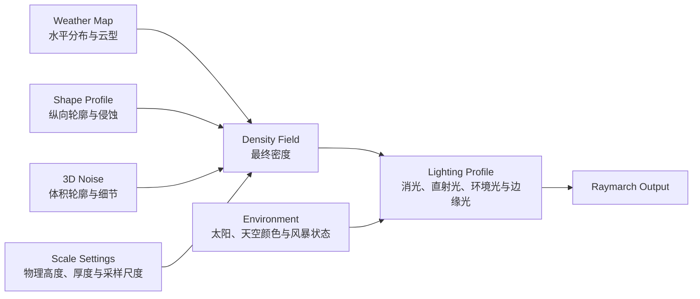

# 体积云暂存方案说明与迁移建议

## 当前合并状态（2026-08-12）

本文最初用于整理暂存方案。当前工作区已经按“能力迁移”完成与远端 `6d8aa0af` 的选择性合并，`stash@{0}` 仍完整保留，未执行 `pop` 或 `drop`。

已合并：

- 512×512 确定性 Weather Map、Seed 和实时 coverage/type 求值；
- 独立 `VolumetricCloudShapeProfile` 及 Shape Settings；
- 独立 `VolumetricCloudLightingProfile`，参数化分档非均匀光学深度、密度消光指数、多重散射、环境光、Powder、视线消光和边缘光；
- `VolumetricCloudSkyRuntime` 的 Weather/Shape/Lighting/Scale/Seed 新 API；
- 时间轴与 Weather Map、风速解耦；
- Lab 中的分布预览、Seed、冻结风场、三层采样尺寸、云层高度/厚度和完整光照调试；
- Engine、Runtime、Demo 和测试统一切换到新 API，不保留旧 API 兼容层。

明确保留远端实现：

- HDRP 风格 Base Noise Atlas；
- 最多六步太阳方向非均匀光学深度积分，带空间 jitter，并复用主视线采样点的 Weather；性能/均衡/高质量分别为 4+0、6+1、6+2（光照步数 + Detail 步数）；
- 多重散射 LUT；
- Direction Cache、Temporal 路径和 GPU Profiler。

合并验证时还修正了暂存实现中的两个所有权/公式错误：

1. `weatherScale` 已定义为“每世界单位重复率”，Shader 不再二次乘 Unity 米制换算常量；
2. Base Erosion 恢复为 `-(1 - lowFrequencyFbm) * baseErosionIntensity`，不再错误使用 `1 - baseErosionIntensity`。

因此下面第 6 节中的旧单采样 Lighting Profile 仅作为暂存历史说明；工作区实际采用第 6.3 节描述的分档光照迁移方案。

## 1. 文档目的

本文整理 `stash@{0}` 中已经完成但尚未合入当前分支的体积云方案，说明它解决的问题、模块职责、数据流、公开 API、调试能力以及与最新远端实现的冲突。

本文记录的快照为：

- Stash：`stash@{0}`
- Stash commit：`aab0e3e39ce913904e1ac62f9a2ed63c1b673d15`
- Stash 基线：`57fd8d53`
- 当前远端基线：`6d8aa0af feat(world): unify and optimize volumetric clouds`

本文不是让后续开发直接执行 `git stash pop`。暂存方案基于旧运行时，而当前工作区已经增加统一 Sky Runtime、分档非均匀光学深度采样、密度消光指数、多重散射 LUT 和 GPU Profiler。后续应按模块迁移能力，不应整包覆盖当前代码。

## 2. 要解决的问题

暂存方案针对以下问题设计：

1. 水平云团分布过于均匀、连续且规则，缺乏大尺度空洞、云带和不同尺度云团。
2. Weather Map、云体纵向形状和光照响应混在同一套 Shader 常数中，修改水平分布时容易连带改变厚度、明暗和云底阴影。
3. 光照与厚度参数写死在 Shader，Demo 无法定位“分布问题”还是“光照问题”。
4. 缺少 Weather Map、Cloud Shape Profile 和实际占用率的可视化诊断。
5. 时间、Weather Map 和风场状态互相耦合，不利于固定分布后单独观察昼夜光照。

核心原则是将体积云拆成互相独立的职责层：



设计约束：

- Weather Map 只决定水平上“哪里有云、是什么云型”。
- Shape Profile 只决定垂直方向和云体内部的形态。
- Lighting Profile 只决定已有密度如何被照亮，不反向修改分布。
- Scale Settings 只决定球壳几何和噪声的世界尺度。
- Demo 只调用公开 API，不直接写 `material.shaderData`。
- 新 API 为唯一 API，不增加旧接口的兼容导出或回退逻辑。

## 3. Weather Map：水平分布层

### 3.1 暂存实现

文件：

`world/engine/overlay/packages/core/src/lighting/volumetricClouds/VolumetricCloudWeatherMap.ts`

暂存方案用一个确定性、可平铺的 512×512 RGBA Weather Map 基础场替换原来的 512×256 三通道 Value Noise。

基础场由两组 3 octave Worley FBM 构成：

| 通道 | 内容              | 基础频率 | 职责             |
| ---- | ----------------- | -------: | ---------------- |
| R    | Large Worley      |       12 | 大尺度云团和空洞 |
| G    | Fine Worley       |       48 | 中小尺度边界扰动 |
| B    | 默认 Top Cloud    |        — | 工具和预览使用   |
| A    | `sqrt(Top Cloud)` |        — | 工具和预览使用   |

关键参数来自 Enviro 3 WeatherTexture 的结构：

- Large/Fine 混合比例：`0.75`
- 云型基础修正：`0.901`
- 水平位置偏移：`0.8`
- Engine coverage `[0, 1]` 转 Enviro coverage `[-1, 1]`
- 默认 Seed：`0`

Shader 中实时解析水平分布，不因 coverage、cloudType 或 detail 改变而重新生成 GPU 纹理：

```text
coverage = normalizedCoverage * 2 - 1
dilatedCoverage = mix(largeWorley, fineWorley, 0.75)
resolvedCoverage = saturate(dilatedCoverage + (1 - dilatedCoverage) * coverage)

typeModifier = clamp(0.901 + (cloudType - 0.5) * 0.902, 0, 1.8)
resolvedType = saturate((sqrt(largeWorley) - 0.1) * 0.65 * typeModifier)
```

`detail` 不改变宏观 Weather Map 拓扑，它进入后续 3D detail erosion。

### 3.2 Seed 与缓存

- 构造函数接受安全整数 Seed。
- Seed 为 `0` 时使用稳定默认分布。
- 默认基础场在 CPU 侧缓存，避免多个 Runtime 重复生成。
- 更换 Seed 会生成一套新的、仍然可平铺的水平拓扑。
- `bake(settings)` 仅用于调试预览和工具输出；运行时 Shader 使用基础场和实时参数求值。

### 3.3 默认天气

Engine 默认参数：

```ts
{
  coverage: 0.46,
  cloudType: 0.5,
  detail: 0.4
}
```

Demo 的 Enviro Cloudy 1 对照值为：

```ts
{
  coverage: enviroToNormalizedCoverage(0.27),
  cloudType: 0.5,
  detail: 0.4
}
```

两组值用途不同：前者是 Engine 通用默认值，后者是 Demo 对 Unity/Enviro 样例的校准值。

## 4. Cloud Shape Profile：云体形态层

### 4.1 独立 Profile 资源

新增文件：

`world/engine/overlay/packages/core/src/lighting/volumetricClouds/VolumetricCloudShapeProfile.ts`

Shape Profile 使用一张 3×1 RGBA 纹理保存三种基础云型的高度梯度：

| Profile      | Bottom Start | Bottom End | Top Start | Top End |
| ------------ | -----------: | ---------: | --------: | ------: |
| Stratus      |         0.00 |       0.07 |      0.08 |    0.15 |
| Cumulus      |         0.00 |       0.20 |      0.42 |    0.60 |
| Cumulonimbus |         0.00 |       0.08 |      0.75 |    0.98 |

Weather Map 给出的 cloud type 在这三个 Profile 之间插值。这样水平分布不再拥有垂直形状的职责。

### 4.2 Shape Settings

| 参数                    | 默认值 | 作用                            |
| ----------------------- | -----: | ------------------------------- |
| `bottomShape`           |  -0.10 | 云底轮廓塑形                    |
| `middleShape`           |  -1.48 | 云体中段塑形                    |
| `topShape`              |  -4.35 | 云顶轮廓塑形                    |
| `rampShape`             |   0.85 | Bottom/Middle/Top 权重过渡      |
| `cloudTypeShaping`      |  0.595 | Profile 对最终形状的影响强度    |
| `baseErosionIntensity`  |  0.067 | 低频基础侵蚀                    |
| `baseNoiseMultiplier`   |   1.10 | 基础 3D Noise 强度              |
| `detailErosionScale`    |   0.50 | Weather detail 到高频侵蚀的映射 |
| `maxDetailErosion`      |   0.50 | 高频侵蚀上限                    |
| `detailNoiseMultiplier` |   1.00 | Detail Noise 强度               |
| `curlIntensity`         |  0.757 | Curl 扰动强度                   |
| `topDensityMultiplier`  |   0.20 | 高层云密度倍率                  |
| `lightErosionMinimum`   |   0.04 | 光密度简化采样的最小侵蚀        |
| `lightErosionMaximum`   |   0.15 | 光密度简化采样的最大侵蚀        |

Shape Settings 通过 `VolumetricCloudMaterial.setShapeProfile()` 写入材质，Shape Profile 纹理通过构造参数传入。

### 4.3 密度组合顺序

暂存方案中的密度计算顺序为：

1. 根据球壳半径计算归一化高度。
2. 采样 Weather Map，获得 coverage、cloud type 和 top cloud。
3. 根据风和高度对采样位置做位移。
4. 采样 Base 3D Noise，得到基础体积轮廓。
5. 采样 Shape Profile，并结合 Bottom/Middle/Top envelope。
6. 用 Weather coverage 对基础轮廓做阈值裁切。
7. 采样 Curl 和 Detail Noise，侵蚀云体边缘。
8. 应用全局 cloud density，得到最终密度。

因此修改 Weather Map 不应直接改变光学响应；修改 Lighting Profile 也不应改变云团占用区域。

## 5. Base Noise：周期性频谱方案

新增文件：

`world/engine/overlay/packages/core/src/lighting/volumetricClouds/VolumetricCloudSpectralNoise.ts`

暂存方案把 Base Noise Atlas 从原有噪声改成确定性的周期性频谱 3D Noise，并使用不同频段生成 RGBA：

- R：主 Shape 频段
- G：Broad 频段
- B：Medium 频段
- A：Fine 频段

目标是降低可识别的重复块和规则团簇，同时维持 Atlas 的周期性和现有 `sampleNoise3D()` 接口。

这一部分与最新远端的 HDRP 风格 Perlin-Worley Atlas 冲突。迁移时不应直接恢复频谱实现，应先固定同一镜头、Weather Map、Shape Profile 和光照做 A/B 对比，再决定 Base Noise 算法。当前建议保留最新远端 Perlin-Worley。

## 6. Lighting Profile：光学响应层

### 6.1 独立 Profile

新增文件：

`world/engine/overlay/packages/core/src/lighting/volumetricClouds/VolumetricCloudLightingProfile.ts`

暂存方案把旧 Shader 中的光照常数完整提取成公开 `VolumetricCloudLightingProfile`：

| 参数                     |            默认值 | 作用                                 |
| ------------------------ | ----------------: | ------------------------------------ |
| `lightSampleDistance`    |        `1.45 / 6` | 单次太阳方向密度采样距离，占厚度比例 |
| `lightOpticalDepthScale` |              1.65 | 光学深度倍率                         |
| `clearLightAbsorption`   |              1.05 | 晴天吸收                             |
| `stormLightAbsorption`   |              1.55 | 风暴吸收                             |
| `bottomShadowStart`      |              0.03 | 云底阴影过渡起点                     |
| `bottomShadowEnd`        |              0.33 | 云底阴影过渡终点                     |
| `ambientFloor`           |              0.19 | 最暗处环境光下限                     |
| `bottomDirectLight`      |              0.46 | 云底直射光权重                       |
| `topDirectLight`         |              0.78 | 云顶直射光权重                       |
| `powderDensityScale`     |              2.20 | Powder 密度响应                      |
| `powderStrength`         |              0.08 | Powder 光照强度                      |
| `lightColorRampStart`    |              0.16 | 阴影到亮色的颜色过渡起点             |
| `lightColorRampEnd`      |              0.92 | 阴影到亮色的颜色过渡终点             |
| `extinctionEdgeStart`    |              0.00 | 低密度消光起点                       |
| `extinctionEdgeEnd`      |             0.045 | 低密度消光终点                       |
| `extinctionScale`        |              0.92 | 总体消光尺度                         |
| `edgeLightIntensity`     |              0.00 | 低密度边缘附加光强度                 |
| `edgeLightColor`         | `[1, 0.82, 0.62]` | 线性 RGB 边缘光颜色                  |

默认 `edgeLightIntensity = 0`，用于保证引入参数化后不主动改变原有光照基线。

### 6.2 暂存光照公式

暂存版本保留的是旧的单次太阳方向密度采样：

```text
lightPosition = position + sunDirection * thickness * lightSampleDistance
opticalDepth = lightDensity(lightPosition) * lightOpticalDepthScale
directLight = exp(-opticalDepth * weatherAbsorption)

lightAmount = ambientFloor
            + directLight * verticalDirectLight
            + powder * powderStrength
```

边缘光只作用于低密度边界：

```text
edgeMask = directLight * (1 - smoothstep(edgeStart, edgeEnd, density))
sampleColor += edgeLightColor * edgeMask * edgeLightIntensity
```

颜色输入遵守以下约定：

- UI 颜色选择器使用 sRGB。
- 写入 Lighting Profile 前转换为线性 RGB。
- Galacean 最终渲染阶段再把线性结果转换到 sRGB。

### 6.3 与最新光照的关系

最新远端已经把单次光照采样升级为：

- 4 个非均匀太阳方向采样点；
- 光学深度积分；
- Dual HG 相位函数；
- 16×8、8 octave 的多重散射 LUT；
- 基于 coarse density 的边缘散射抑制。

因此迁移 `LightingProfile` 时，应参数化最新公式中的常数，而不是恢复暂存版本的单采样 Shader。以下旧字段需要重新映射：

| 暂存字段                                       | 最新算法中的迁移含义                             |
| ---------------------------------------------- | ------------------------------------------------ |
| `lightSampleDistance`                          | 改为太阳方向积分最大距离或距离倍率               |
| `lightOpticalDepthScale`                       | 光学深度/消光倍率                                |
| `clearLightAbsorption`、`stormLightAbsorption` | 晴天基础消光和风暴倍率                           |
| `bottomDirectLight`、`topDirectLight`          | 最新 ambient/direct 合成的高度权重               |
| `powderDensityScale`、`powderStrength`         | 最新 Powder 项的密度响应和能量权重               |
| `extinctionEdgeStart`、`extinctionEdgeEnd`     | `edgeDensity` 的 smoothstep 范围                 |
| `extinctionScale`                              | Raymarch alpha 消光倍率                          |
| `edgeLightIntensity`、`edgeLightColor`         | 最新 directional scattering 上的低密度边缘附加项 |

## 7. Scale Settings：物理层与分布尺寸

`VolumetricCloudScaleSettings` 暴露：

| 参数           | 默认值 | 作用                          |
| -------------- | -----: | ----------------------------- |
| `planetRadius` |    100 | 地面球半径                    |
| `baseAltitude` |      4 | 云底绝对高度                  |
| `thickness`    |      6 | 云层物理厚度                  |
| `weatherScale` |   0.04 | Weather Map 世界采样频率      |
| `shapeScale`   |  0.055 | Base Shape Noise 世界采样频率 |
| `detailScale`  | 0.0275 | Detail Noise 世界采样频率     |

Demo 不直接编辑频率，而是提供更直观的尺寸倍率：

```text
weatherScale = baseWeatherScale / weatherSize
shapeScale   = baseShapeScale / shapeSize
detailScale  = baseDetailScale / detailSize
```

这样数值越大表示云团或噪声结构越大。修改尺寸时必须保留当前 `baseAltitude` 和 `thickness`，避免分布调试意外覆盖厚度调试结果。

## 8. 暂存公开 API

暂存设计中的目标 API 如下。它描述的是 stash 方案，不代表当前 `HEAD` 已经全部具备这些方法：

```ts
const material = new VolumetricCloudMaterial(engine, {
  weatherMap,
  shapeProfile,
  baseNoise,
  detailNoise,
  curlNoise,
  blueNoise,
  noiseProfile
});

material.setWeatherSettings({ coverage, cloudType, detail });
material.setWeatherMapProfile(weatherMapProfile);
material.setShapeProfile(shapeSettings);
material.setLightingProfile(lightingProfile);
material.setScaleSettings({
  planetRadius,
  baseAltitude,
  thickness,
  weatherScale,
  shapeScale,
  detailScale
});
```

API 约束：

- `setShapeProfile()`、`setLightingProfile()` 在接受数据时校验数值范围并复制状态。
- Getter 返回脱离内部状态的副本。
- `edgeLightColor` 必须是包含三个有限非负数的线性 RGB tuple。
- Clone 必须复制 Weather、Shape、Lighting、Scale 以及对应纹理。
- 改变影响历史结果的参数后必须使 temporal/direction-cache history 失效。
- 不提供旧 API 兼容层；所有调用方一次性迁移到新 API。

曾出现的 `materialLighting.edgeLightColor is not iterable` 是 Profile 数据结构与调用方版本不一致造成的。正式迁移必须让默认 Profile、Runtime 状态、UI 和测试在同一个提交中切换，不能只更新接口的一侧。

## 9. Demo 调试方案

新增诊断文件：

`world/gallery/demos/volumetric-clouds/src/VolumetricCloudDistributionDebug.ts`

### 9.1 分布诊断

面板提供：

- Coverage 通道预览；
- Cloud Type 通道预览；
- Top Cloud 通道预览；
- Large Worley 基础场预览；
- Fine Worley 基础场预览；
- Shape Profile 曲线预览；
- 当前通道平均值；
- 云覆盖占用率；
- 平均 Cloud Type；
- 当前 Seed；
- Weather、Shape、Detail 尺寸倍率；
- 冻结/恢复风场；
- 恢复默认分布。

诊断器必须调用 Engine 的 `field.bake(settings)` 和 `evaluateVolumetricCloudShapeProfile()`，不能在 Demo 内复制 Worley 或密度算法。这样预览与实际 Engine 数据源一致。

### 9.2 光照与厚度调试

面板暴露：

- `baseAltitude`；
- `thickness`；
- Lighting Profile 的全部标量；
- `edgeLightColor` sRGB 颜色选择器；
- 一键恢复光照和厚度基线。

UI 只能调用 `setLightingProfile()` 和 `setScaleSettings()`，禁止直接操作 Shader uniform。

### 9.3 时间与天气解耦

暂存 Demo 中：

- 昼夜 Timeline 只改变时间、太阳方向和天空/云光照 Palette；
- Weather Map 的 coverage、cloudType、detail 由独立控制项维护；
- 暂停、拖动和恢复 Timeline 不改 Weather Map；
- 修改 Weather Map 或风速不自动暂停时间；
- 冻结风场只冻结云场位移，不冻结太阳运动。

这样可以固定同一云团拓扑，对比早晨、正午、黄昏和夜晚的光照。

## 10. 测试契约

暂存测试覆盖以下约束：

1. Demo 使用 Engine 公共体积云实现，不维护本地 Material/Weather Map 副本。
2. 时间 Timeline 不写入 Weather coverage/type/detail。
3. Weather Map 使用基础场一次上传，天气变化不重复上传纹理。
4. Shape Profile 由 Engine 类型创建并上传。
5. 光照和厚度通过公开 API 修改，Demo 不访问 `shaderData`。
6. Edge Light 颜色执行 sRGB → Linear 转换。
7. 分布诊断调用 Engine 的实际 Weather/Shape evaluator，不复制算法。
8. Seed、冻结风场、三个尺寸倍率和恢复默认值均有 UI 合约。
9. 改变分布、形态、光照或尺度后使历史缓存失效。
10. Clone 后的 Profile 和颜色数组与原材质状态互不引用。

## 11. Stash 文件清单

### 11.1 已跟踪修改

- `VolumetricCloudMaterial.ts`
- `VolumetricCloudNoiseAtlas.ts`
- `VolumetricCloudWeatherMap.ts`
- `volumetricClouds/index.ts`
- `VolumetricCloud.test.ts`
- `TerrainEnvironmentArchitecture.spec.ts`
- `TerrainVolumetricCloudRuntime.ts`
- `volumetric-clouds/index.html`
- `volumetric-clouds/main.ts`
- `volumetric-clouds/styles.css`
- `VolumetricCloudContract.spec.ts`
- `world/gallery/package.json`

### 11.2 Stash 中的未跟踪新文件

以下文件保存在 `stash@{0}^3`：

- `VolumetricCloudLightingProfile.ts`
- `VolumetricCloudShapeProfile.ts`
- `VolumetricCloudSpectralNoise.ts`
- `VolumetricCloudDistributionDebug.ts`
- 独立 `world/gallery/demos/sky/terrain` Demo 和资源
- `world/gallery/tsconfig.sky-terrain.json`

独立 Sky/Terrain Demo 不属于本次体积云核心方案，迁移时应单独评估。

## 12. 与最新远端的迁移矩阵

| 暂存内容                         | 处理方式       | 原因                                                   |
| -------------------------------- | -------------- | ------------------------------------------------------ |
| Enviro Worley Weather Map        | 移植           | 最新 Weather Map 仍是较规则的 Value Noise              |
| Weather Seed 和默认缓存          | 移植           | 有利于调试、复现和减少重复生成                         |
| Shape Profile 纹理和设置         | 移植           | 可消除 Shape Shader 硬编码，职责清晰                   |
| Lighting Profile 数据结构        | 重写后移植     | 应参数化最新六步光照、密度响应和多重散射，不恢复旧公式 |
| Edge Light 参数                  | 适配后移植     | 接入最新 directional scattering，避免简单加色造成发平  |
| 厚度和分布尺寸 UI                | 移植           | 当前 Engine 已有 Scale API，但 Demo 未完整暴露         |
| 分布预览和统计                   | 移植           | 诊断水平分布是否规则所必需                             |
| 时间与 Weather 解耦              | 按产品语义恢复 | 最新 Shared Runtime 当前会让时间同时插值 Weather       |
| 周期性频谱 Base Noise            | 暂不移植       | 与最新 HDRP Perlin-Worley 冲突，需独立 A/B             |
| 旧单次光照 Shader                | 舍弃           | 最新六步光学深度、Detail 遮蔽和多重散射更完整          |
| 旧 TerrainVolumetricCloudRuntime | 舍弃           | 最新远端已统一为 `VolumetricCloudSkyRuntime`           |
| Demo 私有噪声资源路径            | 舍弃           | 最新资源已归属 `world/gallery/shared/lighting`         |
| 旧 Direction Cache 文件版本      | 舍弃           | 会回退最新 HDR、历史和调度优化                         |

## 13. 推荐迁移顺序

1. 在 Engine 层恢复 `VolumetricCloudShapeProfile` 和重新设计后的 `VolumetricCloudLightingProfile`。
2. 用 Enviro Worley Weather Map 替换当前通用 Value Noise Weather Map，并补充 Seed、缓存和单元测试。
3. 保留最新 HDRP Perlin-Worley Base Noise、多重散射 LUT、六步光照和 Direction Cache。
4. 将当前 Shader 的 Shape 和 Lighting 常数接入 Profile uniform，两个渲染路径必须同步修改。
5. 在最新 `VolumetricCloudSkyRuntime` 上新增 Shape、Lighting、Seed 和完整 Scale API。
6. 把独立 Demo 和 Integrated World 的调用方全部切换到新 API，不增加兼容层。
7. 移植分布、厚度和光照调试面板。
8. 固定同一镜头、Seed、时间和 Weather 参数做视觉回归。
9. 使用最新 GPU Profiler 对 Weather、Shape 和 Lighting 迁移前后分别测量。

## 14. 验收标准

### 分布

- 水平分布存在清晰的大尺度空洞、云带和疏密变化。
- 近景和远景不出现明显棋盘、等距柱状或重复条纹。
- 相同 Seed 产生完全一致的分布。
- Weather Map 边界可平铺，不出现接缝。

### 形态

- Stratus、Cumulus、Cumulonimbus 的高度轮廓可独立验证。
- Weather coverage 改变时不意外改变云层厚度。
- 修改 Shape Profile 不改变太阳和天空光照参数。

### 光照

- 云底有稳定、连续的阴影层次。
- 迎光面、背光面和内部透光差异明显，不整体发灰或发平。
- 多重散射可以关闭或调低进行性能/效果对照，但默认保留最新实现。
- Edge Light 强度为 0 时严格回到无边缘附加光基线。
- Edge Light 颜色遵守 sRGB 输入、Linear 计算的颜色空间约定。

### 架构

- Engine 拥有 Weather、Shape、Lighting 算法和参数校验。
- Shared Runtime 拥有 GPU 资源和跨 Demo 状态。
- Demo 只负责交互与诊断。
- 不存在 Shader 常数的 Demo 补丁、旧 API 兼容层或重复 Runtime。

### 性能

- 默认 Seed 的 Weather basis 只生成一次并复用缓存。
- Weather 参数变化不触发 Weather Map GPU 纹理重建。
- Profile 参数变化只更新 uniform 并使必要的历史缓存失效。
- 使用最新 GPU timer 分别记录 steady state 和 invalidation burst。

## 15. 已知风险

1. 512×512、两组 3 octave Worley 的 CPU 首次生成成本高于当前 512×256 Value Noise；非默认 Seed 仍可能造成主线程停顿。
2. 暂存的频谱 Base Noise 未与最新 HDRP Perlin-Worley 做受控 A/B，不能仅凭单张截图判断替换。
3. 直接把旧 Edge Light 加到最新多重散射结果上可能导致云体发白、亮暗面变平，必须基于低密度、光学深度和方向散射共同限制。
4. 最新 Shared Runtime 把时间与天气预设绑定；恢复解耦会改变公共 Timeline 语义，需要同时更新调用方和测试。
5. 当前运行时已收口为单一方向缓存路径；后续消费者仍应复用同一 Material 的 Shape 与 Lighting 状态，避免重新形成双源。
6. Profile API 是有意的不兼容更新，默认值、Runtime、Demo、测试必须原子迁移。

## 16. 结论

暂存方案最有价值的部分不是某一组调参，而是职责拆分：

- Weather Map 管水平分布；
- Shape Profile 管云体形态；
- Lighting Profile 管光学响应；
- Scale Settings 管物理高度、厚度和采样尺度；
- 调试面板使用 Engine 的真实 evaluator 观察这些层。

后续应把这套职责模型迁移到最新统一 Runtime 和最新光照算法上。需要保留的是 Weather Map、Profile 架构、公开参数和诊断能力，而不是暂存中的旧 Runtime、旧单次光照公式或整个旧 Material 文件。
